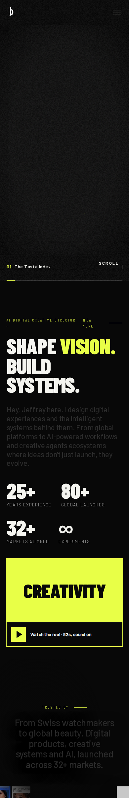

# UI Design System & Master Generation Blueprint: www-blumjeffrey-com

> **Jeffrey Blum — AI Digital Creative Director** (https://www.blumjeffrey.com) — Jeffrey Blum is a New York-based AI Digital Creative Director building creative systems, intelligent workflows, brand platforms, and digi...


---

## 1. Executive Visual Persona & Design Archetype

- **Brand Essence & Persona**: **Jeffrey Blum — AI Digital Creative Director** (`https://www.blumjeffrey.com`). Jeffrey Blum is a New York-based AI Digital Creative Director building creative systems, intelligent workflows, brand platforms, and digi...
- **Visual Archetype**: **High-Contrast Obsidian / Atmospheric Design System (`#080808` canvas, `#555` ink, `#1e1e1e` accent)**.
- **Anti-AI-Slop Differentiators**:
  - **Source-Grounded Chromatic Polarity**: Anchors the viewport in `#080808` (`var(--black)` in `:root`) paired with `#555` primary typography and `#1e1e1e` accents.
  - **Extracted Typographic Hierarchy**: Pairs `Barlow` for display copy (`Shape vision. Build systems.`) with `Barlow Fallback` and not declared in static CSS (uses primary stack / `ui-monospace`).
  - **Calibrated Spatial Grid & Motion**: Combines `56%` container bounds (`gap: 14px`, padding `18px`) with `cubic-bezier(.16,1,.3,1)` easing and Lenis Smooth Scroll (`data-lenis`), GSAP Timeline & ScrollTrigger.

---

## 2. Spatial Architecture & Modular Grid Mathematics



### Viewport Allocation & Container Geometry
- **Captured Viewport Dimensions**: Desktop `1440×20402px` (`assets/desktop.png`, full-page scroll capture), Mobile `390×2400px` (`assets/mobile.png`, capped at 2400px multi-section capture).
- **Master Container Bounds**: `56%` extracted from `www-blumjeffrey-com` stylesheet.
- **Canvas Lateral Padding & Spacing**: `18px` lateral canvas padding with `14px` grid gap.
- **Border Radius Scale**: `50%`, `0px`.

### Responsive Breakpoint Architecture
- **Desktop Layout**: Multi-column CSS Grid / Flexbox layout at `1440px` (`max-width: 56%`, `gap: 14px`).
- **Mobile Layout**: Single-column vertical stack at `390px` viewport width with `18px` horizontal padding.
- **Extracted CSS Media Queries**: `@media (max-width:760px)`, `@media (prefers-reduced-motion:reduce)`, `@media (min-width:761px)`, `@media (min-width:761px) and (prefers-reduced-motion:no-preference)`.

---

## 3. Color System, Materiality & Atmospheric Lighting

### Semantic Palette & Source Grounding
| Semantic Role | Ground-Truth Value | Extracted CSS Source / Selector |
|---|---|---|
| **Primary Canvas Substrate** | `#080808` | `var(--black)` in `:root` |
| **Primary Typography Ink** | `#0f0f0f` | `var(--off-black)` in `:root` |
| **Elevated Surface / Card Substrate** | `#141414` | `var(--dark)` in `:root` |
| **Interactive Accent / Highlight** | `#1e1e1e` | `var(--mid)` in `:root` |
| **Secondary / Muted Copy** | `#2a2a2a` | `var(--border)` in `:root` |
| **Structural Hairline Border** | `#555` | `var(--muted)` in `:root` |

### Sanitized Root CSS Variables (`ui-ux.md` Ground Truth)
| Variable Name | Extracted Value | Semantic Role |
|---|---|---|
| `--motion-instant` | `.12s` | Motion / Easing Token |
| `--motion-fast` | `.2s` | Motion / Easing Token |
| `--motion-medium` | `.3s` | Motion / Easing Token |
| `--motion-slow` | `.4s` | Motion / Easing Token |
| `--motion-reveal` | `.8s` | Motion / Easing Token |
| `--motion-hero` | `.9s` | Motion / Easing Token |
| `--motion-counter` | `1.1s` | Motion / Easing Token |
| `--motion-marquee` | `28s` | Motion / Easing Token |
| `--ease-standard` | `ease` | Motion / Easing Token |
| `--ease-linear` | `linear` | Motion / Easing Token |
| `--ease-pulse` | `ease-in-out` | Motion / Easing Token |
| `--ease-expressive` | `cubic-bezier(.16,1,.3,1)` | Motion / Easing Token |
| `--motion-shift-xs` | `4px` | Motion / Easing Token |
| `--motion-shift-sm` | `8px` | Motion / Easing Token |
| `--motion-shift-md` | `20px` | Motion / Easing Token |
| `--motion-shift-lg` | `32px` | Motion / Easing Token |

---

## 4. Typographic Scale & Editorial Hierarchy

### Font Family Stacks
- **Display Typography**: `Barlow`.
- **Primary Body Stack**: `Barlow Fallback`.
- **Technical / Metadata Stack**: not declared in static CSS (uses primary stack / `ui-monospace`).

### Typographic Scale & Rules (Extracted from Stylesheet & Variables)
- **Hero Display (`H1`)**: rule `h1` (`font-size: clamp(64px,9.6vw,180px)`).
- **Section Heading (`H2`)**: rule `h2` (`font-size: clamp(64px,9vw,170px)`).
- **Body Copy**: rule `p` (`letter-spacing: .22em`).
- **Metadata & Navigation Labels**: rule `small` (`font-size: .6rem`, `letter-spacing: .22em`, `font-weight: 600`).

---

## 5. Choreographed Motion & Interaction Physics

### Primary Easing Curves
- **Extracted Timing Functions**: `cubic-bezier(.16,1,.3,1)`.

### Per-Element Transition & Choreography Rules
- **Selector `.home-v2 .btn-o`**: `transition: color var(--motion-medium)var(--ease)` extracted from `www-blumjeffrey-com` stylesheet.
- **Selector `.home-v2 .btn-o:before`**: `transition: transform var(--motion-slow)var(--ease)` extracted from `www-blumjeffrey-com` stylesheet.
- **Selector `.home-v2 .w`**: `transition: none` extracted from `www-blumjeffrey-com` stylesheet.
- **Extracted Easing Curve (`cubic-bezier(.16,1,.3,1)`)**: Governs interactive state transitions across `<header.cs-hero>` and `<section.home-v2>`.
- **Runtime Interaction Engine**: Integrates Lenis Smooth Scroll (`data-lenis`), GSAP Timeline & ScrollTrigger with `prefers-reduced-motion: reduce` fallback guards.

---

## 6. Component Wireframe & Structural DOM Map

### Visual Layout Schematic (Grounded in `dom.html` — `1440px` Desktop & `390px` Mobile Reflow)
```
┌────────────────────────────────────────────────────────────────────────┐
│ DESKTOP VIEWPORT (1440px) — Jeffrey Blum — AI Digital Creative Directo │
│ ====================================================================== │
│ [ <header.cs-hero>         | Work · Lab · Speaking · About · Contac ]  │
│ ---------------------------------------------------------------------- │
│ | HERO STAGE: <section.home>                                       |   │
│ | H1: Shape vision. Build systems.                                 |   │
│ | Substrate: #080808    | Ink: #555       | Accent: #1e1e1e        |   │
│ ---------------------------------------------------------------------- │
│ | SHOWCASE GRID (<section.home-v2>         ) max-w: 56%            |   │
│ | +------------------------------+  +------------------------------+ | │
│ | | Recent projects              |  | M·A·C Design System          | | │
│ | +------------------------------+  +------------------------------+ | │
│ ---------------------------------------------------------------------- │
│ | MOBILE VIEWPORT REFLOW (390px) — Single-Column Stack (gap: 14px  ) | │
│ | [<header.cs-hero>] -> [<section.home>] -> [<section.home-v2>] |      │
│ ---------------------------------------------------------------------- │
│ [ FOOTER (<footer.ft>           ) | https://www.blumjeffrey.com        │
└────────────────────────────────────────────────────────────────────────┘
```

### Granular DOM Region Breakdown
1. **Brand Header & Navigation Bar (<header.cs-hero> — `www-blumjeffrey-com`)**:
   - Landmark `<header class="cs-hero">` hosting `Jeffrey Blum — AI Digital Creative D` navigation (`Work · Lab · Speaking · About · Contact`), DOM attributes (`data-precedence="next"`, `data-precedence="next"`, `data-precedence="next"`, `data-motion="gsap"`), and stylesheet rule `services { overflow-x:clip }`.
2. **Hero Stage & Focal Lead (<section.home> — `Shape vision. Build systems.`)**:
   - Landmark `<section class="home">` presenting display lead `Shape vision. Build systems.` and copy excerpt *"Module / What's New"* over `#080808` canvas and `#555` ink.
3. **Primary Showcase & Content Grid (<section.home-v2> — `Recent projects`)**:
   - Landmark `<section class="home-v2">` rendering section `Recent projects` with copy *"Regular Upper case"*, asset references (`235a0ef330592118-s.p.b3cd1641.woff2`, `303804218d80822e-s.p.9b40bd6c.woff2`, `4f530f52d514af96-s.p.52297690.woff2`, `81cef6a21128489e-s.p.6cf41120.woff2`), and grid rule `after { box-sizing:border-box;border-radius:0;margin:0;padding:0 }`.
4. **Interactive Detail & Feature Matrix (<section.clients-scene> — `M·A·C Design System`)**:
   - Landmark `<section class="clients-scene">` framing `M·A·C Design System` and `AI Creative Agents` (*"01 M·A·C Figma Design System"*) with `#141414` surface cards, `#1e1e1e` accents, and `.home-v2 img { max-width:100% }`.
5. **Colophon & Global Directory Footer (<footer.ft> — `https://www.blumjeffrey.com`)**:
   - Landmark `<footer class="ft fixed">` anchoring `Jeffrey Blum — AI Digital Creati` footer links (`Work · Lab · Speaking · About · Contact`), copy *"M·A·C Figma Design System"*, and `#555` structural dividers.

---

## 7. Master Zero-Shot AI Generation Prompt

```markdown
# Master Zero-Shot Frontend Generation Prompt: www-blumjeffrey-com (Jeffrey Blum — AI Digital Creative Director)

You are a principal frontend architect and design systems engineer. Build a complete, production-ready web application replicating the exact design system, DOM landmarks, typographic hierarchy, color tokens, and motion physics of `www-blumjeffrey-com` (**Jeffrey Blum — AI Digital Creative Director** — `https://www.blumjeffrey.com`).

### 1. Visual Archetype & Anti-AI-Slop Mandates
- **Archetype**: High-Contrast Obsidian / Atmospheric Design System (`#080808` canvas, `#555` ink, `#1e1e1e` accent).
- **Identity & Domain Context**: Jeffrey Blum is a New York-based AI Digital Creative Director building creative systems, intelligent workflows, brand platforms, and digi...
- **Primary Substrate**: `#080808` (`var(--black)` in `:root`), **Primary Ink**: `#555`, **Accent / Highlight**: `#1e1e1e`.
- **Site-Specific Differentiators**:
  - **Source-Grounded Chromatic Polarity**: Anchors the viewport in `#080808` (`var(--black)` in `:root`) paired with `#555` primary typography and `#1e1e1e` accents.
  - **Extracted Typographic Hierarchy**: Pairs `Barlow` for display copy (`Shape vision. Build systems.`) with `Barlow Fallback` and not declared in static CSS (uses primary stack / `ui-monospace`).
  - **Calibrated Spatial Grid & Motion**: Combines `56%` container bounds (`gap: 14px`, padding `18px`) with `cubic-bezier(.16,1,.3,1)` easing and Lenis Smooth Scroll (`data-lenis`), GSAP Timeline & ScrollTrigger.

### 2. Ground-Truth CSS Variables (`:root` Token Contract)
Declare and consume these exact custom properties extracted from `www-blumjeffrey-com` in your global stylesheet:

:root {
  /* Jeffrey Blum — AI Digital Creative Director (www-blumjeffrey-com) — Ground-Truth Extracted CSS Variables */
  --motion-instant: .12s; /* Motion / Easing Token (www-blumjeffrey-com) */
  --motion-fast: .2s; /* Motion / Easing Token (www-blumjeffrey-com) */
  --motion-medium: .3s; /* Motion / Easing Token (www-blumjeffrey-com) */
  --motion-slow: .4s; /* Motion / Easing Token (www-blumjeffrey-com) */
  --motion-reveal: .8s; /* Motion / Easing Token (www-blumjeffrey-com) */
  --motion-hero: .9s; /* Motion / Easing Token (www-blumjeffrey-com) */
  --motion-counter: 1.1s; /* Motion / Easing Token (www-blumjeffrey-com) */
  --motion-marquee: 28s; /* Motion / Easing Token (www-blumjeffrey-com) */
  --ease-standard: ease; /* Motion / Easing Token (www-blumjeffrey-com) */
  --ease-linear: linear; /* Motion / Easing Token (www-blumjeffrey-com) */
  --ease-pulse: ease-in-out; /* Motion / Easing Token (www-blumjeffrey-com) */
  --ease-expressive: cubic-bezier(.16,1,.3,1); /* Motion / Easing Token (www-blumjeffrey-com) */
  --motion-shift-xs: 4px; /* Motion / Easing Token (www-blumjeffrey-com) */
  --motion-shift-sm: 8px; /* Motion / Easing Token (www-blumjeffrey-com) */
  --motion-shift-md: 20px; /* Motion / Easing Token (www-blumjeffrey-com) */
  --motion-shift-lg: 32px; /* Motion / Easing Token (www-blumjeffrey-com) */
}

### 3. Semantic Color & Materiality Contract
Map every surface, ink, and border strictly to these source-grounded tokens:
- **Primary Canvas Substrate**: `#080808` — grounded in `var(--black)` in `:root`
- **Primary Typography Ink**: `#0f0f0f` — grounded in `var(--off-black)` in `:root`
- **Elevated Surface / Card Substrate**: `#141414` — grounded in `var(--dark)` in `:root`
- **Interactive Accent / Highlight**: `#1e1e1e` — grounded in `var(--mid)` in `:root`
- **Secondary / Muted Copy**: `#2a2a2a` — grounded in `var(--border)` in `:root`
- **Structural Hairline Border**: `#555` — grounded in `var(--muted)` in `:root`

### 4. Spatial Grid, Container Bounds & Responsive Breakpoints
- **Desktop Viewport Reference**: `1440×20402px` (full-page scroll capture, `1440px` standard desktop width).
- **Mobile Viewport Reference**: `390×2400px` (capped at 2400px multi-section capture, `390px` standard mobile width).
- **Container Max-Width**: `56%` extracted from `www-blumjeffrey-com` stylesheet
- **Padding & Gutters**: `18px` lateral canvas padding with `14px` grid gap
- **Desktop Grid**: Multi-column CSS Grid / Flexbox layout at `1440px` (`max-width: 56%`, `gap: 14px`)
- **Mobile Adaptation**: Single-column vertical stack at `390px` viewport width with `18px` horizontal padding
- **Media Queries**: `@media (max-width:760px)`, `@media (prefers-reduced-motion:reduce)`, `@media (min-width:761px)`, `@media (min-width:761px) and (prefers-reduced-motion:no-preference)`
- **Corner Radii**: `50%`, `0px`

### 5. Typography & Editorial Scale Contract
- **Display Font Stack**: `Barlow`
- **Body Font Stack**: `Barlow Fallback`
- **Monospace / Technical Font Stack**: not declared in static CSS (uses primary stack / `ui-monospace`)
- **H1 Display Rule**: rule `h1` (`font-size: clamp(64px,9.6vw,180px)`)
- **H2 Section Rule**: rule `h2` (`font-size: clamp(64px,9vw,170px)`)
- **Body Copy Rule**: rule `p` (`letter-spacing: .22em`)
- **Metadata & Index Rule**: rule `small` (`font-size: .6rem`, `letter-spacing: .22em`, `font-weight: 600`)

### 6. Component Hierarchy, Verbatim Copy & Real DOM Landmarks
Scaffold `www-blumjeffrey-com` (`Jeffrey Blum — AI Digital Creative Director`) with these exact structural regions, extracted copy, and CSS rules from `dom.html`:
1. **Brand Header & Navigation Bar (<header.cs-hero> — `www-blumjeffrey-com`)**:
   - DOM & Selectors: Landmark `<header class="cs-hero">` hosting `Jeffrey Blum — AI Digital Creative D` navigation (`Work · Lab · Speaking · About · Contact`), DOM attributes (`data-precedence="next"`, `data-precedence="next"`, `data-precedence="next"`, `data-motion="gsap"`), and stylesheet rule `services { overflow-x:clip }`.
   - Responsive Contract: Header `Brand Header & Navigation Bar (<header.cs-hero> — `www-blumjeffrey-com`)` (`www-blumjeffrey-com`) adapts across `@media (max-width:760px)`, `@media (prefers-reduced-motion:reduce)`, `@media (min-width:761px)`, `@media (min-width:761px) and (prefers-reduced-motion:no-preference)` with `cubic-bezier(.16,1,.3,1)` transitions and links `Work · Lab · Speaking · About · Contact`.
2. **Hero Stage & Focal Lead (<section.home> — `Shape vision. Build systems.`)**:
   - DOM & Selectors: Landmark `<section class="home">` presenting display lead `Shape vision. Build systems.` and copy excerpt *"Module / What's New"* over `#080808` canvas and `#555` ink.
   - Responsive Contract: Hero stage (`1440×20402px` desktop / `390×2400px` mobile) sets `#080808` background with `#555` headline `Shape vision. Build systems.`.
3. **Primary Showcase & Content Grid (<section.home-v2> — `Recent projects`)**:
   - DOM & Selectors: Landmark `<section class="home-v2">` rendering section `Recent projects` with copy *"Regular Upper case"*, asset references (`235a0ef330592118-s.p.b3cd1641.woff2`, `303804218d80822e-s.p.9b40bd6c.woff2`, `4f530f52d514af96-s.p.52297690.woff2`, `81cef6a21128489e-s.p.6cf41120.woff2`), and grid rule `after { box-sizing:border-box;border-radius:0;margin:0;padding:0 }`.
   - Responsive Contract: Showcase grid `Primary Showcase & Content Grid (<section.home-v2> — `Recent projects`)` applies Multi-column CSS Grid / Flexbox layout at `1440px` (`max-width: 56%`, `gap: 14px`) on desktop and Single-column vertical stack at `390px` viewport width with `18px` horizontal padding on mobile.
4. **Interactive Detail & Feature Matrix (<section.clients-scene> — `M·A·C Design System`)**:
   - DOM & Selectors: Landmark `<section class="clients-scene">` framing `M·A·C Design System` and `AI Creative Agents` (*"01 M·A·C Figma Design System"*) with `#141414` surface cards, `#1e1e1e` accents, and `.home-v2 img { max-width:100% }`.
   - Responsive Contract: Detail module `Interactive Detail & Feature Matrix (<section.clients-scene> — `M·A·C Design System`)` uses `50%`, `0px` radii, `#1e1e1e` highlights, and assets (235a0ef330592118-s.p.b3cd1641.woff2, 303804218d80822e-s.p.9b40bd6c.woff2, 4f530f52d514af96-s.p.52297690.woff2).
5. **Colophon & Global Directory Footer (<footer.ft> — `https://www.blumjeffrey.com`)**:
   - DOM & Selectors: Landmark `<footer class="ft fixed">` anchoring `Jeffrey Blum — AI Digital Creati` footer links (`Work · Lab · Speaking · About · Contact`), copy *"M·A·C Figma Design System"*, and `#555` structural dividers.
   - Responsive Contract: Footer `Colophon & Global Directory Footer (<footer.ft> — `https://www.blumjeffrey.com`)` aligns to `56%` extracted from `www-blumjeffrey-com` stylesheet with `18px` lateral canvas padding with `14px` grid gap and attributes (data-precedence="next", data-precedence="next", data-precedence="next").

#### Verbatim DOM Copy Excerpts (`dom.html`)
- Copy Excerpt 1: *"Module / What's New"*
- Copy Excerpt 2: *"Regular Upper case"*
- Copy Excerpt 3: *"01 M·A·C Figma Design System"*
- Copy Excerpt 4: *"M·A·C Figma Design System"*

### 7. Motion, Extracted Stylesheet Rules & Interaction Choreography
- **Primary Easing Functions**: `cubic-bezier(.16,1,.3,1)`
- **Extracted Stylesheet Rules (`www-blumjeffrey-com`)**:
- `services { overflow-x:clip }`
- `after { box-sizing:border-box;border-radius:0;margin:0;padding:0 }`
- `.home-v2 img { max-width:100% }`
- `.home-v2 .im1 { background-image:url(/home/cases/case-1.webp) }`
- `.home-v2 .im2 { background-image:var(--case-2,none) }`
- **Per-Selector Transition Rules**:
- **Selector `.home-v2 .btn-o`**: `transition: color var(--motion-medium)var(--ease)` extracted from `www-blumjeffrey-com` stylesheet.
- **Selector `.home-v2 .btn-o:before`**: `transition: transform var(--motion-slow)var(--ease)` extracted from `www-blumjeffrey-com` stylesheet.
- **Selector `.home-v2 .w`**: `transition: none` extracted from `www-blumjeffrey-com` stylesheet.
- **Extracted Easing Curve (`cubic-bezier(.16,1,.3,1)`)**: Governs interactive state transitions across `<header.cs-hero>` and `<section.home-v2>`.
- **Runtime Interaction Engine**: Integrates Lenis Smooth Scroll (`data-lenis`), GSAP Timeline & ScrollTrigger with `prefers-reduced-motion: reduce` fallback guards.

### 8. Technical Deliverables
- Implement in Next.js (App Router) with TypeScript and Tailwind CSS consuming the `:root` custom properties defined above for `www-blumjeffrey-com`.
- Reproduce both the `1440px` desktop architecture and `390px` mobile breakpoint transitions, preserving semantic HTML5 landmarks (`<header>`, `<nav>`, `<main>`, `<section>`, `<footer>`) and `prefers-reduced-motion` accessibility guards.
```
