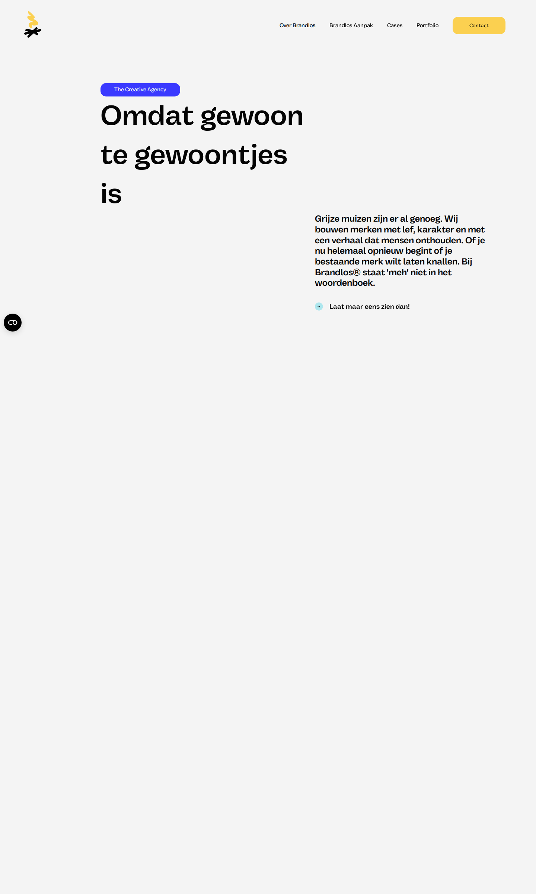
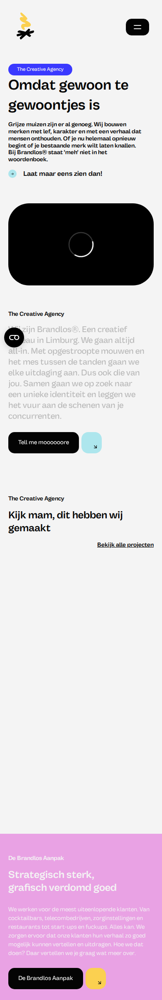

# UI Design System & Master Generation Blueprint: www-brandlos-nl

> **Brandlos · Het creatieve bureau van Limburg** (https://www.brandlos.nl) — Creatief bureau in Limburg. Wij bouwen merken met lef en karakter: van strategie en identiteit tot campagnes die opvallen. Geen grijze mu...



---

## 1. Executive Visual Persona & Design Archetype

- **Brand Essence & Persona**: **Brandlos · Het creatieve bureau van Limburg** (`https://www.brandlos.nl`). Creatief bureau in Limburg. Wij bouwen merken met lef en karakter: van strategie en identiteit tot campagnes die opvallen. Geen grijze mu...
- **Capture Provenance**: Live browser capture (`tier1_fast`, HTTP `200`, captured `2026-11-23`).
- **Visual Archetype**: **Light-Substrate Editorial & Modular Grid System (`#f4f4f4` canvas, `#040404` ink, `#0082f3` accent)**.
- **Anti-AI-Slop Differentiators**:
  - **Live-Computed Chromatic Polarity**: Anchors the viewport in `#f4f4f4` (live computed `body` `background-color` (`computed_styles.json`)) paired with `#040404` primary typography and `#0082f3` accents.
  - **Grounded Typographic Hierarchy**: Pairs `Vastagogrotesk` for display copy (`Omdat gewoon te gewoontjes is`) with `Vastagogrotesk` and not declared in live computed styles (uses primary stack / `ui-monospace`).
  - **Calibrated Spatial Grid & Motion**: Combines `1190px` container bounds (`gap: 16px`, padding `9px`) with `cubic-bezier(0.22,1,0.36,1)` easing and GSAP Timeline & ScrollTrigger, Swiper Touch Carousel Engine.

---

## 2. Spatial Architecture & Modular Grid Mathematics



### Viewport Allocation & Container Geometry
- **Captured Viewport Dimensions**: Desktop `1440×2400px` (`assets/desktop.png`, clamped at 2400px live multi-section capture), Mobile `390×2400px` (`assets/mobile.png`, clamped at 2400px live multi-section capture).
- **Master Container Bounds**: `1190px` (non-`@media` desktop container stylesheet rule).
- **Canvas Lateral Padding & Spacing**: `9px` lateral canvas padding with `16px` grid gap.
- **Border Radius Scale**: `3px`, `100%`, `50%`, `15px`.

### Responsive Breakpoint Architecture
- **Desktop Layout**: Multi-column CSS Grid / Flexbox layout at `1440px` (`max-width: 1190px`, `gap: 16px`).
- **Mobile Layout**: Single-column vertical stack at `390px` viewport width with `9px` horizontal padding.
- **Extracted CSS Media Queries**: `@media screen and (max-width: 991px)`, `@media screen and (max-width: 767px)`, `@media screen and (max-width: 479px)`, `@media (min-width: 768px)`.

---

## 3. Color System, Materiality & Atmospheric Lighting

### Semantic Palette & Source Grounding
| Semantic Role | Ground-Truth Value | Extracted Live / CSS Source |
|---|---|---|
| **Primary Canvas Substrate** | `#f4f4f4` | live computed `body` `background-color` (`computed_styles.json`) |
| **Primary Typography Ink** | `#040404` | live computed `h1` `color` (`computed_styles.json`) |
| **Elevated Surface / Card Substrate** | `#ffff00` | `mark { background: #ffff00 }` |
| **Interactive Accent / Highlight** | `#0082f3` | `.w-dropdown-link.w--current { color: #0082f3 }` |
| **Secondary / Muted Copy** | `#0000ee` | live computed `a` `color` (`computed_styles.json`) |
| **Structural Hairline Border** | `#e2e2e2` | `blockquote { border-left: #e2e2e2 }` |
| **Variable Token (`--_global-vars---accent-1`)** | `#fbd050` | `var(--_global-vars---accent-1)` in `:root` |
| **Variable Token (`--_global-vars---accent-2`)** | `#3a39ff` | `var(--_global-vars---accent-2)` in `:root` |
| **Variable Token (`--_global-vars---accent-5`)** | `#ff5b23` | `var(--_global-vars---accent-5)` in `:root` |
| **Variable Token (`--_global-vars---accent-3`)** | `#ade6ed` | `var(--_global-vars---accent-3)` in `:root` |
| **Variable Token (`--_global-vars---accent-4`)** | `#e9a2e4` | `var(--_global-vars---accent-4)` in `:root` |
| **Variable Token (`--_global-vars---grey`)** | `#b7b7b7` | `var(--_global-vars---grey)` in `:root` |
| **Variable Token (`--swiper-theme-color`)** | `#007aff` | `var(--swiper-theme-color)` in stylesheet |
| **Variable Token (`--swiper-preloader-color`)** | `#ffffff` | `var(--swiper-preloader-color)` in stylesheet |

### Sanitized Root CSS Variables (`ui-ux.md` Ground Truth)
| Variable Name | Extracted Value | Semantic Role |
|---|---|---|
| `--_global-vars---light` | `#f4f4f4` | Canvas / Surface Token |
| `--_global-vars---dark` | `#040404` | Canvas / Surface Token |
| `--_global-vars---accent-1` | `#fbd050` | Brand / Palette Token |
| `--_global-vars---accent-2` | `#3a39ff` | Brand / Palette Token |
| `--_global-vars---accent-5` | `#ff5b23` | Brand / Palette Token |
| `--_global-vars---accent-3` | `#ade6ed` | Brand / Palette Token |
| `--_global-vars---accent-4` | `#e9a2e4` | Brand / Palette Token |
| `--_global-vars---grey` | `#b7b7b7` | Color / Atmospheric Token |
| `--w-backdrop-animation` | `initial` | Motion / Easing Token |
| `--underline-scale` | `1` | Design System Custom Token |
| `--pt-color` | `#fbd050` | Brand / Palette Token |
| `--swiper-theme-color` | `#007aff` | Brand / Palette Token |
| `--swiper-preloader-color` | `#fff` | Brand / Palette Token |
| `--swiper-navigation-size` | `44px` | Layout / Spatial Grid Token |
| `--www-brandlos-nl-bg` | `#f4f4f4` | Canvas Substrate (from live computed `body` `background-color` (`computed_styles.json`)) |
| `--www-brandlos-nl-ink` | `#040404` | Primary Typography Ink (computed-derived) |

---

## 4. Typographic Scale & Editorial Hierarchy

### Font Family Stacks
- **Display Typography**: `Vastagogrotesk`.
- **Primary Body Stack**: `Vastagogrotesk`.
- **Technical / Metadata Stack**: not declared in live computed styles (uses primary stack / `ui-monospace`).

### Typographic Scale & Rules (Live Computed & Stylesheet Grounded)
- **Hero Display (`H1`)**: live computed `h1` (`font-size: 74.88px`, `line-height: 104.832px`, `font-weight: 600`); rule `h1` (`font-size: 2em`).
- **Section Heading (`H2`)**: live computed `h2` (`font-size: 54px`, `line-height: 70.2px`, `font-weight: 600`); rule `h2` (`font-size: 32px`, `line-height: 36px`).
- **Body Copy**: live computed `body` (`font-size: 14px`, `line-height: 18.2px`, `font-weight: 400`); rule `body` (`font-size: 14px`, `line-height: 20px`).
- **Metadata & Navigation Labels**: live computed `nav/a` (`font-size: 14px`, `line-height: 18.2px`, `font-weight: 400`); rule `small` (`font-size: 80%`).

---

## 5. Choreographed Motion & Interaction Physics

### Primary Easing Curves
- **Extracted Timing Functions**: `cubic-bezier(0.22,1,0.36,1)`.

### Per-Element Transition & Choreography Rules
- **Selector `.w-webflow-badge > img`**: `transition: unset` extracted from `www-brandlos-nl` stylesheet.
- **Selector `.w-slider-dot`**: `transition: background-color .1s, color .1s` extracted from `www-brandlos-nl` stylesheet.
- **Selector `.w-lightbox-control`**: `transition: all .3s` extracted from `www-brandlos-nl` stylesheet.
- **Extracted Easing Curve (`cubic-bezier(0.22,1,0.36,1)`)**: Governs interactive state transitions across `<header.w-mod-js>` and `<section.home-showreel>`.
- **Runtime Interaction Engine**: Integrates GSAP Timeline & ScrollTrigger, Swiper Touch Carousel Engine with `prefers-reduced-motion: reduce` fallback guards.

---

## 6. Component Wireframe & Structural DOM Map

### Visual Layout Schematic — Desktop (`1440px`, Grounded in `dom.html` & Landmark Bounding Boxes)
```
┌────────────────────────────────────────────────────────────────────────┐
│ DESKTOP VIEWPORT (1440px) — Brandlos · Het creatieve bureau van Limbur │
│ ====================================================================== │
│ [ <header.w-mod-js> (1440px)          | Overview · Index · Archive · ] │
│ ---------------------------------------------------------------------- │
│ | HERO STAGE: <section.home-hero> (w=1440px)                         | │
│ | H1: Omdat gewoon te gewoontjes is                                  | │
│ | Substrate: #f4f4f4 | Ink: #040404 | Accent: #0082f3                | │
│ ---------------------------------------------------------------------- │
│ | SHOWCASE GRID (<section.home-showreel>) max-w: 1190px              | │
│ | +------------------------------+  +------------------------------+ | │
│ | | Grijze muizen zijn er al gen |  | L a a t m a a r e e n s z i  | | │
│ | +------------------------------+  +------------------------------+ | │
│ ---------------------------------------------------------------------- │
│ | DETAIL MODULE (<section.home-about>) — Wij zijn Brandlos®. E       | │
│ ---------------------------------------------------------------------- │
│ [ FOOTER (<footer.CybotCookieb) | https://www.brandlos.nl              │
└────────────────────────────────────────────────────────────────────────┘
```

### Visual Layout Schematic — Mobile Reflow (`390px`)
```
┌────────────────────────────────────────────────────────────────────────┐
│ MOBILE VIEWPORT REFLOW (390px) — Single-Column Stack (gap: 16px)       │
│ ====================================================================== │
│ [ HEADER BAR (<header.w-mod-js>       ) | Compact Menu (390px)         │
│ ---------------------------------------------------------------------- │
│ | HERO STAGE (<section.home-hero>) — 390px Vertical Lead             | │
│ | H1: Omdat gewoon te gewoontjes is                                  | │
│ ---------------------------------------------------------------------- │
│ | SHOWCASE STACK (<section.home-showreel) — 1-Col Stack              | │
│ | [ Item 1: Grijze muizen zijn er al genoeg. Wij bouwen merk       ] | │
│ | [ Item 2: L a a t m a a r e e n s z i e n d a n !                ] | │
│ ---------------------------------------------------------------------- │
│ | DETAIL STACK (<section.home-about>) — 1-Col (Wij zijn Brandlos®)   | │
│ ---------------------------------------------------------------------- │
│ [ FOOTER (<footer.CybotCookieb) | Stacked 390px Colophon               │
└────────────────────────────────────────────────────────────────────────┘
```

### Granular DOM Region Breakdown
1. **Brand Header & Navigation Bar (<header.w-mod-js> — `www-brandlos-nl`)**:
   - Landmark `<header class="w-mod-js">` (`1440px`) hosting `Brandlos · Het creatieve bureau van ` navigation (`Overview · Index · Archive · About · Contact`), DOM attributes (`data-wf-domain="www.brandlos.nl"`, `data-wf-page="6a60a2741f0d39e46e0880df"`, `data-wf-site="6a60a2731f0d39e46e0880dc"`, `data-nosnippet`), and stylesheet rule `html { -webkit-text-size-adjust: 100%; -ms-text-size-adjust: 100%; font-family:... }`.
2. **Hero Stage & Focal Lead (<section.home-hero> — `Omdat gewoon te gewoontjes is`)**:
   - Landmark `<section class="home-hero">` presenting display lead `Omdat gewoon te gewoontjes is` and copy excerpt *"Grijze muizen zijn er al genoeg. Wij bouwen merken met lef, karak"* over `#f4f4f4` canvas and `#040404` ink.
3. **Primary Showcase & Content Grid (<section.home-showreel> — `Grijze muizen zijn er al genoeg. W`)**:
   - Landmark `<section class="home-showreel">` rendering section `Grijze muizen zijn er al genoeg. Wij bouwen merk` with copy *"L a a t m a a r e e n s z i e n d a n !"*, asset references (`cdn.prod.website-files.com`, `brandlos-nl.webflow.shared.3ea0ad...`, `widgetIcon.min.js`, `state.js`), and grid rule `body { margin: 0; }`.
4. **Interactive Detail & Feature Matrix (<section.home-about> — `L a a t m a a r e e n s z i e n d `)**:
   - Landmark `<section class="home-about">` framing `L a a t m a a r e e n s z i e n d a n !` and `Wij zijn Brandlos®. Een creatief bureau in Limbu` (*"Wij zijn Brandlos®. Een creatief bureau in Limburg. We gaan altij"*) with `#ffff00` surface cards, `#0082f3` accents, and `summary { display: block; }`.
5. **Colophon & Global Directory Footer (<footer.CybotCookiebotScrollAreaSide> — `https://www.brandlos.nl`)**:
   - Landmark `<footer class="CybotCookiebotScrollAreaSide">` anchoring `Brandlos · Het creatieve bureau ` footer links (`Overview · Index · Archive · About · Contact`), copy *"T e l l m e m o o o o o o r e"*, and `#e2e2e2` structural dividers.

---

## 7. Master Zero-Shot AI Generation Prompt

```markdown
# Master Zero-Shot Frontend Generation Prompt: www-brandlos-nl (Brandlos · Het creatieve bureau van Limburg)

You are a principal frontend architect and design systems engineer. Build a complete, production-ready web application replicating the exact design system, DOM landmarks, typographic hierarchy, color tokens, and motion physics of `www-brandlos-nl` (**Brandlos · Het creatieve bureau van Limburg** — `https://www.brandlos.nl`).

### 1. Visual Archetype & Anti-AI-Slop Mandates
- **Archetype**: Light-Substrate Editorial & Modular Grid System (`#f4f4f4` canvas, `#040404` ink, `#0082f3` accent).
- **Identity & Domain Context**: Creatief bureau in Limburg. Wij bouwen merken met lef en karakter: van strategie en identiteit tot campagnes die opvallen. Geen grijze mu...
- **Primary Substrate**: `#f4f4f4` (live computed `body` `background-color` (`computed_styles.json`)), **Primary Ink**: `#040404`, **Accent / Highlight**: `#0082f3`.
- **Site-Specific Differentiators**:
  - **Live-Computed Chromatic Polarity**: Anchors the viewport in `#f4f4f4` (live computed `body` `background-color` (`computed_styles.json`)) paired with `#040404` primary typography and `#0082f3` accents.
  - **Grounded Typographic Hierarchy**: Pairs `Vastagogrotesk` for display copy (`Omdat gewoon te gewoontjes is`) with `Vastagogrotesk` and not declared in live computed styles (uses primary stack / `ui-monospace`).
  - **Calibrated Spatial Grid & Motion**: Combines `1190px` container bounds (`gap: 16px`, padding `9px`) with `cubic-bezier(0.22,1,0.36,1)` easing and GSAP Timeline & ScrollTrigger, Swiper Touch Carousel Engine.

### 2. Ground-Truth CSS Variables (`:root` Token Contract)
Declare and consume these exact custom properties extracted from `www-brandlos-nl` in your global stylesheet:

:root {
  /* Brandlos · Het creatieve bureau van Limburg (www-brandlos-nl) — Live-Grounded CSS Variables */
  --_global-vars---light: #f4f4f4; /* Canvas / Surface Token (www-brandlos-nl) */
  --_global-vars---dark: #040404; /* Canvas / Surface Token (www-brandlos-nl) */
  --_global-vars---accent-1: #fbd050; /* Brand / Palette Token (www-brandlos-nl) */
  --_global-vars---accent-2: #3a39ff; /* Brand / Palette Token (www-brandlos-nl) */
  --_global-vars---accent-5: #ff5b23; /* Brand / Palette Token (www-brandlos-nl) */
  --_global-vars---accent-3: #ade6ed; /* Brand / Palette Token (www-brandlos-nl) */
  --_global-vars---accent-4: #e9a2e4; /* Brand / Palette Token (www-brandlos-nl) */
  --_global-vars---grey: #b7b7b7; /* Color / Atmospheric Token (www-brandlos-nl) */
  --w-backdrop-animation: initial; /* Motion / Easing Token (www-brandlos-nl) */
  --underline-scale: 1; /* Design System Custom Token (www-brandlos-nl) */
  --pt-color: #fbd050; /* Brand / Palette Token (www-brandlos-nl) */
  --swiper-theme-color: #007aff; /* Brand / Palette Token (www-brandlos-nl) */
  --swiper-preloader-color: #fff; /* Brand / Palette Token (www-brandlos-nl) */
  --swiper-navigation-size: 44px; /* Layout / Spatial Grid Token (www-brandlos-nl) */
  --www-brandlos-nl-bg: #f4f4f4; /* Canvas Substrate (from live computed `body` `background-color` (`computed_styles.json`)) (www-brandlos-nl) */
  --www-brandlos-nl-ink: #040404; /* Primary Typography Ink (computed-derived) (www-brandlos-nl) */
}

### 3. Semantic Color & Materiality Contract
Map every surface, ink, and border strictly to these source-grounded tokens:
- **Primary Canvas Substrate**: `#f4f4f4` — grounded in live computed `body` `background-color` (`computed_styles.json`)
- **Primary Typography Ink**: `#040404` — grounded in live computed `h1` `color` (`computed_styles.json`)
- **Elevated Surface / Card Substrate**: `#ffff00` — grounded in `mark { background: #ffff00 }`
- **Interactive Accent / Highlight**: `#0082f3` — grounded in `.w-dropdown-link.w--current { color: #0082f3 }`
- **Secondary / Muted Copy**: `#0000ee` — grounded in live computed `a` `color` (`computed_styles.json`)
- **Structural Hairline Border**: `#e2e2e2` — grounded in `blockquote { border-left: #e2e2e2 }`
- **Variable Token (`--_global-vars---accent-1`)**: `#fbd050` — grounded in `var(--_global-vars---accent-1)` in `:root`
- **Variable Token (`--_global-vars---accent-2`)**: `#3a39ff` — grounded in `var(--_global-vars---accent-2)` in `:root`
- **Variable Token (`--_global-vars---accent-5`)**: `#ff5b23` — grounded in `var(--_global-vars---accent-5)` in `:root`
- **Variable Token (`--_global-vars---accent-3`)**: `#ade6ed` — grounded in `var(--_global-vars---accent-3)` in `:root`
- **Variable Token (`--_global-vars---accent-4`)**: `#e9a2e4` — grounded in `var(--_global-vars---accent-4)` in `:root`
- **Variable Token (`--_global-vars---grey`)**: `#b7b7b7` — grounded in `var(--_global-vars---grey)` in `:root`
- **Variable Token (`--swiper-theme-color`)**: `#007aff` — grounded in `var(--swiper-theme-color)` in stylesheet
- **Variable Token (`--swiper-preloader-color`)**: `#ffffff` — grounded in `var(--swiper-preloader-color)` in stylesheet

### 4. Spatial Grid, Container Bounds & Responsive Breakpoints
- **Desktop Viewport Reference**: `1440×2400px` (clamped at 2400px live multi-section capture, `1440px` standard desktop width).
- **Mobile Viewport Reference**: `390×2400px` (clamped at 2400px live multi-section capture, `390px` standard mobile width).
- **Container Max-Width**: `1190px` (non-`@media` desktop container stylesheet rule)
- **Padding & Gutters**: `9px` lateral canvas padding with `16px` grid gap
- **Desktop Grid**: Multi-column CSS Grid / Flexbox layout at `1440px` (`max-width: 1190px`, `gap: 16px`)
- **Mobile Adaptation**: Single-column vertical stack at `390px` viewport width with `9px` horizontal padding
- **Media Queries**: `@media screen and (max-width: 991px)`, `@media screen and (max-width: 767px)`, `@media screen and (max-width: 479px)`, `@media (min-width: 768px)`
- **Corner Radii**: `3px`, `100%`, `50%`, `15px`

### 5. Typography & Editorial Scale Contract
- **Display Font Stack**: `Vastagogrotesk`
- **Body Font Stack**: `Vastagogrotesk`
- **Monospace / Technical Font Stack**: not declared in live computed styles (uses primary stack / `ui-monospace`)
- **H1 Display Rule**: live computed `h1` (`font-size: 74.88px`, `line-height: 104.832px`, `font-weight: 600`); rule `h1` (`font-size: 2em`)
- **H2 Section Rule**: live computed `h2` (`font-size: 54px`, `line-height: 70.2px`, `font-weight: 600`); rule `h2` (`font-size: 32px`, `line-height: 36px`)
- **Body Copy Rule**: live computed `body` (`font-size: 14px`, `line-height: 18.2px`, `font-weight: 400`); rule `body` (`font-size: 14px`, `line-height: 20px`)
- **Metadata & Index Rule**: live computed `nav/a` (`font-size: 14px`, `line-height: 18.2px`, `font-weight: 400`); rule `small` (`font-size: 80%`)

### 6. Component Hierarchy, Verbatim Copy & Real DOM Landmarks
Scaffold `www-brandlos-nl` (`Brandlos · Het creatieve bureau van Limburg`) with these exact structural regions, extracted copy, and CSS rules from `dom.html`:
1. **Brand Header & Navigation Bar (<header.w-mod-js> — `www-brandlos-nl`)**:
   - DOM & Selectors: Landmark `<header class="w-mod-js">` (`1440px`) hosting `Brandlos · Het creatieve bureau van ` navigation (`Overview · Index · Archive · About · Contact`), DOM attributes (`data-wf-domain="www.brandlos.nl"`, `data-wf-page="6a60a2741f0d39e46e0880df"`, `data-wf-site="6a60a2731f0d39e46e0880dc"`, `data-nosnippet`), and stylesheet rule `html { -webkit-text-size-adjust: 100%; -ms-text-size-adjust: 100%; font-family:... }`.
   - Responsive Contract: Header `Brand Header & Navigation Bar (<header.w-mod-js> — `www-brandlos-nl`)` (`www-brandlos-nl`) adapts across `@media screen and (max-width: 991px)`, `@media screen and (max-width: 767px)`, `@media screen and (max-width: 479px)`, `@media (min-width: 768px)` with `cubic-bezier(0.22,1,0.36,1)` transitions and links `Overview · Index · Archive · About · Contact`.
2. **Hero Stage & Focal Lead (<section.home-hero> — `Omdat gewoon te gewoontjes is`)**:
   - DOM & Selectors: Landmark `<section class="home-hero">` presenting display lead `Omdat gewoon te gewoontjes is` and copy excerpt *"Grijze muizen zijn er al genoeg. Wij bouwen merken met lef, karak"* over `#f4f4f4` canvas and `#040404` ink.
   - Responsive Contract: Hero stage (`1440×2400px` desktop / `390×2400px` mobile) sets `#f4f4f4` background with `#040404` headline `Omdat gewoon te gewoontjes is`.
3. **Primary Showcase & Content Grid (<section.home-showreel> — `Grijze muizen zijn er al genoeg. W`)**:
   - DOM & Selectors: Landmark `<section class="home-showreel">` rendering section `Grijze muizen zijn er al genoeg. Wij bouwen merk` with copy *"L a a t m a a r e e n s z i e n d a n !"*, asset references (`cdn.prod.website-files.com`, `brandlos-nl.webflow.shared.3ea0ad...`, `widgetIcon.min.js`, `state.js`), and grid rule `body { margin: 0; }`.
   - Responsive Contract: Showcase grid `Primary Showcase & Content Grid (<section.home-showreel> — `Grijze muizen zijn er al genoeg. W`)` applies Multi-column CSS Grid / Flexbox layout at `1440px` (`max-width: 1190px`, `gap: 16px`) on desktop and Single-column vertical stack at `390px` viewport width with `9px` horizontal padding on mobile.
4. **Interactive Detail & Feature Matrix (<section.home-about> — `L a a t m a a r e e n s z i e n d `)**:
   - DOM & Selectors: Landmark `<section class="home-about">` framing `L a a t m a a r e e n s z i e n d a n !` and `Wij zijn Brandlos®. Een creatief bureau in Limbu` (*"Wij zijn Brandlos®. Een creatief bureau in Limburg. We gaan altij"*) with `#ffff00` surface cards, `#0082f3` accents, and `summary { display: block; }`.
   - Responsive Contract: Detail module `Interactive Detail & Feature Matrix (<section.home-about> — `L a a t m a a r e e n s z i e n d `)` uses `3px`, `100%`, `50%`, `15px` radii, `#0082f3` highlights, and assets (cdn.prod.website-files.com, brandlos-nl.webflow.shared.3ea0ad..., widgetIcon.min.js).
5. **Colophon & Global Directory Footer (<footer.CybotCookiebotScrollAreaSide> — `https://www.brandlos.nl`)**:
   - DOM & Selectors: Landmark `<footer class="CybotCookiebotScrollAreaSide">` anchoring `Brandlos · Het creatieve bureau ` footer links (`Overview · Index · Archive · About · Contact`), copy *"T e l l m e m o o o o o o r e"*, and `#e2e2e2` structural dividers.
   - Responsive Contract: Footer `Colophon & Global Directory Footer (<footer.CybotCookiebotScrollAreaSide> — `https://www.brandlos.nl`)` aligns to `1190px` (non-`@media` desktop container stylesheet rule) with `9px` lateral canvas padding with `16px` grid gap and attributes (data-wf-domain="www.brandlos.nl", data-wf-page="6a60a2741f0d39e46e0880df", data-wf-site="6a60a2731f0d39e46e0880dc").

#### Verbatim DOM Copy Excerpts (`dom.html`)
- Copy Excerpt 1: *"Grijze muizen zijn er al genoeg. Wij bouwen merken met lef, karakter en met een ve..."*
- Copy Excerpt 2: *"L a a t m a a r e e n s z i e n d a n !"*
- Copy Excerpt 3: *"Wij zijn Brandlos®. Een creatief bureau in Limburg. We gaan altijd all-in. Met opg..."*
- Copy Excerpt 4: *"T e l l m e m o o o o o o r e"*

### 7. Motion, Extracted Stylesheet Rules & Interaction Choreography
- **Primary Easing Functions**: `cubic-bezier(0.22,1,0.36,1)`
- **Extracted Stylesheet Rules (`www-brandlos-nl`)**:
- `html { -webkit-text-size-adjust: 100%; -ms-text-size-adjust: 100%; font-family:... }`
- `body { margin: 0; }`
- `summary { display: block; }`
- `video { vertical-align: baseline; display: inline-block; }`
- `template { display: none; }`
- **Per-Selector Transition Rules**:
- **Selector `.w-webflow-badge > img`**: `transition: unset` extracted from `www-brandlos-nl` stylesheet.
- **Selector `.w-slider-dot`**: `transition: background-color .1s, color .1s` extracted from `www-brandlos-nl` stylesheet.
- **Selector `.w-lightbox-control`**: `transition: all .3s` extracted from `www-brandlos-nl` stylesheet.
- **Extracted Easing Curve (`cubic-bezier(0.22,1,0.36,1)`)**: Governs interactive state transitions across `<header.w-mod-js>` and `<section.home-showreel>`.
- **Runtime Interaction Engine**: Integrates GSAP Timeline & ScrollTrigger, Swiper Touch Carousel Engine with `prefers-reduced-motion: reduce` fallback guards.

### 8. Technical Deliverables
- Implement in Next.js (App Router) with TypeScript and Tailwind CSS consuming the `:root` custom properties defined above for `www-brandlos-nl`.
- Reproduce both the `1440px` desktop architecture and `390px` mobile breakpoint transitions, preserving semantic HTML5 landmarks (`<header>`, `<nav>`, `<main>`, `<section>`, `<footer>`) and `prefers-reduced-motion` accessibility guards.
```
