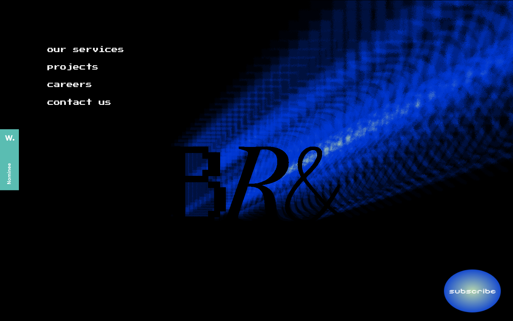
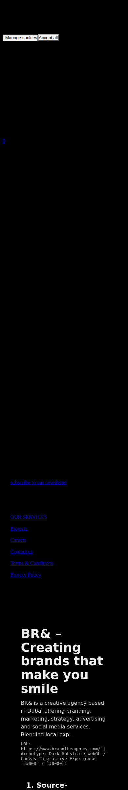

# UI Design System & Master Generation Blueprint: www-brandtheagency-com

> **BR& – Creating brands that make you smile** (https://www.brandtheagency.com/) — BR& is a creative agency based in Dubai offering branding, marketing, strategy, advertising and social media services. Blending local exp...



---

## 1. Executive Visual Persona & Design Archetype

- **Brand Essence & Persona**: **BR& – Creating brands that make you smile** (`https://www.brandtheagency.com/`). BR& is a creative agency based in Dubai offering branding, marketing, strategy, advertising and social media services. Blending local exp...
- **Visual Archetype**: **Dark-Substrate WebGL / Canvas Interactive Experience (`#000` / `#0000`)**.
- **Anti-AI-Slop Differentiators**:
  - **Source-Grounded Chromatic Polarity**: Anchors the viewport in `#000` (`var(--tweak-form-block-title-color-on-background)` in `:root`) paired with `#eee` primary typography and `#0000` accents.
  - **Extracted Typographic Hierarchy**: Pairs `Pixelify Sans` for display copy (`creating brands that make you smile`) with `squarespace-ui-font` and not declared in static CSS (uses primary stack / `ui-monospace`).
  - **Calibrated Spatial Grid & Motion**: Combines `var(--maxPageWidth)` container bounds (`gap: var(--form-field-checkbox-space-between-icon-and-text)`, padding `17px`) with `cubic-bezier(.175,.885,.32,1.275)` easing and Three.js / WebGL Canvas Pipeline, Barba.js Page Transition Router.

---

## 2. Spatial Architecture & Modular Grid Mathematics



### Viewport Allocation & Container Geometry
- **Captured Viewport Dimensions**: Desktop `1440×2400px` (`assets/desktop.png`, capped at 2400px multi-section capture), Mobile `390×2400px` (`assets/mobile.png`, capped at 2400px multi-section capture).
- **Master Container Bounds**: `var(--maxPageWidth)` extracted from `www-brandtheagency-com` stylesheet.
- **Canvas Lateral Padding & Spacing**: `17px` lateral canvas padding with `var(--form-field-checkbox-space-between-icon-and-text)` grid gap.
- **Border Radius Scale**: `1000px`, `3px`, `.4rem`, `0.4rem`.

### Responsive Breakpoint Architecture
- **Desktop Layout**: Multi-column CSS Grid / Flexbox layout at `1440px` (`max-width: var(--maxPageWidth)`, `gap: var(--form-field-checkbox-space-between-icon-and-text)`).
- **Mobile Layout**: Single-column vertical stack at `390px` viewport width with `17px` horizontal padding.
- **Extracted CSS Media Queries**: `@media (prefers-reduced-motion)`, `@media (prefers-reduced-motion:reduce)`, `@media screen and (max-width:767px)`, `@media screen and (max-width:1024px)`.

---

## 3. Color System, Materiality & Atmospheric Lighting

### Semantic Palette & Source Grounding
| Semantic Role | Ground-Truth Value | Extracted CSS Source / Selector |
|---|---|---|
| **Primary Canvas Substrate** | `#000` | `var(--tweak-form-block-title-color-on-background)` in `:root` |
| **Primary Typography Ink** | `#b7d8ad` | `var(--c1)` in `:root` |
| **Elevated Surface / Card Substrate** | `#0037d3` | `var(--c2)` in `:root` |
| **Interactive Accent / Highlight** | `#0000` | `.s3sJjVHu8Sy6uWa6 { background-color: #0000 }` |
| **Secondary / Muted Copy** | `#eee` | `verlay-hover .image-caption-wra... { color: #eee }` |
| **Structural Hairline Border** | `#bbb` | `ion-overlay-hover .image-captio... { color: #bbb }` |

### Sanitized Root CSS Variables (`ui-ux.md` Ground Truth)
| Variable Name | Extracted Value | Semantic Role |
|---|---|---|
| `--tweak-form-block-title-color-on-background` | `#000` | Canvas / Surface Token |
| `--tweak-form-block-caption-color-on-background` | `#000` | Canvas / Surface Token |
| `--tweak-form-block-option-color-on-background` | `#000` | Canvas / Surface Token |
| `--overlap-image-width-flex-offset` | `calc((var(--image-block-overlap-image-width) - 50%) * 2)` | Layout / Spatial Grid Token |
| `--overlap-title-width-offset` | `50%` | Layout / Spatial Grid Token |
| `--collage-image-width-flex-offset` | `calc((var(--image-block-collage-image-width) - 50%) * 2)` | Layout / Spatial Grid Token |
| `--collage-content-width-flex-offset` | `calc((var(--image-block-collage-image-content-width) - 50%) * 2)` | Layout / Spatial Grid Token |
| `--fallback-white-hsl` | `0, 0%, 98%` | Canvas / Surface Token |
| `--fallback-black-hsl` | `0, 0%, 0%` | Canvas / Surface Token |
| `--solid-alpha-modifier` | `1` | Design System Custom Token |
| `--solid-hover-alpha-modifier` | `0.6` | Design System Custom Token |
| `--outline-hover-alpha-modifier` | `0.4` | Elevation / Border Token |
| `--inverted-solid-hover-alpha-modifier` | `var(--solid-hover-alpha-modifier)` | Design System Custom Token |
| `--inverted-outline-hover-alpha-modifier` | `var(--outline-hover-alpha-modifier)` | Elevation / Border Token |
| `--solid-focus-alpha-modifier` | `1` | Design System Custom Token |
| `--outline-focus-alpha-modifier` | `0.4` | Elevation / Border Token |

---

## 4. Typographic Scale & Editorial Hierarchy

### Font Family Stacks
- **Display Typography**: `Pixelify Sans`.
- **Primary Body Stack**: `squarespace-ui-font`.
- **Technical / Metadata Stack**: not declared in static CSS (uses primary stack / `ui-monospace`).

### Typographic Scale & Rules (Extracted from Stylesheet & Variables)
- **Hero Display (`H1`)**: CSS variables `--sqsp-heading-1-color: hsla(var(--black-hsl),1)`, `--heading-1-size: 4.6rem`, `--heading-1-size-value: 4.6`; rule `.title` (`font-size: 1rem`, `line-height: 1.4`, `font-weight: 500`).
- **Section Heading (`H2`)**: CSS variables `--image-block-collage-image-subtitle-color: hsla(var(--black-hsl),1)`, `--image-block-card-image-subtitle-color: hsla(var(--black-hsl),1)`, `--image-block-poster-image-subtitle-color: hsla(var(--white-hsl),1)`.
- **Body Copy**: CSS variables `--paragraphSmallColor: hsla(var(--black-hsl),1)`, `--sqsp-paragraph-3-color: hsla(var(--black-hsl),1)`, `--paragraphLargeColor: hsla(var(--black-hsl),1)`; rule `p` (`line-height: 1.68em`).
- **Metadata & Navigation Labels**: CSS variables `--tweak-form-block-caption-color-on-background: #000`, `--paragraphSmallColor: hsla(var(--black-hsl),1)`, `--tweak-paragraph-small-color-on-background: hsla(var(--black-hsl),1)`; rule `.caption` (`font-size: 12px`).

---

## 5. Choreographed Motion & Interaction Physics

### Primary Easing Curves
- **Extracted Timing Functions**: `cubic-bezier(.175,.885,.32,1.275)`, `cubic-bezier(.5,0,1,.5)`, `cubic-bezier(.4,0,.2,1)`.

### Per-Element Transition & Choreography Rules
- **Selector `.HJfcnBEmS6s00rth`**: `transition: background-color .1s ease-out` extracted from `www-brandtheagency-com` stylesheet.
- **Selector `aption-overlay-hover .image-capti...`**: `transition: opacity .1s ease-out` extracted from `www-brandtheagency-com` stylesheet.
- **Selector `layout-caption-overlay-hover .ima...`**: `transition: margin-bottom .1s ease-out` extracted from `www-brandtheagency-com` stylesheet.
- **Extracted Easing Curve (`cubic-bezier(.175,.885,.32,1.275)`)**: Governs interactive state transitions across `<header.yui3-js-enabled>` and `<article.page-regions>`.
- **Runtime Interaction Engine**: Integrates Three.js / WebGL Canvas Pipeline, Barba.js Page Transition Router with `prefers-reduced-motion: reduce` fallback guards.

---

## 6. Component Wireframe & Structural DOM Map

### Visual Layout Schematic (Grounded in `dom.html` — `1440px` Desktop & `390px` Mobile Reflow)
```
┌────────────────────────────────────────────────────────────────────────┐
│ DESKTOP VIEWPORT (1440px) — BR& – Creating brands that make you smile  │
│ ====================================================================== │
│ [ <header.yui3-js-enabled> | Subscribe · our services · projects ·  ]  │
│ ---------------------------------------------------------------------- │
│ | HERO STAGE: <section.gdpr-cookie-banner>                         |   │
│ | H1: creating brands that make you smile                          |   │
│ | Substrate: #000       | Ink: #eee       | Accent: #0000          |   │
│ ---------------------------------------------------------------------- │
│ | SHOWCASE GRID (<article.page-regions>    ) max-w: var(--maxPageW |   │
│ | +------------------------------+  +------------------------------+ | │
│ | | creating brands that make yo |  | Give us your email, we will  | | │
│ | +------------------------------+  +------------------------------+ | │
│ ---------------------------------------------------------------------- │
│ | MOBILE VIEWPORT REFLOW (390px) — Single-Column Stack (gap: var(--) | │
│ | [<header.yui3-js-en] -> [<section.gdpr-cook] -> [<article.page-regi] │
│ ---------------------------------------------------------------------- │
│ [ FOOTER (<footer.sections>     ) | https://www.brandtheagency.com/    │
└────────────────────────────────────────────────────────────────────────┘
```

### Granular DOM Region Breakdown
1. **Brand Header & Navigation Bar (<header.yui3-js-enabled> — `www-brandtheagency-com`)**:
   - Landmark `<header class="yui3-js-enabled">` hosting `BR& – Creating brands that make you ` navigation (`Subscribe · our services · projects · careers · contact us`), DOM attributes (`data-sqsp-font-ids="6a313988fd7025398af25..."`, `data-name="static-context"`, `data-sqs-type="cookiepreferencesgetter"`, `data-motion-style="m-6b08526a3060ed6bcdf2"`), and stylesheet rule `.fvDxPINFKaIQHxAo { animation-name:spin;animation-duration:1s;animation-timing-function:line... }`.
2. **Hero Stage & Focal Lead (<section.gdpr-cookie-banner> — `creating brands that make you smil`)**:
   - Landmark `<section class="gdpr-cookie-banner BOTTOM">` presenting display lead `creating brands that make you smile` and copy excerpt *"Select “Accept all” to agree to our use of cookies and similar te"* over `#000` canvas and `#eee` ink.
3. **Primary Showcase & Content Grid (<article.page-regions> — `creating brands that make you smil`)**:
   - Landmark `<article class="page-regions">` rendering section `creating brands that make you smile creating bran...` with copy *"creating brands that make you smile"*, asset references (`favicon.ico`, `www.brandtheagency.com`, `BR%26_banner.jpg`, `images.squarespace-cdn.com`), and grid rule `.Ullcl0nljcxhHnEM { animation-name:fadeout;animation-iteration-count:1 }`.
4. **Interactive Detail & Feature Matrix (<section.region> — `Give us your email, we will send y`)**:
   - Landmark `<section class="region">` framing `Give us your email, we will send you cool stuff` and `subscribe to our newsletter` (*"subscribe to our newsletter"*) with `#0037d3` surface cards, `#0000` accents, and `.IL7wXbP6N7YXaIOk { animation-name:fadein;animation-iteration-count:1 }`.
5. **Colophon & Global Directory Footer (<footer.sections> — `https://www.brandtheagency.com/`)**:
   - Landmark `<footer class="sections">` anchoring `BR& – Creating brands that make ` footer links (`Subscribe · our services · projects · careers · contact us`), copy *"Terms & Conditions"*, and `#bbb` structural dividers.

---

## 7. Master Zero-Shot AI Generation Prompt

```markdown
# Master Zero-Shot Frontend Generation Prompt: www-brandtheagency-com (BR& – Creating brands that make you smile)

You are a principal frontend architect and design systems engineer. Build a complete, production-ready web application replicating the exact design system, DOM landmarks, typographic hierarchy, color tokens, and motion physics of `www-brandtheagency-com` (**BR& – Creating brands that make you smile** — `https://www.brandtheagency.com/`).

### 1. Visual Archetype & Anti-AI-Slop Mandates
- **Archetype**: Dark-Substrate WebGL / Canvas Interactive Experience (`#000` / `#0000`).
- **Identity & Domain Context**: BR& is a creative agency based in Dubai offering branding, marketing, strategy, advertising and social media services. Blending local exp...
- **Primary Substrate**: `#000` (`var(--tweak-form-block-title-color-on-background)` in `:root`), **Primary Ink**: `#eee`, **Accent / Highlight**: `#0000`.
- **Site-Specific Differentiators**:
  - **Source-Grounded Chromatic Polarity**: Anchors the viewport in `#000` (`var(--tweak-form-block-title-color-on-background)` in `:root`) paired with `#eee` primary typography and `#0000` accents.
  - **Extracted Typographic Hierarchy**: Pairs `Pixelify Sans` for display copy (`creating brands that make you smile`) with `squarespace-ui-font` and not declared in static CSS (uses primary stack / `ui-monospace`).
  - **Calibrated Spatial Grid & Motion**: Combines `var(--maxPageWidth)` container bounds (`gap: var(--form-field-checkbox-space-between-icon-and-text)`, padding `17px`) with `cubic-bezier(.175,.885,.32,1.275)` easing and Three.js / WebGL Canvas Pipeline, Barba.js Page Transition Router.

### 2. Ground-Truth CSS Variables (`:root` Token Contract)
Declare and consume these exact custom properties extracted from `www-brandtheagency-com` in your global stylesheet:

:root {
  /* BR& – Creating brands that make you smile (www-brandtheagency-com) — Ground-Truth Extracted CSS Variables */
  --tweak-form-block-title-color-on-background: #000; /* Canvas / Surface Token (www-brandtheagency-com) */
  --tweak-form-block-caption-color-on-background: #000; /* Canvas / Surface Token (www-brandtheagency-com) */
  --tweak-form-block-option-color-on-background: #000; /* Canvas / Surface Token (www-brandtheagency-com) */
  --overlap-image-width-flex-offset: calc((var(--image-block-overlap-image-width) - 50%) * 2); /* Layout / Spatial Grid Token (www-brandtheagency-com) */
  --overlap-title-width-offset: 50%; /* Layout / Spatial Grid Token (www-brandtheagency-com) */
  --collage-image-width-flex-offset: calc((var(--image-block-collage-image-width) - 50%) * 2); /* Layout / Spatial Grid Token (www-brandtheagency-com) */
  --collage-content-width-flex-offset: calc((var(--image-block-collage-image-content-width) - 50%) * 2); /* Layout / Spatial Grid Token (www-brandtheagency-com) */
  --fallback-white-hsl: 0, 0%, 98%; /* Canvas / Surface Token (www-brandtheagency-com) */
  --fallback-black-hsl: 0, 0%, 0%; /* Canvas / Surface Token (www-brandtheagency-com) */
  --solid-alpha-modifier: 1; /* Design System Custom Token (www-brandtheagency-com) */
  --solid-hover-alpha-modifier: 0.6; /* Design System Custom Token (www-brandtheagency-com) */
  --outline-hover-alpha-modifier: 0.4; /* Elevation / Border Token (www-brandtheagency-com) */
  --inverted-solid-hover-alpha-modifier: var(--solid-hover-alpha-modifier); /* Design System Custom Token (www-brandtheagency-com) */
  --inverted-outline-hover-alpha-modifier: var(--outline-hover-alpha-modifier); /* Elevation / Border Token (www-brandtheagency-com) */
  --solid-focus-alpha-modifier: 1; /* Design System Custom Token (www-brandtheagency-com) */
  --outline-focus-alpha-modifier: 0.4; /* Elevation / Border Token (www-brandtheagency-com) */
}

### 3. Semantic Color & Materiality Contract
Map every surface, ink, and border strictly to these source-grounded tokens:
- **Primary Canvas Substrate**: `#000` — grounded in `var(--tweak-form-block-title-color-on-background)` in `:root`
- **Primary Typography Ink**: `#b7d8ad` — grounded in `var(--c1)` in `:root`
- **Elevated Surface / Card Substrate**: `#0037d3` — grounded in `var(--c2)` in `:root`
- **Interactive Accent / Highlight**: `#0000` — grounded in `.s3sJjVHu8Sy6uWa6 { background-color: #0000 }`
- **Secondary / Muted Copy**: `#eee` — grounded in `verlay-hover .image-caption-wra... { color: #eee }`
- **Structural Hairline Border**: `#bbb` — grounded in `ion-overlay-hover .image-captio... { color: #bbb }`

### 4. Spatial Grid, Container Bounds & Responsive Breakpoints
- **Desktop Viewport Reference**: `1440×2400px` (capped at 2400px multi-section capture, `1440px` standard desktop width).
- **Mobile Viewport Reference**: `390×2400px` (capped at 2400px multi-section capture, `390px` standard mobile width).
- **Container Max-Width**: `var(--maxPageWidth)` extracted from `www-brandtheagency-com` stylesheet
- **Padding & Gutters**: `17px` lateral canvas padding with `var(--form-field-checkbox-space-between-icon-and-text)` grid gap
- **Desktop Grid**: Multi-column CSS Grid / Flexbox layout at `1440px` (`max-width: var(--maxPageWidth)`, `gap: var(--form-field-checkbox-space-between-icon-and-text)`)
- **Mobile Adaptation**: Single-column vertical stack at `390px` viewport width with `17px` horizontal padding
- **Media Queries**: `@media (prefers-reduced-motion)`, `@media (prefers-reduced-motion:reduce)`, `@media screen and (max-width:767px)`, `@media screen and (max-width:1024px)`
- **Corner Radii**: `1000px`, `3px`, `.4rem`, `0.4rem`

### 5. Typography & Editorial Scale Contract
- **Display Font Stack**: `Pixelify Sans`
- **Body Font Stack**: `squarespace-ui-font`
- **Monospace / Technical Font Stack**: not declared in static CSS (uses primary stack / `ui-monospace`)
- **H1 Display Rule**: CSS variables `--sqsp-heading-1-color: hsla(var(--black-hsl),1)`, `--heading-1-size: 4.6rem`, `--heading-1-size-value: 4.6`; rule `.title` (`font-size: 1rem`, `line-height: 1.4`, `font-weight: 500`)
- **H2 Section Rule**: CSS variables `--image-block-collage-image-subtitle-color: hsla(var(--black-hsl),1)`, `--image-block-card-image-subtitle-color: hsla(var(--black-hsl),1)`, `--image-block-poster-image-subtitle-color: hsla(var(--white-hsl),1)`
- **Body Copy Rule**: CSS variables `--paragraphSmallColor: hsla(var(--black-hsl),1)`, `--sqsp-paragraph-3-color: hsla(var(--black-hsl),1)`, `--paragraphLargeColor: hsla(var(--black-hsl),1)`; rule `p` (`line-height: 1.68em`)
- **Metadata & Index Rule**: CSS variables `--tweak-form-block-caption-color-on-background: #000`, `--paragraphSmallColor: hsla(var(--black-hsl),1)`, `--tweak-paragraph-small-color-on-background: hsla(var(--black-hsl),1)`; rule `.caption` (`font-size: 12px`)

### 6. Component Hierarchy, Verbatim Copy & Real DOM Landmarks
Scaffold `www-brandtheagency-com` (`BR& – Creating brands that make you smile`) with these exact structural regions, extracted copy, and CSS rules from `dom.html`:
1. **Brand Header & Navigation Bar (<header.yui3-js-enabled> — `www-brandtheagency-com`)**:
   - DOM & Selectors: Landmark `<header class="yui3-js-enabled">` hosting `BR& – Creating brands that make you ` navigation (`Subscribe · our services · projects · careers · contact us`), DOM attributes (`data-sqsp-font-ids="6a313988fd7025398af25..."`, `data-name="static-context"`, `data-sqs-type="cookiepreferencesgetter"`, `data-motion-style="m-6b08526a3060ed6bcdf2"`), and stylesheet rule `.fvDxPINFKaIQHxAo { animation-name:spin;animation-duration:1s;animation-timing-function:line... }`.
   - Responsive Contract: Header `Brand Header & Navigation Bar (<header.yui3-js-enabled> — `www-brandtheagency-com`)` (`www-brandtheagency-com`) adapts across `@media (prefers-reduced-motion)`, `@media (prefers-reduced-motion:reduce)`, `@media screen and (max-width:767px)`, `@media screen and (max-width:1024px)` with `cubic-bezier(.175,.885,.32,1.275)`, `cubic-bezier(.5,0,1,.5)`, `cubic-bezier(.4,0,.2,1)` transitions and links `Subscribe · our services · projects · careers · contact us`.
2. **Hero Stage & Focal Lead (<section.gdpr-cookie-banner> — `creating brands that make you smil`)**:
   - DOM & Selectors: Landmark `<section class="gdpr-cookie-banner BOTTOM">` presenting display lead `creating brands that make you smile` and copy excerpt *"Select “Accept all” to agree to our use of cookies and similar te"* over `#000` canvas and `#eee` ink.
   - Responsive Contract: Hero stage (`1440×2400px` desktop / `390×2400px` mobile) sets `#000` background with `#eee` headline `creating brands that make you smile`.
3. **Primary Showcase & Content Grid (<article.page-regions> — `creating brands that make you smil`)**:
   - DOM & Selectors: Landmark `<article class="page-regions">` rendering section `creating brands that make you smile creating bran...` with copy *"creating brands that make you smile"*, asset references (`favicon.ico`, `www.brandtheagency.com`, `BR%26_banner.jpg`, `images.squarespace-cdn.com`), and grid rule `.Ullcl0nljcxhHnEM { animation-name:fadeout;animation-iteration-count:1 }`.
   - Responsive Contract: Showcase grid `Primary Showcase & Content Grid (<article.page-regions> — `creating brands that make you smil`)` applies Multi-column CSS Grid / Flexbox layout at `1440px` (`max-width: var(--maxPageWidth)`, `gap: var(--form-field-checkbox-space-between-icon-and-text)`) on desktop and Single-column vertical stack at `390px` viewport width with `17px` horizontal padding on mobile.
4. **Interactive Detail & Feature Matrix (<section.region> — `Give us your email, we will send y`)**:
   - DOM & Selectors: Landmark `<section class="region">` framing `Give us your email, we will send you cool stuff` and `subscribe to our newsletter` (*"subscribe to our newsletter"*) with `#0037d3` surface cards, `#0000` accents, and `.IL7wXbP6N7YXaIOk { animation-name:fadein;animation-iteration-count:1 }`.
   - Responsive Contract: Detail module `Interactive Detail & Feature Matrix (<section.region> — `Give us your email, we will send y`)` uses `1000px`, `3px`, `.4rem`, `0.4rem` radii, `#0000` highlights, and assets (favicon.ico, www.brandtheagency.com, BR%26_banner.jpg).
5. **Colophon & Global Directory Footer (<footer.sections> — `https://www.brandtheagency.com/`)**:
   - DOM & Selectors: Landmark `<footer class="sections">` anchoring `BR& – Creating brands that make ` footer links (`Subscribe · our services · projects · careers · contact us`), copy *"Terms & Conditions"*, and `#bbb` structural dividers.
   - Responsive Contract: Footer `Colophon & Global Directory Footer (<footer.sections> — `https://www.brandtheagency.com/`)` aligns to `var(--maxPageWidth)` extracted from `www-brandtheagency-com` stylesheet with `17px` lateral canvas padding with `var(--form-field-checkbox-space-between-icon-and-text)` grid gap and attributes (data-sqsp-font-ids="6a313988fd7025398af25...", data-name="static-context", data-sqs-type="cookiepreferencesgetter").

#### Verbatim DOM Copy Excerpts (`dom.html`)
- Copy Excerpt 1: *"Select “Accept all” to agree to our use of cookies and similar technologies to enh..."*
- Copy Excerpt 2: *"creating brands that make you smile"*
- Copy Excerpt 3: *"subscribe to our newsletter"*
- Copy Excerpt 4: *"Terms & Conditions"*

### 7. Motion, Extracted Stylesheet Rules & Interaction Choreography
- **Primary Easing Functions**: `cubic-bezier(.175,.885,.32,1.275)`, `cubic-bezier(.5,0,1,.5)`, `cubic-bezier(.4,0,.2,1)`
- **Extracted Stylesheet Rules (`www-brandtheagency-com`)**:
- `.fvDxPINFKaIQHxAo { animation-name:spin;animation-duration:1s;animation-timing-function:line... }`
- `.Ullcl0nljcxhHnEM { animation-name:fadeout;animation-iteration-count:1 }`
- `.IL7wXbP6N7YXaIOk { animation-name:fadein;animation-iteration-count:1 }`
- `.SIyncARI57oShS6J { animation-name:riseandfadein;animation-iteration-count:1 }`
- `.HJfcnBEmS6s00rth.mVW8qfAVC5cSpu5x { background-color:0000 }`
- **Per-Selector Transition Rules**:
- **Selector `.HJfcnBEmS6s00rth`**: `transition: background-color .1s ease-out` extracted from `www-brandtheagency-com` stylesheet.
- **Selector `aption-overlay-hover .image-capti...`**: `transition: opacity .1s ease-out` extracted from `www-brandtheagency-com` stylesheet.
- **Selector `layout-caption-overlay-hover .ima...`**: `transition: margin-bottom .1s ease-out` extracted from `www-brandtheagency-com` stylesheet.
- **Extracted Easing Curve (`cubic-bezier(.175,.885,.32,1.275)`)**: Governs interactive state transitions across `<header.yui3-js-enabled>` and `<article.page-regions>`.
- **Runtime Interaction Engine**: Integrates Three.js / WebGL Canvas Pipeline, Barba.js Page Transition Router with `prefers-reduced-motion: reduce` fallback guards.

### 8. Technical Deliverables
- Implement in Next.js (App Router) with TypeScript and Tailwind CSS consuming the `:root` custom properties defined above for `www-brandtheagency-com`.
- Reproduce both the `1440px` desktop architecture and `390px` mobile breakpoint transitions, preserving semantic HTML5 landmarks (`<header>`, `<nav>`, `<main>`, `<section>`, `<footer>`) and `prefers-reduced-motion` accessibility guards.
```
