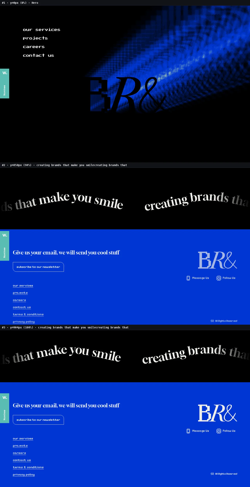
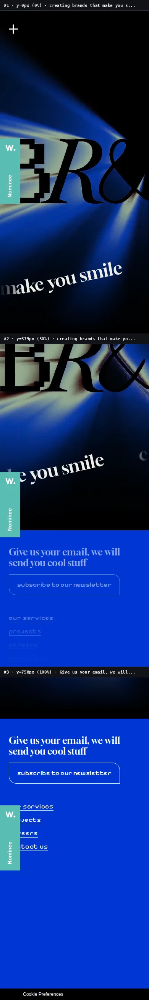

# UI Design System & Master Generation Blueprint: www-brandtheagency-com

> **BR& – Creating brands that make you smile** (https://www.brandtheagency.com/) — BR& is a creative agency based in Dubai offering branding, marketing, strategy, advertising and social media services. Blending local exp...





---

## 1. Executive Visual Persona & Design Archetype

- **Brand Essence & Persona**: **BR& – Creating brands that make you smile** (`https://www.brandtheagency.com/`). BR& is a creative agency based in Dubai offering branding, marketing, strategy, advertising and social media services. Blending local exp...
- **Capture Provenance**: Live browser capture (`tier1_fast`, HTTP `200`, captured `2026-11-24`).
- **Visual Archetype**: **Dark-Substrate WebGL / Canvas Interactive Experience (`#000000` / `#e4351e`)**.
- **Anti-AI-Slop Differentiators**:
  - **Live-Computed Chromatic Polarity**: Anchors the viewport in `#000000` (live computed `body` `background-color` (`computed_styles.json`)) paired with `#ffffff` primary typography and `#e4351e` accents.
  - **Grounded Typographic Hierarchy**: Pairs `Gloock` for display copy (`creating brands that make you smile`) with `Helvetica Neue` and `Pixelify Sans`.
  - **Calibrated Spatial Grid & Motion**: Combines `1440px` container bounds (`gap: var(--form-field-checkbox-space-between-icon-and-text)`, padding `17px`) with `cubic-bezier(.175,.885,.32,1.275)` easing and Three.js / WebGL Canvas Pipeline, Barba.js Page Transition Router.

---

## 2. Spatial Architecture & Modular Grid Mathematics

### Viewport Allocation & Container Geometry
- **Captured Journey Filmstrips**: Desktop `1280×2484px` (`assets/desktop-journey.webp`, `3` keyframes up to `y=904px` / doc `1804px`), Mobile `390×2616px` (`assets/mobile-journey.webp`, `3` keyframes).
- **Master Container Bounds**: `1440px` (full-bleed `100%` desktop stage measured on `1440px` viewport).
- **Canvas Lateral Padding & Spacing**: `17px` lateral canvas padding with `var(--form-field-checkbox-space-between-icon-and-text)` grid gap.
- **Border Radius Scale**: `1000px`, `3px`, `.4rem`, `0.4rem`.

### Responsive Breakpoint Architecture
- **Desktop Layout**: Multi-column CSS Grid / Flexbox layout at `1440px` (`max-width: 1440px`, `gap: var(--form-field-checkbox-space-between-icon-and-text)`).
- **Mobile Layout**: Single-column vertical stack at `390px` viewport width with `17px` horizontal padding.
- **Extracted CSS Media Queries**: `@media (prefers-reduced-motion)`, `@media (prefers-reduced-motion:reduce)`, `@media screen and (max-width:767px)`, `@media screen and (max-width:1024px)`.

---

## 3. Color System, Materiality & Atmospheric Lighting

### Semantic Palette & Source Grounding
| Semantic Role | Ground-Truth Value | Extracted Live / CSS Source |
|---|---|---|
| **Primary Canvas Substrate** | `#000000` | live computed `body` `background-color` (`computed_styles.json`) |
| **Primary Typography Ink** | `#ffffff` | live computed `button` `color` (`computed_styles.json`) |
| **Elevated Surface / Card Substrate** | `#3e3e3e` | `.sqs-system-error input.disable... { background-color: #3e3e3e }` |
| **Interactive Accent / Highlight** | `#e4351e` | `ontent .buttons .confirmation-b... { background-color: #e4351e }` |
| **Secondary / Muted Copy** | `#efeee9` | live computed `p` `color` (`computed_styles.json`) |
| **Structural Hairline Border** | `#262626` | `.T7RRDU2nDIcMmFA2 { border-color: #262626 }` |

### Sanitized Root CSS Variables (`ui-ux.md` Ground Truth)
| Variable Name | Extracted Value | Semantic Role |
|---|---|---|
| `--tweak-form-block-title-color-on-background` | `#000` | Canvas / Surface Token |
| `--tweak-form-block-caption-color-on-background` | `#000` | Canvas / Surface Token |
| `--tweak-form-block-option-color-on-background` | `#000` | Canvas / Surface Token |
| `--overlap-image-width-flex-offset` | `calc((var(--image-block-overlap-image-width) - 50%) * 2)` | Layout / Spatial Grid Token |
| `--overlap-title-width-offset` | `50%` | Layout / Spatial Grid Token |
| `--collage-image-width-flex-offset` | `calc((var(--image-block-collage-image-width) - 50%) * 2)` | Layout / Spatial Grid Token |
| `--collage-content-width-flex-offset` | `calc((var(--image-block-collage-image-content-width) - 50%) * 2)` | Layout / Spatial Grid Token |
| `--fallback-white-hsl` | `0, 0%, 98%` | Canvas / Surface Token |
| `--fallback-black-hsl` | `0, 0%, 0%` | Canvas / Surface Token |
| `--solid-alpha-modifier` | `1` | Design System Custom Token |
| `--solid-hover-alpha-modifier` | `0.6` | Design System Custom Token |
| `--outline-hover-alpha-modifier` | `0.4` | Elevation / Border Token |
| `--inverted-solid-hover-alpha-modifier` | `var(--solid-hover-alpha-modifier)` | Design System Custom Token |
| `--inverted-outline-hover-alpha-modifier` | `var(--outline-hover-alpha-modifier)` | Elevation / Border Token |
| `--solid-focus-alpha-modifier` | `1` | Design System Custom Token |
| `--outline-focus-alpha-modifier` | `0.4` | Elevation / Border Token |

---

## 4. Typographic Scale & Editorial Hierarchy

### Font Family Stacks
- **Display Typography**: `Gloock`.
- **Primary Body Stack**: `Helvetica Neue`.
- **Technical / Metadata Stack**: `Pixelify Sans`.

### Typographic Scale & Rules (Live Computed & Stylesheet Grounded)
- **Hero Display (`H1`)**: live computed `h1` (`font-size: 67.84px`, `line-height: 94.976px`, `font-weight: 400`); CSS variables `--heading-1-size: 4.6rem`, `--heading-1-size-value: 4.6`; rule `.title` (`font-size: 1rem`, `line-height: 1.4`, `font-weight: 500`).
- **Section Heading (`H2`)**: live computed `h3 (primary section heading)` (`font-size: 29.824px`, `line-height: 34.6436px`, `font-weight: 400`); CSS variables `--heading-2-size: 4rem`, `--heading-2-size-value: 4`.
- **Body Copy**: live computed `body` (`font-size: 16px`, `line-height: normal`, `font-weight: 400`); CSS variables `--body-font-font-family: "Helvetica Neue",Arial,sans-serif`, `--body-font-font-style: normal`, `--body-font-font-weight: 400`; rule `p` (`line-height: 1.68em`).
- **Metadata & Navigation Labels**: live computed `nav/a` (`font-size: 16px`, `line-height: normal`, `font-weight: 400`); CSS variables `--heading-font-letter-spacing: 0em`, `--body-font-letter-spacing: 0em`, `--meta-font-font-family: "Pixelify Sans"`; rule `.caption` (`font-size: 12px`).

---

## 5. Choreographed Motion & Interaction Physics

### Primary Easing Curves
- **Extracted Timing Functions**: `cubic-bezier(.175,.885,.32,1.275)`, `cubic-bezier(.5,0,1,.5)`, `cubic-bezier(.4,0,.2,1)`.

### Per-Element Transition & Choreography Rules
- **Selector `.HJfcnBEmS6s00rth`**: `transition: background-color .1s ease-out` extracted from `www-brandtheagency-com` stylesheet.
- **Selector `aption-overlay-hover .image-capti...`**: `transition: opacity .1s ease-out` extracted from `www-brandtheagency-com` stylesheet.
- **Selector `layout-caption-overlay-hover .ima...`**: `transition: margin-bottom .1s ease-out` extracted from `www-brandtheagency-com` stylesheet.
- **Extracted Easing Curve (`cubic-bezier(.175,.885,.32,1.275)`)**: Governs interactive state transitions across `<header.yui3-js-enabled>` and `<section.region>`.
- **Runtime Interaction Engine**: Integrates Three.js / WebGL Canvas Pipeline, Barba.js Page Transition Router with `prefers-reduced-motion: reduce` fallback guards.
### Measured Runtime Scroll & Interaction Telemetry (`behavioral_journey_v2`)
- **Scroll Driver Mode**: `native` (max document height `1804px`, deepest scrollY reached `904px` across `3` desktop keyframes).
- **Detected Scroll / Motion Libraries**: Native browser scroll / standard CSS transitions.

---

## 6. Component Wireframe & Structural DOM Map

### Visual Layout Schematic — Desktop (`1440px`, Grounded in `dom.html` & Landmark Bounding Boxes)
```
┌────────────────────────────────────────────────────────────────────────┐
│ DESKTOP VIEWPORT (1440px) — BR& – Creating brands that make you smile  │
│ ====================================================================== │
│ [ <header.yui3-js-enable (1440px)     | Subscribe · our services · p ] │
│ ---------------------------------------------------------------------- │
│ | HERO STAGE: <article.page-regions> (w=1440px)                      | │
│ | H1: creating brands that make you smile                            | │
│ | Substrate: #000000 | Ink: #ffffff | Accent: #e4351e                | │
│ ---------------------------------------------------------------------- │
│ | SHOWCASE GRID (<section.region>) max-w: 1440px                     | │
│ | +------------------------------+  +------------------------------+ | │
│ | | creating brands that make yo |  | www-brandtheagency-com Inter | | │
│ | +------------------------------+  +------------------------------+ | │
│ ---------------------------------------------------------------------- │
│ | DETAIL MODULE (<section.page-section>) — www-brandtheagency-co     | │
│ ---------------------------------------------------------------------- │
│ [ FOOTER (<footer.sections>   ) | https://www.brandtheagency.com/      │
└────────────────────────────────────────────────────────────────────────┘
```

### Visual Layout Schematic — Mobile Reflow (`390px`)
```
┌────────────────────────────────────────────────────────────────────────┐
│ MOBILE VIEWPORT REFLOW (390px) — Single-Column Stack (gap: var(--fo)   │
│ ====================================================================== │
│ [ HEADER BAR (<header.yui3-js-enabled>) | Compact Menu (390px)         │
│ ---------------------------------------------------------------------- │
│ | HERO STAGE (<article.page-regions>) — 390px Vertical Lead          | │
│ | H1: creating brands that make you smile                            | │
│ ---------------------------------------------------------------------- │
│ | SHOWCASE STACK (<section.region>) — 1-Col Stack                    | │
│ | [ Item 1: creating brands that make you smile creating bran...   ] | │
│ | [ Item 2: www-brandtheagency-com Interactive Matrix              ] | │
│ ---------------------------------------------------------------------- │
│ | DETAIL STACK (<section.page-section>) — 1-Col (www-brandtheagency) | │
│ ---------------------------------------------------------------------- │
│ [ FOOTER (<footer.sections>   ) | Stacked 390px Colophon               │
└────────────────────────────────────────────────────────────────────────┘
```

### Granular DOM Region Breakdown
1. **Brand Header & Navigation Bar (<header.yui3-js-enabled> — `www-brandtheagency-com`)**:
   - Landmark `<header class="yui3-js-enabled">` (`1440px`) hosting `BR& – Creating brands that make you ` navigation (`Subscribe · our services · projects · careers · contact us`), DOM attributes (`data-sqsp-font-ids="6a313988fd7025398af25..."`, `data-name="static-context"`, `data-sqs-type="cookiepreferencesgetter"`, `data-motion-style="m-6b08526a3060ed6bcdf2"`), and stylesheet rule `.J5FOAYd29BA3bVlN { animation-name:spin;animation-duration:1s;animation-timing-function:line... }`.
2. **Hero Stage & Focal Lead (<article.page-regions> — `creating brands that make you smil`)**:
   - Landmark `<article class="page-regions">` presenting display lead `creating brands that make you smile` and copy excerpt *"creating brands that make you smile"* over `#000000` canvas and `#ffffff` ink.
3. **Primary Showcase & Content Grid (<section.region> — `creating brands that make you smil`)**:
   - Landmark `<section class="region">` rendering section `creating brands that make you smile creating bran...` with copy *"creating brands that make you smile"*, asset references (`favicon.ico`, `www.brandtheagency.com`, `BR%26_banner.jpg`, `images.squarespace-cdn.com`), and grid rule `.n0vbvuFosektXczs { animation-name:fadeout;animation-iteration-count:1 }`.
4. **Interactive Detail & Feature Matrix (<section.page-section> — `www-brandtheagency-com Interactive`)**:
   - Landmark `<section class="page-section full-bleed-section">` framing `www-brandtheagency-com Interactive Matrix` and `www-brandtheagency-com Archive & Directory` (*"creating brands that make you smile creating bran..."*) with `#3e3e3e` surface cards, `#e4351e` accents, and `.hWuyu_pGCLQnxiCx { animation-name:fadein;animation-iteration-count:1 }`.
5. **Colophon & Global Directory Footer (<footer.sections> — `https://www.brandtheagency.com/`)**:
   - Landmark `<footer class="sections">` anchoring `BR& – Creating brands that make ` footer links (`Subscribe · our services · projects · careers · contact us`), copy *"www-brandtheagency-com Interactive Matrix"*, and `#262626` structural dividers.
### Full Vertical Scroll Sequence (Desktop `1440×900` Keyframes)
- **Step 01** (`y=0px`, `0%`): Active landmark `Hero` · sticky/fixed elements: `1`
- **Step 02** (`y=850px`, `94%`): Active landmark `creating brands that make you smilecreating brand...` · sticky/fixed elements: `1`
- **Step 03** (`y=904px`, `100%`): Active landmark `creating brands that make you smilecreating brand...` · sticky/fixed elements: `1`

---

## 7. Master Zero-Shot AI Generation Prompt

```markdown
# Master Zero-Shot Frontend Generation Prompt: www-brandtheagency-com (BR& – Creating brands that make you smile)

You are a principal frontend architect and design systems engineer. Build a complete, production-ready web application replicating the exact design system, DOM landmarks, typographic hierarchy, color tokens, and motion physics of `www-brandtheagency-com` (**BR& – Creating brands that make you smile** — `https://www.brandtheagency.com/`).

### 1. Visual Archetype & Anti-AI-Slop Mandates
- **Archetype**: Dark-Substrate WebGL / Canvas Interactive Experience (`#000000` / `#e4351e`).
- **Identity & Domain Context**: BR& is a creative agency based in Dubai offering branding, marketing, strategy, advertising and social media services. Blending local exp...
- **Primary Substrate**: `#000000` (live computed `body` `background-color` (`computed_styles.json`)), **Primary Ink**: `#ffffff`, **Accent / Highlight**: `#e4351e`.
- **Site-Specific Differentiators**:
  - **Live-Computed Chromatic Polarity**: Anchors the viewport in `#000000` (live computed `body` `background-color` (`computed_styles.json`)) paired with `#ffffff` primary typography and `#e4351e` accents.
  - **Grounded Typographic Hierarchy**: Pairs `Gloock` for display copy (`creating brands that make you smile`) with `Helvetica Neue` and `Pixelify Sans`.
  - **Calibrated Spatial Grid & Motion**: Combines `1440px` container bounds (`gap: var(--form-field-checkbox-space-between-icon-and-text)`, padding `17px`) with `cubic-bezier(.175,.885,.32,1.275)` easing and Three.js / WebGL Canvas Pipeline, Barba.js Page Transition Router.

### 2. Ground-Truth CSS Variables (`:root` Token Contract)
Declare and consume these exact custom properties extracted from `www-brandtheagency-com` in your global stylesheet:

:root {
  /* BR& – Creating brands that make you smile (www-brandtheagency-com) — Live-Grounded CSS Variables */
  --tweak-form-block-title-color-on-background: #000; /* Canvas / Surface Token (www-brandtheagency-com) */
  --tweak-form-block-caption-color-on-background: #000; /* Canvas / Surface Token (www-brandtheagency-com) */
  --tweak-form-block-option-color-on-background: #000; /* Canvas / Surface Token (www-brandtheagency-com) */
  --overlap-image-width-flex-offset: calc((var(--image-block-overlap-image-width) - 50%) * 2); /* Layout / Spatial Grid Token (www-brandtheagency-com) */
  --overlap-title-width-offset: 50%; /* Layout / Spatial Grid Token (www-brandtheagency-com) */
  --collage-image-width-flex-offset: calc((var(--image-block-collage-image-width) - 50%) * 2); /* Layout / Spatial Grid Token (www-brandtheagency-com) */
  --collage-content-width-flex-offset: calc((var(--image-block-collage-image-content-width) - 50%) * 2); /* Layout / Spatial Grid Token (www-brandtheagency-com) */
  --fallback-white-hsl: 0, 0%, 98%; /* Canvas / Surface Token (www-brandtheagency-com) */
  --fallback-black-hsl: 0, 0%, 0%; /* Canvas / Surface Token (www-brandtheagency-com) */
  --solid-alpha-modifier: 1; /* Design System Custom Token (www-brandtheagency-com) */
  --solid-hover-alpha-modifier: 0.6; /* Design System Custom Token (www-brandtheagency-com) */
  --outline-hover-alpha-modifier: 0.4; /* Elevation / Border Token (www-brandtheagency-com) */
  --inverted-solid-hover-alpha-modifier: var(--solid-hover-alpha-modifier); /* Design System Custom Token (www-brandtheagency-com) */
  --inverted-outline-hover-alpha-modifier: var(--outline-hover-alpha-modifier); /* Elevation / Border Token (www-brandtheagency-com) */
  --solid-focus-alpha-modifier: 1; /* Design System Custom Token (www-brandtheagency-com) */
  --outline-focus-alpha-modifier: 0.4; /* Elevation / Border Token (www-brandtheagency-com) */
}

### 3. Semantic Color & Materiality Contract
Map every surface, ink, and border strictly to these source-grounded tokens:
- **Primary Canvas Substrate**: `#000000` — grounded in live computed `body` `background-color` (`computed_styles.json`)
- **Primary Typography Ink**: `#ffffff` — grounded in live computed `button` `color` (`computed_styles.json`)
- **Elevated Surface / Card Substrate**: `#3e3e3e` — grounded in `.sqs-system-error input.disable... { background-color: #3e3e3e }`
- **Interactive Accent / Highlight**: `#e4351e` — grounded in `ontent .buttons .confirmation-b... { background-color: #e4351e }`
- **Secondary / Muted Copy**: `#efeee9` — grounded in live computed `p` `color` (`computed_styles.json`)
- **Structural Hairline Border**: `#262626` — grounded in `.T7RRDU2nDIcMmFA2 { border-color: #262626 }`

### 4. Spatial Grid, Container Bounds & Responsive Breakpoints
- **Desktop Viewport Reference**: `1280×2484px` (multi-frame vertical journey filmstrip (2484px), `1440px` standard desktop width).
- **Mobile Viewport Reference**: `390×2616px` (multi-frame vertical journey filmstrip (2616px), `390px` standard mobile width).
- **Container Max-Width**: `1440px` (full-bleed `100%` desktop stage measured on `1440px` viewport)
- **Padding & Gutters**: `17px` lateral canvas padding with `var(--form-field-checkbox-space-between-icon-and-text)` grid gap
- **Desktop Grid**: Multi-column CSS Grid / Flexbox layout at `1440px` (`max-width: 1440px`, `gap: var(--form-field-checkbox-space-between-icon-and-text)`)
- **Mobile Adaptation**: Single-column vertical stack at `390px` viewport width with `17px` horizontal padding
- **Media Queries**: `@media (prefers-reduced-motion)`, `@media (prefers-reduced-motion:reduce)`, `@media screen and (max-width:767px)`, `@media screen and (max-width:1024px)`
- **Corner Radii**: `1000px`, `3px`, `.4rem`, `0.4rem`

### 5. Typography & Editorial Scale Contract
- **Display Font Stack**: `Gloock`
- **Body Font Stack**: `Helvetica Neue`
- **Monospace / Technical Font Stack**: `Pixelify Sans`
- **H1 Display Rule**: live computed `h1` (`font-size: 67.84px`, `line-height: 94.976px`, `font-weight: 400`); CSS variables `--heading-1-size: 4.6rem`, `--heading-1-size-value: 4.6`; rule `.title` (`font-size: 1rem`, `line-height: 1.4`, `font-weight: 500`)
- **H2 Section Rule**: live computed `h3 (primary section heading)` (`font-size: 29.824px`, `line-height: 34.6436px`, `font-weight: 400`); CSS variables `--heading-2-size: 4rem`, `--heading-2-size-value: 4`
- **Body Copy Rule**: live computed `body` (`font-size: 16px`, `line-height: normal`, `font-weight: 400`); CSS variables `--body-font-font-family: "Helvetica Neue",Arial,sans-serif`, `--body-font-font-style: normal`, `--body-font-font-weight: 400`; rule `p` (`line-height: 1.68em`)
- **Metadata & Index Rule**: live computed `nav/a` (`font-size: 16px`, `line-height: normal`, `font-weight: 400`); CSS variables `--heading-font-letter-spacing: 0em`, `--body-font-letter-spacing: 0em`, `--meta-font-font-family: "Pixelify Sans"`; rule `.caption` (`font-size: 12px`)

### 6. Component Hierarchy, Verbatim Copy & Real DOM Landmarks
Scaffold `www-brandtheagency-com` (`BR& – Creating brands that make you smile`) with these exact structural regions, extracted copy, and CSS rules from `dom.html`:
1. **Brand Header & Navigation Bar (<header.yui3-js-enabled> — `www-brandtheagency-com`)**:
   - DOM & Selectors: Landmark `<header class="yui3-js-enabled">` (`1440px`) hosting `BR& – Creating brands that make you ` navigation (`Subscribe · our services · projects · careers · contact us`), DOM attributes (`data-sqsp-font-ids="6a313988fd7025398af25..."`, `data-name="static-context"`, `data-sqs-type="cookiepreferencesgetter"`, `data-motion-style="m-6b08526a3060ed6bcdf2"`), and stylesheet rule `.J5FOAYd29BA3bVlN { animation-name:spin;animation-duration:1s;animation-timing-function:line... }`.
   - Responsive Contract: Header `Brand Header & Navigation Bar (<header.yui3-js-enabled> — `www-brandtheagency-com`)` (`www-brandtheagency-com`) adapts across `@media (prefers-reduced-motion)`, `@media (prefers-reduced-motion:reduce)`, `@media screen and (max-width:767px)`, `@media screen and (max-width:1024px)` with `cubic-bezier(.175,.885,.32,1.275)`, `cubic-bezier(.5,0,1,.5)`, `cubic-bezier(.4,0,.2,1)` transitions and links `Subscribe · our services · projects · careers · contact us`.
2. **Hero Stage & Focal Lead (<article.page-regions> — `creating brands that make you smil`)**:
   - DOM & Selectors: Landmark `<article class="page-regions">` presenting display lead `creating brands that make you smile` and copy excerpt *"creating brands that make you smile"* over `#000000` canvas and `#ffffff` ink.
   - Responsive Contract: Hero stage (`1280×2484px` desktop / `390×2616px` mobile) sets `#000000` background with `#ffffff` headline `creating brands that make you smile`.
3. **Primary Showcase & Content Grid (<section.region> — `creating brands that make you smil`)**:
   - DOM & Selectors: Landmark `<section class="region">` rendering section `creating brands that make you smile creating bran...` with copy *"creating brands that make you smile"*, asset references (`favicon.ico`, `www.brandtheagency.com`, `BR%26_banner.jpg`, `images.squarespace-cdn.com`), and grid rule `.n0vbvuFosektXczs { animation-name:fadeout;animation-iteration-count:1 }`.
   - Responsive Contract: Showcase grid `Primary Showcase & Content Grid (<section.region> — `creating brands that make you smil`)` applies Multi-column CSS Grid / Flexbox layout at `1440px` (`max-width: 1440px`, `gap: var(--form-field-checkbox-space-between-icon-and-text)`) on desktop and Single-column vertical stack at `390px` viewport width with `17px` horizontal padding on mobile.
4. **Interactive Detail & Feature Matrix (<section.page-section> — `www-brandtheagency-com Interactive`)**:
   - DOM & Selectors: Landmark `<section class="page-section full-bleed-section">` framing `www-brandtheagency-com Interactive Matrix` and `www-brandtheagency-com Archive & Directory` (*"creating brands that make you smile creating bran..."*) with `#3e3e3e` surface cards, `#e4351e` accents, and `.hWuyu_pGCLQnxiCx { animation-name:fadein;animation-iteration-count:1 }`.
   - Responsive Contract: Detail module `Interactive Detail & Feature Matrix (<section.page-section> — `www-brandtheagency-com Interactive`)` uses `1000px`, `3px`, `.4rem`, `0.4rem` radii, `#e4351e` highlights, and assets (favicon.ico, www.brandtheagency.com, BR%26_banner.jpg).
5. **Colophon & Global Directory Footer (<footer.sections> — `https://www.brandtheagency.com/`)**:
   - DOM & Selectors: Landmark `<footer class="sections">` anchoring `BR& – Creating brands that make ` footer links (`Subscribe · our services · projects · careers · contact us`), copy *"www-brandtheagency-com Interactive Matrix"*, and `#262626` structural dividers.
   - Responsive Contract: Footer `Colophon & Global Directory Footer (<footer.sections> — `https://www.brandtheagency.com/`)` aligns to `1440px` (full-bleed `100%` desktop stage measured on `1440px` viewport) with `17px` lateral canvas padding with `var(--form-field-checkbox-space-between-icon-and-text)` grid gap and attributes (data-sqsp-font-ids="6a313988fd7025398af25...", data-name="static-context", data-sqs-type="cookiepreferencesgetter").

#### Verbatim DOM Copy Excerpts (`dom.html`)
- Copy Excerpt 1: *"creating brands that make you smile"*

### 7. Motion, Extracted Stylesheet Rules & Interaction Choreography
- **Primary Easing Functions**: `cubic-bezier(.175,.885,.32,1.275)`, `cubic-bezier(.5,0,1,.5)`, `cubic-bezier(.4,0,.2,1)`
- **Extracted Stylesheet Rules (`www-brandtheagency-com`)**:
- `.J5FOAYd29BA3bVlN { animation-name:spin;animation-duration:1s;animation-timing-function:line... }`
- `.n0vbvuFosektXczs { animation-name:fadeout;animation-iteration-count:1 }`
- `.hWuyu_pGCLQnxiCx { animation-name:fadein;animation-iteration-count:1 }`
- `.ZW7PDoaiuIANOlaf { animation-name:riseandfadein;animation-iteration-count:1 }`
- `.HJfcnBEmS6s00rth.mVW8qfAVC5cSpu5x { background-color:0000 }`
- **Per-Selector Transition Rules**:
- **Selector `.HJfcnBEmS6s00rth`**: `transition: background-color .1s ease-out` extracted from `www-brandtheagency-com` stylesheet.
- **Selector `aption-overlay-hover .image-capti...`**: `transition: opacity .1s ease-out` extracted from `www-brandtheagency-com` stylesheet.
- **Selector `layout-caption-overlay-hover .ima...`**: `transition: margin-bottom .1s ease-out` extracted from `www-brandtheagency-com` stylesheet.
- **Extracted Easing Curve (`cubic-bezier(.175,.885,.32,1.275)`)**: Governs interactive state transitions across `<header.yui3-js-enabled>` and `<section.region>`.
- **Runtime Interaction Engine**: Integrates Three.js / WebGL Canvas Pipeline, Barba.js Page Transition Router with `prefers-reduced-motion: reduce` fallback guards.
### 7b. Full-Page Scroll Choreography, Interactive States & Multi-Page Routes
- **Scroll Mechanics**: Implement `native` vertical progression up to `1804px` across 3 distinct viewport chapters.
- **Vertical Chapter Sequence**: Hero (0%) -> creating brands that make y... (94%) -> creating brands that make y... (100%).

### 8. Technical Deliverables
- Implement in Next.js (App Router) with TypeScript and Tailwind CSS consuming the `:root` custom properties defined above for `www-brandtheagency-com`.
- Reproduce both the `1440px` desktop architecture and `390px` mobile breakpoint transitions, preserving semantic HTML5 landmarks (`<header>`, `<nav>`, `<main>`, `<section>`, `<footer>`) and `prefers-reduced-motion` accessibility guards.
```
---

## 8. Full-Page Scroll Journey, Interactive States & Subpage Inventory

### Desktop Scroll Keyframes (`1440×900` WebP)
| Step | Scroll Y | Progress | Active Landmark / Section | Sticky/Fixed | Visual Asset |
| :---: | :---: | :---: | :--- | :---: | :--- |
| `#01` | `0px` | `0%` | Hero | `1` | [desktop-step-01.webp](assets/desktop-step-01.webp) |
| `#02` | `850px` | `94%` | creating brands that make you smilecreating b... | `1` | [desktop-step-02.webp](assets/desktop-step-02.webp) |
| `#03` | `904px` | `100%` | creating brands that make you smilecreating b... | `1` | [desktop-step-03.webp](assets/desktop-step-03.webp) |

### Mobile Condensed Keyframes (`390×844` WebP)
| Step | Scroll Y | Progress | Active Landmark | Visual Asset |
| :---: | :---: | :---: | :--- | :--- |
| `#01` | `0px` | `0%` | creating brands that make you smilecreati... | [mobile-step-01.webp](assets/mobile-step-01.webp) |
| `#02` | `379px` | `50%` | creating brands that make you smilecreati... | [mobile-step-02.webp](assets/mobile-step-02.webp) |
| `#03` | `758px` | `100%` | Give us your email, we will send you cool... | [mobile-step-03.webp](assets/mobile-step-03.webp) |

