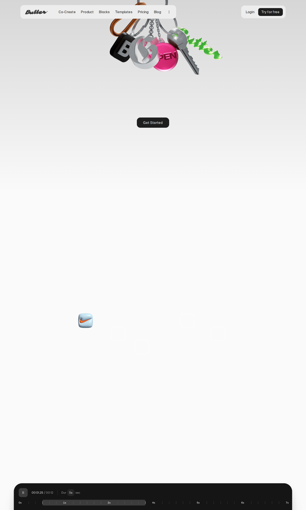
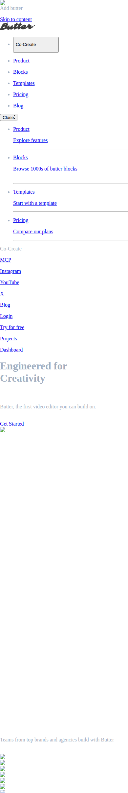

# UI Design System & Master Generation Blueprint: www-butter-video

> **Butter Video · Online Video Editor Engineered for Creativity** (https://www.butter.video/) — The first video editor and design platform built with creative code for creative teams. It's a whole new timeline.



---

## 1. Executive Visual Persona & Design Archetype

- **Brand Essence & Persona**: **Butter Video · Online Video Editor Engineered for Creativity** (`https://www.butter.video/`). The first video editor and design platform built with creative code for creative teams. It's a whole new timeline.
- **Visual Archetype**: **Light-Gallery WebGL / Canvas Interactive Experience (`#ffffff` / `#00ffd0`)**.
- **Anti-AI-Slop Differentiators**:
  - **Source-Grounded Chromatic Polarity**: Anchors the viewport in `#ffffff` (`var(--perf-text)` in `:root`) paired with `#718096` primary typography and `#00ffd0` accents.
  - **Extracted Typographic Hierarchy**: Pairs `DieGrotesk` for display copy (`Engineered for Creativity Engineered`) with `DieGrotesk Fallback` and `monospace)`.
  - **Calibrated Spatial Grid & Motion**: Combines `1920px` container bounds (`gap: .75rem`, padding `1.5rem`) with `cubic-bezier(0.25,0.1,0.25,1)` easing and Lenis Smooth Scroll (`data-lenis`), Three.js / WebGL Canvas Pipeline.

---

## 2. Spatial Architecture & Modular Grid Mathematics



### Viewport Allocation & Container Geometry
- **Captured Viewport Dimensions**: Desktop `1440×14365px` (`assets/desktop.png`, full-page scroll capture), Mobile `390×2400px` (`assets/mobile.png`, capped at 2400px multi-section capture).
- **Master Container Bounds**: `1920px` extracted from `www-butter-video` stylesheet.
- **Canvas Lateral Padding & Spacing**: `1.5rem` lateral canvas padding with `.75rem` grid gap.
- **Border Radius Scale**: `1.6rem`, `50%`, `1rem`, `1.25rem`.

### Responsive Breakpoint Architecture
- **Desktop Layout**: Multi-column CSS Grid / Flexbox layout at `1440px` (`max-width: 1920px`, `gap: .75rem`).
- **Mobile Layout**: Single-column vertical stack at `390px` viewport width with `1.5rem` horizontal padding.
- **Extracted CSS Media Queries**: `@media (max-width:900px)`, `@media (max-width:650px)`, `@media (prefers-reduced-motion:reduce)`, `@media (max-width: 480px)`.

---

## 3. Color System, Materiality & Atmospheric Lighting

### Semantic Palette & Source Grounding
| Semantic Role | Ground-Truth Value | Extracted CSS Source / Selector |
|---|---|---|
| **Primary Canvas Substrate** | `#ffffff` | `var(--perf-text)` in `:root` |
| **Primary Typography Ink** | `#a0aec0` | `var(--perf-text-dim)` in `:root` |
| **Elevated Surface / Card Substrate** | `#718096` | `var(--perf-text-muted)` in `:root` |
| **Interactive Accent / Highlight** | `#00ffd0` | `var(--perf-fps)` in `:root` |
| **Secondary / Muted Copy** | `#ff9f43` | `var(--perf-gpu)` in `:root` |
| **Structural Hairline Border** | `#a78bfa` | `var(--perf-cpu)` in `:root` |
| **Variable Token (`--perf-success`)** | `#10b981` | `var(--perf-success)` in `:root` |
| **Variable Token (`--perf-warning`)** | `#f59e0b` | `var(--perf-warning)` in `:root` |
| **Variable Token (`--perf-danger`)** | `#ef4444` | `var(--perf-danger)` in `:root` |

### Sanitized Root CSS Variables (`ui-ux.md` Ground Truth)
| Variable Name | Extracted Value | Semantic Role |
|---|---|---|
| `--perf-bg` | `rgba(8, 10, 15, .92)` | Canvas / Surface Token |
| `--perf-glass` | `rgba(255, 255, 255, .03)` | Color / Atmospheric Token |
| `--perf-border` | `rgba(255, 255, 255, .08)` | Elevation / Border Token |
| `--perf-text` | `#ffffff` | Typography Ink Token |
| `--perf-text-dim` | `#a0aec0` | Typography Ink Token |
| `--perf-text-muted` | `#718096` | Typography Ink Token |
| `--perf-gauge-bg` | `rgba(0, 0, 0, .15)` | Canvas / Surface Token |
| `--perf-fps` | `#00ffd0` | Color / Atmospheric Token |
| `--perf-gpu` | `#ff9f43` | Color / Atmospheric Token |
| `--perf-cpu` | `#a78bfa` | Color / Atmospheric Token |
| `--perf-success` | `#10b981` | Color / Atmospheric Token |
| `--perf-warning` | `#f59e0b` | Color / Atmospheric Token |
| `--perf-danger` | `#ef4444` | Color / Atmospheric Token |
| `--perf-gradient-primary` | `linear-gradient(135deg, #00ffd0 0%, #a78bfa 100%)` | Brand / Palette Token |
| `--perf-radius` | `12px` | Elevation / Border Token |
| `--perf-radius-sm` | `8px` | Elevation / Border Token |

---

## 4. Typographic Scale & Editorial Hierarchy

### Font Family Stacks
- **Display Typography**: `DieGrotesk`.
- **Primary Body Stack**: `DieGrotesk Fallback`.
- **Technical / Metadata Stack**: `monospace)`.

### Typographic Scale & Rules (Extracted from Stylesheet & Variables)
- **Hero Display (`H1`)**: rule `h1` (`font-size: clamp(5.6rem,6.6vw,12.5rem)`, `line-height: .92`, `letter-spacing: -1px`, `font-weight: 400`).
- **Section Heading (`H2`)**: rule `h2` (`font-size: clamp(3.2rem,6vw,7rem)`, `line-height: .94`, `letter-spacing: -.5px`, `font-weight: 400`).
- **Body Copy**: rule `p` (`font-size: clamp(1.05rem,1.5vw,1.25rem)`, `line-height: 1.45`).
- **Metadata & Navigation Labels**: rule `small` (`font-size: inherit`).

---

## 5. Choreographed Motion & Interaction Physics

### Primary Easing Curves
- **Extracted Timing Functions**: `cubic-bezier(0.25,0.1,0.25,1)`.

### Per-Element Transition & Choreography Rules
- **Selector `.CreatorSlice_secondaryButton__I1S9a`**: `transition: transform .2s var(--butter-ease-out),background .2s var(--butt...` extracted from `www-butter-video` stylesheet.
- **Selector `.CreatorSlice_tabs__0DQZR button`**: `transition: background .2s var(--butter-ease-out),color .2s var(--butter-e...` extracted from `www-butter-video` stylesheet.
- **Selector `media(prefers-reduced-motion:reduce)`**: `transition: none` extracted from `www-butter-video` stylesheet.
- **Standard CSS Easing (`cubic-bezier(0.25,0.1,0.25,1)`)**: Default timing curve (no custom `cubic-bezier()` declared in static CSS).
- **Runtime Interaction Engine**: Integrates Lenis Smooth Scroll (`data-lenis`), Three.js / WebGL Canvas Pipeline with `prefers-reduced-motion: reduce` fallback guards.

---

## 6. Component Wireframe & Structural DOM Map

### Visual Layout Schematic (Grounded in `dom.html` — `1440px` Desktop & `390px` Mobile Reflow)
```
┌────────────────────────────────────────────────────────────────────────┐
│ DESKTOP VIEWPORT (1440px) — Butter Video · Online Video Editor Enginee │
│ ====================================================================== │
│ [ <header.kbhUnc>          | Product Product · Blocks Blocks · Temp ]  │
│ ---------------------------------------------------------------------- │
│ | HERO STAGE: <section.hsoZjO>                                     |   │
│ | H1: Engineered for Creativity Engineered for Creativity          |   │
│ | Substrate: #ffffff    | Ink: #718096    | Accent: #00ffd0        |   │
│ ---------------------------------------------------------------------- │
│ | SHOWCASE GRID (<section.glnUmG>          ) max-w: 1920px         |   │
│ | +------------------------------+  +------------------------------+ | │
│ | | Butter is the first video ed |  | Browse curated blocks for mo | | │
│ | +------------------------------+  +------------------------------+ | │
│ ---------------------------------------------------------------------- │
│ | MOBILE VIEWPORT REFLOW (390px) — Single-Column Stack (gap: .75rem) | │
│ | [<header.kbhUnc>] -> [<section.hsoZjO>] -> [<section.glnUmG>] |      │
│ ---------------------------------------------------------------------- │
│ [ FOOTER (<footer.bdNowa>       ) | https://www.butter.video/          │
└────────────────────────────────────────────────────────────────────────┘
```

### Granular DOM Region Breakdown
1. **Brand Header & Navigation Bar (<header.kbhUnc> — `www-butter-video`)**:
   - Landmark `<header class="kbhUnc">` hosting `Butter Video · Online Video Editor E` navigation (`Product Product · Blocks Blocks · Templates Templates · Pricing Pricing · Blog Blog`), DOM attributes (`data-precedence="next"`, `data-precedence="next"`, `data-styled="active"`, `data-styled-version="6.4.4"`), and stylesheet rule `.__className_8d5843 { font-family:DieGrotesk,DieGrotesk Fallback;font-weight:400;font-style:no... }`.
2. **Hero Stage & Focal Lead (<section.hsoZjO> — `Engineered for Creativity Engineer`)**:
   - Landmark `<section class="hsoZjO">` presenting display lead `Engineered for Creativity Engineered for Creativity` and copy excerpt *"It's a whole new timeline."* over `#ffffff` canvas and `#718096` ink.
3. **Primary Showcase & Content Grid (<section.glnUmG> — `Butter is the first video editor w`)**:
   - Landmark `<section class="glnUmG">` rendering section `Butter is the first video editor where creatives...` with copy *"Co-Create Co-Create"*, asset references (`5fb8d156cdd6d753-s.p.woff2`, `da60608f2183158e-s.p.woff2`, `2836d44e2fdcb041.css`, `6294d87c4b6dbd81.css`), and grid rule `.__className_210739 { font-family:ABCDiatype,ABCDiatype Fallback;font-weight:400;font-style:no... }`.
4. **Interactive Detail & Feature Matrix (<section.lhNRew> — `Browse curated blocks for motion g`)**:
   - Landmark `<section class="lhNRew">` framing `Browse curated blocks for motion graphics, kineti...` and `Make blocks your own with intuitive dials, slider...` (*"Templates Templates"*) with `#718096` surface cards, `#00ffd0` accents, and `.CreatorSlice_inner__5XvuM { width:100%;max-width:1920px;margin-inline:auto }`.
5. **Colophon & Global Directory Footer (<footer.bdNowa> — `https://www.butter.video/`)**:
   - Landmark `<footer class="bdNowa">` anchoring `Butter Video · Online Video Edit` footer links (`Product Product · Blocks Blocks · Templates Templates · Pricing Pricing · Blog Blog`), copy *"Product Product Explore features Explore features"*, and `#a78bfa` structural dividers.

---

## 7. Master Zero-Shot AI Generation Prompt

```markdown
# Master Zero-Shot Frontend Generation Prompt: www-butter-video (Butter Video · Online Video Editor Engineered for Creativity)

You are a principal frontend architect and design systems engineer. Build a complete, production-ready web application replicating the exact design system, DOM landmarks, typographic hierarchy, color tokens, and motion physics of `www-butter-video` (**Butter Video · Online Video Editor Engineered for Creativity** — `https://www.butter.video/`).

### 1. Visual Archetype & Anti-AI-Slop Mandates
- **Archetype**: Light-Gallery WebGL / Canvas Interactive Experience (`#ffffff` / `#00ffd0`).
- **Identity & Domain Context**: The first video editor and design platform built with creative code for creative teams. It's a whole new timeline.
- **Primary Substrate**: `#ffffff` (`var(--perf-text)` in `:root`), **Primary Ink**: `#718096`, **Accent / Highlight**: `#00ffd0`.
- **Site-Specific Differentiators**:
  - **Source-Grounded Chromatic Polarity**: Anchors the viewport in `#ffffff` (`var(--perf-text)` in `:root`) paired with `#718096` primary typography and `#00ffd0` accents.
  - **Extracted Typographic Hierarchy**: Pairs `DieGrotesk` for display copy (`Engineered for Creativity Engineered`) with `DieGrotesk Fallback` and `monospace)`.
  - **Calibrated Spatial Grid & Motion**: Combines `1920px` container bounds (`gap: .75rem`, padding `1.5rem`) with `cubic-bezier(0.25,0.1,0.25,1)` easing and Lenis Smooth Scroll (`data-lenis`), Three.js / WebGL Canvas Pipeline.

### 2. Ground-Truth CSS Variables (`:root` Token Contract)
Declare and consume these exact custom properties extracted from `www-butter-video` in your global stylesheet:

:root {
  /* Butter Video · Online Video Editor Engineered for Creativity (www-butter-video) — Ground-Truth Extracted CSS Variables */
  --perf-bg: rgba(8, 10, 15, .92); /* Canvas / Surface Token (www-butter-video) */
  --perf-glass: rgba(255, 255, 255, .03); /* Color / Atmospheric Token (www-butter-video) */
  --perf-border: rgba(255, 255, 255, .08); /* Elevation / Border Token (www-butter-video) */
  --perf-text: #ffffff; /* Typography Ink Token (www-butter-video) */
  --perf-text-dim: #a0aec0; /* Typography Ink Token (www-butter-video) */
  --perf-text-muted: #718096; /* Typography Ink Token (www-butter-video) */
  --perf-gauge-bg: rgba(0, 0, 0, .15); /* Canvas / Surface Token (www-butter-video) */
  --perf-fps: #00ffd0; /* Color / Atmospheric Token (www-butter-video) */
  --perf-gpu: #ff9f43; /* Color / Atmospheric Token (www-butter-video) */
  --perf-cpu: #a78bfa; /* Color / Atmospheric Token (www-butter-video) */
  --perf-success: #10b981; /* Color / Atmospheric Token (www-butter-video) */
  --perf-warning: #f59e0b; /* Color / Atmospheric Token (www-butter-video) */
  --perf-danger: #ef4444; /* Color / Atmospheric Token (www-butter-video) */
  --perf-gradient-primary: linear-gradient(135deg, #00ffd0 0%, #a78bfa 100%); /* Brand / Palette Token (www-butter-video) */
  --perf-radius: 12px; /* Elevation / Border Token (www-butter-video) */
  --perf-radius-sm: 8px; /* Elevation / Border Token (www-butter-video) */
}

### 3. Semantic Color & Materiality Contract
Map every surface, ink, and border strictly to these source-grounded tokens:
- **Primary Canvas Substrate**: `#ffffff` — grounded in `var(--perf-text)` in `:root`
- **Primary Typography Ink**: `#a0aec0` — grounded in `var(--perf-text-dim)` in `:root`
- **Elevated Surface / Card Substrate**: `#718096` — grounded in `var(--perf-text-muted)` in `:root`
- **Interactive Accent / Highlight**: `#00ffd0` — grounded in `var(--perf-fps)` in `:root`
- **Secondary / Muted Copy**: `#ff9f43` — grounded in `var(--perf-gpu)` in `:root`
- **Structural Hairline Border**: `#a78bfa` — grounded in `var(--perf-cpu)` in `:root`
- **Variable Token (`--perf-success`)**: `#10b981` — grounded in `var(--perf-success)` in `:root`
- **Variable Token (`--perf-warning`)**: `#f59e0b` — grounded in `var(--perf-warning)` in `:root`
- **Variable Token (`--perf-danger`)**: `#ef4444` — grounded in `var(--perf-danger)` in `:root`

### 4. Spatial Grid, Container Bounds & Responsive Breakpoints
- **Desktop Viewport Reference**: `1440×14365px` (full-page scroll capture, `1440px` standard desktop width).
- **Mobile Viewport Reference**: `390×2400px` (capped at 2400px multi-section capture, `390px` standard mobile width).
- **Container Max-Width**: `1920px` extracted from `www-butter-video` stylesheet
- **Padding & Gutters**: `1.5rem` lateral canvas padding with `.75rem` grid gap
- **Desktop Grid**: Multi-column CSS Grid / Flexbox layout at `1440px` (`max-width: 1920px`, `gap: .75rem`)
- **Mobile Adaptation**: Single-column vertical stack at `390px` viewport width with `1.5rem` horizontal padding
- **Media Queries**: `@media (max-width:900px)`, `@media (max-width:650px)`, `@media (prefers-reduced-motion:reduce)`, `@media (max-width: 480px)`
- **Corner Radii**: `1.6rem`, `50%`, `1rem`, `1.25rem`

### 5. Typography & Editorial Scale Contract
- **Display Font Stack**: `DieGrotesk`
- **Body Font Stack**: `DieGrotesk Fallback`
- **Monospace / Technical Font Stack**: `monospace)`
- **H1 Display Rule**: rule `h1` (`font-size: clamp(5.6rem,6.6vw,12.5rem)`, `line-height: .92`, `letter-spacing: -1px`, `font-weight: 400`)
- **H2 Section Rule**: rule `h2` (`font-size: clamp(3.2rem,6vw,7rem)`, `line-height: .94`, `letter-spacing: -.5px`, `font-weight: 400`)
- **Body Copy Rule**: rule `p` (`font-size: clamp(1.05rem,1.5vw,1.25rem)`, `line-height: 1.45`)
- **Metadata & Index Rule**: rule `small` (`font-size: inherit`)

### 6. Component Hierarchy, Verbatim Copy & Real DOM Landmarks
Scaffold `www-butter-video` (`Butter Video · Online Video Editor Engineered for Creativity`) with these exact structural regions, extracted copy, and CSS rules from `dom.html`:
1. **Brand Header & Navigation Bar (<header.kbhUnc> — `www-butter-video`)**:
   - DOM & Selectors: Landmark `<header class="kbhUnc">` hosting `Butter Video · Online Video Editor E` navigation (`Product Product · Blocks Blocks · Templates Templates · Pricing Pricing · Blog Blog`), DOM attributes (`data-precedence="next"`, `data-precedence="next"`, `data-styled="active"`, `data-styled-version="6.4.4"`), and stylesheet rule `.__className_8d5843 { font-family:DieGrotesk,DieGrotesk Fallback;font-weight:400;font-style:no... }`.
   - Responsive Contract: Header `Brand Header & Navigation Bar (<header.kbhUnc> — `www-butter-video`)` (`www-butter-video`) adapts across `@media (max-width:900px)`, `@media (max-width:650px)`, `@media (prefers-reduced-motion:reduce)`, `@media (max-width: 480px)` with `cubic-bezier(0.25,0.1,0.25,1)` transitions and links `Product Product · Blocks Blocks · Templates Templates · Pricing Pricing · Blog Blog`.
2. **Hero Stage & Focal Lead (<section.hsoZjO> — `Engineered for Creativity Engineer`)**:
   - DOM & Selectors: Landmark `<section class="hsoZjO">` presenting display lead `Engineered for Creativity Engineered for Creativity` and copy excerpt *"It's a whole new timeline."* over `#ffffff` canvas and `#718096` ink.
   - Responsive Contract: Hero stage (`1440×14365px` desktop / `390×2400px` mobile) sets `#ffffff` background with `#718096` headline `Engineered for Creativity Engineered for Creativity`.
3. **Primary Showcase & Content Grid (<section.glnUmG> — `Butter is the first video editor w`)**:
   - DOM & Selectors: Landmark `<section class="glnUmG">` rendering section `Butter is the first video editor where creatives...` with copy *"Co-Create Co-Create"*, asset references (`5fb8d156cdd6d753-s.p.woff2`, `da60608f2183158e-s.p.woff2`, `2836d44e2fdcb041.css`, `6294d87c4b6dbd81.css`), and grid rule `.__className_210739 { font-family:ABCDiatype,ABCDiatype Fallback;font-weight:400;font-style:no... }`.
   - Responsive Contract: Showcase grid `Primary Showcase & Content Grid (<section.glnUmG> — `Butter is the first video editor w`)` applies Multi-column CSS Grid / Flexbox layout at `1440px` (`max-width: 1920px`, `gap: .75rem`) on desktop and Single-column vertical stack at `390px` viewport width with `1.5rem` horizontal padding on mobile.
4. **Interactive Detail & Feature Matrix (<section.lhNRew> — `Browse curated blocks for motion g`)**:
   - DOM & Selectors: Landmark `<section class="lhNRew">` framing `Browse curated blocks for motion graphics, kineti...` and `Make blocks your own with intuitive dials, slider...` (*"Templates Templates"*) with `#718096` surface cards, `#00ffd0` accents, and `.CreatorSlice_inner__5XvuM { width:100%;max-width:1920px;margin-inline:auto }`.
   - Responsive Contract: Detail module `Interactive Detail & Feature Matrix (<section.lhNRew> — `Browse curated blocks for motion g`)` uses `1.6rem`, `50%`, `1rem`, `1.25rem` radii, `#00ffd0` highlights, and assets (5fb8d156cdd6d753-s.p.woff2, da60608f2183158e-s.p.woff2, 2836d44e2fdcb041.css).
5. **Colophon & Global Directory Footer (<footer.bdNowa> — `https://www.butter.video/`)**:
   - DOM & Selectors: Landmark `<footer class="bdNowa">` anchoring `Butter Video · Online Video Edit` footer links (`Product Product · Blocks Blocks · Templates Templates · Pricing Pricing · Blog Blog`), copy *"Product Product Explore features Explore features"*, and `#a78bfa` structural dividers.
   - Responsive Contract: Footer `Colophon & Global Directory Footer (<footer.bdNowa> — `https://www.butter.video/`)` aligns to `1920px` extracted from `www-butter-video` stylesheet with `1.5rem` lateral canvas padding with `.75rem` grid gap and attributes (data-precedence="next", data-precedence="next", data-styled="active").

#### Verbatim DOM Copy Excerpts (`dom.html`)
- Copy Excerpt 1: *"It's a whole new timeline."*
- Copy Excerpt 2: *"Co-Create Co-Create"*
- Copy Excerpt 3: *"Templates Templates"*
- Copy Excerpt 4: *"Product Product Explore features Explore features"*

### 7. Motion, Extracted Stylesheet Rules & Interaction Choreography
- **Primary Easing Functions**: `cubic-bezier(0.25,0.1,0.25,1)`
- **Extracted Stylesheet Rules (`www-butter-video`)**:
- `.__className_8d5843 { font-family:DieGrotesk,DieGrotesk Fallback;font-weight:400;font-style:no... }`
- `.__className_210739 { font-family:ABCDiatype,ABCDiatype Fallback;font-weight:400;font-style:no... }`
- `.CreatorSlice_inner__5XvuM { width:100%;max-width:1920px;margin-inline:auto }`
- `.CreatorSlice_surfacePage__D5FDj { background:var(--butter-white) }`
- `.CreatorSlice_surfaceSubtle__v5RgA { background:var(--butter-off-white) }`
- **Per-Selector Transition Rules**:
- **Selector `.CreatorSlice_secondaryButton__I1S9a`**: `transition: transform .2s var(--butter-ease-out),background .2s var(--butt...` extracted from `www-butter-video` stylesheet.
- **Selector `.CreatorSlice_tabs__0DQZR button`**: `transition: background .2s var(--butter-ease-out),color .2s var(--butter-e...` extracted from `www-butter-video` stylesheet.
- **Selector `media(prefers-reduced-motion:reduce)`**: `transition: none` extracted from `www-butter-video` stylesheet.
- **Standard CSS Easing (`cubic-bezier(0.25,0.1,0.25,1)`)**: Default timing curve (no custom `cubic-bezier()` declared in static CSS).
- **Runtime Interaction Engine**: Integrates Lenis Smooth Scroll (`data-lenis`), Three.js / WebGL Canvas Pipeline with `prefers-reduced-motion: reduce` fallback guards.

### 8. Technical Deliverables
- Implement in Next.js (App Router) with TypeScript and Tailwind CSS consuming the `:root` custom properties defined above for `www-butter-video`.
- Reproduce both the `1440px` desktop architecture and `390px` mobile breakpoint transitions, preserving semantic HTML5 landmarks (`<header>`, `<nav>`, `<main>`, `<section>`, `<footer>`) and `prefers-reduced-motion` accessibility guards.
```
