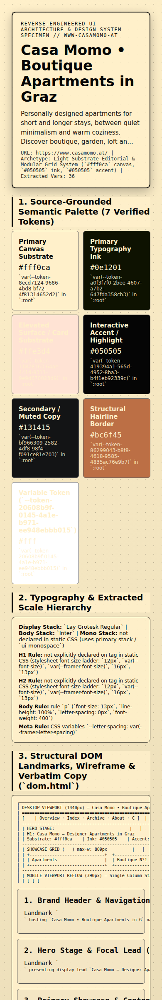

# UI Design System & Master Generation Blueprint: www-casamomo-at

> **Casa Momo • Boutique Apartments in Graz** (https://www.casamomo.at/) — Personally designed apartments for short and longer stays, between quiet minimalism and warm coziness. Discover boutique, garden, loft an...


---

## 1. Executive Visual Persona & Design Archetype

- **Brand Essence & Persona**: **Casa Momo • Boutique Apartments in Graz** (`https://www.casamomo.at/`). Personally designed apartments for short and longer stays, between quiet minimalism and warm coziness. Discover boutique, garden, loft an...
- **Visual Archetype**: **Light-Substrate Editorial & Modular Grid System (`#fff0ca` canvas, `#050505` ink, `#050505` accent)**.
- **Anti-AI-Slop Differentiators**:
  - **Source-Grounded Chromatic Polarity**: Anchors the viewport in `#fff0ca` (`var(--token-8ecd7124-9686-4bd8-bf72-4f81314652d2)` in `:root`) paired with `#050505` primary typography and `#050505` accents.
  - **Extracted Typographic Hierarchy**: Pairs `Lay Grotesk Regular` for display copy (`Casa Momo – Designer Apartments in G`) with `Inter` and not declared in static CSS (uses primary stack / `ui-monospace`).
  - **Calibrated Spatial Grid & Motion**: Combines `809px` container bounds (`gap: 12px`, padding `256px`) with `cubic-bezier(0.66,0,0,1)` easing and Lenis Smooth Scroll (`data-lenis`), Three.js / WebGL Canvas Pipeline.

---

## 2. Spatial Architecture & Modular Grid Mathematics



### Viewport Allocation & Container Geometry
- **Captured Viewport Dimensions**: Desktop `1440×2400px` (`assets/desktop.png`, capped at 2400px multi-section capture), Mobile `390×2400px` (`assets/mobile.png`, capped at 2400px multi-section capture).
- **Master Container Bounds**: `809px` extracted from `www-casamomo-at` stylesheet.
- **Canvas Lateral Padding & Spacing**: `256px` lateral canvas padding with `12px` grid gap.
- **Border Radius Scale**: `2px`, `64px`, `8px`, `15px`.

### Responsive Breakpoint Architecture
- **Desktop Layout**: Multi-column CSS Grid / Flexbox layout at `1440px` (`max-width: 809px`, `gap: 12px`).
- **Mobile Layout**: Single-column vertical stack at `390px` viewport width with `256px` horizontal padding.
- **Extracted CSS Media Queries**: `@media (max-width:809px) and (min-width:0)`, `@media (max-width:809.98px)`, `@media (min-width:810px) and (max-width:1599.98px)`, `@media (max-width: 809.98px)`.

---

## 3. Color System, Materiality & Atmospheric Lighting

### Semantic Palette & Source Grounding
| Semantic Role | Ground-Truth Value | Extracted CSS Source / Selector |
|---|---|---|
| **Primary Canvas Substrate** | `#fff0ca` | `var(--token-8ecd7124-9686-4bd8-bf72-4f81314652d2)` in `:root` |
| **Primary Typography Ink** | `#0e1201` | `var(--token-a0f3f7f0-2bee-4607-a7b2-647fda358cb3)` in `:root` |
| **Elevated Surface / Card Substrate** | `#ffe3d4` | `var(--token-11878163-64ae-441d-8311-9e9d670023d9)` in `:root` |
| **Interactive Accent / Highlight** | `#050505` | `var(--token-419394a1-565d-4952-8ba3-b4f1eb92339c)` in `:root` |
| **Secondary / Muted Copy** | `#131415` | `var(--token-bf966309-2582-4df8-98f4-f091ce81e703)` in `:root` |
| **Structural Hairline Border** | `#bc6f45` | `var(--token-86299043-b8f8-4618-9585-4835ac76e9b7)` in `:root` |
| **Variable Token (`--token-20608b9f-0145-4a1e-b971-ee948ebbb015`)** | `#fff` | `var(--token-20608b9f-0145-4a1e-b971-ee948ebbb015)` in `:root` |

### Sanitized Root CSS Variables (`ui-ux.md` Ground Truth)
| Variable Name | Extracted Value | Semantic Role |
|---|---|---|
| `--token-8ecd7124-9686-4bd8-bf72-4f81314652d2` | `#fff0ca` | Color / Atmospheric Token |
| `--token-a0f3f7f0-2bee-4607-a7b2-647fda358cb3` | `#0e1201` | Color / Atmospheric Token |
| `--token-11878163-64ae-441d-8311-9e9d670023d9` | `#ffe3d4` | Color / Atmospheric Token |
| `--token-419394a1-565d-4952-8ba3-b4f1eb92339c` | `#050505` | Color / Atmospheric Token |
| `--token-bf966309-2582-4df8-98f4-f091ce81e703` | `#131415` | Color / Atmospheric Token |
| `--token-86299043-b8f8-4618-9585-4835ac76e9b7` | `#bc6f45` | Color / Atmospheric Token |
| `--token-0da0c5a6-8028-40b0-8315-7bce946c6731` | `#131415` | Color / Atmospheric Token |
| `--token-20608b9f-0145-4a1e-b971-ee948ebbb015` | `#fff` | Color / Atmospheric Token |
| `--token-e00ea664-9c78-44de-bf9c-6839d671d9c2` | `#050505` | Color / Atmospheric Token |
| `--token-31f69385-9489-4b68-a801-60367d4b1ac3` | `#0e1201` | Color / Atmospheric Token |
| `--text-decoration-skip-ink` | `var(--framer-text-decoration-skip-ink)` | Typography Ink Token |
| `--text-underline-offset` | `var(--framer-text-decoration-offset)` | Typography Ink Token |
| `--font-family` | `var(--framer-font-family)` | Typography / Scale Token |
| `--font-style` | `var(--framer-font-style)` | Typography / Scale Token |
| `--font-weight` | `var(--framer-font-weight)` | Typography / Scale Token |
| `--text-color` | `var(--framer-text-color)` | Typography Ink Token |

---

## 4. Typographic Scale & Editorial Hierarchy

### Font Family Stacks
- **Display Typography**: `Lay Grotesk Regular`.
- **Primary Body Stack**: `Inter`.
- **Technical / Metadata Stack**: not declared in static CSS (uses primary stack / `ui-monospace`).

### Typographic Scale & Rules (Extracted from Stylesheet & Variables)
- **Hero Display (`H1`)**: not explicitly declared on tag in static CSS (stylesheet font-size ladder: `12px`, `var(--font-size)`, `var(--framer-font-size)`, `16px`, `13px`).
- **Section Heading (`H2`)**: not explicitly declared on tag in static CSS (stylesheet font-size ladder: `12px`, `var(--font-size)`, `var(--framer-font-size)`, `16px`, `13px`).
- **Body Copy**: rule `p` (`font-size: 13px`, `line-height: 100%`, `letter-spacing: 0px`, `font-weight: 400`).
- **Metadata & Navigation Labels**: CSS variables `--letter-spacing: var(--framer-letter-spacing)`.

---

## 5. Choreographed Motion & Interaction Physics

### Primary Easing Curves
- **Extracted Timing Functions**: `cubic-bezier(0.66,0,0,1)`, `cubic-bezier(0.45,0,0.55,1)`, `cubic-bezier(0.52,0,0,1)`.

### Per-Element Transition & Choreography Rules
- **Selector `media (prefers-reduced-motion: re...`**: `transition: .01ms!important` extracted from `www-casamomo-at` stylesheet.
- **Selector `#__framer-editorbar-label`**: `transition: opacity 0.4s ease-out` extracted from `www-casamomo-at` stylesheet.
- **Selector `data-framer-name="Menu Overlay"]`**: `transition: visibility 0s linear 0.6s,display 0s linear 0.6s` extracted from `www-casamomo-at` stylesheet.
- **Extracted Easing Curve (`cubic-bezier(0.66,0,0,1)`)**: Governs interactive state transitions across `<header.framer-bg7hsc>` and `<section.framer-chahzh>`.
- **Runtime Interaction Engine**: Integrates Lenis Smooth Scroll (`data-lenis`), Three.js / WebGL Canvas Pipeline, Framer Motion Layout Physics with `prefers-reduced-motion: reduce` fallback guards.

---

## 6. Component Wireframe & Structural DOM Map

### Visual Layout Schematic (Grounded in `dom.html` — `1440px` Desktop & `390px` Mobile Reflow)
```
┌────────────────────────────────────────────────────────────────────────┐
│ DESKTOP VIEWPORT (1440px) — Casa Momo • Boutique Apartments in Graz    │
│ ====================================================================== │
│ [ <header.framer-bg7hsc>   | Overview · Index · Archive · About · C ]  │
│ ---------------------------------------------------------------------- │
│ | HERO STAGE: <section.framer-1xtxml1>                             |   │
│ | H1: Casa Momo – Designer Apartments in Graz                      |   │
│ | Substrate: #fff0ca    | Ink: #050505    | Accent: #050505        |   │
│ ---------------------------------------------------------------------- │
│ | SHOWCASE GRID (<section.framer-chahzh>   ) max-w: 809px          |   │
│ | +------------------------------+  +------------------------------+ | │
│ | | Apartments                   |  | Boutique N°1                 | | │
│ | +------------------------------+  +------------------------------+ | │
│ ---------------------------------------------------------------------- │
│ | MOBILE VIEWPORT REFLOW (390px) — Single-Column Stack (gap: 12px  ) | │
│ | [<header.framer-bg7] -> [<section.framer-1x] -> [<section.framer-ch] │
│ ---------------------------------------------------------------------- │
│ [ FOOTER (<footer.framer-18na9ah) | https://www.casamomo.at/           │
└────────────────────────────────────────────────────────────────────────┘
```

### Granular DOM Region Breakdown
1. **Brand Header & Navigation Bar (<header.framer-bg7hsc> — `www-casamomo-at`)**:
   - Landmark `<header class="framer-bg7hsc">` hosting `Casa Momo • Boutique Apartments in G` navigation (`Overview · Index · Archive · About · Contact`), DOM attributes (`data-redirect-timezone="1"`, `data-framer-font-css`, `data-framer-css-ssr-minified`, `data-framer-components="framer-lib-cursors-ho..."`), and stylesheet rule `main { box-sizing:border-box;margin:0;padding:0 }`.
2. **Hero Stage & Focal Lead (<section.framer-1xtxml1> — `Casa Momo – Designer Apartments in`)**:
   - Landmark `<section class="framer-1xtxml1">` presenting display lead `Casa Momo – Designer Apartments in Graz` and copy excerpt *"Apartments A A A p p p a a a r r r t t t m m m e e e n n n t t t "* over `#fff0ca` canvas and `#050505` ink.
3. **Primary Showcase & Content Grid (<section.framer-chahzh> — `Apartments`)**:
   - Landmark `<section class="framer-chahzh">` rendering section `Apartments` with copy *"About A A A b b b o o o u u u t t t"*, asset references (`1i2kLqAOiU4EMx2iRruplpXhvgs.png`, `SaAMBRSDzmk41xPyN78AdKzfnM.png`, `NVhSQp5HYf1e4Zkg5QjllUhdYXM.png`, `eegZ1ZoVjnHyJtxDMTEhJ2Bhf4.woff2`), and grid rule `root { -webkit-font-smoothing:antialiased;-moz-osx-font-smoothing:grayscale }`.
4. **Interactive Detail & Feature Matrix (<section.framer-mefgjz> — `Boutique N°1`)**:
   - Landmark `<section class="framer-mefgjz">` framing `Boutique N°1` and `Boutique N°2` (*"Contact C C C o o o n n n t t t a a a c c c t t t"*) with `#ffe3d4` surface cards, `#050505` accents, and `button { font-family:sans-serif;font-size:12px }`.
5. **Colophon & Global Directory Footer (<footer.framer-18na9ah> — `https://www.casamomo.at/`)**:
   - Landmark `<footer class="framer-18na9ah">` anchoring `Casa Momo • Boutique Apartments ` footer links (`Overview · Index · Archive · About · Contact`), copy *"Book Now B B B o o o o o o k k k N N N o o o w w w"*, and `#bc6f45` structural dividers.

---

## 7. Master Zero-Shot AI Generation Prompt

```markdown
# Master Zero-Shot Frontend Generation Prompt: www-casamomo-at (Casa Momo • Boutique Apartments in Graz)

You are a principal frontend architect and design systems engineer. Build a complete, production-ready web application replicating the exact design system, DOM landmarks, typographic hierarchy, color tokens, and motion physics of `www-casamomo-at` (**Casa Momo • Boutique Apartments in Graz** — `https://www.casamomo.at/`).

### 1. Visual Archetype & Anti-AI-Slop Mandates
- **Archetype**: Light-Substrate Editorial & Modular Grid System (`#fff0ca` canvas, `#050505` ink, `#050505` accent).
- **Identity & Domain Context**: Personally designed apartments for short and longer stays, between quiet minimalism and warm coziness. Discover boutique, garden, loft an...
- **Primary Substrate**: `#fff0ca` (`var(--token-8ecd7124-9686-4bd8-bf72-4f81314652d2)` in `:root`), **Primary Ink**: `#050505`, **Accent / Highlight**: `#050505`.
- **Site-Specific Differentiators**:
  - **Source-Grounded Chromatic Polarity**: Anchors the viewport in `#fff0ca` (`var(--token-8ecd7124-9686-4bd8-bf72-4f81314652d2)` in `:root`) paired with `#050505` primary typography and `#050505` accents.
  - **Extracted Typographic Hierarchy**: Pairs `Lay Grotesk Regular` for display copy (`Casa Momo – Designer Apartments in G`) with `Inter` and not declared in static CSS (uses primary stack / `ui-monospace`).
  - **Calibrated Spatial Grid & Motion**: Combines `809px` container bounds (`gap: 12px`, padding `256px`) with `cubic-bezier(0.66,0,0,1)` easing and Lenis Smooth Scroll (`data-lenis`), Three.js / WebGL Canvas Pipeline.

### 2. Ground-Truth CSS Variables (`:root` Token Contract)
Declare and consume these exact custom properties extracted from `www-casamomo-at` in your global stylesheet:

:root {
  /* Casa Momo • Boutique Apartments in Graz (www-casamomo-at) — Ground-Truth Extracted CSS Variables */
  --token-8ecd7124-9686-4bd8-bf72-4f81314652d2: #fff0ca; /* Color / Atmospheric Token (www-casamomo-at) */
  --token-a0f3f7f0-2bee-4607-a7b2-647fda358cb3: #0e1201; /* Color / Atmospheric Token (www-casamomo-at) */
  --token-11878163-64ae-441d-8311-9e9d670023d9: #ffe3d4; /* Color / Atmospheric Token (www-casamomo-at) */
  --token-419394a1-565d-4952-8ba3-b4f1eb92339c: #050505; /* Color / Atmospheric Token (www-casamomo-at) */
  --token-bf966309-2582-4df8-98f4-f091ce81e703: #131415; /* Color / Atmospheric Token (www-casamomo-at) */
  --token-86299043-b8f8-4618-9585-4835ac76e9b7: #bc6f45; /* Color / Atmospheric Token (www-casamomo-at) */
  --token-0da0c5a6-8028-40b0-8315-7bce946c6731: #131415; /* Color / Atmospheric Token (www-casamomo-at) */
  --token-20608b9f-0145-4a1e-b971-ee948ebbb015: #fff; /* Color / Atmospheric Token (www-casamomo-at) */
  --token-e00ea664-9c78-44de-bf9c-6839d671d9c2: #050505; /* Color / Atmospheric Token (www-casamomo-at) */
  --token-31f69385-9489-4b68-a801-60367d4b1ac3: #0e1201; /* Color / Atmospheric Token (www-casamomo-at) */
  --text-decoration-skip-ink: var(--framer-text-decoration-skip-ink); /* Typography Ink Token (www-casamomo-at) */
  --text-underline-offset: var(--framer-text-decoration-offset); /* Typography Ink Token (www-casamomo-at) */
  --font-family: var(--framer-font-family); /* Typography / Scale Token (www-casamomo-at) */
  --font-style: var(--framer-font-style); /* Typography / Scale Token (www-casamomo-at) */
  --font-weight: var(--framer-font-weight); /* Typography / Scale Token (www-casamomo-at) */
  --text-color: var(--framer-text-color); /* Typography Ink Token (www-casamomo-at) */
}

### 3. Semantic Color & Materiality Contract
Map every surface, ink, and border strictly to these source-grounded tokens:
- **Primary Canvas Substrate**: `#fff0ca` — grounded in `var(--token-8ecd7124-9686-4bd8-bf72-4f81314652d2)` in `:root`
- **Primary Typography Ink**: `#0e1201` — grounded in `var(--token-a0f3f7f0-2bee-4607-a7b2-647fda358cb3)` in `:root`
- **Elevated Surface / Card Substrate**: `#ffe3d4` — grounded in `var(--token-11878163-64ae-441d-8311-9e9d670023d9)` in `:root`
- **Interactive Accent / Highlight**: `#050505` — grounded in `var(--token-419394a1-565d-4952-8ba3-b4f1eb92339c)` in `:root`
- **Secondary / Muted Copy**: `#131415` — grounded in `var(--token-bf966309-2582-4df8-98f4-f091ce81e703)` in `:root`
- **Structural Hairline Border**: `#bc6f45` — grounded in `var(--token-86299043-b8f8-4618-9585-4835ac76e9b7)` in `:root`
- **Variable Token (`--token-20608b9f-0145-4a1e-b971-ee948ebbb015`)**: `#fff` — grounded in `var(--token-20608b9f-0145-4a1e-b971-ee948ebbb015)` in `:root`

### 4. Spatial Grid, Container Bounds & Responsive Breakpoints
- **Desktop Viewport Reference**: `1440×2400px` (capped at 2400px multi-section capture, `1440px` standard desktop width).
- **Mobile Viewport Reference**: `390×2400px` (capped at 2400px multi-section capture, `390px` standard mobile width).
- **Container Max-Width**: `809px` extracted from `www-casamomo-at` stylesheet
- **Padding & Gutters**: `256px` lateral canvas padding with `12px` grid gap
- **Desktop Grid**: Multi-column CSS Grid / Flexbox layout at `1440px` (`max-width: 809px`, `gap: 12px`)
- **Mobile Adaptation**: Single-column vertical stack at `390px` viewport width with `256px` horizontal padding
- **Media Queries**: `@media (max-width:809px) and (min-width:0)`, `@media (max-width:809.98px)`, `@media (min-width:810px) and (max-width:1599.98px)`, `@media (max-width: 809.98px)`
- **Corner Radii**: `2px`, `64px`, `8px`, `15px`

### 5. Typography & Editorial Scale Contract
- **Display Font Stack**: `Lay Grotesk Regular`
- **Body Font Stack**: `Inter`
- **Monospace / Technical Font Stack**: not declared in static CSS (uses primary stack / `ui-monospace`)
- **H1 Display Rule**: not explicitly declared on tag in static CSS (stylesheet font-size ladder: `12px`, `var(--font-size)`, `var(--framer-font-size)`, `16px`, `13px`)
- **H2 Section Rule**: not explicitly declared on tag in static CSS (stylesheet font-size ladder: `12px`, `var(--font-size)`, `var(--framer-font-size)`, `16px`, `13px`)
- **Body Copy Rule**: rule `p` (`font-size: 13px`, `line-height: 100%`, `letter-spacing: 0px`, `font-weight: 400`)
- **Metadata & Index Rule**: CSS variables `--letter-spacing: var(--framer-letter-spacing)`

### 6. Component Hierarchy, Verbatim Copy & Real DOM Landmarks
Scaffold `www-casamomo-at` (`Casa Momo • Boutique Apartments in Graz`) with these exact structural regions, extracted copy, and CSS rules from `dom.html`:
1. **Brand Header & Navigation Bar (<header.framer-bg7hsc> — `www-casamomo-at`)**:
   - DOM & Selectors: Landmark `<header class="framer-bg7hsc">` hosting `Casa Momo • Boutique Apartments in G` navigation (`Overview · Index · Archive · About · Contact`), DOM attributes (`data-redirect-timezone="1"`, `data-framer-font-css`, `data-framer-css-ssr-minified`, `data-framer-components="framer-lib-cursors-ho..."`), and stylesheet rule `main { box-sizing:border-box;margin:0;padding:0 }`.
   - Responsive Contract: Header `Brand Header & Navigation Bar (<header.framer-bg7hsc> — `www-casamomo-at`)` (`www-casamomo-at`) adapts across `@media (max-width:809px) and (min-width:0)`, `@media (max-width:809.98px)`, `@media (min-width:810px) and (max-width:1599.98px)`, `@media (max-width: 809.98px)` with `cubic-bezier(0.66,0,0,1)`, `cubic-bezier(0.45,0,0.55,1)`, `cubic-bezier(0.52,0,0,1)` transitions and links `Overview · Index · Archive · About · Contact`.
2. **Hero Stage & Focal Lead (<section.framer-1xtxml1> — `Casa Momo – Designer Apartments in`)**:
   - DOM & Selectors: Landmark `<section class="framer-1xtxml1">` presenting display lead `Casa Momo – Designer Apartments in Graz` and copy excerpt *"Apartments A A A p p p a a a r r r t t t m m m e e e n n n t t t "* over `#fff0ca` canvas and `#050505` ink.
   - Responsive Contract: Hero stage (`1440×2400px` desktop / `390×2400px` mobile) sets `#fff0ca` background with `#050505` headline `Casa Momo – Designer Apartments in Graz`.
3. **Primary Showcase & Content Grid (<section.framer-chahzh> — `Apartments`)**:
   - DOM & Selectors: Landmark `<section class="framer-chahzh">` rendering section `Apartments` with copy *"About A A A b b b o o o u u u t t t"*, asset references (`1i2kLqAOiU4EMx2iRruplpXhvgs.png`, `SaAMBRSDzmk41xPyN78AdKzfnM.png`, `NVhSQp5HYf1e4Zkg5QjllUhdYXM.png`, `eegZ1ZoVjnHyJtxDMTEhJ2Bhf4.woff2`), and grid rule `root { -webkit-font-smoothing:antialiased;-moz-osx-font-smoothing:grayscale }`.
   - Responsive Contract: Showcase grid `Primary Showcase & Content Grid (<section.framer-chahzh> — `Apartments`)` applies Multi-column CSS Grid / Flexbox layout at `1440px` (`max-width: 809px`, `gap: 12px`) on desktop and Single-column vertical stack at `390px` viewport width with `256px` horizontal padding on mobile.
4. **Interactive Detail & Feature Matrix (<section.framer-mefgjz> — `Boutique N°1`)**:
   - DOM & Selectors: Landmark `<section class="framer-mefgjz">` framing `Boutique N°1` and `Boutique N°2` (*"Contact C C C o o o n n n t t t a a a c c c t t t"*) with `#ffe3d4` surface cards, `#050505` accents, and `button { font-family:sans-serif;font-size:12px }`.
   - Responsive Contract: Detail module `Interactive Detail & Feature Matrix (<section.framer-mefgjz> — `Boutique N°1`)` uses `2px`, `64px`, `8px`, `15px` radii, `#050505` highlights, and assets (1i2kLqAOiU4EMx2iRruplpXhvgs.png, SaAMBRSDzmk41xPyN78AdKzfnM.png, NVhSQp5HYf1e4Zkg5QjllUhdYXM.png).
5. **Colophon & Global Directory Footer (<footer.framer-18na9ah> — `https://www.casamomo.at/`)**:
   - DOM & Selectors: Landmark `<footer class="framer-18na9ah">` anchoring `Casa Momo • Boutique Apartments ` footer links (`Overview · Index · Archive · About · Contact`), copy *"Book Now B B B o o o o o o k k k N N N o o o w w w"*, and `#bc6f45` structural dividers.
   - Responsive Contract: Footer `Colophon & Global Directory Footer (<footer.framer-18na9ah> — `https://www.casamomo.at/`)` aligns to `809px` extracted from `www-casamomo-at` stylesheet with `256px` lateral canvas padding with `12px` grid gap and attributes (data-redirect-timezone="1", data-framer-font-css, data-framer-css-ssr-minified).

#### Verbatim DOM Copy Excerpts (`dom.html`)
- Copy Excerpt 1: *"Apartments A A A p p p a a a r r r t t t m m m e e e n n n t t t s s s"*
- Copy Excerpt 2: *"About A A A b b b o o o u u u t t t"*
- Copy Excerpt 3: *"Contact C C C o o o n n n t t t a a a c c c t t t"*
- Copy Excerpt 4: *"Book Now B B B o o o o o o k k k N N N o o o w w w"*

### 7. Motion, Extracted Stylesheet Rules & Interaction Choreography
- **Primary Easing Functions**: `cubic-bezier(0.66,0,0,1)`, `cubic-bezier(0.45,0,0.55,1)`, `cubic-bezier(0.52,0,0,1)`
- **Extracted Stylesheet Rules (`www-casamomo-at`)**:
- `main { box-sizing:border-box;margin:0;padding:0 }`
- `root { -webkit-font-smoothing:antialiased;-moz-osx-font-smoothing:grayscale }`
- `button { font-family:sans-serif;font-size:12px }`
- `body { --framer-will-change-override:transform }`
- `h6 span { display:block }`
- **Per-Selector Transition Rules**:
- **Selector `media (prefers-reduced-motion: re...`**: `transition: .01ms!important` extracted from `www-casamomo-at` stylesheet.
- **Selector `#__framer-editorbar-label`**: `transition: opacity 0.4s ease-out` extracted from `www-casamomo-at` stylesheet.
- **Selector `data-framer-name="Menu Overlay"]`**: `transition: visibility 0s linear 0.6s,display 0s linear 0.6s` extracted from `www-casamomo-at` stylesheet.
- **Extracted Easing Curve (`cubic-bezier(0.66,0,0,1)`)**: Governs interactive state transitions across `<header.framer-bg7hsc>` and `<section.framer-chahzh>`.
- **Runtime Interaction Engine**: Integrates Lenis Smooth Scroll (`data-lenis`), Three.js / WebGL Canvas Pipeline, Framer Motion Layout Physics with `prefers-reduced-motion: reduce` fallback guards.

### 8. Technical Deliverables
- Implement in Next.js (App Router) with TypeScript and Tailwind CSS consuming the `:root` custom properties defined above for `www-casamomo-at`.
- Reproduce both the `1440px` desktop architecture and `390px` mobile breakpoint transitions, preserving semantic HTML5 landmarks (`<header>`, `<nav>`, `<main>`, `<section>`, `<footer>`) and `prefers-reduced-motion` accessibility guards.
```
