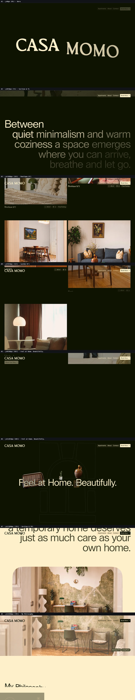
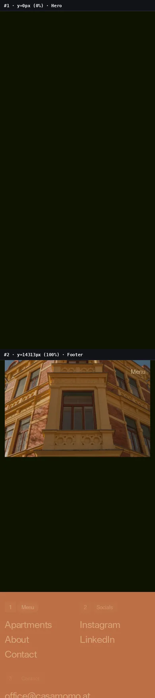

# UI Design System & Master Generation Blueprint: www-casamomo-at

> **Casa Momo • Boutique Apartments in Graz** (https://www.casamomo.at/) — Personally designed apartments for short and longer stays, between quiet minimalism and warm coziness. Discover boutique, garden, loft an...





---

## 1. Executive Visual Persona & Design Archetype

- **Brand Essence & Persona**: **Casa Momo • Boutique Apartments in Graz** (`https://www.casamomo.at/`). Personally designed apartments for short and longer stays, between quiet minimalism and warm coziness. Discover boutique, garden, loft an...
- **Capture Provenance**: Live browser capture (`tier1_fast`, HTTP `200`, captured `2026-11-24`).
- **Visual Archetype**: **High-Contrast Obsidian / Atmospheric Design System (`#0e1201` canvas, `#fff0ca` ink, `#ffffff` accent)**.
- **Anti-AI-Slop Differentiators**:
  - **Live-Computed Chromatic Polarity**: Anchors the viewport in `#0e1201` (live computed `body` `background-color` (`computed_styles.json`)) paired with `#fff0ca` primary typography and `#ffffff` accents.
  - **Grounded Typographic Hierarchy**: Pairs `Inter` for display copy (`Casa Momo – Designer Apartments in G`) with `Lay Grotesk Regular`.
  - **Calibrated Spatial Grid & Motion**: Combines `1344px` container bounds (`gap: 12px`, padding `256px`) with `cubic-bezier(0.66,0,0,1)` easing and Lenis Smooth Scroll (`data-lenis`), Three.js / WebGL Canvas Pipeline.

---

## 2. Spatial Architecture & Modular Grid Mathematics

### Viewport Allocation & Container Geometry
- **Captured Journey Filmstrips**: Desktop `1280×6624px` (`assets/desktop-journey.webp`, `8` keyframes up to `y=14400px` / doc `19336px`), Mobile `390×1744px` (`assets/mobile-journey.webp`, `2` keyframes).
- **Master Container Bounds**: `1344px` (measured widest bounded `<section>` landmark width on `1440px` desktop).
- **Canvas Lateral Padding & Spacing**: `256px` lateral canvas padding with `12px` grid gap.
- **Border Radius Scale**: `2px`, `64px`, `8px`, `15px`.

### Responsive Breakpoint Architecture
- **Desktop Layout**: Multi-column CSS Grid / Flexbox layout at `1440px` (`max-width: 1344px`, `gap: 12px`).
- **Mobile Layout**: Single-column vertical stack at `390px` viewport width with `256px` horizontal padding.
- **Extracted CSS Media Queries**: `@media (min-width: 1600px)`, `@media (min-width: 810px) and (max-width: 1599.98px)`, `@media (max-width: 809.98px)`, `@media (max-width:809px) and (min-width:0)`.

---

## 3. Color System, Materiality & Atmospheric Lighting

### Semantic Palette & Source Grounding
| Semantic Role | Ground-Truth Value | Extracted Live / CSS Source |
|---|---|---|
| **Primary Canvas Substrate** | `#0e1201` | live computed `body` `background-color` (`computed_styles.json`) |
| **Primary Typography Ink** | `#fff0ca` | live computed `p` `color` (`computed_styles.json`) |
| **Elevated Surface / Card Substrate** | `#964317` | live computed `footer` `background-color` (`computed_styles.json`) |
| **Interactive Accent / Highlight** | `#ffffff` | `#__framer-editorbar-button { color: #ffffff }` |
| **Secondary / Muted Copy** | `#000000` | live computed `nav` `color` (`computed_styles.json`) |
| **Structural Hairline Border** | `#000000` | hairline divider derived from live computed `nav` `color` (`computed_styles.json`) |
| **Variable Token (`--token-11878163-64ae-441d-8311-9e9d670023d9`)** | `#ffe3d4` | `var(--token-11878163-64ae-441d-8311-9e9d670023d9)` in `:root` |
| **Variable Token (`--token-419394a1-565d-4952-8ba3-b4f1eb92339c`)** | `#050505` | `var(--token-419394a1-565d-4952-8ba3-b4f1eb92339c)` in `:root` |
| **Variable Token (`--token-bf966309-2582-4df8-98f4-f091ce81e703`)** | `#131415` | `var(--token-bf966309-2582-4df8-98f4-f091ce81e703)` in `:root` |
| **Variable Token (`--token-86299043-b8f8-4618-9585-4835ac76e9b7`)** | `#bc6f45` | `var(--token-86299043-b8f8-4618-9585-4835ac76e9b7)` in `:root` |

### Sanitized Root CSS Variables (`ui-ux.md` Ground Truth)
| Variable Name | Extracted Value | Semantic Role |
|---|---|---|
| `--casa-p1-size` | `calc(var(--casa-page-w, 100vw) * 0.020000)` | Layout / Spatial Grid Token |
| `--casa-p1-lh` | `1.2em` | Dimension / Scale Token |
| `--casa-p1-ls` | `-0.2px` | Dimension / Scale Token |
| `--token-8ecd7124-9686-4bd8-bf72-4f81314652d2` | `#fff0ca` | Color / Atmospheric Token |
| `--token-a0f3f7f0-2bee-4607-a7b2-647fda358cb3` | `#0e1201` | Color / Atmospheric Token |
| `--token-11878163-64ae-441d-8311-9e9d670023d9` | `#ffe3d4` | Color / Atmospheric Token |
| `--token-419394a1-565d-4952-8ba3-b4f1eb92339c` | `#050505` | Color / Atmospheric Token |
| `--token-bf966309-2582-4df8-98f4-f091ce81e703` | `#131415` | Color / Atmospheric Token |
| `--token-86299043-b8f8-4618-9585-4835ac76e9b7` | `#bc6f45` | Color / Atmospheric Token |
| `--token-0da0c5a6-8028-40b0-8315-7bce946c6731` | `#131415` | Color / Atmospheric Token |
| `--token-20608b9f-0145-4a1e-b971-ee948ebbb015` | `#fff` | Color / Atmospheric Token |
| `--token-e00ea664-9c78-44de-bf9c-6839d671d9c2` | `#050505` | Color / Atmospheric Token |
| `--token-31f69385-9489-4b68-a801-60367d4b1ac3` | `#0e1201` | Color / Atmospheric Token |
| `--text-decoration-skip-ink` | `var(--framer-text-decoration-skip-ink)` | Typography Ink Token |
| `--text-underline-offset` | `var(--framer-text-decoration-offset)` | Typography Ink Token |
| `--font-family` | `var(--framer-font-family)` | Typography / Scale Token |

---

## 4. Typographic Scale & Editorial Hierarchy

### Font Family Stacks
- **Display Typography**: `Inter`.
- **Primary Body Stack**: `Lay Grotesk Regular`.
- **Technical / Metadata Stack**: not declared in live computed styles (uses primary stack / `ui-monospace`).

### Typographic Scale & Rules (Live Computed & Stylesheet Grounded)
- **Hero Display (`H1`)**: live computed `h1` (`font-size: 16px`, `line-height: 19.2px`, `font-weight: 400`).
- **Section Heading (`H2`)**: live computed `h2` (`font-size: 135px`, `line-height: 135px`, `font-weight: 400`, `letter-spacing: -2.7px`).
- **Body Copy**: live computed `body` (`font-size: 12px`, `line-height: normal`, `font-weight: 400`); rule `p` (`font-size: 13px`, `line-height: 100%`, `letter-spacing: 0px`, `font-weight: 400`).
- **Metadata & Navigation Labels**: live computed `nav/a` (`font-size: 12px`, `line-height: normal`, `font-weight: 400`); CSS variables `--letter-spacing: var(--framer-letter-spacing)`.

---

## 5. Choreographed Motion & Interaction Physics

### Primary Easing Curves
- **Extracted Timing Functions**: `cubic-bezier(0.66,0,0,1)`, `cubic-bezier(0.45,0,0.55,1)`, `cubic-bezier(0.52,0,0,1)`.

### Per-Element Transition & Choreography Rules
- **Selector `media (prefers-reduced-motion: re...`**: `transition: .01ms!important` extracted from `www-casamomo-at` stylesheet.
- **Selector `#__framer-editorbar-label`**: `transition: opacity 0.4s ease-out` extracted from `www-casamomo-at` stylesheet.
- **Selector `data-framer-name="Menu Overlay"]`**: `transition: visibility 0s linear 0.6s,display 0s linear 0.6s` extracted from `www-casamomo-at` stylesheet.
- **Extracted Easing Curve (`cubic-bezier(0.66,0,0,1)`)**: Governs interactive state transitions across `<header.framer-bg7hsc>` and `<section.framer-chahzh>`.
- **Runtime Interaction Engine**: Integrates Lenis Smooth Scroll (`data-lenis`), Three.js / WebGL Canvas Pipeline, Framer Motion Layout Physics with `prefers-reduced-motion: reduce` fallback guards.
### Measured Runtime Scroll & Interaction Telemetry (`behavioral_journey_v2`)
- **Scroll Driver Mode**: `native` (max document height `19336px`, deepest scrollY reached `14400px` across `8` desktop keyframes).
- **Detected Scroll / Motion Libraries**: `Lenis`, `Framer Motion`.
- **Hover Physics (`primary_cta` · `About A A b b o o u u t t`)**: Computed transition `0s` / `ease` (no static color/transform shift captured at rest).
- **Route Transition Architecture**: First internal navigation (`/apartments/boutique-n1`) measured as `direct` in `1009ms`.

---

## 6. Component Wireframe & Structural DOM Map

### Visual Layout Schematic — Desktop (`1440px`, Grounded in `dom.html` & Landmark Bounding Boxes)
```
┌────────────────────────────────────────────────────────────────────────┐
│ DESKTOP VIEWPORT (1440px) — Casa Momo • Boutique Apartments in Graz    │
│ ====================================================================== │
│ [ <header.framer-bg7hsc> (1440x110px) | Overview · Index · Archive · ] │
│ ---------------------------------------------------------------------- │
│ | HERO STAGE: <section.framer-1xtxml1> (w=1440px)                    | │
│ | H1: Casa Momo – Designer Apartments in Graz                        | │
│ | Substrate: #0e1201 | Ink: #fff0ca | Accent: #ffffff                | │
│ ---------------------------------------------------------------------- │
│ | SHOWCASE GRID (<section.framer-chahzh>) max-w: 1344px              | │
│ | +------------------------------+  +------------------------------+ | │
│ | | Boutique N°1                 |  | Boutique N°2                 | | │
│ | +------------------------------+  +------------------------------+ | │
│ ---------------------------------------------------------------------- │
│ | DETAIL MODULE (<section.framer-mefgjz>) — Boutique N°3             | │
│ ---------------------------------------------------------------------- │
│ [ FOOTER (<footer.framer-18na9) | https://www.casamomo.at/             │
└────────────────────────────────────────────────────────────────────────┘
```

### Visual Layout Schematic — Mobile Reflow (`390px`)
```
┌────────────────────────────────────────────────────────────────────────┐
│ MOBILE VIEWPORT REFLOW (390px) — Single-Column Stack (gap: 12px)       │
│ ====================================================================== │
│ [ HEADER BAR (<header.framer-bg7hsc>  ) | Compact Menu (390px)         │
│ ---------------------------------------------------------------------- │
│ | HERO STAGE (<section.framer-1xtxml1>) — 390px Vertical Lead        | │
│ | H1: Casa Momo – Designer Apartments in Graz                        | │
│ ---------------------------------------------------------------------- │
│ | SHOWCASE STACK (<section.framer-chahzh) — 1-Col Stack              | │
│ | [ Item 1: Boutique N°1                                           ] | │
│ | [ Item 2: Boutique N°2                                           ] | │
│ ---------------------------------------------------------------------- │
│ | DETAIL STACK (<section.framer-mefgjz>) — 1-Col (Boutique N°3)      | │
│ ---------------------------------------------------------------------- │
│ [ FOOTER (<footer.framer-18na9) | Stacked 390px Colophon               │
└────────────────────────────────────────────────────────────────────────┘
```

### Granular DOM Region Breakdown
1. **Brand Header & Navigation Bar (<header.framer-bg7hsc> — `www-casamomo-at`)**:
   - Landmark `<header class="framer-bg7hsc">` (`1440x110px`) hosting `Casa Momo • Boutique Apartments in G` navigation (`Overview · Index · Archive · About · Contact`), DOM attributes (`data-redirect-timezone="1"`, `data-framer-generated-canonical`, `data-framer-font-css`, `data-framer-breakpoint-css`), and stylesheet rule `.hidden-72rtr7 { display:none!important }`.
2. **Hero Stage & Focal Lead (<section.framer-1xtxml1> — `Casa Momo – Designer Apartments in`)**:
   - Landmark `<section class="framer-1xtxml1">` presenting display lead `Casa Momo – Designer Apartments in Graz` and copy excerpt *"I am the head and heart behind Casa Momo and hosting is what I lo"* over `#0e1201` canvas and `#fff0ca` ink.
3. **Primary Showcase & Content Grid (<section.framer-chahzh> — `Boutique N°1`)**:
   - Landmark `<section class="framer-chahzh">` rendering section `Boutique N°1` with copy *"Book Your Stay B B B o o o o o o k k k Y Y Y o o o u u u r r r S "*, asset references (`1i2kLqAOiU4EMx2iRruplpXhvgs.png`, `SaAMBRSDzmk41xPyN78AdKzfnM.png`, `NVhSQp5HYf1e4Zkg5QjllUhdYXM.png`, `eegZ1ZoVjnHyJtxDMTEhJ2Bhf4.woff2`), and grid rule `.hidden-p8zd8m { display:none!important }`.
4. **Interactive Detail & Feature Matrix (<section.framer-mefgjz> — `Boutique N°2`)**:
   - Landmark `<section class="framer-mefgjz">` framing `Boutique N°2` and `Boutique N°3` (*"5.00 / 5 “Moritz is such a gentle and wonderful host! The apartme"*) with `#964317` surface cards, `#ffffff` accents, and `.hidden-o5o8qi { display:none!important }`.
5. **Colophon & Global Directory Footer (<footer.framer-18na9ah> — `https://www.casamomo.at/`)**:
   - Landmark `<footer class="framer-18na9ah">` anchoring `Casa Momo • Boutique Apartments ` footer links (`Overview · Index · Archive · About · Contact`), copy *"“Moritz is such a gentle and wonderful host! The apartment i"*, and `#000000` structural dividers.
### Full Vertical Scroll Sequence (Desktop `1440×900` Keyframes)
- **Step 01** (`y=0px`, `0%`): Active landmark `Hero` · sticky/fixed elements: `1`
- **Step 02** (`y=850px`, `5%`): Active landmark `Section @ 5%` · sticky/fixed elements: `1`
- **Step 03** (`y=3400px`, `18%`): Active landmark `Boutique N°1` · sticky/fixed elements: `1`
- **Step 04** (`y=5950px`, `32%`): Active landmark `Garden N°1` · sticky/fixed elements: `1`
- **Step 05** (`y=8500px`, `46%`): Active landmark `Feel at Home. Beautifully.` · sticky/fixed elements: `1`
- **Step 06** (`y=11050px`, `60%`): Active landmark `Feel at Home. Beautifully.` · sticky/fixed elements: `1`
- **Step 07** (`y=13600px`, `74%`): Active landmark `Section @ 74%` · sticky/fixed elements: `1`
- **Step 08** (`y=14400px`, `78%`): Active landmark `My Philosophy` · sticky/fixed elements: `1`

### Multi-Page Internal Route Map
- **Detail Route (`/apartments/boutique-n1`)**: `https://www.casamomo.at/apartments/boutique-n1` — H1: `Boutique N°1 – Designer Apartment in Graz`, scrollHeight `12691px`, transition `direct` (`1009ms`)
- **About Route (`/about`)**: `https://www.casamomo.at/about` — H1: `About Casa Momo`, scrollHeight `5508px`, transition `direct` (`550ms`)
- **Detail Route (`/apartments/boutique-n2`)**: `https://www.casamomo.at/apartments/boutique-n2` — H1: `Boutique N°2 – Designer Apartment in Graz`, scrollHeight `13712px`, transition `direct` (`521ms`)

---

## 7. Master Zero-Shot AI Generation Prompt

```markdown
# Master Zero-Shot Frontend Generation Prompt: www-casamomo-at (Casa Momo • Boutique Apartments in Graz)

You are a principal frontend architect and design systems engineer. Build a complete, production-ready web application replicating the exact design system, DOM landmarks, typographic hierarchy, color tokens, and motion physics of `www-casamomo-at` (**Casa Momo • Boutique Apartments in Graz** — `https://www.casamomo.at/`).

### 1. Visual Archetype & Anti-AI-Slop Mandates
- **Archetype**: High-Contrast Obsidian / Atmospheric Design System (`#0e1201` canvas, `#fff0ca` ink, `#ffffff` accent).
- **Identity & Domain Context**: Personally designed apartments for short and longer stays, between quiet minimalism and warm coziness. Discover boutique, garden, loft an...
- **Primary Substrate**: `#0e1201` (live computed `body` `background-color` (`computed_styles.json`)), **Primary Ink**: `#fff0ca`, **Accent / Highlight**: `#ffffff`.
- **Site-Specific Differentiators**:
  - **Live-Computed Chromatic Polarity**: Anchors the viewport in `#0e1201` (live computed `body` `background-color` (`computed_styles.json`)) paired with `#fff0ca` primary typography and `#ffffff` accents.
  - **Grounded Typographic Hierarchy**: Pairs `Inter` for display copy (`Casa Momo – Designer Apartments in G`) with `Lay Grotesk Regular`.
  - **Calibrated Spatial Grid & Motion**: Combines `1344px` container bounds (`gap: 12px`, padding `256px`) with `cubic-bezier(0.66,0,0,1)` easing and Lenis Smooth Scroll (`data-lenis`), Three.js / WebGL Canvas Pipeline.

### 2. Ground-Truth CSS Variables (`:root` Token Contract)
Declare and consume these exact custom properties extracted from `www-casamomo-at` in your global stylesheet:

:root {
  /* Casa Momo • Boutique Apartments in Graz (www-casamomo-at) — Live-Grounded CSS Variables */
  --casa-p1-size: calc(var(--casa-page-w, 100vw) * 0.020000); /* Layout / Spatial Grid Token (www-casamomo-at) */
  --casa-p1-lh: 1.2em; /* Dimension / Scale Token (www-casamomo-at) */
  --casa-p1-ls: -0.2px; /* Dimension / Scale Token (www-casamomo-at) */
  --token-8ecd7124-9686-4bd8-bf72-4f81314652d2: #fff0ca; /* Color / Atmospheric Token (www-casamomo-at) */
  --token-a0f3f7f0-2bee-4607-a7b2-647fda358cb3: #0e1201; /* Color / Atmospheric Token (www-casamomo-at) */
  --token-11878163-64ae-441d-8311-9e9d670023d9: #ffe3d4; /* Color / Atmospheric Token (www-casamomo-at) */
  --token-419394a1-565d-4952-8ba3-b4f1eb92339c: #050505; /* Color / Atmospheric Token (www-casamomo-at) */
  --token-bf966309-2582-4df8-98f4-f091ce81e703: #131415; /* Color / Atmospheric Token (www-casamomo-at) */
  --token-86299043-b8f8-4618-9585-4835ac76e9b7: #bc6f45; /* Color / Atmospheric Token (www-casamomo-at) */
  --token-0da0c5a6-8028-40b0-8315-7bce946c6731: #131415; /* Color / Atmospheric Token (www-casamomo-at) */
  --token-20608b9f-0145-4a1e-b971-ee948ebbb015: #fff; /* Color / Atmospheric Token (www-casamomo-at) */
  --token-e00ea664-9c78-44de-bf9c-6839d671d9c2: #050505; /* Color / Atmospheric Token (www-casamomo-at) */
  --token-31f69385-9489-4b68-a801-60367d4b1ac3: #0e1201; /* Color / Atmospheric Token (www-casamomo-at) */
  --text-decoration-skip-ink: var(--framer-text-decoration-skip-ink); /* Typography Ink Token (www-casamomo-at) */
  --text-underline-offset: var(--framer-text-decoration-offset); /* Typography Ink Token (www-casamomo-at) */
  --font-family: var(--framer-font-family); /* Typography / Scale Token (www-casamomo-at) */
}

### 3. Semantic Color & Materiality Contract
Map every surface, ink, and border strictly to these source-grounded tokens:
- **Primary Canvas Substrate**: `#0e1201` — grounded in live computed `body` `background-color` (`computed_styles.json`)
- **Primary Typography Ink**: `#fff0ca` — grounded in live computed `p` `color` (`computed_styles.json`)
- **Elevated Surface / Card Substrate**: `#964317` — grounded in live computed `footer` `background-color` (`computed_styles.json`)
- **Interactive Accent / Highlight**: `#ffffff` — grounded in `#__framer-editorbar-button { color: #ffffff }`
- **Secondary / Muted Copy**: `#000000` — grounded in live computed `nav` `color` (`computed_styles.json`)
- **Structural Hairline Border**: `#000000` — grounded in hairline divider derived from live computed `nav` `color` (`computed_styles.json`)
- **Variable Token (`--token-11878163-64ae-441d-8311-9e9d670023d9`)**: `#ffe3d4` — grounded in `var(--token-11878163-64ae-441d-8311-9e9d670023d9)` in `:root`
- **Variable Token (`--token-419394a1-565d-4952-8ba3-b4f1eb92339c`)**: `#050505` — grounded in `var(--token-419394a1-565d-4952-8ba3-b4f1eb92339c)` in `:root`
- **Variable Token (`--token-bf966309-2582-4df8-98f4-f091ce81e703`)**: `#131415` — grounded in `var(--token-bf966309-2582-4df8-98f4-f091ce81e703)` in `:root`
- **Variable Token (`--token-86299043-b8f8-4618-9585-4835ac76e9b7`)**: `#bc6f45` — grounded in `var(--token-86299043-b8f8-4618-9585-4835ac76e9b7)` in `:root`

### 4. Spatial Grid, Container Bounds & Responsive Breakpoints
- **Desktop Viewport Reference**: `1280×6624px` (multi-frame vertical journey filmstrip (6624px), `1440px` standard desktop width).
- **Mobile Viewport Reference**: `390×1744px` (full-page live capture (1744px), `390px` standard mobile width).
- **Container Max-Width**: `1344px` (measured widest bounded `<section>` landmark width on `1440px` desktop)
- **Padding & Gutters**: `256px` lateral canvas padding with `12px` grid gap
- **Desktop Grid**: Multi-column CSS Grid / Flexbox layout at `1440px` (`max-width: 1344px`, `gap: 12px`)
- **Mobile Adaptation**: Single-column vertical stack at `390px` viewport width with `256px` horizontal padding
- **Media Queries**: `@media (min-width: 1600px)`, `@media (min-width: 810px) and (max-width: 1599.98px)`, `@media (max-width: 809.98px)`, `@media (max-width:809px) and (min-width:0)`
- **Corner Radii**: `2px`, `64px`, `8px`, `15px`

### 5. Typography & Editorial Scale Contract
- **Display Font Stack**: `Inter`
- **Body Font Stack**: `Lay Grotesk Regular`
- **Monospace / Technical Font Stack**: not declared in live computed styles (uses primary stack / `ui-monospace`)
- **H1 Display Rule**: live computed `h1` (`font-size: 16px`, `line-height: 19.2px`, `font-weight: 400`)
- **H2 Section Rule**: live computed `h2` (`font-size: 135px`, `line-height: 135px`, `font-weight: 400`, `letter-spacing: -2.7px`)
- **Body Copy Rule**: live computed `body` (`font-size: 12px`, `line-height: normal`, `font-weight: 400`); rule `p` (`font-size: 13px`, `line-height: 100%`, `letter-spacing: 0px`, `font-weight: 400`)
- **Metadata & Index Rule**: live computed `nav/a` (`font-size: 12px`, `line-height: normal`, `font-weight: 400`); CSS variables `--letter-spacing: var(--framer-letter-spacing)`

### 6. Component Hierarchy, Verbatim Copy & Real DOM Landmarks
Scaffold `www-casamomo-at` (`Casa Momo • Boutique Apartments in Graz`) with these exact structural regions, extracted copy, and CSS rules from `dom.html`:
1. **Brand Header & Navigation Bar (<header.framer-bg7hsc> — `www-casamomo-at`)**:
   - DOM & Selectors: Landmark `<header class="framer-bg7hsc">` (`1440x110px`) hosting `Casa Momo • Boutique Apartments in G` navigation (`Overview · Index · Archive · About · Contact`), DOM attributes (`data-redirect-timezone="1"`, `data-framer-generated-canonical`, `data-framer-font-css`, `data-framer-breakpoint-css`), and stylesheet rule `.hidden-72rtr7 { display:none!important }`.
   - Responsive Contract: Header `Brand Header & Navigation Bar (<header.framer-bg7hsc> — `www-casamomo-at`)` (`www-casamomo-at`) adapts across `@media (min-width: 1600px)`, `@media (min-width: 810px) and (max-width: 1599.98px)`, `@media (max-width: 809.98px)`, `@media (max-width:809px) and (min-width:0)` with `cubic-bezier(0.66,0,0,1)`, `cubic-bezier(0.45,0,0.55,1)`, `cubic-bezier(0.52,0,0,1)` transitions and links `Overview · Index · Archive · About · Contact`.
2. **Hero Stage & Focal Lead (<section.framer-1xtxml1> — `Casa Momo – Designer Apartments in`)**:
   - DOM & Selectors: Landmark `<section class="framer-1xtxml1">` presenting display lead `Casa Momo – Designer Apartments in Graz` and copy excerpt *"I am the head and heart behind Casa Momo and hosting is what I lo"* over `#0e1201` canvas and `#fff0ca` ink.
   - Responsive Contract: Hero stage (`1280×6624px` desktop / `390×1744px` mobile) sets `#0e1201` background with `#fff0ca` headline `Casa Momo – Designer Apartments in Graz`.
3. **Primary Showcase & Content Grid (<section.framer-chahzh> — `Boutique N°1`)**:
   - DOM & Selectors: Landmark `<section class="framer-chahzh">` rendering section `Boutique N°1` with copy *"Book Your Stay B B B o o o o o o k k k Y Y Y o o o u u u r r r S "*, asset references (`1i2kLqAOiU4EMx2iRruplpXhvgs.png`, `SaAMBRSDzmk41xPyN78AdKzfnM.png`, `NVhSQp5HYf1e4Zkg5QjllUhdYXM.png`, `eegZ1ZoVjnHyJtxDMTEhJ2Bhf4.woff2`), and grid rule `.hidden-p8zd8m { display:none!important }`.
   - Responsive Contract: Showcase grid `Primary Showcase & Content Grid (<section.framer-chahzh> — `Boutique N°1`)` applies Multi-column CSS Grid / Flexbox layout at `1440px` (`max-width: 1344px`, `gap: 12px`) on desktop and Single-column vertical stack at `390px` viewport width with `256px` horizontal padding on mobile.
4. **Interactive Detail & Feature Matrix (<section.framer-mefgjz> — `Boutique N°2`)**:
   - DOM & Selectors: Landmark `<section class="framer-mefgjz">` framing `Boutique N°2` and `Boutique N°3` (*"5.00 / 5 “Moritz is such a gentle and wonderful host! The apartme"*) with `#964317` surface cards, `#ffffff` accents, and `.hidden-o5o8qi { display:none!important }`.
   - Responsive Contract: Detail module `Interactive Detail & Feature Matrix (<section.framer-mefgjz> — `Boutique N°2`)` uses `2px`, `64px`, `8px`, `15px` radii, `#ffffff` highlights, and assets (1i2kLqAOiU4EMx2iRruplpXhvgs.png, SaAMBRSDzmk41xPyN78AdKzfnM.png, NVhSQp5HYf1e4Zkg5QjllUhdYXM.png).
5. **Colophon & Global Directory Footer (<footer.framer-18na9ah> — `https://www.casamomo.at/`)**:
   - DOM & Selectors: Landmark `<footer class="framer-18na9ah">` anchoring `Casa Momo • Boutique Apartments ` footer links (`Overview · Index · Archive · About · Contact`), copy *"“Moritz is such a gentle and wonderful host! The apartment i"*, and `#000000` structural dividers.
   - Responsive Contract: Footer `Colophon & Global Directory Footer (<footer.framer-18na9ah> — `https://www.casamomo.at/`)` aligns to `1344px` (measured widest bounded `<section>` landmark width on `1440px` desktop) with `256px` lateral canvas padding with `12px` grid gap and attributes (data-redirect-timezone="1", data-framer-generated-canonical, data-framer-font-css).

#### Verbatim DOM Copy Excerpts (`dom.html`)
- Copy Excerpt 1: *"I am the head and heart behind Casa Momo and hosting is what I love most. I've enj..."*
- Copy Excerpt 2: *"Book Your Stay B B B o o o o o o k k k Y Y Y o o o u u u r r r S S S t t t a a a y..."*
- Copy Excerpt 3: *"5.00 / 5 “Moritz is such a gentle and wonderful host! The apartment is absolutely..."*
- Copy Excerpt 4: *"“Moritz is such a gentle and wonderful host! The apartment is absolutely beautiful..."*

### 7. Motion, Extracted Stylesheet Rules & Interaction Choreography
- **Primary Easing Functions**: `cubic-bezier(0.66,0,0,1)`, `cubic-bezier(0.45,0,0.55,1)`, `cubic-bezier(0.52,0,0,1)`
- **Extracted Stylesheet Rules (`www-casamomo-at`)**:
- `.hidden-72rtr7 { display:none!important }`
- `.hidden-p8zd8m { display:none!important }`
- `.hidden-o5o8qi { display:none!important }`
- `main { box-sizing:border-box;margin:0;padding:0 }`
- `root { -webkit-font-smoothing:antialiased;-moz-osx-font-smoothing:grayscale }`
- **Per-Selector Transition Rules**:
- **Selector `media (prefers-reduced-motion: re...`**: `transition: .01ms!important` extracted from `www-casamomo-at` stylesheet.
- **Selector `#__framer-editorbar-label`**: `transition: opacity 0.4s ease-out` extracted from `www-casamomo-at` stylesheet.
- **Selector `data-framer-name="Menu Overlay"]`**: `transition: visibility 0s linear 0.6s,display 0s linear 0.6s` extracted from `www-casamomo-at` stylesheet.
- **Extracted Easing Curve (`cubic-bezier(0.66,0,0,1)`)**: Governs interactive state transitions across `<header.framer-bg7hsc>` and `<section.framer-chahzh>`.
- **Runtime Interaction Engine**: Integrates Lenis Smooth Scroll (`data-lenis`), Three.js / WebGL Canvas Pipeline, Framer Motion Layout Physics with `prefers-reduced-motion: reduce` fallback guards.
### 7b. Full-Page Scroll Choreography, Interactive States & Multi-Page Routes
- **Scroll Mechanics**: Implement `native` vertical progression up to `19336px` across 8 distinct viewport chapters using Lenis, Framer Motion.
- **Vertical Chapter Sequence**: Hero (0%) -> Section @ 5% (5%) -> Boutique N°1 (18%) -> Garden N°1 (32%) -> Feel at Home. Beautifully. (46%) -> Feel at Home. Beautifully. (60%) -> Section @ 74% (74%) -> My Philosophy (78%).
- **Multi-Page Routes**: Scaffold internal routes `/apartments/boutique-n1` (detail, direct), `/about` (about, direct), `/apartments/boutique-n2` (detail, direct) sharing the global header/footer shell and design tokens.

### 8. Technical Deliverables
- Implement in Next.js (App Router) with TypeScript and Tailwind CSS consuming the `:root` custom properties defined above for `www-casamomo-at`.
- Reproduce both the `1440px` desktop architecture and `390px` mobile breakpoint transitions, preserving semantic HTML5 landmarks (`<header>`, `<nav>`, `<main>`, `<section>`, `<footer>`) and `prefers-reduced-motion` accessibility guards.
```
---

## 8. Full-Page Scroll Journey, Interactive States & Subpage Inventory

### Desktop Scroll Keyframes (`1440×900` WebP)
| Step | Scroll Y | Progress | Active Landmark / Section | Sticky/Fixed | Visual Asset |
| :---: | :---: | :---: | :--- | :---: | :--- |
| `#01` | `0px` | `0%` | Hero | `1` | [desktop-step-01.webp](assets/desktop-step-01.webp) |
| `#02` | `850px` | `5%` | Section @ 5% | `1` | [desktop-step-02.webp](assets/desktop-step-02.webp) |
| `#03` | `3400px` | `18%` | Boutique N°1 | `1` | [desktop-step-03.webp](assets/desktop-step-03.webp) |
| `#04` | `5950px` | `32%` | Garden N°1 | `1` | [desktop-step-04.webp](assets/desktop-step-04.webp) |
| `#05` | `8500px` | `46%` | Feel at Home. Beautifully. | `1` | [desktop-step-05.webp](assets/desktop-step-05.webp) |
| `#06` | `11050px` | `60%` | Feel at Home. Beautifully. | `1` | [desktop-step-06.webp](assets/desktop-step-06.webp) |
| `#07` | `13600px` | `74%` | Section @ 74% | `1` | [desktop-step-07.webp](assets/desktop-step-07.webp) |
| `#08` | `14400px` | `78%` | My Philosophy | `1` | [desktop-step-08.webp](assets/desktop-step-08.webp) |

### Mobile Condensed Keyframes (`390×844` WebP)
| Step | Scroll Y | Progress | Active Landmark | Visual Asset |
| :---: | :---: | :---: | :--- | :--- |
| `#01` | `0px` | `0%` | Hero | [mobile-step-01.webp](assets/mobile-step-01.webp) |
| `#02` | `14313px` | `100%` | Footer | [mobile-step-02.webp](assets/mobile-step-02.webp) |

### Internal Subpage Filmstrips (`1080px` Wide WebP)
| # | Template | Route URL | H1 / Title | Scroll Height | Transition | Filmstrip Asset |
| :-: | :---: | :--- | :--- | :---: | :---: | :--- |
| `1` | `detail` | `https://www.casamomo.at/apartments/boutique-n1` | Boutique N°1 – Designer Apartment in... | `12691px` | `direct` (`1009ms`) | [subpage-01-apartments-boutique-n1.webp](assets/subpage-01-apartments-boutique-n1.webp) |
| `2` | `about` | `https://www.casamomo.at/about` | About Casa Momo | `5508px` | `direct` (`550ms`) | [subpage-02-about.webp](assets/subpage-02-about.webp) |
| `3` | `detail` | `https://www.casamomo.at/apartments/boutique-n2` | Boutique N°2 – Designer Apartment in... | `13712px` | `direct` (`521ms`) | [subpage-03-apartments-boutique-n2.webp](assets/subpage-03-apartments-boutique-n2.webp) |

