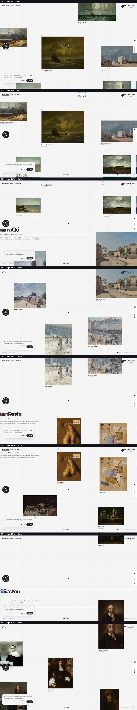
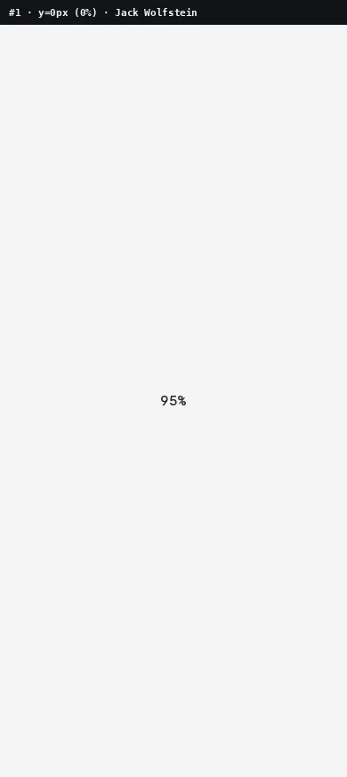

# UI Design System & Master Generation Blueprint: www-chriswilliamsart-com

> **Chris Williams Art Gallery · Contemporary painting in London** (https://www.chriswilliamsart.com/) — Chris Williams Art Gallery shows contemporary painting in Bethnal Green, East London. Explore the work of seven artists online or visit W...





---

## 1. Executive Visual Persona & Design Archetype

- **Brand Essence & Persona**: **Chris Williams Art Gallery · Contemporary painting in London** (`https://www.chriswilliamsart.com/`). Chris Williams Art Gallery shows contemporary painting in Bethnal Green, East London. Explore the work of seven artists online or visit W...
- **Capture Provenance**: Live browser capture (`tier1_fast`, HTTP `200`, captured `2026-11-24`).
- **Visual Archetype**: **Light-Gallery WebGL / Canvas Interactive Experience (`#f4f5f5` / `#b08a5c`)**.
- **Anti-AI-Slop Differentiators**:
  - **Live-Computed Chromatic Polarity**: Anchors the viewport in `#f4f5f5` (live computed `body` `background-color` (`computed_styles.json`)) paired with `#282828` primary typography and `#b08a5c` accents.
  - **Grounded Typographic Hierarchy**: Uses `Google Sans Flex` across display (`Chris Williams Art Gallery shows con`) and body copy.
  - **Calibrated Spatial Grid & Motion**: Combines `1440px` container bounds (`gap: 16px`, padding `20px`) with `cubic-bezier(.34,1.56,.64,1)` easing and Three.js / WebGL Canvas Pipeline, Framer Motion Layout Physics.

---

## 2. Spatial Architecture & Modular Grid Mathematics

### Viewport Allocation & Container Geometry
- **Captured Journey Filmstrips**: Desktop `1280×6624px` (`assets/desktop-journey.webp`, `8` keyframes up to `y=0px` / doc `900px`), Mobile `390×872px` (`assets/mobile-journey.webp`, `1` keyframes).
- **Master Container Bounds**: `1440px` (full-bleed `100%` desktop stage measured on `1440px` viewport).
- **Canvas Lateral Padding & Spacing**: `20px` lateral canvas padding with `16px` grid gap.
- **Border Radius Scale**: `50%`, `999px`, `10px`.

### Responsive Breakpoint Architecture
- **Desktop Layout**: Multi-column CSS Grid / Flexbox layout at `1440px` (`max-width: 1440px`, `gap: 16px`).
- **Mobile Layout**: Single-column vertical stack at `390px` viewport width with `20px` horizontal padding.
- **Extracted CSS Media Queries**: `@media (width<=720px)`, `@media (prefers-reduced-motion:reduce)`.

---

## 3. Color System, Materiality & Atmospheric Lighting

### Semantic Palette & Source Grounding
| Semantic Role | Ground-Truth Value | Extracted Live / CSS Source |
|---|---|---|
| **Primary Canvas Substrate** | `#f4f5f5` | live computed `body` `background-color` (`computed_styles.json`) |
| **Primary Typography Ink** | `#282828` | live computed `h1` `color` (`computed_styles.json`) |
| **Elevated Surface / Card Substrate** | `#b08a5c` | `.room__art--oak { background: #b08a5c }` |
| **Interactive Accent / Highlight** | `#b08a5c` | `.room__art--oak { background: #b08a5c }` |
| **Secondary / Muted Copy** | `#aaaaaa` | `var(--color-muted)` in `:root` |
| **Structural Hairline Border** | `#dbdcdc` | `.list-panel__row { border-bottom: #dbdcdc }` |
| **Variable Token (`--color-placeholder`)** | `#d9d9d9` | `var(--color-placeholder)` in `:root` |

### Sanitized Root CSS Variables (`ui-ux.md` Ground Truth)
| Variable Name | Extracted Value | Semantic Role |
|---|---|---|
| `--color-bg` | `#f4f5f5` | Canvas / Surface Token |
| `--color-fg` | `#282828` | Typography Ink Token |
| `--color-muted` | `#aaa` | Brand / Palette Token |
| `--color-placeholder` | `#d9d9d9` | Brand / Palette Token |
| `--font-base` | `"Google Sans Flex", "Helvetica Neue", Arial, sans-serif` | Typography / Scale Token |
| `--aspect` | `.75` | Design System Custom Token |
| `--long` | `calc(var(--u) * 364)` | Design System Custom Token |
| `--www-chriswilliam-bg` | `#f4f5f5` | Canvas Substrate (from live computed `body` `background-color` (`computed_styles.json`)) |
| `--www-chriswilliam-ink` | `#282828` | Primary Typography Ink (computed-derived) |
| `--www-chriswilliam-surface` | `#b08a5c` | Surface Substrate (computed-derived) |
| `--www-chriswilliam-accent` | `#b08a5c` | Interactive Accent (computed-derived) |
| `--www-chriswilliam-muted` | `#aaaaaa` | Secondary Ink (computed-derived) |
| `--www-chriswilliam-border` | `#dbdcdc` | Structural Border (computed-derived) |
| `--www-chriswilliam-container` | `1440px` | Container Bound (computed-derived) |
| `--www-chriswilliam-gap` | `16px` | Grid Gutter (computed-derived) |
| `--www-chriswilliam-pad` | `20px` | Lateral Padding (computed-derived) |

---

## 4. Typographic Scale & Editorial Hierarchy

### Font Family Stacks
- **Display Typography**: `Google Sans Flex`.
- **Primary Body Stack**: `Google Sans Flex`.
- **Technical / Metadata Stack**: not declared in live computed styles (uses primary stack / `ui-monospace`).

### Typographic Scale & Rules (Live Computed & Stylesheet Grounded)
- **Hero Display (`H1`)**: live computed `h1` (`font-size: 66.24px`, `line-height: 67.5648px`, `font-weight: 500`, `letter-spacing: -2.6496px`).
- **Section Heading (`H2`)**: live computed `h2` (`font-size: 37.44px`, `line-height: 39.312px`, `font-weight: 700`, `letter-spacing: -1.1232px`).
- **Body Copy**: live computed `body` (`font-size: 16px`, `line-height: normal`, `font-weight: 400`); rule `p` (`font-size: 13px`, `line-height: 1.6`).
- **Metadata & Navigation Labels**: live computed `nav/a` (`font-size: 13px`, `line-height: normal`, `font-weight: 500`, `letter-spacing: -0.13px`).

---

## 5. Choreographed Motion & Interaction Physics

### Primary Easing Curves
- **Extracted Timing Functions**: `cubic-bezier(.34,1.56,.64,1)`, `cubic-bezier(.16,1,.3,1)`, `cubic-bezier(.22,1,.36,1)`.

### Per-Element Transition & Choreography Rules
- **Selector `.site-nav__link`**: `transition: opacity .2s` extracted from `www-chriswilliamsart-com` stylesheet.
- **Selector `.site-logo`**: `transition: opacity .2s` extracted from `www-chriswilliamsart-com` stylesheet.
- **Selector `.site-logo__mark`**: `transition: transform .45s cubic-bezier(.34,1.56,.64,1)` extracted from `www-chriswilliamsart-com` stylesheet.
- **Extracted Easing Curve (`cubic-bezier(.34,1.56,.64,1)`)**: Governs interactive state transitions across `<header.site-header>` and `<section.about-outro>`.
- **Runtime Interaction Engine**: Integrates Three.js / WebGL Canvas Pipeline, Framer Motion Layout Physics with `prefers-reduced-motion: reduce` fallback guards.
### Measured Runtime Scroll & Interaction Telemetry (`behavioral_journey_v2`)
- **Scroll Driver Mode**: `wheel` (max document height `900px`, deepest scrollY reached `0px` across `8` desktop keyframes).
- **Detected Scroll / Motion Libraries**: `WebGL/Canvas`.
- **Hover Physics (`primary_cta` · `15 Old Man in a Fur Cap Tobias Kern`)**: `transform`: `matrix(1, 0, 0, 1, 1052...` -> `matrix(1, 0, 0, 1, 1052...` (`transition-duration: 0s`, `timing: ease`).
- **Route Transition Architecture**: First internal navigation (`/work/wolfstein/before-the-squall`) measured as `direct` in `1216ms`.

---

## 6. Component Wireframe & Structural DOM Map

### Visual Layout Schematic — Desktop (`1440px`, Grounded in `dom.html` & Landmark Bounding Boxes)
```
┌────────────────────────────────────────────────────────────────────────┐
│ DESKTOP VIEWPORT (1440px) — Chris Williams Art Gallery · Contemporary  │
│ ====================================================================== │
│ [ <header.site-header> (1440x76px)    | about a b o u t              ] │
│ ---------------------------------------------------------------------- │
│ | HERO STAGE: <section.about-intro> (w=1440px)                       | │
│ | H1: Chris Williams Art Gallery shows contemporary pai...           | │
│ | Substrate: #f4f5f5 | Ink: #282828 | Accent: #b08a5c                | │
│ ---------------------------------------------------------------------- │
│ | SHOWCASE GRID (<section.about-outro>) max-w: 1440px                | │
│ | +------------------------------+  +------------------------------+ | │
│ | | Jack Wolfstein               |  | The ground floor             | | │
│ | +------------------------------+  +------------------------------+ | │
│ ---------------------------------------------------------------------- │
│ | DETAIL MODULE (<section.about-outro:nth(2) — Mira Lindqvist        | │
│ ---------------------------------------------------------------------- │
│ [ FOOTER (<footer.site-footer>) | https://www.chriswilliamsart.com/    │
└────────────────────────────────────────────────────────────────────────┘
```

### Visual Layout Schematic — Mobile Reflow (`390px`)
```
┌────────────────────────────────────────────────────────────────────────┐
│ MOBILE VIEWPORT REFLOW (390px) — Single-Column Stack (gap: 16px)       │
│ ====================================================================== │
│ [ HEADER BAR (<header.site-header>    ) | Compact Menu (390px)         │
│ ---------------------------------------------------------------------- │
│ | HERO STAGE (<section.about-intro>) — 390px Vertical Lead           | │
│ | H1: Chris Williams Art Gallery shows contemporary pai...           | │
│ ---------------------------------------------------------------------- │
│ | SHOWCASE STACK (<section.about-outro>) — 1-Col Stack               | │
│ | [ Item 1: Jack Wolfstein                                         ] | │
│ | [ Item 2: The ground floor                                       ] | │
│ ---------------------------------------------------------------------- │
│ | DETAIL STACK (<section.about-outro:nth) — 1-Col (Mira Lindqvist)   | │
│ ---------------------------------------------------------------------- │
│ [ FOOTER (<footer.site-footer>) | Stacked 390px Colophon               │
└────────────────────────────────────────────────────────────────────────┘
```

### Granular DOM Region Breakdown
1. **Brand Header & Navigation Bar (<header.site-header> — `www-chriswilliamsart-com`)**:
   - Landmark `<header class="site-header">` (`1440x76px`) hosting `Chris Williams Art Gallery · Contemp` navigation (`about a b o u t`), DOM attributes (`data-nav-field`, `data-reveal-text="gallery area"`, `data-reveal-split="1"`, `data-char="g"`), and stylesheet rule `body { overscroll-behavior:none;height:100%;overflow-x:hidden }`.
2. **Hero Stage & Focal Lead (<section.about-intro> — `Chris Williams Art Gallery shows c`)**:
   - Landmark `<section class="about-intro">` presenting display lead `Chris Williams Art Gallery shows contemporary pai...` and copy excerpt *"Jack Wolfstein Jack Wolfstein"* over `#f4f5f5` canvas and `#282828` ink.
3. **Primary Showcase & Content Grid (<section.about-outro> — `Jack Wolfstein`)**:
   - Landmark `<section class="about-outro">` rendering section `Jack Wolfstein` with copy *"Jack Wolfstein J a c k W o l f s t e i n"*, asset references (`favicon.ico`, `favicon.svg`, `apple-touch-icon.png`, `wolfstein-01-CIJigwF-.webp`), and grid rule `button { font:inherit;color:inherit;cursor:pointer;background:0 0;border:none }`.
4. **Interactive Detail & Feature Matrix (<section.about-outro:nth(2)> — `The ground floor`)**:
   - Landmark `<section class="about-outro">` framing `The ground floor` and `Mira Lindqvist` (*"British, b. 1968 Seascape"*) with `#b08a5c` surface cards, `#b08a5c` accents, and `.site-nav { letter-spacing:-.01em;align-items:center;gap:16px;font-size:13px;font-we... }`.
5. **Colophon & Global Directory Footer (<footer.site-footer> — `https://www.chriswilliamsart.com/`)**:
   - Landmark `<footer class="site-footer">` anchoring `Chris Williams Art Gallery · Con` footer links (`about a b o u t`), copy *"Jack Wolfstein paints the North Sea coast, usually in bad we"*, and `#dbdcdc` structural dividers.
### Full Vertical Scroll Sequence (Desktop `1440×900` Keyframes)
- **Step 01** (`y=0px`, `0%`): Active landmark `Hero` · sticky/fixed elements: `5`
- **Step 02** (`y=0px`, `8%`): Active landmark `Hero` · sticky/fixed elements: `5`
- **Step 03** (`y=0px`, `17%`): Active landmark `Hero` · sticky/fixed elements: `5`
- **Step 04** (`y=0px`, `25%`): Active landmark `Hero` · sticky/fixed elements: `5`
- **Step 05** (`y=0px`, `33%`): Active landmark `Hero` · sticky/fixed elements: `5`
- **Step 06** (`y=0px`, `42%`): Active landmark `Hero` · sticky/fixed elements: `5`
- **Step 07** (`y=0px`, `50%`): Active landmark `Hero` · sticky/fixed elements: `5`
- **Step 08** (`y=0px`, `58%`): Active landmark `Hero` · sticky/fixed elements: `5`

### Multi-Page Internal Route Map
- **Detail Route (`/work/wolfstein/before-the-squall`)**: `https://www.chriswilliamsart.com/work/wolfstein/before-the-squall` — H1: `Before the Squall`, scrollHeight `900px`, transition `direct` (`1216ms`)
- **About Route (`/about`)**: `https://www.chriswilliamsart.com/about` — H1: `Chris Williams Art Gallery shows contemporary pai...`, scrollHeight `900px`, transition `direct` (`789ms`)
- **Detail Route (`/work/wolfstein/heavy-weather`)**: `https://www.chriswilliamsart.com/work/wolfstein/heavy-weather` — H1: `Two Boats, Heavy Weather`, scrollHeight `900px`, transition `direct` (`1034ms`)

---

## 7. Master Zero-Shot AI Generation Prompt

```markdown
# Master Zero-Shot Frontend Generation Prompt: www-chriswilliamsart-com (Chris Williams Art Gallery · Contemporary painting in London)

You are a principal frontend architect and design systems engineer. Build a complete, production-ready web application replicating the exact design system, DOM landmarks, typographic hierarchy, color tokens, and motion physics of `www-chriswilliamsart-com` (**Chris Williams Art Gallery · Contemporary painting in London** — `https://www.chriswilliamsart.com/`).

### 1. Visual Archetype & Anti-AI-Slop Mandates
- **Archetype**: Light-Gallery WebGL / Canvas Interactive Experience (`#f4f5f5` / `#b08a5c`).
- **Identity & Domain Context**: Chris Williams Art Gallery shows contemporary painting in Bethnal Green, East London. Explore the work of seven artists online or visit W...
- **Primary Substrate**: `#f4f5f5` (live computed `body` `background-color` (`computed_styles.json`)), **Primary Ink**: `#282828`, **Accent / Highlight**: `#b08a5c`.
- **Site-Specific Differentiators**:
  - **Live-Computed Chromatic Polarity**: Anchors the viewport in `#f4f5f5` (live computed `body` `background-color` (`computed_styles.json`)) paired with `#282828` primary typography and `#b08a5c` accents.
  - **Grounded Typographic Hierarchy**: Uses `Google Sans Flex` across display (`Chris Williams Art Gallery shows con`) and body copy.
  - **Calibrated Spatial Grid & Motion**: Combines `1440px` container bounds (`gap: 16px`, padding `20px`) with `cubic-bezier(.34,1.56,.64,1)` easing and Three.js / WebGL Canvas Pipeline, Framer Motion Layout Physics.

### 2. Ground-Truth CSS Variables (`:root` Token Contract)
Declare and consume these exact custom properties extracted from `www-chriswilliamsart-com` in your global stylesheet:

:root {
  /* Chris Williams Art Gallery · Contemporary painting in London (www-chriswilliamsart-com) — Live-Grounded CSS Variables */
  --color-bg: #f4f5f5; /* Canvas / Surface Token (www-chriswilliamsart-com) */
  --color-fg: #282828; /* Typography Ink Token (www-chriswilliamsart-com) */
  --color-muted: #aaa; /* Brand / Palette Token (www-chriswilliamsart-com) */
  --color-placeholder: #d9d9d9; /* Brand / Palette Token (www-chriswilliamsart-com) */
  --font-base: "Google Sans Flex", "Helvetica Neue", Arial, sans-serif; /* Typography / Scale Token (www-chriswilliamsart-com) */
  --aspect: .75; /* Design System Custom Token (www-chriswilliamsart-com) */
  --long: calc(var(--u) * 364); /* Design System Custom Token (www-chriswilliamsart-com) */
  --www-chriswilliam-bg: #f4f5f5; /* Canvas Substrate (from live computed `body` `background-color` (`computed_styles.json`)) (www-chriswilliamsart-com) */
  --www-chriswilliam-ink: #282828; /* Primary Typography Ink (computed-derived) (www-chriswilliamsart-com) */
  --www-chriswilliam-surface: #b08a5c; /* Surface Substrate (computed-derived) (www-chriswilliamsart-com) */
  --www-chriswilliam-accent: #b08a5c; /* Interactive Accent (computed-derived) (www-chriswilliamsart-com) */
  --www-chriswilliam-muted: #aaaaaa; /* Secondary Ink (computed-derived) (www-chriswilliamsart-com) */
  --www-chriswilliam-border: #dbdcdc; /* Structural Border (computed-derived) (www-chriswilliamsart-com) */
  --www-chriswilliam-container: 1440px; /* Container Bound (computed-derived) (www-chriswilliamsart-com) */
  --www-chriswilliam-gap: 16px; /* Grid Gutter (computed-derived) (www-chriswilliamsart-com) */
  --www-chriswilliam-pad: 20px; /* Lateral Padding (computed-derived) (www-chriswilliamsart-com) */
}

### 3. Semantic Color & Materiality Contract
Map every surface, ink, and border strictly to these source-grounded tokens:
- **Primary Canvas Substrate**: `#f4f5f5` — grounded in live computed `body` `background-color` (`computed_styles.json`)
- **Primary Typography Ink**: `#282828` — grounded in live computed `h1` `color` (`computed_styles.json`)
- **Elevated Surface / Card Substrate**: `#b08a5c` — grounded in `.room__art--oak { background: #b08a5c }`
- **Interactive Accent / Highlight**: `#b08a5c` — grounded in `.room__art--oak { background: #b08a5c }`
- **Secondary / Muted Copy**: `#aaaaaa` — grounded in `var(--color-muted)` in `:root`
- **Structural Hairline Border**: `#dbdcdc` — grounded in `.list-panel__row { border-bottom: #dbdcdc }`
- **Variable Token (`--color-placeholder`)**: `#d9d9d9` — grounded in `var(--color-placeholder)` in `:root`

### 4. Spatial Grid, Container Bounds & Responsive Breakpoints
- **Desktop Viewport Reference**: `1280×6624px` (multi-frame vertical journey filmstrip (6624px), `1440px` standard desktop width).
- **Mobile Viewport Reference**: `390×872px` (full-page live capture (872px), `390px` standard mobile width).
- **Container Max-Width**: `1440px` (full-bleed `100%` desktop stage measured on `1440px` viewport)
- **Padding & Gutters**: `20px` lateral canvas padding with `16px` grid gap
- **Desktop Grid**: Multi-column CSS Grid / Flexbox layout at `1440px` (`max-width: 1440px`, `gap: 16px`)
- **Mobile Adaptation**: Single-column vertical stack at `390px` viewport width with `20px` horizontal padding
- **Media Queries**: `@media (width<=720px)`, `@media (prefers-reduced-motion:reduce)`
- **Corner Radii**: `50%`, `999px`, `10px`

### 5. Typography & Editorial Scale Contract
- **Display Font Stack**: `Google Sans Flex`
- **Body Font Stack**: `Google Sans Flex`
- **Monospace / Technical Font Stack**: not declared in live computed styles (uses primary stack / `ui-monospace`)
- **H1 Display Rule**: live computed `h1` (`font-size: 66.24px`, `line-height: 67.5648px`, `font-weight: 500`, `letter-spacing: -2.6496px`)
- **H2 Section Rule**: live computed `h2` (`font-size: 37.44px`, `line-height: 39.312px`, `font-weight: 700`, `letter-spacing: -1.1232px`)
- **Body Copy Rule**: live computed `body` (`font-size: 16px`, `line-height: normal`, `font-weight: 400`); rule `p` (`font-size: 13px`, `line-height: 1.6`)
- **Metadata & Index Rule**: live computed `nav/a` (`font-size: 13px`, `line-height: normal`, `font-weight: 500`, `letter-spacing: -0.13px`)

### 6. Component Hierarchy, Verbatim Copy & Real DOM Landmarks
Scaffold `www-chriswilliamsart-com` (`Chris Williams Art Gallery · Contemporary painting in London`) with these exact structural regions, extracted copy, and CSS rules from `dom.html`:
1. **Brand Header & Navigation Bar (<header.site-header> — `www-chriswilliamsart-com`)**:
   - DOM & Selectors: Landmark `<header class="site-header">` (`1440x76px`) hosting `Chris Williams Art Gallery · Contemp` navigation (`about a b o u t`), DOM attributes (`data-nav-field`, `data-reveal-text="gallery area"`, `data-reveal-split="1"`, `data-char="g"`), and stylesheet rule `body { overscroll-behavior:none;height:100%;overflow-x:hidden }`.
   - Responsive Contract: Header `Brand Header & Navigation Bar (<header.site-header> — `www-chriswilliamsart-com`)` (`www-chriswilliamsart-com`) adapts across `@media (width<=720px)`, `@media (prefers-reduced-motion:reduce)` with `cubic-bezier(.34,1.56,.64,1)`, `cubic-bezier(.16,1,.3,1)`, `cubic-bezier(.22,1,.36,1)` transitions and links `about a b o u t`.
2. **Hero Stage & Focal Lead (<section.about-intro> — `Chris Williams Art Gallery shows c`)**:
   - DOM & Selectors: Landmark `<section class="about-intro">` presenting display lead `Chris Williams Art Gallery shows contemporary pai...` and copy excerpt *"Jack Wolfstein Jack Wolfstein"* over `#f4f5f5` canvas and `#282828` ink.
   - Responsive Contract: Hero stage (`1280×6624px` desktop / `390×872px` mobile) sets `#f4f5f5` background with `#282828` headline `Chris Williams Art Gallery shows contemporary pai...`.
3. **Primary Showcase & Content Grid (<section.about-outro> — `Jack Wolfstein`)**:
   - DOM & Selectors: Landmark `<section class="about-outro">` rendering section `Jack Wolfstein` with copy *"Jack Wolfstein J a c k W o l f s t e i n"*, asset references (`favicon.ico`, `favicon.svg`, `apple-touch-icon.png`, `wolfstein-01-CIJigwF-.webp`), and grid rule `button { font:inherit;color:inherit;cursor:pointer;background:0 0;border:none }`.
   - Responsive Contract: Showcase grid `Primary Showcase & Content Grid (<section.about-outro> — `Jack Wolfstein`)` applies Multi-column CSS Grid / Flexbox layout at `1440px` (`max-width: 1440px`, `gap: 16px`) on desktop and Single-column vertical stack at `390px` viewport width with `20px` horizontal padding on mobile.
4. **Interactive Detail & Feature Matrix (<section.about-outro:nth(2)> — `The ground floor`)**:
   - DOM & Selectors: Landmark `<section class="about-outro">` framing `The ground floor` and `Mira Lindqvist` (*"British, b. 1968 Seascape"*) with `#b08a5c` surface cards, `#b08a5c` accents, and `.site-nav { letter-spacing:-.01em;align-items:center;gap:16px;font-size:13px;font-we... }`.
   - Responsive Contract: Detail module `Interactive Detail & Feature Matrix (<section.about-outro:nth(2)> — `The ground floor`)` uses `50%`, `999px`, `10px` radii, `#b08a5c` highlights, and assets (favicon.ico, favicon.svg, apple-touch-icon.png).
5. **Colophon & Global Directory Footer (<footer.site-footer> — `https://www.chriswilliamsart.com/`)**:
   - DOM & Selectors: Landmark `<footer class="site-footer">` anchoring `Chris Williams Art Gallery · Con` footer links (`about a b o u t`), copy *"Jack Wolfstein paints the North Sea coast, usually in bad we"*, and `#dbdcdc` structural dividers.
   - Responsive Contract: Footer `Colophon & Global Directory Footer (<footer.site-footer> — `https://www.chriswilliamsart.com/`)` aligns to `1440px` (full-bleed `100%` desktop stage measured on `1440px` viewport) with `20px` lateral canvas padding with `16px` grid gap and attributes (data-nav-field, data-reveal-text="gallery area", data-reveal-split="1").

#### Verbatim DOM Copy Excerpts (`dom.html`)
- Copy Excerpt 1: *"Jack Wolfstein Jack Wolfstein"*
- Copy Excerpt 2: *"Jack Wolfstein J a c k W o l f s t e i n"*
- Copy Excerpt 3: *"British, b. 1968 Seascape"*
- Copy Excerpt 4: *"Jack Wolfstein paints the North Sea coast, usually in bad weather. He has worked w..."*

### 7. Motion, Extracted Stylesheet Rules & Interaction Choreography
- **Primary Easing Functions**: `cubic-bezier(.34,1.56,.64,1)`, `cubic-bezier(.16,1,.3,1)`, `cubic-bezier(.22,1,.36,1)`
- **Extracted Stylesheet Rules (`www-chriswilliamsart-com`)**:
- `body { overscroll-behavior:none;height:100%;overflow-x:hidden }`
- `button { font:inherit;color:inherit;cursor:pointer;background:0 0;border:none }`
- `.site-nav { letter-spacing:-.01em;align-items:center;gap:16px;font-size:13px;font-we... }`
- `.site-nav__link { transition:opacity .2s;position:relative }`
- `.site-nav__link:hover { opacity:.6 }`
- **Per-Selector Transition Rules**:
- **Selector `.site-nav__link`**: `transition: opacity .2s` extracted from `www-chriswilliamsart-com` stylesheet.
- **Selector `.site-logo`**: `transition: opacity .2s` extracted from `www-chriswilliamsart-com` stylesheet.
- **Selector `.site-logo__mark`**: `transition: transform .45s cubic-bezier(.34,1.56,.64,1)` extracted from `www-chriswilliamsart-com` stylesheet.
- **Extracted Easing Curve (`cubic-bezier(.34,1.56,.64,1)`)**: Governs interactive state transitions across `<header.site-header>` and `<section.about-outro>`.
- **Runtime Interaction Engine**: Integrates Three.js / WebGL Canvas Pipeline, Framer Motion Layout Physics with `prefers-reduced-motion: reduce` fallback guards.
### 7b. Full-Page Scroll Choreography, Interactive States & Multi-Page Routes
- **Scroll Mechanics**: Implement `wheel` vertical progression up to `900px` across 8 distinct viewport chapters using WebGL/Canvas.
- **Vertical Chapter Sequence**: Hero (0%) -> Hero (8%) -> Hero (17%) -> Hero (25%) -> Hero (33%) -> Hero (42%) -> Hero (50%) -> Hero (58%).
- **Hover Micro-Interaction (`primary_cta`)**: Animate `transform` with `0s ease`.
- **Multi-Page Routes**: Scaffold internal routes `/work/wolfstein/before-the-squall` (detail, direct), `/about` (about, direct), `/work/wolfstein/heavy-weather` (detail, direct) sharing the global header/footer shell and design tokens.

### 8. Technical Deliverables
- Implement in Next.js (App Router) with TypeScript and Tailwind CSS consuming the `:root` custom properties defined above for `www-chriswilliamsart-com`.
- Reproduce both the `1440px` desktop architecture and `390px` mobile breakpoint transitions, preserving semantic HTML5 landmarks (`<header>`, `<nav>`, `<main>`, `<section>`, `<footer>`) and `prefers-reduced-motion` accessibility guards.
```
---

## 8. Full-Page Scroll Journey, Interactive States & Subpage Inventory

### Desktop Scroll Keyframes (`1440×900` WebP)
| Step | Scroll Y | Progress | Active Landmark / Section | Sticky/Fixed | Visual Asset |
| :---: | :---: | :---: | :--- | :---: | :--- |
| `#01` | `0px` | `0%` | Hero | `5` | [desktop-step-01.webp](assets/desktop-step-01.webp) |
| `#02` | `0px` | `8%` | Hero | `5` | [desktop-step-02.webp](assets/desktop-step-02.webp) |
| `#03` | `0px` | `17%` | Hero | `5` | [desktop-step-03.webp](assets/desktop-step-03.webp) |
| `#04` | `0px` | `25%` | Hero | `5` | [desktop-step-04.webp](assets/desktop-step-04.webp) |
| `#05` | `0px` | `33%` | Hero | `5` | [desktop-step-05.webp](assets/desktop-step-05.webp) |
| `#06` | `0px` | `42%` | Hero | `5` | [desktop-step-06.webp](assets/desktop-step-06.webp) |
| `#07` | `0px` | `50%` | Hero | `5` | [desktop-step-07.webp](assets/desktop-step-07.webp) |
| `#08` | `0px` | `58%` | Hero | `5` | [desktop-step-08.webp](assets/desktop-step-08.webp) |

### Mobile Condensed Keyframes (`390×844` WebP)
| Step | Scroll Y | Progress | Active Landmark | Visual Asset |
| :---: | :---: | :---: | :--- | :--- |
| `#01` | `0px` | `0%` | Jack Wolfstein | [mobile-step-01.webp](assets/mobile-step-01.webp) |

### Internal Subpage Filmstrips (`1080px` Wide WebP)
| # | Template | Route URL | H1 / Title | Scroll Height | Transition | Filmstrip Asset |
| :-: | :---: | :--- | :--- | :---: | :---: | :--- |
| `1` | `detail` | `https://www.chriswilliamsart.com/work/wolfstein/before-the-squall` | Before the Squall | `900px` | `direct` (`1216ms`) | [subpage-01-work-wolfstein-before-the-squall.webp](assets/subpage-01-work-wolfstein-before-the-squall.webp) |
| `2` | `about` | `https://www.chriswilliamsart.com/about` | Chris Williams Art Gallery shows cont... | `900px` | `direct` (`789ms`) | [subpage-02-about.webp](assets/subpage-02-about.webp) |
| `3` | `detail` | `https://www.chriswilliamsart.com/work/wolfstein/heavy-weather` | Two Boats, Heavy Weather | `900px` | `direct` (`1034ms`) | [subpage-03-work-wolfstein-heavy-weather.webp](assets/subpage-03-work-wolfstein-heavy-weather.webp) |

