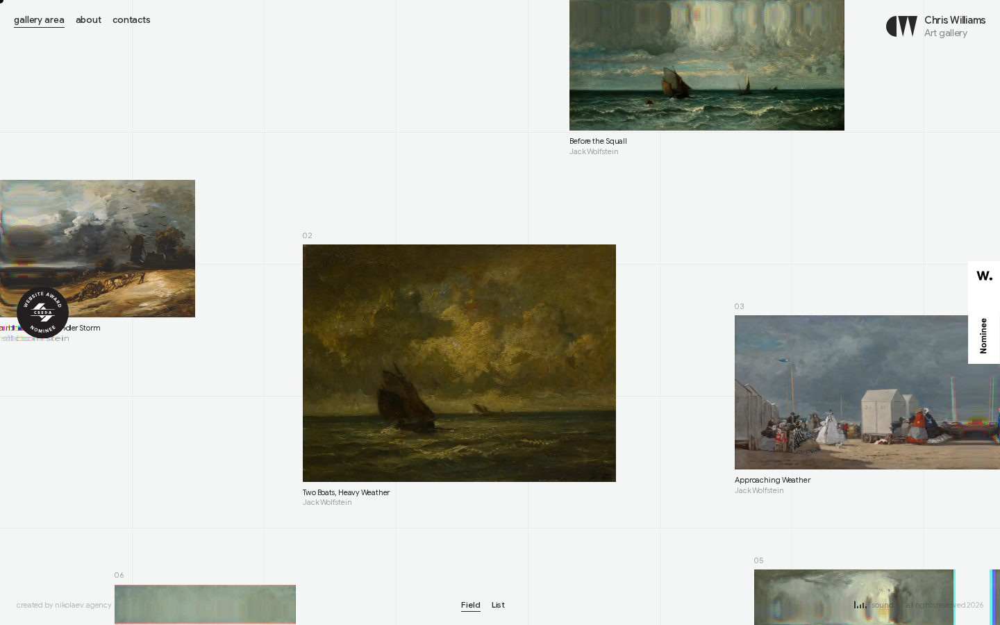
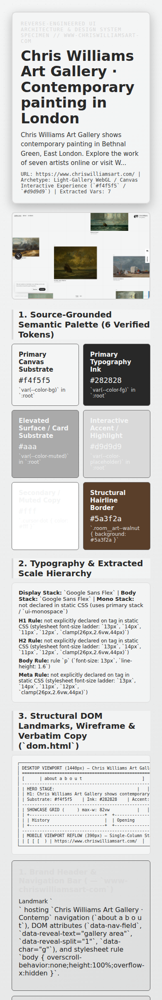

# UI Design System & Master Generation Blueprint: www-chriswilliamsart-com

> **Chris Williams Art Gallery · Contemporary painting in London** (https://www.chriswilliamsart.com/) — Chris Williams Art Gallery shows contemporary painting in Bethnal Green, East London. Explore the work of seven artists online or visit W...



---

## 1. Executive Visual Persona & Design Archetype

- **Brand Essence & Persona**: **Chris Williams Art Gallery · Contemporary painting in London** (`https://www.chriswilliamsart.com/`). Chris Williams Art Gallery shows contemporary painting in Bethnal Green, East London. Explore the work of seven artists online or visit W...
- **Visual Archetype**: **Light-Gallery WebGL / Canvas Interactive Experience (`#f4f5f5` / `#d9d9d9`)**.
- **Anti-AI-Slop Differentiators**:
  - **Source-Grounded Chromatic Polarity**: Anchors the viewport in `#f4f5f5` (`var(--color-bg)` in `:root`) paired with `#282828` primary typography and `#d9d9d9` accents.
  - **Extracted Typographic Hierarchy**: Pairs `Google Sans Flex` for display copy (`Chris Williams Art Gallery shows con`) with `Google Sans Flex` and not declared in static CSS (uses primary stack / `ui-monospace`).
  - **Calibrated Spatial Grid & Motion**: Combines `82vw` container bounds (`gap: 16px`, padding `22px`) with `cubic-bezier(.34,1.56,.64,1)` easing and Three.js / WebGL Canvas Pipeline, Framer Motion Layout Physics.

---

## 2. Spatial Architecture & Modular Grid Mathematics



### Viewport Allocation & Container Geometry
- **Captured Viewport Dimensions**: Desktop `1440×2400px` (`assets/desktop.png`, capped at 2400px multi-section capture), Mobile `390×2400px` (`assets/mobile.png`, capped at 2400px multi-section capture).
- **Master Container Bounds**: `82vw` extracted from `www-chriswilliamsart-com` stylesheet.
- **Canvas Lateral Padding & Spacing**: `22px` lateral canvas padding with `16px` grid gap.
- **Border Radius Scale**: `50%`, `999px`, `10px`.

### Responsive Breakpoint Architecture
- **Desktop Layout**: Multi-column CSS Grid / Flexbox layout at `1440px` (`max-width: 82vw`, `gap: 16px`).
- **Mobile Layout**: Single-column vertical stack at `390px` viewport width with `22px` horizontal padding.
- **Extracted CSS Media Queries**: `@media (width<=720px)`, `@media (prefers-reduced-motion:reduce)`.

---

## 3. Color System, Materiality & Atmospheric Lighting

### Semantic Palette & Source Grounding
| Semantic Role | Ground-Truth Value | Extracted CSS Source / Selector |
|---|---|---|
| **Primary Canvas Substrate** | `#f4f5f5` | `var(--color-bg)` in `:root` |
| **Primary Typography Ink** | `#282828` | `var(--color-fg)` in `:root` |
| **Elevated Surface / Card Substrate** | `#aaa` | `var(--color-muted)` in `:root` |
| **Interactive Accent / Highlight** | `#d9d9d9` | `var(--color-placeholder)` in `:root` |
| **Secondary / Muted Copy** | `#fff` | `.cursor-dot { color: #fff }` |
| **Structural Hairline Border** | `#5a3f2a` | `.room__art--walnut { background: #5a3f2a }` |

### Sanitized Root CSS Variables (`ui-ux.md` Ground Truth)
| Variable Name | Extracted Value | Semantic Role |
|---|---|---|
| `--color-bg` | `#f4f5f5` | Canvas / Surface Token |
| `--color-fg` | `#282828` | Typography Ink Token |
| `--color-muted` | `#aaa` | Brand / Palette Token |
| `--color-placeholder` | `#d9d9d9` | Brand / Palette Token |
| `--font-base` | `"Google Sans Flex", "Helvetica Neue", Arial, sans-serif` | Typography / Scale Token |
| `--aspect` | `.75` | Design System Custom Token |
| `--long` | `calc(var(--u) * 364)` | Design System Custom Token |
| `--www-chriswilliam-bg` | `#f4f5f5` | Canvas Substrate (from `var(--color-bg)` in `:root`) |
| `--www-chriswilliam-ink` | `#282828` | Primary Typography Ink (stylesheet-derived) |
| `--www-chriswilliam-surface` | `#aaa` | Surface Substrate (stylesheet-derived) |
| `--www-chriswilliam-accent` | `#d9d9d9` | Interactive Accent (stylesheet-derived) |
| `--www-chriswilliam-muted` | `#fff` | Secondary Ink (stylesheet-derived) |
| `--www-chriswilliam-border` | `#5a3f2a` | Structural Border (stylesheet-derived) |
| `--www-chriswilliam-container` | `82vw` | Container Bound (stylesheet-derived) |
| `--www-chriswilliam-gap` | `16px` | Grid Gutter (stylesheet-derived) |
| `--www-chriswilliam-pad` | `22px` | Lateral Padding (stylesheet-derived) |

---

## 4. Typographic Scale & Editorial Hierarchy

### Font Family Stacks
- **Display Typography**: `Google Sans Flex`.
- **Primary Body Stack**: `Google Sans Flex`.
- **Technical / Metadata Stack**: not declared in static CSS (uses primary stack / `ui-monospace`).

### Typographic Scale & Rules (Extracted from Stylesheet & Variables)
- **Hero Display (`H1`)**: not explicitly declared on tag in static CSS (stylesheet font-size ladder: `13px`, `14px`, `11px`, `12px`, `clamp(26px,2.6vw,44px)`).
- **Section Heading (`H2`)**: not explicitly declared on tag in static CSS (stylesheet font-size ladder: `13px`, `14px`, `11px`, `12px`, `clamp(26px,2.6vw,44px)`).
- **Body Copy**: rule `p` (`font-size: 13px`, `line-height: 1.6`).
- **Metadata & Navigation Labels**: not explicitly declared on tag in static CSS (stylesheet font-size ladder: `13px`, `14px`, `11px`, `12px`, `clamp(26px,2.6vw,44px)`).

---

## 5. Choreographed Motion & Interaction Physics

### Primary Easing Curves
- **Extracted Timing Functions**: `cubic-bezier(.34,1.56,.64,1)`, `cubic-bezier(.16,1,.3,1)`, `cubic-bezier(.22,1,.36,1)`.

### Per-Element Transition & Choreography Rules
- **Selector `.site-nav__link`**: `transition: opacity .2s` extracted from `www-chriswilliamsart-com` stylesheet.
- **Selector `.site-logo`**: `transition: opacity .2s` extracted from `www-chriswilliamsart-com` stylesheet.
- **Selector `.site-logo__mark`**: `transition: transform .45s cubic-bezier(.34,1.56,.64,1)` extracted from `www-chriswilliamsart-com` stylesheet.
- **Extracted Easing Curve (`cubic-bezier(.34,1.56,.64,1)`)**: Governs interactive state transitions across `<header.site-header>` and `<section.about-outro>`.
- **Runtime Interaction Engine**: Integrates Three.js / WebGL Canvas Pipeline, Framer Motion Layout Physics with `prefers-reduced-motion: reduce` fallback guards.

---

## 6. Component Wireframe & Structural DOM Map

### Visual Layout Schematic (Grounded in `dom.html` — `1440px` Desktop & `390px` Mobile Reflow)
```
┌────────────────────────────────────────────────────────────────────────┐
│ DESKTOP VIEWPORT (1440px) — Chris Williams Art Gallery · Contemporary  │
│ ====================================================================== │
│ [ <header.site-header>     | about a b o u t                        ]  │
│ ---------------------------------------------------------------------- │
│ | HERO STAGE: <section.about-intro>                                |   │
│ | H1: Chris Williams Art Gallery shows contemporary pai...         |   │
│ | Substrate: #f4f5f5    | Ink: #282828    | Accent: #d9d9d9        |   │
│ ---------------------------------------------------------------------- │
│ | SHOWCASE GRID (<section.about-outro>     ) max-w: 82vw           |   │
│ | +------------------------------+  +------------------------------+ | │
│ | | History                      |  | Opening                      | | │
│ | +------------------------------+  +------------------------------+ | │
│ ---------------------------------------------------------------------- │
│ | MOBILE VIEWPORT REFLOW (390px) — Single-Column Stack (gap: 16px  ) | │
│ | [<header.site-heade] -> [<section.about-int] -> [<section.about-out] │
│ ---------------------------------------------------------------------- │
│ [ FOOTER (<footer.site-footer>  ) | https://www.chriswilliamsart.com/  │
└────────────────────────────────────────────────────────────────────────┘
```

### Granular DOM Region Breakdown
1. **Brand Header & Navigation Bar (<header.site-header> — `www-chriswilliamsart-com`)**:
   - Landmark `<header class="site-header">` hosting `Chris Williams Art Gallery · Contemp` navigation (`about a b o u t`), DOM attributes (`data-nav-field`, `data-reveal-text="gallery area"`, `data-reveal-split="1"`, `data-char="g"`), and stylesheet rule `body { overscroll-behavior:none;height:100%;overflow-x:hidden }`.
2. **Hero Stage & Focal Lead (<section.about-intro> — `Chris Williams Art Gallery shows c`)**:
   - Landmark `<section class="about-intro">` presenting display lead `Chris Williams Art Gallery shows contemporary pai...` and copy excerpt *"gallery area g a l l e r y a r e a"* over `#f4f5f5` canvas and `#282828` ink.
3. **Primary Showcase & Content Grid (<section.about-outro> — `History`)**:
   - Landmark `<section class="about-outro">` rendering section `History` with copy *"contacts c o n t a c t s"*, asset references (`favicon.ico`, `favicon.svg`, `apple-touch-icon.png`, `wolfstein-01-CIJigwF-.webp`), and grid rule `button { font:inherit;color:inherit;cursor:pointer;background:0 0;border:none }`.
4. **Interactive Detail & Feature Matrix (<section.about-outro> — `Opening`)**:
   - Landmark `<section class="about-outro">` framing `Opening` and `Jack Wolfstein` (*"Chris Williams Art gallery"*) with `#aaa` surface cards, `#d9d9d9` accents, and `.site-nav { letter-spacing:-.01em;align-items:center;gap:16px;font-size:13px;font-we... }`.
5. **Colophon & Global Directory Footer (<footer.site-footer> — `https://www.chriswilliamsart.com/`)**:
   - Landmark `<footer class="site-footer">` anchoring `Chris Williams Art Gallery · Con` footer links (`about a b o u t`), copy *"Jack Wolfstein J a c k W o l f s t e i n"*, and `#5a3f2a` structural dividers.

---

## 7. Master Zero-Shot AI Generation Prompt

```markdown
# Master Zero-Shot Frontend Generation Prompt: www-chriswilliamsart-com (Chris Williams Art Gallery · Contemporary painting in London)

You are a principal frontend architect and design systems engineer. Build a complete, production-ready web application replicating the exact design system, DOM landmarks, typographic hierarchy, color tokens, and motion physics of `www-chriswilliamsart-com` (**Chris Williams Art Gallery · Contemporary painting in London** — `https://www.chriswilliamsart.com/`).

### 1. Visual Archetype & Anti-AI-Slop Mandates
- **Archetype**: Light-Gallery WebGL / Canvas Interactive Experience (`#f4f5f5` / `#d9d9d9`).
- **Identity & Domain Context**: Chris Williams Art Gallery shows contemporary painting in Bethnal Green, East London. Explore the work of seven artists online or visit W...
- **Primary Substrate**: `#f4f5f5` (`var(--color-bg)` in `:root`), **Primary Ink**: `#282828`, **Accent / Highlight**: `#d9d9d9`.
- **Site-Specific Differentiators**:
  - **Source-Grounded Chromatic Polarity**: Anchors the viewport in `#f4f5f5` (`var(--color-bg)` in `:root`) paired with `#282828` primary typography and `#d9d9d9` accents.
  - **Extracted Typographic Hierarchy**: Pairs `Google Sans Flex` for display copy (`Chris Williams Art Gallery shows con`) with `Google Sans Flex` and not declared in static CSS (uses primary stack / `ui-monospace`).
  - **Calibrated Spatial Grid & Motion**: Combines `82vw` container bounds (`gap: 16px`, padding `22px`) with `cubic-bezier(.34,1.56,.64,1)` easing and Three.js / WebGL Canvas Pipeline, Framer Motion Layout Physics.

### 2. Ground-Truth CSS Variables (`:root` Token Contract)
Declare and consume these exact custom properties extracted from `www-chriswilliamsart-com` in your global stylesheet:

:root {
  /* Chris Williams Art Gallery · Contemporary painting in London (www-chriswilliamsart-com) — Ground-Truth Extracted CSS Variables */
  --color-bg: #f4f5f5; /* Canvas / Surface Token (www-chriswilliamsart-com) */
  --color-fg: #282828; /* Typography Ink Token (www-chriswilliamsart-com) */
  --color-muted: #aaa; /* Brand / Palette Token (www-chriswilliamsart-com) */
  --color-placeholder: #d9d9d9; /* Brand / Palette Token (www-chriswilliamsart-com) */
  --font-base: "Google Sans Flex", "Helvetica Neue", Arial, sans-serif; /* Typography / Scale Token (www-chriswilliamsart-com) */
  --aspect: .75; /* Design System Custom Token (www-chriswilliamsart-com) */
  --long: calc(var(--u) * 364); /* Design System Custom Token (www-chriswilliamsart-com) */
  --www-chriswilliam-bg: #f4f5f5; /* Canvas Substrate (from `var(--color-bg)` in `:root`) (www-chriswilliamsart-com) */
  --www-chriswilliam-ink: #282828; /* Primary Typography Ink (stylesheet-derived) (www-chriswilliamsart-com) */
  --www-chriswilliam-surface: #aaa; /* Surface Substrate (stylesheet-derived) (www-chriswilliamsart-com) */
  --www-chriswilliam-accent: #d9d9d9; /* Interactive Accent (stylesheet-derived) (www-chriswilliamsart-com) */
  --www-chriswilliam-muted: #fff; /* Secondary Ink (stylesheet-derived) (www-chriswilliamsart-com) */
  --www-chriswilliam-border: #5a3f2a; /* Structural Border (stylesheet-derived) (www-chriswilliamsart-com) */
  --www-chriswilliam-container: 82vw; /* Container Bound (stylesheet-derived) (www-chriswilliamsart-com) */
  --www-chriswilliam-gap: 16px; /* Grid Gutter (stylesheet-derived) (www-chriswilliamsart-com) */
  --www-chriswilliam-pad: 22px; /* Lateral Padding (stylesheet-derived) (www-chriswilliamsart-com) */
}

### 3. Semantic Color & Materiality Contract
Map every surface, ink, and border strictly to these source-grounded tokens:
- **Primary Canvas Substrate**: `#f4f5f5` — grounded in `var(--color-bg)` in `:root`
- **Primary Typography Ink**: `#282828` — grounded in `var(--color-fg)` in `:root`
- **Elevated Surface / Card Substrate**: `#aaa` — grounded in `var(--color-muted)` in `:root`
- **Interactive Accent / Highlight**: `#d9d9d9` — grounded in `var(--color-placeholder)` in `:root`
- **Secondary / Muted Copy**: `#fff` — grounded in `.cursor-dot { color: #fff }`
- **Structural Hairline Border**: `#5a3f2a` — grounded in `.room__art--walnut { background: #5a3f2a }`

### 4. Spatial Grid, Container Bounds & Responsive Breakpoints
- **Desktop Viewport Reference**: `1440×2400px` (capped at 2400px multi-section capture, `1440px` standard desktop width).
- **Mobile Viewport Reference**: `390×2400px` (capped at 2400px multi-section capture, `390px` standard mobile width).
- **Container Max-Width**: `82vw` extracted from `www-chriswilliamsart-com` stylesheet
- **Padding & Gutters**: `22px` lateral canvas padding with `16px` grid gap
- **Desktop Grid**: Multi-column CSS Grid / Flexbox layout at `1440px` (`max-width: 82vw`, `gap: 16px`)
- **Mobile Adaptation**: Single-column vertical stack at `390px` viewport width with `22px` horizontal padding
- **Media Queries**: `@media (width<=720px)`, `@media (prefers-reduced-motion:reduce)`
- **Corner Radii**: `50%`, `999px`, `10px`

### 5. Typography & Editorial Scale Contract
- **Display Font Stack**: `Google Sans Flex`
- **Body Font Stack**: `Google Sans Flex`
- **Monospace / Technical Font Stack**: not declared in static CSS (uses primary stack / `ui-monospace`)
- **H1 Display Rule**: not explicitly declared on tag in static CSS (stylesheet font-size ladder: `13px`, `14px`, `11px`, `12px`, `clamp(26px,2.6vw,44px)`)
- **H2 Section Rule**: not explicitly declared on tag in static CSS (stylesheet font-size ladder: `13px`, `14px`, `11px`, `12px`, `clamp(26px,2.6vw,44px)`)
- **Body Copy Rule**: rule `p` (`font-size: 13px`, `line-height: 1.6`)
- **Metadata & Index Rule**: not explicitly declared on tag in static CSS (stylesheet font-size ladder: `13px`, `14px`, `11px`, `12px`, `clamp(26px,2.6vw,44px)`)

### 6. Component Hierarchy, Verbatim Copy & Real DOM Landmarks
Scaffold `www-chriswilliamsart-com` (`Chris Williams Art Gallery · Contemporary painting in London`) with these exact structural regions, extracted copy, and CSS rules from `dom.html`:
1. **Brand Header & Navigation Bar (<header.site-header> — `www-chriswilliamsart-com`)**:
   - DOM & Selectors: Landmark `<header class="site-header">` hosting `Chris Williams Art Gallery · Contemp` navigation (`about a b o u t`), DOM attributes (`data-nav-field`, `data-reveal-text="gallery area"`, `data-reveal-split="1"`, `data-char="g"`), and stylesheet rule `body { overscroll-behavior:none;height:100%;overflow-x:hidden }`.
   - Responsive Contract: Header `Brand Header & Navigation Bar (<header.site-header> — `www-chriswilliamsart-com`)` (`www-chriswilliamsart-com`) adapts across `@media (width<=720px)`, `@media (prefers-reduced-motion:reduce)` with `cubic-bezier(.34,1.56,.64,1)`, `cubic-bezier(.16,1,.3,1)`, `cubic-bezier(.22,1,.36,1)` transitions and links `about a b o u t`.
2. **Hero Stage & Focal Lead (<section.about-intro> — `Chris Williams Art Gallery shows c`)**:
   - DOM & Selectors: Landmark `<section class="about-intro">` presenting display lead `Chris Williams Art Gallery shows contemporary pai...` and copy excerpt *"gallery area g a l l e r y a r e a"* over `#f4f5f5` canvas and `#282828` ink.
   - Responsive Contract: Hero stage (`1440×2400px` desktop / `390×2400px` mobile) sets `#f4f5f5` background with `#282828` headline `Chris Williams Art Gallery shows contemporary pai...`.
3. **Primary Showcase & Content Grid (<section.about-outro> — `History`)**:
   - DOM & Selectors: Landmark `<section class="about-outro">` rendering section `History` with copy *"contacts c o n t a c t s"*, asset references (`favicon.ico`, `favicon.svg`, `apple-touch-icon.png`, `wolfstein-01-CIJigwF-.webp`), and grid rule `button { font:inherit;color:inherit;cursor:pointer;background:0 0;border:none }`.
   - Responsive Contract: Showcase grid `Primary Showcase & Content Grid (<section.about-outro> — `History`)` applies Multi-column CSS Grid / Flexbox layout at `1440px` (`max-width: 82vw`, `gap: 16px`) on desktop and Single-column vertical stack at `390px` viewport width with `22px` horizontal padding on mobile.
4. **Interactive Detail & Feature Matrix (<section.about-outro> — `Opening`)**:
   - DOM & Selectors: Landmark `<section class="about-outro">` framing `Opening` and `Jack Wolfstein` (*"Chris Williams Art gallery"*) with `#aaa` surface cards, `#d9d9d9` accents, and `.site-nav { letter-spacing:-.01em;align-items:center;gap:16px;font-size:13px;font-we... }`.
   - Responsive Contract: Detail module `Interactive Detail & Feature Matrix (<section.about-outro> — `Opening`)` uses `50%`, `999px`, `10px` radii, `#d9d9d9` highlights, and assets (favicon.ico, favicon.svg, apple-touch-icon.png).
5. **Colophon & Global Directory Footer (<footer.site-footer> — `https://www.chriswilliamsart.com/`)**:
   - DOM & Selectors: Landmark `<footer class="site-footer">` anchoring `Chris Williams Art Gallery · Con` footer links (`about a b o u t`), copy *"Jack Wolfstein J a c k W o l f s t e i n"*, and `#5a3f2a` structural dividers.
   - Responsive Contract: Footer `Colophon & Global Directory Footer (<footer.site-footer> — `https://www.chriswilliamsart.com/`)` aligns to `82vw` extracted from `www-chriswilliamsart-com` stylesheet with `22px` lateral canvas padding with `16px` grid gap and attributes (data-nav-field, data-reveal-text="gallery area", data-reveal-split="1").

#### Verbatim DOM Copy Excerpts (`dom.html`)
- Copy Excerpt 1: *"gallery area g a l l e r y a r e a"*
- Copy Excerpt 2: *"contacts c o n t a c t s"*
- Copy Excerpt 3: *"Chris Williams Art gallery"*
- Copy Excerpt 4: *"Jack Wolfstein J a c k W o l f s t e i n"*

### 7. Motion, Extracted Stylesheet Rules & Interaction Choreography
- **Primary Easing Functions**: `cubic-bezier(.34,1.56,.64,1)`, `cubic-bezier(.16,1,.3,1)`, `cubic-bezier(.22,1,.36,1)`
- **Extracted Stylesheet Rules (`www-chriswilliamsart-com`)**:
- `body { overscroll-behavior:none;height:100%;overflow-x:hidden }`
- `button { font:inherit;color:inherit;cursor:pointer;background:0 0;border:none }`
- `.site-nav { letter-spacing:-.01em;align-items:center;gap:16px;font-size:13px;font-we... }`
- `.site-nav__link { transition:opacity .2s;position:relative }`
- `.site-nav__link:hover { opacity:.6 }`
- **Per-Selector Transition Rules**:
- **Selector `.site-nav__link`**: `transition: opacity .2s` extracted from `www-chriswilliamsart-com` stylesheet.
- **Selector `.site-logo`**: `transition: opacity .2s` extracted from `www-chriswilliamsart-com` stylesheet.
- **Selector `.site-logo__mark`**: `transition: transform .45s cubic-bezier(.34,1.56,.64,1)` extracted from `www-chriswilliamsart-com` stylesheet.
- **Extracted Easing Curve (`cubic-bezier(.34,1.56,.64,1)`)**: Governs interactive state transitions across `<header.site-header>` and `<section.about-outro>`.
- **Runtime Interaction Engine**: Integrates Three.js / WebGL Canvas Pipeline, Framer Motion Layout Physics with `prefers-reduced-motion: reduce` fallback guards.

### 8. Technical Deliverables
- Implement in Next.js (App Router) with TypeScript and Tailwind CSS consuming the `:root` custom properties defined above for `www-chriswilliamsart-com`.
- Reproduce both the `1440px` desktop architecture and `390px` mobile breakpoint transitions, preserving semantic HTML5 landmarks (`<header>`, `<nav>`, `<main>`, `<section>`, `<footer>`) and `prefers-reduced-motion` accessibility guards.
```
