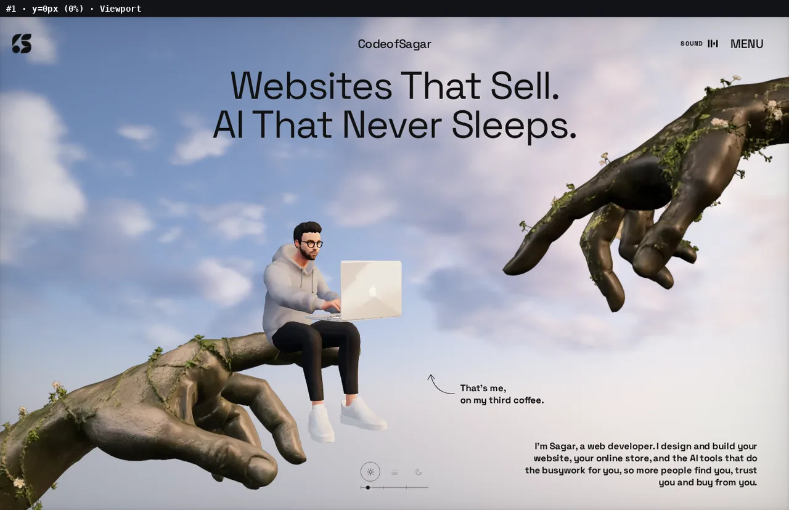
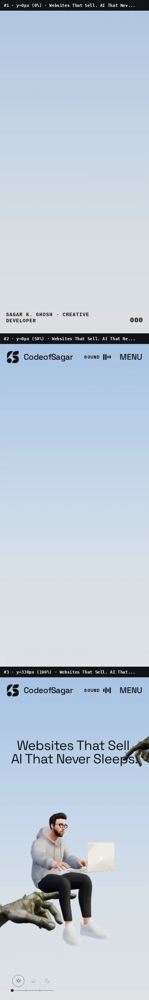

# UI Design System & Master Generation Blueprint: www-codeofsagar-in

> **Sagar K. Ghosh — Full-stack Developer & Designer** (https://www.codeofsagar.in/) — Websites and stores that sell, 3D people remember and automation that gives your team its time back, designed and built by Sagar K. Ghosh.





---

## 1. Executive Visual Persona & Design Archetype

- **Brand Essence & Persona**: **Sagar K. Ghosh — Full-stack Developer & Designer** (`https://www.codeofsagar.in/`). Websites and stores that sell, 3D people remember and automation that gives your team its time back, designed and built by Sagar K. Ghosh.
- **Final Redirected URL**: [https://codeofsagar.in/](https://codeofsagar.in/)
- **Capture Provenance**: Live browser capture (`tier1_fast`, HTTP `200`, captured `2026-11-24`).
- **Visual Archetype**: **Light-Gallery WebGL / Canvas Interactive Experience (`#ffffff` / `#008000`)**.
- **Anti-AI-Slop Differentiators**:
  - **Live-Computed Chromatic Polarity**: Anchors the viewport in `#ffffff` (live computed `body` `background-color` (`computed_styles.json`)) paired with `#0f0f0f` primary typography and `#008000` accents.
  - **Grounded Typographic Hierarchy**: Uses `spaceGrotesk` across display (`Websites That Sell. AI That Never Sl`) and body copy, paired with `spaceMono` for monospace/code.
  - **Calibrated Spatial Grid & Motion**: Combines `1700px` container bounds (`gap: 10px`, padding `28.8px`) with `cubic-bezier(.4,0,1,1)` easing and Lenis Smooth Scroll (`data-lenis`), GSAP Timeline & ScrollTrigger.

---

## 2. Spatial Architecture & Modular Grid Mathematics

### Viewport Allocation & Container Geometry
- **Captured Journey Filmstrips**: Desktop `1280×828px` (`assets/desktop-journey.webp`, `1` keyframes up to `y=0px` / doc `900px`), Mobile `390×2616px` (`assets/mobile-journey.webp`, `3` keyframes).
- **Master Container Bounds**: `1700px` (non-`@media` desktop container stylesheet rule).
- **Canvas Lateral Padding & Spacing**: `28.8px` lateral canvas padding with `10px` grid gap.
- **Border Radius Scale**: `.25rem`, `2rem`, `var(--radius-md)`, `var(--radius-sm)`.

### Responsive Breakpoint Architecture
- **Desktop Layout**: Multi-column CSS Grid / Flexbox layout at `1440px` (`max-width: 1700px`, `gap: 10px`).
- **Mobile Layout**: Single-column vertical stack at `390px` viewport width with `28.8px` horizontal padding.
- **Extracted CSS Media Queries**: `@media (min-width:1700px)`, `@media (min-width:40rem)`, `@media (min-width:48rem)`, `@media (min-width:64rem)`.

---

## 3. Color System, Materiality & Atmospheric Lighting

### Semantic Palette & Source Grounding
| Semantic Role | Ground-Truth Value | Extracted Live / CSS Source |
|---|---|---|
| **Primary Canvas Substrate** | `#ffffff` | live computed `body` `background-color` (`computed_styles.json`) |
| **Primary Typography Ink** | `#0f0f0f` | live computed `a` `color` (`computed_styles.json`) |
| **Elevated Surface / Card Substrate** | `#eeeae5` | `.project-transition-overlay { background: #eeeae5 }` |
| **Interactive Accent / Highlight** | `#008000` | `des button.AboutClutter-module_... { background: green }` (`#008000`) |
| **Secondary / Muted Copy** | `#262626` | `var(--ink-soft)` in `:root` |
| **Structural Hairline Border** | `#eeeeee` | `var(--line)` in `:root` (`0f0f0f12`) |

### Sanitized Root CSS Variables (`ui-ux.md` Ground Truth)
| Variable Name | Extracted Value | Semantic Role |
|---|---|---|
| `--fs-text` | `1rem` | Typography Ink Token |
| `--fs-btn` | `var(--fs-text)` | Design System Custom Token |
| `--fs-head` | `var(--fs-text)` | Design System Custom Token |
| `--fw-text` | `700` | Typography Ink Token |
| `--fs-semi` | `clamp(1.5rem, 2.3vw, 2.6rem)` | Dimension / Scale Token |
| `--fs-title` | `clamp(2.2rem, 1rem + 3.8vw, 5rem)` | Dimension / Scale Token |
| `--type-text` | `var(--fw-text) var(--fs-text) / 1.3 var(--font-grotesk)` | Typography Ink Token |
| `--type-head` | `500 var(--fs-head) / 1.05 var(--font-grotesk)` | Typography / Scale Token |
| `--type-title` | `400 var(--fs-title) / 1 var(--font-grotesk)` | Typography / Scale Token |
| `--type-mtitle` | `700 clamp(2.25rem, 10.5vw, 3.25rem) / .95 var(--font-grotesk)` | Typography / Scale Token |
| `--ls-mtitle` | `-.06em` | Dimension / Scale Token |
| `--ls-text` | `-.005em` | Typography Ink Token |
| `--ls-head` | `-.02em` | Dimension / Scale Token |
| `--ls-title` | `-.03em` | Dimension / Scale Token |
| `--tt-text` | `none` | Typography Ink Token |
| `--page-x` | `clamp(1rem, 2vw, 2.5rem)` | Dimension / Scale Token |

---

## 4. Typographic Scale & Editorial Hierarchy

### Font Family Stacks
- **Display Typography**: `spaceGrotesk`.
- **Primary Body Stack**: `spaceGrotesk`.
- **Technical / Metadata Stack**: `spaceMono`.

### Typographic Scale & Rules (Live Computed & Stylesheet Grounded)
- **Hero Display (`H1`)**: live computed `h1` (`font-size: 70.72px`, `line-height: 70.72px`, `font-weight: 400`, `letter-spacing: -2.1216px`); CSS variables `--font-display: var(--font-space-grotesk), ui-sans-serif, system-ui, sans-serif`.
- **Section Heading (`H2`)**: live computed `h2` (`font-size: 144px`, `line-height: 122.4px`, `font-weight: 300`, `letter-spacing: -3.6px`).
- **Body Copy**: live computed `body` (`font-size: 17px`, `line-height: 22.1px`, `font-weight: 700`, `letter-spacing: -0.085px`).
- **Metadata & Navigation Labels**: live computed `nav/a` (`font-size: 17px`, `line-height: 22.1px`, `font-weight: 700`, `letter-spacing: -0.085px`); CSS variables `--type-meta: 700 .9rem / 1.3 var(--font-tech)`, `--ls-meta: .06em`, `--text-xs: .75rem`.

---

## 5. Choreographed Motion & Interaction Physics

### Primary Easing Curves
- **Extracted Timing Functions**: `cubic-bezier(.4,0,1,1)`, `cubic-bezier(0,0,.2,1)`, `cubic-bezier(.4,0,.2,1)`.

### Per-Element Transition & Choreography Rules
- **Selector `layer theme`**: `transition: .15s` extracted from `www-codeofsagar-in` stylesheet.
- **Selector `.transition`**: `transition: var(--tw-ease,var(--default-transition-timing-function))` extracted from `www-codeofsagar-in` stylesheet.
- **Selector `.transition\!`**: `transition: var(--tw-ease,var(--default-transition-timing-function))!impor...` extracted from `www-codeofsagar-in` stylesheet.
- **Extracted Easing Curve (`cubic-bezier(.4,0,1,1)`)**: Governs interactive state transitions across `<header.NavBar-module__aMivtW__bar>` and `<section.grain-surface>`.
- **Runtime Interaction Engine**: Integrates Lenis Smooth Scroll (`data-lenis`), GSAP Timeline & ScrollTrigger, Three.js / WebGL Canvas Pipeline with `prefers-reduced-motion: reduce` fallback guards.
### Measured Runtime Scroll & Interaction Telemetry (`behavioral_journey_v2`)
- **Scroll Driver Mode**: `wheel` (max document height `900px`, deepest scrollY reached `0px` across `1` desktop keyframes).
- **Detected Scroll / Motion Libraries**: `Lenis`, `WebGL/Canvas`.

---

## 6. Component Wireframe & Structural DOM Map

### Visual Layout Schematic — Desktop (`1440px`, Grounded in `dom.html` & Landmark Bounding Boxes)
```
┌────────────────────────────────────────────────────────────────────────┐
│ DESKTOP VIEWPORT (1440px) — Sagar K. Ghosh — Full-stack Developer & De │
│ ====================================================================== │
│ [ <header.NavBar-module_ (1372x56px)  | H H o o m m e e · W W o o r  ] │
│ ---------------------------------------------------------------------- │
│ | HERO STAGE: <section.relative> (w=1440px)                          | │
│ | H1: Websites That Sell. AI That Never Sleeps.                      | │
│ | Substrate: #ffffff | Ink: #0f0f0f | Accent: #008000                | │
│ ---------------------------------------------------------------------- │
│ | SHOWCASE GRID (<section.grain-surface>) max-w: 1700px              | │
│ | +------------------------------+  +------------------------------+ | │
│ | | Websites that sell. AI that  |  | S A G A R K . G H O S H      | | │
│ | +------------------------------+  +------------------------------+ | │
│ ---------------------------------------------------------------------- │
│ | DETAIL MODULE (<section.bg-paper>) — Get Found. Get Chosen         | │
│ ---------------------------------------------------------------------- │
│ [ FOOTER (<footer.relative>   ) | https://www.codeofsagar.in/          │
└────────────────────────────────────────────────────────────────────────┘
```

### Visual Layout Schematic — Mobile Reflow (`390px`)
```
┌────────────────────────────────────────────────────────────────────────┐
│ MOBILE VIEWPORT REFLOW (390px) — Single-Column Stack (gap: 10px)       │
│ ====================================================================== │
│ [ HEADER BAR (<header.NavBar-module__a) | Compact Menu (390px)         │
│ ---------------------------------------------------------------------- │
│ | HERO STAGE (<section.relative>) — 390px Vertical Lead              | │
│ | H1: Websites That Sell. AI That Never Sleeps.                      | │
│ ---------------------------------------------------------------------- │
│ | SHOWCASE STACK (<section.grain-surface) — 1-Col Stack              | │
│ | [ Item 1: Websites that sell. AI that never sleeps.              ] | │
│ | [ Item 2: S A G A R K . G H O S H                                ] | │
│ ---------------------------------------------------------------------- │
│ | DETAIL STACK (<section.bg-paper>) — 1-Col (Get Found. Get Cho)     | │
│ ---------------------------------------------------------------------- │
│ [ FOOTER (<footer.relative>   ) | Stacked 390px Colophon               │
└────────────────────────────────────────────────────────────────────────┘
```

### Granular DOM Region Breakdown
1. **Brand Header & Navigation Bar (<header.NavBar-module__aMivtW__bar> — `www-codeofsagar-in`)**:
   - Landmark `<header class="NavBar-module__aMivtW__bar">` (`1372x56px`) hosting `Sagar K. Ghosh — Full-stack Develope` navigation (`H H o o m m e e · W W o o r r k k · A A b b o o u u t t · F F A A Q Q`), DOM attributes (`data-nav-solid`, `data-lines-anim`, `data-sky="day"`, `data-dot="small"`), and stylesheet rule `host { --color-neutral-900:lab(7.78201% -.0000149012 0) }`.
2. **Hero Stage & Focal Lead (<section.relative> — `Websites That Sell. AI That Never `)**:
   - Landmark `<section class="relative z-10">` presenting display lead `Websites That Sell. AI That Never Sleeps.` and copy excerpt *"I'm Sagar, a web developer. I design and build your website, your"* over `#ffffff` canvas and `#0f0f0f` ink.
3. **Primary Showcase & Content Grid (<section.grain-surface> — `Websites that sell. AI that never `)**:
   - Landmark `<section class="grain-surface home-titles">` rendering section `Websites that sell. AI that never sleeps.` with copy *"That's me, on my third coffee."*, asset references (`space_grotesk_latin_wght_normal-s...`, `space_mono_latin_400_normal-s.p.1...`, `space_mono_latin_700_normal-s.p.0...`, `36s0t0o8ux5as.js`), and grid rule `backdrop { box-sizing:border-box;border:0 solid;margin:0;padding:0 }`.
4. **Interactive Detail & Feature Matrix (<section.bg-paper> — `S A G A R K . G H O S H`)**:
   - Landmark `<section class="bg-paper">` framing `S A G A R K . G H O S H` and `Get Found. Get Chosen. Get Bought.` (*"on my third coffee."*) with `#eeeae5` surface cards, `#008000` accents, and `file-selector-button { box-sizing:border-box;border:0 solid;margin:0;padding:0 }`.
5. **Colophon & Global Directory Footer (<footer.relative> — `https://www.codeofsagar.in/`)**:
   - Landmark `<footer class="relative flex">` anchoring `Sagar K. Ghosh — Full-stack Deve` footer links (`H H o o m m e e · W W o o r r k k · A A b b o o u u t t · F F A A Q Q`), copy *"Let's make it simple."*, and `#eeeeee` structural dividers.
### Full Vertical Scroll Sequence (Desktop `1440×900` Keyframes)
- **Step 01** (`y=0px`, `0%`): Active landmark `Viewport` · sticky/fixed elements: `0`

---

## 7. Master Zero-Shot AI Generation Prompt

```markdown
# Master Zero-Shot Frontend Generation Prompt: www-codeofsagar-in (Sagar K. Ghosh — Full-stack Developer & Designer)

You are a principal frontend architect and design systems engineer. Build a complete, production-ready web application replicating the exact design system, DOM landmarks, typographic hierarchy, color tokens, and motion physics of `www-codeofsagar-in` (**Sagar K. Ghosh — Full-stack Developer & Designer** — `https://www.codeofsagar.in/`).

### 1. Visual Archetype & Anti-AI-Slop Mandates
- **Archetype**: Light-Gallery WebGL / Canvas Interactive Experience (`#ffffff` / `#008000`).
- **Identity & Domain Context**: Websites and stores that sell, 3D people remember and automation that gives your team its time back, designed and built by Sagar K. Ghosh.
- **Primary Substrate**: `#ffffff` (live computed `body` `background-color` (`computed_styles.json`)), **Primary Ink**: `#0f0f0f`, **Accent / Highlight**: `#008000`.
- **Site-Specific Differentiators**:
  - **Live-Computed Chromatic Polarity**: Anchors the viewport in `#ffffff` (live computed `body` `background-color` (`computed_styles.json`)) paired with `#0f0f0f` primary typography and `#008000` accents.
  - **Grounded Typographic Hierarchy**: Uses `spaceGrotesk` across display (`Websites That Sell. AI That Never Sl`) and body copy, paired with `spaceMono` for monospace/code.
  - **Calibrated Spatial Grid & Motion**: Combines `1700px` container bounds (`gap: 10px`, padding `28.8px`) with `cubic-bezier(.4,0,1,1)` easing and Lenis Smooth Scroll (`data-lenis`), GSAP Timeline & ScrollTrigger.

### 2. Ground-Truth CSS Variables (`:root` Token Contract)
Declare and consume these exact custom properties extracted from `www-codeofsagar-in` in your global stylesheet:

:root {
  /* Sagar K. Ghosh — Full-stack Developer & Designer (www-codeofsagar-in) — Live-Grounded CSS Variables */
  --fs-text: 1rem; /* Typography Ink Token (www-codeofsagar-in) */
  --fs-btn: var(--fs-text); /* Design System Custom Token (www-codeofsagar-in) */
  --fs-head: var(--fs-text); /* Design System Custom Token (www-codeofsagar-in) */
  --fw-text: 700; /* Typography Ink Token (www-codeofsagar-in) */
  --fs-semi: clamp(1.5rem, 2.3vw, 2.6rem); /* Dimension / Scale Token (www-codeofsagar-in) */
  --fs-title: clamp(2.2rem, 1rem + 3.8vw, 5rem); /* Dimension / Scale Token (www-codeofsagar-in) */
  --type-text: var(--fw-text) var(--fs-text) / 1.3 var(--font-grotesk); /* Typography Ink Token (www-codeofsagar-in) */
  --type-head: 500 var(--fs-head) / 1.05 var(--font-grotesk); /* Typography / Scale Token (www-codeofsagar-in) */
  --type-title: 400 var(--fs-title) / 1 var(--font-grotesk); /* Typography / Scale Token (www-codeofsagar-in) */
  --type-mtitle: 700 clamp(2.25rem, 10.5vw, 3.25rem) / .95 var(--font-grotesk); /* Typography / Scale Token (www-codeofsagar-in) */
  --ls-mtitle: -.06em; /* Dimension / Scale Token (www-codeofsagar-in) */
  --ls-text: -.005em; /* Typography Ink Token (www-codeofsagar-in) */
  --ls-head: -.02em; /* Dimension / Scale Token (www-codeofsagar-in) */
  --ls-title: -.03em; /* Dimension / Scale Token (www-codeofsagar-in) */
  --tt-text: none; /* Typography Ink Token (www-codeofsagar-in) */
  --page-x: clamp(1rem, 2vw, 2.5rem); /* Dimension / Scale Token (www-codeofsagar-in) */
}

### 3. Semantic Color & Materiality Contract
Map every surface, ink, and border strictly to these source-grounded tokens:
- **Primary Canvas Substrate**: `#ffffff` — grounded in live computed `body` `background-color` (`computed_styles.json`)
- **Primary Typography Ink**: `#0f0f0f` — grounded in live computed `a` `color` (`computed_styles.json`)
- **Elevated Surface / Card Substrate**: `#eeeae5` — grounded in `.project-transition-overlay { background: #eeeae5 }`
- **Interactive Accent / Highlight**: `#008000` — grounded in `des button.AboutClutter-module_... { background: green }` (`#008000`)
- **Secondary / Muted Copy**: `#262626` — grounded in `var(--ink-soft)` in `:root`
- **Structural Hairline Border**: `#eeeeee` — grounded in `var(--line)` in `:root` (`0f0f0f12`)

### 4. Spatial Grid, Container Bounds & Responsive Breakpoints
- **Desktop Viewport Reference**: `1280×828px` (single-viewport 100vh live capture (900px), `1440px` standard desktop width).
- **Mobile Viewport Reference**: `390×2616px` (multi-frame vertical journey filmstrip (2616px), `390px` standard mobile width).
- **Container Max-Width**: `1700px` (non-`@media` desktop container stylesheet rule)
- **Padding & Gutters**: `28.8px` lateral canvas padding with `10px` grid gap
- **Desktop Grid**: Multi-column CSS Grid / Flexbox layout at `1440px` (`max-width: 1700px`, `gap: 10px`)
- **Mobile Adaptation**: Single-column vertical stack at `390px` viewport width with `28.8px` horizontal padding
- **Media Queries**: `@media (min-width:1700px)`, `@media (min-width:40rem)`, `@media (min-width:48rem)`, `@media (min-width:64rem)`
- **Corner Radii**: `.25rem`, `2rem`, `var(--radius-md)`, `var(--radius-sm)`

### 5. Typography & Editorial Scale Contract
- **Display Font Stack**: `spaceGrotesk`
- **Body Font Stack**: `spaceGrotesk`
- **Monospace / Technical Font Stack**: `spaceMono`
- **H1 Display Rule**: live computed `h1` (`font-size: 70.72px`, `line-height: 70.72px`, `font-weight: 400`, `letter-spacing: -2.1216px`); CSS variables `--font-display: var(--font-space-grotesk), ui-sans-serif, system-ui, sans-serif`
- **H2 Section Rule**: live computed `h2` (`font-size: 144px`, `line-height: 122.4px`, `font-weight: 300`, `letter-spacing: -3.6px`)
- **Body Copy Rule**: live computed `body` (`font-size: 17px`, `line-height: 22.1px`, `font-weight: 700`, `letter-spacing: -0.085px`)
- **Metadata & Index Rule**: live computed `nav/a` (`font-size: 17px`, `line-height: 22.1px`, `font-weight: 700`, `letter-spacing: -0.085px`); CSS variables `--type-meta: 700 .9rem / 1.3 var(--font-tech)`, `--ls-meta: .06em`, `--text-xs: .75rem`

### 6. Component Hierarchy, Verbatim Copy & Real DOM Landmarks
Scaffold `www-codeofsagar-in` (`Sagar K. Ghosh — Full-stack Developer & Designer`) with these exact structural regions, extracted copy, and CSS rules from `dom.html`:
1. **Brand Header & Navigation Bar (<header.NavBar-module__aMivtW__bar> — `www-codeofsagar-in`)**:
   - DOM & Selectors: Landmark `<header class="NavBar-module__aMivtW__bar">` (`1372x56px`) hosting `Sagar K. Ghosh — Full-stack Develope` navigation (`H H o o m m e e · W W o o r r k k · A A b b o o u u t t · F F A A Q Q`), DOM attributes (`data-nav-solid`, `data-lines-anim`, `data-sky="day"`, `data-dot="small"`), and stylesheet rule `host { --color-neutral-900:lab(7.78201% -.0000149012 0) }`.
   - Responsive Contract: Header `Brand Header & Navigation Bar (<header.NavBar-module__aMivtW__bar> — `www-codeofsagar-in`)` (`www-codeofsagar-in`) adapts across `@media (min-width:1700px)`, `@media (min-width:40rem)`, `@media (min-width:48rem)`, `@media (min-width:64rem)` with `cubic-bezier(.4,0,1,1)`, `cubic-bezier(0,0,.2,1)`, `cubic-bezier(.4,0,.2,1)` transitions and links `H H o o m m e e · W W o o r r k k · A A b b o o u u t t · F F A A Q Q`.
2. **Hero Stage & Focal Lead (<section.relative> — `Websites That Sell. AI That Never `)**:
   - DOM & Selectors: Landmark `<section class="relative z-10">` presenting display lead `Websites That Sell. AI That Never Sleeps.` and copy excerpt *"I'm Sagar, a web developer. I design and build your website, your"* over `#ffffff` canvas and `#0f0f0f` ink.
   - Responsive Contract: Hero stage (`1280×828px` desktop / `390×2616px` mobile) sets `#ffffff` background with `#0f0f0f` headline `Websites That Sell. AI That Never Sleeps.`.
3. **Primary Showcase & Content Grid (<section.grain-surface> — `Websites that sell. AI that never `)**:
   - DOM & Selectors: Landmark `<section class="grain-surface home-titles">` rendering section `Websites that sell. AI that never sleeps.` with copy *"That's me, on my third coffee."*, asset references (`space_grotesk_latin_wght_normal-s...`, `space_mono_latin_400_normal-s.p.1...`, `space_mono_latin_700_normal-s.p.0...`, `36s0t0o8ux5as.js`), and grid rule `backdrop { box-sizing:border-box;border:0 solid;margin:0;padding:0 }`.
   - Responsive Contract: Showcase grid `Primary Showcase & Content Grid (<section.grain-surface> — `Websites that sell. AI that never `)` applies Multi-column CSS Grid / Flexbox layout at `1440px` (`max-width: 1700px`, `gap: 10px`) on desktop and Single-column vertical stack at `390px` viewport width with `28.8px` horizontal padding on mobile.
4. **Interactive Detail & Feature Matrix (<section.bg-paper> — `S A G A R K . G H O S H`)**:
   - DOM & Selectors: Landmark `<section class="bg-paper">` framing `S A G A R K . G H O S H` and `Get Found. Get Chosen. Get Bought.` (*"on my third coffee."*) with `#eeeae5` surface cards, `#008000` accents, and `file-selector-button { box-sizing:border-box;border:0 solid;margin:0;padding:0 }`.
   - Responsive Contract: Detail module `Interactive Detail & Feature Matrix (<section.bg-paper> — `S A G A R K . G H O S H`)` uses `.25rem`, `2rem`, `var(--radius-md)`, `var(--radius-sm)` radii, `#008000` highlights, and assets (space_grotesk_latin_wght_normal-s..., space_mono_latin_400_normal-s.p.1..., space_mono_latin_700_normal-s.p.0...).
5. **Colophon & Global Directory Footer (<footer.relative> — `https://www.codeofsagar.in/`)**:
   - DOM & Selectors: Landmark `<footer class="relative flex">` anchoring `Sagar K. Ghosh — Full-stack Deve` footer links (`H H o o m m e e · W W o o r r k k · A A b b o o u u t t · F F A A Q Q`), copy *"Let's make it simple."*, and `#eeeeee` structural dividers.
   - Responsive Contract: Footer `Colophon & Global Directory Footer (<footer.relative> — `https://www.codeofsagar.in/`)` aligns to `1700px` (non-`@media` desktop container stylesheet rule) with `28.8px` lateral canvas padding with `10px` grid gap and attributes (data-nav-solid, data-lines-anim, data-sky="day").

#### Verbatim DOM Copy Excerpts (`dom.html`)
- Copy Excerpt 1: *"I'm Sagar, a web developer. I design and build your website, your online store, an..."*
- Copy Excerpt 2: *"That's me, on my third coffee."*
- Copy Excerpt 3: *"on my third coffee."*
- Copy Excerpt 4: *"Let's make it simple."*

### 7. Motion, Extracted Stylesheet Rules & Interaction Choreography
- **Primary Easing Functions**: `cubic-bezier(.4,0,1,1)`, `cubic-bezier(0,0,.2,1)`, `cubic-bezier(.4,0,.2,1)`
- **Extracted Stylesheet Rules (`www-codeofsagar-in`)**:
- `host { --color-neutral-900:lab(7.78201% -.0000149012 0) }`
- `backdrop { box-sizing:border-box;border:0 solid;margin:0;padding:0 }`
- `file-selector-button { box-sizing:border-box;border:0 solid;margin:0;padding:0 }`
- `strong { font-weight:bolder }`
- `small { font-size:80% }`
- **Per-Selector Transition Rules**:
- **Selector `layer theme`**: `transition: .15s` extracted from `www-codeofsagar-in` stylesheet.
- **Selector `.transition`**: `transition: var(--tw-ease,var(--default-transition-timing-function))` extracted from `www-codeofsagar-in` stylesheet.
- **Selector `.transition\!`**: `transition: var(--tw-ease,var(--default-transition-timing-function))!impor...` extracted from `www-codeofsagar-in` stylesheet.
- **Extracted Easing Curve (`cubic-bezier(.4,0,1,1)`)**: Governs interactive state transitions across `<header.NavBar-module__aMivtW__bar>` and `<section.grain-surface>`.
- **Runtime Interaction Engine**: Integrates Lenis Smooth Scroll (`data-lenis`), GSAP Timeline & ScrollTrigger, Three.js / WebGL Canvas Pipeline with `prefers-reduced-motion: reduce` fallback guards.
### 7b. Full-Page Scroll Choreography, Interactive States & Multi-Page Routes
- **Scroll Mechanics**: Implement `wheel` vertical progression up to `900px` across 1 distinct viewport chapters using Lenis, WebGL/Canvas.
- **Vertical Chapter Sequence**: Viewport (0%).

### 8. Technical Deliverables
- Implement in Next.js (App Router) with TypeScript and Tailwind CSS consuming the `:root` custom properties defined above for `www-codeofsagar-in`.
- Reproduce both the `1440px` desktop architecture and `390px` mobile breakpoint transitions, preserving semantic HTML5 landmarks (`<header>`, `<nav>`, `<main>`, `<section>`, `<footer>`) and `prefers-reduced-motion` accessibility guards.
```
---

## 8. Full-Page Scroll Journey, Interactive States & Subpage Inventory

### Desktop Scroll Keyframes (`1440×900` WebP)
| Step | Scroll Y | Progress | Active Landmark / Section | Sticky/Fixed | Visual Asset |
| :---: | :---: | :---: | :--- | :---: | :--- |
| `#01` | `0px` | `0%` | Viewport | `0` | [desktop-step-01.webp](assets/desktop-step-01.webp) |

### Mobile Condensed Keyframes (`390×844` WebP)
| Step | Scroll Y | Progress | Active Landmark | Visual Asset |
| :---: | :---: | :---: | :--- | :--- |
| `#01` | `0px` | `0%` | Websites That Sell. AI That Never Sleeps. | [mobile-step-01.webp](assets/mobile-step-01.webp) |
| `#02` | `0px` | `50%` | Websites That Sell. AI That Never Sleeps. | [mobile-step-02.webp](assets/mobile-step-02.webp) |
| `#03` | `338px` | `100%` | Websites That Sell. AI That Never Sleeps. | [mobile-step-03.webp](assets/mobile-step-03.webp) |

