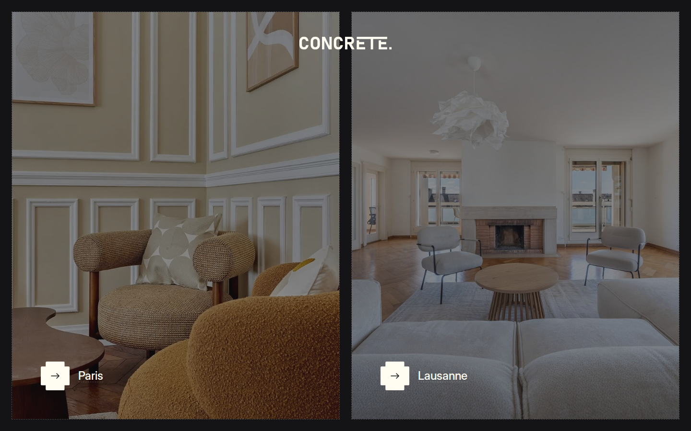
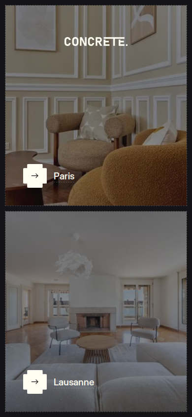

# UI Design System & Master Generation Blueprint: www-concretemanagement-fr

> **Concrete.** (https://www.concretemanagement.fr/) — L’immobilier, pensé pour vous



---

## 1. Executive Visual Persona & Design Archetype

- **Brand Essence & Persona**: **Concrete.** (`https://www.concretemanagement.fr/`). L’immobilier, pensé pour vous
- **Final Redirected URL**: [https://www.concretemanagement.ch/fr](https://www.concretemanagement.ch/fr)
- **Capture Provenance**: Live browser capture (`tier1_fast`, HTTP `200`, captured `2026-11-23`).
- **Visual Archetype**: **High-Contrast Obsidian / Atmospheric Design System (`#141416` canvas, `#ffffff` ink, `#0082f3` accent)**.
- **Anti-AI-Slop Differentiators**:
  - **Live-Computed Chromatic Polarity**: Anchors the viewport in `#141416` (live computed `body` `background-color` (`computed_styles.json`)) paired with `#ffffff` primary typography and `#0082f3` accents.
  - **Grounded Typographic Hierarchy**: Pairs `Otto` for display copy (`L’immobilier, pensé pour vous`) with `Interdisplay` and not declared in live computed styles (uses primary stack / `ui-monospace`).
  - **Calibrated Spatial Grid & Motion**: Combines `80em` container bounds (`gap: 16px`, padding `9px`) with `cubic-bezier(.36,.33,0,1)` easing and Lenis Smooth Scroll (`data-lenis`), Swiper Touch Carousel Engine.

---

## 2. Spatial Architecture & Modular Grid Mathematics



### Viewport Allocation & Container Geometry
- **Captured Viewport Dimensions**: Desktop `1440×900px` (`assets/desktop.png`, single-viewport 100vh live capture (900px)), Mobile `390×844px` (`assets/mobile.png`, single-viewport 100vh live capture (844px)).
- **Master Container Bounds**: `80em` (non-`@media` desktop container stylesheet rule).
- **Canvas Lateral Padding & Spacing**: `9px` lateral canvas padding with `16px` grid gap.
- **Border Radius Scale**: `3px`, `100%`, `50%`, `4px`.

### Responsive Breakpoint Architecture
- **Desktop Layout**: Multi-column CSS Grid / Flexbox layout at `1440px` (`max-width: 80em`, `gap: 16px`).
- **Mobile Layout**: Single-column vertical stack at `390px` viewport width with `9px` horizontal padding.
- **Extracted CSS Media Queries**: `@media screen and (max-width: 991px)`, `@media screen and (max-width: 767px)`, `@media screen and (max-width: 479px)`, `@media (min-width: 768px)`.

---

## 3. Color System, Materiality & Atmospheric Lighting

### Semantic Palette & Source Grounding
| Semantic Role | Ground-Truth Value | Extracted Live / CSS Source |
|---|---|---|
| **Primary Canvas Substrate** | `#141416` | live computed `body` `background-color` (`computed_styles.json`) |
| **Primary Typography Ink** | `#ffffff` | live computed `h1` `color` (`computed_styles.json`) |
| **Elevated Surface / Card Substrate** | `#222222` | `.w-slider-nav-invert > div.w-ac... { background-color: #222222 }` |
| **Interactive Accent / Highlight** | `#0082f3` | `.w-dropdown-link.w--current { color: #0082f3 }` |
| **Secondary / Muted Copy** | `#97968d` | live computed `a` `color` (`computed_styles.json`) |
| **Structural Hairline Border** | `#3898ec` | `.w-select:focus { border-color: #3898ec }` |
| **Variable Token (`--_colors---kaki--base`)** | `#dcd9c8` | `var(--_colors---kaki--base)` in `:root` |
| **Variable Token (`--_colors---brown--base`)** | `#5f4242` | `var(--_colors---brown--base)` in `:root` |
| **Variable Token (`--_colors---cream--base`)** | `#fffdf1` | `var(--_colors---cream--base)` in `:root` |
| **Variable Token (`--_colors---dark--light`)** | `#2c2b2f` | `var(--_colors---dark--light)` in `:root` |
| **Variable Token (`--_colors---white--20`)** | `#fff3` | `var(--_colors---white--20)` in `:root` |

### Sanitized Root CSS Variables (`ui-ux.md` Ground Truth)
| Variable Name | Extracted Value | Semantic Role |
|---|---|---|
| `--_colors---dark--base` | `#141416` | Canvas / Surface Token |
| `--_colors---white--base` | `white` | Canvas / Surface Token |
| `--_colors---kaki--base` | `#dcd9c8` | Brand / Palette Token |
| `--xl` | `12.5em` | Dimension / Scale Token |
| `--_sizes---space--md` | `2.5em` | Layout / Spatial Grid Token |
| `--_sizes---space--sm` | `1.5em` | Layout / Spatial Grid Token |
| `--_colors---dark--20` | `#14141633` | Canvas / Surface Token |
| `--_sizes---space--lg` | `5em` | Layout / Spatial Grid Token |
| `--_colors---brown--base` | `#5f4242` | Brand / Palette Token |
| `--_colors---cream--base` | `#fffdf1` | Brand / Palette Token |
| `--_colors---kaki--dark` | `#97968d` | Canvas / Surface Token |
| `--_colors---dark--light` | `#2c2b2f` | Canvas / Surface Token |
| `--_colors---white--20` | `#fff3` | Canvas / Surface Token |
| `--_colors---white--50` | `#ffffff80` | Canvas / Surface Token |
| `--_colors---dark--50` | `#14141680` | Canvas / Surface Token |
| `--_sizes---perc-60` | `60%` | Layout / Spatial Grid Token |

---

## 4. Typographic Scale & Editorial Hierarchy

### Font Family Stacks
- **Display Typography**: `Otto`.
- **Primary Body Stack**: `Interdisplay`.
- **Technical / Metadata Stack**: not declared in live computed styles (uses primary stack / `ui-monospace`).

### Typographic Scale & Rules (Live Computed & Stylesheet Grounded)
- **Hero Display (`H1`)**: live computed `h1` (`font-size: 144px`, `line-height: 129.6px`, `font-weight: 300`, `letter-spacing: -10.08px`); rule `h1` (`font-size: 2em`).
- **Section Heading (`H2`)**: live computed `h2` (`font-size: 56px`, `line-height: 61.6px`, `font-weight: 300`, `letter-spacing: -3.92px`); rule `h2` (`font-size: 32px`, `line-height: 36px`).
- **Body Copy**: live computed `body` (`font-size: 16px`, `line-height: 20.8px`, `font-weight: 400`); rule `body` (`font-size: 14px`, `line-height: 20px`).
- **Metadata & Navigation Labels**: live computed `nav/a` (`font-size: 24px`, `line-height: 20.8px`, `font-weight: 400`); rule `small` (`font-size: 80%`).

---

## 5. Choreographed Motion & Interaction Physics

### Primary Easing Curves
- **Extracted Timing Functions**: `cubic-bezier(.36,.33,0,1)`, `cubic-bezier(.22,.61,.36,1)`, `cubic-bezier(.4,0,.2,1)`.

### Per-Element Transition & Choreography Rules
- **Selector `.w-webflow-badge > img`**: `transition: unset` extracted from `www-concretemanagement-fr` stylesheet.
- **Selector `.w-slider-dot`**: `transition: background-color .1s, color .1s` extracted from `www-concretemanagement-fr` stylesheet.
- **Selector `.w-lightbox-control`**: `transition: all .3s` extracted from `www-concretemanagement-fr` stylesheet.
- **Extracted Easing Curve (`cubic-bezier(.36,.33,0,1)`)**: Governs interactive state transitions across `<header.w-mod-js>` and `<section.presentation>`.
- **Runtime Interaction Engine**: Integrates Lenis Smooth Scroll (`data-lenis`), Swiper Touch Carousel Engine with `prefers-reduced-motion: reduce` fallback guards.

---

## 6. Component Wireframe & Structural DOM Map

### Visual Layout Schematic — Desktop (`1440px`, Grounded in `dom.html` & Landmark Bounding Boxes)
```
┌────────────────────────────────────────────────────────────────────────┐
│ DESKTOP VIEWPORT (1440px) — Concrete.                                  │
│ ====================================================================== │
│ [ <header.w-mod-js> (1440px)          | Paris · Lausanne · Propriéta ] │
│ ---------------------------------------------------------------------- │
│ | HERO STAGE: <section.hero> (w=1440px)                              | │
│ | H1: L’immobilier, pensé pour vous                                  | │
│ | Substrate: #141416 | Ink: #ffffff | Accent: #0082f3                | │
│ ---------------------------------------------------------------------- │
│ | SHOWCASE GRID (<section.presentation>) max-w: 80em                 | │
│ | +------------------------------+  +------------------------------+ | │
│ | | Concrete est une structure d |  | Votre patrimoine, notre expe | | │
│ | +------------------------------+  +------------------------------+ | │
│ ---------------------------------------------------------------------- │
│ | DETAIL MODULE (<section.stacking>) — Gestion moyenne durée         | │
│ ---------------------------------------------------------------------- │
│ [ FOOTER (<footer.portail-btn>) | https://www.concretemanagement.fr/   │
└────────────────────────────────────────────────────────────────────────┘
```

### Visual Layout Schematic — Mobile Reflow (`390px`)
```
┌────────────────────────────────────────────────────────────────────────┐
│ MOBILE VIEWPORT REFLOW (390px) — Single-Column Stack (gap: 16px)       │
│ ====================================================================== │
│ [ HEADER BAR (<header.w-mod-js>       ) | Compact Menu (390px)         │
│ ---------------------------------------------------------------------- │
│ | HERO STAGE (<section.hero>) — 390px Vertical Lead                  | │
│ | H1: L’immobilier, pensé pour vous                                  | │
│ ---------------------------------------------------------------------- │
│ | SHOWCASE STACK (<section.presentation>) — 1-Col Stack              | │
│ | [ Item 1: Concrete est une structure de gestion patrimonial...   ] | │
│ | [ Item 2: Votre patrimoine, notre expertise                      ] | │
│ ---------------------------------------------------------------------- │
│ | DETAIL STACK (<section.stacking>) — 1-Col (Gestion moyenne du)     | │
│ ---------------------------------------------------------------------- │
│ [ FOOTER (<footer.portail-btn>) | Stacked 390px Colophon               │
└────────────────────────────────────────────────────────────────────────┘
```

### Granular DOM Region Breakdown
1. **Brand Header & Navigation Bar (<header.w-mod-js> — `www-concretemanagement-fr`)**:
   - Landmark `<header class="w-mod-js">` (`1440px`) hosting `Concrete.` navigation (`Paris · Lausanne · Propriétaires + · Locataires + · À propos`), DOM attributes (`data-wf-domain="www.concretemanagemen..."`, `data-wf-page="6966a64d3505e01c9d776d27"`, `data-wf-site="6966a64c3505e01c9d776d0f"`, `data-wf--buttonsimple--variant="cream"`), and stylesheet rule `html { -webkit-text-size-adjust: 100%; -ms-text-size-adjust: 100%; font-family:... }`.
2. **Hero Stage & Focal Lead (<section.hero> — `L’immobilier, pensé pour vous`)**:
   - Landmark `<section class="hero">` presenting display lead `L’immobilier, pensé pour vous` and copy excerpt *"Demander une estimation"* over `#141416` canvas and `#ffffff` ink.
3. **Primary Showcase & Content Grid (<section.presentation> — `Concrete est une structure de gest`)**:
   - Landmark `<section class="presentation u-section">` rendering section `Concrete est une structure de gestion patrimonial...` with copy *"Gestion moyenne durée"*, asset references (`cdn.prod.website-files.com`, `concrete-3b73a4.webflow.shared.4d...`, `69809783d135718ad587d127_favicon.png`, `69809785d587f5575f03e822_favicon-...`), and grid rule `body { margin: 0; }`.
4. **Interactive Detail & Feature Matrix (<section.stacking> — `Votre patrimoine, notre expertise`)**:
   - Landmark `<section class="stacking u-section">` framing `Votre patrimoine, notre expertise` and `Gestion moyenne durée` (*"Gestion courte durée"*) with `#222222` surface cards, `#0082f3` accents, and `summary { display: block; }`.
5. **Colophon & Global Directory Footer (<footer.portail-btn> — `https://www.concretemanagement.fr/`)**:
   - Landmark `<footer class="portail-btn">` anchoring `Concrete.` footer links (`Paris · Lausanne · Propriétaires + · Locataires + · À propos`), copy *"Trouver un appartement"*, and `#3898ec` structural dividers.

---

## 7. Master Zero-Shot AI Generation Prompt

```markdown
# Master Zero-Shot Frontend Generation Prompt: www-concretemanagement-fr (Concrete.)

You are a principal frontend architect and design systems engineer. Build a complete, production-ready web application replicating the exact design system, DOM landmarks, typographic hierarchy, color tokens, and motion physics of `www-concretemanagement-fr` (**Concrete.** — `https://www.concretemanagement.fr/`).

### 1. Visual Archetype & Anti-AI-Slop Mandates
- **Archetype**: High-Contrast Obsidian / Atmospheric Design System (`#141416` canvas, `#ffffff` ink, `#0082f3` accent).
- **Identity & Domain Context**: L’immobilier, pensé pour vous
- **Primary Substrate**: `#141416` (live computed `body` `background-color` (`computed_styles.json`)), **Primary Ink**: `#ffffff`, **Accent / Highlight**: `#0082f3`.
- **Site-Specific Differentiators**:
  - **Live-Computed Chromatic Polarity**: Anchors the viewport in `#141416` (live computed `body` `background-color` (`computed_styles.json`)) paired with `#ffffff` primary typography and `#0082f3` accents.
  - **Grounded Typographic Hierarchy**: Pairs `Otto` for display copy (`L’immobilier, pensé pour vous`) with `Interdisplay` and not declared in live computed styles (uses primary stack / `ui-monospace`).
  - **Calibrated Spatial Grid & Motion**: Combines `80em` container bounds (`gap: 16px`, padding `9px`) with `cubic-bezier(.36,.33,0,1)` easing and Lenis Smooth Scroll (`data-lenis`), Swiper Touch Carousel Engine.

### 2. Ground-Truth CSS Variables (`:root` Token Contract)
Declare and consume these exact custom properties extracted from `www-concretemanagement-fr` in your global stylesheet:

:root {
  /* Concrete. (www-concretemanagement-fr) — Live-Grounded CSS Variables */
  --_colors---dark--base: #141416; /* Canvas / Surface Token (www-concretemanagement-fr) */
  --_colors---white--base: white; /* Canvas / Surface Token (www-concretemanagement-fr) */
  --_colors---kaki--base: #dcd9c8; /* Brand / Palette Token (www-concretemanagement-fr) */
  --xl: 12.5em; /* Dimension / Scale Token (www-concretemanagement-fr) */
  --_sizes---space--md: 2.5em; /* Layout / Spatial Grid Token (www-concretemanagement-fr) */
  --_sizes---space--sm: 1.5em; /* Layout / Spatial Grid Token (www-concretemanagement-fr) */
  --_colors---dark--20: #14141633; /* Canvas / Surface Token (www-concretemanagement-fr) */
  --_sizes---space--lg: 5em; /* Layout / Spatial Grid Token (www-concretemanagement-fr) */
  --_colors---brown--base: #5f4242; /* Brand / Palette Token (www-concretemanagement-fr) */
  --_colors---cream--base: #fffdf1; /* Brand / Palette Token (www-concretemanagement-fr) */
  --_colors---kaki--dark: #97968d; /* Canvas / Surface Token (www-concretemanagement-fr) */
  --_colors---dark--light: #2c2b2f; /* Canvas / Surface Token (www-concretemanagement-fr) */
  --_colors---white--20: #fff3; /* Canvas / Surface Token (www-concretemanagement-fr) */
  --_colors---white--50: #ffffff80; /* Canvas / Surface Token (www-concretemanagement-fr) */
  --_colors---dark--50: #14141680; /* Canvas / Surface Token (www-concretemanagement-fr) */
  --_sizes---perc-60: 60%; /* Layout / Spatial Grid Token (www-concretemanagement-fr) */
}

### 3. Semantic Color & Materiality Contract
Map every surface, ink, and border strictly to these source-grounded tokens:
- **Primary Canvas Substrate**: `#141416` — grounded in live computed `body` `background-color` (`computed_styles.json`)
- **Primary Typography Ink**: `#ffffff` — grounded in live computed `h1` `color` (`computed_styles.json`)
- **Elevated Surface / Card Substrate**: `#222222` — grounded in `.w-slider-nav-invert > div.w-ac... { background-color: #222222 }`
- **Interactive Accent / Highlight**: `#0082f3` — grounded in `.w-dropdown-link.w--current { color: #0082f3 }`
- **Secondary / Muted Copy**: `#97968d` — grounded in live computed `a` `color` (`computed_styles.json`)
- **Structural Hairline Border**: `#3898ec` — grounded in `.w-select:focus { border-color: #3898ec }`
- **Variable Token (`--_colors---kaki--base`)**: `#dcd9c8` — grounded in `var(--_colors---kaki--base)` in `:root`
- **Variable Token (`--_colors---brown--base`)**: `#5f4242` — grounded in `var(--_colors---brown--base)` in `:root`
- **Variable Token (`--_colors---cream--base`)**: `#fffdf1` — grounded in `var(--_colors---cream--base)` in `:root`
- **Variable Token (`--_colors---dark--light`)**: `#2c2b2f` — grounded in `var(--_colors---dark--light)` in `:root`
- **Variable Token (`--_colors---white--20`)**: `#fff3` — grounded in `var(--_colors---white--20)` in `:root`

### 4. Spatial Grid, Container Bounds & Responsive Breakpoints
- **Desktop Viewport Reference**: `1440×900px` (single-viewport 100vh live capture (900px), `1440px` standard desktop width).
- **Mobile Viewport Reference**: `390×844px` (single-viewport 100vh live capture (844px), `390px` standard mobile width).
- **Container Max-Width**: `80em` (non-`@media` desktop container stylesheet rule)
- **Padding & Gutters**: `9px` lateral canvas padding with `16px` grid gap
- **Desktop Grid**: Multi-column CSS Grid / Flexbox layout at `1440px` (`max-width: 80em`, `gap: 16px`)
- **Mobile Adaptation**: Single-column vertical stack at `390px` viewport width with `9px` horizontal padding
- **Media Queries**: `@media screen and (max-width: 991px)`, `@media screen and (max-width: 767px)`, `@media screen and (max-width: 479px)`, `@media (min-width: 768px)`
- **Corner Radii**: `3px`, `100%`, `50%`, `4px`

### 5. Typography & Editorial Scale Contract
- **Display Font Stack**: `Otto`
- **Body Font Stack**: `Interdisplay`
- **Monospace / Technical Font Stack**: not declared in live computed styles (uses primary stack / `ui-monospace`)
- **H1 Display Rule**: live computed `h1` (`font-size: 144px`, `line-height: 129.6px`, `font-weight: 300`, `letter-spacing: -10.08px`); rule `h1` (`font-size: 2em`)
- **H2 Section Rule**: live computed `h2` (`font-size: 56px`, `line-height: 61.6px`, `font-weight: 300`, `letter-spacing: -3.92px`); rule `h2` (`font-size: 32px`, `line-height: 36px`)
- **Body Copy Rule**: live computed `body` (`font-size: 16px`, `line-height: 20.8px`, `font-weight: 400`); rule `body` (`font-size: 14px`, `line-height: 20px`)
- **Metadata & Index Rule**: live computed `nav/a` (`font-size: 24px`, `line-height: 20.8px`, `font-weight: 400`); rule `small` (`font-size: 80%`)

### 6. Component Hierarchy, Verbatim Copy & Real DOM Landmarks
Scaffold `www-concretemanagement-fr` (`Concrete.`) with these exact structural regions, extracted copy, and CSS rules from `dom.html`:
1. **Brand Header & Navigation Bar (<header.w-mod-js> — `www-concretemanagement-fr`)**:
   - DOM & Selectors: Landmark `<header class="w-mod-js">` (`1440px`) hosting `Concrete.` navigation (`Paris · Lausanne · Propriétaires + · Locataires + · À propos`), DOM attributes (`data-wf-domain="www.concretemanagemen..."`, `data-wf-page="6966a64d3505e01c9d776d27"`, `data-wf-site="6966a64c3505e01c9d776d0f"`, `data-wf--buttonsimple--variant="cream"`), and stylesheet rule `html { -webkit-text-size-adjust: 100%; -ms-text-size-adjust: 100%; font-family:... }`.
   - Responsive Contract: Header `Brand Header & Navigation Bar (<header.w-mod-js> — `www-concretemanagement-fr`)` (`www-concretemanagement-fr`) adapts across `@media screen and (max-width: 991px)`, `@media screen and (max-width: 767px)`, `@media screen and (max-width: 479px)`, `@media (min-width: 768px)` with `cubic-bezier(.36,.33,0,1)`, `cubic-bezier(.22,.61,.36,1)`, `cubic-bezier(.4,0,.2,1)` transitions and links `Paris · Lausanne · Propriétaires + · Locataires + · À propos`.
2. **Hero Stage & Focal Lead (<section.hero> — `L’immobilier, pensé pour vous`)**:
   - DOM & Selectors: Landmark `<section class="hero">` presenting display lead `L’immobilier, pensé pour vous` and copy excerpt *"Demander une estimation"* over `#141416` canvas and `#ffffff` ink.
   - Responsive Contract: Hero stage (`1440×900px` desktop / `390×844px` mobile) sets `#141416` background with `#ffffff` headline `L’immobilier, pensé pour vous`.
3. **Primary Showcase & Content Grid (<section.presentation> — `Concrete est une structure de gest`)**:
   - DOM & Selectors: Landmark `<section class="presentation u-section">` rendering section `Concrete est une structure de gestion patrimonial...` with copy *"Gestion moyenne durée"*, asset references (`cdn.prod.website-files.com`, `concrete-3b73a4.webflow.shared.4d...`, `69809783d135718ad587d127_favicon.png`, `69809785d587f5575f03e822_favicon-...`), and grid rule `body { margin: 0; }`.
   - Responsive Contract: Showcase grid `Primary Showcase & Content Grid (<section.presentation> — `Concrete est une structure de gest`)` applies Multi-column CSS Grid / Flexbox layout at `1440px` (`max-width: 80em`, `gap: 16px`) on desktop and Single-column vertical stack at `390px` viewport width with `9px` horizontal padding on mobile.
4. **Interactive Detail & Feature Matrix (<section.stacking> — `Votre patrimoine, notre expertise`)**:
   - DOM & Selectors: Landmark `<section class="stacking u-section">` framing `Votre patrimoine, notre expertise` and `Gestion moyenne durée` (*"Gestion courte durée"*) with `#222222` surface cards, `#0082f3` accents, and `summary { display: block; }`.
   - Responsive Contract: Detail module `Interactive Detail & Feature Matrix (<section.stacking> — `Votre patrimoine, notre expertise`)` uses `3px`, `100%`, `50%`, `4px` radii, `#0082f3` highlights, and assets (cdn.prod.website-files.com, concrete-3b73a4.webflow.shared.4d..., 69809783d135718ad587d127_favicon.png).
5. **Colophon & Global Directory Footer (<footer.portail-btn> — `https://www.concretemanagement.fr/`)**:
   - DOM & Selectors: Landmark `<footer class="portail-btn">` anchoring `Concrete.` footer links (`Paris · Lausanne · Propriétaires + · Locataires + · À propos`), copy *"Trouver un appartement"*, and `#3898ec` structural dividers.
   - Responsive Contract: Footer `Colophon & Global Directory Footer (<footer.portail-btn> — `https://www.concretemanagement.fr/`)` aligns to `80em` (non-`@media` desktop container stylesheet rule) with `9px` lateral canvas padding with `16px` grid gap and attributes (data-wf-domain="www.concretemanagemen...", data-wf-page="6966a64d3505e01c9d776d27", data-wf-site="6966a64c3505e01c9d776d0f").

#### Verbatim DOM Copy Excerpts (`dom.html`)
- Copy Excerpt 1: *"Demander une estimation"*
- Copy Excerpt 2: *"Gestion moyenne durée"*
- Copy Excerpt 3: *"Gestion courte durée"*
- Copy Excerpt 4: *"Trouver un appartement"*

### 7. Motion, Extracted Stylesheet Rules & Interaction Choreography
- **Primary Easing Functions**: `cubic-bezier(.36,.33,0,1)`, `cubic-bezier(.22,.61,.36,1)`, `cubic-bezier(.4,0,.2,1)`
- **Extracted Stylesheet Rules (`www-concretemanagement-fr`)**:
- `html { -webkit-text-size-adjust: 100%; -ms-text-size-adjust: 100%; font-family:... }`
- `body { margin: 0; }`
- `summary { display: block; }`
- `video { vertical-align: baseline; display: inline-block; }`
- `template { display: none; }`
- **Per-Selector Transition Rules**:
- **Selector `.w-webflow-badge > img`**: `transition: unset` extracted from `www-concretemanagement-fr` stylesheet.
- **Selector `.w-slider-dot`**: `transition: background-color .1s, color .1s` extracted from `www-concretemanagement-fr` stylesheet.
- **Selector `.w-lightbox-control`**: `transition: all .3s` extracted from `www-concretemanagement-fr` stylesheet.
- **Extracted Easing Curve (`cubic-bezier(.36,.33,0,1)`)**: Governs interactive state transitions across `<header.w-mod-js>` and `<section.presentation>`.
- **Runtime Interaction Engine**: Integrates Lenis Smooth Scroll (`data-lenis`), Swiper Touch Carousel Engine with `prefers-reduced-motion: reduce` fallback guards.

### 8. Technical Deliverables
- Implement in Next.js (App Router) with TypeScript and Tailwind CSS consuming the `:root` custom properties defined above for `www-concretemanagement-fr`.
- Reproduce both the `1440px` desktop architecture and `390px` mobile breakpoint transitions, preserving semantic HTML5 landmarks (`<header>`, `<nav>`, `<main>`, `<section>`, `<footer>`) and `prefers-reduced-motion` accessibility guards.
```
