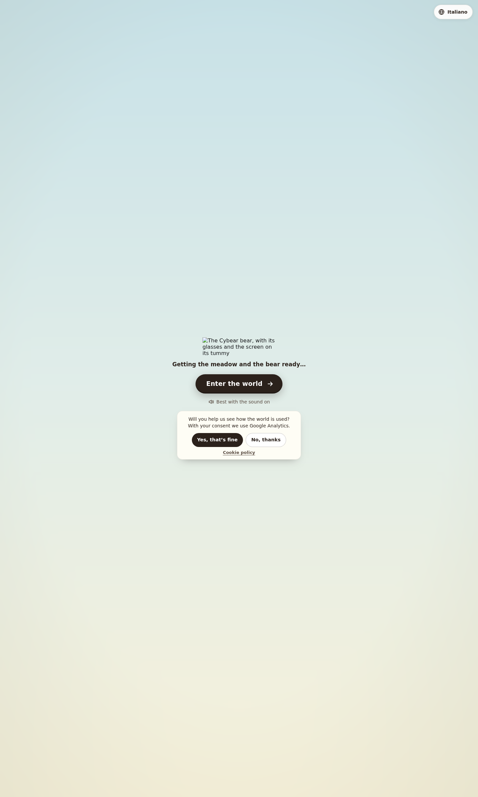

# UI Design System & Master Generation Blueprint: www-cybear-it_world

> **Cybear World** (https://www.cybear.it/world/) — Cybear World: il mondo 3D di Cybear da esplorare con l'orso, tra i cinque amici del Metodo Ecosistema, i case history, la mostra fotograf...



---

## 1. Executive Visual Persona & Design Archetype

- **Brand Essence & Persona**: **Cybear World** (`https://www.cybear.it/world/`). Cybear World: il mondo 3D di Cybear da esplorare con l'orso, tra i cinque amici del Metodo Ecosistema, i case history, la mostra fotograf...
- **Visual Archetype**: **Light-Gallery WebGL / Canvas Interactive Experience (`#7fc4ef` / `#2b211b`)**.
- **Anti-AI-Slop Differentiators**:
  - **Source-Grounded Chromatic Polarity**: Anchors the viewport in `#7fc4ef` (`var(--sky-top)` in `:root`) paired with `#2b211b` primary typography and `#2b211b` accents.
  - **Extracted Typographic Hierarchy**: Pairs `Antonio` for display copy (`You’ve met the whole ecosystem!`) with `Figtree` and not declared in static CSS (uses primary stack / `ui-monospace`).
  - **Calibrated Spatial Grid & Motion**: Combines `360px` container bounds (`gap: 12px`, padding `10px`) with `cubic-bezier(.3,1.7,.5,1)` easing and Three.js / WebGL Canvas Pipeline.

---

## 2. Spatial Architecture & Modular Grid Mathematics


### Viewport Allocation & Container Geometry
- **Captured Viewport Dimensions**: Desktop `1440×2400px` (`assets/desktop.png`, capped at 2400px multi-section capture), Mobile `390×2400px` (`assets/mobile.png`, capped at 2400px multi-section capture).
- **Master Container Bounds**: `360px` extracted from `www-cybear-it_world` stylesheet.
- **Canvas Lateral Padding & Spacing**: `10px` lateral canvas padding with `12px` grid gap.
- **Border Radius Scale**: `18px`, `999px`, `50%`, `12px`.

### Responsive Breakpoint Architecture
- **Desktop Layout**: Multi-column CSS Grid / Flexbox layout at `1440px` (`max-width: 360px`, `gap: 12px`).
- **Mobile Layout**: Single-column vertical stack at `390px` viewport width with `10px` horizontal padding.
- **Extracted CSS Media Queries**: `@media (prefers-reduced-motion:reduce)`, `@media (max-width:560px)`, `@media (max-height:500px)`, `@media (prefers-reduced-motion: reduce)`.

---

## 3. Color System, Materiality & Atmospheric Lighting

### Semantic Palette & Source Grounding
| Semantic Role | Ground-Truth Value | Extracted CSS Source / Selector |
|---|---|---|
| **Primary Canvas Substrate** | `#7fc4ef` | `var(--sky-top)` in `:root` |
| **Primary Typography Ink** | `#bfe3f6` | `var(--sky)` in `:root` |
| **Elevated Surface / Card Substrate** | `#f5efd4` | `var(--haze)` in `:root` |
| **Interactive Accent / Highlight** | `#2b211b` | `var(--fg)` in `:root` |
| **Secondary / Muted Copy** | `#5b4d43` | `var(--muted)` in `:root` |
| **Structural Hairline Border** | `#7a4a24` | `var(--accent)` in `:root` |
| **Variable Token (`--bubble-bg`)** | `#ffffff` | `var(--bubble-bg)` in `:root` |
| **Variable Token (`--focus`)** | `#c0682a` | `var(--focus)` in `:root` |
| **Variable Token (`--meter-fg`)** | `#f6f1e7` | `var(--meter-fg)` in `:root` |
| **Variable Token (`--a1`)** | `#d9622b` | `var(--a1)` in `:root` |
| **Variable Token (`--a2`)** | `#2f6fc4` | `var(--a2)` in `:root` |

### Sanitized Root CSS Variables (`ui-ux.md` Ground Truth)
| Variable Name | Extracted Value | Semantic Role |
|---|---|---|
| `--sky-top` | `#7fc4ef` | Color / Atmospheric Token |
| `--sky` | `#bfe3f6` | Color / Atmospheric Token |
| `--haze` | `#f5efd4` | Color / Atmospheric Token |
| `--fg` | `#2b211b` | Typography Ink Token |
| `--muted` | `#5b4d43` | Color / Atmospheric Token |
| `--accent` | `#7a4a24` | Brand / Palette Token |
| `--chip-bg` | `rgba(255,255,255,.84)` | Canvas / Surface Token |
| `--chip-line` | `rgba(43,33,27,.14)` | Color / Atmospheric Token |
| `--bubble-bg` | `#ffffff` | Canvas / Surface Token |
| `--bubble-fg` | `#2b211b` | Typography Ink Token |
| `--bubble-line` | `#2b211b` | Color / Atmospheric Token |
| `--focus` | `#c0682a` | Color / Atmospheric Token |
| `--meter-bg` | `rgba(18,14,10,.8)` | Canvas / Surface Token |
| `--meter-fg` | `#f6f1e7` | Typography Ink Token |
| `--a1` | `#d9622b` | Color / Atmospheric Token |
| `--a2` | `#2f6fc4` | Color / Atmospheric Token |

---

## 4. Typographic Scale & Editorial Hierarchy

### Font Family Stacks
- **Display Typography**: `Antonio`.
- **Primary Body Stack**: `Figtree`.
- **Technical / Metadata Stack**: not declared in static CSS (uses primary stack / `ui-monospace`).

### Typographic Scale & Rules (Extracted from Stylesheet & Variables)
- **Hero Display (`H1`)**: CSS variables `--font-display: "Antonio","Arial Narrow","Roboto Condensed",sans-serif`.
- **Section Heading (`H2`)**: rule `h2` (`letter-spacing: .005em`).
- **Body Copy**: rule `p` (`font-size: 16px`, `line-height: 1.45`).
- **Metadata & Navigation Labels**: rule `small` (`font-weight: 500`).

---

## 5. Choreographed Motion & Interaction Physics

### Primary Easing Curves
- **Extracted Timing Functions**: `cubic-bezier(.3,1.7,.5,1)`, `cubic-bezier(.45,.05,.4,1)`, `cubic-bezier(.3,1.6,.5,1)`.

### Per-Element Transition & Choreography Rules
- **Selector `.explore-only`**: `transition: opacity .45s ease,visibility .45s` extracted from `www-cybear-it_world` stylesheet.
- **Selector `.start`**: `transition: transform .15s ease,box-shadow .15s ease` extracted from `www-cybear-it_world` stylesheet.
- **Selector `.hints`**: `transition: opacity .6s ease` extracted from `www-cybear-it_world` stylesheet.
- **Extracted Easing Curve (`cubic-bezier(.3,1.7,.5,1)`)**: Governs interactive state transitions across `<header.top>` and `<article.rd>`.
- **Runtime Interaction Engine**: Integrates Three.js / WebGL Canvas Pipeline with `prefers-reduced-motion: reduce` fallback guards.

---

## 6. Component Wireframe & Structural DOM Map

### Visual Layout Schematic (Grounded in `dom.html` — `1440px` Desktop & `390px` Mobile Reflow)
```
┌────────────────────────────────────────────────────────────────────────┐
│ DESKTOP VIEWPORT (1440px) — Cybear World                               │
│ ====================================================================== │
│ [ <header.top>             | Overview · Index · Archive · About · C ]  │
│ ---------------------------------------------------------------------- │
│ | HERO STAGE: <article.rd>                                         |   │
│ | H1: You’ve met the whole ecosystem!                              |   │
│ | Substrate: #7fc4ef    | Ink: #2b211b    | Accent: #2b211b        |   │
│ ---------------------------------------------------------------------- │
│ | SHOWCASE GRID (<article.rd>              ) max-w: 360px          |   │
│ | +------------------------------+  +------------------------------+ | │
│ | | Text version of the world    |  | The world of Cybear is ready | | │
│ | +------------------------------+  +------------------------------+ | │
│ ---------------------------------------------------------------------- │
│ | MOBILE VIEWPORT REFLOW (390px) — Single-Column Stack (gap: 12px  ) | │
│ | [<header.top>] -> [<article.rd>] -> [<article.rd>] |                 │
│ ---------------------------------------------------------------------- │
│ [ FOOTER (<footer.stage>        ) | https://www.cybear.it/world/       │
└────────────────────────────────────────────────────────────────────────┘
```

### Granular DOM Region Breakdown
1. **Brand Header & Navigation Bar (<header.top> — `www-cybear-it_world`)**:
   - Landmark `<header class="top">` hosting `Cybear World` navigation (`Overview · Index · Archive · About · Contact`), DOM attributes (`data-engine="three.js r160"`, `data-src="img/cybear-world-logo..."`, `data-code="KeyW"`, `data-code="KeyA"`), and stylesheet rule `body { height:100% }`.
2. **Hero Stage & Focal Lead (<article.rd> — `You’ve met the whole ecosystem!`)**:
   - Landmark `<article class="rd">` presenting display lead `You’ve met the whole ecosystem!` and copy excerpt *"Text version of the world"* over `#7fc4ef` canvas and `#2b211b` ink.
3. **Primary Showcase & Content Grid (<article.rd> — `Text version of the world`)**:
   - Landmark `<article class="rd">` rendering section `Text version of the world` with copy *"The world of Cybear is ready!"*, asset references (`icon-32.png`, `icon-180.png`, `testo.html`, `antonio-600.woff2`), and grid rule `.stage.over-bear { cursor:grab }`.
4. **Interactive Detail & Feature Matrix (<article.rd> — `The world of Cybear is ready!`)**:
   - Landmark `<article class="rd">` framing `The world of Cybear is ready!` and `Best with the sound on` (*"Best with the sound on"*) with `#f5efd4` surface cards, `#2b211b` accents, and `.stage.over-thing { cursor:pointer }`.
5. **Colophon & Global Directory Footer (<footer.stage> — `https://www.cybear.it/world/`)**:
   - Landmark `<footer class="stage">` anchoring `Cybear World` footer links (`Overview · Index · Archive · About · Contact`), copy *"Coins, visits and your choice of path will be reset: the Exp"*, and `#7a4a24` structural dividers.

---

## 7. Master Zero-Shot AI Generation Prompt

```markdown
# Master Zero-Shot Frontend Generation Prompt: www-cybear-it_world (Cybear World)

You are a principal frontend architect and design systems engineer. Build a complete, production-ready web application replicating the exact design system, DOM landmarks, typographic hierarchy, color tokens, and motion physics of `www-cybear-it_world` (**Cybear World** — `https://www.cybear.it/world/`).

### 1. Visual Archetype & Anti-AI-Slop Mandates
- **Archetype**: Light-Gallery WebGL / Canvas Interactive Experience (`#7fc4ef` / `#2b211b`).
- **Identity & Domain Context**: Cybear World: il mondo 3D di Cybear da esplorare con l'orso, tra i cinque amici del Metodo Ecosistema, i case history, la mostra fotograf...
- **Primary Substrate**: `#7fc4ef` (`var(--sky-top)` in `:root`), **Primary Ink**: `#2b211b`, **Accent / Highlight**: `#2b211b`.
- **Site-Specific Differentiators**:
  - **Source-Grounded Chromatic Polarity**: Anchors the viewport in `#7fc4ef` (`var(--sky-top)` in `:root`) paired with `#2b211b` primary typography and `#2b211b` accents.
  - **Extracted Typographic Hierarchy**: Pairs `Antonio` for display copy (`You’ve met the whole ecosystem!`) with `Figtree` and not declared in static CSS (uses primary stack / `ui-monospace`).
  - **Calibrated Spatial Grid & Motion**: Combines `360px` container bounds (`gap: 12px`, padding `10px`) with `cubic-bezier(.3,1.7,.5,1)` easing and Three.js / WebGL Canvas Pipeline.

### 2. Ground-Truth CSS Variables (`:root` Token Contract)
Declare and consume these exact custom properties extracted from `www-cybear-it_world` in your global stylesheet:

:root {
  /* Cybear World (www-cybear-it_world) — Ground-Truth Extracted CSS Variables */
  --sky-top: #7fc4ef; /* Color / Atmospheric Token (www-cybear-it_world) */
  --sky: #bfe3f6; /* Color / Atmospheric Token (www-cybear-it_world) */
  --haze: #f5efd4; /* Color / Atmospheric Token (www-cybear-it_world) */
  --fg: #2b211b; /* Typography Ink Token (www-cybear-it_world) */
  --muted: #5b4d43; /* Color / Atmospheric Token (www-cybear-it_world) */
  --accent: #7a4a24; /* Brand / Palette Token (www-cybear-it_world) */
  --chip-bg: rgba(255,255,255,.84); /* Canvas / Surface Token (www-cybear-it_world) */
  --chip-line: rgba(43,33,27,.14); /* Color / Atmospheric Token (www-cybear-it_world) */
  --bubble-bg: #ffffff; /* Canvas / Surface Token (www-cybear-it_world) */
  --bubble-fg: #2b211b; /* Typography Ink Token (www-cybear-it_world) */
  --bubble-line: #2b211b; /* Color / Atmospheric Token (www-cybear-it_world) */
  --focus: #c0682a; /* Color / Atmospheric Token (www-cybear-it_world) */
  --meter-bg: rgba(18,14,10,.8); /* Canvas / Surface Token (www-cybear-it_world) */
  --meter-fg: #f6f1e7; /* Typography Ink Token (www-cybear-it_world) */
  --a1: #d9622b; /* Color / Atmospheric Token (www-cybear-it_world) */
  --a2: #2f6fc4; /* Color / Atmospheric Token (www-cybear-it_world) */
}

### 3. Semantic Color & Materiality Contract
Map every surface, ink, and border strictly to these source-grounded tokens:
- **Primary Canvas Substrate**: `#7fc4ef` — grounded in `var(--sky-top)` in `:root`
- **Primary Typography Ink**: `#bfe3f6` — grounded in `var(--sky)` in `:root`
- **Elevated Surface / Card Substrate**: `#f5efd4` — grounded in `var(--haze)` in `:root`
- **Interactive Accent / Highlight**: `#2b211b` — grounded in `var(--fg)` in `:root`
- **Secondary / Muted Copy**: `#5b4d43` — grounded in `var(--muted)` in `:root`
- **Structural Hairline Border**: `#7a4a24` — grounded in `var(--accent)` in `:root`
- **Variable Token (`--bubble-bg`)**: `#ffffff` — grounded in `var(--bubble-bg)` in `:root`
- **Variable Token (`--focus`)**: `#c0682a` — grounded in `var(--focus)` in `:root`
- **Variable Token (`--meter-fg`)**: `#f6f1e7` — grounded in `var(--meter-fg)` in `:root`
- **Variable Token (`--a1`)**: `#d9622b` — grounded in `var(--a1)` in `:root`
- **Variable Token (`--a2`)**: `#2f6fc4` — grounded in `var(--a2)` in `:root`

### 4. Spatial Grid, Container Bounds & Responsive Breakpoints
- **Desktop Viewport Reference**: `1440×2400px` (capped at 2400px multi-section capture, `1440px` standard desktop width).
- **Mobile Viewport Reference**: `390×2400px` (capped at 2400px multi-section capture, `390px` standard mobile width).
- **Container Max-Width**: `360px` extracted from `www-cybear-it_world` stylesheet
- **Padding & Gutters**: `10px` lateral canvas padding with `12px` grid gap
- **Desktop Grid**: Multi-column CSS Grid / Flexbox layout at `1440px` (`max-width: 360px`, `gap: 12px`)
- **Mobile Adaptation**: Single-column vertical stack at `390px` viewport width with `10px` horizontal padding
- **Media Queries**: `@media (prefers-reduced-motion:reduce)`, `@media (max-width:560px)`, `@media (max-height:500px)`, `@media (prefers-reduced-motion: reduce)`
- **Corner Radii**: `18px`, `999px`, `50%`, `12px`

### 5. Typography & Editorial Scale Contract
- **Display Font Stack**: `Antonio`
- **Body Font Stack**: `Figtree`
- **Monospace / Technical Font Stack**: not declared in static CSS (uses primary stack / `ui-monospace`)
- **H1 Display Rule**: CSS variables `--font-display: "Antonio","Arial Narrow","Roboto Condensed",sans-serif`
- **H2 Section Rule**: rule `h2` (`letter-spacing: .005em`)
- **Body Copy Rule**: rule `p` (`font-size: 16px`, `line-height: 1.45`)
- **Metadata & Index Rule**: rule `small` (`font-weight: 500`)

### 6. Component Hierarchy, Verbatim Copy & Real DOM Landmarks
Scaffold `www-cybear-it_world` (`Cybear World`) with these exact structural regions, extracted copy, and CSS rules from `dom.html`:
1. **Brand Header & Navigation Bar (<header.top> — `www-cybear-it_world`)**:
   - DOM & Selectors: Landmark `<header class="top">` hosting `Cybear World` navigation (`Overview · Index · Archive · About · Contact`), DOM attributes (`data-engine="three.js r160"`, `data-src="img/cybear-world-logo..."`, `data-code="KeyW"`, `data-code="KeyA"`), and stylesheet rule `body { height:100% }`.
   - Responsive Contract: Header `Brand Header & Navigation Bar (<header.top> — `www-cybear-it_world`)` (`www-cybear-it_world`) adapts across `@media (prefers-reduced-motion:reduce)`, `@media (max-width:560px)`, `@media (max-height:500px)`, `@media (prefers-reduced-motion: reduce)` with `cubic-bezier(.3,1.7,.5,1)`, `cubic-bezier(.45,.05,.4,1)`, `cubic-bezier(.3,1.6,.5,1)` transitions and links `Overview · Index · Archive · About · Contact`.
2. **Hero Stage & Focal Lead (<article.rd> — `You’ve met the whole ecosystem!`)**:
   - DOM & Selectors: Landmark `<article class="rd">` presenting display lead `You’ve met the whole ecosystem!` and copy excerpt *"Text version of the world"* over `#7fc4ef` canvas and `#2b211b` ink.
   - Responsive Contract: Hero stage (`1440×2400px` desktop / `390×2400px` mobile) sets `#7fc4ef` background with `#2b211b` headline `You’ve met the whole ecosystem!`.
3. **Primary Showcase & Content Grid (<article.rd> — `Text version of the world`)**:
   - DOM & Selectors: Landmark `<article class="rd">` rendering section `Text version of the world` with copy *"The world of Cybear is ready!"*, asset references (`icon-32.png`, `icon-180.png`, `testo.html`, `antonio-600.woff2`), and grid rule `.stage.over-bear { cursor:grab }`.
   - Responsive Contract: Showcase grid `Primary Showcase & Content Grid (<article.rd> — `Text version of the world`)` applies Multi-column CSS Grid / Flexbox layout at `1440px` (`max-width: 360px`, `gap: 12px`) on desktop and Single-column vertical stack at `390px` viewport width with `10px` horizontal padding on mobile.
4. **Interactive Detail & Feature Matrix (<article.rd> — `The world of Cybear is ready!`)**:
   - DOM & Selectors: Landmark `<article class="rd">` framing `The world of Cybear is ready!` and `Best with the sound on` (*"Best with the sound on"*) with `#f5efd4` surface cards, `#2b211b` accents, and `.stage.over-thing { cursor:pointer }`.
   - Responsive Contract: Detail module `Interactive Detail & Feature Matrix (<article.rd> — `The world of Cybear is ready!`)` uses `18px`, `999px`, `50%`, `12px` radii, `#2b211b` highlights, and assets (icon-32.png, icon-180.png, testo.html).
5. **Colophon & Global Directory Footer (<footer.stage> — `https://www.cybear.it/world/`)**:
   - DOM & Selectors: Landmark `<footer class="stage">` anchoring `Cybear World` footer links (`Overview · Index · Archive · About · Contact`), copy *"Coins, visits and your choice of path will be reset: the Exp"*, and `#7a4a24` structural dividers.
   - Responsive Contract: Footer `Colophon & Global Directory Footer (<footer.stage> — `https://www.cybear.it/world/`)` aligns to `360px` extracted from `www-cybear-it_world` stylesheet with `10px` lateral canvas padding with `12px` grid gap and attributes (data-engine="three.js r160", data-src="img/cybear-world-logo...", data-code="KeyW").

#### Verbatim DOM Copy Excerpts (`dom.html`)
- Copy Excerpt 1: *"Text version of the world"*
- Copy Excerpt 2: *"The world of Cybear is ready!"*
- Copy Excerpt 3: *"Best with the sound on"*
- Copy Excerpt 4: *"Coins, visits and your choice of path will be reset: the Explorer will ask you aga..."*

### 7. Motion, Extracted Stylesheet Rules & Interaction Choreography
- **Primary Easing Functions**: `cubic-bezier(.3,1.7,.5,1)`, `cubic-bezier(.45,.05,.4,1)`, `cubic-bezier(.3,1.6,.5,1)`
- **Extracted Stylesheet Rules (`www-cybear-it_world`)**:
- `body { height:100% }`
- `.stage.over-bear { cursor:grab }`
- `.stage.over-thing { cursor:pointer }`
- `.stage.grabbing { cursor:grabbing }`
- `.stage canvas { display:block;width:100%;height:100%;touch-action:none;-webkit-tap-highl... }`
- **Per-Selector Transition Rules**:
- **Selector `.explore-only`**: `transition: opacity .45s ease,visibility .45s` extracted from `www-cybear-it_world` stylesheet.
- **Selector `.start`**: `transition: transform .15s ease,box-shadow .15s ease` extracted from `www-cybear-it_world` stylesheet.
- **Selector `.hints`**: `transition: opacity .6s ease` extracted from `www-cybear-it_world` stylesheet.
- **Extracted Easing Curve (`cubic-bezier(.3,1.7,.5,1)`)**: Governs interactive state transitions across `<header.top>` and `<article.rd>`.
- **Runtime Interaction Engine**: Integrates Three.js / WebGL Canvas Pipeline with `prefers-reduced-motion: reduce` fallback guards.

### 8. Technical Deliverables
- Implement in Next.js (App Router) with TypeScript and Tailwind CSS consuming the `:root` custom properties defined above for `www-cybear-it_world`.
- Reproduce both the `1440px` desktop architecture and `390px` mobile breakpoint transitions, preserving semantic HTML5 landmarks (`<header>`, `<nav>`, `<main>`, `<section>`, `<footer>`) and `prefers-reduced-motion` accessibility guards.
```
