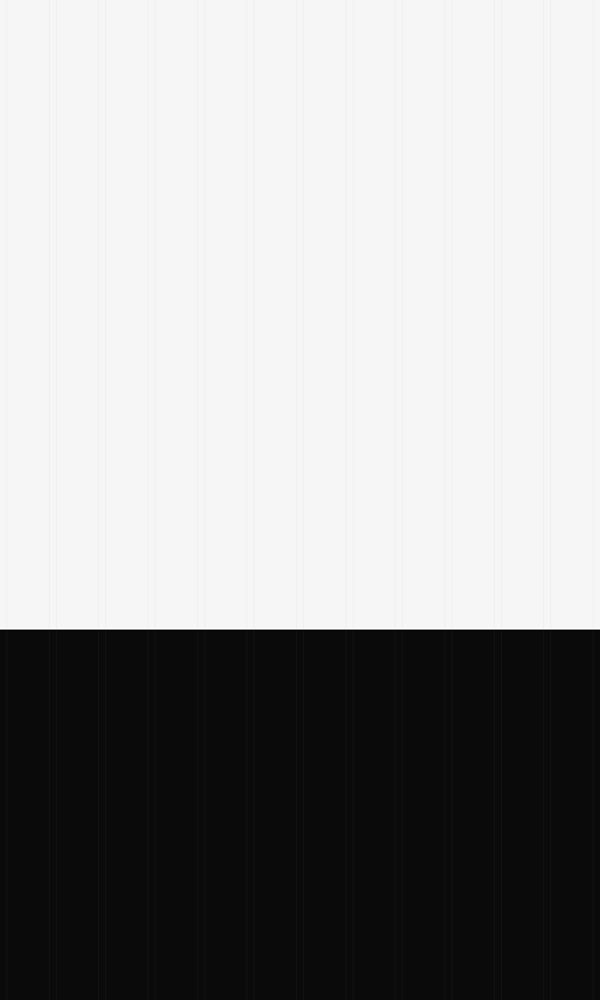
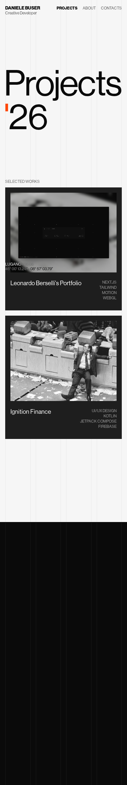

# UI Design System & Master Generation Blueprint: www-danielebuser-com

> **Daniele Buser · Creative Developer** (https://www.danielebuser.com/) — Explore Daniele Buser's creative development projects: interactive 3D web experiences, WebGL experiments, and high-performance front-end...



---

## 1. Executive Visual Persona & Design Archetype

- **Brand Essence & Persona**: **Daniele Buser · Creative Developer** (`https://www.danielebuser.com/`). Explore Daniele Buser's creative development projects: interactive 3D web experiences, WebGL experiments, and high-performance front-end...
- **Capture Provenance**: Live browser capture (`tier1_fast`, HTTP `200`, captured `2026-11-23`).
- **Visual Archetype**: **High-Contrast Obsidian / Atmospheric Design System (`#0a0a0a` canvas, `#f6f6f6` ink, `#ff4500` accent)**.
- **Anti-AI-Slop Differentiators**:
  - **Live-Computed Chromatic Polarity**: Anchors the viewport in `#0a0a0a` (live computed `body` `background-color` (`computed_styles.json`)) paired with `#f6f6f6` primary typography and `#ff4500` accents.
  - **Grounded Typographic Hierarchy**: Pairs `neueHaasGrotesk` for display copy (`Projects '26`) with `neueHaasGrotesk` and `SFMono-Regular`.
  - **Calibrated Spatial Grid & Motion**: Combines `1408px` container bounds (`gap: var(--spacing)`, padding `16px`) with `cubic-bezier(.4,0,.6,1)` easing and Lenis Smooth Scroll (`data-lenis`), GSAP Timeline & ScrollTrigger.

---

## 2. Spatial Architecture & Modular Grid Mathematics



### Viewport Allocation & Container Geometry
- **Captured Viewport Dimensions**: Desktop `1440×2400px` (`assets/desktop.png`, clamped at 2400px live multi-section capture), Mobile `390×2400px` (`assets/mobile.png`, clamped at 2400px live multi-section capture).
- **Master Container Bounds**: `1408px` (measured widest bounded `<section>` landmark width on `1440px` desktop).
- **Canvas Lateral Padding & Spacing**: `16px` lateral canvas padding with `var(--spacing)` grid gap.
- **Border Radius Scale**: `.25rem`, `18px`, `20px`, `28px`.

### Responsive Breakpoint Architecture
- **Desktop Layout**: Multi-column CSS Grid / Flexbox layout at `1440px` (`max-width: 1408px`, `gap: var(--spacing)`).
- **Mobile Layout**: Single-column vertical stack at `390px` viewport width with `16px` horizontal padding.
- **Extracted CSS Media Queries**: `@media (min-width:40rem)`, `@media (min-width:48rem)`, `@media (min-width:64rem)`, `@media (min-width:80rem)`.

---

## 3. Color System, Materiality & Atmospheric Lighting

### Semantic Palette & Source Grounding
| Semantic Role | Ground-Truth Value | Extracted Live / CSS Source |
|---|---|---|
| **Primary Canvas Substrate** | `#0a0a0a` | live computed `body` `background-color` (`computed_styles.json`) |
| **Primary Typography Ink** | `#f6f6f6` | live computed `main` `color` (`computed_styles.json`) |
| **Elevated Surface / Card Substrate** | `#1e1e1e` | `var(--color-card-dark)` in `:root` |
| **Interactive Accent / Highlight** | `#ff4500` | `var(--color-accent)` in `:root` |
| **Secondary / Muted Copy** | `#6b6b6b` | live computed `h2` `color` (`computed_styles.json`) |
| **Structural Hairline Border** | `#1a1a1a` | `var(--color-grid-line-dark)` in `:root` |
| **Variable Token (`--color-rose-400`)** | `#ff667f` | `var(--color-rose-400)` in `:root` |
| **Variable Token (`--color-neutral-200`)** | `#e5e5e5` | `var(--color-neutral-200)` in `:root` |
| **Variable Token (`--color-black`)** | `#000000` | `var(--color-black)` in `:root` |
| **Variable Token (`--color-white`)** | `#ffffff` | `var(--color-white)` in `:root` |

### Sanitized Root CSS Variables (`ui-ux.md` Ground Truth)
| Variable Name | Extracted Value | Semantic Role |
|---|---|---|
| `--font-sans` | `var(--font-neue-haas), sans-serif` | Typography / Scale Token |
| `--color-rose-400` | `#ff667f` | Brand / Palette Token |
| `--color-neutral-200` | `#e5e5e5` | Brand / Palette Token |
| `--color-black` | `#000` | Canvas / Surface Token |
| `--color-white` | `#fff` | Canvas / Surface Token |
| `--spacing` | `.25rem` | Layout / Spatial Grid Token |
| `--container-2xl` | `42rem` | Layout / Spatial Grid Token |
| `--text-xs` | `.75rem` | Typography Ink Token |
| `--text-xs--line-height` | `calc(1 / .75)` | Typography Ink Token |
| `--text-sm` | `.875rem` | Typography Ink Token |
| `--text-sm--line-height` | `calc(1.25 / .875)` | Typography Ink Token |
| `--text-base` | `1rem` | Typography Ink Token |
| `--text-base--line-height` | `calc(1.5 / 1)` | Typography Ink Token |
| `--text-lg` | `1.125rem` | Typography Ink Token |
| `--text-lg--line-height` | `calc(1.75 / 1.125)` | Typography Ink Token |
| `--text-xl` | `1.25rem` | Typography Ink Token |

---

## 4. Typographic Scale & Editorial Hierarchy

### Font Family Stacks
- **Display Typography**: `neueHaasGrotesk`.
- **Primary Body Stack**: `neueHaasGrotesk`.
- **Technical / Metadata Stack**: `SFMono-Regular`.

### Typographic Scale & Rules (Live Computed & Stylesheet Grounded)
- **Hero Display (`H1`)**: live computed `h1` (`font-size: 208.8px`, `line-height: 177.48px`, `font-weight: 400`, `letter-spacing: -5.22px`); CSS variables `--text-4xl: 2.25rem`, `--text-4xl--line-height: calc(2.5 / 2.25)`, `--text-5xl: 3rem`.
- **Section Heading (`H2`)**: live computed `h3 (primary section heading)` (`font-size: 30.56px`, `line-height: 30.56px`, `font-weight: 400`); CSS variables `--text-2xl: 1.5rem`, `--text-2xl--line-height: calc(2 / 1.5)`, `--text-3xl: 1.875rem`.
- **Body Copy**: live computed `body` (`font-size: 16px`, `line-height: 16px`, `font-weight: 400`); CSS variables `--text-base: 1rem`, `--text-base--line-height: calc(1.5 / 1)`, `--text-body-lg: 1.125rem`.
- **Metadata & Navigation Labels**: live computed `nav/a` (`font-size: 16px`, `line-height: 16px`, `font-weight: 400`); CSS variables `--text-xs: .75rem`, `--text-xs--line-height: calc(1 / .75)`, `--text-sm: .875rem`.

---

## 5. Choreographed Motion & Interaction Physics

### Primary Easing Curves
- **Extracted Timing Functions**: `cubic-bezier(.4,0,.6,1)`, `cubic-bezier(.4,0,.2,1)`, `cubic-bezier(.8,0,1,1)`.

### Per-Element Transition & Choreography Rules
- **Selector `layer theme`**: `transition: .15s` extracted from `www-danielebuser-com` stylesheet.
- **Selector `.transition`**: `transition: var(--tw-ease,var(--default-transition-timing-function))` extracted from `www-danielebuser-com` stylesheet.
- **Selector `.transition-all`**: `transition: var(--tw-ease,var(--default-transition-timing-function))` extracted from `www-danielebuser-com` stylesheet.
- **Extracted Easing Curve (`cubic-bezier(.4,0,.6,1)`)**: Governs interactive state transitions across `<header.pointer-events-none>` and `<section.pb-64>`.
- **Runtime Interaction Engine**: Integrates Lenis Smooth Scroll (`data-lenis`), GSAP Timeline & ScrollTrigger, Three.js / WebGL Canvas Pipeline, Framer Motion Layout Physics with `prefers-reduced-motion: reduce` fallback guards.

---

## 6. Component Wireframe & Structural DOM Map

### Visual Layout Schematic — Desktop (`1440px`, Grounded in `dom.html` & Landmark Bounding Boxes)
```
┌────────────────────────────────────────────────────────────────────────┐
│ DESKTOP VIEWPORT (1440px) — Daniele Buser · Creative Developer         │
│ ====================================================================== │
│ [ <header.pointer-events (1440x69px)  | PROJECTS · ABOUT · CONTACTS  ] │
│ ---------------------------------------------------------------------- │
│ | HERO STAGE: <section.pt-16> (w=1440px)                             | │
│ | H1: Projects '26                                                   | │
│ | Substrate: #0a0a0a | Ink: #f6f6f6 | Accent: #ff4500                | │
│ ---------------------------------------------------------------------- │
│ | SHOWCASE GRID (<section.pb-64>) max-w: 1408px                      | │
│ | +------------------------------+  +------------------------------+ | │
│ | | Projects ' 26                |  | SELECTED WORKS               | | │
│ | +------------------------------+  +------------------------------+ | │
│ ---------------------------------------------------------------------- │
│ | DETAIL MODULE (<section.bg-background>) — Leonardo Berselli's P    | │
│ ---------------------------------------------------------------------- │
│ [ FOOTER (<footer.pointer-even) | https://www.danielebuser.com/        │
└────────────────────────────────────────────────────────────────────────┘
```

### Visual Layout Schematic — Mobile Reflow (`390px`)
```
┌────────────────────────────────────────────────────────────────────────┐
│ MOBILE VIEWPORT REFLOW (390px) — Single-Column Stack (gap: var(--sp)   │
│ ====================================================================== │
│ [ HEADER BAR (<header.pointer-events-n) | Compact Menu (390px)         │
│ ---------------------------------------------------------------------- │
│ | HERO STAGE (<section.pt-16>) — 390px Vertical Lead                 | │
│ | H1: Projects '26                                                   | │
│ ---------------------------------------------------------------------- │
│ | SHOWCASE STACK (<section.pb-64>) — 1-Col Stack                     | │
│ | [ Item 1: Projects ' 26                                          ] | │
│ | [ Item 2: SELECTED WORKS                                         ] | │
│ ---------------------------------------------------------------------- │
│ | DETAIL STACK (<section.bg-background>) — 1-Col (Leonardo Berselli')  │
│ ---------------------------------------------------------------------- │
│ [ FOOTER (<footer.pointer-even) | Stacked 390px Colophon               │
└────────────────────────────────────────────────────────────────────────┘
```

### Granular DOM Region Breakdown
1. **Brand Header & Navigation Bar (<header.pointer-events-none> — `www-danielebuser-com`)**:
   - Landmark `<header class="pointer-events-none top-0">` (`1440x69px`) hosting `Daniele Buser · Creative Developer` navigation (`PROJECTS · ABOUT · CONTACTS`), DOM attributes (`data-precedence="next"`, `data-sdkn="@vercel/analytics/next"`, `data-sdkv="2.0.1"`, `data-disable-auto-track="1"`), and stylesheet rule `host { --color-rose-400:lab(64.4125% 63.0291 19.2068);--color-neutral-200:lab(9... }`.
2. **Hero Stage & Focal Lead (<section.pt-16> — `Projects '26`)**:
   - Landmark `<section class="pt-16 flex">` presenting display lead `Projects '26` and copy excerpt *"Creative Developer"* over `#0a0a0a` canvas and `#f6f6f6` ink.
3. **Primary Showcase & Content Grid (<section.pb-64> — `Projects ' 26`)**:
   - Landmark `<section class="pb-64 relative">` rendering section `Projects ' 26` with copy *"If you have a project in mind, feel free to reach out - I'd be gl"*, asset references (`NeueHaasGroteskDisplay_Bold-s.p.0...`, `NeueHaasGroteskDisplay_Light-s.p....`, `NeueHaasGroteskDisplay_Reg-s.p.2r...`, `0g5culx7t__ba.css`), and grid rule `backdrop { box-sizing:border-box;border:0 solid;margin:0;padding:0 }`.
4. **Interactive Detail & Feature Matrix (<section.bg-background> — `SELECTED WORKS`)**:
   - Landmark `<section class="bg-background text-foreground">` framing `SELECTED WORKS` and `Leonardo Berselli's Portfolio` (*"LinkedIn (opens in new tab)"*) with `#1e1e1e` surface cards, `#ff4500` accents, and `file-selector-button { box-sizing:border-box;border:0 solid;margin:0;padding:0 }`.
5. **Colophon & Global Directory Footer (<footer.pointer-events-none> — `https://www.danielebuser.com/`)**:
   - Landmark `<footer class="pointer-events-none bottom-0">` anchoring `Daniele Buser · Creative Develop` footer links (`PROJECTS · ABOUT · CONTACTS`), copy *"(opens in new tab)"*, and `#1a1a1a` structural dividers.

---

## 7. Master Zero-Shot AI Generation Prompt

```markdown
# Master Zero-Shot Frontend Generation Prompt: www-danielebuser-com (Daniele Buser · Creative Developer)

You are a principal frontend architect and design systems engineer. Build a complete, production-ready web application replicating the exact design system, DOM landmarks, typographic hierarchy, color tokens, and motion physics of `www-danielebuser-com` (**Daniele Buser · Creative Developer** — `https://www.danielebuser.com/`).

### 1. Visual Archetype & Anti-AI-Slop Mandates
- **Archetype**: High-Contrast Obsidian / Atmospheric Design System (`#0a0a0a` canvas, `#f6f6f6` ink, `#ff4500` accent).
- **Identity & Domain Context**: Explore Daniele Buser's creative development projects: interactive 3D web experiences, WebGL experiments, and high-performance front-end...
- **Primary Substrate**: `#0a0a0a` (live computed `body` `background-color` (`computed_styles.json`)), **Primary Ink**: `#f6f6f6`, **Accent / Highlight**: `#ff4500`.
- **Site-Specific Differentiators**:
  - **Live-Computed Chromatic Polarity**: Anchors the viewport in `#0a0a0a` (live computed `body` `background-color` (`computed_styles.json`)) paired with `#f6f6f6` primary typography and `#ff4500` accents.
  - **Grounded Typographic Hierarchy**: Pairs `neueHaasGrotesk` for display copy (`Projects '26`) with `neueHaasGrotesk` and `SFMono-Regular`.
  - **Calibrated Spatial Grid & Motion**: Combines `1408px` container bounds (`gap: var(--spacing)`, padding `16px`) with `cubic-bezier(.4,0,.6,1)` easing and Lenis Smooth Scroll (`data-lenis`), GSAP Timeline & ScrollTrigger.

### 2. Ground-Truth CSS Variables (`:root` Token Contract)
Declare and consume these exact custom properties extracted from `www-danielebuser-com` in your global stylesheet:

:root {
  /* Daniele Buser · Creative Developer (www-danielebuser-com) — Live-Grounded CSS Variables */
  --font-sans: var(--font-neue-haas), sans-serif; /* Typography / Scale Token (www-danielebuser-com) */
  --color-rose-400: #ff667f; /* Brand / Palette Token (www-danielebuser-com) */
  --color-neutral-200: #e5e5e5; /* Brand / Palette Token (www-danielebuser-com) */
  --color-black: #000; /* Canvas / Surface Token (www-danielebuser-com) */
  --color-white: #fff; /* Canvas / Surface Token (www-danielebuser-com) */
  --spacing: .25rem; /* Layout / Spatial Grid Token (www-danielebuser-com) */
  --container-2xl: 42rem; /* Layout / Spatial Grid Token (www-danielebuser-com) */
  --text-xs: .75rem; /* Typography Ink Token (www-danielebuser-com) */
  --text-xs--line-height: calc(1 / .75); /* Typography Ink Token (www-danielebuser-com) */
  --text-sm: .875rem; /* Typography Ink Token (www-danielebuser-com) */
  --text-sm--line-height: calc(1.25 / .875); /* Typography Ink Token (www-danielebuser-com) */
  --text-base: 1rem; /* Typography Ink Token (www-danielebuser-com) */
  --text-base--line-height: calc(1.5 / 1); /* Typography Ink Token (www-danielebuser-com) */
  --text-lg: 1.125rem; /* Typography Ink Token (www-danielebuser-com) */
  --text-lg--line-height: calc(1.75 / 1.125); /* Typography Ink Token (www-danielebuser-com) */
  --text-xl: 1.25rem; /* Typography Ink Token (www-danielebuser-com) */
}

### 3. Semantic Color & Materiality Contract
Map every surface, ink, and border strictly to these source-grounded tokens:
- **Primary Canvas Substrate**: `#0a0a0a` — grounded in live computed `body` `background-color` (`computed_styles.json`)
- **Primary Typography Ink**: `#f6f6f6` — grounded in live computed `main` `color` (`computed_styles.json`)
- **Elevated Surface / Card Substrate**: `#1e1e1e` — grounded in `var(--color-card-dark)` in `:root`
- **Interactive Accent / Highlight**: `#ff4500` — grounded in `var(--color-accent)` in `:root`
- **Secondary / Muted Copy**: `#6b6b6b` — grounded in live computed `h2` `color` (`computed_styles.json`)
- **Structural Hairline Border**: `#1a1a1a` — grounded in `var(--color-grid-line-dark)` in `:root`
- **Variable Token (`--color-rose-400`)**: `#ff667f` — grounded in `var(--color-rose-400)` in `:root`
- **Variable Token (`--color-neutral-200`)**: `#e5e5e5` — grounded in `var(--color-neutral-200)` in `:root`
- **Variable Token (`--color-black`)**: `#000000` — grounded in `var(--color-black)` in `:root`
- **Variable Token (`--color-white`)**: `#ffffff` — grounded in `var(--color-white)` in `:root`

### 4. Spatial Grid, Container Bounds & Responsive Breakpoints
- **Desktop Viewport Reference**: `1440×2400px` (clamped at 2400px live multi-section capture, `1440px` standard desktop width).
- **Mobile Viewport Reference**: `390×2400px` (clamped at 2400px live multi-section capture, `390px` standard mobile width).
- **Container Max-Width**: `1408px` (measured widest bounded `<section>` landmark width on `1440px` desktop)
- **Padding & Gutters**: `16px` lateral canvas padding with `var(--spacing)` grid gap
- **Desktop Grid**: Multi-column CSS Grid / Flexbox layout at `1440px` (`max-width: 1408px`, `gap: var(--spacing)`)
- **Mobile Adaptation**: Single-column vertical stack at `390px` viewport width with `16px` horizontal padding
- **Media Queries**: `@media (min-width:40rem)`, `@media (min-width:48rem)`, `@media (min-width:64rem)`, `@media (min-width:80rem)`
- **Corner Radii**: `.25rem`, `18px`, `20px`, `28px`

### 5. Typography & Editorial Scale Contract
- **Display Font Stack**: `neueHaasGrotesk`
- **Body Font Stack**: `neueHaasGrotesk`
- **Monospace / Technical Font Stack**: `SFMono-Regular`
- **H1 Display Rule**: live computed `h1` (`font-size: 208.8px`, `line-height: 177.48px`, `font-weight: 400`, `letter-spacing: -5.22px`); CSS variables `--text-4xl: 2.25rem`, `--text-4xl--line-height: calc(2.5 / 2.25)`, `--text-5xl: 3rem`
- **H2 Section Rule**: live computed `h3 (primary section heading)` (`font-size: 30.56px`, `line-height: 30.56px`, `font-weight: 400`); CSS variables `--text-2xl: 1.5rem`, `--text-2xl--line-height: calc(2 / 1.5)`, `--text-3xl: 1.875rem`
- **Body Copy Rule**: live computed `body` (`font-size: 16px`, `line-height: 16px`, `font-weight: 400`); CSS variables `--text-base: 1rem`, `--text-base--line-height: calc(1.5 / 1)`, `--text-body-lg: 1.125rem`
- **Metadata & Index Rule**: live computed `nav/a` (`font-size: 16px`, `line-height: 16px`, `font-weight: 400`); CSS variables `--text-xs: .75rem`, `--text-xs--line-height: calc(1 / .75)`, `--text-sm: .875rem`

### 6. Component Hierarchy, Verbatim Copy & Real DOM Landmarks
Scaffold `www-danielebuser-com` (`Daniele Buser · Creative Developer`) with these exact structural regions, extracted copy, and CSS rules from `dom.html`:
1. **Brand Header & Navigation Bar (<header.pointer-events-none> — `www-danielebuser-com`)**:
   - DOM & Selectors: Landmark `<header class="pointer-events-none top-0">` (`1440x69px`) hosting `Daniele Buser · Creative Developer` navigation (`PROJECTS · ABOUT · CONTACTS`), DOM attributes (`data-precedence="next"`, `data-sdkn="@vercel/analytics/next"`, `data-sdkv="2.0.1"`, `data-disable-auto-track="1"`), and stylesheet rule `host { --color-rose-400:lab(64.4125% 63.0291 19.2068);--color-neutral-200:lab(9... }`.
   - Responsive Contract: Header `Brand Header & Navigation Bar (<header.pointer-events-none> — `www-danielebuser-com`)` (`www-danielebuser-com`) adapts across `@media (min-width:40rem)`, `@media (min-width:48rem)`, `@media (min-width:64rem)`, `@media (min-width:80rem)` with `cubic-bezier(.4,0,.6,1)`, `cubic-bezier(.4,0,.2,1)`, `cubic-bezier(.8,0,1,1)` transitions and links `PROJECTS · ABOUT · CONTACTS`.
2. **Hero Stage & Focal Lead (<section.pt-16> — `Projects '26`)**:
   - DOM & Selectors: Landmark `<section class="pt-16 flex">` presenting display lead `Projects '26` and copy excerpt *"Creative Developer"* over `#0a0a0a` canvas and `#f6f6f6` ink.
   - Responsive Contract: Hero stage (`1440×2400px` desktop / `390×2400px` mobile) sets `#0a0a0a` background with `#f6f6f6` headline `Projects '26`.
3. **Primary Showcase & Content Grid (<section.pb-64> — `Projects ' 26`)**:
   - DOM & Selectors: Landmark `<section class="pb-64 relative">` rendering section `Projects ' 26` with copy *"If you have a project in mind, feel free to reach out - I'd be gl"*, asset references (`NeueHaasGroteskDisplay_Bold-s.p.0...`, `NeueHaasGroteskDisplay_Light-s.p....`, `NeueHaasGroteskDisplay_Reg-s.p.2r...`, `0g5culx7t__ba.css`), and grid rule `backdrop { box-sizing:border-box;border:0 solid;margin:0;padding:0 }`.
   - Responsive Contract: Showcase grid `Primary Showcase & Content Grid (<section.pb-64> — `Projects ' 26`)` applies Multi-column CSS Grid / Flexbox layout at `1440px` (`max-width: 1408px`, `gap: var(--spacing)`) on desktop and Single-column vertical stack at `390px` viewport width with `16px` horizontal padding on mobile.
4. **Interactive Detail & Feature Matrix (<section.bg-background> — `SELECTED WORKS`)**:
   - DOM & Selectors: Landmark `<section class="bg-background text-foreground">` framing `SELECTED WORKS` and `Leonardo Berselli's Portfolio` (*"LinkedIn (opens in new tab)"*) with `#1e1e1e` surface cards, `#ff4500` accents, and `file-selector-button { box-sizing:border-box;border:0 solid;margin:0;padding:0 }`.
   - Responsive Contract: Detail module `Interactive Detail & Feature Matrix (<section.bg-background> — `SELECTED WORKS`)` uses `.25rem`, `18px`, `20px`, `28px` radii, `#ff4500` highlights, and assets (NeueHaasGroteskDisplay_Bold-s.p.0..., NeueHaasGroteskDisplay_Light-s.p...., NeueHaasGroteskDisplay_Reg-s.p.2r...).
5. **Colophon & Global Directory Footer (<footer.pointer-events-none> — `https://www.danielebuser.com/`)**:
   - DOM & Selectors: Landmark `<footer class="pointer-events-none bottom-0">` anchoring `Daniele Buser · Creative Develop` footer links (`PROJECTS · ABOUT · CONTACTS`), copy *"(opens in new tab)"*, and `#1a1a1a` structural dividers.
   - Responsive Contract: Footer `Colophon & Global Directory Footer (<footer.pointer-events-none> — `https://www.danielebuser.com/`)` aligns to `1408px` (measured widest bounded `<section>` landmark width on `1440px` desktop) with `16px` lateral canvas padding with `var(--spacing)` grid gap and attributes (data-precedence="next", data-sdkn="@vercel/analytics/next", data-sdkv="2.0.1").

#### Verbatim DOM Copy Excerpts (`dom.html`)
- Copy Excerpt 1: *"Creative Developer"*
- Copy Excerpt 2: *"If you have a project in mind, feel free to reach out - I'd be glad to help bring..."*
- Copy Excerpt 3: *"LinkedIn (opens in new tab)"*
- Copy Excerpt 4: *"(opens in new tab)"*

### 7. Motion, Extracted Stylesheet Rules & Interaction Choreography
- **Primary Easing Functions**: `cubic-bezier(.4,0,.6,1)`, `cubic-bezier(.4,0,.2,1)`, `cubic-bezier(.8,0,1,1)`
- **Extracted Stylesheet Rules (`www-danielebuser-com`)**:
- `host { --color-rose-400:lab(64.4125% 63.0291 19.2068);--color-neutral-200:lab(9... }`
- `backdrop { box-sizing:border-box;border:0 solid;margin:0;padding:0 }`
- `file-selector-button { box-sizing:border-box;border:0 solid;margin:0;padding:0 }`
- `strong { font-weight:bolder }`
- `small { font-size:80% }`
- **Per-Selector Transition Rules**:
- **Selector `layer theme`**: `transition: .15s` extracted from `www-danielebuser-com` stylesheet.
- **Selector `.transition`**: `transition: var(--tw-ease,var(--default-transition-timing-function))` extracted from `www-danielebuser-com` stylesheet.
- **Selector `.transition-all`**: `transition: var(--tw-ease,var(--default-transition-timing-function))` extracted from `www-danielebuser-com` stylesheet.
- **Extracted Easing Curve (`cubic-bezier(.4,0,.6,1)`)**: Governs interactive state transitions across `<header.pointer-events-none>` and `<section.pb-64>`.
- **Runtime Interaction Engine**: Integrates Lenis Smooth Scroll (`data-lenis`), GSAP Timeline & ScrollTrigger, Three.js / WebGL Canvas Pipeline, Framer Motion Layout Physics with `prefers-reduced-motion: reduce` fallback guards.

### 8. Technical Deliverables
- Implement in Next.js (App Router) with TypeScript and Tailwind CSS consuming the `:root` custom properties defined above for `www-danielebuser-com`.
- Reproduce both the `1440px` desktop architecture and `390px` mobile breakpoint transitions, preserving semantic HTML5 landmarks (`<header>`, `<nav>`, `<main>`, `<section>`, `<footer>`) and `prefers-reduced-motion` accessibility guards.
```
