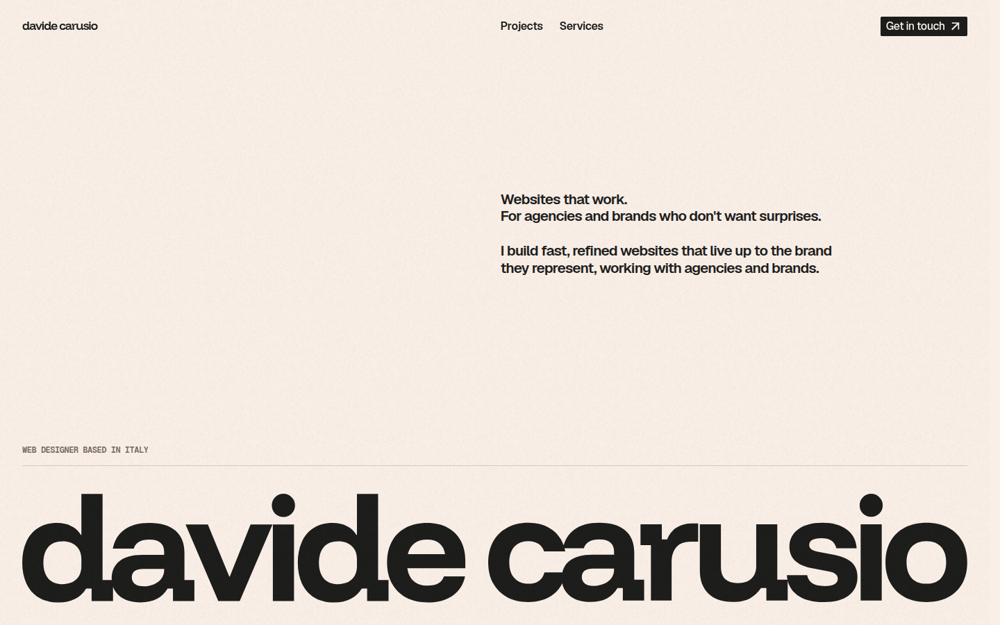
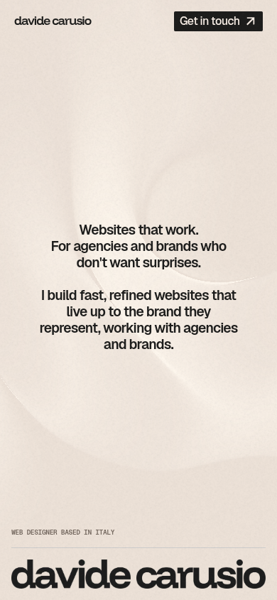

# UI Design System & Master Generation Blueprint: www-davidecarusio-it

> **Davide Carusio - Web Designer / Webflow Dev** (https://www.davidecarusio.it/) — Freelance web designer and Webflow expert in Italy. Fast, custom-built websites from design to development for agencies and international...



---

## 1. Executive Visual Persona & Design Archetype

- **Brand Essence & Persona**: **Davide Carusio - Web Designer / Webflow Dev** (`https://www.davidecarusio.it/`). Freelance web designer and Webflow expert in Italy. Fast, custom-built websites from design to development for agencies and international...
- **Capture Provenance**: Live browser capture (`tier2_webgl`, HTTP `200`, captured `2026-11-23`).
- **Visual Archetype**: **Light-Gallery WebGL / Canvas Interactive Experience (`#f9efe7` / `#0082f3`)**.
- **Anti-AI-Slop Differentiators**:
  - **Live-Computed Chromatic Polarity**: Anchors the viewport in `#f9efe7` (live computed `body` `background-color` (`computed_styles.json`)) paired with `#1c1c1b` primary typography and `#0082f3` accents.
  - **Grounded Typographic Hierarchy**: Pairs `Geist` for display copy (`Websites that work. For agencies and`) with `Geist` and `Geistmono`.
  - **Calibrated Spatial Grid & Motion**: Combines `60em` container bounds (`gap: 16px`, padding `9px`) with `cubic-bezier(0.625,0.05,0,1)` easing and Lenis Smooth Scroll (`data-lenis`), GSAP Timeline & ScrollTrigger.

---

## 2. Spatial Architecture & Modular Grid Mathematics



### Viewport Allocation & Container Geometry
- **Captured Viewport Dimensions**: Desktop `1440×900px` (`assets/desktop.png`, single-viewport 100vh live capture (900px)), Mobile `390×844px` (`assets/mobile.png`, single-viewport 100vh live capture (844px)).
- **Master Container Bounds**: `60em` (non-`@media` desktop container stylesheet rule).
- **Canvas Lateral Padding & Spacing**: `9px` lateral canvas padding with `16px` grid gap.
- **Border Radius Scale**: `3px`, `100%`, `50%`, `var(--button-043-icon-border-radius)`.

### Responsive Breakpoint Architecture
- **Desktop Layout**: Multi-column CSS Grid / Flexbox layout at `1440px` (`max-width: 60em`, `gap: 16px`).
- **Mobile Layout**: Single-column vertical stack at `390px` viewport width with `9px` horizontal padding.
- **Extracted CSS Media Queries**: `@media screen and (max-width: 991px)`, `@media screen and (max-width: 767px)`, `@media screen and (max-width: 479px)`, `@media (min-width: 768px)`.

---

## 3. Color System, Materiality & Atmospheric Lighting

### Semantic Palette & Source Grounding
| Semantic Role | Ground-Truth Value | Extracted Live / CSS Source |
|---|---|---|
| **Primary Canvas Substrate** | `#f9efe7` | live computed `body` `background-color` (`computed_styles.json`) |
| **Primary Typography Ink** | `#1c1c1b` | live computed `h1` `color` (`computed_styles.json`) |
| **Elevated Surface / Card Substrate** | `#e5ccb2` | `var(--tag_bg)` in `:root` |
| **Interactive Accent / Highlight** | `#0082f3` | `.w-dropdown-link.w--current { color: #0082f3 }` |
| **Secondary / Muted Copy** | `#73675e` | live computed `p` `color` (`computed_styles.json`) |
| **Structural Hairline Border** | `#d9d9d9` | `var(--divider)` in `:root` |
| **Variable Token (`--lighter-black`)** | `#2b2b2b` | `var(--lighter-black)` in `:root` |
| **Variable Token (`--tag_text`)** | `#4b5563` | `var(--tag_text)` in `:root` |
| **Variable Token (`--p_paragraph`)** | `#998a7e` | `var(--p_paragraph)` in `:root` |
| **Variable Token (`--button-043-color`)** | `#ffffff` | `var(--button-043-color)` in `:root` |

### Sanitized Root CSS Variables (`ui-ux.md` Ground Truth)
| Variable Name | Extracted Value | Semantic Role |
|---|---|---|
| `--light-bg` | `#f9efe7` | Canvas / Surface Token |
| `--lighter-black` | `#2b2b2b` | Canvas / Surface Token |
| `--dark-bg` | `#1c1c1b` | Canvas / Surface Token |
| `--p_paragraph-darker` | `#73675e` | Canvas / Surface Token |
| `--tag_bg` | `#e5ccb2` | Canvas / Surface Token |
| `--tag_text` | `#4b5563` | Typography Ink Token |
| `--divider` | `#d9d9d9` | Color / Atmospheric Token |
| `--p_paragraph` | `#998a7e` | Typography / Scale Token |
| `--size-unit` | `16` | Layout / Spatial Grid Token |
| `--size-container-ideal` | `1440` | Layout / Spatial Grid Token |
| `--size-container-min` | `1280px` | Layout / Spatial Grid Token |
| `--size-container-max` | `1920px` | Layout / Spatial Grid Token |
| `--size-container` | `clamp(var(--size-container-min), 100vw, var(--size-container-max))` | Layout / Spatial Grid Token |
| `--button-043-color` | `#fff` | Brand / Palette Token |
| `--button-043-color-background` | `currentColor` | Canvas / Surface Token |
| `--button-043-hover-color-background` | `currentColor` | Canvas / Surface Token |

---

## 4. Typographic Scale & Editorial Hierarchy

### Font Family Stacks
- **Display Typography**: `Geist`.
- **Primary Body Stack**: `Geist`.
- **Technical / Metadata Stack**: `Geistmono`.

### Typographic Scale & Rules (Live Computed & Stylesheet Grounded)
- **Hero Display (`H1`)**: live computed `h1` (`font-size: 20.8px`, `line-height: 24.96px`, `font-weight: 600`, `letter-spacing: -0.832px`); rule `h1` (`font-size: 38px`, `line-height: 44px`).
- **Section Heading (`H2`)**: live computed `h2` (`font-size: 64px`, `line-height: 64px`, `font-weight: 600`, `letter-spacing: -2.56px`); rule `h2` (`font-size: 32px`, `line-height: 36px`).
- **Body Copy**: live computed `body` (`font-size: 16px`, `line-height: 20px`, `font-weight: 600`); rule `body` (`font-size: 14px`, `line-height: 20px`).
- **Metadata & Navigation Labels**: live computed `nav/a` (`font-size: 16px`, `line-height: 20px`, `font-weight: 600`); rule `small` (`font-size: 80%`).

---

## 5. Choreographed Motion & Interaction Physics

### Primary Easing Curves
- **Extracted Timing Functions**: `cubic-bezier(0.625,0.05,0,1)`, `cubic-bezier(0.4,0,0.2,1)`, `cubic-bezier(0.32,0.72,0,1)`.

### Per-Element Transition & Choreography Rules
- **Selector `.w-webflow-badge > img`**: `transition: unset` extracted from `www-davidecarusio-it` stylesheet.
- **Selector `.w-slider-dot`**: `transition: background-color 100ms, color 100ms` extracted from `www-davidecarusio-it` stylesheet.
- **Selector `.w-lightbox-control`**: `transition: all 0.3s` extracted from `www-davidecarusio-it` stylesheet.
- **Extracted Easing Curve (`cubic-bezier(0.625,0.05,0,1)`)**: Governs interactive state transitions across `<nav.underlay-nav__header>` and `<section.sticky-title-wrapper>`.
- **Runtime Interaction Engine**: Integrates Lenis Smooth Scroll (`data-lenis`), GSAP Timeline & ScrollTrigger, HTML5 `<canvas>` Interactive Viewport Surface with `prefers-reduced-motion: reduce` fallback guards.

---

## 6. Component Wireframe & Structural DOM Map

### Visual Layout Schematic — Desktop (`1440px`, Grounded in `dom.html` & Landmark Bounding Boxes)
```
┌────────────────────────────────────────────────────────────────────────┐
│ DESKTOP VIEWPORT (1440px) — Davide Carusio - Web Designer / Webflow De │
│ ====================================================================== │
│ [ <nav.underlay-nav__hea (1425x76px)  | davide carusio · Projects ·  ] │
│ ---------------------------------------------------------------------- │
│ | HERO STAGE: <section.hero_wrap> (w=1440px)                         | │
│ | H1: Websites that work. For agencies and brands who d...           | │
│ | Substrate: #f9efe7 | Ink: #1c1c1b | Accent: #0082f3                | │
│ ---------------------------------------------------------------------- │
│ | SHOWCASE GRID (<section.sticky-title-wrap) max-w: 60em             | │
│ | +------------------------------+  +------------------------------+ | │
│ | | Italy-based photographer. Th |  | t h e b e s t p i z z a i s  | | │
│ | +------------------------------+  +------------------------------+ | │
│ ---------------------------------------------------------------------- │
│ | DETAIL MODULE (<section.work_wrap>) — G e t i n t o u c h          | │
│ ---------------------------------------------------------------------- │
│ [ FOOTER (<footer.footer-wrap>) | https://www.davidecarusio.it/        │
└────────────────────────────────────────────────────────────────────────┘
```

### Visual Layout Schematic — Mobile Reflow (`390px`)
```
┌────────────────────────────────────────────────────────────────────────┐
│ MOBILE VIEWPORT REFLOW (390px) — Single-Column Stack (gap: 16px)       │
│ ====================================================================== │
│ [ HEADER BAR (<nav.underlay-nav__heade) | Compact Menu (390px)         │
│ ---------------------------------------------------------------------- │
│ | HERO STAGE (<section.hero_wrap>) — 390px Vertical Lead             | │
│ | H1: Websites that work. For agencies and brands who d...           | │
│ ---------------------------------------------------------------------- │
│ | SHOWCASE STACK (<section.sticky-title-) — 1-Col Stack              | │
│ | [ Item 1: Italy-based photographer. The site focuses on cl       ] | │
│ | [ Item 2: t h e b e s t p i z z a i s t h e m a r g h e r        ] | │
│ ---------------------------------------------------------------------- │
│ | DETAIL STACK (<section.work_wrap>) — 1-Col (G e t i n t o u c )    | │
│ ---------------------------------------------------------------------- │
│ [ FOOTER (<footer.footer-wrap>) | Stacked 390px Colophon               │
└────────────────────────────────────────────────────────────────────────┘
```

### Granular DOM Region Breakdown
1. **Brand Header & Navigation Bar (<nav.underlay-nav__header> — `www-davidecarusio-it`)**:
   - Landmark `<nav class="underlay-nav__header">` (`1425x76px`) hosting `Davide Carusio - Web Designer / Webf` navigation (`davide carusio · Projects · Services · IT · G e t i n t o u c h`), DOM attributes (`data-wf-page="6aabacfa3017369152d1f8b2"`, `data-wf-site="6a3a84272e4493d30711d604"`, `data-theme-nav="light"`, `data-bg-nav="light"`), and stylesheet rule `.w-icon-slider-right:before { content: "\e600"; }`.
2. **Hero Stage & Focal Lead (<section.hero_wrap> — `Websites that work. For agencies a`)**:
   - Landmark `<section class="hero_wrap">` presenting display lead `Websites that work. For agencies and brands who d...` and copy excerpt *"Italy-based photographer. The site focuses on clean design and th"* over `#f9efe7` canvas and `#1c1c1b` ink.
3. **Primary Showcase & Content Grid (<section.sticky-title-wrapper> — `Italy-based photographer. The site`)**:
   - Landmark `<section class="sticky-title-wrapper">` rendering section `Italy-based photographer. The site focuses on cl` with copy *"t h e b e s t p i z z a i s t h e m a r g h e r i t a"*, asset references (`normalize.css`, `webflow.css`, `davidecarusio-it-v3.webflow.css`, `favicon.png`), and grid rule `.w-icon-slider-left:before { content: "\e601"; }`.
4. **Interactive Detail & Feature Matrix (<section.work_wrap> — `t h e b e s t p i z z a i s t h e `)**:
   - Landmark `<section class="work_wrap">` framing `t h e b e s t p i z z a i s t h e m a r g h e r ` and `G e t i n t o u c h` (*"G e t i n t o u c h"*) with `#e5ccb2` surface cards, `#0082f3` accents, and `.w-icon-nav-menu:before { content: "\e602"; }`.
5. **Colophon & Global Directory Footer (<footer.footer-wrap> — `https://www.davidecarusio.it/`)**:
   - Landmark `<footer class="footer-wrap">` anchoring `Davide Carusio - Web Designer / ` footer links (`davide carusio · Projects · Services · IT · G e t i n t o u c h`), copy *"Last Updated: 24/09/2026"*, and `#d9d9d9` structural dividers.

---

## 7. Master Zero-Shot AI Generation Prompt

```markdown
# Master Zero-Shot Frontend Generation Prompt: www-davidecarusio-it (Davide Carusio - Web Designer / Webflow Dev)

You are a principal frontend architect and design systems engineer. Build a complete, production-ready web application replicating the exact design system, DOM landmarks, typographic hierarchy, color tokens, and motion physics of `www-davidecarusio-it` (**Davide Carusio - Web Designer / Webflow Dev** — `https://www.davidecarusio.it/`).

### 1. Visual Archetype & Anti-AI-Slop Mandates
- **Archetype**: Light-Gallery WebGL / Canvas Interactive Experience (`#f9efe7` / `#0082f3`).
- **Identity & Domain Context**: Freelance web designer and Webflow expert in Italy. Fast, custom-built websites from design to development for agencies and international...
- **Primary Substrate**: `#f9efe7` (live computed `body` `background-color` (`computed_styles.json`)), **Primary Ink**: `#1c1c1b`, **Accent / Highlight**: `#0082f3`.
- **Site-Specific Differentiators**:
  - **Live-Computed Chromatic Polarity**: Anchors the viewport in `#f9efe7` (live computed `body` `background-color` (`computed_styles.json`)) paired with `#1c1c1b` primary typography and `#0082f3` accents.
  - **Grounded Typographic Hierarchy**: Pairs `Geist` for display copy (`Websites that work. For agencies and`) with `Geist` and `Geistmono`.
  - **Calibrated Spatial Grid & Motion**: Combines `60em` container bounds (`gap: 16px`, padding `9px`) with `cubic-bezier(0.625,0.05,0,1)` easing and Lenis Smooth Scroll (`data-lenis`), GSAP Timeline & ScrollTrigger.

### 2. Ground-Truth CSS Variables (`:root` Token Contract)
Declare and consume these exact custom properties extracted from `www-davidecarusio-it` in your global stylesheet:

:root {
  /* Davide Carusio - Web Designer / Webflow Dev (www-davidecarusio-it) — Live-Grounded CSS Variables */
  --light-bg: #f9efe7; /* Canvas / Surface Token (www-davidecarusio-it) */
  --lighter-black: #2b2b2b; /* Canvas / Surface Token (www-davidecarusio-it) */
  --dark-bg: #1c1c1b; /* Canvas / Surface Token (www-davidecarusio-it) */
  --p_paragraph-darker: #73675e; /* Canvas / Surface Token (www-davidecarusio-it) */
  --tag_bg: #e5ccb2; /* Canvas / Surface Token (www-davidecarusio-it) */
  --tag_text: #4b5563; /* Typography Ink Token (www-davidecarusio-it) */
  --divider: #d9d9d9; /* Color / Atmospheric Token (www-davidecarusio-it) */
  --p_paragraph: #998a7e; /* Typography / Scale Token (www-davidecarusio-it) */
  --size-unit: 16; /* Layout / Spatial Grid Token (www-davidecarusio-it) */
  --size-container-ideal: 1440; /* Layout / Spatial Grid Token (www-davidecarusio-it) */
  --size-container-min: 1280px; /* Layout / Spatial Grid Token (www-davidecarusio-it) */
  --size-container-max: 1920px; /* Layout / Spatial Grid Token (www-davidecarusio-it) */
  --size-container: clamp(var(--size-container-min), 100vw, var(--size-container-max)); /* Layout / Spatial Grid Token (www-davidecarusio-it) */
  --button-043-color: #fff; /* Brand / Palette Token (www-davidecarusio-it) */
  --button-043-color-background: currentColor; /* Canvas / Surface Token (www-davidecarusio-it) */
  --button-043-hover-color-background: currentColor; /* Canvas / Surface Token (www-davidecarusio-it) */
}

### 3. Semantic Color & Materiality Contract
Map every surface, ink, and border strictly to these source-grounded tokens:
- **Primary Canvas Substrate**: `#f9efe7` — grounded in live computed `body` `background-color` (`computed_styles.json`)
- **Primary Typography Ink**: `#1c1c1b` — grounded in live computed `h1` `color` (`computed_styles.json`)
- **Elevated Surface / Card Substrate**: `#e5ccb2` — grounded in `var(--tag_bg)` in `:root`
- **Interactive Accent / Highlight**: `#0082f3` — grounded in `.w-dropdown-link.w--current { color: #0082f3 }`
- **Secondary / Muted Copy**: `#73675e` — grounded in live computed `p` `color` (`computed_styles.json`)
- **Structural Hairline Border**: `#d9d9d9` — grounded in `var(--divider)` in `:root`
- **Variable Token (`--lighter-black`)**: `#2b2b2b` — grounded in `var(--lighter-black)` in `:root`
- **Variable Token (`--tag_text`)**: `#4b5563` — grounded in `var(--tag_text)` in `:root`
- **Variable Token (`--p_paragraph`)**: `#998a7e` — grounded in `var(--p_paragraph)` in `:root`
- **Variable Token (`--button-043-color`)**: `#ffffff` — grounded in `var(--button-043-color)` in `:root`

### 4. Spatial Grid, Container Bounds & Responsive Breakpoints
- **Desktop Viewport Reference**: `1440×900px` (single-viewport 100vh live capture (900px), `1440px` standard desktop width).
- **Mobile Viewport Reference**: `390×844px` (single-viewport 100vh live capture (844px), `390px` standard mobile width).
- **Container Max-Width**: `60em` (non-`@media` desktop container stylesheet rule)
- **Padding & Gutters**: `9px` lateral canvas padding with `16px` grid gap
- **Desktop Grid**: Multi-column CSS Grid / Flexbox layout at `1440px` (`max-width: 60em`, `gap: 16px`)
- **Mobile Adaptation**: Single-column vertical stack at `390px` viewport width with `9px` horizontal padding
- **Media Queries**: `@media screen and (max-width: 991px)`, `@media screen and (max-width: 767px)`, `@media screen and (max-width: 479px)`, `@media (min-width: 768px)`
- **Corner Radii**: `3px`, `100%`, `50%`, `var(--button-043-icon-border-radius)`

### 5. Typography & Editorial Scale Contract
- **Display Font Stack**: `Geist`
- **Body Font Stack**: `Geist`
- **Monospace / Technical Font Stack**: `Geistmono`
- **H1 Display Rule**: live computed `h1` (`font-size: 20.8px`, `line-height: 24.96px`, `font-weight: 600`, `letter-spacing: -0.832px`); rule `h1` (`font-size: 38px`, `line-height: 44px`)
- **H2 Section Rule**: live computed `h2` (`font-size: 64px`, `line-height: 64px`, `font-weight: 600`, `letter-spacing: -2.56px`); rule `h2` (`font-size: 32px`, `line-height: 36px`)
- **Body Copy Rule**: live computed `body` (`font-size: 16px`, `line-height: 20px`, `font-weight: 600`); rule `body` (`font-size: 14px`, `line-height: 20px`)
- **Metadata & Index Rule**: live computed `nav/a` (`font-size: 16px`, `line-height: 20px`, `font-weight: 600`); rule `small` (`font-size: 80%`)

### 6. Component Hierarchy, Verbatim Copy & Real DOM Landmarks
Scaffold `www-davidecarusio-it` (`Davide Carusio - Web Designer / Webflow Dev`) with these exact structural regions, extracted copy, and CSS rules from `dom.html`:
1. **Brand Header & Navigation Bar (<nav.underlay-nav__header> — `www-davidecarusio-it`)**:
   - DOM & Selectors: Landmark `<nav class="underlay-nav__header">` (`1425x76px`) hosting `Davide Carusio - Web Designer / Webf` navigation (`davide carusio · Projects · Services · IT · G e t i n t o u c h`), DOM attributes (`data-wf-page="6aabacfa3017369152d1f8b2"`, `data-wf-site="6a3a84272e4493d30711d604"`, `data-theme-nav="light"`, `data-bg-nav="light"`), and stylesheet rule `.w-icon-slider-right:before { content: "\e600"; }`.
   - Responsive Contract: Header `Brand Header & Navigation Bar (<nav.underlay-nav__header> — `www-davidecarusio-it`)` (`www-davidecarusio-it`) adapts across `@media screen and (max-width: 991px)`, `@media screen and (max-width: 767px)`, `@media screen and (max-width: 479px)`, `@media (min-width: 768px)` with `cubic-bezier(0.625,0.05,0,1)`, `cubic-bezier(0.4,0,0.2,1)`, `cubic-bezier(0.32,0.72,0,1)` transitions and links `davide carusio · Projects · Services · IT · G e t i n t o u c h`.
2. **Hero Stage & Focal Lead (<section.hero_wrap> — `Websites that work. For agencies a`)**:
   - DOM & Selectors: Landmark `<section class="hero_wrap">` presenting display lead `Websites that work. For agencies and brands who d...` and copy excerpt *"Italy-based photographer. The site focuses on clean design and th"* over `#f9efe7` canvas and `#1c1c1b` ink.
   - Responsive Contract: Hero stage (`1440×900px` desktop / `390×844px` mobile) sets `#f9efe7` background with `#1c1c1b` headline `Websites that work. For agencies and brands who d...`.
3. **Primary Showcase & Content Grid (<section.sticky-title-wrapper> — `Italy-based photographer. The site`)**:
   - DOM & Selectors: Landmark `<section class="sticky-title-wrapper">` rendering section `Italy-based photographer. The site focuses on cl` with copy *"t h e b e s t p i z z a i s t h e m a r g h e r i t a"*, asset references (`normalize.css`, `webflow.css`, `davidecarusio-it-v3.webflow.css`, `favicon.png`), and grid rule `.w-icon-slider-left:before { content: "\e601"; }`.
   - Responsive Contract: Showcase grid `Primary Showcase & Content Grid (<section.sticky-title-wrapper> — `Italy-based photographer. The site`)` applies Multi-column CSS Grid / Flexbox layout at `1440px` (`max-width: 60em`, `gap: 16px`) on desktop and Single-column vertical stack at `390px` viewport width with `9px` horizontal padding on mobile.
4. **Interactive Detail & Feature Matrix (<section.work_wrap> — `t h e b e s t p i z z a i s t h e `)**:
   - DOM & Selectors: Landmark `<section class="work_wrap">` framing `t h e b e s t p i z z a i s t h e m a r g h e r ` and `G e t i n t o u c h` (*"G e t i n t o u c h"*) with `#e5ccb2` surface cards, `#0082f3` accents, and `.w-icon-nav-menu:before { content: "\e602"; }`.
   - Responsive Contract: Detail module `Interactive Detail & Feature Matrix (<section.work_wrap> — `t h e b e s t p i z z a i s t h e `)` uses `3px`, `100%`, `50%`, `var(--button-043-icon-border-radius)` radii, `#0082f3` highlights, and assets (normalize.css, webflow.css, davidecarusio-it-v3.webflow.css).
5. **Colophon & Global Directory Footer (<footer.footer-wrap> — `https://www.davidecarusio.it/`)**:
   - DOM & Selectors: Landmark `<footer class="footer-wrap">` anchoring `Davide Carusio - Web Designer / ` footer links (`davide carusio · Projects · Services · IT · G e t i n t o u c h`), copy *"Last Updated: 24/09/2026"*, and `#d9d9d9` structural dividers.
   - Responsive Contract: Footer `Colophon & Global Directory Footer (<footer.footer-wrap> — `https://www.davidecarusio.it/`)` aligns to `60em` (non-`@media` desktop container stylesheet rule) with `9px` lateral canvas padding with `16px` grid gap and attributes (data-wf-page="6aabacfa3017369152d1f8b2", data-wf-site="6a3a84272e4493d30711d604", data-theme-nav="light").

#### Verbatim DOM Copy Excerpts (`dom.html`)
- Copy Excerpt 1: *"Italy-based photographer. The site focuses on clean design and thoughtful UX, lett..."*
- Copy Excerpt 2: *"t h e b e s t p i z z a i s t h e m a r g h e r i t a"*
- Copy Excerpt 3: *"G e t i n t o u c h"*
- Copy Excerpt 4: *"Last Updated: 24/09/2026"*

### 7. Motion, Extracted Stylesheet Rules & Interaction Choreography
- **Primary Easing Functions**: `cubic-bezier(0.625,0.05,0,1)`, `cubic-bezier(0.4,0,0.2,1)`, `cubic-bezier(0.32,0.72,0,1)`
- **Extracted Stylesheet Rules (`www-davidecarusio-it`)**:
- `.w-icon-slider-right:before { content: "\e600"; }`
- `.w-icon-slider-left:before { content: "\e601"; }`
- `.w-icon-nav-menu:before { content: "\e602"; }`
- `.w-icon-dropdown-toggle:before { content: "\e603"; }`
- `.w-icon-file-upload-remove:before { content: "\e900"; }`
- **Per-Selector Transition Rules**:
- **Selector `.w-webflow-badge > img`**: `transition: unset` extracted from `www-davidecarusio-it` stylesheet.
- **Selector `.w-slider-dot`**: `transition: background-color 100ms, color 100ms` extracted from `www-davidecarusio-it` stylesheet.
- **Selector `.w-lightbox-control`**: `transition: all 0.3s` extracted from `www-davidecarusio-it` stylesheet.
- **Extracted Easing Curve (`cubic-bezier(0.625,0.05,0,1)`)**: Governs interactive state transitions across `<nav.underlay-nav__header>` and `<section.sticky-title-wrapper>`.
- **Runtime Interaction Engine**: Integrates Lenis Smooth Scroll (`data-lenis`), GSAP Timeline & ScrollTrigger, HTML5 `<canvas>` Interactive Viewport Surface with `prefers-reduced-motion: reduce` fallback guards.

### 8. Technical Deliverables
- Implement in Next.js (App Router) with TypeScript and Tailwind CSS consuming the `:root` custom properties defined above for `www-davidecarusio-it`.
- Reproduce both the `1440px` desktop architecture and `390px` mobile breakpoint transitions, preserving semantic HTML5 landmarks (`<header>`, `<nav>`, `<main>`, `<section>`, `<footer>`) and `prefers-reduced-motion` accessibility guards.
```
