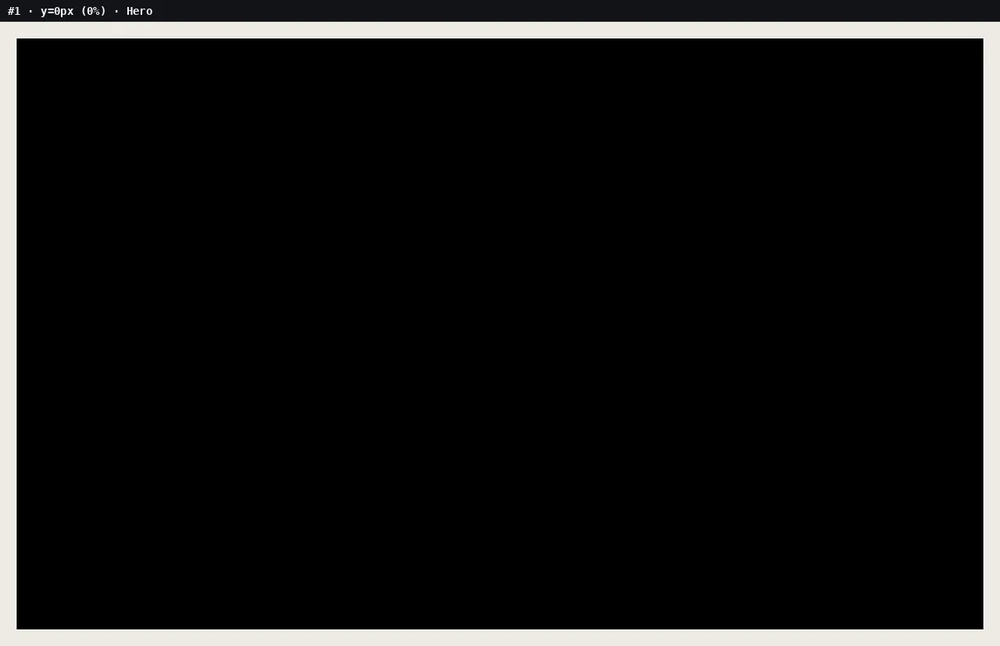
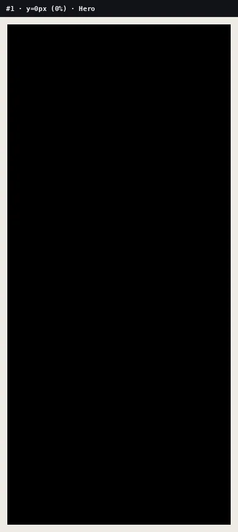

# UI Design System & Master Generation Blueprint: www-dbydt-space

> **Deebak Tamilmani · Design Portfolio** (https://www.dbydt.space) — Design portfolio of Deebak Tamilmani. Fragments of architecture and design projects, held as memory rather than archive, drawn in real ti...





---

## 1. Executive Visual Persona & Design Archetype

- **Brand Essence & Persona**: **Deebak Tamilmani · Design Portfolio** (`https://www.dbydt.space`). Design portfolio of Deebak Tamilmani. Fragments of architecture and design projects, held as memory rather than archive, drawn in real ti...
- **Capture Provenance**: Live browser capture (`tier2_webgl`, HTTP `200`, captured `2026-11-24`).
- **Visual Archetype**: **Light-Substrate Editorial & Modular Grid System (`#eeebe4` canvas, `#0000ee` ink, `#2b2b2b` accent)**.
- **Anti-AI-Slop Differentiators**:
  - **Live-Computed Chromatic Polarity**: Anchors the viewport in `#eeebe4` (live computed `html` `background-color` (`computed_styles.json`)) paired with `#0000ee` primary typography and `#2b2b2b` accents.
  - **Grounded Typographic Hierarchy**: Uses `Segoe UI` across display (`Deebak Tamilmani · Design Portfolio`) and body copy.
  - **Calibrated Spatial Grid & Motion**: Combines `1440px` container bounds (`gap: 3px`, padding `8px`) with `cubic-bezier(.16,1,.3,1)` easing and Lenis Smooth Scroll (`data-lenis`).

---

## 2. Spatial Architecture & Modular Grid Mathematics

### Viewport Allocation & Container Geometry
- **Captured Journey Filmstrips**: Desktop `1280×828px` (`assets/desktop-journey.webp`, `1` keyframes up to `y=0px` / doc `900px`), Mobile `390×872px` (`assets/mobile-journey.webp`, `1` keyframes).
- **Master Container Bounds**: `1440px` (full-bleed `100%` viewport stage).
- **Canvas Lateral Padding & Spacing**: `8px` lateral canvas padding with `3px` grid gap.
- **Border Radius Scale**: `50%`.

### Responsive Breakpoint Architecture
- **Desktop Layout**: Multi-column CSS Grid / Flexbox layout at `1440px` (`max-width: 1440px`, `gap: 3px`).
- **Mobile Layout**: Single-column vertical stack at `390px` viewport width with `8px` horizontal padding.
- **Extracted CSS Media Queries**: `@media (prefers-reduced-motion:reduce)`.

---

## 3. Color System, Materiality & Atmospheric Lighting

### Semantic Palette & Source Grounding
| Semantic Role | Ground-Truth Value | Extracted Live / CSS Source |
|---|---|---|
| **Primary Canvas Substrate** | `#eeebe4` | live computed `html` `background-color` (`computed_styles.json`) |
| **Primary Typography Ink** | `#0000ee` | live computed `a` `color` (`computed_styles.json`) |
| **Elevated Surface / Card Substrate** | `#2b2b2b` | `.bento-strip-cell-bhp { background: #2b2b2b }` |
| **Interactive Accent / Highlight** | `#2b2b2b` | `.bento-hello-open-btn { color: #2b2b2b }` |
| **Secondary / Muted Copy** | `#6b675f` | `t-content-text p.project-conten... { color: #6b675f }` |
| **Structural Hairline Border** | `#dbd8d2` | `.timeline-entry { border-top: #dbd8d2 }` |

### Sanitized Root CSS Variables (`ui-ux.md` Ground Truth)
| Variable Name | Extracted Value | Semantic Role |
|---|---|---|
| `--pg-annot-mark-thickness` | `1.5px` | Dimension / Scale Token |
| `--pg-annot-bracket-size` | `8px` | Layout / Spatial Grid Token |
| `--fullscreen-ruler-reveal-inset` | `0%` | Dimension / Scale Token |
| `--project-surface` | `#EEEBE4` | Canvas / Surface Token |
| `--scene-clip-left` | `100%` | Dimension / Scale Token |
| `--bhp-caption-row-height` | `44px` | Layout / Spatial Grid Token |
| `--bhp-caption-top-padding` | `16px` | Layout / Spatial Grid Token |
| `--card-slot` | `max(300px, 25%)` | Dimension / Scale Token |
| `--ruler-height` | `30px` | Layout / Spatial Grid Token |
| `--ruler-label-top` | `30px` | Dimension / Scale Token |
| `--bento-title-size` | `clamp(5rem, min(16vw, 15vh), 8rem)` | Layout / Spatial Grid Token |
| `--stack-unit` | `40px` | Dimension / Scale Token |
| `--www-dbydt-space-bg` | `#eeebe4` | Canvas Substrate (from live computed `html` `background-color` (`computed_styles.json`)) |
| `--www-dbydt-space-ink` | `#0000ee` | Primary Typography Ink (computed-derived) |
| `--www-dbydt-space-surface` | `#2b2b2b` | Surface Substrate (computed-derived) |
| `--www-dbydt-space-accent` | `#2b2b2b` | Interactive Accent (computed-derived) |

---

## 4. Typographic Scale & Editorial Hierarchy

### Font Family Stacks
- **Display Typography**: `Segoe UI`.
- **Primary Body Stack**: `Segoe UI`.
- **Technical / Metadata Stack**: not declared in live computed styles (uses primary stack / `ui-monospace`).

### Typographic Scale & Rules (Live Computed & Stylesheet Grounded)
- **Hero Display (`H1`)**: live computed `h1` (`font-size: 32px`, `line-height: normal`, `font-weight: 700`).
- **Section Heading (`H2`)**: live computed `h2` (`font-size: 24px`, `line-height: normal`, `font-weight: 700`).
- **Body Copy**: live computed `body` (`font-size: 16px`, `line-height: normal`, `font-weight: 400`); rule `p` (`font-size: 10px`, `line-height: 1.4`, `font-weight: 300`).
- **Metadata & Navigation Labels**: live computed `nav/a` (`font-size: 16px`, `line-height: normal`, `font-weight: 400`); CSS variables `--bhp-caption-row-height: 44px`, `--bhp-caption-top-padding: 16px`, `--ruler-label-top: 30px`.

---

## 5. Choreographed Motion & Interaction Physics

### Primary Easing Curves
- **Extracted Timing Functions**: `cubic-bezier(.16,1,.3,1)`, `cubic-bezier(.3,0,.2,1)`, `cubic-bezier(.4,0,.2,1)`.

### Per-Element Transition & Choreography Rules
- **Selector `.pg-annot`**: `transition: opacity .3s ease` extracted from `www-dbydt-space` stylesheet.
- **Selector `.pg-annot-plus`**: `transition: opacity .3s ease` extracted from `www-dbydt-space` stylesheet.
- **Selector `.pg-annot-brackets`**: `transition: opacity .16s ease` extracted from `www-dbydt-space` stylesheet.
- **Extracted Easing Curve (`cubic-bezier(.16,1,.3,1)`)**: Governs interactive state transitions across `<header>` and `<main#seo-content:nth(3)>`.
- **Runtime Interaction Engine**: Integrates Lenis Smooth Scroll (`data-lenis`) with `prefers-reduced-motion: reduce` fallback guards.
### Measured Runtime Scroll & Interaction Telemetry (`behavioral_journey_v2`)
- **Scroll Driver Mode**: `wheel` (max document height `900px`, deepest scrollY reached `0px` across `1` desktop keyframes).
- **Detected Scroll / Motion Libraries**: `Lenis`, `WebGL/Canvas`.

---

## 6. Component Wireframe & Structural DOM Map

### Visual Layout Schematic — Desktop (`1440px`, Grounded in `dom.html` & Landmark Bounding Boxes)
```
┌────────────────────────────────────────────────────────────────────────┐
│ DESKTOP VIEWPORT (1440px) — Deebak Tamilmani · Design Portfolio        │
│ ====================================================================== │
│ [ <header> (1440px)                   | Hues of Al'Ula · A Street Wi ] │
│ ---------------------------------------------------------------------- │
│ | HERO STAGE: <main#seo-content> (w=1440px)                          | │
│ | H1: Deebak Tamilmani · Design Portfolio                            | │
│ | Substrate: #eeebe4 | Ink: #0000ee | Accent: #2b2b2b                | │
│ ---------------------------------------------------------------------- │
│ | SHOWCASE GRID (<main#seo-content:nth(3)>) max-w: 1440px            | │
│ | +------------------------------+  +------------------------------+ | │
│ | | Experience and education     |  | Projects                     | | │
│ | +------------------------------+  +------------------------------+ | │
│ ---------------------------------------------------------------------- │
│ | DETAIL MODULE (<main#seo-content:nth(4)>) — Research               | │
│ ---------------------------------------------------------------------- │
│ [ FOOTER (<footer>            ) | https://www.dbydt.space              │
└────────────────────────────────────────────────────────────────────────┘
```

### Visual Layout Schematic — Mobile Reflow (`390px`)
```
┌────────────────────────────────────────────────────────────────────────┐
│ MOBILE VIEWPORT REFLOW (390px) — Single-Column Stack (gap: 3px)        │
│ ====================================================================== │
│ [ HEADER BAR (<header>                ) | Compact Menu (390px)         │
│ ---------------------------------------------------------------------- │
│ | HERO STAGE (<main#seo-content>) — 390px Vertical Lead              | │
│ | H1: Deebak Tamilmani · Design Portfolio                            | │
│ ---------------------------------------------------------------------- │
│ | SHOWCASE STACK (<main#seo-content:nth() — 1-Col Stack              | │
│ | [ Item 1: Experience and education                               ] | │
│ | [ Item 2: Projects                                               ] | │
│ ---------------------------------------------------------------------- │
│ | DETAIL STACK (<main#seo-content:nth(4)) — 1-Col (Research)         | │
│ ---------------------------------------------------------------------- │
│ [ FOOTER (<footer>            ) | Stacked 390px Colophon               │
└────────────────────────────────────────────────────────────────────────┘
```

### Granular DOM Region Breakdown
1. **Brand Header & Navigation Bar (<header> — `www-dbydt-space`)**:
   - Landmark `<header>` landmark (`1440px`) hosting `Deebak Tamilmani · Design Portfolio` navigation (`Hues of Al'Ula · A Street Within · Olakh · Atmos & Aura · Club & Courts`), DOM attributes (`data-website-id="8efd2acd-25e0-4014-bc..."`, `data-host-url="https://www.dbydt.space"`), and stylesheet rule `root { font-family:system-ui,-apple-system,Segoe UI,sans-serif;color:eeebe4;bac... }`.
2. **Hero Stage & Focal Lead (<main#seo-content> — `Deebak Tamilmani · Design Portfoli`)**:
   - Landmark `<main id="seo-content">` presenting display lead `Deebak Tamilmani · Design Portfolio` and copy excerpt *"Over the years, I have worked on many projects. Some were built, "* over `#eeebe4` canvas and `#0000ee` ink.
3. **Primary Showcase & Content Grid (<main#seo-content:nth(3)> — `Experience and education`)**:
   - Landmark `<main id="seo-content">` rendering section `Experience and education` with copy *"Hues of Al'Ula is a farm dwelling in the Cultural Oasis of Al'Ula"*, asset references (`favicon.svg`, `favicon-512.png`, `favicon-180.png`, `GeistPixel-Square.woff2`), and grid rule `.app { width:100%;height:100%;margin:0 }`.
4. **Interactive Detail & Feature Matrix (<main#seo-content:nth(4)> — `Projects`)**:
   - Landmark `<main id="seo-content">` framing `Projects` and `Research` (*"A Street Within is an office for a real estate developer in Ahmed"*) with `#2b2b2b` surface cards, `#2b2b2b` accents, and `html { -webkit-text-size-adjust:100%;text-size-adjust:100% }`.
5. **Colophon & Global Directory Footer (<footer> — `https://www.dbydt.space`)**:
   - Landmark `<footer>` landmark anchoring `Deebak Tamilmani · Design Portfo` footer links (`Hues of Al'Ula · A Street Within · Olakh · Atmos & Aura · Club & Courts`), copy *"Olakh , the Marathi word for identity, reimagines the Pre-Em"*, and `#dbd8d2` structural dividers.
### Full Vertical Scroll Sequence (Desktop `1440×900` Keyframes)
- **Step 01** (`y=0px`, `0%`): Active landmark `Hero` · sticky/fixed elements: `2`

---

## 7. Master Zero-Shot AI Generation Prompt

```markdown
# Master Zero-Shot Frontend Generation Prompt: www-dbydt-space (Deebak Tamilmani · Design Portfolio)

You are a principal frontend architect and design systems engineer. Build a complete, production-ready web application replicating the exact design system, DOM landmarks, typographic hierarchy, color tokens, and motion physics of `www-dbydt-space` (**Deebak Tamilmani · Design Portfolio** — `https://www.dbydt.space`).

### 1. Visual Archetype & Anti-AI-Slop Mandates
- **Archetype**: Light-Substrate Editorial & Modular Grid System (`#eeebe4` canvas, `#0000ee` ink, `#2b2b2b` accent).
- **Identity & Domain Context**: Design portfolio of Deebak Tamilmani. Fragments of architecture and design projects, held as memory rather than archive, drawn in real ti...
- **Primary Substrate**: `#eeebe4` (live computed `html` `background-color` (`computed_styles.json`)), **Primary Ink**: `#0000ee`, **Accent / Highlight**: `#2b2b2b`.
- **Site-Specific Differentiators**:
  - **Live-Computed Chromatic Polarity**: Anchors the viewport in `#eeebe4` (live computed `html` `background-color` (`computed_styles.json`)) paired with `#0000ee` primary typography and `#2b2b2b` accents.
  - **Grounded Typographic Hierarchy**: Uses `Segoe UI` across display (`Deebak Tamilmani · Design Portfolio`) and body copy.
  - **Calibrated Spatial Grid & Motion**: Combines `1440px` container bounds (`gap: 3px`, padding `8px`) with `cubic-bezier(.16,1,.3,1)` easing and Lenis Smooth Scroll (`data-lenis`).

### 2. Ground-Truth CSS Variables (`:root` Token Contract)
Declare and consume these exact custom properties extracted from `www-dbydt-space` in your global stylesheet:

:root {
  /* Deebak Tamilmani · Design Portfolio (www-dbydt-space) — Live-Grounded CSS Variables */
  --pg-annot-mark-thickness: 1.5px; /* Dimension / Scale Token (www-dbydt-space) */
  --pg-annot-bracket-size: 8px; /* Layout / Spatial Grid Token (www-dbydt-space) */
  --fullscreen-ruler-reveal-inset: 0%; /* Dimension / Scale Token (www-dbydt-space) */
  --project-surface: #EEEBE4; /* Canvas / Surface Token (www-dbydt-space) */
  --scene-clip-left: 100%; /* Dimension / Scale Token (www-dbydt-space) */
  --bhp-caption-row-height: 44px; /* Layout / Spatial Grid Token (www-dbydt-space) */
  --bhp-caption-top-padding: 16px; /* Layout / Spatial Grid Token (www-dbydt-space) */
  --card-slot: max(300px, 25%); /* Dimension / Scale Token (www-dbydt-space) */
  --ruler-height: 30px; /* Layout / Spatial Grid Token (www-dbydt-space) */
  --ruler-label-top: 30px; /* Dimension / Scale Token (www-dbydt-space) */
  --bento-title-size: clamp(5rem, min(16vw, 15vh), 8rem); /* Layout / Spatial Grid Token (www-dbydt-space) */
  --stack-unit: 40px; /* Dimension / Scale Token (www-dbydt-space) */
  --www-dbydt-space-bg: #eeebe4; /* Canvas Substrate (from live computed `html` `background-color` (`computed_styles.json`)) (www-dbydt-space) */
  --www-dbydt-space-ink: #0000ee; /* Primary Typography Ink (computed-derived) (www-dbydt-space) */
  --www-dbydt-space-surface: #2b2b2b; /* Surface Substrate (computed-derived) (www-dbydt-space) */
  --www-dbydt-space-accent: #2b2b2b; /* Interactive Accent (computed-derived) (www-dbydt-space) */
}

### 3. Semantic Color & Materiality Contract
Map every surface, ink, and border strictly to these source-grounded tokens:
- **Primary Canvas Substrate**: `#eeebe4` — grounded in live computed `html` `background-color` (`computed_styles.json`)
- **Primary Typography Ink**: `#0000ee` — grounded in live computed `a` `color` (`computed_styles.json`)
- **Elevated Surface / Card Substrate**: `#2b2b2b` — grounded in `.bento-strip-cell-bhp { background: #2b2b2b }`
- **Interactive Accent / Highlight**: `#2b2b2b` — grounded in `.bento-hello-open-btn { color: #2b2b2b }`
- **Secondary / Muted Copy**: `#6b675f` — grounded in `t-content-text p.project-conten... { color: #6b675f }`
- **Structural Hairline Border**: `#dbd8d2` — grounded in `.timeline-entry { border-top: #dbd8d2 }`

### 4. Spatial Grid, Container Bounds & Responsive Breakpoints
- **Desktop Viewport Reference**: `1280×828px` (single-viewport 100vh live capture (900px), `1440px` standard desktop width).
- **Mobile Viewport Reference**: `390×872px` (full-page live capture (872px), `390px` standard mobile width).
- **Container Max-Width**: `1440px` (full-bleed `100%` viewport stage)
- **Padding & Gutters**: `8px` lateral canvas padding with `3px` grid gap
- **Desktop Grid**: Multi-column CSS Grid / Flexbox layout at `1440px` (`max-width: 1440px`, `gap: 3px`)
- **Mobile Adaptation**: Single-column vertical stack at `390px` viewport width with `8px` horizontal padding
- **Media Queries**: `@media (prefers-reduced-motion:reduce)`
- **Corner Radii**: `50%`

### 5. Typography & Editorial Scale Contract
- **Display Font Stack**: `Segoe UI`
- **Body Font Stack**: `Segoe UI`
- **Monospace / Technical Font Stack**: not declared in live computed styles (uses primary stack / `ui-monospace`)
- **H1 Display Rule**: live computed `h1` (`font-size: 32px`, `line-height: normal`, `font-weight: 700`)
- **H2 Section Rule**: live computed `h2` (`font-size: 24px`, `line-height: normal`, `font-weight: 700`)
- **Body Copy Rule**: live computed `body` (`font-size: 16px`, `line-height: normal`, `font-weight: 400`); rule `p` (`font-size: 10px`, `line-height: 1.4`, `font-weight: 300`)
- **Metadata & Index Rule**: live computed `nav/a` (`font-size: 16px`, `line-height: normal`, `font-weight: 400`); CSS variables `--bhp-caption-row-height: 44px`, `--bhp-caption-top-padding: 16px`, `--ruler-label-top: 30px`

### 6. Component Hierarchy, Verbatim Copy & Real DOM Landmarks
Scaffold `www-dbydt-space` (`Deebak Tamilmani · Design Portfolio`) with these exact structural regions, extracted copy, and CSS rules from `dom.html`:
1. **Brand Header & Navigation Bar (<header> — `www-dbydt-space`)**:
   - DOM & Selectors: Landmark `<header>` landmark (`1440px`) hosting `Deebak Tamilmani · Design Portfolio` navigation (`Hues of Al'Ula · A Street Within · Olakh · Atmos & Aura · Club & Courts`), DOM attributes (`data-website-id="8efd2acd-25e0-4014-bc..."`, `data-host-url="https://www.dbydt.space"`), and stylesheet rule `root { font-family:system-ui,-apple-system,Segoe UI,sans-serif;color:eeebe4;bac... }`.
   - Responsive Contract: Header `Brand Header & Navigation Bar (<header> — `www-dbydt-space`)` (`www-dbydt-space`) adapts across `@media (prefers-reduced-motion:reduce)` with `cubic-bezier(.16,1,.3,1)`, `cubic-bezier(.3,0,.2,1)`, `cubic-bezier(.4,0,.2,1)` transitions and links `Hues of Al'Ula · A Street Within · Olakh · Atmos & Aura · Club & Courts`.
2. **Hero Stage & Focal Lead (<main#seo-content> — `Deebak Tamilmani · Design Portfoli`)**:
   - DOM & Selectors: Landmark `<main id="seo-content">` presenting display lead `Deebak Tamilmani · Design Portfolio` and copy excerpt *"Over the years, I have worked on many projects. Some were built, "* over `#eeebe4` canvas and `#0000ee` ink.
   - Responsive Contract: Hero stage (`1280×828px` desktop / `390×872px` mobile) sets `#eeebe4` background with `#0000ee` headline `Deebak Tamilmani · Design Portfolio`.
3. **Primary Showcase & Content Grid (<main#seo-content:nth(3)> — `Experience and education`)**:
   - DOM & Selectors: Landmark `<main id="seo-content">` rendering section `Experience and education` with copy *"Hues of Al'Ula is a farm dwelling in the Cultural Oasis of Al'Ula"*, asset references (`favicon.svg`, `favicon-512.png`, `favicon-180.png`, `GeistPixel-Square.woff2`), and grid rule `.app { width:100%;height:100%;margin:0 }`.
   - Responsive Contract: Showcase grid `Primary Showcase & Content Grid (<main#seo-content:nth(3)> — `Experience and education`)` applies Multi-column CSS Grid / Flexbox layout at `1440px` (`max-width: 1440px`, `gap: 3px`) on desktop and Single-column vertical stack at `390px` viewport width with `8px` horizontal padding on mobile.
4. **Interactive Detail & Feature Matrix (<main#seo-content:nth(4)> — `Projects`)**:
   - DOM & Selectors: Landmark `<main id="seo-content">` framing `Projects` and `Research` (*"A Street Within is an office for a real estate developer in Ahmed"*) with `#2b2b2b` surface cards, `#2b2b2b` accents, and `html { -webkit-text-size-adjust:100%;text-size-adjust:100% }`.
   - Responsive Contract: Detail module `Interactive Detail & Feature Matrix (<main#seo-content:nth(4)> — `Projects`)` uses `50%` radii, `#2b2b2b` highlights, and assets (favicon.svg, favicon-512.png, favicon-180.png).
5. **Colophon & Global Directory Footer (<footer> — `https://www.dbydt.space`)**:
   - DOM & Selectors: Landmark `<footer>` landmark anchoring `Deebak Tamilmani · Design Portfo` footer links (`Hues of Al'Ula · A Street Within · Olakh · Atmos & Aura · Club & Courts`), copy *"Olakh , the Marathi word for identity, reimagines the Pre-Em"*, and `#dbd8d2` structural dividers.
   - Responsive Contract: Footer `Colophon & Global Directory Footer (<footer> — `https://www.dbydt.space`)` aligns to `1440px` (full-bleed `100%` viewport stage) with `8px` lateral canvas padding with `3px` grid gap and attributes (data-website-id="8efd2acd-25e0-4014-bc...", data-host-url="https://www.dbydt.space").

#### Verbatim DOM Copy Excerpts (`dom.html`)
- Copy Excerpt 1: *"Over the years, I have worked on many projects. Some were built, some were develop..."*
- Copy Excerpt 2: *"Hues of Al'Ula is a farm dwelling in the Cultural Oasis of Al'Ula, a landscape tha..."*
- Copy Excerpt 3: *"A Street Within is an office for a real estate developer in Ahmedabad, planned aro..."*
- Copy Excerpt 4: *"Olakh , the Marathi word for identity, reimagines the Pre-Embarkation Security Che..."*

### 7. Motion, Extracted Stylesheet Rules & Interaction Choreography
- **Primary Easing Functions**: `cubic-bezier(.16,1,.3,1)`, `cubic-bezier(.3,0,.2,1)`, `cubic-bezier(.4,0,.2,1)`
- **Extracted Stylesheet Rules (`www-dbydt-space`)**:
- `root { font-family:system-ui,-apple-system,Segoe UI,sans-serif;color:eeebe4;bac... }`
- `.app { width:100%;height:100%;margin:0 }`
- `html { -webkit-text-size-adjust:100%;text-size-adjust:100% }`
- `.nav-scroll-spacer { width:1px;pointer-events:none;visibility:hidden }`
- `html.lenis.lenis-smooth { scroll-behavior:auto!important }`
- **Per-Selector Transition Rules**:
- **Selector `.pg-annot`**: `transition: opacity .3s ease` extracted from `www-dbydt-space` stylesheet.
- **Selector `.pg-annot-plus`**: `transition: opacity .3s ease` extracted from `www-dbydt-space` stylesheet.
- **Selector `.pg-annot-brackets`**: `transition: opacity .16s ease` extracted from `www-dbydt-space` stylesheet.
- **Extracted Easing Curve (`cubic-bezier(.16,1,.3,1)`)**: Governs interactive state transitions across `<header>` and `<main#seo-content:nth(3)>`.
- **Runtime Interaction Engine**: Integrates Lenis Smooth Scroll (`data-lenis`) with `prefers-reduced-motion: reduce` fallback guards.
### 7b. Full-Page Scroll Choreography, Interactive States & Multi-Page Routes
- **Scroll Mechanics**: Implement `wheel` vertical progression up to `900px` across 1 distinct viewport chapters using Lenis, WebGL/Canvas.
- **Vertical Chapter Sequence**: Hero (0%).

### 8. Technical Deliverables
- Implement in Next.js (App Router) with TypeScript and Tailwind CSS consuming the `:root` custom properties defined above for `www-dbydt-space`.
- Reproduce both the `1440px` desktop architecture and `390px` mobile breakpoint transitions, preserving semantic HTML5 landmarks (`<header>`, `<nav>`, `<main>`, `<section>`, `<footer>`) and `prefers-reduced-motion` accessibility guards.
```
---

## 8. Full-Page Scroll Journey, Interactive States & Subpage Inventory

### Desktop Scroll Keyframes (`1440×900` WebP)
| Step | Scroll Y | Progress | Active Landmark / Section | Sticky/Fixed | Visual Asset |
| :---: | :---: | :---: | :--- | :---: | :--- |
| `#01` | `0px` | `0%` | Hero | `2` | [desktop-step-01.webp](assets/desktop-step-01.webp) |

### Mobile Condensed Keyframes (`390×844` WebP)
| Step | Scroll Y | Progress | Active Landmark | Visual Asset |
| :---: | :---: | :---: | :--- | :--- |
| `#01` | `0px` | `0%` | Hero | [mobile-step-01.webp](assets/mobile-step-01.webp) |

