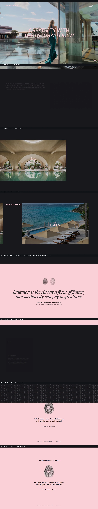
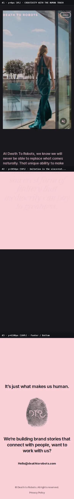

# UI Design System & Master Generation Blueprint: www-deathtorobots-com

> **Death to Robots** (https://www.deathtorobots.com/) — Death To Robots is a multi disciplinary creative agency working with brands to bring their stories to life.





---

## 1. Executive Visual Persona & Design Archetype

- **Brand Essence & Persona**: **Death to Robots** (`https://www.deathtorobots.com/`). Death To Robots is a multi disciplinary creative agency working with brands to bring their stories to life.
- **Capture Provenance**: Live browser capture (`tier1_fast`, HTTP `200`, captured `2026-11-24`).
- **Visual Archetype**: **High-Contrast Obsidian / Atmospheric Design System (`#18181c` canvas, `#facfd7` ink, `#0000ee` accent)**.
- **Anti-AI-Slop Differentiators**:
  - **Live-Computed Chromatic Polarity**: Anchors the viewport in `#18181c` (live computed `body` `background-color` (`computed_styles.json`)) paired with `#facfd7` primary typography and `#0000ee` accents.
  - **Grounded Typographic Hierarchy**: Pairs `Inter Display` for display copy (`CREATIVITY WITH THE HUMAN TOUCH`) with `Libre Caslon Text` and `Fragment Mono`.
  - **Calibrated Spatial Grid & Motion**: Combines `1280px` container bounds (`gap: 40px`, padding `120px`) with `cubic-bezier(0.25,0.1,0.25,1)` easing and Framer Motion Layout Physics.

---

## 2. Spatial Architecture & Modular Grid Mathematics

### Viewport Allocation & Container Geometry
- **Captured Journey Filmstrips**: Desktop `1280×6624px` (`assets/desktop-journey.webp`, `8` keyframes up to `y=7925px` / doc `8825px`), Mobile `390×2616px` (`assets/mobile-journey.webp`, `3` keyframes).
- **Master Container Bounds**: `1280px` (measured widest bounded `<section>` landmark width on `1440px` desktop).
- **Canvas Lateral Padding & Spacing**: `120px` lateral canvas padding with `40px` grid gap.
- **Border Radius Scale**: `50%`, `100px`.

### Responsive Breakpoint Architecture
- **Desktop Layout**: Multi-column CSS Grid / Flexbox layout at `1440px` (`max-width: 1280px`, `gap: 40px`).
- **Mobile Layout**: Single-column vertical stack at `390px` viewport width with `120px` horizontal padding.
- **Extracted CSS Media Queries**: `@media (max-width:1439px) and (min-width:810px)`, `@media (max-width:809px) and (min-width:0)`, `@media (max-width:1199px) and (min-width:810px)`, `@media (min-width:810px) and (max-width:1439.98px)`.

---

## 3. Color System, Materiality & Atmospheric Lighting

### Semantic Palette & Source Grounding
| Semantic Role | Ground-Truth Value | Extracted Live / CSS Source |
|---|---|---|
| **Primary Canvas Substrate** | `#18181c` | live computed `body` `background-color` (`computed_styles.json`) |
| **Primary Typography Ink** | `#facfd7` | live computed `h1` `color` (`computed_styles.json`) |
| **Elevated Surface / Card Substrate** | `#000000` | live computed `button` `background-color` (`computed_styles.json`) |
| **Interactive Accent / Highlight** | `#0000ee` | live computed `a` `color` (`computed_styles.json`) |
| **Secondary / Muted Copy** | `#000000` | live computed `body` `color` (`computed_styles.json`) |
| **Structural Hairline Border** | `#ffd4e7` | `var(--border-color)` in `:root` (`var(--token-908df3da-acb6-4887-9b...`) |
| **Variable Token (`--token-dacee660-a67c-4051-becf-4db07353f7b4`)** | `#c99a99` | `var(--token-dacee660-a67c-4051-becf-4db07353f7b4)` in `:root` |
| **Variable Token (`--token-95cae479-a51e-4b73-bdc7-90fa75ba5517`)** | `#e6f3f7` | `var(--token-95cae479-a51e-4b73-bdc7-90fa75ba5517)` in `:root` |
| **Variable Token (`--token-35498dc0-e879-4403-885a-88dac352d8b5`)** | `#f4f0f1` | `var(--token-35498dc0-e879-4403-885a-88dac352d8b5)` in `:root` |
| **Variable Token (`--token-fc6d5ea3-c283-4bf2-b7f4-8555ae2b42a3`)** | `#09090a` | `var(--token-fc6d5ea3-c283-4bf2-b7f4-8555ae2b42a3)` in `:root` |
| **Variable Token (`--token-16de7c3c-1de6-4c69-bb44-67f15599c539`)** | `#ffffff` | `var(--token-16de7c3c-1de6-4c69-bb44-67f15599c539)` in `:root` |

### Sanitized Root CSS Variables (`ui-ux.md` Ground Truth)
| Variable Name | Extracted Value | Semantic Role |
|---|---|---|
| `--token-908df3da-acb6-4887-9bd8-cb0ea958bbbc` | `#facfd7` | Color / Atmospheric Token |
| `--token-dacee660-a67c-4051-becf-4db07353f7b4` | `#c99a99` | Color / Atmospheric Token |
| `--token-95cae479-a51e-4b73-bdc7-90fa75ba5517` | `#e6f3f7` | Color / Atmospheric Token |
| `--token-35498dc0-e879-4403-885a-88dac352d8b5` | `#f4f0f1` | Color / Atmospheric Token |
| `--token-6194d64f-9929-472b-87b8-3361a2342d68` | `#18181c` | Color / Atmospheric Token |
| `--token-fc6d5ea3-c283-4bf2-b7f4-8555ae2b42a3` | `#09090a` | Color / Atmospheric Token |
| `--token-16de7c3c-1de6-4c69-bb44-67f15599c539` | `#fff` | Color / Atmospheric Token |
| `--text-decoration-skip-ink` | `var(--framer-text-decoration-skip-ink)` | Typography Ink Token |
| `--text-underline-offset` | `var(--framer-text-decoration-offset)` | Typography Ink Token |
| `--font-family` | `var(--framer-font-family)` | Typography / Scale Token |
| `--font-style` | `var(--framer-font-style)` | Typography / Scale Token |
| `--font-weight` | `var(--framer-font-weight)` | Typography / Scale Token |
| `--text-color` | `var(--framer-text-color)` | Typography Ink Token |
| `--letter-spacing` | `var(--framer-letter-spacing)` | Typography / Scale Token |
| `--font-size` | `var(--framer-font-size)` | Typography / Scale Token |
| `--text-transform` | `var(--framer-text-transform)` | Typography Ink Token |

---

## 4. Typographic Scale & Editorial Hierarchy

### Font Family Stacks
- **Display Typography**: `Inter Display`.
- **Primary Body Stack**: `Libre Caslon Text`.
- **Technical / Metadata Stack**: `Fragment Mono`.

### Typographic Scale & Rules (Live Computed & Stylesheet Grounded)
- **Hero Display (`H1`)**: live computed `h1` (`font-size: 72px`, `line-height: 72px`, `font-weight: 500`, `letter-spacing: -2.16px`).
- **Section Heading (`H2`)**: live computed `h2` (`font-size: 62px`, `line-height: 68.2px`, `font-weight: 400`, `letter-spacing: -2.48px`); rule `h2` (`font-size: 62px`, `line-height: 110%`, `letter-spacing: -.04em`, `font-weight: 400`).
- **Body Copy**: live computed `body` (`font-size: 12px`, `line-height: normal`, `font-weight: 400`); rule `p` (`font-size: 15px`, `line-height: 120%`, `letter-spacing: -.04em`, `font-weight: 400`).
- **Metadata & Navigation Labels**: live computed `nav/a` (`font-size: 12px`, `line-height: normal`, `font-weight: 400`); CSS variables `--letter-spacing: var(--framer-letter-spacing)`.

---

## 5. Choreographed Motion & Interaction Physics

### Primary Easing Curves
- **Extracted Timing Functions**: `cubic-bezier(0.25,0.1,0.25,1)`.

### Per-Element Transition & Choreography Rules
- **Standard CSS Easing (`cubic-bezier(0.25,0.1,0.25,1)`)**: Default timing curve (no custom `cubic-bezier()` declared in captured CSS).
- **Runtime Interaction Engine**: Integrates Framer Motion Layout Physics with `prefers-reduced-motion: reduce` fallback guards.
### Measured Runtime Scroll & Interaction Telemetry (`behavioral_journey_v2`)
- **Scroll Driver Mode**: `native` (max document height `8825px`, deepest scrollY reached `7925px` across `8` desktop keyframes).
- **Detected Scroll / Motion Libraries**: Native browser scroll / standard CSS transitions.

---

## 6. Component Wireframe & Structural DOM Map

### Visual Layout Schematic — Desktop (`1440px`, Grounded in `dom.html` & Landmark Bounding Boxes)
```
┌────────────────────────────────────────────────────────────────────────┐
│ DESKTOP VIEWPORT (1440px) — Death to Robots                            │
│ ====================================================================== │
│ [ <header.framer-cZUYc> (1440px)      | View project · Privacy Polic ] │
│ ---------------------------------------------------------------------- │
│ | HERO STAGE: <section.framer-40HKB> (w=1440px)                      | │
│ | H1: CREATIVITY WITH THE HUMAN TOUCH                                | │
│ | Substrate: #18181c | Ink: #facfd7 | Accent: #0000ee                | │
│ ---------------------------------------------------------------------- │
│ | SHOWCASE GRID (<section.framer-MvPmZ>) max-w: 1280px               | │
│ | +------------------------------+  +------------------------------+ | │
│ | | Said the human to the robot. |  | We are seasoned individuals. | | │
│ | +------------------------------+  +------------------------------+ | │
│ ---------------------------------------------------------------------- │
│ | DETAIL MODULE (<section.framer-JsaAU>) — Each cohort operates      | │
│ ---------------------------------------------------------------------- │
│ [ FOOTER (<footer.framer-owpXO) | https://www.deathtorobots.com/       │
└────────────────────────────────────────────────────────────────────────┘
```

### Visual Layout Schematic — Mobile Reflow (`390px`)
```
┌────────────────────────────────────────────────────────────────────────┐
│ MOBILE VIEWPORT REFLOW (390px) — Single-Column Stack (gap: 40px)       │
│ ====================================================================== │
│ [ HEADER BAR (<header.framer-cZUYc>   ) | Compact Menu (390px)         │
│ ---------------------------------------------------------------------- │
│ | HERO STAGE (<section.framer-40HKB>) — 390px Vertical Lead          | │
│ | H1: CREATIVITY WITH THE HUMAN TOUCH                                | │
│ ---------------------------------------------------------------------- │
│ | SHOWCASE STACK (<section.framer-MvPmZ>) — 1-Col Stack              | │
│ | [ Item 1: Said the human to the robot. And the robot was s       ] | │
│ | [ Item 2: We are seasoned individuals. Marketing aficionad       ] | │
│ ---------------------------------------------------------------------- │
│ | DETAIL STACK (<section.framer-JsaAU>) — 1-Col (Each cohort operat) | │
│ ---------------------------------------------------------------------- │
│ [ FOOTER (<footer.framer-owpXO) | Stacked 390px Colophon               │
└────────────────────────────────────────────────────────────────────────┘
```

### Granular DOM Region Breakdown
1. **Brand Header & Navigation Bar (<header.framer-cZUYc> — `www-deathtorobots-com`)**:
   - Landmark `<header class="framer-cZUYc">` (`1440px`) hosting `Death to Robots` navigation (`View project · Privacy Policy`), DOM attributes (`data-framer-font-css`, `data-framer-css-ssr-minified`, `data-framer-components="framer-lib-cursors-ho..."`, `data-fid="6850ab2d3e85af3c59772..."`), and stylesheet rule `main { box-sizing:border-box;margin:0;padding:0 }`.
2. **Hero Stage & Focal Lead (<section.framer-40HKB> — `CREATIVITY WITH THE HUMAN TOUCH`)**:
   - Landmark `<section class="framer-40HKB">` presenting display lead `CREATIVITY WITH THE HUMAN TOUCH` and copy excerpt *"Said the human to the robot. And the robot was sad. For it knew t"* over `#18181c` canvas and `#facfd7` ink.
3. **Primary Showcase & Content Grid (<section.framer-MvPmZ> — `Said the human to the robot. And t`)**:
   - Landmark `<section class="framer-MvPmZ">` rendering section `Said the human to the robot. And the robot was s` with copy *"We are seasoned individuals. Marketing aficionados driven by our "*, asset references (`C3gIWFd95Sm9nRAlHsGFIAHc.png`, `9ElfLHgpoirQvFUBxVdBZSXBbY.png`, `fonts.gstatic.com`, `script`), and grid rule `root { -webkit-font-smoothing:antialiased;-moz-osx-font-smoothing:grayscale }`.
4. **Interactive Detail & Feature Matrix (<section.framer-JsaAU> — `We are seasoned individuals. Marke`)**:
   - Landmark `<section class="framer-JsaAU">` framing `We are seasoned individuals. Marketing aficionad` and `Each cohort operates under the direction of a se` (*"Each cohort operates under the direction of a senior partner. Our"*) with `#000000` surface cards, `#0000ee` accents, and `button { font-family:sans-serif;font-size:12px }`.
5. **Colophon & Global Directory Footer (<footer.framer-owpXO> — `https://www.deathtorobots.com/`)**:
   - Landmark `<footer class="framer-owpXO">` anchoring `Death to Robots` footer links (`View project · Privacy Policy`), copy *"Relationship + Insight + Creativity = Results with Purpose"*, and `#ffd4e7` structural dividers.
### Full Vertical Scroll Sequence (Desktop `1440×900` Keyframes)
- **Step 01** (`y=0px`, `0%`): Active landmark `CREATIVITY WITH THE HUMAN TOUCH` · sticky/fixed elements: `2`
- **Step 02** (`y=850px`, `11%`): Active landmark `Section @ 11%` · sticky/fixed elements: `2`
- **Step 03** (`y=2550px`, `32%`): Active landmark `Section @ 32%` · sticky/fixed elements: `1`
- **Step 04** (`y=3400px`, `43%`): Active landmark `Section @ 43%` · sticky/fixed elements: `1`
- **Step 05** (`y=5100px`, `64%`): Active landmark `Imitation is the sincerest form of flattery that...` · sticky/fixed elements: `1`
- **Step 06** (`y=5950px`, `75%`): Active landmark `Section @ 75%` · sticky/fixed elements: `1`
- **Step 07** (`y=7650px`, `97%`): Active landmark `Footer / Bottom` · sticky/fixed elements: `1`
- **Step 08** (`y=7925px`, `100%`): Active landmark `Footer / Bottom` · sticky/fixed elements: `1`

---

## 7. Master Zero-Shot AI Generation Prompt

```markdown
# Master Zero-Shot Frontend Generation Prompt: www-deathtorobots-com (Death to Robots)

You are a principal frontend architect and design systems engineer. Build a complete, production-ready web application replicating the exact design system, DOM landmarks, typographic hierarchy, color tokens, and motion physics of `www-deathtorobots-com` (**Death to Robots** — `https://www.deathtorobots.com/`).

### 1. Visual Archetype & Anti-AI-Slop Mandates
- **Archetype**: High-Contrast Obsidian / Atmospheric Design System (`#18181c` canvas, `#facfd7` ink, `#0000ee` accent).
- **Identity & Domain Context**: Death To Robots is a multi disciplinary creative agency working with brands to bring their stories to life.
- **Primary Substrate**: `#18181c` (live computed `body` `background-color` (`computed_styles.json`)), **Primary Ink**: `#facfd7`, **Accent / Highlight**: `#0000ee`.
- **Site-Specific Differentiators**:
  - **Live-Computed Chromatic Polarity**: Anchors the viewport in `#18181c` (live computed `body` `background-color` (`computed_styles.json`)) paired with `#facfd7` primary typography and `#0000ee` accents.
  - **Grounded Typographic Hierarchy**: Pairs `Inter Display` for display copy (`CREATIVITY WITH THE HUMAN TOUCH`) with `Libre Caslon Text` and `Fragment Mono`.
  - **Calibrated Spatial Grid & Motion**: Combines `1280px` container bounds (`gap: 40px`, padding `120px`) with `cubic-bezier(0.25,0.1,0.25,1)` easing and Framer Motion Layout Physics.

### 2. Ground-Truth CSS Variables (`:root` Token Contract)
Declare and consume these exact custom properties extracted from `www-deathtorobots-com` in your global stylesheet:

:root {
  /* Death to Robots (www-deathtorobots-com) — Live-Grounded CSS Variables */
  --token-908df3da-acb6-4887-9bd8-cb0ea958bbbc: #facfd7; /* Color / Atmospheric Token (www-deathtorobots-com) */
  --token-dacee660-a67c-4051-becf-4db07353f7b4: #c99a99; /* Color / Atmospheric Token (www-deathtorobots-com) */
  --token-95cae479-a51e-4b73-bdc7-90fa75ba5517: #e6f3f7; /* Color / Atmospheric Token (www-deathtorobots-com) */
  --token-35498dc0-e879-4403-885a-88dac352d8b5: #f4f0f1; /* Color / Atmospheric Token (www-deathtorobots-com) */
  --token-6194d64f-9929-472b-87b8-3361a2342d68: #18181c; /* Color / Atmospheric Token (www-deathtorobots-com) */
  --token-fc6d5ea3-c283-4bf2-b7f4-8555ae2b42a3: #09090a; /* Color / Atmospheric Token (www-deathtorobots-com) */
  --token-16de7c3c-1de6-4c69-bb44-67f15599c539: #fff; /* Color / Atmospheric Token (www-deathtorobots-com) */
  --text-decoration-skip-ink: var(--framer-text-decoration-skip-ink); /* Typography Ink Token (www-deathtorobots-com) */
  --text-underline-offset: var(--framer-text-decoration-offset); /* Typography Ink Token (www-deathtorobots-com) */
  --font-family: var(--framer-font-family); /* Typography / Scale Token (www-deathtorobots-com) */
  --font-style: var(--framer-font-style); /* Typography / Scale Token (www-deathtorobots-com) */
  --font-weight: var(--framer-font-weight); /* Typography / Scale Token (www-deathtorobots-com) */
  --text-color: var(--framer-text-color); /* Typography Ink Token (www-deathtorobots-com) */
  --letter-spacing: var(--framer-letter-spacing); /* Typography / Scale Token (www-deathtorobots-com) */
  --font-size: var(--framer-font-size); /* Typography / Scale Token (www-deathtorobots-com) */
  --text-transform: var(--framer-text-transform); /* Typography Ink Token (www-deathtorobots-com) */
}

### 3. Semantic Color & Materiality Contract
Map every surface, ink, and border strictly to these source-grounded tokens:
- **Primary Canvas Substrate**: `#18181c` — grounded in live computed `body` `background-color` (`computed_styles.json`)
- **Primary Typography Ink**: `#facfd7` — grounded in live computed `h1` `color` (`computed_styles.json`)
- **Elevated Surface / Card Substrate**: `#000000` — grounded in live computed `button` `background-color` (`computed_styles.json`)
- **Interactive Accent / Highlight**: `#0000ee` — grounded in live computed `a` `color` (`computed_styles.json`)
- **Secondary / Muted Copy**: `#000000` — grounded in live computed `body` `color` (`computed_styles.json`)
- **Structural Hairline Border**: `#ffd4e7` — grounded in `var(--border-color)` in `:root` (`var(--token-908df3da-acb6-4887-9b...`)
- **Variable Token (`--token-dacee660-a67c-4051-becf-4db07353f7b4`)**: `#c99a99` — grounded in `var(--token-dacee660-a67c-4051-becf-4db07353f7b4)` in `:root`
- **Variable Token (`--token-95cae479-a51e-4b73-bdc7-90fa75ba5517`)**: `#e6f3f7` — grounded in `var(--token-95cae479-a51e-4b73-bdc7-90fa75ba5517)` in `:root`
- **Variable Token (`--token-35498dc0-e879-4403-885a-88dac352d8b5`)**: `#f4f0f1` — grounded in `var(--token-35498dc0-e879-4403-885a-88dac352d8b5)` in `:root`
- **Variable Token (`--token-fc6d5ea3-c283-4bf2-b7f4-8555ae2b42a3`)**: `#09090a` — grounded in `var(--token-fc6d5ea3-c283-4bf2-b7f4-8555ae2b42a3)` in `:root`
- **Variable Token (`--token-16de7c3c-1de6-4c69-bb44-67f15599c539`)**: `#ffffff` — grounded in `var(--token-16de7c3c-1de6-4c69-bb44-67f15599c539)` in `:root`

### 4. Spatial Grid, Container Bounds & Responsive Breakpoints
- **Desktop Viewport Reference**: `1280×6624px` (multi-frame vertical journey filmstrip (6624px), `1440px` standard desktop width).
- **Mobile Viewport Reference**: `390×2616px` (multi-frame vertical journey filmstrip (2616px), `390px` standard mobile width).
- **Container Max-Width**: `1280px` (measured widest bounded `<section>` landmark width on `1440px` desktop)
- **Padding & Gutters**: `120px` lateral canvas padding with `40px` grid gap
- **Desktop Grid**: Multi-column CSS Grid / Flexbox layout at `1440px` (`max-width: 1280px`, `gap: 40px`)
- **Mobile Adaptation**: Single-column vertical stack at `390px` viewport width with `120px` horizontal padding
- **Media Queries**: `@media (max-width:1439px) and (min-width:810px)`, `@media (max-width:809px) and (min-width:0)`, `@media (max-width:1199px) and (min-width:810px)`, `@media (min-width:810px) and (max-width:1439.98px)`
- **Corner Radii**: `50%`, `100px`

### 5. Typography & Editorial Scale Contract
- **Display Font Stack**: `Inter Display`
- **Body Font Stack**: `Libre Caslon Text`
- **Monospace / Technical Font Stack**: `Fragment Mono`
- **H1 Display Rule**: live computed `h1` (`font-size: 72px`, `line-height: 72px`, `font-weight: 500`, `letter-spacing: -2.16px`)
- **H2 Section Rule**: live computed `h2` (`font-size: 62px`, `line-height: 68.2px`, `font-weight: 400`, `letter-spacing: -2.48px`); rule `h2` (`font-size: 62px`, `line-height: 110%`, `letter-spacing: -.04em`, `font-weight: 400`)
- **Body Copy Rule**: live computed `body` (`font-size: 12px`, `line-height: normal`, `font-weight: 400`); rule `p` (`font-size: 15px`, `line-height: 120%`, `letter-spacing: -.04em`, `font-weight: 400`)
- **Metadata & Index Rule**: live computed `nav/a` (`font-size: 12px`, `line-height: normal`, `font-weight: 400`); CSS variables `--letter-spacing: var(--framer-letter-spacing)`

### 6. Component Hierarchy, Verbatim Copy & Real DOM Landmarks
Scaffold `www-deathtorobots-com` (`Death to Robots`) with these exact structural regions, extracted copy, and CSS rules from `dom.html`:
1. **Brand Header & Navigation Bar (<header.framer-cZUYc> — `www-deathtorobots-com`)**:
   - DOM & Selectors: Landmark `<header class="framer-cZUYc">` (`1440px`) hosting `Death to Robots` navigation (`View project · Privacy Policy`), DOM attributes (`data-framer-font-css`, `data-framer-css-ssr-minified`, `data-framer-components="framer-lib-cursors-ho..."`, `data-fid="6850ab2d3e85af3c59772..."`), and stylesheet rule `main { box-sizing:border-box;margin:0;padding:0 }`.
   - Responsive Contract: Header `Brand Header & Navigation Bar (<header.framer-cZUYc> — `www-deathtorobots-com`)` (`www-deathtorobots-com`) adapts across `@media (max-width:1439px) and (min-width:810px)`, `@media (max-width:809px) and (min-width:0)`, `@media (max-width:1199px) and (min-width:810px)`, `@media (min-width:810px) and (max-width:1439.98px)` with `cubic-bezier(0.25,0.1,0.25,1)` transitions and links `View project · Privacy Policy`.
2. **Hero Stage & Focal Lead (<section.framer-40HKB> — `CREATIVITY WITH THE HUMAN TOUCH`)**:
   - DOM & Selectors: Landmark `<section class="framer-40HKB">` presenting display lead `CREATIVITY WITH THE HUMAN TOUCH` and copy excerpt *"Said the human to the robot. And the robot was sad. For it knew t"* over `#18181c` canvas and `#facfd7` ink.
   - Responsive Contract: Hero stage (`1280×6624px` desktop / `390×2616px` mobile) sets `#18181c` background with `#facfd7` headline `CREATIVITY WITH THE HUMAN TOUCH`.
3. **Primary Showcase & Content Grid (<section.framer-MvPmZ> — `Said the human to the robot. And t`)**:
   - DOM & Selectors: Landmark `<section class="framer-MvPmZ">` rendering section `Said the human to the robot. And the robot was s` with copy *"We are seasoned individuals. Marketing aficionados driven by our "*, asset references (`C3gIWFd95Sm9nRAlHsGFIAHc.png`, `9ElfLHgpoirQvFUBxVdBZSXBbY.png`, `fonts.gstatic.com`, `script`), and grid rule `root { -webkit-font-smoothing:antialiased;-moz-osx-font-smoothing:grayscale }`.
   - Responsive Contract: Showcase grid `Primary Showcase & Content Grid (<section.framer-MvPmZ> — `Said the human to the robot. And t`)` applies Multi-column CSS Grid / Flexbox layout at `1440px` (`max-width: 1280px`, `gap: 40px`) on desktop and Single-column vertical stack at `390px` viewport width with `120px` horizontal padding on mobile.
4. **Interactive Detail & Feature Matrix (<section.framer-JsaAU> — `We are seasoned individuals. Marke`)**:
   - DOM & Selectors: Landmark `<section class="framer-JsaAU">` framing `We are seasoned individuals. Marketing aficionad` and `Each cohort operates under the direction of a se` (*"Each cohort operates under the direction of a senior partner. Our"*) with `#000000` surface cards, `#0000ee` accents, and `button { font-family:sans-serif;font-size:12px }`.
   - Responsive Contract: Detail module `Interactive Detail & Feature Matrix (<section.framer-JsaAU> — `We are seasoned individuals. Marke`)` uses `50%`, `100px` radii, `#0000ee` highlights, and assets (C3gIWFd95Sm9nRAlHsGFIAHc.png, 9ElfLHgpoirQvFUBxVdBZSXBbY.png, fonts.gstatic.com).
5. **Colophon & Global Directory Footer (<footer.framer-owpXO> — `https://www.deathtorobots.com/`)**:
   - DOM & Selectors: Landmark `<footer class="framer-owpXO">` anchoring `Death to Robots` footer links (`View project · Privacy Policy`), copy *"Relationship + Insight + Creativity = Results with Purpose"*, and `#ffd4e7` structural dividers.
   - Responsive Contract: Footer `Colophon & Global Directory Footer (<footer.framer-owpXO> — `https://www.deathtorobots.com/`)` aligns to `1280px` (measured widest bounded `<section>` landmark width on `1440px` desktop) with `120px` lateral canvas padding with `40px` grid gap and attributes (data-framer-font-css, data-framer-css-ssr-minified, data-framer-components="framer-lib-cursors-ho...").

#### Verbatim DOM Copy Excerpts (`dom.html`)
- Copy Excerpt 1: *"Said the human to the robot. And the robot was sad. For it knew that only a human..."*
- Copy Excerpt 2: *"We are seasoned individuals. Marketing aficionados driven by our tasks. Motivated..."*
- Copy Excerpt 3: *"Each cohort operates under the direction of a senior partner. Our process combines:"*
- Copy Excerpt 4: *"Relationship + Insight + Creativity = Results with Purpose"*

### 7. Motion, Extracted Stylesheet Rules & Interaction Choreography
- **Primary Easing Functions**: `cubic-bezier(0.25,0.1,0.25,1)`
- **Extracted Stylesheet Rules (`www-deathtorobots-com`)**:
- `main { box-sizing:border-box;margin:0;padding:0 }`
- `root { -webkit-font-smoothing:antialiased;-moz-osx-font-smoothing:grayscale }`
- `button { font-family:sans-serif;font-size:12px }`
- `body { --framer-will-change-override:transform }`
- `before { content:"";padding-bottom:calc(100%/calc(var(--aspect-ratio)));display:b... }`
- **Per-Selector Transition Rules**:
- **Standard CSS Easing (`cubic-bezier(0.25,0.1,0.25,1)`)**: Default timing curve (no custom `cubic-bezier()` declared in captured CSS).
- **Runtime Interaction Engine**: Integrates Framer Motion Layout Physics with `prefers-reduced-motion: reduce` fallback guards.
### 7b. Full-Page Scroll Choreography, Interactive States & Multi-Page Routes
- **Scroll Mechanics**: Implement `native` vertical progression up to `8825px` across 8 distinct viewport chapters.
- **Vertical Chapter Sequence**: CREATIVITY WITH THE HUMAN T... (0%) -> Section @ 11% (11%) -> Section @ 32% (32%) -> Section @ 43% (43%) -> Imitation is the sincerest... (64%) -> Section @ 75% (75%) -> Footer / Bottom (97%) -> Footer / Bottom (100%).

### 8. Technical Deliverables
- Implement in Next.js (App Router) with TypeScript and Tailwind CSS consuming the `:root` custom properties defined above for `www-deathtorobots-com`.
- Reproduce both the `1440px` desktop architecture and `390px` mobile breakpoint transitions, preserving semantic HTML5 landmarks (`<header>`, `<nav>`, `<main>`, `<section>`, `<footer>`) and `prefers-reduced-motion` accessibility guards.
```
---

## 8. Full-Page Scroll Journey, Interactive States & Subpage Inventory

### Desktop Scroll Keyframes (`1440×900` WebP)
| Step | Scroll Y | Progress | Active Landmark / Section | Sticky/Fixed | Visual Asset |
| :---: | :---: | :---: | :--- | :---: | :--- |
| `#01` | `0px` | `0%` | CREATIVITY WITH THE HUMAN TOUCH | `2` | [desktop-step-01.webp](assets/desktop-step-01.webp) |
| `#02` | `850px` | `11%` | Section @ 11% | `2` | [desktop-step-02.webp](assets/desktop-step-02.webp) |
| `#03` | `2550px` | `32%` | Section @ 32% | `1` | [desktop-step-03.webp](assets/desktop-step-03.webp) |
| `#04` | `3400px` | `43%` | Section @ 43% | `1` | [desktop-step-04.webp](assets/desktop-step-04.webp) |
| `#05` | `5100px` | `64%` | Imitation is the sincerest form of flattery t... | `1` | [desktop-step-05.webp](assets/desktop-step-05.webp) |
| `#06` | `5950px` | `75%` | Section @ 75% | `1` | [desktop-step-06.webp](assets/desktop-step-06.webp) |
| `#07` | `7650px` | `97%` | Footer / Bottom | `1` | [desktop-step-07.webp](assets/desktop-step-07.webp) |
| `#08` | `7925px` | `100%` | Footer / Bottom | `1` | [desktop-step-08.webp](assets/desktop-step-08.webp) |

### Mobile Condensed Keyframes (`390×844` WebP)
| Step | Scroll Y | Progress | Active Landmark | Visual Asset |
| :---: | :---: | :---: | :--- | :--- |
| `#01` | `0px` | `0%` | CREATIVITY WITH THE HUMAN TOUCH | [mobile-step-01.webp](assets/mobile-step-01.webp) |
| `#02` | `3054px` | `50%` | Imitation is the sincerest form of flatte... | [mobile-step-02.webp](assets/mobile-step-02.webp) |
| `#03` | `6108px` | `100%` | Footer / Bottom | [mobile-step-03.webp](assets/mobile-step-03.webp) |

