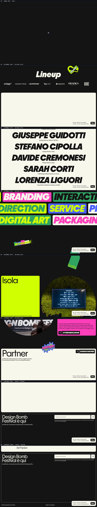
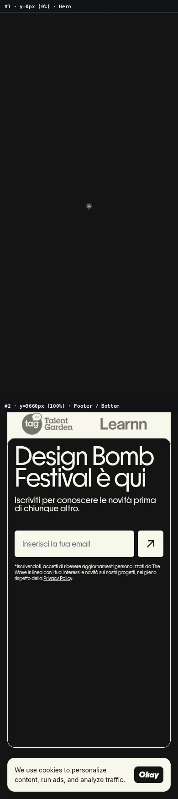

# UI Design System & Master Generation Blueprint: www-designbomb-it

> **Design Bomb Festival** (https://www.designbomb.it/) — The Wave presenta la nuova edizione di Design Bomb, che cresce e diventa festival. 22-23-24 Maggio, Catania.





---

## 1. Executive Visual Persona & Design Archetype

- **Brand Essence & Persona**: **Design Bomb Festival** (`https://www.designbomb.it/`). The Wave presenta la nuova edizione di Design Bomb, che cresce e diventa festival. 22-23-24 Maggio, Catania.
- **Capture Provenance**: Live browser capture (`tier2_webgl`, HTTP `200`, captured `2026-11-24`).
- **Visual Archetype**: **Dark-Substrate WebGL / Canvas Interactive Experience (`#141414` / `#0000ee`)**.
- **Anti-AI-Slop Differentiators**:
  - **Live-Computed Chromatic Polarity**: Anchors the viewport in `#141414` (live computed `body` `background-color` (`computed_styles.json`)) paired with `#f7f6eb` primary typography and `#0000ee` accents.
  - **Grounded Typographic Hierarchy**: Pairs `PP Frama Extrabold Italic` for display copy (`Design Bomb Festival`) with `PP Frama Regular`.
  - **Calibrated Spatial Grid & Motion**: Combines `1408px` container bounds (`gap: 24px`, padding `64px`) with `cubic-bezier(0.25,0.1,0.25,1)` easing and Lenis Smooth Scroll (`data-lenis`), Lottie Vector Animation Player.

---

## 2. Spatial Architecture & Modular Grid Mathematics

### Viewport Allocation & Container Geometry
- **Captured Journey Filmstrips**: Desktop `1280×6624px` (`assets/desktop-journey.webp`, `8` keyframes up to `y=9701px` / doc `10601px`), Mobile `390×1744px` (`assets/mobile-journey.webp`, `2` keyframes).
- **Master Container Bounds**: `1408px` (measured widest bounded `<section>` landmark width on `1440px` desktop).
- **Canvas Lateral Padding & Spacing**: `64px` lateral canvas padding with `24px` grid gap.
- **Border Radius Scale**: `6px`, `16px`, `9999px`, `30px`.

### Responsive Breakpoint Architecture
- **Desktop Layout**: Multi-column CSS Grid / Flexbox layout at `1440px` (`max-width: 1408px`, `gap: 24px`).
- **Mobile Layout**: Single-column vertical stack at `390px` viewport width with `64px` horizontal padding.
- **Extracted CSS Media Queries**: `@media (min-width: 1440px)`, `@media (min-width: 1200px) and (max-width: 1439.98px)`, `@media (min-width: 810px) and (max-width: 1199.98px)`, `@media (max-width: 809.98px)`.

---

## 3. Color System, Materiality & Atmospheric Lighting

### Semantic Palette & Source Grounding
| Semantic Role | Ground-Truth Value | Extracted Live / CSS Source |
|---|---|---|
| **Primary Canvas Substrate** | `#141414` | live computed `body` `background-color` (`computed_styles.json`) |
| **Primary Typography Ink** | `#f7f6eb` | live computed `p` `color` (`computed_styles.json`) |
| **Elevated Surface / Card Substrate** | `#ceff00` | `.framer-hw4kQ.framer-1zonqd { background-color: #ceff00 }` |
| **Interactive Accent / Highlight** | `#0000ee` | live computed `a` `color` (`computed_styles.json`) |
| **Secondary / Muted Copy** | `#000000` | live computed `body` `color` (`computed_styles.json`) |
| **Structural Hairline Border** | `#f7f6eb` | `var(--border-color)` in `:root` |
| **Variable Token (`--token-0689d26c-723f-45fc-b97a-089acbcfc796`)** | `#4a60ff` | `var(--token-0689d26c-723f-45fc-b97a-089acbcfc796)` in `:root` |
| **Variable Token (`--token-4809db6f-b397-4188-a942-074244c77dac`)** | `#ff3eba` | `var(--token-4809db6f-b397-4188-a942-074244c77dac)` in `:root` |
| **Variable Token (`--token-797c06e2-082b-4d59-9429-4a87c1a6bdd2`)** | `#31a362` | `var(--token-797c06e2-082b-4d59-9429-4a87c1a6bdd2)` in `:root` |

### Sanitized Root CSS Variables (`ui-ux.md` Ground Truth)
| Variable Name | Extracted Value | Semantic Role |
|---|---|---|
| `--token-0689d26c-723f-45fc-b97a-089acbcfc796` | `#4a60ff` | Color / Atmospheric Token |
| `--token-7cb9fefc-a8e8-4059-91ee-bd65906318ee` | `#ceff00` | Color / Atmospheric Token |
| `--token-4809db6f-b397-4188-a942-074244c77dac` | `#ff3eba` | Color / Atmospheric Token |
| `--token-797c06e2-082b-4d59-9429-4a87c1a6bdd2` | `#31a362` | Color / Atmospheric Token |
| `--token-f1aabd16-a90b-4a64-bd76-31330e5c4d0f` | `#f7f6eb` | Color / Atmospheric Token |
| `--token-cd7ed41b-0134-43b6-beec-bf340d65ac87` | `#141414` | Color / Atmospheric Token |
| `--token-8e1f8495-735c-4bc6-8090-6a9a9f74db16` | `#141414` | Color / Atmospheric Token |
| `--text-decoration-skip-ink` | `var(--framer-text-decoration-skip-ink)` | Typography Ink Token |
| `--text-underline-offset` | `var(--framer-text-decoration-offset)` | Typography Ink Token |
| `--font-family` | `var(--framer-font-family)` | Typography / Scale Token |
| `--font-style` | `var(--framer-font-style)` | Typography / Scale Token |
| `--font-weight` | `var(--framer-font-weight)` | Typography / Scale Token |
| `--text-color` | `var(--framer-text-color)` | Typography Ink Token |
| `--letter-spacing` | `var(--framer-letter-spacing)` | Typography / Scale Token |
| `--font-size` | `var(--framer-font-size)` | Typography / Scale Token |
| `--text-transform` | `var(--framer-text-transform)` | Typography Ink Token |

---

## 4. Typographic Scale & Editorial Hierarchy

### Font Family Stacks
- **Display Typography**: `PP Frama Extrabold Italic`.
- **Primary Body Stack**: `PP Frama Regular`.
- **Technical / Metadata Stack**: not declared in live computed styles (uses primary stack / `ui-monospace`).

### Typographic Scale & Rules (Live Computed & Stylesheet Grounded)
- **Hero Display (`H1`)**: observed font-size ladder: `12px`, `16px`, `var(--font-size)`, `var(--framer-font-size)`, `1px`.
- **Section Heading (`H2`)**: observed font-size ladder: `12px`, `16px`, `var(--font-size)`, `var(--framer-font-size)`, `1px`.
- **Body Copy**: live computed `body` (`font-size: 12px`, `line-height: normal`, `font-weight: 400`).
- **Metadata & Navigation Labels**: live computed `nav/a` (`font-size: 12px`, `line-height: normal`, `font-weight: 400`); CSS variables `--letter-spacing: var(--framer-letter-spacing)`.

---

## 5. Choreographed Motion & Interaction Physics

### Primary Easing Curves
- **Extracted Timing Functions**: `cubic-bezier(0.25,0.1,0.25,1)`.

### Per-Element Transition & Choreography Rules
- **Selector `#__framer-editorbar-label`**: `transition: opacity 0.4s ease-out` extracted from `www-designbomb-it` stylesheet.
- **Selector `style]`**: `transition: none` extracted from `www-designbomb-it` stylesheet.
- **Selector `style]`**: `transition: none` extracted from `www-designbomb-it` stylesheet.
- **Standard CSS Easing (`cubic-bezier(0.25,0.1,0.25,1)`)**: Default timing curve (no custom `cubic-bezier()` declared in captured CSS).
- **Runtime Interaction Engine**: Integrates Lenis Smooth Scroll (`data-lenis`), Lottie Vector Animation Player, Framer Motion Layout Physics, HTML5 `<canvas>` Interactive Viewport Surface with `prefers-reduced-motion: reduce` fallback guards.
### Measured Runtime Scroll & Interaction Telemetry (`behavioral_journey_v2`)
- **Scroll Driver Mode**: `native` (max document height `10601px`, deepest scrollY reached `9701px` across `8` desktop keyframes).
- **Detected Scroll / Motion Libraries**: `Lenis`, `Framer Motion`, `WebGL/Canvas`.

---

## 6. Component Wireframe & Structural DOM Map

### Visual Layout Schematic — Desktop (`1440px`, Grounded in `dom.html` & Landmark Bounding Boxes)
```
┌────────────────────────────────────────────────────────────────────────┐
│ DESKTOP VIEWPORT (1440px) — Design Bomb Festival                       │
│ ====================================================================== │
│ [ <header.lenis> (1440px)             | Programma · Workshop · camer ] │
│ ---------------------------------------------------------------------- │
│ | HERO STAGE: <section.framer-hw4kQ> (w=1440px)                      | │
│ | H1: Design Bomb Festival                                           | │
│ | Substrate: #141414 | Ink: #f7f6eb | Accent: #0000ee                | │
│ ---------------------------------------------------------------------- │
│ | SHOWCASE GRID (<section.framer-6q1hH>) max-w: 1408px               | │
│ | +------------------------------+  +------------------------------+ | │
│ | | Featured Work & Interactive  |  | Technical Architecture & Nar | | │
│ | +------------------------------+  +------------------------------+ | │
│ ---------------------------------------------------------------------- │
│ | DETAIL MODULE (<section.framer-LuCAZ>) — Global Directory & Co     | │
│ ---------------------------------------------------------------------- │
│ [ FOOTER (<footer.framer-1qs62) | https://www.designbomb.it/           │
└────────────────────────────────────────────────────────────────────────┘
```

### Visual Layout Schematic — Mobile Reflow (`390px`)
```
┌────────────────────────────────────────────────────────────────────────┐
│ MOBILE VIEWPORT REFLOW (390px) — Single-Column Stack (gap: 24px)       │
│ ====================================================================== │
│ [ HEADER BAR (<header.lenis>          ) | Compact Menu (390px)         │
│ ---------------------------------------------------------------------- │
│ | HERO STAGE (<section.framer-hw4kQ>) — 390px Vertical Lead          | │
│ | H1: Design Bomb Festival                                           | │
│ ---------------------------------------------------------------------- │
│ | SHOWCASE STACK (<section.framer-6q1hH>) — 1-Col Stack              | │
│ | [ Item 1: Featured Work & Interactive Showcase                   ] | │
│ | [ Item 2: Technical Architecture & Narrative                     ] | │
│ ---------------------------------------------------------------------- │
│ | DETAIL STACK (<section.framer-LuCAZ>) — 1-Col (Global Directory &) | │
│ ---------------------------------------------------------------------- │
│ [ FOOTER (<footer.framer-1qs62) | Stacked 390px Colophon               │
└────────────────────────────────────────────────────────────────────────┘
```

### Granular DOM Region Breakdown
1. **Brand Header & Navigation Bar (<header.lenis> — `www-designbomb-it`)**:
   - Landmark `<header class="lenis">` (`1440px`) hosting `Design Bomb Festival` navigation (`Programma · Workshop · cameretta · Shop · TICKET`), DOM attributes (`data-framer-font-css`, `data-framer-breakpoint-css`, `data-framer-css-ssr-minified`, `data-framer-components="framer-lib-cursors-ho..."`), and stylesheet rule `.hidden-16glhda { display:none!important }`.
2. **Hero Stage & Focal Lead (<section.framer-hw4kQ> — `Design Bomb Festival`)**:
   - Landmark `<section class="framer-hw4kQ">` presenting display lead `Design Bomb Festival` and copy excerpt *"Un festival per tutta la community"* over `#141414` canvas and `#f7f6eb` ink.
3. **Primary Showcase & Content Grid (<section.framer-6q1hH> — `Featured Work & Interactive Showca`)**:
   - Landmark `<section class="framer-6q1hH">` rendering section `Featured Work & Interactive Showcase` with copy *"Un festival per tutta"*, asset references (`CHxdCbEfx7lZs5B6CqTOXcfZQo.jpg`, `script`, `sNmVGd3Q3ckANl0dcx338qCTY4.png`, `yuFzZzaiq6SXFBvCqfED1Hgy4.png`), and grid rule `.hidden-1qs623s { display:none!important }`.
4. **Interactive Detail & Feature Matrix (<section.framer-LuCAZ> — `Technical Architecture & Narrative`)**:
   - Landmark `<section class="framer-LuCAZ">` framing `Technical Architecture & Narrative` and `Global Directory & Contact` (*"Tre giorni, tantissimi ospiti, centinaia di persone che respirano"*) with `#ceff00` surface cards, `#0000ee` accents, and `.hidden-1tdjaai { display:none!important }`.
5. **Colophon & Global Directory Footer (<footer.framer-1qs623s> — `https://www.designbomb.it/`)**:
   - Landmark `<footer class="framer-1qs623s">` anchoring `Design Bomb Festival` footer links (`Programma · Workshop · cameretta · Shop · TICKET`), copy *"Awwwards Studio of the Year / Enea Rossi, CEO, Co-Founder e "*, and `#f7f6eb` structural dividers.
### Full Vertical Scroll Sequence (Desktop `1440×900` Keyframes)
- **Step 01** (`y=0px`, `0%`): Active landmark `Hero` · sticky/fixed elements: `2`
- **Step 02** (`y=1700px`, `18%`): Active landmark `Section @ 18%` · sticky/fixed elements: `2`
- **Step 03** (`y=3400px`, `35%`): Active landmark `Section @ 35%` · sticky/fixed elements: `2`
- **Step 04** (`y=5100px`, `53%`): Active landmark `Section @ 53%` · sticky/fixed elements: `2`
- **Step 05** (`y=5950px`, `61%`): Active landmark `Section @ 61%` · sticky/fixed elements: `2`
- **Step 06** (`y=7650px`, `79%`): Active landmark `Section @ 79%` · sticky/fixed elements: `2`
- **Step 07** (`y=9350px`, `96%`): Active landmark `Footer / Bottom` · sticky/fixed elements: `2`
- **Step 08** (`y=9701px`, `100%`): Active landmark `Footer / Bottom` · sticky/fixed elements: `2`

---

## 7. Master Zero-Shot AI Generation Prompt

```markdown
# Master Zero-Shot Frontend Generation Prompt: www-designbomb-it (Design Bomb Festival)

You are a principal frontend architect and design systems engineer. Build a complete, production-ready web application replicating the exact design system, DOM landmarks, typographic hierarchy, color tokens, and motion physics of `www-designbomb-it` (**Design Bomb Festival** — `https://www.designbomb.it/`).

### 1. Visual Archetype & Anti-AI-Slop Mandates
- **Archetype**: Dark-Substrate WebGL / Canvas Interactive Experience (`#141414` / `#0000ee`).
- **Identity & Domain Context**: The Wave presenta la nuova edizione di Design Bomb, che cresce e diventa festival. 22-23-24 Maggio, Catania.
- **Primary Substrate**: `#141414` (live computed `body` `background-color` (`computed_styles.json`)), **Primary Ink**: `#f7f6eb`, **Accent / Highlight**: `#0000ee`.
- **Site-Specific Differentiators**:
  - **Live-Computed Chromatic Polarity**: Anchors the viewport in `#141414` (live computed `body` `background-color` (`computed_styles.json`)) paired with `#f7f6eb` primary typography and `#0000ee` accents.
  - **Grounded Typographic Hierarchy**: Pairs `PP Frama Extrabold Italic` for display copy (`Design Bomb Festival`) with `PP Frama Regular`.
  - **Calibrated Spatial Grid & Motion**: Combines `1408px` container bounds (`gap: 24px`, padding `64px`) with `cubic-bezier(0.25,0.1,0.25,1)` easing and Lenis Smooth Scroll (`data-lenis`), Lottie Vector Animation Player.

### 2. Ground-Truth CSS Variables (`:root` Token Contract)
Declare and consume these exact custom properties extracted from `www-designbomb-it` in your global stylesheet:

:root {
  /* Design Bomb Festival (www-designbomb-it) — Live-Grounded CSS Variables */
  --token-0689d26c-723f-45fc-b97a-089acbcfc796: #4a60ff; /* Color / Atmospheric Token (www-designbomb-it) */
  --token-7cb9fefc-a8e8-4059-91ee-bd65906318ee: #ceff00; /* Color / Atmospheric Token (www-designbomb-it) */
  --token-4809db6f-b397-4188-a942-074244c77dac: #ff3eba; /* Color / Atmospheric Token (www-designbomb-it) */
  --token-797c06e2-082b-4d59-9429-4a87c1a6bdd2: #31a362; /* Color / Atmospheric Token (www-designbomb-it) */
  --token-f1aabd16-a90b-4a64-bd76-31330e5c4d0f: #f7f6eb; /* Color / Atmospheric Token (www-designbomb-it) */
  --token-cd7ed41b-0134-43b6-beec-bf340d65ac87: #141414; /* Color / Atmospheric Token (www-designbomb-it) */
  --token-8e1f8495-735c-4bc6-8090-6a9a9f74db16: #141414; /* Color / Atmospheric Token (www-designbomb-it) */
  --text-decoration-skip-ink: var(--framer-text-decoration-skip-ink); /* Typography Ink Token (www-designbomb-it) */
  --text-underline-offset: var(--framer-text-decoration-offset); /* Typography Ink Token (www-designbomb-it) */
  --font-family: var(--framer-font-family); /* Typography / Scale Token (www-designbomb-it) */
  --font-style: var(--framer-font-style); /* Typography / Scale Token (www-designbomb-it) */
  --font-weight: var(--framer-font-weight); /* Typography / Scale Token (www-designbomb-it) */
  --text-color: var(--framer-text-color); /* Typography Ink Token (www-designbomb-it) */
  --letter-spacing: var(--framer-letter-spacing); /* Typography / Scale Token (www-designbomb-it) */
  --font-size: var(--framer-font-size); /* Typography / Scale Token (www-designbomb-it) */
  --text-transform: var(--framer-text-transform); /* Typography Ink Token (www-designbomb-it) */
}

### 3. Semantic Color & Materiality Contract
Map every surface, ink, and border strictly to these source-grounded tokens:
- **Primary Canvas Substrate**: `#141414` — grounded in live computed `body` `background-color` (`computed_styles.json`)
- **Primary Typography Ink**: `#f7f6eb` — grounded in live computed `p` `color` (`computed_styles.json`)
- **Elevated Surface / Card Substrate**: `#ceff00` — grounded in `.framer-hw4kQ.framer-1zonqd { background-color: #ceff00 }`
- **Interactive Accent / Highlight**: `#0000ee` — grounded in live computed `a` `color` (`computed_styles.json`)
- **Secondary / Muted Copy**: `#000000` — grounded in live computed `body` `color` (`computed_styles.json`)
- **Structural Hairline Border**: `#f7f6eb` — grounded in `var(--border-color)` in `:root`
- **Variable Token (`--token-0689d26c-723f-45fc-b97a-089acbcfc796`)**: `#4a60ff` — grounded in `var(--token-0689d26c-723f-45fc-b97a-089acbcfc796)` in `:root`
- **Variable Token (`--token-4809db6f-b397-4188-a942-074244c77dac`)**: `#ff3eba` — grounded in `var(--token-4809db6f-b397-4188-a942-074244c77dac)` in `:root`
- **Variable Token (`--token-797c06e2-082b-4d59-9429-4a87c1a6bdd2`)**: `#31a362` — grounded in `var(--token-797c06e2-082b-4d59-9429-4a87c1a6bdd2)` in `:root`

### 4. Spatial Grid, Container Bounds & Responsive Breakpoints
- **Desktop Viewport Reference**: `1280×6624px` (multi-frame vertical journey filmstrip (6624px), `1440px` standard desktop width).
- **Mobile Viewport Reference**: `390×1744px` (full-page live capture (1744px), `390px` standard mobile width).
- **Container Max-Width**: `1408px` (measured widest bounded `<section>` landmark width on `1440px` desktop)
- **Padding & Gutters**: `64px` lateral canvas padding with `24px` grid gap
- **Desktop Grid**: Multi-column CSS Grid / Flexbox layout at `1440px` (`max-width: 1408px`, `gap: 24px`)
- **Mobile Adaptation**: Single-column vertical stack at `390px` viewport width with `64px` horizontal padding
- **Media Queries**: `@media (min-width: 1440px)`, `@media (min-width: 1200px) and (max-width: 1439.98px)`, `@media (min-width: 810px) and (max-width: 1199.98px)`, `@media (max-width: 809.98px)`
- **Corner Radii**: `6px`, `16px`, `9999px`, `30px`

### 5. Typography & Editorial Scale Contract
- **Display Font Stack**: `PP Frama Extrabold Italic`
- **Body Font Stack**: `PP Frama Regular`
- **Monospace / Technical Font Stack**: not declared in live computed styles (uses primary stack / `ui-monospace`)
- **H1 Display Rule**: observed font-size ladder: `12px`, `16px`, `var(--font-size)`, `var(--framer-font-size)`, `1px`
- **H2 Section Rule**: observed font-size ladder: `12px`, `16px`, `var(--font-size)`, `var(--framer-font-size)`, `1px`
- **Body Copy Rule**: live computed `body` (`font-size: 12px`, `line-height: normal`, `font-weight: 400`)
- **Metadata & Index Rule**: live computed `nav/a` (`font-size: 12px`, `line-height: normal`, `font-weight: 400`); CSS variables `--letter-spacing: var(--framer-letter-spacing)`

### 6. Component Hierarchy, Verbatim Copy & Real DOM Landmarks
Scaffold `www-designbomb-it` (`Design Bomb Festival`) with these exact structural regions, extracted copy, and CSS rules from `dom.html`:
1. **Brand Header & Navigation Bar (<header.lenis> — `www-designbomb-it`)**:
   - DOM & Selectors: Landmark `<header class="lenis">` (`1440px`) hosting `Design Bomb Festival` navigation (`Programma · Workshop · cameretta · Shop · TICKET`), DOM attributes (`data-framer-font-css`, `data-framer-breakpoint-css`, `data-framer-css-ssr-minified`, `data-framer-components="framer-lib-cursors-ho..."`), and stylesheet rule `.hidden-16glhda { display:none!important }`.
   - Responsive Contract: Header `Brand Header & Navigation Bar (<header.lenis> — `www-designbomb-it`)` (`www-designbomb-it`) adapts across `@media (min-width: 1440px)`, `@media (min-width: 1200px) and (max-width: 1439.98px)`, `@media (min-width: 810px) and (max-width: 1199.98px)`, `@media (max-width: 809.98px)` with `cubic-bezier(0.25,0.1,0.25,1)` transitions and links `Programma · Workshop · cameretta · Shop · TICKET`.
2. **Hero Stage & Focal Lead (<section.framer-hw4kQ> — `Design Bomb Festival`)**:
   - DOM & Selectors: Landmark `<section class="framer-hw4kQ">` presenting display lead `Design Bomb Festival` and copy excerpt *"Un festival per tutta la community"* over `#141414` canvas and `#f7f6eb` ink.
   - Responsive Contract: Hero stage (`1280×6624px` desktop / `390×1744px` mobile) sets `#141414` background with `#f7f6eb` headline `Design Bomb Festival`.
3. **Primary Showcase & Content Grid (<section.framer-6q1hH> — `Featured Work & Interactive Showca`)**:
   - DOM & Selectors: Landmark `<section class="framer-6q1hH">` rendering section `Featured Work & Interactive Showcase` with copy *"Un festival per tutta"*, asset references (`CHxdCbEfx7lZs5B6CqTOXcfZQo.jpg`, `script`, `sNmVGd3Q3ckANl0dcx338qCTY4.png`, `yuFzZzaiq6SXFBvCqfED1Hgy4.png`), and grid rule `.hidden-1qs623s { display:none!important }`.
   - Responsive Contract: Showcase grid `Primary Showcase & Content Grid (<section.framer-6q1hH> — `Featured Work & Interactive Showca`)` applies Multi-column CSS Grid / Flexbox layout at `1440px` (`max-width: 1408px`, `gap: 24px`) on desktop and Single-column vertical stack at `390px` viewport width with `64px` horizontal padding on mobile.
4. **Interactive Detail & Feature Matrix (<section.framer-LuCAZ> — `Technical Architecture & Narrative`)**:
   - DOM & Selectors: Landmark `<section class="framer-LuCAZ">` framing `Technical Architecture & Narrative` and `Global Directory & Contact` (*"Tre giorni, tantissimi ospiti, centinaia di persone che respirano"*) with `#ceff00` surface cards, `#0000ee` accents, and `.hidden-1tdjaai { display:none!important }`.
   - Responsive Contract: Detail module `Interactive Detail & Feature Matrix (<section.framer-LuCAZ> — `Technical Architecture & Narrative`)` uses `6px`, `16px`, `9999px`, `30px` radii, `#0000ee` highlights, and assets (CHxdCbEfx7lZs5B6CqTOXcfZQo.jpg, script, sNmVGd3Q3ckANl0dcx338qCTY4.png).
5. **Colophon & Global Directory Footer (<footer.framer-1qs623s> — `https://www.designbomb.it/`)**:
   - DOM & Selectors: Landmark `<footer class="framer-1qs623s">` anchoring `Design Bomb Festival` footer links (`Programma · Workshop · cameretta · Shop · TICKET`), copy *"Awwwards Studio of the Year / Enea Rossi, CEO, Co-Founder e "*, and `#f7f6eb` structural dividers.
   - Responsive Contract: Footer `Colophon & Global Directory Footer (<footer.framer-1qs623s> — `https://www.designbomb.it/`)` aligns to `1408px` (measured widest bounded `<section>` landmark width on `1440px` desktop) with `64px` lateral canvas padding with `24px` grid gap and attributes (data-framer-font-css, data-framer-breakpoint-css, data-framer-css-ssr-minified).

#### Verbatim DOM Copy Excerpts (`dom.html`)
- Copy Excerpt 1: *"Un festival per tutta la community"*
- Copy Excerpt 2: *"Un festival per tutta"*
- Copy Excerpt 3: *"Tre giorni, tantissimi ospiti, centinaia di persone che respirano la stessa aria...."*
- Copy Excerpt 4: *"Awwwards Studio of the Year / Enea Rossi, CEO, Co-Founder e Creative Partner"*

### 7. Motion, Extracted Stylesheet Rules & Interaction Choreography
- **Primary Easing Functions**: `cubic-bezier(0.25,0.1,0.25,1)`
- **Extracted Stylesheet Rules (`www-designbomb-it`)**:
- `.hidden-16glhda { display:none!important }`
- `.hidden-1qs623s { display:none!important }`
- `.hidden-1tdjaai { display:none!important }`
- `.hidden-tzhh5x { display:none!important }`
- `main { box-sizing:border-box;margin:0;padding:0 }`
- **Per-Selector Transition Rules**:
- **Selector `#__framer-editorbar-label`**: `transition: opacity 0.4s ease-out` extracted from `www-designbomb-it` stylesheet.
- **Selector `style]`**: `transition: none` extracted from `www-designbomb-it` stylesheet.
- **Selector `style]`**: `transition: none` extracted from `www-designbomb-it` stylesheet.
- **Standard CSS Easing (`cubic-bezier(0.25,0.1,0.25,1)`)**: Default timing curve (no custom `cubic-bezier()` declared in captured CSS).
- **Runtime Interaction Engine**: Integrates Lenis Smooth Scroll (`data-lenis`), Lottie Vector Animation Player, Framer Motion Layout Physics, HTML5 `<canvas>` Interactive Viewport Surface with `prefers-reduced-motion: reduce` fallback guards.
### 7b. Full-Page Scroll Choreography, Interactive States & Multi-Page Routes
- **Scroll Mechanics**: Implement `native` vertical progression up to `10601px` across 8 distinct viewport chapters using Lenis, Framer Motion, WebGL/Canvas.
- **Vertical Chapter Sequence**: Hero (0%) -> Section @ 18% (18%) -> Section @ 35% (35%) -> Section @ 53% (53%) -> Section @ 61% (61%) -> Section @ 79% (79%) -> Footer / Bottom (96%) -> Footer / Bottom (100%).

### 8. Technical Deliverables
- Implement in Next.js (App Router) with TypeScript and Tailwind CSS consuming the `:root` custom properties defined above for `www-designbomb-it`.
- Reproduce both the `1440px` desktop architecture and `390px` mobile breakpoint transitions, preserving semantic HTML5 landmarks (`<header>`, `<nav>`, `<main>`, `<section>`, `<footer>`) and `prefers-reduced-motion` accessibility guards.
```
---

## 8. Full-Page Scroll Journey, Interactive States & Subpage Inventory

### Desktop Scroll Keyframes (`1440×900` WebP)
| Step | Scroll Y | Progress | Active Landmark / Section | Sticky/Fixed | Visual Asset |
| :---: | :---: | :---: | :--- | :---: | :--- |
| `#01` | `0px` | `0%` | Hero | `2` | [desktop-step-01.webp](assets/desktop-step-01.webp) |
| `#02` | `1700px` | `18%` | Section @ 18% | `2` | [desktop-step-02.webp](assets/desktop-step-02.webp) |
| `#03` | `3400px` | `35%` | Section @ 35% | `2` | [desktop-step-03.webp](assets/desktop-step-03.webp) |
| `#04` | `5100px` | `53%` | Section @ 53% | `2` | [desktop-step-04.webp](assets/desktop-step-04.webp) |
| `#05` | `5950px` | `61%` | Section @ 61% | `2` | [desktop-step-05.webp](assets/desktop-step-05.webp) |
| `#06` | `7650px` | `79%` | Section @ 79% | `2` | [desktop-step-06.webp](assets/desktop-step-06.webp) |
| `#07` | `9350px` | `96%` | Footer / Bottom | `2` | [desktop-step-07.webp](assets/desktop-step-07.webp) |
| `#08` | `9701px` | `100%` | Footer / Bottom | `2` | [desktop-step-08.webp](assets/desktop-step-08.webp) |

### Mobile Condensed Keyframes (`390×844` WebP)
| Step | Scroll Y | Progress | Active Landmark | Visual Asset |
| :---: | :---: | :---: | :--- | :--- |
| `#01` | `0px` | `0%` | Hero | [mobile-step-01.webp](assets/mobile-step-01.webp) |
| `#02` | `9660px` | `100%` | Footer / Bottom | [mobile-step-02.webp](assets/mobile-step-02.webp) |

