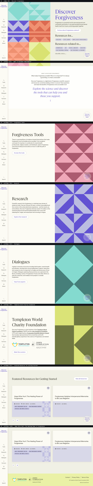
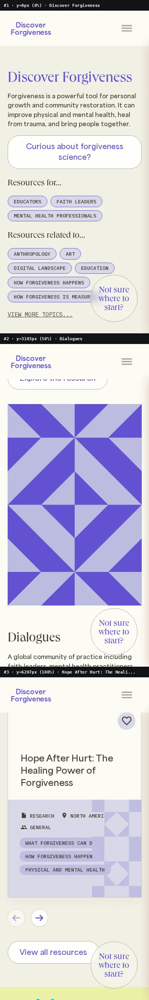

# UI Design System & Master Generation Blueprint: www-discoverforgiveness-org

> **Discover Forgiveness · Templeton World Charity Foundation** (https://www.discoverforgiveness.org/) — Explore the transformative power of forgiveness at Discover Forgiveness. Our experts, from psychologists to spiritual leaders, offer insi...





---

## 1. Executive Visual Persona & Design Archetype

- **Brand Essence & Persona**: **Discover Forgiveness · Templeton World Charity Foundation** (`https://www.discoverforgiveness.org/`). Explore the transformative power of forgiveness at Discover Forgiveness. Our experts, from psychologists to spiritual leaders, offer insi...
- **Capture Provenance**: Live browser capture (`tier1_fast`, HTTP `200`, captured `2026-11-24`).
- **Visual Archetype**: **Light-Substrate Editorial & Modular Grid System (`#fefefb` canvas, `#433f35` ink, `#0082f3` accent)**.
- **Anti-AI-Slop Differentiators**:
  - **Live-Computed Chromatic Polarity**: Anchors the viewport in `#fefefb` (live computed `body` `background-color` (`computed_styles.json`)) paired with `#433f35` primary typography and `#0082f3` accents.
  - **Grounded Typographic Hierarchy**: Pairs `Queens` for display copy (`Discover Forgiveness`) with `Area Normal` and `IBM Plex Mono`.
  - **Calibrated Spatial Grid & Motion**: Combines `1320px` container bounds (`gap: 16px`, padding `9px`) with `cubic-bezier(.445,.05,.55,.95)` easing and Swiper Touch Carousel Engine, Lottie Vector Animation Player.

---

## 2. Spatial Architecture & Modular Grid Mathematics

### Viewport Allocation & Container Geometry
- **Captured Journey Filmstrips**: Desktop `1280×6624px` (`assets/desktop-journey.webp`, `8` keyframes up to `y=5343px` / doc `6243px`), Mobile `390×2616px` (`assets/mobile-journey.webp`, `3` keyframes).
- **Master Container Bounds**: `1320px` (measured widest bounded `<section>` landmark width on `1440px` desktop).
- **Canvas Lateral Padding & Spacing**: `9px` lateral canvas padding with `16px` grid gap.
- **Border Radius Scale**: `3px`, `100%`, `50%`, `2px`.

### Responsive Breakpoint Architecture
- **Desktop Layout**: Multi-column CSS Grid / Flexbox layout at `1440px` (`max-width: 1320px`, `gap: 16px`).
- **Mobile Layout**: Single-column vertical stack at `390px` viewport width with `9px` horizontal padding.
- **Extracted CSS Media Queries**: `@media screen and (max-width: 991px)`, `@media screen and (max-width: 767px)`, `@media screen and (max-width: 479px)`, `@media (min-width: 768px)`.

---

## 3. Color System, Materiality & Atmospheric Lighting

### Semantic Palette & Source Grounding
| Semantic Role | Ground-Truth Value | Extracted Live / CSS Source |
|---|---|---|
| **Primary Canvas Substrate** | `#fefefb` | live computed `body` `background-color` (`computed_styles.json`) |
| **Primary Typography Ink** | `#433f35` | live computed `body` `color` (`computed_styles.json`) |
| **Elevated Surface / Card Substrate** | `#f0f0e5` | live computed `header` `background-color` (`computed_styles.json`) |
| **Interactive Accent / Highlight** | `#0082f3` | `.w-dropdown-link.w--current { color: #0082f3 }` |
| **Secondary / Muted Copy** | `#6251d2` | live computed `h1` `color` (`computed_styles.json`) |
| **Structural Hairline Border** | `#e2e2e2` | `blockquote { border-left: #e2e2e2 }` |
| **Variable Token (`--tan5`)** | `#abaa9c` | `var(--tan5)` in `:root` |
| **Variable Token (`--tan`)** | `#fbfaf4` | `var(--tan)` in `:root` |
| **Variable Token (`--purple_transp`)** | `#8170f0` | `var(--purple_transp)` in `:root` |
| **Variable Token (`--dk-gray`)** | `#777269` | `var(--dk-gray)` in `:root` |
| **Variable Token (`--tan4`)** | `#cbc8be` | `var(--tan4)` in `:root` |
| **Variable Token (`--tan3`)** | `#e2e2d5` | `var(--tan3)` in `:root` |
| **Variable Token (`--transparent`)** | `#0000` | `var(--transparent)` in `:root` |
| **Variable Token (`--purple1`)** | `#d8d8e9` | `var(--purple1)` in `:root` |
| **Variable Token (`--purple2`)** | `#bfbee0` | `var(--purple2)` in `:root` |
| **Variable Token (`--pear2`)** | `#d9e273` | `var(--pear2)` in `:root` |

### Sanitized Root CSS Variables (`ui-ux.md` Ground Truth)
| Variable Name | Extracted Value | Semantic Role |
|---|---|---|
| `--off-white` | `#fefefb` | Canvas / Surface Token |
| `--dark` | `#433f35` | Canvas / Surface Token |
| `--purple3` | `#6251d2` | Color / Atmospheric Token |
| `--black` | `black` | Canvas / Surface Token |
| `--white` | `white` | Canvas / Surface Token |
| `--tan5` | `#abaa9c` | Color / Atmospheric Token |
| `--tan` | `#fbfaf4` | Color / Atmospheric Token |
| `--purple_transp` | `#8170f033` | Color / Atmospheric Token |
| `--dk-gray` | `#777269` | Color / Atmospheric Token |
| `--tan4` | `#cbc8be` | Color / Atmospheric Token |
| `--tan3` | `#e2e2d5` | Color / Atmospheric Token |
| `--tan2` | `#f0f0e5` | Color / Atmospheric Token |
| `--transparent` | `#0000` | Color / Atmospheric Token |
| `--purple1` | `#d8d8e9` | Color / Atmospheric Token |
| `--purple2` | `#bfbee0` | Color / Atmospheric Token |
| `--pear2` | `#d9e273` | Color / Atmospheric Token |

---

## 4. Typographic Scale & Editorial Hierarchy

### Font Family Stacks
- **Display Typography**: `Queens`.
- **Primary Body Stack**: `Area Normal`.
- **Technical / Metadata Stack**: `IBM Plex Mono`.

### Typographic Scale & Rules (Live Computed & Stylesheet Grounded)
- **Hero Display (`H1`)**: live computed `h1` (`font-size: 89.8064px`, `line-height: 89.8064px`, `font-weight: 400`); rule `h1` (`font-size: 2em`).
- **Section Heading (`H2`)**: live computed `h2` (`font-size: 67.3548px`, `line-height: 80.8258px`, `font-weight: 400`); rule `h2` (`font-size: 32px`, `line-height: 36px`).
- **Body Copy**: live computed `body` (`font-size: 14.9677px`, `line-height: 22.4516px`, `font-weight: 400`); rule `body` (`font-size: 14px`, `line-height: 20px`).
- **Metadata & Navigation Labels**: live computed `nav/a` (`font-size: 16.8387px`, `line-height: 18.5226px`, `font-weight: 800`); rule `small` (`font-size: 80%`).

---

## 5. Choreographed Motion & Interaction Physics

### Primary Easing Curves
- **Extracted Timing Functions**: `cubic-bezier(.445,.05,.55,.95)`.

### Per-Element Transition & Choreography Rules
- **Selector `.w-webflow-badge > img`**: `transition: unset` extracted from `www-discoverforgiveness-org` stylesheet.
- **Selector `.w-slider-dot`**: `transition: background-color .1s, color .1s` extracted from `www-discoverforgiveness-org` stylesheet.
- **Selector `.w-lightbox-control`**: `transition: all .3s` extracted from `www-discoverforgiveness-org` stylesheet.
- **Extracted Easing Curve (`cubic-bezier(.445,.05,.55,.95)`)**: Governs interactive state transitions across `<header.section_header37>` and `<section.section_layout349>`.
- **Runtime Interaction Engine**: Integrates Swiper Touch Carousel Engine, Lottie Vector Animation Player with `prefers-reduced-motion: reduce` fallback guards.
### Measured Runtime Scroll & Interaction Telemetry (`behavioral_journey_v2`)
- **Scroll Driver Mode**: `native` (max document height `6243px`, deepest scrollY reached `5343px` across `8` desktop keyframes).
- **Detected Scroll / Motion Libraries**: Native browser scroll / standard CSS transitions.
- **Hover Physics (`primary_cta` · `Curious about forgiveness science?`)**: `borderColor`: `rgb(171, 170, 156)` -> `rgb(98, 81, 210)` (`transition-duration: 0.25s`, `timing: ease`).
- **Route Transition Architecture**: First internal navigation (`/resources/hope-after-hurt-the-healing-power-of-forgiveness`) measured as `direct` in `648ms`.

---

## 6. Component Wireframe & Structural DOM Map

### Visual Layout Schematic — Desktop (`1440px`, Grounded in `dom.html` & Landmark Bounding Boxes)
```
┌────────────────────────────────────────────────────────────────────────┐
│ DESKTOP VIEWPORT (1440px) — Discover Forgiveness · Templeton World Cha │
│ ====================================================================== │
│ [ <header.section_header (1320x900px) | Educators · Faith Leaders ·  ] │
│ ---------------------------------------------------------------------- │
│ | HERO STAGE: <section.section_layout134> (w=1440px)                 | │
│ | H1: Discover Forgiveness                                           | │
│ | Substrate: #fefefb | Ink: #433f35 | Accent: #0082f3                | │
│ ---------------------------------------------------------------------- │
│ | SHOWCASE GRID (<section.section_layout349) max-w: 1320px           | │
│ | +------------------------------+  +------------------------------+ | │
│ | | What is Discover forgiveness |  | In this section, you will fi | | │
│ | +------------------------------+  +------------------------------+ | │
│ ---------------------------------------------------------------------- │
│ | DETAIL MODULE (<section.section_blog41>) — Forgiveness is a powe   | │
│ ---------------------------------------------------------------------- │
│ [ FOOTER (<footer.footer3_comp) | https://www.discoverforgiveness.org  │
└────────────────────────────────────────────────────────────────────────┘
```

### Visual Layout Schematic — Mobile Reflow (`390px`)
```
┌────────────────────────────────────────────────────────────────────────┐
│ MOBILE VIEWPORT REFLOW (390px) — Single-Column Stack (gap: 16px)       │
│ ====================================================================== │
│ [ HEADER BAR (<header.section_header37) | Compact Menu (390px)         │
│ ---------------------------------------------------------------------- │
│ | HERO STAGE (<section.section_layout1) — 390px Vertical Lead        | │
│ | H1: Discover Forgiveness                                           | │
│ ---------------------------------------------------------------------- │
│ | SHOWCASE STACK (<section.section_layou) — 1-Col Stack              | │
│ | [ Item 1: What is Discover forgiveness?                          ] | │
│ | [ Item 2: In this section, you will find videos from past        ] | │
│ ---------------------------------------------------------------------- │
│ | DETAIL STACK (<section.section_blog41>) — 1-Col (Forgiveness is a p) │
│ ---------------------------------------------------------------------- │
│ [ FOOTER (<footer.footer3_comp) | Stacked 390px Colophon               │
└────────────────────────────────────────────────────────────────────────┘
```

### Granular DOM Region Breakdown
1. **Brand Header & Navigation Bar (<header.section_header37> — `www-discoverforgiveness-org`)**:
   - Landmark `<header class="section_header37">` (`1320x900px`) hosting `Discover Forgiveness · Templeton Wor` navigation (`Educators · Faith Leaders · Anthropology · Art · Digital Landscape`), DOM attributes (`data-wf-domain="www.discoverforgivene..."`, `data-wf-page="64b81f977202559487efb8c0"`, `data-wf-site="64b81f977202559487efb843"`, `data-animation="default"`), and stylesheet rule `html { -webkit-text-size-adjust: 100%; -ms-text-size-adjust: 100%; font-family:... }`.
2. **Hero Stage & Focal Lead (<section.section_layout134> — `Discover Forgiveness`)**:
   - Landmark `<section class="section_layout134">` presenting display lead `Discover Forgiveness` and copy excerpt *"Frontline workers include mental health professionals, faith lead"* over `#fefefb` canvas and `#433f35` ink.
3. **Primary Showcase & Content Grid (<section.section_layout349> — `What is Discover forgiveness?`)**:
   - Landmark `<section class="section_layout349">` rendering section `What is Discover forgiveness?` with copy *"In this section, you will find videos from past Forgiveness Forum"*, asset references (`cdn.prod.website-files.com`, `discover-forgiveness.webflow.shar...`, `fonts.googleapis.com`, `fonts.gstatic.com`), and grid rule `body { margin: 0; }`.
4. **Interactive Detail & Feature Matrix (<section.section_blog41> — `In this section, you will find vid`)**:
   - Landmark `<section class="section_blog41">` framing `In this section, you will find videos from past ` and `Forgiveness is a powerful tool for personal grow` (*"Forgiveness is a powerful tool for personal growth and community "*) with `#f0f0e5` surface cards, `#0082f3` accents, and `summary { display: block; }`.
5. **Colophon & Global Directory Footer (<footer.footer3_component> — `https://www.discoverforgiveness.org/`)**:
   - Landmark `<footer class="footer3_component">` anchoring `Discover Forgiveness · Templeton` footer links (`Educators · Faith Leaders · Anthropology · Art · Digital Landscape`), copy *"What makes forgiveness possible? Why is it so important? Is "*, and `#e2e2e2` structural dividers.
### Full Vertical Scroll Sequence (Desktop `1440×900` Keyframes)
- **Step 01** (`y=0px`, `0%`): Active landmark `Discover Forgiveness` · sticky/fixed elements: `4`
- **Step 02** (`y=850px`, `16%`): Active landmark `WHAT IS DISCOVER FORGIVENESS?` · sticky/fixed elements: `4`
- **Step 03** (`y=1700px`, `32%`): Active landmark `Forgiveness Tools` · sticky/fixed elements: `4`
- **Step 04** (`y=2550px`, `48%`): Active landmark `Research` · sticky/fixed elements: `4`
- **Step 05** (`y=3400px`, `64%`): Active landmark `Dialogues` · sticky/fixed elements: `4`
- **Step 06** (`y=4250px`, `80%`): Active landmark `Templeton World Charity Foundation` · sticky/fixed elements: `4`
- **Step 07** (`y=5100px`, `95%`): Active landmark `Featured Resources for Getting Started` · sticky/fixed elements: `4`
- **Step 08** (`y=5343px`, `100%`): Active landmark `Hope After Hurt: The Healing Power of Forgiveness` · sticky/fixed elements: `4`

### Multi-Page Internal Route Map
- **Detail Route (`/resources/hope-after-hurt-the-healing-power-of-forgiveness`)**: `https://www.discoverforgiveness.org/resources/hope-after-hurt-the-healing-power-of-forgiveness` — H1: `Hope After Hurt: The Healing Power of Forgiveness`, scrollHeight `2058px`, transition `direct` (`648ms`)
- **Detail Route (`/resources/forgiveness-updates-interpersonal-memories-to-be-less-negative`)**: `https://www.discoverforgiveness.org/resources/forgiveness-updates-interpersonal-memories-to-be-less-negative` — H1: `Forgiveness Updates Interpersonal Memories to Be...`, scrollHeight `1565px`, transition `direct` (`768ms`)

---

## 7. Master Zero-Shot AI Generation Prompt

```markdown
# Master Zero-Shot Frontend Generation Prompt: www-discoverforgiveness-org (Discover Forgiveness · Templeton World Charity Foundation)

You are a principal frontend architect and design systems engineer. Build a complete, production-ready web application replicating the exact design system, DOM landmarks, typographic hierarchy, color tokens, and motion physics of `www-discoverforgiveness-org` (**Discover Forgiveness · Templeton World Charity Foundation** — `https://www.discoverforgiveness.org/`).

### 1. Visual Archetype & Anti-AI-Slop Mandates
- **Archetype**: Light-Substrate Editorial & Modular Grid System (`#fefefb` canvas, `#433f35` ink, `#0082f3` accent).
- **Identity & Domain Context**: Explore the transformative power of forgiveness at Discover Forgiveness. Our experts, from psychologists to spiritual leaders, offer insi...
- **Primary Substrate**: `#fefefb` (live computed `body` `background-color` (`computed_styles.json`)), **Primary Ink**: `#433f35`, **Accent / Highlight**: `#0082f3`.
- **Site-Specific Differentiators**:
  - **Live-Computed Chromatic Polarity**: Anchors the viewport in `#fefefb` (live computed `body` `background-color` (`computed_styles.json`)) paired with `#433f35` primary typography and `#0082f3` accents.
  - **Grounded Typographic Hierarchy**: Pairs `Queens` for display copy (`Discover Forgiveness`) with `Area Normal` and `IBM Plex Mono`.
  - **Calibrated Spatial Grid & Motion**: Combines `1320px` container bounds (`gap: 16px`, padding `9px`) with `cubic-bezier(.445,.05,.55,.95)` easing and Swiper Touch Carousel Engine, Lottie Vector Animation Player.

### 2. Ground-Truth CSS Variables (`:root` Token Contract)
Declare and consume these exact custom properties extracted from `www-discoverforgiveness-org` in your global stylesheet:

:root {
  /* Discover Forgiveness · Templeton World Charity Foundation (www-discoverforgiveness-org) — Live-Grounded CSS Variables */
  --off-white: #fefefb; /* Canvas / Surface Token (www-discoverforgiveness-org) */
  --dark: #433f35; /* Canvas / Surface Token (www-discoverforgiveness-org) */
  --purple3: #6251d2; /* Color / Atmospheric Token (www-discoverforgiveness-org) */
  --black: black; /* Canvas / Surface Token (www-discoverforgiveness-org) */
  --white: white; /* Canvas / Surface Token (www-discoverforgiveness-org) */
  --tan5: #abaa9c; /* Color / Atmospheric Token (www-discoverforgiveness-org) */
  --tan: #fbfaf4; /* Color / Atmospheric Token (www-discoverforgiveness-org) */
  --purple_transp: #8170f033; /* Color / Atmospheric Token (www-discoverforgiveness-org) */
  --dk-gray: #777269; /* Color / Atmospheric Token (www-discoverforgiveness-org) */
  --tan4: #cbc8be; /* Color / Atmospheric Token (www-discoverforgiveness-org) */
  --tan3: #e2e2d5; /* Color / Atmospheric Token (www-discoverforgiveness-org) */
  --tan2: #f0f0e5; /* Color / Atmospheric Token (www-discoverforgiveness-org) */
  --transparent: #0000; /* Color / Atmospheric Token (www-discoverforgiveness-org) */
  --purple1: #d8d8e9; /* Color / Atmospheric Token (www-discoverforgiveness-org) */
  --purple2: #bfbee0; /* Color / Atmospheric Token (www-discoverforgiveness-org) */
  --pear2: #d9e273; /* Color / Atmospheric Token (www-discoverforgiveness-org) */
}

### 3. Semantic Color & Materiality Contract
Map every surface, ink, and border strictly to these source-grounded tokens:
- **Primary Canvas Substrate**: `#fefefb` — grounded in live computed `body` `background-color` (`computed_styles.json`)
- **Primary Typography Ink**: `#433f35` — grounded in live computed `body` `color` (`computed_styles.json`)
- **Elevated Surface / Card Substrate**: `#f0f0e5` — grounded in live computed `header` `background-color` (`computed_styles.json`)
- **Interactive Accent / Highlight**: `#0082f3` — grounded in `.w-dropdown-link.w--current { color: #0082f3 }`
- **Secondary / Muted Copy**: `#6251d2` — grounded in live computed `h1` `color` (`computed_styles.json`)
- **Structural Hairline Border**: `#e2e2e2` — grounded in `blockquote { border-left: #e2e2e2 }`
- **Variable Token (`--tan5`)**: `#abaa9c` — grounded in `var(--tan5)` in `:root`
- **Variable Token (`--tan`)**: `#fbfaf4` — grounded in `var(--tan)` in `:root`
- **Variable Token (`--purple_transp`)**: `#8170f0` — grounded in `var(--purple_transp)` in `:root`
- **Variable Token (`--dk-gray`)**: `#777269` — grounded in `var(--dk-gray)` in `:root`
- **Variable Token (`--tan4`)**: `#cbc8be` — grounded in `var(--tan4)` in `:root`
- **Variable Token (`--tan3`)**: `#e2e2d5` — grounded in `var(--tan3)` in `:root`
- **Variable Token (`--transparent`)**: `#0000` — grounded in `var(--transparent)` in `:root`
- **Variable Token (`--purple1`)**: `#d8d8e9` — grounded in `var(--purple1)` in `:root`
- **Variable Token (`--purple2`)**: `#bfbee0` — grounded in `var(--purple2)` in `:root`
- **Variable Token (`--pear2`)**: `#d9e273` — grounded in `var(--pear2)` in `:root`

### 4. Spatial Grid, Container Bounds & Responsive Breakpoints
- **Desktop Viewport Reference**: `1280×6624px` (multi-frame vertical journey filmstrip (6624px), `1440px` standard desktop width).
- **Mobile Viewport Reference**: `390×2616px` (multi-frame vertical journey filmstrip (2616px), `390px` standard mobile width).
- **Container Max-Width**: `1320px` (measured widest bounded `<section>` landmark width on `1440px` desktop)
- **Padding & Gutters**: `9px` lateral canvas padding with `16px` grid gap
- **Desktop Grid**: Multi-column CSS Grid / Flexbox layout at `1440px` (`max-width: 1320px`, `gap: 16px`)
- **Mobile Adaptation**: Single-column vertical stack at `390px` viewport width with `9px` horizontal padding
- **Media Queries**: `@media screen and (max-width: 991px)`, `@media screen and (max-width: 767px)`, `@media screen and (max-width: 479px)`, `@media (min-width: 768px)`
- **Corner Radii**: `3px`, `100%`, `50%`, `2px`

### 5. Typography & Editorial Scale Contract
- **Display Font Stack**: `Queens`
- **Body Font Stack**: `Area Normal`
- **Monospace / Technical Font Stack**: `IBM Plex Mono`
- **H1 Display Rule**: live computed `h1` (`font-size: 89.8064px`, `line-height: 89.8064px`, `font-weight: 400`); rule `h1` (`font-size: 2em`)
- **H2 Section Rule**: live computed `h2` (`font-size: 67.3548px`, `line-height: 80.8258px`, `font-weight: 400`); rule `h2` (`font-size: 32px`, `line-height: 36px`)
- **Body Copy Rule**: live computed `body` (`font-size: 14.9677px`, `line-height: 22.4516px`, `font-weight: 400`); rule `body` (`font-size: 14px`, `line-height: 20px`)
- **Metadata & Index Rule**: live computed `nav/a` (`font-size: 16.8387px`, `line-height: 18.5226px`, `font-weight: 800`); rule `small` (`font-size: 80%`)

### 6. Component Hierarchy, Verbatim Copy & Real DOM Landmarks
Scaffold `www-discoverforgiveness-org` (`Discover Forgiveness · Templeton World Charity Foundation`) with these exact structural regions, extracted copy, and CSS rules from `dom.html`:
1. **Brand Header & Navigation Bar (<header.section_header37> — `www-discoverforgiveness-org`)**:
   - DOM & Selectors: Landmark `<header class="section_header37">` (`1320x900px`) hosting `Discover Forgiveness · Templeton Wor` navigation (`Educators · Faith Leaders · Anthropology · Art · Digital Landscape`), DOM attributes (`data-wf-domain="www.discoverforgivene..."`, `data-wf-page="64b81f977202559487efb8c0"`, `data-wf-site="64b81f977202559487efb843"`, `data-animation="default"`), and stylesheet rule `html { -webkit-text-size-adjust: 100%; -ms-text-size-adjust: 100%; font-family:... }`.
   - Responsive Contract: Header `Brand Header & Navigation Bar (<header.section_header37> — `www-discoverforgiveness-org`)` (`www-discoverforgiveness-org`) adapts across `@media screen and (max-width: 991px)`, `@media screen and (max-width: 767px)`, `@media screen and (max-width: 479px)`, `@media (min-width: 768px)` with `cubic-bezier(.445,.05,.55,.95)` transitions and links `Educators · Faith Leaders · Anthropology · Art · Digital Landscape`.
2. **Hero Stage & Focal Lead (<section.section_layout134> — `Discover Forgiveness`)**:
   - DOM & Selectors: Landmark `<section class="section_layout134">` presenting display lead `Discover Forgiveness` and copy excerpt *"Frontline workers include mental health professionals, faith lead"* over `#fefefb` canvas and `#433f35` ink.
   - Responsive Contract: Hero stage (`1280×6624px` desktop / `390×2616px` mobile) sets `#fefefb` background with `#433f35` headline `Discover Forgiveness`.
3. **Primary Showcase & Content Grid (<section.section_layout349> — `What is Discover forgiveness?`)**:
   - DOM & Selectors: Landmark `<section class="section_layout349">` rendering section `What is Discover forgiveness?` with copy *"In this section, you will find videos from past Forgiveness Forum"*, asset references (`cdn.prod.website-files.com`, `discover-forgiveness.webflow.shar...`, `fonts.googleapis.com`, `fonts.gstatic.com`), and grid rule `body { margin: 0; }`.
   - Responsive Contract: Showcase grid `Primary Showcase & Content Grid (<section.section_layout349> — `What is Discover forgiveness?`)` applies Multi-column CSS Grid / Flexbox layout at `1440px` (`max-width: 1320px`, `gap: 16px`) on desktop and Single-column vertical stack at `390px` viewport width with `9px` horizontal padding on mobile.
4. **Interactive Detail & Feature Matrix (<section.section_blog41> — `In this section, you will find vid`)**:
   - DOM & Selectors: Landmark `<section class="section_blog41">` framing `In this section, you will find videos from past ` and `Forgiveness is a powerful tool for personal grow` (*"Forgiveness is a powerful tool for personal growth and community "*) with `#f0f0e5` surface cards, `#0082f3` accents, and `summary { display: block; }`.
   - Responsive Contract: Detail module `Interactive Detail & Feature Matrix (<section.section_blog41> — `In this section, you will find vid`)` uses `3px`, `100%`, `50%`, `2px` radii, `#0082f3` highlights, and assets (cdn.prod.website-files.com, discover-forgiveness.webflow.shar..., fonts.googleapis.com).
5. **Colophon & Global Directory Footer (<footer.footer3_component> — `https://www.discoverforgiveness.org/`)**:
   - DOM & Selectors: Landmark `<footer class="footer3_component">` anchoring `Discover Forgiveness · Templeton` footer links (`Educators · Faith Leaders · Anthropology · Art · Digital Landscape`), copy *"What makes forgiveness possible? Why is it so important? Is "*, and `#e2e2e2` structural dividers.
   - Responsive Contract: Footer `Colophon & Global Directory Footer (<footer.footer3_component> — `https://www.discoverforgiveness.org/`)` aligns to `1320px` (measured widest bounded `<section>` landmark width on `1440px` desktop) with `9px` lateral canvas padding with `16px` grid gap and attributes (data-wf-domain="www.discoverforgivene...", data-wf-page="64b81f977202559487efb8c0", data-wf-site="64b81f977202559487efb843").

#### Verbatim DOM Copy Excerpts (`dom.html`)
- Copy Excerpt 1: *"Frontline workers include mental health professionals, faith leaders, and educator..."*
- Copy Excerpt 2: *"In this section, you will find videos from past Forgiveness Forum events, media co..."*
- Copy Excerpt 3: *"Forgiveness is a powerful tool for personal growth and community restoration. It c..."*
- Copy Excerpt 4: *"What makes forgiveness possible? Why is it so important? Is it always a good thing..."*

### 7. Motion, Extracted Stylesheet Rules & Interaction Choreography
- **Primary Easing Functions**: `cubic-bezier(.445,.05,.55,.95)`
- **Extracted Stylesheet Rules (`www-discoverforgiveness-org`)**:
- `html { -webkit-text-size-adjust: 100%; -ms-text-size-adjust: 100%; font-family:... }`
- `body { margin: 0; }`
- `summary { display: block; }`
- `video { vertical-align: baseline; display: inline-block; }`
- `template { display: none; }`
- **Per-Selector Transition Rules**:
- **Selector `.w-webflow-badge > img`**: `transition: unset` extracted from `www-discoverforgiveness-org` stylesheet.
- **Selector `.w-slider-dot`**: `transition: background-color .1s, color .1s` extracted from `www-discoverforgiveness-org` stylesheet.
- **Selector `.w-lightbox-control`**: `transition: all .3s` extracted from `www-discoverforgiveness-org` stylesheet.
- **Extracted Easing Curve (`cubic-bezier(.445,.05,.55,.95)`)**: Governs interactive state transitions across `<header.section_header37>` and `<section.section_layout349>`.
- **Runtime Interaction Engine**: Integrates Swiper Touch Carousel Engine, Lottie Vector Animation Player with `prefers-reduced-motion: reduce` fallback guards.
### 7b. Full-Page Scroll Choreography, Interactive States & Multi-Page Routes
- **Scroll Mechanics**: Implement `native` vertical progression up to `6243px` across 8 distinct viewport chapters.
- **Vertical Chapter Sequence**: Discover Forgiveness (0%) -> WHAT IS DISCOVER FORGIVENESS? (16%) -> Forgiveness Tools (32%) -> Research (48%) -> Dialogues (64%) -> Templeton World Charity Fou... (80%) -> Featured Resources for Gett... (95%) -> Hope After Hurt: The Healin... (100%).
- **Hover Micro-Interaction (`primary_cta`)**: Animate `borderColor` with `0.25s ease`.
- **Multi-Page Routes**: Scaffold internal routes `/resources/hope-after-hurt-the-healing-power-of-forgiveness` (detail, direct), `/resources/forgiveness-updates-interpersonal-memories-to-be-less-negative` (detail, direct) sharing the global header/footer shell and design tokens.

### 8. Technical Deliverables
- Implement in Next.js (App Router) with TypeScript and Tailwind CSS consuming the `:root` custom properties defined above for `www-discoverforgiveness-org`.
- Reproduce both the `1440px` desktop architecture and `390px` mobile breakpoint transitions, preserving semantic HTML5 landmarks (`<header>`, `<nav>`, `<main>`, `<section>`, `<footer>`) and `prefers-reduced-motion` accessibility guards.
```
---

## 8. Full-Page Scroll Journey, Interactive States & Subpage Inventory

### Desktop Scroll Keyframes (`1440×900` WebP)
| Step | Scroll Y | Progress | Active Landmark / Section | Sticky/Fixed | Visual Asset |
| :---: | :---: | :---: | :--- | :---: | :--- |
| `#01` | `0px` | `0%` | Discover Forgiveness | `4` | [desktop-step-01.webp](assets/desktop-step-01.webp) |
| `#02` | `850px` | `16%` | WHAT IS DISCOVER FORGIVENESS? | `4` | [desktop-step-02.webp](assets/desktop-step-02.webp) |
| `#03` | `1700px` | `32%` | Forgiveness Tools | `4` | [desktop-step-03.webp](assets/desktop-step-03.webp) |
| `#04` | `2550px` | `48%` | Research | `4` | [desktop-step-04.webp](assets/desktop-step-04.webp) |
| `#05` | `3400px` | `64%` | Dialogues | `4` | [desktop-step-05.webp](assets/desktop-step-05.webp) |
| `#06` | `4250px` | `80%` | Templeton World Charity Foundation | `4` | [desktop-step-06.webp](assets/desktop-step-06.webp) |
| `#07` | `5100px` | `95%` | Featured Resources for Getting Started | `4` | [desktop-step-07.webp](assets/desktop-step-07.webp) |
| `#08` | `5343px` | `100%` | Hope After Hurt: The Healing Power of Forgive... | `4` | [desktop-step-08.webp](assets/desktop-step-08.webp) |

### Mobile Condensed Keyframes (`390×844` WebP)
| Step | Scroll Y | Progress | Active Landmark | Visual Asset |
| :---: | :---: | :---: | :--- | :--- |
| `#01` | `0px` | `0%` | Discover Forgiveness | [mobile-step-01.webp](assets/mobile-step-01.webp) |
| `#02` | `3103px` | `50%` | Dialogues | [mobile-step-02.webp](assets/mobile-step-02.webp) |
| `#03` | `6207px` | `100%` | Hope After Hurt: The Healing Power of For... | [mobile-step-03.webp](assets/mobile-step-03.webp) |

### Internal Subpage Filmstrips (`1080px` Wide WebP)
| # | Template | Route URL | H1 / Title | Scroll Height | Transition | Filmstrip Asset |
| :-: | :---: | :--- | :--- | :---: | :---: | :--- |
| `1` | `detail` | `https://www.discoverforgiveness.org/resources/hope-after-hurt-the-healing-power-of-forgiveness` | Hope After Hurt: The Healing Power of... | `2058px` | `direct` (`648ms`) | [subpage-01-resources-hope-after-hurt-the-healin.webp](assets/subpage-01-resources-hope-after-hurt-the-healin.webp) |
| `3` | `detail` | `https://www.discoverforgiveness.org/resources/forgiveness-updates-interpersonal-memories-to-be-less-negative` | Forgiveness Updates Interpersonal Mem... | `1565px` | `direct` (`768ms`) | [subpage-03-resources-forgiveness-updates-interp.webp](assets/subpage-03-resources-forgiveness-updates-interp.webp) |

