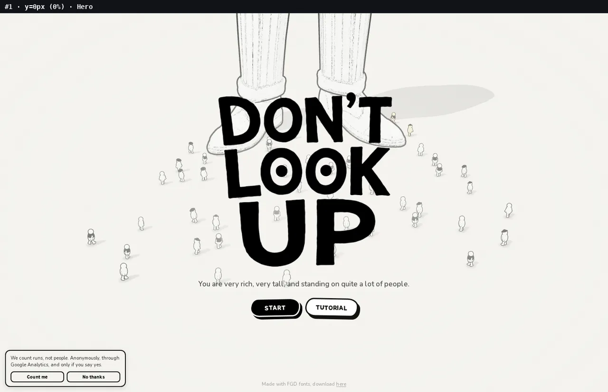
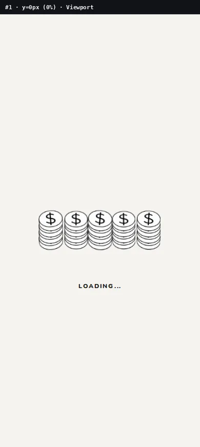

# UI Design System & Master Generation Blueprint: www-dontlookup-app

> **Don't Look Up — a game about keeping everyone looking down** (https://www.dontlookup.app/) — You are very rich, very tall, and standing on quite a lot of people. Keep them distracted and they keep paying. Let them look up, and the...





---

## 1. Executive Visual Persona & Design Archetype

- **Brand Essence & Persona**: **Don't Look Up — a game about keeping everyone looking down** (`https://www.dontlookup.app/`). You are very rich, very tall, and standing on quite a lot of people. Keep them distracted and they keep paying. Let them look up, and the...
- **Capture Provenance**: Live browser capture (`tier1_fast`, HTTP `200`, captured `2026-11-24`).
- **Visual Archetype**: **Light-Gallery WebGL / Canvas Interactive Experience (`#f4f3ef` / `#ffffff`)**.
- **Anti-AI-Slop Differentiators**:
  - **Live-Computed Chromatic Polarity**: Anchors the viewport in `#f4f3ef` (live computed `body` `background-color` (`computed_styles.json`)) paired with `#14140f` primary typography and `#ffffff` accents.
  - **Grounded Typographic Hierarchy**: Uses `Nunito` across display (`Don't Look Up — a game about keeping`) and body copy, paired with `SFMono-Regular` for monospace/code.
  - **Calibrated Spatial Grid & Motion**: Combines `1440px` container bounds (`gap: 13px`, padding `5px`) with `cubic-bezier(0.2,1.5,0.32,1)` easing and GSAP Timeline & ScrollTrigger, Three.js / WebGL Canvas Pipeline.

---

## 2. Spatial Architecture & Modular Grid Mathematics

### Viewport Allocation & Container Geometry
- **Captured Journey Filmstrips**: Desktop `1280×828px` (`assets/desktop-journey.webp`, `1` keyframes up to `y=0px` / doc `900px`), Mobile `390×872px` (`assets/mobile-journey.webp`, `1` keyframes).
- **Master Container Bounds**: `1440px` (full-bleed `100%` viewport stage).
- **Canvas Lateral Padding & Spacing**: `5px` lateral canvas padding with `13px` grid gap.
- **Border Radius Scale**: `11px`, `12px`, `17px`, `3px`.

### Responsive Breakpoint Architecture
- **Desktop Layout**: Multi-column CSS Grid / Flexbox layout at `1440px` (`max-width: 1440px`, `gap: 13px`).
- **Mobile Layout**: Single-column vertical stack at `390px` viewport width with `5px` horizontal padding.
- **Extracted CSS Media Queries**: `@media (prefers-reduced-motion: reduce)`, `@media (max-width: 1060px)`, `@media (max-width: 820px)`, `@media (max-width: 820px), (pointer: coarse)`.

---

## 3. Color System, Materiality & Atmospheric Lighting

### Semantic Palette & Source Grounding
| Semantic Role | Ground-Truth Value | Extracted Live / CSS Source |
|---|---|---|
| **Primary Canvas Substrate** | `#f4f3ef` | live computed `body` `background-color` (`computed_styles.json`) |
| **Primary Typography Ink** | `#14140f` | live computed `body` `color` (`computed_styles.json`) |
| **Elevated Surface / Card Substrate** | `#ffffff` | live computed `button` `background-color` (`computed_styles.json`) |
| **Interactive Accent / Highlight** | `#ffffff` | live computed `button` `background-color` (`computed_styles.json`) |
| **Secondary / Muted Copy** | `#8a5d02` | `#hud.is-warn .mtxt { color: #8a5d02 }` |
| **Structural Hairline Border** | `#e0dfdb` | `.mitem { border-top: #e0dfdb }` |
| **Variable Token (`--red`)** | `#c0342a` | `var(--red)` in `:root` |
| **Variable Token (`--convert`)** | `#9abeef` | `var(--convert)` in `:root` |
| **Variable Token (`--follow`)** | `#2b5a9b` | `var(--follow)` in `:root` |
| **Variable Token (`--y1`)** | `#f8e08a` | `var(--y1)` in `:root` |
| **Variable Token (`--y2`)** | `#f2c31a` | `var(--y2)` in `:root` |
| **Variable Token (`--y3`)** | `#c98f06` | `var(--y3)` in `:root` |

### Sanitized Root CSS Variables (`ui-ux.md` Ground Truth)
| Variable Name | Extracted Value | Semantic Role |
|---|---|---|
| `--paper` | `#f4f3ef` | Canvas / Surface Token |
| `--ink` | `#14140f` | Typography Ink Token |
| `--red` | `#c0342a` | Color / Atmospheric Token |
| `--btn-h` | `44px` | Dimension / Scale Token |
| `--convert` | `#9abeef` | Color / Atmospheric Token |
| `--follow` | `#2b5a9b` | Color / Atmospheric Token |
| `--y1` | `#f8e08a` | Color / Atmospheric Token |
| `--y2` | `#f2c31a` | Color / Atmospheric Token |
| `--y3` | `#c98f06` | Color / Atmospheric Token |
| `--btn-r` | `14px` | Dimension / Scale Token |
| `--body` | `'Nunito', ui-rounded, "SF Pro Rounded", system-ui, sans-serif` | Dimension / Scale Token |
| `--font` | `var(--body)` | Typography / Scale Token |
| `--hand` | `var(--body)` | Design System Custom Token |
| `--bw` | `2.5px` | Dimension / Scale Token |
| `--lift` | `5px` | Dimension / Scale Token |
| `--rail-n` | `8` | Design System Custom Token |

---

## 4. Typographic Scale & Editorial Hierarchy

### Font Family Stacks
- **Display Typography**: `Nunito`.
- **Primary Body Stack**: `Nunito`.
- **Technical / Metadata Stack**: `SFMono-Regular`.

### Typographic Scale & Rules (Live Computed & Stylesheet Grounded)
- **Hero Display (`H1`)**: observed font-size ladder: `16px`, `11px`, `15px`, `13px`, `10px`.
- **Section Heading (`H2`)**: observed font-size ladder: `16px`, `11px`, `15px`, `13px`, `10px`.
- **Body Copy**: live computed `body` (`font-size: 16px`, `line-height: normal`, `font-weight: 400`); CSS variables `--body: 'Nunito', ui-rounded, "SF Pro Rounded", system-ui, sans-serif`.
- **Metadata & Navigation Labels**: live computed `nav/a` (`font-size: 11px`, `line-height: 16.5px`, `font-weight: 600`, `letter-spacing: 0.11px`).

---

## 5. Choreographed Motion & Interaction Physics

### Primary Easing Curves
- **Extracted Timing Functions**: `cubic-bezier(0.2,1.5,0.32,1)`, `cubic-bezier(0.45,0.05,0.55,0.95)`, `cubic-bezier(0.33,1,0.68,1)`.

### Per-Element Transition & Choreography Rules
- **Selector `.bubble`**: `transition: opacity 140ms ease-out` extracted from `www-dontlookup-app` stylesheet.
- **Selector `#bar > i`**: `transition: width 220ms linear` extracted from `www-dontlookup-app` stylesheet.
- **Selector `fee-fill`**: `transition: width 200ms linear` extracted from `www-dontlookup-app` stylesheet.
- **Extracted Easing Curve (`cubic-bezier(0.2,1.5,0.32,1)`)**: Governs interactive state transitions across `<header.is-title>` and `<div.is-teaching>`.
- **Runtime Interaction Engine**: Integrates GSAP Timeline & ScrollTrigger, Three.js / WebGL Canvas Pipeline with `prefers-reduced-motion: reduce` fallback guards.
### Measured Runtime Scroll & Interaction Telemetry (`behavioral_journey_v2`)
- **Scroll Driver Mode**: `wheel` (max document height `900px`, deepest scrollY reached `0px` across `1` desktop keyframes).
- **Detected Scroll / Motion Libraries**: `WebGL/Canvas`.

---

## 6. Component Wireframe & Structural DOM Map

### Visual Layout Schematic — Desktop (`1440px`, Grounded in `dom.html` & Landmark Bounding Boxes)
```
┌────────────────────────────────────────────────────────────────────────┐
│ DESKTOP VIEWPORT (1440px) — Don't Look Up — a game about keeping every │
│ ====================================================================== │
│ [ <header.is-title> (1440px)          | here                         ] │
│ ---------------------------------------------------------------------- │
│ | HERO STAGE: <div.is-asking> (w=1440px)                             | │
│ | H1: Don't Look Up — a game about keeping everyone lo               | │
│ | Substrate: #f4f3ef | Ink: #14140f | Accent: #ffffff                | │
│ ---------------------------------------------------------------------- │
│ | SHOWCASE GRID (<div.is-teaching>) max-w: 1440px                    | │
│ | +------------------------------+  +------------------------------+ | │
│ | | Featured Work & Interactive  |  | Technical Architecture & Nar | | │
│ | +------------------------------+  +------------------------------+ | │
│ ---------------------------------------------------------------------- │
│ | DETAIL MODULE (<div.mcell>) — Global Directory & Co                | │
│ ---------------------------------------------------------------------- │
│ [ FOOTER (<footer.lbl>        ) | https://www.dontlookup.app/          │
└────────────────────────────────────────────────────────────────────────┘
```

### Visual Layout Schematic — Mobile Reflow (`390px`)
```
┌────────────────────────────────────────────────────────────────────────┐
│ MOBILE VIEWPORT REFLOW (390px) — Single-Column Stack (gap: 13px)       │
│ ====================================================================== │
│ [ HEADER BAR (<header.is-title>       ) | Compact Menu (390px)         │
│ ---------------------------------------------------------------------- │
│ | HERO STAGE (<div.is-asking>) — 390px Vertical Lead                 | │
│ | H1: Don't Look Up — a game about keeping everyone lo               | │
│ ---------------------------------------------------------------------- │
│ | SHOWCASE STACK (<div.is-teaching>) — 1-Col Stack                   | │
│ | [ Item 1: Featured Work & Interactive Showcase                   ] | │
│ | [ Item 2: Technical Architecture & Narrative                     ] | │
│ ---------------------------------------------------------------------- │
│ | DETAIL STACK (<div.mcell>) — 1-Col (Global Directory &)            | │
│ ---------------------------------------------------------------------- │
│ [ FOOTER (<footer.lbl>        ) | Stacked 390px Colophon               │
└────────────────────────────────────────────────────────────────────────┘
```

### Granular DOM Region Breakdown
1. **Brand Header & Navigation Bar (<header.is-title> — `www-dontlookup-app`)**:
   - Landmark `<header class="is-title">` (`1440px`) hosting `Don't Look Up — a game about keeping` navigation (`here`), DOM attributes (`data-engine="three.js r170"`, `data-id="ball"`, `data-cost="ball"`, `data-id="ball"`), and stylesheet rule `stage { position: fixed; inset: 0; }`.
2. **Hero Stage & Focal Lead (<div.is-asking> — `Don't Look Up — a game about keepi`)**:
   - Landmark `<div class="is-asking">` presenting display lead `Don't Look Up — a game about keeping everyone lo` and copy excerpt *"We count runs, not people. Anonymously, through Google Analytics,"* over `#f4f3ef` canvas and `#14140f` ink.
3. **Primary Showcase & Content Grid (<div.is-teaching> — `Featured Work & Interactive Showca`)**:
   - Landmark `<div class="is-teaching">` rendering section `Featured Work & Interactive Showcase` with copy *"Keep your eye on the ball, not on the fees."*, asset references (`favicon.ico`, `favicon-32.png`, `icon-192.png`, `apple-touch-icon.png`), and grid rule `stage canvas { display: block; touch-action: none; }`.
4. **Interactive Detail & Feature Matrix (<div.mcell> — `Technical Architecture & Narrative`)**:
   - Landmark `<div class="mcell">` framing `Technical Architecture & Narrative` and `Global Directory & Contact` (*"Raise the fee Use +. This crowd will carry about 30%. Anything yo"*) with `#ffffff` surface cards, `#ffffff` accents, and `bubbles { position: fixed; inset: 0; pointer-events: none; overflow: hidden; }`.
5. **Colophon & Global Directory Footer (<footer.lbl> — `https://www.dontlookup.app/`)**:
   - Landmark `<footer class="lbl">` anchoring `Don't Look Up — a game about kee` footer links (`here`), copy *"Plant a distraction"*, and `#e0dfdb` structural dividers.
### Full Vertical Scroll Sequence (Desktop `1440×900` Keyframes)
- **Step 01** (`y=0px`, `0%`): Active landmark `Hero` · sticky/fixed elements: `6`

---

## 7. Master Zero-Shot AI Generation Prompt

```markdown
# Master Zero-Shot Frontend Generation Prompt: www-dontlookup-app (Don't Look Up — a game about keeping everyone looking down)

You are a principal frontend architect and design systems engineer. Build a complete, production-ready web application replicating the exact design system, DOM landmarks, typographic hierarchy, color tokens, and motion physics of `www-dontlookup-app` (**Don't Look Up — a game about keeping everyone looking down** — `https://www.dontlookup.app/`).

### 1. Visual Archetype & Anti-AI-Slop Mandates
- **Archetype**: Light-Gallery WebGL / Canvas Interactive Experience (`#f4f3ef` / `#ffffff`).
- **Identity & Domain Context**: You are very rich, very tall, and standing on quite a lot of people. Keep them distracted and they keep paying. Let them look up, and the...
- **Primary Substrate**: `#f4f3ef` (live computed `body` `background-color` (`computed_styles.json`)), **Primary Ink**: `#14140f`, **Accent / Highlight**: `#ffffff`.
- **Site-Specific Differentiators**:
  - **Live-Computed Chromatic Polarity**: Anchors the viewport in `#f4f3ef` (live computed `body` `background-color` (`computed_styles.json`)) paired with `#14140f` primary typography and `#ffffff` accents.
  - **Grounded Typographic Hierarchy**: Uses `Nunito` across display (`Don't Look Up — a game about keeping`) and body copy, paired with `SFMono-Regular` for monospace/code.
  - **Calibrated Spatial Grid & Motion**: Combines `1440px` container bounds (`gap: 13px`, padding `5px`) with `cubic-bezier(0.2,1.5,0.32,1)` easing and GSAP Timeline & ScrollTrigger, Three.js / WebGL Canvas Pipeline.

### 2. Ground-Truth CSS Variables (`:root` Token Contract)
Declare and consume these exact custom properties extracted from `www-dontlookup-app` in your global stylesheet:

:root {
  /* Don't Look Up — a game about keeping everyone looking down (www-dontlookup-app) — Live-Grounded CSS Variables */
  --paper: #f4f3ef; /* Canvas / Surface Token (www-dontlookup-app) */
  --ink: #14140f; /* Typography Ink Token (www-dontlookup-app) */
  --red: #c0342a; /* Color / Atmospheric Token (www-dontlookup-app) */
  --btn-h: 44px; /* Dimension / Scale Token (www-dontlookup-app) */
  --convert: #9abeef; /* Color / Atmospheric Token (www-dontlookup-app) */
  --follow: #2b5a9b; /* Color / Atmospheric Token (www-dontlookup-app) */
  --y1: #f8e08a; /* Color / Atmospheric Token (www-dontlookup-app) */
  --y2: #f2c31a; /* Color / Atmospheric Token (www-dontlookup-app) */
  --y3: #c98f06; /* Color / Atmospheric Token (www-dontlookup-app) */
  --btn-r: 14px; /* Dimension / Scale Token (www-dontlookup-app) */
  --body: 'Nunito', ui-rounded, "SF Pro Rounded", system-ui, sans-serif; /* Dimension / Scale Token (www-dontlookup-app) */
  --font: var(--body); /* Typography / Scale Token (www-dontlookup-app) */
  --hand: var(--body); /* Design System Custom Token (www-dontlookup-app) */
  --bw: 2.5px; /* Dimension / Scale Token (www-dontlookup-app) */
  --lift: 5px; /* Dimension / Scale Token (www-dontlookup-app) */
  --rail-n: 8; /* Design System Custom Token (www-dontlookup-app) */
}

### 3. Semantic Color & Materiality Contract
Map every surface, ink, and border strictly to these source-grounded tokens:
- **Primary Canvas Substrate**: `#f4f3ef` — grounded in live computed `body` `background-color` (`computed_styles.json`)
- **Primary Typography Ink**: `#14140f` — grounded in live computed `body` `color` (`computed_styles.json`)
- **Elevated Surface / Card Substrate**: `#ffffff` — grounded in live computed `button` `background-color` (`computed_styles.json`)
- **Interactive Accent / Highlight**: `#ffffff` — grounded in live computed `button` `background-color` (`computed_styles.json`)
- **Secondary / Muted Copy**: `#8a5d02` — grounded in `#hud.is-warn .mtxt { color: #8a5d02 }`
- **Structural Hairline Border**: `#e0dfdb` — grounded in `.mitem { border-top: #e0dfdb }`
- **Variable Token (`--red`)**: `#c0342a` — grounded in `var(--red)` in `:root`
- **Variable Token (`--convert`)**: `#9abeef` — grounded in `var(--convert)` in `:root`
- **Variable Token (`--follow`)**: `#2b5a9b` — grounded in `var(--follow)` in `:root`
- **Variable Token (`--y1`)**: `#f8e08a` — grounded in `var(--y1)` in `:root`
- **Variable Token (`--y2`)**: `#f2c31a` — grounded in `var(--y2)` in `:root`
- **Variable Token (`--y3`)**: `#c98f06` — grounded in `var(--y3)` in `:root`

### 4. Spatial Grid, Container Bounds & Responsive Breakpoints
- **Desktop Viewport Reference**: `1280×828px` (single-viewport 100vh live capture (900px), `1440px` standard desktop width).
- **Mobile Viewport Reference**: `390×872px` (full-page live capture (872px), `390px` standard mobile width).
- **Container Max-Width**: `1440px` (full-bleed `100%` viewport stage)
- **Padding & Gutters**: `5px` lateral canvas padding with `13px` grid gap
- **Desktop Grid**: Multi-column CSS Grid / Flexbox layout at `1440px` (`max-width: 1440px`, `gap: 13px`)
- **Mobile Adaptation**: Single-column vertical stack at `390px` viewport width with `5px` horizontal padding
- **Media Queries**: `@media (prefers-reduced-motion: reduce)`, `@media (max-width: 1060px)`, `@media (max-width: 820px)`, `@media (max-width: 820px), (pointer: coarse)`
- **Corner Radii**: `11px`, `12px`, `17px`, `3px`

### 5. Typography & Editorial Scale Contract
- **Display Font Stack**: `Nunito`
- **Body Font Stack**: `Nunito`
- **Monospace / Technical Font Stack**: `SFMono-Regular`
- **H1 Display Rule**: observed font-size ladder: `16px`, `11px`, `15px`, `13px`, `10px`
- **H2 Section Rule**: observed font-size ladder: `16px`, `11px`, `15px`, `13px`, `10px`
- **Body Copy Rule**: live computed `body` (`font-size: 16px`, `line-height: normal`, `font-weight: 400`); CSS variables `--body: 'Nunito', ui-rounded, "SF Pro Rounded", system-ui, sans-serif`
- **Metadata & Index Rule**: live computed `nav/a` (`font-size: 11px`, `line-height: 16.5px`, `font-weight: 600`, `letter-spacing: 0.11px`)

### 6. Component Hierarchy, Verbatim Copy & Real DOM Landmarks
Scaffold `www-dontlookup-app` (`Don't Look Up — a game about keeping everyone looking down`) with these exact structural regions, extracted copy, and CSS rules from `dom.html`:
1. **Brand Header & Navigation Bar (<header.is-title> — `www-dontlookup-app`)**:
   - DOM & Selectors: Landmark `<header class="is-title">` (`1440px`) hosting `Don't Look Up — a game about keeping` navigation (`here`), DOM attributes (`data-engine="three.js r170"`, `data-id="ball"`, `data-cost="ball"`, `data-id="ball"`), and stylesheet rule `stage { position: fixed; inset: 0; }`.
   - Responsive Contract: Header `Brand Header & Navigation Bar (<header.is-title> — `www-dontlookup-app`)` (`www-dontlookup-app`) adapts across `@media (prefers-reduced-motion: reduce)`, `@media (max-width: 1060px)`, `@media (max-width: 820px)`, `@media (max-width: 820px), (pointer: coarse)` with `cubic-bezier(0.2,1.5,0.32,1)`, `cubic-bezier(0.45,0.05,0.55,0.95)`, `cubic-bezier(0.33,1,0.68,1)` transitions and links `here`.
2. **Hero Stage & Focal Lead (<div.is-asking> — `Don't Look Up — a game about keepi`)**:
   - DOM & Selectors: Landmark `<div class="is-asking">` presenting display lead `Don't Look Up — a game about keeping everyone lo` and copy excerpt *"We count runs, not people. Anonymously, through Google Analytics,"* over `#f4f3ef` canvas and `#14140f` ink.
   - Responsive Contract: Hero stage (`1280×828px` desktop / `390×872px` mobile) sets `#f4f3ef` background with `#14140f` headline `Don't Look Up — a game about keeping everyone lo`.
3. **Primary Showcase & Content Grid (<div.is-teaching> — `Featured Work & Interactive Showca`)**:
   - DOM & Selectors: Landmark `<div class="is-teaching">` rendering section `Featured Work & Interactive Showcase` with copy *"Keep your eye on the ball, not on the fees."*, asset references (`favicon.ico`, `favicon-32.png`, `icon-192.png`, `apple-touch-icon.png`), and grid rule `stage canvas { display: block; touch-action: none; }`.
   - Responsive Contract: Showcase grid `Primary Showcase & Content Grid (<div.is-teaching> — `Featured Work & Interactive Showca`)` applies Multi-column CSS Grid / Flexbox layout at `1440px` (`max-width: 1440px`, `gap: 13px`) on desktop and Single-column vertical stack at `390px` viewport width with `5px` horizontal padding on mobile.
4. **Interactive Detail & Feature Matrix (<div.mcell> — `Technical Architecture & Narrative`)**:
   - DOM & Selectors: Landmark `<div class="mcell">` framing `Technical Architecture & Narrative` and `Global Directory & Contact` (*"Raise the fee Use +. This crowd will carry about 30%. Anything yo"*) with `#ffffff` surface cards, `#ffffff` accents, and `bubbles { position: fixed; inset: 0; pointer-events: none; overflow: hidden; }`.
   - Responsive Contract: Detail module `Interactive Detail & Feature Matrix (<div.mcell> — `Technical Architecture & Narrative`)` uses `11px`, `12px`, `17px`, `3px` radii, `#ffffff` highlights, and assets (favicon.ico, favicon-32.png, icon-192.png).
5. **Colophon & Global Directory Footer (<footer.lbl> — `https://www.dontlookup.app/`)**:
   - DOM & Selectors: Landmark `<footer class="lbl">` anchoring `Don't Look Up — a game about kee` footer links (`here`), copy *"Plant a distraction"*, and `#e0dfdb` structural dividers.
   - Responsive Contract: Footer `Colophon & Global Directory Footer (<footer.lbl> — `https://www.dontlookup.app/`)` aligns to `1440px` (full-bleed `100%` viewport stage) with `5px` lateral canvas padding with `13px` grid gap and attributes (data-engine="three.js r170", data-id="ball", data-cost="ball").

#### Verbatim DOM Copy Excerpts (`dom.html`)
- Copy Excerpt 1: *"We count runs, not people. Anonymously, through Google Analytics, and only if you..."*
- Copy Excerpt 2: *"Keep your eye on the ball, not on the fees."*
- Copy Excerpt 3: *"Raise the fee Use +. This crowd will carry about 30%. Anything you are not chargin..."*
- Copy Excerpt 4: *"Plant a distraction"*

### 7. Motion, Extracted Stylesheet Rules & Interaction Choreography
- **Primary Easing Functions**: `cubic-bezier(0.2,1.5,0.32,1)`, `cubic-bezier(0.45,0.05,0.55,0.95)`, `cubic-bezier(0.33,1,0.68,1)`
- **Extracted Stylesheet Rules (`www-dontlookup-app`)**:
- `stage { position: fixed; inset: 0; }`
- `stage canvas { display: block; touch-action: none; }`
- `bubbles { position: fixed; inset: 0; pointer-events: none; overflow: hidden; }`
- `.btail-fill { fill: fff; }`
- `.bubble.is-visible { opacity: 1; }`
- **Per-Selector Transition Rules**:
- **Selector `.bubble`**: `transition: opacity 140ms ease-out` extracted from `www-dontlookup-app` stylesheet.
- **Selector `#bar > i`**: `transition: width 220ms linear` extracted from `www-dontlookup-app` stylesheet.
- **Selector `fee-fill`**: `transition: width 200ms linear` extracted from `www-dontlookup-app` stylesheet.
- **Extracted Easing Curve (`cubic-bezier(0.2,1.5,0.32,1)`)**: Governs interactive state transitions across `<header.is-title>` and `<div.is-teaching>`.
- **Runtime Interaction Engine**: Integrates GSAP Timeline & ScrollTrigger, Three.js / WebGL Canvas Pipeline with `prefers-reduced-motion: reduce` fallback guards.
### 7b. Full-Page Scroll Choreography, Interactive States & Multi-Page Routes
- **Scroll Mechanics**: Implement `wheel` vertical progression up to `900px` across 1 distinct viewport chapters using WebGL/Canvas.
- **Vertical Chapter Sequence**: Hero (0%).

### 8. Technical Deliverables
- Implement in Next.js (App Router) with TypeScript and Tailwind CSS consuming the `:root` custom properties defined above for `www-dontlookup-app`.
- Reproduce both the `1440px` desktop architecture and `390px` mobile breakpoint transitions, preserving semantic HTML5 landmarks (`<header>`, `<nav>`, `<main>`, `<section>`, `<footer>`) and `prefers-reduced-motion` accessibility guards.
```
---

## 8. Full-Page Scroll Journey, Interactive States & Subpage Inventory

### Desktop Scroll Keyframes (`1440×900` WebP)
| Step | Scroll Y | Progress | Active Landmark / Section | Sticky/Fixed | Visual Asset |
| :---: | :---: | :---: | :--- | :---: | :--- |
| `#01` | `0px` | `0%` | Hero | `6` | [desktop-step-01.webp](assets/desktop-step-01.webp) |

### Mobile Condensed Keyframes (`390×844` WebP)
| Step | Scroll Y | Progress | Active Landmark | Visual Asset |
| :---: | :---: | :---: | :--- | :--- |
| `#01` | `0px` | `0%` | Viewport | [mobile-step-01.webp](assets/mobile-step-01.webp) |

