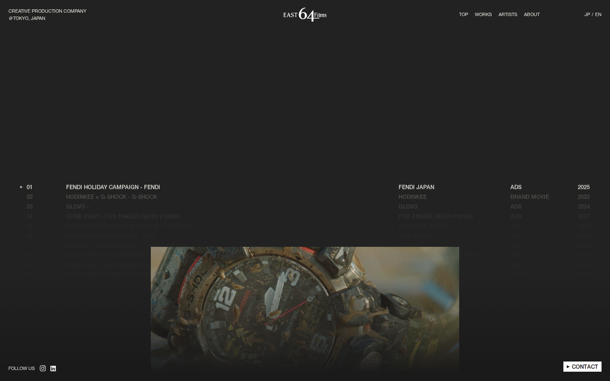

# UI Design System & Master Generation Blueprint: www-east64films-com

> **EAST 64 Films · Tokyo-Based International Production Company** (https://www.east64films.com/) — EAST 64 Films is a Tokyo-based production company working across Japan and abroad. From commercials, music videos, and branded content to...



---

## 1. Executive Visual Persona & Design Archetype

- **Brand Essence & Persona**: **EAST 64 Films · Tokyo-Based International Production Company** (`https://www.east64films.com/`). EAST 64 Films is a Tokyo-based production company working across Japan and abroad. From commercials, music videos, and branded content to...
- **Visual Archetype**: **Light-Substrate Editorial & Modular Grid System (`#4eaebf` canvas, `#151515` ink, `#e43936` accent)**.
- **Anti-AI-Slop Differentiators**:
  - **Source-Grounded Chromatic Polarity**: Anchors the viewport in `#4eaebf` (`var(--cl-blue)` in `:root`) paired with `#151515` primary typography and `#e43936` accents.
  - **Extracted Typographic Hierarchy**: Pairs `Noto Sans JP` for display copy (`F E N D I H o l i d a y C a m p a i `) with `matrix-ii-ext-semi-narrow` and not declared in static CSS (uses primary stack / `ui-monospace`).
  - **Calibrated Spatial Grid & Motion**: Combines `256px` container bounds (`gap: 1.25rem`, padding `135px`) with `cubic-bezier(0.61,1,0.88,1)` easing and Lenis Smooth Scroll (`data-lenis`), Swiper Touch Carousel Engine.

---

## 2. Spatial Architecture & Modular Grid Mathematics


### Viewport Allocation & Container Geometry
- **Captured Viewport Dimensions**: Desktop `1440×2400px` (`assets/desktop.png`, capped at 2400px multi-section capture), Mobile `390×2400px` (`assets/mobile.png`, capped at 2400px multi-section capture).
- **Master Container Bounds**: `256px` extracted from `www-east64films-com` stylesheet.
- **Canvas Lateral Padding & Spacing**: `135px` lateral canvas padding with `1.25rem` grid gap.
- **Border Radius Scale**: `4px`, `5px`, `100px`, `999px`.

### Responsive Breakpoint Architecture
- **Desktop Layout**: Multi-column CSS Grid / Flexbox layout at `1440px` (`max-width: 256px`, `gap: 1.25rem`).
- **Mobile Layout**: Single-column vertical stack at `390px` viewport width with `135px` horizontal padding.
- **Extracted CSS Media Queries**: `@media (width >= 64rem)`, `@media (max-width: 768px)`, `@media (prefers-reduced-motion: reduce)`, `@media (width >= 48rem)`.

---

## 3. Color System, Materiality & Atmospheric Lighting

### Semantic Palette & Source Grounding
| Semantic Role | Ground-Truth Value | Extracted CSS Source / Selector |
|---|---|---|
| **Primary Canvas Substrate** | `#4eaebf` | `var(--cl-blue)` in `:root` |
| **Primary Typography Ink** | `#f6b000` | `var(--cl-yellow)` in `:root` |
| **Elevated Surface / Card Substrate** | `#00a44d` | `var(--cl-green)` in `:root` |
| **Interactive Accent / Highlight** | `#e43936` | `var(--cl-red)` in `:root` |
| **Secondary / Muted Copy** | `#f46f2c` | `var(--cl-orange)` in `:root` |
| **Structural Hairline Border** | `#151515` | `var(--cl-dark)` in `:root` |
| **Variable Token (`--cl-white`)** | `#ffffff` | `var(--cl-white)` in `:root` |
| **Variable Token (`--cl-whitegray`)** | `#eeeeee` | `var(--cl-whitegray)` in `:root` |
| **Variable Token (`--cl-black`)** | `#1a1a1a` | `var(--cl-black)` in `:root` |
| **Variable Token (`--cl-blackgray`)** | `#222222` | `var(--cl-blackgray)` in `:root` |
| **Variable Token (`--cl-lightgray`)** | `#b9b9b9` | `var(--cl-lightgray)` in `:root` |

### Sanitized Root CSS Variables (`ui-ux.md` Ground Truth)
| Variable Name | Extracted Value | Semantic Role |
|---|---|---|
| `--cl-blue` | `#4eaebf` | Color / Atmospheric Token |
| `--cl-yellow` | `#f6b000` | Color / Atmospheric Token |
| `--cl-green` | `#00a44d` | Color / Atmospheric Token |
| `--cl-red` | `#e43936` | Color / Atmospheric Token |
| `--cl-orange` | `#f46f2c` | Color / Atmospheric Token |
| `--cl-dark` | `#151515` | Canvas / Surface Token |
| `--cl-white` | `#ffffff` | Canvas / Surface Token |
| `--cl-whitegray` | `#eeeeee` | Canvas / Surface Token |
| `--cl-black` | `#1a1a1a` | Canvas / Surface Token |
| `--cl-blackgray` | `#222222` | Canvas / Surface Token |
| `--cl-lightgray` | `#b9b9b9` | Canvas / Surface Token |
| `--cl-base` | `var(--cl-white)` | Design System Custom Token |
| `--cl-bg` | `var(--cl-blackgray)` | Canvas / Surface Token |
| `--fw-regular` | `400` | Design System Custom Token |
| `--fw-medium` | `500` | Design System Custom Token |
| `--fw-bold` | `700` | Design System Custom Token |

---

## 4. Typographic Scale & Editorial Hierarchy

### Font Family Stacks
- **Display Typography**: `Noto Sans JP`.
- **Primary Body Stack**: `matrix-ii-ext-semi-narrow`.
- **Technical / Metadata Stack**: not declared in static CSS (uses primary stack / `ui-monospace`).

### Typographic Scale & Rules (Extracted from Stylesheet & Variables)
- **Hero Display (`H1`)**: not explicitly declared on tag in static CSS (stylesheet font-size ladder: `80%`, `75%`, `1rem`, `clamp(1.5rem,6vw,8rem)`, `13px`).
- **Section Heading (`H2`)**: not explicitly declared on tag in static CSS (stylesheet font-size ladder: `80%`, `75%`, `1rem`, `clamp(1.5rem,6vw,8rem)`, `13px`).
- **Body Copy**: CSS variables `--font-size-base: var(--font-size-md)`; rule `p` (`font-size: 13px`, `line-height: 1.4`, `font-weight: 400`).
- **Metadata & Navigation Labels**: CSS variables `--base-letter-spacing: 0em`.

---

## 5. Choreographed Motion & Interaction Physics

### Primary Easing Curves
- **Extracted Timing Functions**: `cubic-bezier(0.61,1,0.88,1)`, `cubic-bezier(0.25,0.25,0.75,0.75)`, `cubic-bezier(0.55,0.085,0.68,0.53)`.

### Per-Element Transition & Choreography Rules
- **Selector `body`**: `transition: background-color var(--duration-fast) var(--ease-power2-out)` extracted from `www-east64films-com` stylesheet.
- **Selector `.l-header__body`**: `transition: color var(--duration-fast) var(--ease-power2-out)` extracted from `www-east64films-com` stylesheet.
- **Selector `.l-header__body-wrapper`**: `transition: opacity .3s ease,visibility .3s ease` extracted from `www-east64films-com` stylesheet.
- **Extracted Easing Curve (`cubic-bezier(0.61,1,0.88,1)`)**: Governs interactive state transitions across `<header.site-header>` and `<section.p-works>`.
- **Runtime Interaction Engine**: Integrates Lenis Smooth Scroll (`data-lenis`), Swiper Touch Carousel Engine with `prefers-reduced-motion: reduce` fallback guards.

---

## 6. Component Wireframe & Structural DOM Map

### Visual Layout Schematic (Grounded in `dom.html` — `1440px` Desktop & `390px` Mobile Reflow)
```
┌────────────────────────────────────────────────────────────────────────┐
│ DESKTOP VIEWPORT (1440px) — EAST 64 Films · Tokyo-Based International  │
│ ====================================================================== │
│ [ <header.site-header>     | T T O O P P · W W O O R R K K S S · A  ]  │
│ ---------------------------------------------------------------------- │
│ | HERO STAGE: <section.p-works>                                    |   │
│ | H1: F E N D I H o l i d a y C a m p a i g n F E N D I            |   │
│ | Substrate: #4eaebf    | Ink: #151515    | Accent: #e43936        |   │
│ ---------------------------------------------------------------------- │
│ | SHOWCASE GRID (<section.p-works>         ) max-w: 256px          |   │
│ | +------------------------------+  +------------------------------+ | │
│ | | W W O O R R K K S S          |  | A A R R T T I I S S T T S S  | | │
│ | +------------------------------+  +------------------------------+ | │
│ ---------------------------------------------------------------------- │
│ | MOBILE VIEWPORT REFLOW (390px) — Single-Column Stack (gap: 1.25re) | │
│ | [<header.site-heade] -> [<section.p-works>] -> [<section.p-works>] | │
│ ---------------------------------------------------------------------- │
│ [ FOOTER (<footer.l-footer>     ) | https://www.east64films.com/       │
└────────────────────────────────────────────────────────────────────────┘
```

### Granular DOM Region Breakdown
1. **Brand Header & Navigation Bar (<header.site-header> — `www-east64films-com`)**:
   - Landmark `<header class="site-header">` hosting `EAST 64 Films · Tokyo-Based Internat` navigation (`T T O O P P · W W O O R R K K S S · A A B B O O U U T T`), DOM attributes (`data-lang-suffix="/"`, `data-lang-suffix="/"`, `data-lang-suffix="/"`, `data-lang-suffix="/works/"`), and stylesheet rule `.tk-matrix-ii { font-family: "matrix-ii",serif; }`.
2. **Hero Stage & Focal Lead (<section.p-works> — `F E N D I H o l i d a y C a m p a `)**:
   - Landmark `<section class="p-works">` presenting display lead `F E N D I H o l i d a y C a m p a i g n F E N D I` and copy excerpt *"W W O O R R K K S S"* over `#4eaebf` canvas and `#151515` ink.
3. **Primary Showcase & Content Grid (<section.p-works> — `W W O O R R K K S S`)**:
   - Landmark `<section class="p-works">` rendering section `W W O O R R K K S S` with copy *"A A R R T T I I S S T T S S"*, asset references (`knx0cof.css`, `fonts.googleapis.com`, `fonts.gstatic.com`, `favicon.ico`), and grid rule `.tk-matrix-ii-extra { font-family: "matrix-ii-extra",serif; }`.
4. **Interactive Detail & Feature Matrix (<section.p-works> — `A A R R T T I I S S T T S S`)**:
   - Landmark `<section class="p-works">` framing `A A R R T T I I S S T T S S` and `A A B B O O U U T T` (*"A A B B O O U U T T"*) with `#00a44d` surface cards, `#e43936` accents, and `.tk-matrix-ii-display-hilite-scr { font-family: "matrix-ii-display-hilite-scr",sans-serif; }`.
5. **Colophon & Global Directory Footer (<footer.l-footer> — `https://www.east64films.com/`)**:
   - Landmark `<footer class="l-footer">` anchoring `EAST 64 Films · Tokyo-Based Inte` footer links (`T T O O P P · W W O O R R K K S S · A A B B O O U U T T`), copy *"C o m m e r c i a l s , F i l m s , C r e a t i v e C a m p "*, and `#151515` structural dividers.

---

## 7. Master Zero-Shot AI Generation Prompt

```markdown
# Master Zero-Shot Frontend Generation Prompt: www-east64films-com (EAST 64 Films · Tokyo-Based International Production Company)

You are a principal frontend architect and design systems engineer. Build a complete, production-ready web application replicating the exact design system, DOM landmarks, typographic hierarchy, color tokens, and motion physics of `www-east64films-com` (**EAST 64 Films · Tokyo-Based International Production Company** — `https://www.east64films.com/`).

### 1. Visual Archetype & Anti-AI-Slop Mandates
- **Archetype**: Light-Substrate Editorial & Modular Grid System (`#4eaebf` canvas, `#151515` ink, `#e43936` accent).
- **Identity & Domain Context**: EAST 64 Films is a Tokyo-based production company working across Japan and abroad. From commercials, music videos, and branded content to...
- **Primary Substrate**: `#4eaebf` (`var(--cl-blue)` in `:root`), **Primary Ink**: `#151515`, **Accent / Highlight**: `#e43936`.
- **Site-Specific Differentiators**:
  - **Source-Grounded Chromatic Polarity**: Anchors the viewport in `#4eaebf` (`var(--cl-blue)` in `:root`) paired with `#151515` primary typography and `#e43936` accents.
  - **Extracted Typographic Hierarchy**: Pairs `Noto Sans JP` for display copy (`F E N D I H o l i d a y C a m p a i `) with `matrix-ii-ext-semi-narrow` and not declared in static CSS (uses primary stack / `ui-monospace`).
  - **Calibrated Spatial Grid & Motion**: Combines `256px` container bounds (`gap: 1.25rem`, padding `135px`) with `cubic-bezier(0.61,1,0.88,1)` easing and Lenis Smooth Scroll (`data-lenis`), Swiper Touch Carousel Engine.

### 2. Ground-Truth CSS Variables (`:root` Token Contract)
Declare and consume these exact custom properties extracted from `www-east64films-com` in your global stylesheet:

:root {
  /* EAST 64 Films · Tokyo-Based International Production Company (www-east64films-com) — Ground-Truth Extracted CSS Variables */
  --cl-blue: #4eaebf; /* Color / Atmospheric Token (www-east64films-com) */
  --cl-yellow: #f6b000; /* Color / Atmospheric Token (www-east64films-com) */
  --cl-green: #00a44d; /* Color / Atmospheric Token (www-east64films-com) */
  --cl-red: #e43936; /* Color / Atmospheric Token (www-east64films-com) */
  --cl-orange: #f46f2c; /* Color / Atmospheric Token (www-east64films-com) */
  --cl-dark: #151515; /* Canvas / Surface Token (www-east64films-com) */
  --cl-white: #ffffff; /* Canvas / Surface Token (www-east64films-com) */
  --cl-whitegray: #eeeeee; /* Canvas / Surface Token (www-east64films-com) */
  --cl-black: #1a1a1a; /* Canvas / Surface Token (www-east64films-com) */
  --cl-blackgray: #222222; /* Canvas / Surface Token (www-east64films-com) */
  --cl-lightgray: #b9b9b9; /* Canvas / Surface Token (www-east64films-com) */
  --cl-base: var(--cl-white); /* Design System Custom Token (www-east64films-com) */
  --cl-bg: var(--cl-blackgray); /* Canvas / Surface Token (www-east64films-com) */
  --fw-regular: 400; /* Design System Custom Token (www-east64films-com) */
  --fw-medium: 500; /* Design System Custom Token (www-east64films-com) */
  --fw-bold: 700; /* Design System Custom Token (www-east64films-com) */
}

### 3. Semantic Color & Materiality Contract
Map every surface, ink, and border strictly to these source-grounded tokens:
- **Primary Canvas Substrate**: `#4eaebf` — grounded in `var(--cl-blue)` in `:root`
- **Primary Typography Ink**: `#f6b000` — grounded in `var(--cl-yellow)` in `:root`
- **Elevated Surface / Card Substrate**: `#00a44d` — grounded in `var(--cl-green)` in `:root`
- **Interactive Accent / Highlight**: `#e43936` — grounded in `var(--cl-red)` in `:root`
- **Secondary / Muted Copy**: `#f46f2c` — grounded in `var(--cl-orange)` in `:root`
- **Structural Hairline Border**: `#151515` — grounded in `var(--cl-dark)` in `:root`
- **Variable Token (`--cl-white`)**: `#ffffff` — grounded in `var(--cl-white)` in `:root`
- **Variable Token (`--cl-whitegray`)**: `#eeeeee` — grounded in `var(--cl-whitegray)` in `:root`
- **Variable Token (`--cl-black`)**: `#1a1a1a` — grounded in `var(--cl-black)` in `:root`
- **Variable Token (`--cl-blackgray`)**: `#222222` — grounded in `var(--cl-blackgray)` in `:root`
- **Variable Token (`--cl-lightgray`)**: `#b9b9b9` — grounded in `var(--cl-lightgray)` in `:root`

### 4. Spatial Grid, Container Bounds & Responsive Breakpoints
- **Desktop Viewport Reference**: `1440×2400px` (capped at 2400px multi-section capture, `1440px` standard desktop width).
- **Mobile Viewport Reference**: `390×2400px` (capped at 2400px multi-section capture, `390px` standard mobile width).
- **Container Max-Width**: `256px` extracted from `www-east64films-com` stylesheet
- **Padding & Gutters**: `135px` lateral canvas padding with `1.25rem` grid gap
- **Desktop Grid**: Multi-column CSS Grid / Flexbox layout at `1440px` (`max-width: 256px`, `gap: 1.25rem`)
- **Mobile Adaptation**: Single-column vertical stack at `390px` viewport width with `135px` horizontal padding
- **Media Queries**: `@media (width >= 64rem)`, `@media (max-width: 768px)`, `@media (prefers-reduced-motion: reduce)`, `@media (width >= 48rem)`
- **Corner Radii**: `4px`, `5px`, `100px`, `999px`

### 5. Typography & Editorial Scale Contract
- **Display Font Stack**: `Noto Sans JP`
- **Body Font Stack**: `matrix-ii-ext-semi-narrow`
- **Monospace / Technical Font Stack**: not declared in static CSS (uses primary stack / `ui-monospace`)
- **H1 Display Rule**: not explicitly declared on tag in static CSS (stylesheet font-size ladder: `80%`, `75%`, `1rem`, `clamp(1.5rem,6vw,8rem)`, `13px`)
- **H2 Section Rule**: not explicitly declared on tag in static CSS (stylesheet font-size ladder: `80%`, `75%`, `1rem`, `clamp(1.5rem,6vw,8rem)`, `13px`)
- **Body Copy Rule**: CSS variables `--font-size-base: var(--font-size-md)`; rule `p` (`font-size: 13px`, `line-height: 1.4`, `font-weight: 400`)
- **Metadata & Index Rule**: CSS variables `--base-letter-spacing: 0em`

### 6. Component Hierarchy, Verbatim Copy & Real DOM Landmarks
Scaffold `www-east64films-com` (`EAST 64 Films · Tokyo-Based International Production Company`) with these exact structural regions, extracted copy, and CSS rules from `dom.html`:
1. **Brand Header & Navigation Bar (<header.site-header> — `www-east64films-com`)**:
   - DOM & Selectors: Landmark `<header class="site-header">` hosting `EAST 64 Films · Tokyo-Based Internat` navigation (`T T O O P P · W W O O R R K K S S · A A B B O O U U T T`), DOM attributes (`data-lang-suffix="/"`, `data-lang-suffix="/"`, `data-lang-suffix="/"`, `data-lang-suffix="/works/"`), and stylesheet rule `.tk-matrix-ii { font-family: "matrix-ii",serif; }`.
   - Responsive Contract: Header `Brand Header & Navigation Bar (<header.site-header> — `www-east64films-com`)` (`www-east64films-com`) adapts across `@media (width >= 64rem)`, `@media (max-width: 768px)`, `@media (prefers-reduced-motion: reduce)`, `@media (width >= 48rem)` with `cubic-bezier(0.61,1,0.88,1)`, `cubic-bezier(0.25,0.25,0.75,0.75)`, `cubic-bezier(0.55,0.085,0.68,0.53)` transitions and links `T T O O P P · W W O O R R K K S S · A A B B O O U U T T`.
2. **Hero Stage & Focal Lead (<section.p-works> — `F E N D I H o l i d a y C a m p a `)**:
   - DOM & Selectors: Landmark `<section class="p-works">` presenting display lead `F E N D I H o l i d a y C a m p a i g n F E N D I` and copy excerpt *"W W O O R R K K S S"* over `#4eaebf` canvas and `#151515` ink.
   - Responsive Contract: Hero stage (`1440×2400px` desktop / `390×2400px` mobile) sets `#4eaebf` background with `#151515` headline `F E N D I H o l i d a y C a m p a i g n F E N D I`.
3. **Primary Showcase & Content Grid (<section.p-works> — `W W O O R R K K S S`)**:
   - DOM & Selectors: Landmark `<section class="p-works">` rendering section `W W O O R R K K S S` with copy *"A A R R T T I I S S T T S S"*, asset references (`knx0cof.css`, `fonts.googleapis.com`, `fonts.gstatic.com`, `favicon.ico`), and grid rule `.tk-matrix-ii-extra { font-family: "matrix-ii-extra",serif; }`.
   - Responsive Contract: Showcase grid `Primary Showcase & Content Grid (<section.p-works> — `W W O O R R K K S S`)` applies Multi-column CSS Grid / Flexbox layout at `1440px` (`max-width: 256px`, `gap: 1.25rem`) on desktop and Single-column vertical stack at `390px` viewport width with `135px` horizontal padding on mobile.
4. **Interactive Detail & Feature Matrix (<section.p-works> — `A A R R T T I I S S T T S S`)**:
   - DOM & Selectors: Landmark `<section class="p-works">` framing `A A R R T T I I S S T T S S` and `A A B B O O U U T T` (*"A A B B O O U U T T"*) with `#00a44d` surface cards, `#e43936` accents, and `.tk-matrix-ii-display-hilite-scr { font-family: "matrix-ii-display-hilite-scr",sans-serif; }`.
   - Responsive Contract: Detail module `Interactive Detail & Feature Matrix (<section.p-works> — `A A R R T T I I S S T T S S`)` uses `4px`, `5px`, `100px`, `999px` radii, `#e43936` highlights, and assets (knx0cof.css, fonts.googleapis.com, fonts.gstatic.com).
5. **Colophon & Global Directory Footer (<footer.l-footer> — `https://www.east64films.com/`)**:
   - DOM & Selectors: Landmark `<footer class="l-footer">` anchoring `EAST 64 Films · Tokyo-Based Inte` footer links (`T T O O P P · W W O O R R K K S S · A A B B O O U U T T`), copy *"C o m m e r c i a l s , F i l m s , C r e a t i v e C a m p "*, and `#151515` structural dividers.
   - Responsive Contract: Footer `Colophon & Global Directory Footer (<footer.l-footer> — `https://www.east64films.com/`)` aligns to `256px` extracted from `www-east64films-com` stylesheet with `135px` lateral canvas padding with `1.25rem` grid gap and attributes (data-lang-suffix="/", data-lang-suffix="/", data-lang-suffix="/").

#### Verbatim DOM Copy Excerpts (`dom.html`)
- Copy Excerpt 1: *"W W O O R R K K S S"*
- Copy Excerpt 2: *"A A R R T T I I S S T T S S"*
- Copy Excerpt 3: *"A A B B O O U U T T"*
- Copy Excerpt 4: *"C o m m e r c i a l s , F i l m s , C r e a t i v e C a m p a i g n s ,"*

### 7. Motion, Extracted Stylesheet Rules & Interaction Choreography
- **Primary Easing Functions**: `cubic-bezier(0.61,1,0.88,1)`, `cubic-bezier(0.25,0.25,0.75,0.75)`, `cubic-bezier(0.55,0.085,0.68,0.53)`
- **Extracted Stylesheet Rules (`www-east64films-com`)**:
- `.tk-matrix-ii { font-family: "matrix-ii",serif; }`
- `.tk-matrix-ii-extra { font-family: "matrix-ii-extra",serif; }`
- `.tk-matrix-ii-display-hilite-scr { font-family: "matrix-ii-display-hilite-scr",sans-serif; }`
- `.tk-matrix-ii-display-hilite-ext { font-family: "matrix-ii-display-hilite-ext",sans-serif; }`
- `.tk-matrix-ii-display-hilite-ita { font-family: "matrix-ii-display-hilite-ita",sans-serif; }`
- **Per-Selector Transition Rules**:
- **Selector `body`**: `transition: background-color var(--duration-fast) var(--ease-power2-out)` extracted from `www-east64films-com` stylesheet.
- **Selector `.l-header__body`**: `transition: color var(--duration-fast) var(--ease-power2-out)` extracted from `www-east64films-com` stylesheet.
- **Selector `.l-header__body-wrapper`**: `transition: opacity .3s ease,visibility .3s ease` extracted from `www-east64films-com` stylesheet.
- **Extracted Easing Curve (`cubic-bezier(0.61,1,0.88,1)`)**: Governs interactive state transitions across `<header.site-header>` and `<section.p-works>`.
- **Runtime Interaction Engine**: Integrates Lenis Smooth Scroll (`data-lenis`), Swiper Touch Carousel Engine with `prefers-reduced-motion: reduce` fallback guards.

### 8. Technical Deliverables
- Implement in Next.js (App Router) with TypeScript and Tailwind CSS consuming the `:root` custom properties defined above for `www-east64films-com`.
- Reproduce both the `1440px` desktop architecture and `390px` mobile breakpoint transitions, preserving semantic HTML5 landmarks (`<header>`, `<nav>`, `<main>`, `<section>`, `<footer>`) and `prefers-reduced-motion` accessibility guards.
```
