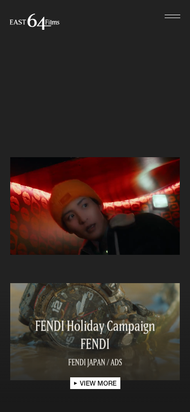

# UI Design System & Master Generation Blueprint: www-east64films-com

> **EAST 64 Films · Tokyo-Based International Production Company** (https://www.east64films.com/) — EAST 64 Films is a Tokyo-based production company working across Japan and abroad. From commercials, music videos, and branded content to...


---

## 1. Executive Visual Persona & Design Archetype

- **Brand Essence & Persona**: **EAST 64 Films · Tokyo-Based International Production Company** (`https://www.east64films.com/`). EAST 64 Films is a Tokyo-based production company working across Japan and abroad. From commercials, music videos, and branded content to...
- **Capture Provenance**: Live browser capture (`tier1_fast`, HTTP `200`, captured `2026-11-23`).
- **Visual Archetype**: **High-Contrast Obsidian / Atmospheric Design System (`#222222` canvas, `#ece9e2` ink, `#3498db` accent)**.
- **Anti-AI-Slop Differentiators**:
  - **Live-Computed Chromatic Polarity**: Anchors the viewport in `#222222` (live computed `body` `background-color` (`computed_styles.json`)) paired with `#ece9e2` primary typography and `#3498db` accents.
  - **Grounded Typographic Hierarchy**: Pairs `matrix-ii-ext-semi-narrow` for display copy (`EAST 64 Films · Tokyo-Based Internat`) with `Noto Sans JP` and not declared in live computed styles (uses primary stack / `ui-monospace`).
  - **Calibrated Spatial Grid & Motion**: Combines `1440px` container bounds (`gap: 1.25rem`, padding `135px`) with `cubic-bezier(0.61,1,0.88,1)` easing and Lenis Smooth Scroll (`data-lenis`), Swiper Touch Carousel Engine.

---

## 2. Spatial Architecture & Modular Grid Mathematics



### Viewport Allocation & Container Geometry
- **Captured Viewport Dimensions**: Desktop `1440×900px` (`assets/desktop.png`, single-viewport 100vh live capture (900px)), Mobile `390×844px` (`assets/mobile.png`, single-viewport 100vh live capture (844px)).
- **Master Container Bounds**: `1440px` (full-bleed `100%` desktop stage measured on `1440px` viewport).
- **Canvas Lateral Padding & Spacing**: `135px` lateral canvas padding with `1.25rem` grid gap.
- **Border Radius Scale**: `4px`, `5px`, `100px`, `999px`.

### Responsive Breakpoint Architecture
- **Desktop Layout**: Multi-column CSS Grid / Flexbox layout at `1440px` (`max-width: 1440px`, `gap: 1.25rem`).
- **Mobile Layout**: Single-column vertical stack at `390px` viewport width with `135px` horizontal padding.
- **Extracted CSS Media Queries**: `@media (width >= 64rem)`, `@media (max-width: 768px)`, `@media (prefers-reduced-motion: reduce)`, `@media (width >= 48rem)`.

---

## 3. Color System, Materiality & Atmospheric Lighting

### Semantic Palette & Source Grounding
| Semantic Role | Ground-Truth Value | Extracted Live / CSS Source |
|---|---|---|
| **Primary Canvas Substrate** | `#222222` | live computed `body` `background-color` (`computed_styles.json`) |
| **Primary Typography Ink** | `#ece9e2` | live computed `h1` `color` (`computed_styles.json`) |
| **Elevated Surface / Card Substrate** | `#3b3b3b` | `.footer { background: #3b3b3b }` |
| **Interactive Accent / Highlight** | `#3498db` | `.c-form__btn-primary { background-color: #3498db }` |
| **Secondary / Muted Copy** | `#808080` | `.has-cyan-bluish-gray-color { color: gray }` (`#808080`) |
| **Structural Hairline Border** | `#e74c3c` | `.c-form__group.has-error select { border-color: #e74c3c }` |
| **Variable Token (`--cl-blue`)** | `#4eaebf` | `var(--cl-blue)` in `:root` |
| **Variable Token (`--cl-yellow`)** | `#f6b000` | `var(--cl-yellow)` in `:root` |
| **Variable Token (`--cl-green`)** | `#00a44d` | `var(--cl-green)` in `:root` |
| **Variable Token (`--cl-red`)** | `#e43936` | `var(--cl-red)` in `:root` |
| **Variable Token (`--cl-orange`)** | `#f46f2c` | `var(--cl-orange)` in `:root` |
| **Variable Token (`--cl-dark`)** | `#151515` | `var(--cl-dark)` in `:root` |
| **Variable Token (`--cl-white`)** | `#ffffff` | `var(--cl-white)` in `:root` |
| **Variable Token (`--cl-whitegray`)** | `#eeeeee` | `var(--cl-whitegray)` in `:root` |
| **Variable Token (`--cl-black`)** | `#1a1a1a` | `var(--cl-black)` in `:root` |
| **Variable Token (`--cl-lightgray`)** | `#b9b9b9` | `var(--cl-lightgray)` in `:root` |

### Sanitized Root CSS Variables (`ui-ux.md` Ground Truth)
| Variable Name | Extracted Value | Semantic Role |
|---|---|---|
| `--cl-blue` | `#4eaebf` | Color / Atmospheric Token |
| `--cl-yellow` | `#f6b000` | Color / Atmospheric Token |
| `--cl-green` | `#00a44d` | Color / Atmospheric Token |
| `--cl-red` | `#e43936` | Color / Atmospheric Token |
| `--cl-orange` | `#f46f2c` | Color / Atmospheric Token |
| `--cl-dark` | `#151515` | Canvas / Surface Token |
| `--cl-white` | `#ffffff` | Canvas / Surface Token |
| `--cl-whitegray` | `#eeeeee` | Canvas / Surface Token |
| `--cl-black` | `#1a1a1a` | Canvas / Surface Token |
| `--cl-blackgray` | `#222222` | Canvas / Surface Token |
| `--cl-lightgray` | `#b9b9b9` | Canvas / Surface Token |
| `--cl-base` | `var(--cl-white)` | Design System Custom Token |
| `--cl-bg` | `var(--cl-blackgray)` | Canvas / Surface Token |
| `--fw-regular` | `400` | Design System Custom Token |
| `--fw-medium` | `500` | Design System Custom Token |
| `--fw-bold` | `700` | Design System Custom Token |

---

## 4. Typographic Scale & Editorial Hierarchy

### Font Family Stacks
- **Display Typography**: `matrix-ii-ext-semi-narrow`.
- **Primary Body Stack**: `Noto Sans JP`.
- **Technical / Metadata Stack**: not declared in live computed styles (uses primary stack / `ui-monospace`).

### Typographic Scale & Rules (Live Computed & Stylesheet Grounded)
- **Hero Display (`H1`)**: live computed `h1` (`font-size: 44px`, `line-height: 55px`, `font-weight: 400`).
- **Section Heading (`H2`)**: observed font-size ladder: `44px`, `16px`, `11px`, `80%`, `75%`.
- **Body Copy**: live computed `body` (`font-size: 16px`, `line-height: 29.5px`, `font-weight: 500`); CSS variables `--font-size-base: var(--font-size-md)`; rule `p` (`font-size: 13px`, `line-height: 1.4`, `font-weight: 400`).
- **Metadata & Navigation Labels**: live computed `nav/a` (`font-size: 11px`, `line-height: 20.2812px`, `font-weight: 400`); CSS variables `--base-letter-spacing: 0em`.

---

## 5. Choreographed Motion & Interaction Physics

### Primary Easing Curves
- **Extracted Timing Functions**: `cubic-bezier(0.61,1,0.88,1)`, `cubic-bezier(0.25,0.25,0.75,0.75)`, `cubic-bezier(0.55,0.085,0.68,0.53)`.

### Per-Element Transition & Choreography Rules
- **Selector `body`**: `transition: background-color var(--duration-fast) var(--ease-power2-out)` extracted from `www-east64films-com` stylesheet.
- **Selector `.l-header__body`**: `transition: color var(--duration-fast) var(--ease-power2-out)` extracted from `www-east64films-com` stylesheet.
- **Selector `.l-header__body-wrapper`**: `transition: opacity .3s ease,visibility .3s ease` extracted from `www-east64films-com` stylesheet.
- **Extracted Easing Curve (`cubic-bezier(0.61,1,0.88,1)`)**: Governs interactive state transitions across `<header.site-header>` and `<section.p-works:nth(2)>`.
- **Runtime Interaction Engine**: Integrates Lenis Smooth Scroll (`data-lenis`), Swiper Touch Carousel Engine with `prefers-reduced-motion: reduce` fallback guards.

---

## 6. Component Wireframe & Structural DOM Map

### Visual Layout Schematic — Desktop (`1440px`, Grounded in `dom.html` & Landmark Bounding Boxes)
```
┌────────────────────────────────────────────────────────────────────────┐
│ DESKTOP VIEWPORT (1440px) — EAST 64 Films · Tokyo-Based International  │
│ ====================================================================== │
│ [ <header.site-header> (1440x33px)    | T T O O P P · W W O O R R K  ] │
│ ---------------------------------------------------------------------- │
│ | HERO STAGE: <section.p-works> (w=1440px)                           | │
│ | H1: EAST 64 Films · Tokyo-Based International Produc               | │
│ | Substrate: #222222 | Ink: #ece9e2 | Accent: #3498db                | │
│ ---------------------------------------------------------------------- │
│ | SHOWCASE GRID (<section.p-works:nth(2)>) max-w: 1440px             | │
│ | +------------------------------+  +------------------------------+ | │
│ | | Featured Work & Interactive  |  | Technical Architecture & Nar | | │
│ | +------------------------------+  +------------------------------+ | │
│ ---------------------------------------------------------------------- │
│ | DETAIL MODULE (<section.p-works:nth(3)>) — Global Directory & Co   | │
│ ---------------------------------------------------------------------- │
│ [ FOOTER (<footer.l-footer>   ) | https://www.east64films.com/         │
└────────────────────────────────────────────────────────────────────────┘
```

### Visual Layout Schematic — Mobile Reflow (`390px`)
```
┌────────────────────────────────────────────────────────────────────────┐
│ MOBILE VIEWPORT REFLOW (390px) — Single-Column Stack (gap: 1.25rem)    │
│ ====================================================================== │
│ [ HEADER BAR (<header.site-header>    ) | Compact Menu (390px)         │
│ ---------------------------------------------------------------------- │
│ | HERO STAGE (<section.p-works>) — 390px Vertical Lead               | │
│ | H1: EAST 64 Films · Tokyo-Based International Produc               | │
│ ---------------------------------------------------------------------- │
│ | SHOWCASE STACK (<section.p-works:nth(2) — 1-Col Stack              | │
│ | [ Item 1: Featured Work & Interactive Showcase                   ] | │
│ | [ Item 2: Technical Architecture & Narrative                     ] | │
│ ---------------------------------------------------------------------- │
│ | DETAIL STACK (<section.p-works:nth(3)>) — 1-Col (Global Directory &) │
│ ---------------------------------------------------------------------- │
│ [ FOOTER (<footer.l-footer>   ) | Stacked 390px Colophon               │
└────────────────────────────────────────────────────────────────────────┘
```

### Granular DOM Region Breakdown
1. **Brand Header & Navigation Bar (<header.site-header> — `www-east64films-com`)**:
   - Landmark `<header class="site-header">` (`1440x33px`) hosting `EAST 64 Films · Tokyo-Based Internat` navigation (`T T O O P P · W W O O R R K K S S · A A B B O O U U T T`), DOM attributes (`data-lang-suffix="/"`, `data-lang-suffix="/"`, `data-lang-suffix="/"`, `data-lang-suffix="/works/"`), and stylesheet rule `.tk-matrix-ii { font-family: "matrix-ii",serif; }`.
2. **Hero Stage & Focal Lead (<section.p-works> — `EAST 64 Films · Tokyo-Based Intern`)**:
   - Landmark `<section class="p-works">` presenting display lead `EAST 64 Films · Tokyo-Based International Produc` and copy excerpt *"C o m m e r c i a l s , F i l m s , C r e a t i v e C a m p a i g"* over `#222222` canvas and `#ece9e2` ink.
3. **Primary Showcase & Content Grid (<section.p-works:nth(2)> — `Featured Work & Interactive Showca`)**:
   - Landmark `<section class="p-works">` rendering section `Featured Work & Interactive Showcase` with copy *"C o m m e r c i a l s ,"*, asset references (`knx0cof.css`, `fonts.googleapis.com`, `fonts.gstatic.com`, `favicon.ico`), and grid rule `.tk-matrix-ii-extra { font-family: "matrix-ii-extra",serif; }`.
4. **Interactive Detail & Feature Matrix (<section.p-works:nth(3)> — `Technical Architecture & Narrative`)**:
   - Landmark `<section class="p-works">` framing `Technical Architecture & Narrative` and `Global Directory & Contact` (*"C a m p a i g n s ,"*) with `#3b3b3b` surface cards, `#3498db` accents, and `.tk-matrix-ii-display-hilite-scr { font-family: "matrix-ii-display-hilite-scr",sans-serif; }`.
5. **Colophon & Global Directory Footer (<footer.l-footer> — `https://www.east64films.com/`)**:
   - Landmark `<footer class="l-footer">` anchoring `EAST 64 Films · Tokyo-Based Inte` footer links (`T T O O P P · W W O O R R K K S S · A A B B O O U U T T`), copy *"M u s i c V i d e o s , B r a n d e d C o n t e n t , e t c "*, and `#e74c3c` structural dividers.

---

## 7. Master Zero-Shot AI Generation Prompt

```markdown
# Master Zero-Shot Frontend Generation Prompt: www-east64films-com (EAST 64 Films · Tokyo-Based International Production Company)

You are a principal frontend architect and design systems engineer. Build a complete, production-ready web application replicating the exact design system, DOM landmarks, typographic hierarchy, color tokens, and motion physics of `www-east64films-com` (**EAST 64 Films · Tokyo-Based International Production Company** — `https://www.east64films.com/`).

### 1. Visual Archetype & Anti-AI-Slop Mandates
- **Archetype**: High-Contrast Obsidian / Atmospheric Design System (`#222222` canvas, `#ece9e2` ink, `#3498db` accent).
- **Identity & Domain Context**: EAST 64 Films is a Tokyo-based production company working across Japan and abroad. From commercials, music videos, and branded content to...
- **Primary Substrate**: `#222222` (live computed `body` `background-color` (`computed_styles.json`)), **Primary Ink**: `#ece9e2`, **Accent / Highlight**: `#3498db`.
- **Site-Specific Differentiators**:
  - **Live-Computed Chromatic Polarity**: Anchors the viewport in `#222222` (live computed `body` `background-color` (`computed_styles.json`)) paired with `#ece9e2` primary typography and `#3498db` accents.
  - **Grounded Typographic Hierarchy**: Pairs `matrix-ii-ext-semi-narrow` for display copy (`EAST 64 Films · Tokyo-Based Internat`) with `Noto Sans JP` and not declared in live computed styles (uses primary stack / `ui-monospace`).
  - **Calibrated Spatial Grid & Motion**: Combines `1440px` container bounds (`gap: 1.25rem`, padding `135px`) with `cubic-bezier(0.61,1,0.88,1)` easing and Lenis Smooth Scroll (`data-lenis`), Swiper Touch Carousel Engine.

### 2. Ground-Truth CSS Variables (`:root` Token Contract)
Declare and consume these exact custom properties extracted from `www-east64films-com` in your global stylesheet:

:root {
  /* EAST 64 Films · Tokyo-Based International Production Company (www-east64films-com) — Live-Grounded CSS Variables */
  --cl-blue: #4eaebf; /* Color / Atmospheric Token (www-east64films-com) */
  --cl-yellow: #f6b000; /* Color / Atmospheric Token (www-east64films-com) */
  --cl-green: #00a44d; /* Color / Atmospheric Token (www-east64films-com) */
  --cl-red: #e43936; /* Color / Atmospheric Token (www-east64films-com) */
  --cl-orange: #f46f2c; /* Color / Atmospheric Token (www-east64films-com) */
  --cl-dark: #151515; /* Canvas / Surface Token (www-east64films-com) */
  --cl-white: #ffffff; /* Canvas / Surface Token (www-east64films-com) */
  --cl-whitegray: #eeeeee; /* Canvas / Surface Token (www-east64films-com) */
  --cl-black: #1a1a1a; /* Canvas / Surface Token (www-east64films-com) */
  --cl-blackgray: #222222; /* Canvas / Surface Token (www-east64films-com) */
  --cl-lightgray: #b9b9b9; /* Canvas / Surface Token (www-east64films-com) */
  --cl-base: var(--cl-white); /* Design System Custom Token (www-east64films-com) */
  --cl-bg: var(--cl-blackgray); /* Canvas / Surface Token (www-east64films-com) */
  --fw-regular: 400; /* Design System Custom Token (www-east64films-com) */
  --fw-medium: 500; /* Design System Custom Token (www-east64films-com) */
  --fw-bold: 700; /* Design System Custom Token (www-east64films-com) */
}

### 3. Semantic Color & Materiality Contract
Map every surface, ink, and border strictly to these source-grounded tokens:
- **Primary Canvas Substrate**: `#222222` — grounded in live computed `body` `background-color` (`computed_styles.json`)
- **Primary Typography Ink**: `#ece9e2` — grounded in live computed `h1` `color` (`computed_styles.json`)
- **Elevated Surface / Card Substrate**: `#3b3b3b` — grounded in `.footer { background: #3b3b3b }`
- **Interactive Accent / Highlight**: `#3498db` — grounded in `.c-form__btn-primary { background-color: #3498db }`
- **Secondary / Muted Copy**: `#808080` — grounded in `.has-cyan-bluish-gray-color { color: gray }` (`#808080`)
- **Structural Hairline Border**: `#e74c3c` — grounded in `.c-form__group.has-error select { border-color: #e74c3c }`
- **Variable Token (`--cl-blue`)**: `#4eaebf` — grounded in `var(--cl-blue)` in `:root`
- **Variable Token (`--cl-yellow`)**: `#f6b000` — grounded in `var(--cl-yellow)` in `:root`
- **Variable Token (`--cl-green`)**: `#00a44d` — grounded in `var(--cl-green)` in `:root`
- **Variable Token (`--cl-red`)**: `#e43936` — grounded in `var(--cl-red)` in `:root`
- **Variable Token (`--cl-orange`)**: `#f46f2c` — grounded in `var(--cl-orange)` in `:root`
- **Variable Token (`--cl-dark`)**: `#151515` — grounded in `var(--cl-dark)` in `:root`
- **Variable Token (`--cl-white`)**: `#ffffff` — grounded in `var(--cl-white)` in `:root`
- **Variable Token (`--cl-whitegray`)**: `#eeeeee` — grounded in `var(--cl-whitegray)` in `:root`
- **Variable Token (`--cl-black`)**: `#1a1a1a` — grounded in `var(--cl-black)` in `:root`
- **Variable Token (`--cl-lightgray`)**: `#b9b9b9` — grounded in `var(--cl-lightgray)` in `:root`

### 4. Spatial Grid, Container Bounds & Responsive Breakpoints
- **Desktop Viewport Reference**: `1440×900px` (single-viewport 100vh live capture (900px), `1440px` standard desktop width).
- **Mobile Viewport Reference**: `390×844px` (single-viewport 100vh live capture (844px), `390px` standard mobile width).
- **Container Max-Width**: `1440px` (full-bleed `100%` desktop stage measured on `1440px` viewport)
- **Padding & Gutters**: `135px` lateral canvas padding with `1.25rem` grid gap
- **Desktop Grid**: Multi-column CSS Grid / Flexbox layout at `1440px` (`max-width: 1440px`, `gap: 1.25rem`)
- **Mobile Adaptation**: Single-column vertical stack at `390px` viewport width with `135px` horizontal padding
- **Media Queries**: `@media (width >= 64rem)`, `@media (max-width: 768px)`, `@media (prefers-reduced-motion: reduce)`, `@media (width >= 48rem)`
- **Corner Radii**: `4px`, `5px`, `100px`, `999px`

### 5. Typography & Editorial Scale Contract
- **Display Font Stack**: `matrix-ii-ext-semi-narrow`
- **Body Font Stack**: `Noto Sans JP`
- **Monospace / Technical Font Stack**: not declared in live computed styles (uses primary stack / `ui-monospace`)
- **H1 Display Rule**: live computed `h1` (`font-size: 44px`, `line-height: 55px`, `font-weight: 400`)
- **H2 Section Rule**: observed font-size ladder: `44px`, `16px`, `11px`, `80%`, `75%`
- **Body Copy Rule**: live computed `body` (`font-size: 16px`, `line-height: 29.5px`, `font-weight: 500`); CSS variables `--font-size-base: var(--font-size-md)`; rule `p` (`font-size: 13px`, `line-height: 1.4`, `font-weight: 400`)
- **Metadata & Index Rule**: live computed `nav/a` (`font-size: 11px`, `line-height: 20.2812px`, `font-weight: 400`); CSS variables `--base-letter-spacing: 0em`

### 6. Component Hierarchy, Verbatim Copy & Real DOM Landmarks
Scaffold `www-east64films-com` (`EAST 64 Films · Tokyo-Based International Production Company`) with these exact structural regions, extracted copy, and CSS rules from `dom.html`:
1. **Brand Header & Navigation Bar (<header.site-header> — `www-east64films-com`)**:
   - DOM & Selectors: Landmark `<header class="site-header">` (`1440x33px`) hosting `EAST 64 Films · Tokyo-Based Internat` navigation (`T T O O P P · W W O O R R K K S S · A A B B O O U U T T`), DOM attributes (`data-lang-suffix="/"`, `data-lang-suffix="/"`, `data-lang-suffix="/"`, `data-lang-suffix="/works/"`), and stylesheet rule `.tk-matrix-ii { font-family: "matrix-ii",serif; }`.
   - Responsive Contract: Header `Brand Header & Navigation Bar (<header.site-header> — `www-east64films-com`)` (`www-east64films-com`) adapts across `@media (width >= 64rem)`, `@media (max-width: 768px)`, `@media (prefers-reduced-motion: reduce)`, `@media (width >= 48rem)` with `cubic-bezier(0.61,1,0.88,1)`, `cubic-bezier(0.25,0.25,0.75,0.75)`, `cubic-bezier(0.55,0.085,0.68,0.53)` transitions and links `T T O O P P · W W O O R R K K S S · A A B B O O U U T T`.
2. **Hero Stage & Focal Lead (<section.p-works> — `EAST 64 Films · Tokyo-Based Intern`)**:
   - DOM & Selectors: Landmark `<section class="p-works">` presenting display lead `EAST 64 Films · Tokyo-Based International Produc` and copy excerpt *"C o m m e r c i a l s , F i l m s , C r e a t i v e C a m p a i g"* over `#222222` canvas and `#ece9e2` ink.
   - Responsive Contract: Hero stage (`1440×900px` desktop / `390×844px` mobile) sets `#222222` background with `#ece9e2` headline `EAST 64 Films · Tokyo-Based International Produc`.
3. **Primary Showcase & Content Grid (<section.p-works:nth(2)> — `Featured Work & Interactive Showca`)**:
   - DOM & Selectors: Landmark `<section class="p-works">` rendering section `Featured Work & Interactive Showcase` with copy *"C o m m e r c i a l s ,"*, asset references (`knx0cof.css`, `fonts.googleapis.com`, `fonts.gstatic.com`, `favicon.ico`), and grid rule `.tk-matrix-ii-extra { font-family: "matrix-ii-extra",serif; }`.
   - Responsive Contract: Showcase grid `Primary Showcase & Content Grid (<section.p-works:nth(2)> — `Featured Work & Interactive Showca`)` applies Multi-column CSS Grid / Flexbox layout at `1440px` (`max-width: 1440px`, `gap: 1.25rem`) on desktop and Single-column vertical stack at `390px` viewport width with `135px` horizontal padding on mobile.
4. **Interactive Detail & Feature Matrix (<section.p-works:nth(3)> — `Technical Architecture & Narrative`)**:
   - DOM & Selectors: Landmark `<section class="p-works">` framing `Technical Architecture & Narrative` and `Global Directory & Contact` (*"C a m p a i g n s ,"*) with `#3b3b3b` surface cards, `#3498db` accents, and `.tk-matrix-ii-display-hilite-scr { font-family: "matrix-ii-display-hilite-scr",sans-serif; }`.
   - Responsive Contract: Detail module `Interactive Detail & Feature Matrix (<section.p-works:nth(3)> — `Technical Architecture & Narrative`)` uses `4px`, `5px`, `100px`, `999px` radii, `#3498db` highlights, and assets (knx0cof.css, fonts.googleapis.com, fonts.gstatic.com).
5. **Colophon & Global Directory Footer (<footer.l-footer> — `https://www.east64films.com/`)**:
   - DOM & Selectors: Landmark `<footer class="l-footer">` anchoring `EAST 64 Films · Tokyo-Based Inte` footer links (`T T O O P P · W W O O R R K K S S · A A B B O O U U T T`), copy *"M u s i c V i d e o s , B r a n d e d C o n t e n t , e t c "*, and `#e74c3c` structural dividers.
   - Responsive Contract: Footer `Colophon & Global Directory Footer (<footer.l-footer> — `https://www.east64films.com/`)` aligns to `1440px` (full-bleed `100%` desktop stage measured on `1440px` viewport) with `135px` lateral canvas padding with `1.25rem` grid gap and attributes (data-lang-suffix="/", data-lang-suffix="/", data-lang-suffix="/").

#### Verbatim DOM Copy Excerpts (`dom.html`)
- Copy Excerpt 1: *"C o m m e r c i a l s , F i l m s , C r e a t i v e C a m p a i g n s ,"*
- Copy Excerpt 2: *"C o m m e r c i a l s ,"*
- Copy Excerpt 3: *"C a m p a i g n s ,"*
- Copy Excerpt 4: *"M u s i c V i d e o s , B r a n d e d C o n t e n t , e t c ."*

### 7. Motion, Extracted Stylesheet Rules & Interaction Choreography
- **Primary Easing Functions**: `cubic-bezier(0.61,1,0.88,1)`, `cubic-bezier(0.25,0.25,0.75,0.75)`, `cubic-bezier(0.55,0.085,0.68,0.53)`
- **Extracted Stylesheet Rules (`www-east64films-com`)**:
- `.tk-matrix-ii { font-family: "matrix-ii",serif; }`
- `.tk-matrix-ii-extra { font-family: "matrix-ii-extra",serif; }`
- `.tk-matrix-ii-display-hilite-scr { font-family: "matrix-ii-display-hilite-scr",sans-serif; }`
- `.tk-matrix-ii-display-hilite-ext { font-family: "matrix-ii-display-hilite-ext",sans-serif; }`
- `.tk-matrix-ii-display-hilite-ita { font-family: "matrix-ii-display-hilite-ita",sans-serif; }`
- **Per-Selector Transition Rules**:
- **Selector `body`**: `transition: background-color var(--duration-fast) var(--ease-power2-out)` extracted from `www-east64films-com` stylesheet.
- **Selector `.l-header__body`**: `transition: color var(--duration-fast) var(--ease-power2-out)` extracted from `www-east64films-com` stylesheet.
- **Selector `.l-header__body-wrapper`**: `transition: opacity .3s ease,visibility .3s ease` extracted from `www-east64films-com` stylesheet.
- **Extracted Easing Curve (`cubic-bezier(0.61,1,0.88,1)`)**: Governs interactive state transitions across `<header.site-header>` and `<section.p-works:nth(2)>`.
- **Runtime Interaction Engine**: Integrates Lenis Smooth Scroll (`data-lenis`), Swiper Touch Carousel Engine with `prefers-reduced-motion: reduce` fallback guards.

### 8. Technical Deliverables
- Implement in Next.js (App Router) with TypeScript and Tailwind CSS consuming the `:root` custom properties defined above for `www-east64films-com`.
- Reproduce both the `1440px` desktop architecture and `390px` mobile breakpoint transitions, preserving semantic HTML5 landmarks (`<header>`, `<nav>`, `<main>`, `<section>`, `<footer>`) and `prefers-reduced-motion` accessibility guards.
```
