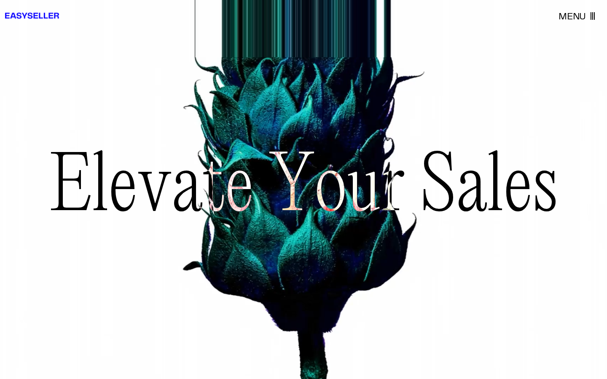
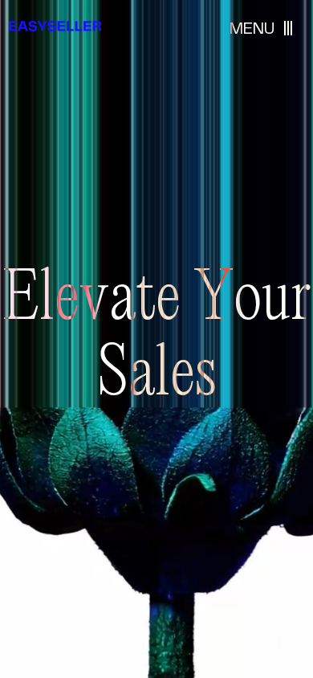

# UI Design System & Master Generation Blueprint: www-easyseller-it

> **EASYSELLER · Sales Digital Agency** (https://www.easyseller.it/) — Aiutiamo i brand e retail multibrand a crescere online attraverso percorsi completi di consulenza · digitalizzazione · gestione · promozi...



---

## 1. Executive Visual Persona & Design Archetype

- **Brand Essence & Persona**: **EASYSELLER · Sales Digital Agency** (`https://www.easyseller.it/`). Aiutiamo i brand e retail multibrand a crescere online attraverso percorsi completi di consulenza · digitalizzazione · gestione · promozi...
- **Capture Provenance**: Live browser capture (`tier1_fast`, HTTP `200`, captured `2026-11-23`).
- **Visual Archetype**: **Light-Gallery WebGL / Canvas Interactive Experience (`#ffffff` / `#0d6efd`)**.
- **Anti-AI-Slop Differentiators**:
  - **Live-Computed Chromatic Polarity**: Anchors the viewport in `#ffffff` (live computed `body` `background-color` (`computed_styles.json`)) paired with `#000000` primary typography and `#0d6efd` accents.
  - **Grounded Typographic Hierarchy**: Pairs `Font2` for display copy (`Elevate Your Sales`) with `Font1` and not declared in live computed styles (uses primary stack / `ui-monospace`).
  - **Calibrated Spatial Grid & Motion**: Combines `97vw` container bounds (`gap: 12px`, padding `1px`) with `cubic-bezier(.6,0,.2,1)` easing and Lenis Smooth Scroll (`data-lenis`), GSAP Timeline & ScrollTrigger.

---

## 2. Spatial Architecture & Modular Grid Mathematics



### Viewport Allocation & Container Geometry
- **Captured Viewport Dimensions**: Desktop `1440×900px` (`assets/desktop.png`, single-viewport 100vh live capture (900px)), Mobile `390×844px` (`assets/mobile.png`, single-viewport 100vh live capture (844px)).
- **Master Container Bounds**: `97vw` (non-`@media` desktop container stylesheet rule).
- **Canvas Lateral Padding & Spacing**: `1px` lateral canvas padding with `12px` grid gap.
- **Border Radius Scale**: `100%`, `50%`, `10px`, `1.5rem`.

### Responsive Breakpoint Architecture
- **Desktop Layout**: Multi-column CSS Grid / Flexbox layout at `1440px` (`max-width: 97vw`, `gap: 12px`).
- **Mobile Layout**: Single-column vertical stack at `390px` viewport width with `1px` horizontal padding.
- **Extracted CSS Media Queries**: `@media (prefers-reduced-motion: reduce)`, `@media (min-width:576px)`, `@media (min-width:768px)`, `@media (min-width:992px)`.

---

## 3. Color System, Materiality & Atmospheric Lighting

### Semantic Palette & Source Grounding
| Semantic Role | Ground-Truth Value | Extracted Live / CSS Source |
|---|---|---|
| **Primary Canvas Substrate** | `#ffffff` | live computed `body` `background-color` (`computed_styles.json`) |
| **Primary Typography Ink** | `#000000` | live computed `main` `color` (`computed_styles.json`) |
| **Elevated Surface / Card Substrate** | `#dddddd` | `var(--wp-editor-canvas-background)` in `:root` |
| **Interactive Accent / Highlight** | `#0d6efd` | `var(--bs-primary)` in `:root` |
| **Secondary / Muted Copy** | `#6c757d` | `var(--bs-secondary)` in `:root` |
| **Structural Hairline Border** | `#9ec5fe` | `var(--bs-primary-border-subtle)` in `:root` |
| **Variable Token (`--wp-block-synced-color`)** | `#7a00df` | `var(--wp-block-synced-color)` in `:root` |
| **Variable Token (`--wp-admin-theme-color`)** | `#007cba` | `var(--wp-admin-theme-color)` in `:root` |
| **Variable Token (`--wp-admin-theme-color-darker-10`)** | `#006ba1` | `var(--wp-admin-theme-color-darker-10)` in `:root` |
| **Variable Token (`--wp-admin-theme-color-darker-20`)** | `#005a87` | `var(--wp-admin-theme-color-darker-20)` in `:root` |
| **Variable Token (`--bs-indigo`)** | `#6610f2` | `var(--bs-indigo)` in `:root` |
| **Variable Token (`--bs-purple`)** | `#6f42c1` | `var(--bs-purple)` in `:root` |
| **Variable Token (`--bs-pink`)** | `#d63384` | `var(--bs-pink)` in `:root` |
| **Variable Token (`--bs-red`)** | `#dc3545` | `var(--bs-red)` in `:root` |

### Sanitized Root CSS Variables (`ui-ux.md` Ground Truth)
| Variable Name | Extracted Value | Semantic Role |
|---|---|---|
| `--wp-block-synced-color` | `#7a00df` | Brand / Palette Token |
| `--wp-block-synced-color--rgb` | `122,0,223` | Brand / Palette Token |
| `--wp-bound-block-color` | `var(--wp-block-synced-color)` | Brand / Palette Token |
| `--wp-editor-canvas-background` | `#ddd` | Canvas / Surface Token |
| `--wp-admin-theme-color` | `#007cba` | Brand / Palette Token |
| `--wp-admin-theme-color--rgb` | `0,124,186` | Brand / Palette Token |
| `--wp-admin-theme-color-darker-10` | `#006ba1` | Canvas / Surface Token |
| `--wp-admin-theme-color-darker-10--rgb` | `0,107,160.5` | Canvas / Surface Token |
| `--wp-admin-theme-color-darker-20` | `#005a87` | Canvas / Surface Token |
| `--wp-admin-theme-color-darker-20--rgb` | `0,90,135` | Canvas / Surface Token |
| `--wp-admin-border-width-focus` | `2px` | Layout / Spatial Grid Token |
| `--bs-blue` | `#0d6efd` | Color / Atmospheric Token |
| `--bs-indigo` | `#6610f2` | Color / Atmospheric Token |
| `--bs-purple` | `#6f42c1` | Color / Atmospheric Token |
| `--bs-pink` | `#d63384` | Typography Ink Token |
| `--bs-red` | `#dc3545` | Color / Atmospheric Token |

---

## 4. Typographic Scale & Editorial Hierarchy

### Font Family Stacks
- **Display Typography**: `Font2`.
- **Primary Body Stack**: `Font1`.
- **Technical / Metadata Stack**: not declared in live computed styles (uses primary stack / `ui-monospace`).

### Typographic Scale & Rules (Live Computed & Stylesheet Grounded)
- **Hero Display (`H1`)**: live computed `h1` (`font-size: 172.8px`, `line-height: 207.36px`, `font-weight: 400`); CSS variables `--h1-val: 14rem`, `--h1-font-size: calc(var(--h1-val) + 0.2 * ((100vw - 1440px) / 200))`; rule `h1` (`font-size: 12vw`, `line-height: 120%`).
- **Section Heading (`H2`)**: live computed `h2` (`font-size: 96px`, `line-height: 105.6px`, `font-weight: 400`); CSS variables `--h2-val: 10rem`, `--h2-font-size: calc(var(--h2-val) + 0.2 * ((100vw - 1440px) / 200))`; rule `h2` (`font-size: var(--h4-font-size)`, `font-weight: 400`).
- **Body Copy**: live computed `body` (`font-size: 20px`, `line-height: 28px`, `font-weight: 400`); CSS variables `--bs-body-font-family: var(--bs-font-sans-serif)`, `--bs-body-font-size: 1rem`, `--bs-body-font-weight: 400`; rule `p` (`font-size: calc(var(--p-font-size) + 0.5...`, `line-height: 150%`).
- **Metadata & Navigation Labels**: live computed `nav/a` (`font-size: 20px`, `line-height: 28px`, `font-weight: 400`); CSS variables `--p-small-val: 1rem`, `--p-small-font-size: calc(var(--p-small-val) + 0.2 * ((100vw - 1440px) / 200))`; rule `,small` (`font-size: .875em`).

---

## 5. Choreographed Motion & Interaction Physics

### Primary Easing Curves
- **Extracted Timing Functions**: `cubic-bezier(.6,0,.2,1)`.

### Per-Element Transition & Choreography Rules
- **Selector `.swiper-pagination`**: `transition: .3s opacity` extracted from `www-easyseller-it` stylesheet.
- **Selector `n-bullets-dynamic .swiper-paginat...`**: `transition: .2s transform,.2s top` extracted from `www-easyseller-it` stylesheet.
- **Selector `n-bullets-dynamic .swiper-paginat...`**: `transition: .2s transform,.2s left` extracted from `www-easyseller-it` stylesheet.
- **Extracted Easing Curve (`cubic-bezier(.6,0,.2,1)`)**: Governs interactive state transitions across `<header.py-4>` and `<section.py-5>`.
- **Runtime Interaction Engine**: Integrates Lenis Smooth Scroll (`data-lenis`), GSAP Timeline & ScrollTrigger, Three.js / WebGL Canvas Pipeline, Swiper Touch Carousel Engine, Barba.js Page Transition Router with `prefers-reduced-motion: reduce` fallback guards.

---

## 6. Component Wireframe & Structural DOM Map

### Visual Layout Schematic — Desktop (`1440px`, Grounded in `dom.html` & Landmark Bounding Boxes)
```
┌────────────────────────────────────────────────────────────────────────┐
│ DESKTOP VIEWPORT (1440px) — EASYSELLER · Sales Digital Agency          │
│ ====================================================================== │
│ [ <header.py-4> (1440x76px)           | Instagram · LinkedIn · Faceb ] │
│ ---------------------------------------------------------------------- │
│ | HERO STAGE: <section.hero_section> (w=1440px)                      | │
│ | H1: Elevate Your Sales                                             | │
│ | Substrate: #ffffff | Ink: #000000 | Accent: #0d6efd                | │
│ ---------------------------------------------------------------------- │
│ | SHOWCASE GRID (<section.py-5>) max-w: 97vw                         | │
│ | +------------------------------+  +------------------------------+ | │
│ | | E l e v a t e Y o u r S a l  |  | Aiutiamo i brand e retail mu | | │
│ | +------------------------------+  +------------------------------+ | │
│ ---------------------------------------------------------------------- │
│ | DETAIL MODULE (<section.py-5:nth(2)>) — Operatività concreta.      | │
│ ---------------------------------------------------------------------- │
│ [ FOOTER (<footer.py-5>       ) | https://www.easyseller.it/           │
└────────────────────────────────────────────────────────────────────────┘
```

### Visual Layout Schematic — Mobile Reflow (`390px`)
```
┌────────────────────────────────────────────────────────────────────────┐
│ MOBILE VIEWPORT REFLOW (390px) — Single-Column Stack (gap: 12px)       │
│ ====================================================================== │
│ [ HEADER BAR (<header.py-4>           ) | Compact Menu (390px)         │
│ ---------------------------------------------------------------------- │
│ | HERO STAGE (<section.hero_section>) — 390px Vertical Lead          | │
│ | H1: Elevate Your Sales                                             | │
│ ---------------------------------------------------------------------- │
│ | SHOWCASE STACK (<section.py-5>) — 1-Col Stack                      | │
│ | [ Item 1: E l e v a t e Y o u r S a l e s                        ] | │
│ | [ Item 2: Aiutiamo i brand e retail multibrand a crescere o...   ] | │
│ ---------------------------------------------------------------------- │
│ | DETAIL STACK (<section.py-5:nth(2)>) — 1-Col (Operatività concre)  | │
│ ---------------------------------------------------------------------- │
│ [ FOOTER (<footer.py-5>       ) | Stacked 390px Colophon               │
└────────────────────────────────────────────────────────────────────────┘
```

### Granular DOM Region Breakdown
1. **Brand Header & Navigation Bar (<header.py-4> — `www-easyseller-it`)**:
   - Landmark `<header class="py-4 ready">` (`1440x76px`) hosting `EASYSELLER · Sales Digital Agency` navigation (`Instagram · LinkedIn · Facebook · Youtube · Servizi`), DOM attributes (`data-wp-strategy="defer"`, `data-barba="wrapper"`, `data-barba="container"`, `data-barba-namespace="home"`), and stylesheet rule `.wpcf7 .hidden-fields-container { display: none; }`.
2. **Hero Stage & Focal Lead (<section.hero_section> — `Elevate Your Sales`)**:
   - Landmark `<section class="hero_section">` presenting display lead `Elevate Your Sales` and copy excerpt *"Dal 2013 il nostro obiettivo è aiutarti a vendere di più, acquisi"* over `#ffffff` canvas and `#000000` ink.
3. **Primary Showcase & Content Grid (<section.py-5> — `E l e v a t e Y o u r S a l e s`)**:
   - Landmark `<section class="py-5">` rendering section `E l e v a t e Y o u r S a l e s` with copy *"Alcuni dei brand che abbiamo supportato nel raggiungere nuovi ris"*, asset references (`favicon.png`, `embed`, `styles.css`, `bootstrap.min.css`), and grid rule `.wpcf7 form .wpcf7-response-output { margin: 2em 0.5em 1em; padding: 0.2em 1em; border: 2px solid 00a0d2; }`.
4. **Interactive Detail & Feature Matrix (<section.py-5:nth(2)> — `Aiutiamo i brand e retail multibra`)**:
   - Landmark `<section class="py-5">` framing `Aiutiamo i brand e retail multibrand a crescere o...` and `Operatività concreta.` (*"Woman · Man · Kids Beachwear"*) with `#dddddd` surface cards, `#0d6efd` accents, and `form.submitting .wpcf7-response-o... { display: none; }`.
5. **Colophon & Global Directory Footer (<footer.py-5> — `https://www.easyseller.it/`)**:
   - Landmark `<footer class="py-5">` anchoring `EASYSELLER · Sales Digital Agenc` footer links (`Instagram · LinkedIn · Facebook · Youtube · Servizi`), copy *"Woman · Man Beachwear"*, and `#9ec5fe` structural dividers.

---

## 7. Master Zero-Shot AI Generation Prompt

```markdown
# Master Zero-Shot Frontend Generation Prompt: www-easyseller-it (EASYSELLER · Sales Digital Agency)

You are a principal frontend architect and design systems engineer. Build a complete, production-ready web application replicating the exact design system, DOM landmarks, typographic hierarchy, color tokens, and motion physics of `www-easyseller-it` (**EASYSELLER · Sales Digital Agency** — `https://www.easyseller.it/`).

### 1. Visual Archetype & Anti-AI-Slop Mandates
- **Archetype**: Light-Gallery WebGL / Canvas Interactive Experience (`#ffffff` / `#0d6efd`).
- **Identity & Domain Context**: Aiutiamo i brand e retail multibrand a crescere online attraverso percorsi completi di consulenza · digitalizzazione · gestione · promozi...
- **Primary Substrate**: `#ffffff` (live computed `body` `background-color` (`computed_styles.json`)), **Primary Ink**: `#000000`, **Accent / Highlight**: `#0d6efd`.
- **Site-Specific Differentiators**:
  - **Live-Computed Chromatic Polarity**: Anchors the viewport in `#ffffff` (live computed `body` `background-color` (`computed_styles.json`)) paired with `#000000` primary typography and `#0d6efd` accents.
  - **Grounded Typographic Hierarchy**: Pairs `Font2` for display copy (`Elevate Your Sales`) with `Font1` and not declared in live computed styles (uses primary stack / `ui-monospace`).
  - **Calibrated Spatial Grid & Motion**: Combines `97vw` container bounds (`gap: 12px`, padding `1px`) with `cubic-bezier(.6,0,.2,1)` easing and Lenis Smooth Scroll (`data-lenis`), GSAP Timeline & ScrollTrigger.

### 2. Ground-Truth CSS Variables (`:root` Token Contract)
Declare and consume these exact custom properties extracted from `www-easyseller-it` in your global stylesheet:

:root {
  /* EASYSELLER · Sales Digital Agency (www-easyseller-it) — Live-Grounded CSS Variables */
  --wp-block-synced-color: #7a00df; /* Brand / Palette Token (www-easyseller-it) */
  --wp-block-synced-color--rgb: 122,0,223; /* Brand / Palette Token (www-easyseller-it) */
  --wp-bound-block-color: var(--wp-block-synced-color); /* Brand / Palette Token (www-easyseller-it) */
  --wp-editor-canvas-background: #ddd; /* Canvas / Surface Token (www-easyseller-it) */
  --wp-admin-theme-color: #007cba; /* Brand / Palette Token (www-easyseller-it) */
  --wp-admin-theme-color--rgb: 0,124,186; /* Brand / Palette Token (www-easyseller-it) */
  --wp-admin-theme-color-darker-10: #006ba1; /* Canvas / Surface Token (www-easyseller-it) */
  --wp-admin-theme-color-darker-10--rgb: 0,107,160.5; /* Canvas / Surface Token (www-easyseller-it) */
  --wp-admin-theme-color-darker-20: #005a87; /* Canvas / Surface Token (www-easyseller-it) */
  --wp-admin-theme-color-darker-20--rgb: 0,90,135; /* Canvas / Surface Token (www-easyseller-it) */
  --wp-admin-border-width-focus: 2px; /* Layout / Spatial Grid Token (www-easyseller-it) */
  --bs-blue: #0d6efd; /* Color / Atmospheric Token (www-easyseller-it) */
  --bs-indigo: #6610f2; /* Color / Atmospheric Token (www-easyseller-it) */
  --bs-purple: #6f42c1; /* Color / Atmospheric Token (www-easyseller-it) */
  --bs-pink: #d63384; /* Typography Ink Token (www-easyseller-it) */
  --bs-red: #dc3545; /* Color / Atmospheric Token (www-easyseller-it) */
}

### 3. Semantic Color & Materiality Contract
Map every surface, ink, and border strictly to these source-grounded tokens:
- **Primary Canvas Substrate**: `#ffffff` — grounded in live computed `body` `background-color` (`computed_styles.json`)
- **Primary Typography Ink**: `#000000` — grounded in live computed `main` `color` (`computed_styles.json`)
- **Elevated Surface / Card Substrate**: `#dddddd` — grounded in `var(--wp-editor-canvas-background)` in `:root`
- **Interactive Accent / Highlight**: `#0d6efd` — grounded in `var(--bs-primary)` in `:root`
- **Secondary / Muted Copy**: `#6c757d` — grounded in `var(--bs-secondary)` in `:root`
- **Structural Hairline Border**: `#9ec5fe` — grounded in `var(--bs-primary-border-subtle)` in `:root`
- **Variable Token (`--wp-block-synced-color`)**: `#7a00df` — grounded in `var(--wp-block-synced-color)` in `:root`
- **Variable Token (`--wp-admin-theme-color`)**: `#007cba` — grounded in `var(--wp-admin-theme-color)` in `:root`
- **Variable Token (`--wp-admin-theme-color-darker-10`)**: `#006ba1` — grounded in `var(--wp-admin-theme-color-darker-10)` in `:root`
- **Variable Token (`--wp-admin-theme-color-darker-20`)**: `#005a87` — grounded in `var(--wp-admin-theme-color-darker-20)` in `:root`
- **Variable Token (`--bs-indigo`)**: `#6610f2` — grounded in `var(--bs-indigo)` in `:root`
- **Variable Token (`--bs-purple`)**: `#6f42c1` — grounded in `var(--bs-purple)` in `:root`
- **Variable Token (`--bs-pink`)**: `#d63384` — grounded in `var(--bs-pink)` in `:root`
- **Variable Token (`--bs-red`)**: `#dc3545` — grounded in `var(--bs-red)` in `:root`

### 4. Spatial Grid, Container Bounds & Responsive Breakpoints
- **Desktop Viewport Reference**: `1440×900px` (single-viewport 100vh live capture (900px), `1440px` standard desktop width).
- **Mobile Viewport Reference**: `390×844px` (single-viewport 100vh live capture (844px), `390px` standard mobile width).
- **Container Max-Width**: `97vw` (non-`@media` desktop container stylesheet rule)
- **Padding & Gutters**: `1px` lateral canvas padding with `12px` grid gap
- **Desktop Grid**: Multi-column CSS Grid / Flexbox layout at `1440px` (`max-width: 97vw`, `gap: 12px`)
- **Mobile Adaptation**: Single-column vertical stack at `390px` viewport width with `1px` horizontal padding
- **Media Queries**: `@media (prefers-reduced-motion: reduce)`, `@media (min-width:576px)`, `@media (min-width:768px)`, `@media (min-width:992px)`
- **Corner Radii**: `100%`, `50%`, `10px`, `1.5rem`

### 5. Typography & Editorial Scale Contract
- **Display Font Stack**: `Font2`
- **Body Font Stack**: `Font1`
- **Monospace / Technical Font Stack**: not declared in live computed styles (uses primary stack / `ui-monospace`)
- **H1 Display Rule**: live computed `h1` (`font-size: 172.8px`, `line-height: 207.36px`, `font-weight: 400`); CSS variables `--h1-val: 14rem`, `--h1-font-size: calc(var(--h1-val) + 0.2 * ((100vw - 1440px) / 200))`; rule `h1` (`font-size: 12vw`, `line-height: 120%`)
- **H2 Section Rule**: live computed `h2` (`font-size: 96px`, `line-height: 105.6px`, `font-weight: 400`); CSS variables `--h2-val: 10rem`, `--h2-font-size: calc(var(--h2-val) + 0.2 * ((100vw - 1440px) / 200))`; rule `h2` (`font-size: var(--h4-font-size)`, `font-weight: 400`)
- **Body Copy Rule**: live computed `body` (`font-size: 20px`, `line-height: 28px`, `font-weight: 400`); CSS variables `--bs-body-font-family: var(--bs-font-sans-serif)`, `--bs-body-font-size: 1rem`, `--bs-body-font-weight: 400`; rule `p` (`font-size: calc(var(--p-font-size) + 0.5...`, `line-height: 150%`)
- **Metadata & Index Rule**: live computed `nav/a` (`font-size: 20px`, `line-height: 28px`, `font-weight: 400`); CSS variables `--p-small-val: 1rem`, `--p-small-font-size: calc(var(--p-small-val) + 0.2 * ((100vw - 1440px) / 200))`; rule `,small` (`font-size: .875em`)

### 6. Component Hierarchy, Verbatim Copy & Real DOM Landmarks
Scaffold `www-easyseller-it` (`EASYSELLER · Sales Digital Agency`) with these exact structural regions, extracted copy, and CSS rules from `dom.html`:
1. **Brand Header & Navigation Bar (<header.py-4> — `www-easyseller-it`)**:
   - DOM & Selectors: Landmark `<header class="py-4 ready">` (`1440x76px`) hosting `EASYSELLER · Sales Digital Agency` navigation (`Instagram · LinkedIn · Facebook · Youtube · Servizi`), DOM attributes (`data-wp-strategy="defer"`, `data-barba="wrapper"`, `data-barba="container"`, `data-barba-namespace="home"`), and stylesheet rule `.wpcf7 .hidden-fields-container { display: none; }`.
   - Responsive Contract: Header `Brand Header & Navigation Bar (<header.py-4> — `www-easyseller-it`)` (`www-easyseller-it`) adapts across `@media (prefers-reduced-motion: reduce)`, `@media (min-width:576px)`, `@media (min-width:768px)`, `@media (min-width:992px)` with `cubic-bezier(.6,0,.2,1)` transitions and links `Instagram · LinkedIn · Facebook · Youtube · Servizi`.
2. **Hero Stage & Focal Lead (<section.hero_section> — `Elevate Your Sales`)**:
   - DOM & Selectors: Landmark `<section class="hero_section">` presenting display lead `Elevate Your Sales` and copy excerpt *"Dal 2013 il nostro obiettivo è aiutarti a vendere di più, acquisi"* over `#ffffff` canvas and `#000000` ink.
   - Responsive Contract: Hero stage (`1440×900px` desktop / `390×844px` mobile) sets `#ffffff` background with `#000000` headline `Elevate Your Sales`.
3. **Primary Showcase & Content Grid (<section.py-5> — `E l e v a t e Y o u r S a l e s`)**:
   - DOM & Selectors: Landmark `<section class="py-5">` rendering section `E l e v a t e Y o u r S a l e s` with copy *"Alcuni dei brand che abbiamo supportato nel raggiungere nuovi ris"*, asset references (`favicon.png`, `embed`, `styles.css`, `bootstrap.min.css`), and grid rule `.wpcf7 form .wpcf7-response-output { margin: 2em 0.5em 1em; padding: 0.2em 1em; border: 2px solid 00a0d2; }`.
   - Responsive Contract: Showcase grid `Primary Showcase & Content Grid (<section.py-5> — `E l e v a t e Y o u r S a l e s`)` applies Multi-column CSS Grid / Flexbox layout at `1440px` (`max-width: 97vw`, `gap: 12px`) on desktop and Single-column vertical stack at `390px` viewport width with `1px` horizontal padding on mobile.
4. **Interactive Detail & Feature Matrix (<section.py-5:nth(2)> — `Aiutiamo i brand e retail multibra`)**:
   - DOM & Selectors: Landmark `<section class="py-5">` framing `Aiutiamo i brand e retail multibrand a crescere o...` and `Operatività concreta.` (*"Woman · Man · Kids Beachwear"*) with `#dddddd` surface cards, `#0d6efd` accents, and `form.submitting .wpcf7-response-o... { display: none; }`.
   - Responsive Contract: Detail module `Interactive Detail & Feature Matrix (<section.py-5:nth(2)> — `Aiutiamo i brand e retail multibra`)` uses `100%`, `50%`, `10px`, `1.5rem` radii, `#0d6efd` highlights, and assets (favicon.png, embed, styles.css).
5. **Colophon & Global Directory Footer (<footer.py-5> — `https://www.easyseller.it/`)**:
   - DOM & Selectors: Landmark `<footer class="py-5">` anchoring `EASYSELLER · Sales Digital Agenc` footer links (`Instagram · LinkedIn · Facebook · Youtube · Servizi`), copy *"Woman · Man Beachwear"*, and `#9ec5fe` structural dividers.
   - Responsive Contract: Footer `Colophon & Global Directory Footer (<footer.py-5> — `https://www.easyseller.it/`)` aligns to `97vw` (non-`@media` desktop container stylesheet rule) with `1px` lateral canvas padding with `12px` grid gap and attributes (data-wp-strategy="defer", data-barba="wrapper", data-barba="container").

#### Verbatim DOM Copy Excerpts (`dom.html`)
- Copy Excerpt 1: *"Dal 2013 il nostro obiettivo è aiutarti a vendere di più, acquisire più clienti e..."*
- Copy Excerpt 2: *"Alcuni dei brand che abbiamo supportato nel raggiungere nuovi risultati."*
- Copy Excerpt 3: *"Woman · Man · Kids Beachwear"*
- Copy Excerpt 4: *"Woman · Man Beachwear"*

### 7. Motion, Extracted Stylesheet Rules & Interaction Choreography
- **Primary Easing Functions**: `cubic-bezier(.6,0,.2,1)`
- **Extracted Stylesheet Rules (`www-easyseller-it`)**:
- `.wpcf7 .hidden-fields-container { display: none; }`
- `.wpcf7 form .wpcf7-response-output { margin: 2em 0.5em 1em; padding: 0.2em 1em; border: 2px solid 00a0d2; }`
- `form.submitting .wpcf7-response-o... { display: none; }`
- `.wpcf7 form.sent .wpcf7-response-... { border-color: 46b450; }`
- `cf7 form.aborted .wpcf7-response-... { border-color: dc3232; }`
- **Per-Selector Transition Rules**:
- **Selector `.swiper-pagination`**: `transition: .3s opacity` extracted from `www-easyseller-it` stylesheet.
- **Selector `n-bullets-dynamic .swiper-paginat...`**: `transition: .2s transform,.2s top` extracted from `www-easyseller-it` stylesheet.
- **Selector `n-bullets-dynamic .swiper-paginat...`**: `transition: .2s transform,.2s left` extracted from `www-easyseller-it` stylesheet.
- **Extracted Easing Curve (`cubic-bezier(.6,0,.2,1)`)**: Governs interactive state transitions across `<header.py-4>` and `<section.py-5>`.
- **Runtime Interaction Engine**: Integrates Lenis Smooth Scroll (`data-lenis`), GSAP Timeline & ScrollTrigger, Three.js / WebGL Canvas Pipeline, Swiper Touch Carousel Engine, Barba.js Page Transition Router with `prefers-reduced-motion: reduce` fallback guards.

### 8. Technical Deliverables
- Implement in Next.js (App Router) with TypeScript and Tailwind CSS consuming the `:root` custom properties defined above for `www-easyseller-it`.
- Reproduce both the `1440px` desktop architecture and `390px` mobile breakpoint transitions, preserving semantic HTML5 landmarks (`<header>`, `<nav>`, `<main>`, `<section>`, `<footer>`) and `prefers-reduced-motion` accessibility guards.
```
