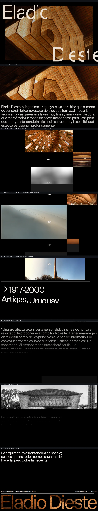
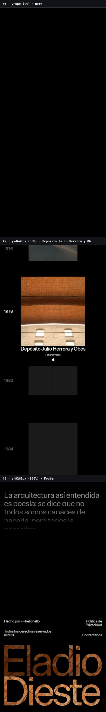

# UI Design System & Master Generation Blueprint: www-eladiodieste-com

> **Eladio Dieste** (https://www.eladiodieste.com/) — Eladio Dieste (1917–2000), ingeniero uruguayo. Biografía, trayectoria y obras: bóvedas de ladrillo, estructuras de cascarón y la revoluci...





---

## 1. Executive Visual Persona & Design Archetype

- **Brand Essence & Persona**: **Eladio Dieste** (`https://www.eladiodieste.com/`). Eladio Dieste (1917–2000), ingeniero uruguayo. Biografía, trayectoria y obras: bóvedas de ladrillo, estructuras de cascarón y la revoluci...
- **Capture Provenance**: Live browser capture (`tier2_webgl`, HTTP `200`, captured `2026-11-24`).
- **Visual Archetype**: **Dark-Substrate WebGL / Canvas Interactive Experience (`#000000` / `#a55f2d`)**.
- **Anti-AI-Slop Differentiators**:
  - **Live-Computed Chromatic Polarity**: Anchors the viewport in `#000000` (live computed `body` `background-color` (`computed_styles.json`)) paired with `#f1ece8` primary typography and `#a55f2d` accents.
  - **Grounded Typographic Hierarchy**: Uses `font` across display (`Eladio Dieste`) and body copy, paired with `SFMono-Regular` for monospace/code.
  - **Calibrated Spatial Grid & Motion**: Combines `96rem` container bounds (`gap: 0px (flush layout)`, padding `var(--split-mask-pad)`) with `cubic-bezier(0,0,.2,1)` easing and Lenis Smooth Scroll (`data-lenis`), Three.js / WebGL Canvas Pipeline.

---

## 2. Spatial Architecture & Modular Grid Mathematics

### Viewport Allocation & Container Geometry
- **Captured Journey Filmstrips**: Desktop `1280×6624px` (`assets/desktop-journey.webp`, `8` keyframes up to `y=13125px` / doc `14025px`), Mobile `390×2616px` (`assets/mobile-journey.webp`, `3` keyframes).
- **Master Container Bounds**: `96rem` (non-`@media` desktop container stylesheet rule).
- **Canvas Lateral Padding & Spacing**: `var(--split-mask-pad)` lateral canvas padding with `0px (flush layout)` grid gap.
- **Border Radius Scale**: `var(--radius-md)`, `50%`.

### Responsive Breakpoint Architecture
- **Desktop Layout**: Multi-column CSS Grid / Flexbox layout at `1440px` (`max-width: 96rem`, `gap: 0px (flush layout)`).
- **Mobile Layout**: Single-column vertical stack at `390px` viewport width with `var(--split-mask-pad)` horizontal padding.
- **Extracted CSS Media Queries**: `@media (min-width:40rem)`, `@media (min-width:48rem)`, `@media (min-width:64rem)`, `@media (min-width:80rem)`.

---

## 3. Color System, Materiality & Atmospheric Lighting

### Semantic Palette & Source Grounding
| Semantic Role | Ground-Truth Value | Extracted Live / CSS Source |
|---|---|---|
| **Primary Canvas Substrate** | `#000000` | live computed `body` `background-color` (`computed_styles.json`) |
| **Primary Typography Ink** | `#f1ece8` | live computed `h1` `color` (`computed_styles.json`) |
| **Elevated Surface / Card Substrate** | `#eadfd2` | `var(--background)` in `:root` |
| **Interactive Accent / Highlight** | `#a55f2d` | live computed `main` `color` (`computed_styles.json`) |
| **Secondary / Muted Copy** | `#a55f2d` | live computed `main` `color` (`computed_styles.json`) |
| **Structural Hairline Border** | `#ffffff` | `.border-off-white { border-color: #ffffff }` |

### Sanitized Root CSS Variables (`ui-ux.md` Ground Truth)
| Variable Name | Extracted Value | Semantic Role |
|---|---|---|
| `--background` | `#eadfd2` | Canvas / Surface Token |
| `--foreground` | `#a55f2d` | Typography Ink Token |
| `--off-white` | `#f1ece8` | Canvas / Surface Token |
| `--color-black` | `#000` | Canvas / Surface Token |
| `--color-white` | `#fff` | Canvas / Surface Token |
| `--spacing` | `.25rem` | Layout / Spatial Grid Token |
| `--container-xl` | `36rem` | Layout / Spatial Grid Token |
| `--text-xs` | `.75rem` | Typography Ink Token |
| `--text-xs--line-height` | `calc(1/.75)` | Typography Ink Token |
| `--text-sm` | `.875rem` | Typography Ink Token |
| `--text-sm--line-height` | `calc(1.25/.875)` | Typography Ink Token |
| `--text-lg` | `1.125rem` | Typography Ink Token |
| `--text-lg--line-height` | `calc(1.75/1.125)` | Typography Ink Token |
| `--text-xl` | `1.25rem` | Typography Ink Token |
| `--text-xl--line-height` | `calc(1.75/1.25)` | Typography Ink Token |
| `--text-2xl` | `1.5rem` | Typography Ink Token |

---

## 4. Typographic Scale & Editorial Hierarchy

### Font Family Stacks
- **Display Typography**: `font`.
- **Primary Body Stack**: `font`.
- **Technical / Metadata Stack**: `SFMono-Regular`.

### Typographic Scale & Rules (Live Computed & Stylesheet Grounded)
- **Hero Display (`H1`)**: live computed `h1` (`font-size: 17.5524px`, `line-height: 26.3287px`, `font-weight: 400`); CSS variables `--text-5xl: 3rem`, `--text-5xl--line-height: 1`, `--text-6xl: 3.75rem`.
- **Section Heading (`H2`)**: live computed `h2` (`font-size: 122.867px`, `line-height: 122.867px`, `font-weight: 400`, `letter-spacing: -6.14335px`); CSS variables `--text-2xl: 1.5rem`, `--text-2xl--line-height: calc(2/1.5)`, `--text-3xl: 1.875rem`.
- **Body Copy**: live computed `body` (`font-size: 17.5524px`, `line-height: 26.3287px`, `font-weight: 400`).
- **Metadata & Navigation Labels**: live computed `nav/a` (`font-size: 17.5524px`, `line-height: 26.3287px`, `font-weight: 500`, `letter-spacing: -0.0175524px`); CSS variables `--text-xs: .75rem`, `--text-xs--line-height: calc(1/.75)`, `--text-sm: .875rem`.

---

## 5. Choreographed Motion & Interaction Physics

### Primary Easing Curves
- **Extracted Timing Functions**: `cubic-bezier(0,0,.2,1)`, `cubic-bezier(.4,0,.2,1)`, `cubic-bezier(.19,1,.22,1)`.

### Per-Element Transition & Choreography Rules
- **Selector `layer theme`**: `transition: .15s` extracted from `www-eladiodieste-com` stylesheet.
- **Selector `body`**: `transition: background-color .7s,color .7s` extracted from `www-eladiodieste-com` stylesheet.
- **Selector `.reveal-divider`**: `transition: transform 1.4s var(--ease-out-expo)` extracted from `www-eladiodieste-com` stylesheet.
- **Extracted Easing Curve (`cubic-bezier(0,0,.2,1)`)**: Governs interactive state transitions across `<nav.font-medium>` and `<section.px-global>`.
- **Runtime Interaction Engine**: Integrates Lenis Smooth Scroll (`data-lenis`), Three.js / WebGL Canvas Pipeline with `prefers-reduced-motion: reduce` fallback guards.
### Measured Runtime Scroll & Interaction Telemetry (`behavioral_journey_v2`)
- **Scroll Driver Mode**: `native` (max document height `14025px`, deepest scrollY reached `13125px` across `8` desktop keyframes).
- **Detected Scroll / Motion Libraries**: `Lenis`, `WebGL/Canvas`.
- **Hover Physics (`primary_cta` · `Inicio`)**: Computed transition `0s` / `ease` (no static color/transform shift captured at rest).
- **Route Transition Architecture**: First internal navigation (`/en`) measured as `SPA` in `2131ms`.

---

## 6. Component Wireframe & Structural DOM Map

### Visual Layout Schematic — Desktop (`1440px`, Grounded in `dom.html` & Landmark Bounding Boxes)
```
┌────────────────────────────────────────────────────────────────────────┐
│ DESKTOP VIEWPORT (1440px) — Eladio Dieste                              │
│ ====================================================================== │
│ [ <nav.font-medium> (1405x26px)       | Inicio · Obra · Vida · Carre ] │
│ ---------------------------------------------------------------------- │
│ | HERO STAGE: <section.text-background> (w=1440px)                   | │
│ | H1: Eladio Dieste                                                  | │
│ | Substrate: #000000 | Ink: #f1ece8 | Accent: #a55f2d                | │
│ ---------------------------------------------------------------------- │
│ | SHOWCASE GRID (<section.px-global>) max-w: 96rem                   | │
│ | +------------------------------+  +------------------------------+ | │
│ | | Vivienda Berlingieri (Próxim |  | Iglesia de Atlántida Cristo  | | │
│ | +------------------------------+  +------------------------------+ | │
│ ---------------------------------------------------------------------- │
│ | DETAIL MODULE (<section.gap-5>) — Fábrica TEM S.A. (Pró            | │
│ ---------------------------------------------------------------------- │
│ [ FOOTER (<footer.h-dvh>      ) | https://www.eladiodieste.com/        │
└────────────────────────────────────────────────────────────────────────┘
```

### Visual Layout Schematic — Mobile Reflow (`390px`)
```
┌────────────────────────────────────────────────────────────────────────┐
│ MOBILE VIEWPORT REFLOW (390px) — Single-Column Stack (gap: 0px (flu)   │
│ ====================================================================== │
│ [ HEADER BAR (<nav.font-medium>       ) | Compact Menu (390px)         │
│ ---------------------------------------------------------------------- │
│ | HERO STAGE (<section.text-background) — 390px Vertical Lead        | │
│ | H1: Eladio Dieste                                                  | │
│ ---------------------------------------------------------------------- │
│ | SHOWCASE STACK (<section.px-global>) — 1-Col Stack                 | │
│ | [ Item 1: Vivienda Berlingieri (Próximamente)                    ] | │
│ | [ Item 2: Iglesia de Atlántida Cristo Obrero y Nuestra Seño...   ] | │
│ ---------------------------------------------------------------------- │
│ | DETAIL STACK (<section.gap-5>) — 1-Col (Fábrica TEM S.A. ()        | │
│ ---------------------------------------------------------------------- │
│ [ FOOTER (<footer.h-dvh>      ) | Stacked 390px Colophon               │
└────────────────────────────────────────────────────────────────────────┘
```

### Granular DOM Region Breakdown
1. **Brand Header & Navigation Bar (<nav.font-medium> — `www-eladiodieste-com`)**:
   - Landmark `<nav class="font-medium pointer-events-auto">` (`1405x26px`) hosting `Eladio Dieste` navigation (`Inicio · Obra · Vida · Carrera · English`), DOM attributes (`data-scroll-orientation="vertical"`, `data-precedence="next"`, `data-precedence="next"`, `data-sdkn="@vercel/analytics/next"`), and stylesheet rule `font_b50abbf3-module__9ye_bG__cla... { font-family:font,font Fallback }`.
2. **Hero Stage & Focal Lead (<section.text-background> — `Eladio Dieste`)**:
   - Landmark `<section class="text-background invisible">` presenting display lead `Eladio Dieste` and copy excerpt *"Foto: (FADU, UDELAR)"* over `#000000` canvas and `#f1ece8` ink.
3. **Primary Showcase & Content Grid (<section.px-global> — `Vivienda Berlingieri (Próximamente`)**:
   - Landmark `<section class="px-global pt-6">` rendering section `Vivienda Berlingieri (Próximamente)` with copy *"Todos los derechos reservados © 2026"*, asset references (`die_grotesk_a_medium-s.p.221bfec9...`, `die_grotesk_a_regular-s.p.e93e1fc...`, `bg.webp`, `inf-4.webp`), and grid rule `backdrop { box-sizing:border-box;border:0 solid;margin:0;padding:0 }`.
4. **Interactive Detail & Feature Matrix (<section.gap-5> — `Iglesia de Atlántida Cristo Obrero`)**:
   - Landmark `<section class="px-global gap-5">` framing `Iglesia de Atlántida Cristo Obrero y Nuestra Seño...` and `Fábrica TEM S.A. (Próximamente)` (*"Eladio Dieste, el ingeniero uruguayo, cuya obra hizo que el modo "*) with `#eadfd2` surface cards, `#a55f2d` accents, and `file-selector-button { box-sizing:border-box;border:0 solid;margin:0;padding:0 }`.
5. **Colophon & Global Directory Footer (<footer.h-dvh> — `https://www.eladiodieste.com/`)**:
   - Landmark `<footer class="h-dvh overflow-hidden">` anchoring `Eladio Dieste` footer links (`Inicio · Obra · Vida · Carrera · English`), copy *"Eladio Dieste, el ingeniero uruguayo, cuya obra hizo que el "*, and `#ffffff` structural dividers.
### Full Vertical Scroll Sequence (Desktop `1440×900` Keyframes)
- **Step 01** (`y=0px`, `0%`): Active landmark `Hero` · sticky/fixed elements: `2`
- **Step 02** (`y=850px`, `6%`): Active landmark `Section @ 6%` · sticky/fixed elements: `2`
- **Step 03** (`y=3400px`, `26%`): Active landmark `Iglesia de Atlántida Cristo Obrero y Nuestra Seño...` · sticky/fixed elements: `1`
- **Step 04** (`y=5950px`, `45%`): Active landmark `Gimnasio Polideportivo (Próximamente)` · sticky/fixed elements: `1`
- **Step 05** (`y=7650px`, `58%`): Active landmark `→ 1917-2000 Artigas, Uruguay` · sticky/fixed elements: `1`
- **Step 06** (`y=10200px`, `78%`): Active landmark `#carrera` · sticky/fixed elements: `1`
- **Step 07** (`y=12750px`, `97%`): Active landmark `Footer` · sticky/fixed elements: `1`
- **Step 08** (`y=13125px`, `100%`): Active landmark `Footer` · sticky/fixed elements: `1`

### Multi-Page Internal Route Map
- **Other Route (`/en`)**: `https://www.eladiodieste.com/en` — H1: `Eladio Dieste`, scrollHeight `14108px`, transition `SPA` (`2131ms`)

---

## 7. Master Zero-Shot AI Generation Prompt

```markdown
# Master Zero-Shot Frontend Generation Prompt: www-eladiodieste-com (Eladio Dieste)

You are a principal frontend architect and design systems engineer. Build a complete, production-ready web application replicating the exact design system, DOM landmarks, typographic hierarchy, color tokens, and motion physics of `www-eladiodieste-com` (**Eladio Dieste** — `https://www.eladiodieste.com/`).

### 1. Visual Archetype & Anti-AI-Slop Mandates
- **Archetype**: Dark-Substrate WebGL / Canvas Interactive Experience (`#000000` / `#a55f2d`).
- **Identity & Domain Context**: Eladio Dieste (1917–2000), ingeniero uruguayo. Biografía, trayectoria y obras: bóvedas de ladrillo, estructuras de cascarón y la revoluci...
- **Primary Substrate**: `#000000` (live computed `body` `background-color` (`computed_styles.json`)), **Primary Ink**: `#f1ece8`, **Accent / Highlight**: `#a55f2d`.
- **Site-Specific Differentiators**:
  - **Live-Computed Chromatic Polarity**: Anchors the viewport in `#000000` (live computed `body` `background-color` (`computed_styles.json`)) paired with `#f1ece8` primary typography and `#a55f2d` accents.
  - **Grounded Typographic Hierarchy**: Uses `font` across display (`Eladio Dieste`) and body copy, paired with `SFMono-Regular` for monospace/code.
  - **Calibrated Spatial Grid & Motion**: Combines `96rem` container bounds (`gap: 0px (flush layout)`, padding `var(--split-mask-pad)`) with `cubic-bezier(0,0,.2,1)` easing and Lenis Smooth Scroll (`data-lenis`), Three.js / WebGL Canvas Pipeline.

### 2. Ground-Truth CSS Variables (`:root` Token Contract)
Declare and consume these exact custom properties extracted from `www-eladiodieste-com` in your global stylesheet:

:root {
  /* Eladio Dieste (www-eladiodieste-com) — Live-Grounded CSS Variables */
  --background: #eadfd2; /* Canvas / Surface Token (www-eladiodieste-com) */
  --foreground: #a55f2d; /* Typography Ink Token (www-eladiodieste-com) */
  --off-white: #f1ece8; /* Canvas / Surface Token (www-eladiodieste-com) */
  --color-black: #000; /* Canvas / Surface Token (www-eladiodieste-com) */
  --color-white: #fff; /* Canvas / Surface Token (www-eladiodieste-com) */
  --spacing: .25rem; /* Layout / Spatial Grid Token (www-eladiodieste-com) */
  --container-xl: 36rem; /* Layout / Spatial Grid Token (www-eladiodieste-com) */
  --text-xs: .75rem; /* Typography Ink Token (www-eladiodieste-com) */
  --text-xs--line-height: calc(1/.75); /* Typography Ink Token (www-eladiodieste-com) */
  --text-sm: .875rem; /* Typography Ink Token (www-eladiodieste-com) */
  --text-sm--line-height: calc(1.25/.875); /* Typography Ink Token (www-eladiodieste-com) */
  --text-lg: 1.125rem; /* Typography Ink Token (www-eladiodieste-com) */
  --text-lg--line-height: calc(1.75/1.125); /* Typography Ink Token (www-eladiodieste-com) */
  --text-xl: 1.25rem; /* Typography Ink Token (www-eladiodieste-com) */
  --text-xl--line-height: calc(1.75/1.25); /* Typography Ink Token (www-eladiodieste-com) */
  --text-2xl: 1.5rem; /* Typography Ink Token (www-eladiodieste-com) */
}

### 3. Semantic Color & Materiality Contract
Map every surface, ink, and border strictly to these source-grounded tokens:
- **Primary Canvas Substrate**: `#000000` — grounded in live computed `body` `background-color` (`computed_styles.json`)
- **Primary Typography Ink**: `#f1ece8` — grounded in live computed `h1` `color` (`computed_styles.json`)
- **Elevated Surface / Card Substrate**: `#eadfd2` — grounded in `var(--background)` in `:root`
- **Interactive Accent / Highlight**: `#a55f2d` — grounded in live computed `main` `color` (`computed_styles.json`)
- **Secondary / Muted Copy**: `#a55f2d` — grounded in live computed `main` `color` (`computed_styles.json`)
- **Structural Hairline Border**: `#ffffff` — grounded in `.border-off-white { border-color: #ffffff }`

### 4. Spatial Grid, Container Bounds & Responsive Breakpoints
- **Desktop Viewport Reference**: `1280×6624px` (multi-frame vertical journey filmstrip (6624px), `1440px` standard desktop width).
- **Mobile Viewport Reference**: `390×2616px` (multi-frame vertical journey filmstrip (2616px), `390px` standard mobile width).
- **Container Max-Width**: `96rem` (non-`@media` desktop container stylesheet rule)
- **Padding & Gutters**: `var(--split-mask-pad)` lateral canvas padding with `0px (flush layout)` grid gap
- **Desktop Grid**: Multi-column CSS Grid / Flexbox layout at `1440px` (`max-width: 96rem`, `gap: 0px (flush layout)`)
- **Mobile Adaptation**: Single-column vertical stack at `390px` viewport width with `var(--split-mask-pad)` horizontal padding
- **Media Queries**: `@media (min-width:40rem)`, `@media (min-width:48rem)`, `@media (min-width:64rem)`, `@media (min-width:80rem)`
- **Corner Radii**: `var(--radius-md)`, `50%`

### 5. Typography & Editorial Scale Contract
- **Display Font Stack**: `font`
- **Body Font Stack**: `font`
- **Monospace / Technical Font Stack**: `SFMono-Regular`
- **H1 Display Rule**: live computed `h1` (`font-size: 17.5524px`, `line-height: 26.3287px`, `font-weight: 400`); CSS variables `--text-5xl: 3rem`, `--text-5xl--line-height: 1`, `--text-6xl: 3.75rem`
- **H2 Section Rule**: live computed `h2` (`font-size: 122.867px`, `line-height: 122.867px`, `font-weight: 400`, `letter-spacing: -6.14335px`); CSS variables `--text-2xl: 1.5rem`, `--text-2xl--line-height: calc(2/1.5)`, `--text-3xl: 1.875rem`
- **Body Copy Rule**: live computed `body` (`font-size: 17.5524px`, `line-height: 26.3287px`, `font-weight: 400`)
- **Metadata & Index Rule**: live computed `nav/a` (`font-size: 17.5524px`, `line-height: 26.3287px`, `font-weight: 500`, `letter-spacing: -0.0175524px`); CSS variables `--text-xs: .75rem`, `--text-xs--line-height: calc(1/.75)`, `--text-sm: .875rem`

### 6. Component Hierarchy, Verbatim Copy & Real DOM Landmarks
Scaffold `www-eladiodieste-com` (`Eladio Dieste`) with these exact structural regions, extracted copy, and CSS rules from `dom.html`:
1. **Brand Header & Navigation Bar (<nav.font-medium> — `www-eladiodieste-com`)**:
   - DOM & Selectors: Landmark `<nav class="font-medium pointer-events-auto">` (`1405x26px`) hosting `Eladio Dieste` navigation (`Inicio · Obra · Vida · Carrera · English`), DOM attributes (`data-scroll-orientation="vertical"`, `data-precedence="next"`, `data-precedence="next"`, `data-sdkn="@vercel/analytics/next"`), and stylesheet rule `font_b50abbf3-module__9ye_bG__cla... { font-family:font,font Fallback }`.
   - Responsive Contract: Header `Brand Header & Navigation Bar (<nav.font-medium> — `www-eladiodieste-com`)` (`www-eladiodieste-com`) adapts across `@media (min-width:40rem)`, `@media (min-width:48rem)`, `@media (min-width:64rem)`, `@media (min-width:80rem)` with `cubic-bezier(0,0,.2,1)`, `cubic-bezier(.4,0,.2,1)`, `cubic-bezier(.19,1,.22,1)` transitions and links `Inicio · Obra · Vida · Carrera · English`.
2. **Hero Stage & Focal Lead (<section.text-background> — `Eladio Dieste`)**:
   - DOM & Selectors: Landmark `<section class="text-background invisible">` presenting display lead `Eladio Dieste` and copy excerpt *"Foto: (FADU, UDELAR)"* over `#000000` canvas and `#f1ece8` ink.
   - Responsive Contract: Hero stage (`1280×6624px` desktop / `390×2616px` mobile) sets `#000000` background with `#f1ece8` headline `Eladio Dieste`.
3. **Primary Showcase & Content Grid (<section.px-global> — `Vivienda Berlingieri (Próximamente`)**:
   - DOM & Selectors: Landmark `<section class="px-global pt-6">` rendering section `Vivienda Berlingieri (Próximamente)` with copy *"Todos los derechos reservados © 2026"*, asset references (`die_grotesk_a_medium-s.p.221bfec9...`, `die_grotesk_a_regular-s.p.e93e1fc...`, `bg.webp`, `inf-4.webp`), and grid rule `backdrop { box-sizing:border-box;border:0 solid;margin:0;padding:0 }`.
   - Responsive Contract: Showcase grid `Primary Showcase & Content Grid (<section.px-global> — `Vivienda Berlingieri (Próximamente`)` applies Multi-column CSS Grid / Flexbox layout at `1440px` (`max-width: 96rem`, `gap: 0px (flush layout)`) on desktop and Single-column vertical stack at `390px` viewport width with `var(--split-mask-pad)` horizontal padding on mobile.
4. **Interactive Detail & Feature Matrix (<section.gap-5> — `Iglesia de Atlántida Cristo Obrero`)**:
   - DOM & Selectors: Landmark `<section class="px-global gap-5">` framing `Iglesia de Atlántida Cristo Obrero y Nuestra Seño...` and `Fábrica TEM S.A. (Próximamente)` (*"Eladio Dieste, el ingeniero uruguayo, cuya obra hizo que el modo "*) with `#eadfd2` surface cards, `#a55f2d` accents, and `file-selector-button { box-sizing:border-box;border:0 solid;margin:0;padding:0 }`.
   - Responsive Contract: Detail module `Interactive Detail & Feature Matrix (<section.gap-5> — `Iglesia de Atlántida Cristo Obrero`)` uses `var(--radius-md)`, `50%` radii, `#a55f2d` highlights, and assets (die_grotesk_a_medium-s.p.221bfec9..., die_grotesk_a_regular-s.p.e93e1fc..., bg.webp).
5. **Colophon & Global Directory Footer (<footer.h-dvh> — `https://www.eladiodieste.com/`)**:
   - DOM & Selectors: Landmark `<footer class="h-dvh overflow-hidden">` anchoring `Eladio Dieste` footer links (`Inicio · Obra · Vida · Carrera · English`), copy *"Eladio Dieste, el ingeniero uruguayo, cuya obra hizo que el "*, and `#ffffff` structural dividers.
   - Responsive Contract: Footer `Colophon & Global Directory Footer (<footer.h-dvh> — `https://www.eladiodieste.com/`)` aligns to `96rem` (non-`@media` desktop container stylesheet rule) with `var(--split-mask-pad)` lateral canvas padding with `0px (flush layout)` grid gap and attributes (data-scroll-orientation="vertical", data-precedence="next", data-precedence="next").

#### Verbatim DOM Copy Excerpts (`dom.html`)
- Copy Excerpt 1: *"Foto: (FADU, UDELAR)"*
- Copy Excerpt 2: *"Todos los derechos reservados © 2026"*
- Copy Excerpt 3: *"Eladio Dieste, el ingeniero uruguayo, cuya obra hizo que el modo de construir, tal..."*
- Copy Excerpt 4: *"Eladio Dieste, el ingeniero uruguayo, cuya obra hizo que el modo"*

### 7. Motion, Extracted Stylesheet Rules & Interaction Choreography
- **Primary Easing Functions**: `cubic-bezier(0,0,.2,1)`, `cubic-bezier(.4,0,.2,1)`, `cubic-bezier(.19,1,.22,1)`
- **Extracted Stylesheet Rules (`www-eladiodieste-com`)**:
- `font_b50abbf3-module__9ye_bG__cla... { font-family:font,font Fallback }`
- `backdrop { box-sizing:border-box;border:0 solid;margin:0;padding:0 }`
- `file-selector-button { box-sizing:border-box;border:0 solid;margin:0;padding:0 }`
- `strong { font-weight:bolder }`
- `small { font-size:80% }`
- **Per-Selector Transition Rules**:
- **Selector `layer theme`**: `transition: .15s` extracted from `www-eladiodieste-com` stylesheet.
- **Selector `body`**: `transition: background-color .7s,color .7s` extracted from `www-eladiodieste-com` stylesheet.
- **Selector `.reveal-divider`**: `transition: transform 1.4s var(--ease-out-expo)` extracted from `www-eladiodieste-com` stylesheet.
- **Extracted Easing Curve (`cubic-bezier(0,0,.2,1)`)**: Governs interactive state transitions across `<nav.font-medium>` and `<section.px-global>`.
- **Runtime Interaction Engine**: Integrates Lenis Smooth Scroll (`data-lenis`), Three.js / WebGL Canvas Pipeline with `prefers-reduced-motion: reduce` fallback guards.
### 7b. Full-Page Scroll Choreography, Interactive States & Multi-Page Routes
- **Scroll Mechanics**: Implement `native` vertical progression up to `14025px` across 8 distinct viewport chapters using Lenis, WebGL/Canvas.
- **Vertical Chapter Sequence**: Hero (0%) -> Section @ 6% (6%) -> Iglesia de Atlántida Cristo... (26%) -> Gimnasio Polideportivo (Pró... (45%) -> → 1917-2000 Artigas, Uruguay (58%) -> #carrera (78%) -> Footer (97%) -> Footer (100%).
- **Multi-Page Routes**: Scaffold internal routes `/en` (other, SPA) sharing the global header/footer shell and design tokens.

### 8. Technical Deliverables
- Implement in Next.js (App Router) with TypeScript and Tailwind CSS consuming the `:root` custom properties defined above for `www-eladiodieste-com`.
- Reproduce both the `1440px` desktop architecture and `390px` mobile breakpoint transitions, preserving semantic HTML5 landmarks (`<header>`, `<nav>`, `<main>`, `<section>`, `<footer>`) and `prefers-reduced-motion` accessibility guards.
```
---

## 8. Full-Page Scroll Journey, Interactive States & Subpage Inventory

### Desktop Scroll Keyframes (`1440×900` WebP)
| Step | Scroll Y | Progress | Active Landmark / Section | Sticky/Fixed | Visual Asset |
| :---: | :---: | :---: | :--- | :---: | :--- |
| `#01` | `0px` | `0%` | Hero | `2` | [desktop-step-01.webp](assets/desktop-step-01.webp) |
| `#02` | `850px` | `6%` | Section @ 6% | `2` | [desktop-step-02.webp](assets/desktop-step-02.webp) |
| `#03` | `3400px` | `26%` | Iglesia de Atlántida Cristo Obrero y Nuestra... | `1` | [desktop-step-03.webp](assets/desktop-step-03.webp) |
| `#04` | `5950px` | `45%` | Gimnasio Polideportivo (Próximamente) | `1` | [desktop-step-04.webp](assets/desktop-step-04.webp) |
| `#05` | `7650px` | `58%` | → 1917-2000 Artigas, Uruguay | `1` | [desktop-step-05.webp](assets/desktop-step-05.webp) |
| `#06` | `10200px` | `78%` | #carrera | `1` | [desktop-step-06.webp](assets/desktop-step-06.webp) |
| `#07` | `12750px` | `97%` | Footer | `1` | [desktop-step-07.webp](assets/desktop-step-07.webp) |
| `#08` | `13125px` | `100%` | Footer | `1` | [desktop-step-08.webp](assets/desktop-step-08.webp) |

### Mobile Condensed Keyframes (`390×844` WebP)
| Step | Scroll Y | Progress | Active Landmark | Visual Asset |
| :---: | :---: | :---: | :--- | :--- |
| `#01` | `0px` | `0%` | Hero | [mobile-step-01.webp](assets/mobile-step-01.webp) |
| `#02` | `4640px` | `50%` | Depósito Julio Herrera y Obes (Próximamente) | [mobile-step-02.webp](assets/mobile-step-02.webp) |
| `#03` | `9281px` | `100%` | Footer | [mobile-step-03.webp](assets/mobile-step-03.webp) |

### Internal Subpage Filmstrips (`1080px` Wide WebP)
| # | Template | Route URL | H1 / Title | Scroll Height | Transition | Filmstrip Asset |
| :-: | :---: | :--- | :--- | :---: | :---: | :--- |
| `1` | `other` | `https://www.eladiodieste.com/en` | Eladio Dieste | `14108px` | `SPA` (`2131ms`) | [subpage-01-en.webp](assets/subpage-01-en.webp) |

