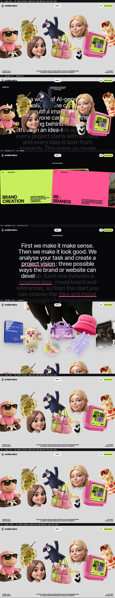
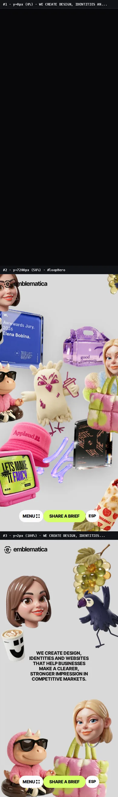

# UI Design System & Master Generation Blueprint: www-emblematica-agency

> **emblematica — concept-led brand & web design agency in barcelona** (https://www.emblematica.agency) — emblematica is a concept-led design agency in Barcelona creating brand identities and websites that help businesses stand out in competit...





---

## 1. Executive Visual Persona & Design Archetype

- **Brand Essence & Persona**: **emblematica — concept-led brand & web design agency in barcelona** (`https://www.emblematica.agency`). emblematica is a concept-led design agency in Barcelona creating brand identities and websites that help businesses stand out in competit...
- **Final Redirected URL**: [https://emblematica.agency/](https://emblematica.agency/)
- **Capture Provenance**: Live browser capture (`tier1_fast`, HTTP `200`, captured `2026-11-24`).
- **Visual Archetype**: **Light-Substrate Editorial & Modular Grid System (`#dadada` canvas, `#0e0c0d` ink, `#ff5490` accent)**.
- **Anti-AI-Slop Differentiators**:
  - **Live-Computed Chromatic Polarity**: Anchors the viewport in `#dadada` (live computed `body` `background-color` (`computed_styles.json`)) paired with `#0e0c0d` primary typography and `#ff5490` accents.
  - **Grounded Typographic Hierarchy**: Uses `Inter Tight` across display (`WE CREATE DESIGN, IDENTITIES AND WEB`) and body copy.
  - **Calibrated Spatial Grid & Motion**: Combines `1160px` container bounds (`gap: 4px`, padding `22px`) with `cubic-bezier(0.16,1,0.3,1)` easing and Three.js / WebGL Canvas Pipeline, Barba.js Page Transition Router.

---

## 2. Spatial Architecture & Modular Grid Mathematics

### Viewport Allocation & Container Geometry
- **Captured Journey Filmstrips**: Desktop `1280×6624px` (`assets/desktop-journey.webp`, `8` keyframes up to `y=8500px` / doc `47561px`), Mobile `390×2616px` (`assets/mobile-journey.webp`, `3` keyframes).
- **Master Container Bounds**: `1160px` (measured widest bounded `<section>` landmark width on `1440px` desktop).
- **Canvas Lateral Padding & Spacing**: `22px` lateral canvas padding with `4px` grid gap.
- **Border Radius Scale**: `999px`, `24px`, `50%`, `20px`.

### Responsive Breakpoint Architecture
- **Desktop Layout**: Multi-column CSS Grid / Flexbox layout at `1440px` (`max-width: 1160px`, `gap: 4px`).
- **Mobile Layout**: Single-column vertical stack at `390px` viewport width with `22px` horizontal padding.
- **Extracted CSS Media Queries**: `@media screen and (max-width:1024px)`, `@media screen and (max-width:640px)`, `@media screen and (max-width:480px)`, `@media screen and (max-width:1200px)`.

---

## 3. Color System, Materiality & Atmospheric Lighting

### Semantic Palette & Source Grounding
| Semantic Role | Ground-Truth Value | Extracted Live / CSS Source |
|---|---|---|
| **Primary Canvas Substrate** | `#dadada` | live computed `body` `background-color` (`computed_styles.json`) |
| **Primary Typography Ink** | `#0e0c0d` | live computed `h1` `color` (`computed_styles.json`) |
| **Elevated Surface / Card Substrate** | `#ffffff` | `.t-mbfix { background-color: white }` (`#ffffff`) |
| **Interactive Accent / Highlight** | `#ff5490` | `.about-link:focus-visible { color: #ff5490 }` |
| **Secondary / Muted Copy** | `#323232` | live computed `button` `color` (`computed_styles.json`) |
| **Structural Hairline Border** | `#323232` | hairline divider derived from live computed `button` `color` (`computed_styles.json`) |
| **Variable Token (`--white`)** | `#fbfbfb` | `var(--white)` in `:root` |
| **Variable Token (`--acid`)** | `#d5ff69` | `var(--acid)` in `:root` |

### Sanitized Root CSS Variables (`ui-ux.md` Ground Truth)
| Variable Name | Extracted Value | Semantic Role |
|---|---|---|
| `--ink` | `#0e0c0d` | Typography Ink Token |
| `--paper` | `#dadada` | Canvas / Surface Token |
| `--white` | `#fbfbfb` | Canvas / Surface Token |
| `--acid` | `#d5ff69` | Color / Atmospheric Token |
| `--t-headline-font` | `'InterTight',Arial,sans-serif` | Typography / Scale Token |
| `--t-text-font` | `'InterTight',Arial,sans-serif` | Typography Ink Token |
| `--menu-edge-gap` | `calc(12 * var(--u))` | Layout / Spatial Grid Token |
| `--menu-anchor-left` | `calc(50vw - (45 * var(--u)))` | Dimension / Scale Token |
| `--menu-anchor-top` | `var(--menu-edge-gap)` | Design System Custom Token |
| `--menu-drawer-padding-left` | `calc(28 * var(--u))` | Layout / Spatial Grid Token |
| `--menu-origin-x` | `0px` | Dimension / Scale Token |
| `--menu-origin-y` | `0px` | Dimension / Scale Token |
| `--menu-origin-scale-x` | `0.12` | Design System Custom Token |
| `--menu-origin-scale-y` | `0.05` | Design System Custom Token |
| `--preloader-size` | `220` | Layout / Spatial Grid Token |
| `--preloader-delay` | `70ms` | Motion / Easing Token |

---

## 4. Typographic Scale & Editorial Hierarchy

### Font Family Stacks
- **Display Typography**: `Inter Tight`.
- **Primary Body Stack**: `Inter Tight`.
- **Technical / Metadata Stack**: not declared in live computed styles (uses primary stack / `ui-monospace`).

### Typographic Scale & Rules (Live Computed & Stylesheet Grounded)
- **Hero Display (`H1`)**: live computed `h1` (`font-size: 14px`, `line-height: 16.38px`, `font-weight: 800`).
- **Section Heading (`H2`)**: live computed `h2` (`font-size: 70px`, `line-height: 71.4px`, `font-weight: 500`, `letter-spacing: -2.1px`); rule `h2` (`font-size: calc(58 * var(--u))`, `line-height: 0.92`).
- **Body Copy**: live computed `body` (`font-size: 16px`, `line-height: normal`, `font-weight: 800`); rule `body` (`font-weight: 800`).
- **Metadata & Navigation Labels**: live computed `nav/a` (`font-size: 16px`, `line-height: normal`, `font-weight: 800`); CSS variables `--loop-caption-alpha: 0.000`; rule `.caption` (`font-size: calc(14 * var(--u))`, `line-height: 1.17`, `letter-spacing: 0`, `font-weight: inherit`).

---

## 5. Choreographed Motion & Interaction Physics

### Primary Easing Curves
- **Extracted Timing Functions**: `cubic-bezier(0.16,1,0.3,1)`, `cubic-bezier(0.16,0.96,0.19,1)`, `cubic-bezier(0.18,1,0.36,1)`.

### Per-Element Transition & Choreography Rules
- **Selector `.t-mbfix`**: `transition: all 0.1s ease` extracted from `www-emblematica-agency` stylesheet.
- **Selector `.r_anim`**: `transition: opacity 0.5s` extracted from `www-emblematica-agency` stylesheet.
- **Selector `.t-mbfix`**: `transition: all 0.1s ease` extracted from `www-emblematica-agency` stylesheet.
- **Extracted Easing Curve (`cubic-bezier(0.16,1,0.3,1)`)**: Governs interactive state transitions across `<header.t-records>` and `<section.manifesto-runout>`.
- **Runtime Interaction Engine**: Integrates Three.js / WebGL Canvas Pipeline, Barba.js Page Transition Router with `prefers-reduced-motion: reduce` fallback guards.
### Measured Runtime Scroll & Interaction Telemetry (`behavioral_journey_v2`)
- **Scroll Driver Mode**: `native` (max document height `47561px`, deepest scrollY reached `8500px` across `8` desktop keyframes).
- **Detected Scroll / Motion Libraries**: Native browser scroll / standard CSS transitions.
- **Nav / Drawer Probe (`Open menu`)**: Triggered visual change (pixel diff `44.718`, captured in `assets/state-nav.webp`); revealed links: WEB&DIGITAL, BRANDING& DESIGN, WHO WE ARE, PROJECTS, BOOK A CALL, ASK@EMBLEMATICA.AGENCY.
- **Hover Physics (`primary_cta` · `SHARE A BRIEF`)**: `backgroundColor`: `rgb(213, 255, 105)` -> `rgb(255, 84, 144)` (`transition-duration: 0.42s, 0.22s`, `timing: cubic-bezier(0.18, 1, 0.36, 1), ease`).
- **Route Transition Architecture**: First internal navigation (`/about`) measured as `direct` in `858ms`.

---

## 6. Component Wireframe & Structural DOM Map

### Visual Layout Schematic — Desktop (`1440px`, Grounded in `dom.html` & Landmark Bounding Boxes)
```
┌────────────────────────────────────────────────────────────────────────┐
│ DESKTOP VIEWPORT (1440px) — emblematica — concept-led brand & web desi │
│ ====================================================================== │
│ [ <header.t-records> (1389x38px)      | Overview · Index · Archive · ] │
│ ---------------------------------------------------------------------- │
│ | HERO STAGE: <section.manifesto> (w=1440px)                         | │
│ | H1: WE CREATE DESIGN, IDENTITIES AND WEBSITES THAT HE...           | │
│ | Substrate: #dadada | Ink: #0e0c0d | Accent: #ff5490                | │
│ ---------------------------------------------------------------------- │
│ | SHOWCASE GRID (<section.manifesto-runout>) max-w: 1160px           | │
│ | +------------------------------+  +------------------------------+ | │
│ | | We create design, identities |  | concept-led design agency    | | │
│ | +------------------------------+  +------------------------------+ | │
│ ---------------------------------------------------------------------- │
│ | DETAIL MODULE (<section.services>) — let's meet in barcelo         | │
│ ---------------------------------------------------------------------- │
│ [ FOOTER (<footer.t-records>  ) | https://www.emblematica.agency       │
└────────────────────────────────────────────────────────────────────────┘
```

### Visual Layout Schematic — Mobile Reflow (`390px`)
```
┌────────────────────────────────────────────────────────────────────────┐
│ MOBILE VIEWPORT REFLOW (390px) — Single-Column Stack (gap: 4px)        │
│ ====================================================================== │
│ [ HEADER BAR (<header.t-records>      ) | Compact Menu (390px)         │
│ ---------------------------------------------------------------------- │
│ | HERO STAGE (<section.manifesto>) — 390px Vertical Lead             | │
│ | H1: WE CREATE DESIGN, IDENTITIES AND WEBSITES THAT HE...           | │
│ ---------------------------------------------------------------------- │
│ | SHOWCASE STACK (<section.manifesto-run) — 1-Col Stack              | │
│ | [ Item 1: We create design, identities and websites that he...   ] | │
│ | [ Item 2: concept-led design agency                              ] | │
│ ---------------------------------------------------------------------- │
│ | DETAIL STACK (<section.services>) — 1-Col (let's meet in barc)     | │
│ ---------------------------------------------------------------------- │
│ [ FOOTER (<footer.t-records>  ) | Stacked 390px Colophon               │
└────────────────────────────────────────────────────────────────────────┘
```

### Granular DOM Region Breakdown
1. **Brand Header & Navigation Bar (<header.t-records> — `www-emblematica-agency`)**:
   - Landmark `<header class="t-records t-records_animated">` (`1389x38px`) hosting `emblematica — concept-led brand & we` navigation (`Overview · Index · Archive · About · Contact`), DOM attributes (`data-hook="blocks-collection-con..."`, `data-tilda-project-id="13693937"`, `data-tilda-page-id="189979109"`, `data-tilda-formskey="f0b53f0bdbcb91ba7a098..."`), and stylesheet rule `.csssize { height:3344px }`.
2. **Hero Stage & Focal Lead (<section.manifesto> — `WE CREATE DESIGN, IDENTITIES AND W`)**:
   - Landmark `<section class="manifesto">` presenting display lead `WE CREATE DESIGN, IDENTITIES AND WEBSITES THAT HE...` and copy excerpt *"CONCEPT-LED DESIGN AGENCY"* over `#dadada` canvas and `#0e0c0d` ink.
3. **Primary Showcase & Content Grid (<section.manifesto-runout> — `We create design, identities and w`)**:
   - Landmark `<section class="manifesto-runout">` rendering section `We create design, identities and websites that he...` with copy *"concept-led design agency"*, asset references (`emblematica.agency`, `ws.tildacdn.com`, `static.tildacdn.com`, `Frame_2087327053.png`), and grid rule `body { --t-headline-font:'InterTight',Arial,sans-serif;--t-text-font:'InterTigh... }`.
4. **Interactive Detail & Feature Matrix (<section.services> — `concept-led design agency`)**:
   - Landmark `<section class="services">` framing `concept-led design agency` and `let's meet in barcelona` (*"let's meet in barcelona"*) with `#ffffff` surface cards, `#ff5490` accents, and `.t-body { margin:0px }`.
5. **Colophon & Global Directory Footer (<footer.t-records> — `https://www.emblematica.agency`)**:
   - Landmark `<footer class="t-records">` anchoring `emblematica — concept-led brand ` footer links (`Overview · Index · Archive · About · Contact`), copy *"At Emblematica, we believe"*, and `#323232` structural dividers.
### Full Vertical Scroll Sequence (Desktop `1440×900` Keyframes)
- **Step 01** (`y=0px`, `0%`): Active landmark `WE CREATE DESIGN, IDENTITIES AND WEBSITES THAT HE...` · sticky/fixed elements: `11`
- **Step 02** (`y=850px`, `2%`): Active landmark `#manifesto` · sticky/fixed elements: `11`
- **Step 03** (`y=3400px`, `7%`): Active landmark `RE- BRANDS` · sticky/fixed elements: `6`
- **Step 04** (`y=5950px`, `13%`): Active landmark `Section @ 13%` · sticky/fixed elements: `2`
- **Step 05** (`y=8500px`, `18%`): Active landmark `#loopHero` · sticky/fixed elements: `3`
- **Step 06** (`y=2px`, `0%`): Active landmark `WE CREATE DESIGN, IDENTITIES AND WEBSITES THAT HE...` · sticky/fixed elements: `11`
- **Step 07** (`y=2px`, `0%`): Active landmark `WE CREATE DESIGN, IDENTITIES AND WEBSITES THAT HE...` · sticky/fixed elements: `11`
- **Step 08** (`y=2px`, `100%`): Active landmark `WE CREATE DESIGN, IDENTITIES AND WEBSITES THAT HE...` · sticky/fixed elements: `11`

### Multi-Page Internal Route Map
- **About Route (`/about`)**: `https://emblematica.agency/about` — H1: `Women-founded. Idea-led. Built for the AI era`, scrollHeight `7653px`, transition `direct` (`858ms`)
- **Other Route (`/digital`)**: `https://emblematica.agency/digital` — H1: `WE CREATE WEBSITES THAT COMMUNICATE THE BRAND`, scrollHeight `9808px`, transition `direct` (`487ms`)
- **Other Route (`/branding`)**: `https://emblematica.agency/branding` — H1: `WE TURN BUSINESS IDEAS INTO BRAND SYSTEMS`, scrollHeight `37252px`, transition `direct` (`792ms`)

---

## 7. Master Zero-Shot AI Generation Prompt

```markdown
# Master Zero-Shot Frontend Generation Prompt: www-emblematica-agency (emblematica — concept-led brand & web design agency in barcelona)

You are a principal frontend architect and design systems engineer. Build a complete, production-ready web application replicating the exact design system, DOM landmarks, typographic hierarchy, color tokens, and motion physics of `www-emblematica-agency` (**emblematica — concept-led brand & web design agency in barcelona** — `https://www.emblematica.agency`).

### 1. Visual Archetype & Anti-AI-Slop Mandates
- **Archetype**: Light-Substrate Editorial & Modular Grid System (`#dadada` canvas, `#0e0c0d` ink, `#ff5490` accent).
- **Identity & Domain Context**: emblematica is a concept-led design agency in Barcelona creating brand identities and websites that help businesses stand out in competit...
- **Primary Substrate**: `#dadada` (live computed `body` `background-color` (`computed_styles.json`)), **Primary Ink**: `#0e0c0d`, **Accent / Highlight**: `#ff5490`.
- **Site-Specific Differentiators**:
  - **Live-Computed Chromatic Polarity**: Anchors the viewport in `#dadada` (live computed `body` `background-color` (`computed_styles.json`)) paired with `#0e0c0d` primary typography and `#ff5490` accents.
  - **Grounded Typographic Hierarchy**: Uses `Inter Tight` across display (`WE CREATE DESIGN, IDENTITIES AND WEB`) and body copy.
  - **Calibrated Spatial Grid & Motion**: Combines `1160px` container bounds (`gap: 4px`, padding `22px`) with `cubic-bezier(0.16,1,0.3,1)` easing and Three.js / WebGL Canvas Pipeline, Barba.js Page Transition Router.

### 2. Ground-Truth CSS Variables (`:root` Token Contract)
Declare and consume these exact custom properties extracted from `www-emblematica-agency` in your global stylesheet:

:root {
  /* emblematica — concept-led brand & web design agency in barcelona (www-emblematica-agency) — Live-Grounded CSS Variables */
  --ink: #0e0c0d; /* Typography Ink Token (www-emblematica-agency) */
  --paper: #dadada; /* Canvas / Surface Token (www-emblematica-agency) */
  --white: #fbfbfb; /* Canvas / Surface Token (www-emblematica-agency) */
  --acid: #d5ff69; /* Color / Atmospheric Token (www-emblematica-agency) */
  --t-headline-font: 'InterTight',Arial,sans-serif; /* Typography / Scale Token (www-emblematica-agency) */
  --t-text-font: 'InterTight',Arial,sans-serif; /* Typography Ink Token (www-emblematica-agency) */
  --menu-edge-gap: calc(12 * var(--u)); /* Layout / Spatial Grid Token (www-emblematica-agency) */
  --menu-anchor-left: calc(50vw - (45 * var(--u))); /* Dimension / Scale Token (www-emblematica-agency) */
  --menu-anchor-top: var(--menu-edge-gap); /* Design System Custom Token (www-emblematica-agency) */
  --menu-drawer-padding-left: calc(28 * var(--u)); /* Layout / Spatial Grid Token (www-emblematica-agency) */
  --menu-origin-x: 0px; /* Dimension / Scale Token (www-emblematica-agency) */
  --menu-origin-y: 0px; /* Dimension / Scale Token (www-emblematica-agency) */
  --menu-origin-scale-x: 0.12; /* Design System Custom Token (www-emblematica-agency) */
  --menu-origin-scale-y: 0.05; /* Design System Custom Token (www-emblematica-agency) */
  --preloader-size: 220; /* Layout / Spatial Grid Token (www-emblematica-agency) */
  --preloader-delay: 70ms; /* Motion / Easing Token (www-emblematica-agency) */
}

### 3. Semantic Color & Materiality Contract
Map every surface, ink, and border strictly to these source-grounded tokens:
- **Primary Canvas Substrate**: `#dadada` — grounded in live computed `body` `background-color` (`computed_styles.json`)
- **Primary Typography Ink**: `#0e0c0d` — grounded in live computed `h1` `color` (`computed_styles.json`)
- **Elevated Surface / Card Substrate**: `#ffffff` — grounded in `.t-mbfix { background-color: white }` (`#ffffff`)
- **Interactive Accent / Highlight**: `#ff5490` — grounded in `.about-link:focus-visible { color: #ff5490 }`
- **Secondary / Muted Copy**: `#323232` — grounded in live computed `button` `color` (`computed_styles.json`)
- **Structural Hairline Border**: `#323232` — grounded in hairline divider derived from live computed `button` `color` (`computed_styles.json`)
- **Variable Token (`--white`)**: `#fbfbfb` — grounded in `var(--white)` in `:root`
- **Variable Token (`--acid`)**: `#d5ff69` — grounded in `var(--acid)` in `:root`

### 4. Spatial Grid, Container Bounds & Responsive Breakpoints
- **Desktop Viewport Reference**: `1280×6624px` (multi-frame vertical journey filmstrip (6624px), `1440px` standard desktop width).
- **Mobile Viewport Reference**: `390×2616px` (multi-frame vertical journey filmstrip (2616px), `390px` standard mobile width).
- **Container Max-Width**: `1160px` (measured widest bounded `<section>` landmark width on `1440px` desktop)
- **Padding & Gutters**: `22px` lateral canvas padding with `4px` grid gap
- **Desktop Grid**: Multi-column CSS Grid / Flexbox layout at `1440px` (`max-width: 1160px`, `gap: 4px`)
- **Mobile Adaptation**: Single-column vertical stack at `390px` viewport width with `22px` horizontal padding
- **Media Queries**: `@media screen and (max-width:1024px)`, `@media screen and (max-width:640px)`, `@media screen and (max-width:480px)`, `@media screen and (max-width:1200px)`
- **Corner Radii**: `999px`, `24px`, `50%`, `20px`

### 5. Typography & Editorial Scale Contract
- **Display Font Stack**: `Inter Tight`
- **Body Font Stack**: `Inter Tight`
- **Monospace / Technical Font Stack**: not declared in live computed styles (uses primary stack / `ui-monospace`)
- **H1 Display Rule**: live computed `h1` (`font-size: 14px`, `line-height: 16.38px`, `font-weight: 800`)
- **H2 Section Rule**: live computed `h2` (`font-size: 70px`, `line-height: 71.4px`, `font-weight: 500`, `letter-spacing: -2.1px`); rule `h2` (`font-size: calc(58 * var(--u))`, `line-height: 0.92`)
- **Body Copy Rule**: live computed `body` (`font-size: 16px`, `line-height: normal`, `font-weight: 800`); rule `body` (`font-weight: 800`)
- **Metadata & Index Rule**: live computed `nav/a` (`font-size: 16px`, `line-height: normal`, `font-weight: 800`); CSS variables `--loop-caption-alpha: 0.000`; rule `.caption` (`font-size: calc(14 * var(--u))`, `line-height: 1.17`, `letter-spacing: 0`, `font-weight: inherit`)

### 6. Component Hierarchy, Verbatim Copy & Real DOM Landmarks
Scaffold `www-emblematica-agency` (`emblematica — concept-led brand & web design agency in barcelona`) with these exact structural regions, extracted copy, and CSS rules from `dom.html`:
1. **Brand Header & Navigation Bar (<header.t-records> — `www-emblematica-agency`)**:
   - DOM & Selectors: Landmark `<header class="t-records t-records_animated">` (`1389x38px`) hosting `emblematica — concept-led brand & we` navigation (`Overview · Index · Archive · About · Contact`), DOM attributes (`data-hook="blocks-collection-con..."`, `data-tilda-project-id="13693937"`, `data-tilda-page-id="189979109"`, `data-tilda-formskey="f0b53f0bdbcb91ba7a098..."`), and stylesheet rule `.csssize { height:3344px }`.
   - Responsive Contract: Header `Brand Header & Navigation Bar (<header.t-records> — `www-emblematica-agency`)` (`www-emblematica-agency`) adapts across `@media screen and (max-width:1024px)`, `@media screen and (max-width:640px)`, `@media screen and (max-width:480px)`, `@media screen and (max-width:1200px)` with `cubic-bezier(0.16,1,0.3,1)`, `cubic-bezier(0.16,0.96,0.19,1)`, `cubic-bezier(0.18,1,0.36,1)` transitions and links `Overview · Index · Archive · About · Contact`.
2. **Hero Stage & Focal Lead (<section.manifesto> — `WE CREATE DESIGN, IDENTITIES AND W`)**:
   - DOM & Selectors: Landmark `<section class="manifesto">` presenting display lead `WE CREATE DESIGN, IDENTITIES AND WEBSITES THAT HE...` and copy excerpt *"CONCEPT-LED DESIGN AGENCY"* over `#dadada` canvas and `#0e0c0d` ink.
   - Responsive Contract: Hero stage (`1280×6624px` desktop / `390×2616px` mobile) sets `#dadada` background with `#0e0c0d` headline `WE CREATE DESIGN, IDENTITIES AND WEBSITES THAT HE...`.
3. **Primary Showcase & Content Grid (<section.manifesto-runout> — `We create design, identities and w`)**:
   - DOM & Selectors: Landmark `<section class="manifesto-runout">` rendering section `We create design, identities and websites that he...` with copy *"concept-led design agency"*, asset references (`emblematica.agency`, `ws.tildacdn.com`, `static.tildacdn.com`, `Frame_2087327053.png`), and grid rule `body { --t-headline-font:'InterTight',Arial,sans-serif;--t-text-font:'InterTigh... }`.
   - Responsive Contract: Showcase grid `Primary Showcase & Content Grid (<section.manifesto-runout> — `We create design, identities and w`)` applies Multi-column CSS Grid / Flexbox layout at `1440px` (`max-width: 1160px`, `gap: 4px`) on desktop and Single-column vertical stack at `390px` viewport width with `22px` horizontal padding on mobile.
4. **Interactive Detail & Feature Matrix (<section.services> — `concept-led design agency`)**:
   - DOM & Selectors: Landmark `<section class="services">` framing `concept-led design agency` and `let's meet in barcelona` (*"let's meet in barcelona"*) with `#ffffff` surface cards, `#ff5490` accents, and `.t-body { margin:0px }`.
   - Responsive Contract: Detail module `Interactive Detail & Feature Matrix (<section.services> — `concept-led design agency`)` uses `999px`, `24px`, `50%`, `20px` radii, `#ff5490` highlights, and assets (emblematica.agency, ws.tildacdn.com, static.tildacdn.com).
5. **Colophon & Global Directory Footer (<footer.t-records> — `https://www.emblematica.agency`)**:
   - DOM & Selectors: Landmark `<footer class="t-records">` anchoring `emblematica — concept-led brand ` footer links (`Overview · Index · Archive · About · Contact`), copy *"At Emblematica, we believe"*, and `#323232` structural dividers.
   - Responsive Contract: Footer `Colophon & Global Directory Footer (<footer.t-records> — `https://www.emblematica.agency`)` aligns to `1160px` (measured widest bounded `<section>` landmark width on `1440px` desktop) with `22px` lateral canvas padding with `4px` grid gap and attributes (data-hook="blocks-collection-con...", data-tilda-project-id="13693937", data-tilda-page-id="189979109").

#### Verbatim DOM Copy Excerpts (`dom.html`)
- Copy Excerpt 1: *"CONCEPT-LED DESIGN AGENCY"*
- Copy Excerpt 2: *"concept-led design agency"*
- Copy Excerpt 3: *"let's meet in barcelona"*
- Copy Excerpt 4: *"At Emblematica, we believe"*

### 7. Motion, Extracted Stylesheet Rules & Interaction Choreography
- **Primary Easing Functions**: `cubic-bezier(0.16,1,0.3,1)`, `cubic-bezier(0.16,0.96,0.19,1)`, `cubic-bezier(0.18,1,0.36,1)`
- **Extracted Stylesheet Rules (`www-emblematica-agency`)**:
- `.csssize { height:3344px }`
- `body { --t-headline-font:'InterTight',Arial,sans-serif;--t-text-font:'InterTigh... }`
- `.t-body { margin:0px }`
- `.t-img-select { outline:none }`
- `.t-checkbox__indicator { outline-color:2015FF;outline-offset:4px;outline-style:auto }`
- **Per-Selector Transition Rules**:
- **Selector `.t-mbfix`**: `transition: all 0.1s ease` extracted from `www-emblematica-agency` stylesheet.
- **Selector `.r_anim`**: `transition: opacity 0.5s` extracted from `www-emblematica-agency` stylesheet.
- **Selector `.t-mbfix`**: `transition: all 0.1s ease` extracted from `www-emblematica-agency` stylesheet.
- **Extracted Easing Curve (`cubic-bezier(0.16,1,0.3,1)`)**: Governs interactive state transitions across `<header.t-records>` and `<section.manifesto-runout>`.
- **Runtime Interaction Engine**: Integrates Three.js / WebGL Canvas Pipeline, Barba.js Page Transition Router with `prefers-reduced-motion: reduce` fallback guards.
### 7b. Full-Page Scroll Choreography, Interactive States & Multi-Page Routes
- **Scroll Mechanics**: Implement `native` vertical progression up to `47561px` across 8 distinct viewport chapters.
- **Vertical Chapter Sequence**: WE CREATE DESIGN, IDENTITIE... (0%) -> #manifesto (2%) -> RE- BRANDS (7%) -> Section @ 13% (13%) -> #loopHero (18%) -> WE CREATE DESIGN, IDENTITIE... (0%) -> WE CREATE DESIGN, IDENTITIE... (0%) -> WE CREATE DESIGN, IDENTITIE... (100%).
- **Navigation Drawer / Menu State**: Replicate interactive menu toggle (`Open menu`) with Escape-to-close keyboard handling.
- **Hover Micro-Interaction (`primary_cta`)**: Animate `backgroundColor` with `0.42s, 0.22s cubic-bezier(0.18, 1, 0.36, 1), ease`.
- **Multi-Page Routes**: Scaffold internal routes `/about` (about, direct), `/digital` (other, direct), `/branding` (other, direct) sharing the global header/footer shell and design tokens.

### 8. Technical Deliverables
- Implement in Next.js (App Router) with TypeScript and Tailwind CSS consuming the `:root` custom properties defined above for `www-emblematica-agency`.
- Reproduce both the `1440px` desktop architecture and `390px` mobile breakpoint transitions, preserving semantic HTML5 landmarks (`<header>`, `<nav>`, `<main>`, `<section>`, `<footer>`) and `prefers-reduced-motion` accessibility guards.
```
---

## 8. Full-Page Scroll Journey, Interactive States & Subpage Inventory

### Desktop Scroll Keyframes (`1440×900` WebP)
| Step | Scroll Y | Progress | Active Landmark / Section | Sticky/Fixed | Visual Asset |
| :---: | :---: | :---: | :--- | :---: | :--- |
| `#01` | `0px` | `0%` | WE CREATE DESIGN, IDENTITIES AND WEBSITES THA... | `11` | [desktop-step-01.webp](assets/desktop-step-01.webp) |
| `#02` | `850px` | `2%` | #manifesto | `11` | [desktop-step-02.webp](assets/desktop-step-02.webp) |
| `#03` | `3400px` | `7%` | RE- BRANDS | `6` | [desktop-step-03.webp](assets/desktop-step-03.webp) |
| `#04` | `5950px` | `13%` | Section @ 13% | `2` | [desktop-step-04.webp](assets/desktop-step-04.webp) |
| `#05` | `8500px` | `18%` | #loopHero | `3` | [desktop-step-05.webp](assets/desktop-step-05.webp) |
| `#06` | `2px` | `0%` | WE CREATE DESIGN, IDENTITIES AND WEBSITES THA... | `11` | [desktop-step-06.webp](assets/desktop-step-06.webp) |
| `#07` | `2px` | `0%` | WE CREATE DESIGN, IDENTITIES AND WEBSITES THA... | `11` | [desktop-step-07.webp](assets/desktop-step-07.webp) |
| `#08` | `2px` | `100%` | WE CREATE DESIGN, IDENTITIES AND WEBSITES THA... | `11` | [desktop-step-08.webp](assets/desktop-step-08.webp) |

### Mobile Condensed Keyframes (`390×844` WebP)
| Step | Scroll Y | Progress | Active Landmark | Visual Asset |
| :---: | :---: | :---: | :--- | :--- |
| `#01` | `0px` | `0%` | WE CREATE DESIGN, IDENTITIES AND WEBSITES... | [mobile-step-01.webp](assets/mobile-step-01.webp) |
| `#02` | `7200px` | `50%` | #loopHero | [mobile-step-02.webp](assets/mobile-step-02.webp) |
| `#03` | `2px` | `100%` | WE CREATE DESIGN, IDENTITIES AND WEBSITES... | [mobile-step-03.webp](assets/mobile-step-03.webp) |

### Interactive UI State Captures (`1440×900` WebP)
| State Type | Trigger / Observation | Visual Asset |
| :--- | :--- | :--- |
| `nav_menu` | Nav/Menu opened (`Open menu`, diff `44.718`) | [state-nav.webp](assets/state-nav.webp) |

### Internal Subpage Filmstrips (`1080px` Wide WebP)
| # | Template | Route URL | H1 / Title | Scroll Height | Transition | Filmstrip Asset |
| :-: | :---: | :--- | :--- | :---: | :---: | :--- |
| `1` | `about` | `https://emblematica.agency/about` | Women-founded. Idea-led. Built for th... | `7653px` | `direct` (`858ms`) | [subpage-01-about.webp](assets/subpage-01-about.webp) |
| `2` | `other` | `https://emblematica.agency/digital` | WE CREATE WEBSITES THAT COMMUNICATE T... | `9808px` | `direct` (`487ms`) | [subpage-02-digital.webp](assets/subpage-02-digital.webp) |
| `3` | `other` | `https://emblematica.agency/branding` | WE TURN BUSINESS IDEAS INTO BRAND SYS... | `37252px` | `direct` (`792ms`) | [subpage-03-branding.webp](assets/subpage-03-branding.webp) |

