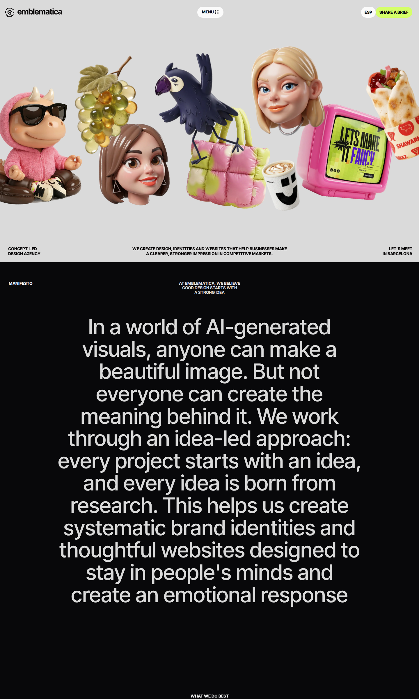

# UI Design System & Master Generation Blueprint: www-emblematica-agency

> **emblematica — concept-led brand & web design agency in barcelona** (https://www.emblematica.agency) — emblematica is a concept-led design agency in Barcelona creating brand identities and websites that help businesses stand out in competit...



---

## 1. Executive Visual Persona & Design Archetype

- **Brand Essence & Persona**: **emblematica — concept-led brand & web design agency in barcelona** (`https://www.emblematica.agency`). emblematica is a concept-led design agency in Barcelona creating brand identities and websites that help businesses stand out in competit...
- **Visual Archetype**: **High-Contrast Obsidian / Atmospheric Design System (`#0e0c0d` canvas, `#fbfbfb` ink, `#d5ff69` accent)**.
- **Anti-AI-Slop Differentiators**:
  - **Source-Grounded Chromatic Polarity**: Anchors the viewport in `#0e0c0d` (`var(--ink)` in `:root`) paired with `#fbfbfb` primary typography and `#d5ff69` accents.
  - **Extracted Typographic Hierarchy**: Pairs `InterTight` for display copy (`We create design, identities and web`) with `Inter Tight` and not declared in static CSS (uses primary stack / `ui-monospace`).
  - **Calibrated Spatial Grid & Motion**: Combines `1200px` container bounds (`gap: 4px`, padding `22px`) with `cubic-bezier(0.16,1,0.3,1)` easing and Three.js / WebGL Canvas Pipeline, Barba.js Page Transition Router.

---

## 2. Spatial Architecture & Modular Grid Mathematics


### Viewport Allocation & Container Geometry
- **Captured Viewport Dimensions**: Desktop `1440×47561px` (`assets/desktop.png`, full-page scroll capture), Mobile `390×2400px` (`assets/mobile.png`, capped at 2400px multi-section capture).
- **Master Container Bounds**: `1200px` extracted from `www-emblematica-agency` stylesheet.
- **Canvas Lateral Padding & Spacing**: `22px` lateral canvas padding with `4px` grid gap.
- **Border Radius Scale**: `999px`, `24px`, `50%`, `20px`.

### Responsive Breakpoint Architecture
- **Desktop Layout**: Multi-column CSS Grid / Flexbox layout at `1440px` (`max-width: 1200px`, `gap: 4px`).
- **Mobile Layout**: Single-column vertical stack at `390px` viewport width with `22px` horizontal padding.
- **Extracted CSS Media Queries**: `@media screen and (max-width:1024px)`, `@media screen and (max-width:640px)`, `@media screen and (max-width:480px)`, `@media screen and (max-width:1200px)`.

---

## 3. Color System, Materiality & Atmospheric Lighting

### Semantic Palette & Source Grounding
| Semantic Role | Ground-Truth Value | Extracted CSS Source / Selector |
|---|---|---|
| **Primary Canvas Substrate** | `#0e0c0d` | `var(--ink)` in `:root` |
| **Primary Typography Ink** | `#dadada` | `var(--paper)` in `:root` |
| **Elevated Surface / Card Substrate** | `#fbfbfb` | `var(--white)` in `:root` |
| **Interactive Accent / Highlight** | `#d5ff69` | `var(--acid)` in `:root` |
| **Secondary / Muted Copy** | `#2015FF` | `.t-checkbox__indicator { color: #2015FF }` |
| **Structural Hairline Border** | `#ff8562` | `.tn-nested-link { color: #ff8562 }` |

### Sanitized Root CSS Variables (`ui-ux.md` Ground Truth)
| Variable Name | Extracted Value | Semantic Role |
|---|---|---|
| `--t-headline-font` | `'InterTight',Arial,sans-serif` | Typography / Scale Token |
| `--t-text-font` | `'InterTight',Arial,sans-serif` | Typography Ink Token |
| `--ink` | `#0e0c0d` | Typography Ink Token |
| `--paper` | `#dadada` | Canvas / Surface Token |
| `--white` | `#fbfbfb` | Canvas / Surface Token |
| `--acid` | `#d5ff69` | Color / Atmospheric Token |
| `--menu-edge-gap` | `calc(12 * var(--u))` | Layout / Spatial Grid Token |
| `--menu-anchor-left` | `calc(50vw - (45 * var(--u)))` | Dimension / Scale Token |
| `--menu-anchor-top` | `var(--menu-edge-gap)` | Design System Custom Token |
| `--menu-drawer-padding-left` | `calc(28 * var(--u))` | Layout / Spatial Grid Token |
| `--menu-origin-x` | `0px` | Dimension / Scale Token |
| `--menu-origin-y` | `0px` | Dimension / Scale Token |
| `--menu-origin-scale-x` | `0.12` | Design System Custom Token |
| `--menu-origin-scale-y` | `0.05` | Design System Custom Token |
| `--preloader-size` | `220` | Layout / Spatial Grid Token |
| `--preloader-delay` | `70ms` | Motion / Easing Token |

---

## 4. Typographic Scale & Editorial Hierarchy

### Font Family Stacks
- **Display Typography**: `InterTight`.
- **Primary Body Stack**: `Inter Tight`.
- **Technical / Metadata Stack**: not declared in static CSS (uses primary stack / `ui-monospace`).

### Typographic Scale & Rules (Extracted from Stylesheet & Variables)
- **Hero Display (`H1`)**: not explicitly declared on tag in static CSS (stylesheet font-size ladder: `14px`, `clamp(calc(48 * var(--u)`, `13px`, `clamp(40px, 12.4vw, 72px)`, `15px`).
- **Section Heading (`H2`)**: rule `h2` (`font-size: calc(58 * var(--u))`, `line-height: 0.92`).
- **Body Copy**: rule `body` (`font-weight: 800`).
- **Metadata & Navigation Labels**: CSS variables `--loop-caption-alpha: 0.000`; rule `.caption` (`font-size: calc(14 * var(--u))`, `line-height: 1.17`, `letter-spacing: 0`, `font-weight: inherit`).

---

## 5. Choreographed Motion & Interaction Physics

### Primary Easing Curves
- **Extracted Timing Functions**: `cubic-bezier(0.16,1,0.3,1)`, `cubic-bezier(0.16,0.96,0.19,1)`, `cubic-bezier(0.18,1,0.36,1)`.

### Per-Element Transition & Choreography Rules
- **Selector `.t-mbfix`**: `transition: all 0.1s ease` extracted from `www-emblematica-agency` stylesheet.
- **Selector `.r_anim`**: `transition: opacity 0.5s` extracted from `www-emblematica-agency` stylesheet.
- **Selector `.t-records_animated`**: `transition: opacity ease-in-out .2s` extracted from `www-emblematica-agency` stylesheet.
- **Extracted Easing Curve (`cubic-bezier(0.16,1,0.3,1)`)**: Governs interactive state transitions across `<header.t-records>` and `<section.manifesto-runout>`.
- **Runtime Interaction Engine**: Integrates Three.js / WebGL Canvas Pipeline, Barba.js Page Transition Router with `prefers-reduced-motion: reduce` fallback guards.

---

## 6. Component Wireframe & Structural DOM Map

### Visual Layout Schematic (Grounded in `dom.html` — `1440px` Desktop & `390px` Mobile Reflow)
```
┌────────────────────────────────────────────────────────────────────────┐
│ DESKTOP VIEWPORT (1440px) — emblematica — concept-led brand & web desi │
│ ====================================================================== │
│ [ <header.t-records>       | Overview · Index · Archive · About · C ]  │
│ ---------------------------------------------------------------------- │
│ | HERO STAGE: <section.manifesto>                                  |   │
│ | H1: We create design, identities and websites that he...         |   │
│ | Substrate: #0e0c0d    | Ink: #fbfbfb    | Accent: #d5ff69        |   │
│ ---------------------------------------------------------------------- │
│ | SHOWCASE GRID (<section.manifesto-runout>) max-w: 1200px         |   │
│ | +------------------------------+  +------------------------------+ | │
│ | | Brand Creation               |  | Re- Brands                   | | │
│ | +------------------------------+  +------------------------------+ | │
│ ---------------------------------------------------------------------- │
│ | MOBILE VIEWPORT REFLOW (390px) — Single-Column Stack (gap: 4px   ) | │
│ | [<header.t-records>] -> [<section.manifesto] -> [<section.manifesto] │
│ ---------------------------------------------------------------------- │
│ [ FOOTER (<footer.t-records>    ) | https://www.emblematica.agency     │
└────────────────────────────────────────────────────────────────────────┘
```

### Granular DOM Region Breakdown
1. **Brand Header & Navigation Bar (<header.t-records> — `www-emblematica-agency`)**:
   - Landmark `<header class="t-records t-records_animated">` hosting `emblematica — concept-led brand & we` navigation (`Overview · Index · Archive · About · Contact`), DOM attributes (`data-hook="blocks-collection-con..."`, `data-tilda-project-id="13693937"`, `data-tilda-page-id="189979109"`, `data-tilda-formskey="f0b53f0bdbcb91ba7a098..."`), and stylesheet rule `.csssize { height:3344px }`.
2. **Hero Stage & Focal Lead (<section.manifesto> — `We create design, identities and w`)**:
   - Landmark `<section class="manifesto">` presenting display lead `We create design, identities and websites that he...` and copy excerpt *"concept-led design agency"* over `#0e0c0d` canvas and `#fbfbfb` ink.
3. **Primary Showcase & Content Grid (<section.manifesto-runout> — `Brand Creation`)**:
   - Landmark `<section class="manifesto-runout">` rendering section `Brand Creation` with copy *"let's meet in barcelona"*, asset references (`emblematica.agency`, `ws.tildacdn.com`, `static.tildacdn.com`, `Frame_2087327053.png`), and grid rule `body { --t-headline-font:'InterTight',Arial,sans-serif;--t-text-font:'InterTigh... }`.
4. **Interactive Detail & Feature Matrix (<section.services> — `Re- Brands`)**:
   - Landmark `<section class="services">` framing `Re- Brands` and `Web& Digital` (*"At Emblematica, we believe"*) with `#fbfbfb` surface cards, `#d5ff69` accents, and `.t-body { margin:0px }`.
5. **Colophon & Global Directory Footer (<footer.t-records> — `https://www.emblematica.agency`)**:
   - Landmark `<footer class="t-records">` anchoring `emblematica — concept-led brand ` footer links (`Overview · Index · Archive · About · Contact`), copy *"I n a w o r l d o f A I - g e n e r a t e d v i s u a l s , "*, and `#ff8562` structural dividers.

---

## 7. Master Zero-Shot AI Generation Prompt

```markdown
# Master Zero-Shot Frontend Generation Prompt: www-emblematica-agency (emblematica — concept-led brand & web design agency in barcelona)

You are a principal frontend architect and design systems engineer. Build a complete, production-ready web application replicating the exact design system, DOM landmarks, typographic hierarchy, color tokens, and motion physics of `www-emblematica-agency` (**emblematica — concept-led brand & web design agency in barcelona** — `https://www.emblematica.agency`).

### 1. Visual Archetype & Anti-AI-Slop Mandates
- **Archetype**: High-Contrast Obsidian / Atmospheric Design System (`#0e0c0d` canvas, `#fbfbfb` ink, `#d5ff69` accent).
- **Identity & Domain Context**: emblematica is a concept-led design agency in Barcelona creating brand identities and websites that help businesses stand out in competit...
- **Primary Substrate**: `#0e0c0d` (`var(--ink)` in `:root`), **Primary Ink**: `#fbfbfb`, **Accent / Highlight**: `#d5ff69`.
- **Site-Specific Differentiators**:
  - **Source-Grounded Chromatic Polarity**: Anchors the viewport in `#0e0c0d` (`var(--ink)` in `:root`) paired with `#fbfbfb` primary typography and `#d5ff69` accents.
  - **Extracted Typographic Hierarchy**: Pairs `InterTight` for display copy (`We create design, identities and web`) with `Inter Tight` and not declared in static CSS (uses primary stack / `ui-monospace`).
  - **Calibrated Spatial Grid & Motion**: Combines `1200px` container bounds (`gap: 4px`, padding `22px`) with `cubic-bezier(0.16,1,0.3,1)` easing and Three.js / WebGL Canvas Pipeline, Barba.js Page Transition Router.

### 2. Ground-Truth CSS Variables (`:root` Token Contract)
Declare and consume these exact custom properties extracted from `www-emblematica-agency` in your global stylesheet:

:root {
  /* emblematica — concept-led brand & web design agency in barcelona (www-emblematica-agency) — Ground-Truth Extracted CSS Variables */
  --t-headline-font: 'InterTight',Arial,sans-serif; /* Typography / Scale Token (www-emblematica-agency) */
  --t-text-font: 'InterTight',Arial,sans-serif; /* Typography Ink Token (www-emblematica-agency) */
  --ink: #0e0c0d; /* Typography Ink Token (www-emblematica-agency) */
  --paper: #dadada; /* Canvas / Surface Token (www-emblematica-agency) */
  --white: #fbfbfb; /* Canvas / Surface Token (www-emblematica-agency) */
  --acid: #d5ff69; /* Color / Atmospheric Token (www-emblematica-agency) */
  --menu-edge-gap: calc(12 * var(--u)); /* Layout / Spatial Grid Token (www-emblematica-agency) */
  --menu-anchor-left: calc(50vw - (45 * var(--u))); /* Dimension / Scale Token (www-emblematica-agency) */
  --menu-anchor-top: var(--menu-edge-gap); /* Design System Custom Token (www-emblematica-agency) */
  --menu-drawer-padding-left: calc(28 * var(--u)); /* Layout / Spatial Grid Token (www-emblematica-agency) */
  --menu-origin-x: 0px; /* Dimension / Scale Token (www-emblematica-agency) */
  --menu-origin-y: 0px; /* Dimension / Scale Token (www-emblematica-agency) */
  --menu-origin-scale-x: 0.12; /* Design System Custom Token (www-emblematica-agency) */
  --menu-origin-scale-y: 0.05; /* Design System Custom Token (www-emblematica-agency) */
  --preloader-size: 220; /* Layout / Spatial Grid Token (www-emblematica-agency) */
  --preloader-delay: 70ms; /* Motion / Easing Token (www-emblematica-agency) */
}

### 3. Semantic Color & Materiality Contract
Map every surface, ink, and border strictly to these source-grounded tokens:
- **Primary Canvas Substrate**: `#0e0c0d` — grounded in `var(--ink)` in `:root`
- **Primary Typography Ink**: `#dadada` — grounded in `var(--paper)` in `:root`
- **Elevated Surface / Card Substrate**: `#fbfbfb` — grounded in `var(--white)` in `:root`
- **Interactive Accent / Highlight**: `#d5ff69` — grounded in `var(--acid)` in `:root`
- **Secondary / Muted Copy**: `#2015FF` — grounded in `.t-checkbox__indicator { color: #2015FF }`
- **Structural Hairline Border**: `#ff8562` — grounded in `.tn-nested-link { color: #ff8562 }`

### 4. Spatial Grid, Container Bounds & Responsive Breakpoints
- **Desktop Viewport Reference**: `1440×47561px` (full-page scroll capture, `1440px` standard desktop width).
- **Mobile Viewport Reference**: `390×2400px` (capped at 2400px multi-section capture, `390px` standard mobile width).
- **Container Max-Width**: `1200px` extracted from `www-emblematica-agency` stylesheet
- **Padding & Gutters**: `22px` lateral canvas padding with `4px` grid gap
- **Desktop Grid**: Multi-column CSS Grid / Flexbox layout at `1440px` (`max-width: 1200px`, `gap: 4px`)
- **Mobile Adaptation**: Single-column vertical stack at `390px` viewport width with `22px` horizontal padding
- **Media Queries**: `@media screen and (max-width:1024px)`, `@media screen and (max-width:640px)`, `@media screen and (max-width:480px)`, `@media screen and (max-width:1200px)`
- **Corner Radii**: `999px`, `24px`, `50%`, `20px`

### 5. Typography & Editorial Scale Contract
- **Display Font Stack**: `InterTight`
- **Body Font Stack**: `Inter Tight`
- **Monospace / Technical Font Stack**: not declared in static CSS (uses primary stack / `ui-monospace`)
- **H1 Display Rule**: not explicitly declared on tag in static CSS (stylesheet font-size ladder: `14px`, `clamp(calc(48 * var(--u)`, `13px`, `clamp(40px, 12.4vw, 72px)`, `15px`)
- **H2 Section Rule**: rule `h2` (`font-size: calc(58 * var(--u))`, `line-height: 0.92`)
- **Body Copy Rule**: rule `body` (`font-weight: 800`)
- **Metadata & Index Rule**: CSS variables `--loop-caption-alpha: 0.000`; rule `.caption` (`font-size: calc(14 * var(--u))`, `line-height: 1.17`, `letter-spacing: 0`, `font-weight: inherit`)

### 6. Component Hierarchy, Verbatim Copy & Real DOM Landmarks
Scaffold `www-emblematica-agency` (`emblematica — concept-led brand & web design agency in barcelona`) with these exact structural regions, extracted copy, and CSS rules from `dom.html`:
1. **Brand Header & Navigation Bar (<header.t-records> — `www-emblematica-agency`)**:
   - DOM & Selectors: Landmark `<header class="t-records t-records_animated">` hosting `emblematica — concept-led brand & we` navigation (`Overview · Index · Archive · About · Contact`), DOM attributes (`data-hook="blocks-collection-con..."`, `data-tilda-project-id="13693937"`, `data-tilda-page-id="189979109"`, `data-tilda-formskey="f0b53f0bdbcb91ba7a098..."`), and stylesheet rule `.csssize { height:3344px }`.
   - Responsive Contract: Header `Brand Header & Navigation Bar (<header.t-records> — `www-emblematica-agency`)` (`www-emblematica-agency`) adapts across `@media screen and (max-width:1024px)`, `@media screen and (max-width:640px)`, `@media screen and (max-width:480px)`, `@media screen and (max-width:1200px)` with `cubic-bezier(0.16,1,0.3,1)`, `cubic-bezier(0.16,0.96,0.19,1)`, `cubic-bezier(0.18,1,0.36,1)` transitions and links `Overview · Index · Archive · About · Contact`.
2. **Hero Stage & Focal Lead (<section.manifesto> — `We create design, identities and w`)**:
   - DOM & Selectors: Landmark `<section class="manifesto">` presenting display lead `We create design, identities and websites that he...` and copy excerpt *"concept-led design agency"* over `#0e0c0d` canvas and `#fbfbfb` ink.
   - Responsive Contract: Hero stage (`1440×47561px` desktop / `390×2400px` mobile) sets `#0e0c0d` background with `#fbfbfb` headline `We create design, identities and websites that he...`.
3. **Primary Showcase & Content Grid (<section.manifesto-runout> — `Brand Creation`)**:
   - DOM & Selectors: Landmark `<section class="manifesto-runout">` rendering section `Brand Creation` with copy *"let's meet in barcelona"*, asset references (`emblematica.agency`, `ws.tildacdn.com`, `static.tildacdn.com`, `Frame_2087327053.png`), and grid rule `body { --t-headline-font:'InterTight',Arial,sans-serif;--t-text-font:'InterTigh... }`.
   - Responsive Contract: Showcase grid `Primary Showcase & Content Grid (<section.manifesto-runout> — `Brand Creation`)` applies Multi-column CSS Grid / Flexbox layout at `1440px` (`max-width: 1200px`, `gap: 4px`) on desktop and Single-column vertical stack at `390px` viewport width with `22px` horizontal padding on mobile.
4. **Interactive Detail & Feature Matrix (<section.services> — `Re- Brands`)**:
   - DOM & Selectors: Landmark `<section class="services">` framing `Re- Brands` and `Web& Digital` (*"At Emblematica, we believe"*) with `#fbfbfb` surface cards, `#d5ff69` accents, and `.t-body { margin:0px }`.
   - Responsive Contract: Detail module `Interactive Detail & Feature Matrix (<section.services> — `Re- Brands`)` uses `999px`, `24px`, `50%`, `20px` radii, `#d5ff69` highlights, and assets (emblematica.agency, ws.tildacdn.com, static.tildacdn.com).
5. **Colophon & Global Directory Footer (<footer.t-records> — `https://www.emblematica.agency`)**:
   - DOM & Selectors: Landmark `<footer class="t-records">` anchoring `emblematica — concept-led brand ` footer links (`Overview · Index · Archive · About · Contact`), copy *"I n a w o r l d o f A I - g e n e r a t e d v i s u a l s , "*, and `#ff8562` structural dividers.
   - Responsive Contract: Footer `Colophon & Global Directory Footer (<footer.t-records> — `https://www.emblematica.agency`)` aligns to `1200px` extracted from `www-emblematica-agency` stylesheet with `22px` lateral canvas padding with `4px` grid gap and attributes (data-hook="blocks-collection-con...", data-tilda-project-id="13693937", data-tilda-page-id="189979109").

#### Verbatim DOM Copy Excerpts (`dom.html`)
- Copy Excerpt 1: *"concept-led design agency"*
- Copy Excerpt 2: *"let's meet in barcelona"*
- Copy Excerpt 3: *"At Emblematica, we believe"*
- Copy Excerpt 4: *"I n a w o r l d o f A I - g e n e r a t e d v i s u a l s , a n y o n e c a n m a..."*

### 7. Motion, Extracted Stylesheet Rules & Interaction Choreography
- **Primary Easing Functions**: `cubic-bezier(0.16,1,0.3,1)`, `cubic-bezier(0.16,0.96,0.19,1)`, `cubic-bezier(0.18,1,0.36,1)`
- **Extracted Stylesheet Rules (`www-emblematica-agency`)**:
- `.csssize { height:3344px }`
- `body { --t-headline-font:'InterTight',Arial,sans-serif;--t-text-font:'InterTigh... }`
- `.t-body { margin:0px }`
- `.t-img-select { outline:none }`
- `.t-checkbox__indicator { outline-color:2015FF;outline-offset:4px;outline-style:auto }`
- **Per-Selector Transition Rules**:
- **Selector `.t-mbfix`**: `transition: all 0.1s ease` extracted from `www-emblematica-agency` stylesheet.
- **Selector `.r_anim`**: `transition: opacity 0.5s` extracted from `www-emblematica-agency` stylesheet.
- **Selector `.t-records_animated`**: `transition: opacity ease-in-out .2s` extracted from `www-emblematica-agency` stylesheet.
- **Extracted Easing Curve (`cubic-bezier(0.16,1,0.3,1)`)**: Governs interactive state transitions across `<header.t-records>` and `<section.manifesto-runout>`.
- **Runtime Interaction Engine**: Integrates Three.js / WebGL Canvas Pipeline, Barba.js Page Transition Router with `prefers-reduced-motion: reduce` fallback guards.

### 8. Technical Deliverables
- Implement in Next.js (App Router) with TypeScript and Tailwind CSS consuming the `:root` custom properties defined above for `www-emblematica-agency`.
- Reproduce both the `1440px` desktop architecture and `390px` mobile breakpoint transitions, preserving semantic HTML5 landmarks (`<header>`, `<nav>`, `<main>`, `<section>`, `<footer>`) and `prefers-reduced-motion` accessibility guards.
```
