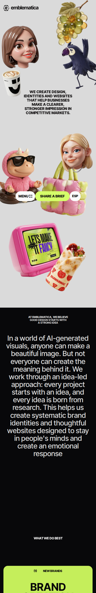

# UI Design System & Master Generation Blueprint: www-emblematica-agency

> **emblematica — concept-led brand & web design agency in barcelona** (https://www.emblematica.agency) — emblematica is a concept-led design agency in Barcelona creating brand identities and websites that help businesses stand out in competit...


---

## 1. Executive Visual Persona & Design Archetype

- **Brand Essence & Persona**: **emblematica — concept-led brand & web design agency in barcelona** (`https://www.emblematica.agency`). emblematica is a concept-led design agency in Barcelona creating brand identities and websites that help businesses stand out in competit...
- **Final Redirected URL**: [https://emblematica.agency/](https://emblematica.agency/)
- **Capture Provenance**: Live browser capture (`tier1_fast`, HTTP `200`, captured `2026-11-23`).
- **Visual Archetype**: **Light-Substrate Editorial & Modular Grid System (`#dadada` canvas, `#08080a` ink, `#ff5490` accent)**.
- **Anti-AI-Slop Differentiators**:
  - **Live-Computed Chromatic Polarity**: Anchors the viewport in `#dadada` (live computed `body` `background-color` (`computed_styles.json`)) paired with `#08080a` primary typography and `#ff5490` accents.
  - **Grounded Typographic Hierarchy**: Pairs `Inter Tight` for display copy (`WE CREATE DESIGN, IDENTITIES AND WEB`) with `Inter Tight` and not declared in live computed styles (uses primary stack / `ui-monospace`).
  - **Calibrated Spatial Grid & Motion**: Combines `1312px` container bounds (`gap: 4px`, padding `100px`) with `cubic-bezier(0.16,1,0.3,1)` easing and Three.js / WebGL Canvas Pipeline, Barba.js Page Transition Router.

---

## 2. Spatial Architecture & Modular Grid Mathematics



### Viewport Allocation & Container Geometry
- **Captured Viewport Dimensions**: Desktop `1440×2400px` (`assets/desktop.png`, clamped at 2400px live multi-section capture), Mobile `390×2400px` (`assets/mobile.png`, clamped at 2400px live multi-section capture).
- **Master Container Bounds**: `1312px` (measured widest bounded `<section>` landmark width on `1440px` desktop).
- **Canvas Lateral Padding & Spacing**: `100px` lateral canvas padding with `4px` grid gap.
- **Border Radius Scale**: `999px`, `24px`, `50%`, `20px`.

### Responsive Breakpoint Architecture
- **Desktop Layout**: Multi-column CSS Grid / Flexbox layout at `1440px` (`max-width: 1312px`, `gap: 4px`).
- **Mobile Layout**: Single-column vertical stack at `390px` viewport width with `100px` horizontal padding.
- **Extracted CSS Media Queries**: `@media screen and (max-width:1200px)`, `@media screen and (max-width:960px)`, `@media screen and (max-width:1024px)`, `@media screen and (max-width:640px)`.

---

## 3. Color System, Materiality & Atmospheric Lighting

### Semantic Palette & Source Grounding
| Semantic Role | Ground-Truth Value | Extracted Live / CSS Source |
|---|---|---|
| **Primary Canvas Substrate** | `#dadada` | live computed `body` `background-color` (`computed_styles.json`) |
| **Primary Typography Ink** | `#08080a` | live computed `h2` `color` (`computed_styles.json`) |
| **Elevated Surface / Card Substrate** | `#ffffff` | `.t-mbfix { background-color: white }` (`#ffffff`) |
| **Interactive Accent / Highlight** | `#ff5490` | `.about-link:focus-visible { color: #ff5490 }` |
| **Secondary / Muted Copy** | `#323232` | live computed `button` `color` (`computed_styles.json`) |
| **Structural Hairline Border** | `#323232` | hairline divider derived from live computed `button` `color` (`computed_styles.json`) |
| **Variable Token (`--ink`)** | `#0e0c0d` | `var(--ink)` in `:root` |
| **Variable Token (`--white`)** | `#fbfbfb` | `var(--white)` in `:root` |
| **Variable Token (`--acid`)** | `#d5ff69` | `var(--acid)` in `:root` |

### Sanitized Root CSS Variables (`ui-ux.md` Ground Truth)
| Variable Name | Extracted Value | Semantic Role |
|---|---|---|
| `--ink` | `#0e0c0d` | Typography Ink Token |
| `--paper` | `#dadada` | Canvas / Surface Token |
| `--white` | `#fbfbfb` | Canvas / Surface Token |
| `--acid` | `#d5ff69` | Color / Atmospheric Token |
| `--t-headline-font` | `'InterTight',Arial,sans-serif` | Typography / Scale Token |
| `--t-text-font` | `'InterTight',Arial,sans-serif` | Typography Ink Token |
| `--menu-edge-gap` | `calc(12 * var(--u))` | Layout / Spatial Grid Token |
| `--menu-anchor-left` | `calc(50vw - (45 * var(--u)))` | Dimension / Scale Token |
| `--menu-anchor-top` | `var(--menu-edge-gap)` | Design System Custom Token |
| `--menu-drawer-padding-left` | `calc(28 * var(--u))` | Layout / Spatial Grid Token |
| `--menu-origin-x` | `0px` | Dimension / Scale Token |
| `--menu-origin-y` | `0px` | Dimension / Scale Token |
| `--menu-origin-scale-x` | `0.12` | Design System Custom Token |
| `--menu-origin-scale-y` | `0.05` | Design System Custom Token |
| `--preloader-size` | `220` | Layout / Spatial Grid Token |
| `--preloader-delay` | `70ms` | Motion / Easing Token |

---

## 4. Typographic Scale & Editorial Hierarchy

### Font Family Stacks
- **Display Typography**: `Inter Tight`.
- **Primary Body Stack**: `Inter Tight`.
- **Technical / Metadata Stack**: not declared in live computed styles (uses primary stack / `ui-monospace`).

### Typographic Scale & Rules (Live Computed & Stylesheet Grounded)
- **Hero Display (`H1`)**: live computed `h1` (`font-size: 14px`, `line-height: 16.38px`, `font-weight: 800`).
- **Section Heading (`H2`)**: live computed `h2` (`font-size: 58px`, `line-height: 53.36px`, `font-weight: 700`); rule `h2` (`font-size: calc(58 * var(--u))`, `line-height: 0.92`).
- **Body Copy**: live computed `body` (`font-size: 16px`, `line-height: normal`, `font-weight: 800`); rule `body` (`font-weight: 800`).
- **Metadata & Navigation Labels**: live computed `nav/a` (`font-size: 16px`, `line-height: normal`, `font-weight: 800`); CSS variables `--loop-caption-alpha: 0.000`; rule `.caption` (`font-size: calc(14 * var(--u))`, `line-height: 1.17`, `letter-spacing: 0`, `font-weight: inherit`).

---

## 5. Choreographed Motion & Interaction Physics

### Primary Easing Curves
- **Extracted Timing Functions**: `cubic-bezier(0.16,1,0.3,1)`, `cubic-bezier(0.16,0.96,0.19,1)`, `cubic-bezier(0.18,1,0.36,1)`.

### Per-Element Transition & Choreography Rules
- **Selector `.t-mbfix`**: `transition: all 0.1s ease` extracted from `www-emblematica-agency` stylesheet.
- **Selector `.r_anim`**: `transition: opacity 0.5s` extracted from `www-emblematica-agency` stylesheet.
- **Selector `.t-records_animated`**: `transition: opacity ease-in-out .2s` extracted from `www-emblematica-agency` stylesheet.
- **Extracted Easing Curve (`cubic-bezier(0.16,1,0.3,1)`)**: Governs interactive state transitions across `<header.t-records>` and `<section.manifesto-runout>`.
- **Runtime Interaction Engine**: Integrates Three.js / WebGL Canvas Pipeline, Barba.js Page Transition Router with `prefers-reduced-motion: reduce` fallback guards.

---

## 6. Component Wireframe & Structural DOM Map

### Visual Layout Schematic — Desktop (`1440px`, Grounded in `dom.html` & Landmark Bounding Boxes)
```
┌────────────────────────────────────────────────────────────────────────┐
│ DESKTOP VIEWPORT (1440px) — emblematica — concept-led brand & web desi │
│ ====================================================================== │
│ [ <header.t-records> (1389x38px)      | Overview · Index · Archive · ] │
│ ---------------------------------------------------------------------- │
│ | HERO STAGE: <section.manifesto> (w=1440px)                         | │
│ | H1: WE CREATE DESIGN, IDENTITIES AND WEBSITES THAT HE...           | │
│ | Substrate: #dadada | Ink: #08080a | Accent: #ff5490                | │
│ ---------------------------------------------------------------------- │
│ | SHOWCASE GRID (<section.manifesto-runout>) max-w: 1312px           | │
│ | +------------------------------+  +------------------------------+ | │
│ | | We create design, identities |  | concept-led design agency    | | │
│ | +------------------------------+  +------------------------------+ | │
│ ---------------------------------------------------------------------- │
│ | DETAIL MODULE (<section.services>) — let's meet in barcelo         | │
│ ---------------------------------------------------------------------- │
│ [ FOOTER (<footer.t-records>  ) | https://www.emblematica.agency       │
└────────────────────────────────────────────────────────────────────────┘
```

### Visual Layout Schematic — Mobile Reflow (`390px`)
```
┌────────────────────────────────────────────────────────────────────────┐
│ MOBILE VIEWPORT REFLOW (390px) — Single-Column Stack (gap: 4px)        │
│ ====================================================================== │
│ [ HEADER BAR (<header.t-records>      ) | Compact Menu (390px)         │
│ ---------------------------------------------------------------------- │
│ | HERO STAGE (<section.manifesto>) — 390px Vertical Lead             | │
│ | H1: WE CREATE DESIGN, IDENTITIES AND WEBSITES THAT HE...           | │
│ ---------------------------------------------------------------------- │
│ | SHOWCASE STACK (<section.manifesto-run) — 1-Col Stack              | │
│ | [ Item 1: We create design, identities and websites that he...   ] | │
│ | [ Item 2: concept-led design agency                              ] | │
│ ---------------------------------------------------------------------- │
│ | DETAIL STACK (<section.services>) — 1-Col (let's meet in barc)     | │
│ ---------------------------------------------------------------------- │
│ [ FOOTER (<footer.t-records>  ) | Stacked 390px Colophon               │
└────────────────────────────────────────────────────────────────────────┘
```

### Granular DOM Region Breakdown
1. **Brand Header & Navigation Bar (<header.t-records> — `www-emblematica-agency`)**:
   - Landmark `<header class="t-records t-records_animated">` (`1389x38px`) hosting `emblematica — concept-led brand & we` navigation (`Overview · Index · Archive · About · Contact`), DOM attributes (`data-hook="blocks-collection-con..."`, `data-tilda-project-id="13693937"`, `data-tilda-page-id="189979109"`, `data-tilda-formskey="f0b53f0bdbcb91ba7a098..."`), and stylesheet rule `after { -webkit-box-sizing:content-box;-moz-box-sizing:content-box;box-sizing:co... }`.
2. **Hero Stage & Focal Lead (<section.manifesto> — `WE CREATE DESIGN, IDENTITIES AND W`)**:
   - Landmark `<section class="manifesto">` presenting display lead `WE CREATE DESIGN, IDENTITIES AND WEBSITES THAT HE...` and copy excerpt *"CONCEPT-LED DESIGN AGENCY"* over `#dadada` canvas and `#08080a` ink.
3. **Primary Showcase & Content Grid (<section.manifesto-runout> — `We create design, identities and w`)**:
   - Landmark `<section class="manifesto-runout">` rendering section `We create design, identities and websites that he...` with copy *"concept-led design agency"*, asset references (`emblematica.agency`, `ws.tildacdn.com`, `static.tildacdn.com`, `Frame_2087327053.png`), and grid rule `video { margin:0;padding:0;border:0 }`.
4. **Interactive Detail & Feature Matrix (<section.services> — `concept-led design agency`)**:
   - Landmark `<section class="services">` framing `concept-led design agency` and `let's meet in barcelona` (*"let's meet in barcelona"*) with `#ffffff` surface cards, `#ff5490` accents, and `sup { line-height:0;font-size:smaller;vertical-align:super }`.
5. **Colophon & Global Directory Footer (<footer.t-records> — `https://www.emblematica.agency`)**:
   - Landmark `<footer class="t-records">` anchoring `emblematica — concept-led brand ` footer links (`Overview · Index · Archive · About · Contact`), copy *"At Emblematica, we believe"*, and `#323232` structural dividers.

---

## 7. Master Zero-Shot AI Generation Prompt

```markdown
# Master Zero-Shot Frontend Generation Prompt: www-emblematica-agency (emblematica — concept-led brand & web design agency in barcelona)

You are a principal frontend architect and design systems engineer. Build a complete, production-ready web application replicating the exact design system, DOM landmarks, typographic hierarchy, color tokens, and motion physics of `www-emblematica-agency` (**emblematica — concept-led brand & web design agency in barcelona** — `https://www.emblematica.agency`).

### 1. Visual Archetype & Anti-AI-Slop Mandates
- **Archetype**: Light-Substrate Editorial & Modular Grid System (`#dadada` canvas, `#08080a` ink, `#ff5490` accent).
- **Identity & Domain Context**: emblematica is a concept-led design agency in Barcelona creating brand identities and websites that help businesses stand out in competit...
- **Primary Substrate**: `#dadada` (live computed `body` `background-color` (`computed_styles.json`)), **Primary Ink**: `#08080a`, **Accent / Highlight**: `#ff5490`.
- **Site-Specific Differentiators**:
  - **Live-Computed Chromatic Polarity**: Anchors the viewport in `#dadada` (live computed `body` `background-color` (`computed_styles.json`)) paired with `#08080a` primary typography and `#ff5490` accents.
  - **Grounded Typographic Hierarchy**: Pairs `Inter Tight` for display copy (`WE CREATE DESIGN, IDENTITIES AND WEB`) with `Inter Tight` and not declared in live computed styles (uses primary stack / `ui-monospace`).
  - **Calibrated Spatial Grid & Motion**: Combines `1312px` container bounds (`gap: 4px`, padding `100px`) with `cubic-bezier(0.16,1,0.3,1)` easing and Three.js / WebGL Canvas Pipeline, Barba.js Page Transition Router.

### 2. Ground-Truth CSS Variables (`:root` Token Contract)
Declare and consume these exact custom properties extracted from `www-emblematica-agency` in your global stylesheet:

:root {
  /* emblematica — concept-led brand & web design agency in barcelona (www-emblematica-agency) — Live-Grounded CSS Variables */
  --ink: #0e0c0d; /* Typography Ink Token (www-emblematica-agency) */
  --paper: #dadada; /* Canvas / Surface Token (www-emblematica-agency) */
  --white: #fbfbfb; /* Canvas / Surface Token (www-emblematica-agency) */
  --acid: #d5ff69; /* Color / Atmospheric Token (www-emblematica-agency) */
  --t-headline-font: 'InterTight',Arial,sans-serif; /* Typography / Scale Token (www-emblematica-agency) */
  --t-text-font: 'InterTight',Arial,sans-serif; /* Typography Ink Token (www-emblematica-agency) */
  --menu-edge-gap: calc(12 * var(--u)); /* Layout / Spatial Grid Token (www-emblematica-agency) */
  --menu-anchor-left: calc(50vw - (45 * var(--u))); /* Dimension / Scale Token (www-emblematica-agency) */
  --menu-anchor-top: var(--menu-edge-gap); /* Design System Custom Token (www-emblematica-agency) */
  --menu-drawer-padding-left: calc(28 * var(--u)); /* Layout / Spatial Grid Token (www-emblematica-agency) */
  --menu-origin-x: 0px; /* Dimension / Scale Token (www-emblematica-agency) */
  --menu-origin-y: 0px; /* Dimension / Scale Token (www-emblematica-agency) */
  --menu-origin-scale-x: 0.12; /* Design System Custom Token (www-emblematica-agency) */
  --menu-origin-scale-y: 0.05; /* Design System Custom Token (www-emblematica-agency) */
  --preloader-size: 220; /* Layout / Spatial Grid Token (www-emblematica-agency) */
  --preloader-delay: 70ms; /* Motion / Easing Token (www-emblematica-agency) */
}

### 3. Semantic Color & Materiality Contract
Map every surface, ink, and border strictly to these source-grounded tokens:
- **Primary Canvas Substrate**: `#dadada` — grounded in live computed `body` `background-color` (`computed_styles.json`)
- **Primary Typography Ink**: `#08080a` — grounded in live computed `h2` `color` (`computed_styles.json`)
- **Elevated Surface / Card Substrate**: `#ffffff` — grounded in `.t-mbfix { background-color: white }` (`#ffffff`)
- **Interactive Accent / Highlight**: `#ff5490` — grounded in `.about-link:focus-visible { color: #ff5490 }`
- **Secondary / Muted Copy**: `#323232` — grounded in live computed `button` `color` (`computed_styles.json`)
- **Structural Hairline Border**: `#323232` — grounded in hairline divider derived from live computed `button` `color` (`computed_styles.json`)
- **Variable Token (`--ink`)**: `#0e0c0d` — grounded in `var(--ink)` in `:root`
- **Variable Token (`--white`)**: `#fbfbfb` — grounded in `var(--white)` in `:root`
- **Variable Token (`--acid`)**: `#d5ff69` — grounded in `var(--acid)` in `:root`

### 4. Spatial Grid, Container Bounds & Responsive Breakpoints
- **Desktop Viewport Reference**: `1440×2400px` (clamped at 2400px live multi-section capture, `1440px` standard desktop width).
- **Mobile Viewport Reference**: `390×2400px` (clamped at 2400px live multi-section capture, `390px` standard mobile width).
- **Container Max-Width**: `1312px` (measured widest bounded `<section>` landmark width on `1440px` desktop)
- **Padding & Gutters**: `100px` lateral canvas padding with `4px` grid gap
- **Desktop Grid**: Multi-column CSS Grid / Flexbox layout at `1440px` (`max-width: 1312px`, `gap: 4px`)
- **Mobile Adaptation**: Single-column vertical stack at `390px` viewport width with `100px` horizontal padding
- **Media Queries**: `@media screen and (max-width:1200px)`, `@media screen and (max-width:960px)`, `@media screen and (max-width:1024px)`, `@media screen and (max-width:640px)`
- **Corner Radii**: `999px`, `24px`, `50%`, `20px`

### 5. Typography & Editorial Scale Contract
- **Display Font Stack**: `Inter Tight`
- **Body Font Stack**: `Inter Tight`
- **Monospace / Technical Font Stack**: not declared in live computed styles (uses primary stack / `ui-monospace`)
- **H1 Display Rule**: live computed `h1` (`font-size: 14px`, `line-height: 16.38px`, `font-weight: 800`)
- **H2 Section Rule**: live computed `h2` (`font-size: 58px`, `line-height: 53.36px`, `font-weight: 700`); rule `h2` (`font-size: calc(58 * var(--u))`, `line-height: 0.92`)
- **Body Copy Rule**: live computed `body` (`font-size: 16px`, `line-height: normal`, `font-weight: 800`); rule `body` (`font-weight: 800`)
- **Metadata & Index Rule**: live computed `nav/a` (`font-size: 16px`, `line-height: normal`, `font-weight: 800`); CSS variables `--loop-caption-alpha: 0.000`; rule `.caption` (`font-size: calc(14 * var(--u))`, `line-height: 1.17`, `letter-spacing: 0`, `font-weight: inherit`)

### 6. Component Hierarchy, Verbatim Copy & Real DOM Landmarks
Scaffold `www-emblematica-agency` (`emblematica — concept-led brand & web design agency in barcelona`) with these exact structural regions, extracted copy, and CSS rules from `dom.html`:
1. **Brand Header & Navigation Bar (<header.t-records> — `www-emblematica-agency`)**:
   - DOM & Selectors: Landmark `<header class="t-records t-records_animated">` (`1389x38px`) hosting `emblematica — concept-led brand & we` navigation (`Overview · Index · Archive · About · Contact`), DOM attributes (`data-hook="blocks-collection-con..."`, `data-tilda-project-id="13693937"`, `data-tilda-page-id="189979109"`, `data-tilda-formskey="f0b53f0bdbcb91ba7a098..."`), and stylesheet rule `after { -webkit-box-sizing:content-box;-moz-box-sizing:content-box;box-sizing:co... }`.
   - Responsive Contract: Header `Brand Header & Navigation Bar (<header.t-records> — `www-emblematica-agency`)` (`www-emblematica-agency`) adapts across `@media screen and (max-width:1200px)`, `@media screen and (max-width:960px)`, `@media screen and (max-width:1024px)`, `@media screen and (max-width:640px)` with `cubic-bezier(0.16,1,0.3,1)`, `cubic-bezier(0.16,0.96,0.19,1)`, `cubic-bezier(0.18,1,0.36,1)` transitions and links `Overview · Index · Archive · About · Contact`.
2. **Hero Stage & Focal Lead (<section.manifesto> — `WE CREATE DESIGN, IDENTITIES AND W`)**:
   - DOM & Selectors: Landmark `<section class="manifesto">` presenting display lead `WE CREATE DESIGN, IDENTITIES AND WEBSITES THAT HE...` and copy excerpt *"CONCEPT-LED DESIGN AGENCY"* over `#dadada` canvas and `#08080a` ink.
   - Responsive Contract: Hero stage (`1440×2400px` desktop / `390×2400px` mobile) sets `#dadada` background with `#08080a` headline `WE CREATE DESIGN, IDENTITIES AND WEBSITES THAT HE...`.
3. **Primary Showcase & Content Grid (<section.manifesto-runout> — `We create design, identities and w`)**:
   - DOM & Selectors: Landmark `<section class="manifesto-runout">` rendering section `We create design, identities and websites that he...` with copy *"concept-led design agency"*, asset references (`emblematica.agency`, `ws.tildacdn.com`, `static.tildacdn.com`, `Frame_2087327053.png`), and grid rule `video { margin:0;padding:0;border:0 }`.
   - Responsive Contract: Showcase grid `Primary Showcase & Content Grid (<section.manifesto-runout> — `We create design, identities and w`)` applies Multi-column CSS Grid / Flexbox layout at `1440px` (`max-width: 1312px`, `gap: 4px`) on desktop and Single-column vertical stack at `390px` viewport width with `100px` horizontal padding on mobile.
4. **Interactive Detail & Feature Matrix (<section.services> — `concept-led design agency`)**:
   - DOM & Selectors: Landmark `<section class="services">` framing `concept-led design agency` and `let's meet in barcelona` (*"let's meet in barcelona"*) with `#ffffff` surface cards, `#ff5490` accents, and `sup { line-height:0;font-size:smaller;vertical-align:super }`.
   - Responsive Contract: Detail module `Interactive Detail & Feature Matrix (<section.services> — `concept-led design agency`)` uses `999px`, `24px`, `50%`, `20px` radii, `#ff5490` highlights, and assets (emblematica.agency, ws.tildacdn.com, static.tildacdn.com).
5. **Colophon & Global Directory Footer (<footer.t-records> — `https://www.emblematica.agency`)**:
   - DOM & Selectors: Landmark `<footer class="t-records">` anchoring `emblematica — concept-led brand ` footer links (`Overview · Index · Archive · About · Contact`), copy *"At Emblematica, we believe"*, and `#323232` structural dividers.
   - Responsive Contract: Footer `Colophon & Global Directory Footer (<footer.t-records> — `https://www.emblematica.agency`)` aligns to `1312px` (measured widest bounded `<section>` landmark width on `1440px` desktop) with `100px` lateral canvas padding with `4px` grid gap and attributes (data-hook="blocks-collection-con...", data-tilda-project-id="13693937", data-tilda-page-id="189979109").

#### Verbatim DOM Copy Excerpts (`dom.html`)
- Copy Excerpt 1: *"CONCEPT-LED DESIGN AGENCY"*
- Copy Excerpt 2: *"concept-led design agency"*
- Copy Excerpt 3: *"let's meet in barcelona"*
- Copy Excerpt 4: *"At Emblematica, we believe"*

### 7. Motion, Extracted Stylesheet Rules & Interaction Choreography
- **Primary Easing Functions**: `cubic-bezier(0.16,1,0.3,1)`, `cubic-bezier(0.16,0.96,0.19,1)`, `cubic-bezier(0.18,1,0.36,1)`
- **Extracted Stylesheet Rules (`www-emblematica-agency`)**:
- `after { -webkit-box-sizing:content-box;-moz-box-sizing:content-box;box-sizing:co... }`
- `video { margin:0;padding:0;border:0 }`
- `sup { line-height:0;font-size:smaller;vertical-align:super }`
- `sub { line-height:0;font-size:smaller;vertical-align:sub }`
- `.t-clear { clear:both }`
- **Per-Selector Transition Rules**:
- **Selector `.t-mbfix`**: `transition: all 0.1s ease` extracted from `www-emblematica-agency` stylesheet.
- **Selector `.r_anim`**: `transition: opacity 0.5s` extracted from `www-emblematica-agency` stylesheet.
- **Selector `.t-records_animated`**: `transition: opacity ease-in-out .2s` extracted from `www-emblematica-agency` stylesheet.
- **Extracted Easing Curve (`cubic-bezier(0.16,1,0.3,1)`)**: Governs interactive state transitions across `<header.t-records>` and `<section.manifesto-runout>`.
- **Runtime Interaction Engine**: Integrates Three.js / WebGL Canvas Pipeline, Barba.js Page Transition Router with `prefers-reduced-motion: reduce` fallback guards.

### 8. Technical Deliverables
- Implement in Next.js (App Router) with TypeScript and Tailwind CSS consuming the `:root` custom properties defined above for `www-emblematica-agency`.
- Reproduce both the `1440px` desktop architecture and `390px` mobile breakpoint transitions, preserving semantic HTML5 landmarks (`<header>`, `<nav>`, `<main>`, `<section>`, `<footer>`) and `prefers-reduced-motion` accessibility guards.
```
