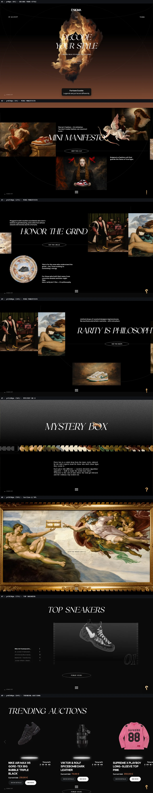
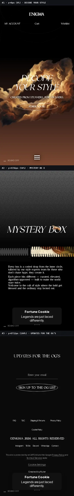

# UI Design System & Master Generation Blueprint: www-enigmascult-com

> **Enigma – Sneaker Auctions, Mystery Boxes & Reborn Customs** (https://www.enigmascult.com/) — Enigma is the cult of authenticated streetwear: live sneaker auctions, style-coded mystery boxes and Reborn customs. Decode your style. J...





---

## 1. Executive Visual Persona & Design Archetype

- **Brand Essence & Persona**: **Enigma – Sneaker Auctions, Mystery Boxes & Reborn Customs** (`https://www.enigmascult.com/`). Enigma is the cult of authenticated streetwear: live sneaker auctions, style-coded mystery boxes and Reborn customs. Decode your style. J...
- **Capture Provenance**: Live browser capture (`tier1_fast`, HTTP `200`, captured `2026-11-24`).
- **Visual Archetype**: **Dark-Substrate WebGL / Canvas Interactive Experience (`#0a0a0a` / `#ff0000`)**.
- **Anti-AI-Slop Differentiators**:
  - **Live-Computed Chromatic Polarity**: Anchors the viewport in `#0a0a0a` (live computed `body` `background-color` (`computed_styles.json`)) paired with `#f9f9f9` primary typography and `#ff0000` accents.
  - **Grounded Typographic Hierarchy**: Pairs `Editorial Today` for display copy (`DECODE YOUR STYLE`) with `Helvena`.
  - **Calibrated Spatial Grid & Motion**: Combines `1000px` container bounds (`gap: 10px`, padding `.9rem`) with `cubic-bezier(.45,.05,.25,1)` easing and Lenis Smooth Scroll (`data-lenis`), Three.js / WebGL Canvas Pipeline.

---

## 2. Spatial Architecture & Modular Grid Mathematics

### Viewport Allocation & Container Geometry
- **Captured Journey Filmstrips**: Desktop `1280×6624px` (`assets/desktop-journey.webp`, `8` keyframes up to `y=8500px` / doc `11069px`), Mobile `390×2616px` (`assets/mobile-journey.webp`, `3` keyframes).
- **Master Container Bounds**: `1000px` (non-`@media` desktop container stylesheet rule).
- **Canvas Lateral Padding & Spacing**: `.9rem` lateral canvas padding with `10px` grid gap.
- **Border Radius Scale**: `4px`, `8px`, `12px`, `50%`.

### Responsive Breakpoint Architecture
- **Desktop Layout**: Multi-column CSS Grid / Flexbox layout at `1440px` (`max-width: 1000px`, `gap: 10px`).
- **Mobile Layout**: Single-column vertical stack at `390px` viewport width with `.9rem` horizontal padding.
- **Extracted CSS Media Queries**: `@media only screen and (max-width:768px)`, `@media (max-width:782px)`, `@media (prefers-reduced-motion:reduce)`, `@media (max-width:781px)`.

---

## 3. Color System, Materiality & Atmospheric Lighting

### Semantic Palette & Source Grounding
| Semantic Role | Ground-Truth Value | Extracted Live / CSS Source |
|---|---|---|
| **Primary Canvas Substrate** | `#0a0a0a` | live computed `body` `background-color` (`computed_styles.json`) |
| **Primary Typography Ink** | `#f9f9f9` | live computed `h1` `color` (`computed_styles.json`) |
| **Elevated Surface / Card Substrate** | `#000000` | live computed `section` `background-color` (`computed_styles.json`) |
| **Interactive Accent / Highlight** | `#ff0000` | `.woocommerce a.remove { color: red }` (`#ff0000`) |
| **Secondary / Muted Copy** | `#767676` | `var(--wc-subtext)` in `:root` |
| **Structural Hairline Border** | `#066aab` | `var(--wpforms-button-border-color)` in `:root` |
| **Variable Token (`--wp-block-synced-color`)** | `#7a00df` | `var(--wp-block-synced-color)` in `:root` |
| **Variable Token (`--wp-editor-canvas-background`)** | `#dddddd` | `var(--wp-editor-canvas-background)` in `:root` |
| **Variable Token (`--wp-admin-theme-color`)** | `#007cba` | `var(--wp-admin-theme-color)` in `:root` |
| **Variable Token (`--wp-admin-theme-color-darker-10`)** | `#006ba1` | `var(--wp-admin-theme-color-darker-10)` in `:root` |
| **Variable Token (`--wp-admin-theme-color-darker-20`)** | `#005a87` | `var(--wp-admin-theme-color-darker-20)` in `:root` |
| **Variable Token (`--woocommerce`)** | `#720eec` | `var(--woocommerce)` in `:root` |
| **Variable Token (`--wc-green`)** | `#007518` | `var(--wc-green)` in `:root` |
| **Variable Token (`--wc-red`)** | `#aa0000` | `var(--wc-red)` in `:root` |
| **Variable Token (`--wc-orange`)** | `#ffba00` | `var(--wc-orange)` in `:root` |

### Sanitized Root CSS Variables (`ui-ux.md` Ground Truth)
| Variable Name | Extracted Value | Semantic Role |
|---|---|---|
| `--wp-block-synced-color` | `#7a00df` | Brand / Palette Token |
| `--wp-block-synced-color--rgb` | `122,0,223` | Brand / Palette Token |
| `--wp-bound-block-color` | `var(--wp-block-synced-color)` | Brand / Palette Token |
| `--wp-editor-canvas-background` | `#ddd` | Canvas / Surface Token |
| `--wp-admin-theme-color` | `#007cba` | Brand / Palette Token |
| `--wp-admin-theme-color--rgb` | `0,124,186` | Brand / Palette Token |
| `--wp-admin-theme-color-darker-10` | `#006ba1` | Canvas / Surface Token |
| `--wp-admin-theme-color-darker-10--rgb` | `0,107,160.5` | Canvas / Surface Token |
| `--wp-admin-theme-color-darker-20` | `#005a87` | Canvas / Surface Token |
| `--wp-admin-theme-color-darker-20--rgb` | `0,90,135` | Canvas / Surface Token |
| `--wp-admin-border-width-focus` | `2px` | Layout / Spatial Grid Token |
| `--wp-admin--admin-bar--position-offset` | `var(--wp-admin--admin-bar--height,0px)` | Dimension / Scale Token |
| `--woocommerce` | `#720eec` | Color / Atmospheric Token |
| `--wc-green` | `#007518` | Color / Atmospheric Token |
| `--wc-red` | `#a00` | Color / Atmospheric Token |
| `--wc-orange` | `#ffba00` | Color / Atmospheric Token |

---

## 4. Typographic Scale & Editorial Hierarchy

### Font Family Stacks
- **Display Typography**: `Editorial Today`.
- **Primary Body Stack**: `Helvena`.
- **Technical / Metadata Stack**: not declared in live computed styles (uses primary stack / `ui-monospace`).

### Typographic Scale & Rules (Live Computed & Stylesheet Grounded)
- **Hero Display (`H1`)**: live computed `h1` (`font-size: 75px`, `line-height: 81px`, `font-weight: 200`, `letter-spacing: -3px`).
- **Section Heading (`H2`)**: live computed `h2` (`font-size: 90px`, `line-height: 82.8px`, `font-weight: 200`); rule `h2` (`font-size: var(--wp--preset--font-size--...`).
- **Body Copy**: live computed `body` (`font-size: 16px`, `line-height: normal`, `font-weight: 400`); rule `p` (`font-size: clamp(14px,.8854166667vw,17px)`, `line-height: 1.4`).
- **Metadata & Navigation Labels**: live computed `nav/a` (`font-size: 16px`, `line-height: normal`, `font-weight: 400`); CSS variables `--wpforms-field-size-sublabel-spacing: 5px`, `--wpforms-label-size-font-size: 16px`, `--wpforms-label-size-line-height: 19px`; rule `small` (`font-size: clamp(11px,.6770833333vw,13px)`).

---

## 5. Choreographed Motion & Interaction Physics

### Primary Easing Curves
- **Extracted Timing Functions**: `cubic-bezier(.45,.05,.25,1)`, `cubic-bezier(.22,1,.36,1)`, `cubic-bezier(.32,0,.18,1)`.

### Per-Element Transition & Choreography Rules
- **Selector `.page-veil`**: `transition: opacity .45s ease-in-out` extracted from `www-enigmascult-com` stylesheet.
- **Selector `.is-page-fading .page-veil`**: `transition: opacity .4s ease-in` extracted from `www-enigmascult-com` stylesheet.
- **Selector `html:not(.is-page-arriving) body:...`**: `transition: opacity .85s ease-in-out .05s,transform 1s ease-out` extracted from `www-enigmascult-com` stylesheet.
- **Extracted Easing Curve (`cubic-bezier(.45,.05,.25,1)`)**: Governs interactive state transitions across `<header.wp-block-template-part>` and `<section.manifesto>`.
- **Runtime Interaction Engine**: Integrates Lenis Smooth Scroll (`data-lenis`), Three.js / WebGL Canvas Pipeline, Swiper Touch Carousel Engine with `prefers-reduced-motion: reduce` fallback guards.
### Measured Runtime Scroll & Interaction Telemetry (`behavioral_journey_v2`)
- **Scroll Driver Mode**: `native` (max document height `11069px`, deepest scrollY reached `8500px` across `8` desktop keyframes).
- **Detected Scroll / Motion Libraries**: `Lenis`, `GSAP/ScrollTrigger`, `WebGL/Canvas`.
- **Hover Physics (`primary_cta` · `FORGE YOURS`)**: Computed transition `0.25s, 0.25s, 0.25s, 0.25s, 0.25s` / `ease, ease, ease, ease, ease` (no static color/transform shift captured at rest).
- **Interactive Control Probe (`accordion`)**: Tested `Unzip the mystery box` (diff `0.059`).
- **Route Transition Architecture**: First internal navigation (`/shop/`) measured as `direct` in `4573ms`.

---

## 6. Component Wireframe & Structural DOM Map

### Visual Layout Schematic — Desktop (`1440px`, Grounded in `dom.html` & Landmark Bounding Boxes)
```
┌────────────────────────────────────────────────────────────────────────┐
│ DESKTOP VIEWPORT (1440px) — Enigma – Sneaker Auctions, Mystery Boxes & │
│ ====================================================================== │
│ [ <header.wp-block-templ (1440x0px)   | My Account · Cart · Wishlist ] │
│ ---------------------------------------------------------------------- │
│ | HERO STAGE: <section.block-hero> (w=1440px)                        | │
│ | H1: DECODE YOUR STYLE                                              | │
│ | Substrate: #0a0a0a | Ink: #f9f9f9 | Accent: #ff0000                | │
│ ---------------------------------------------------------------------- │
│ | SHOWCASE GRID (<section.manifesto>) max-w: 1000px                  | │
│ | +------------------------------+  +------------------------------+ | │
│ | | Decode Your Style            |  | Mini Manifesto               | | │
│ | +------------------------------+  +------------------------------+ | │
│ ---------------------------------------------------------------------- │
│ | DETAIL MODULE (<section.mystery-box>) — Honor the Grind            | │
│ ---------------------------------------------------------------------- │
│ [ FOOTER (<footer.wp-block-tem) | https://www.enigmascult.com/         │
└────────────────────────────────────────────────────────────────────────┘
```

### Visual Layout Schematic — Mobile Reflow (`390px`)
```
┌────────────────────────────────────────────────────────────────────────┐
│ MOBILE VIEWPORT REFLOW (390px) — Single-Column Stack (gap: 10px)       │
│ ====================================================================== │
│ [ HEADER BAR (<header.wp-block-templat) | Compact Menu (390px)         │
│ ---------------------------------------------------------------------- │
│ | HERO STAGE (<section.block-hero>) — 390px Vertical Lead            | │
│ | H1: DECODE YOUR STYLE                                              | │
│ ---------------------------------------------------------------------- │
│ | SHOWCASE STACK (<section.manifesto>) — 1-Col Stack                 | │
│ | [ Item 1: Decode Your Style                                      ] | │
│ | [ Item 2: Mini Manifesto                                         ] | │
│ ---------------------------------------------------------------------- │
│ | DETAIL STACK (<section.mystery-box>) — 1-Col (Honor the Grind)     | │
│ ---------------------------------------------------------------------- │
│ [ FOOTER (<footer.wp-block-tem) | Stacked 390px Colophon               │
└────────────────────────────────────────────────────────────────────────┘
```

### Granular DOM Region Breakdown
1. **Brand Header & Navigation Bar (<header.wp-block-template-part> — `www-enigmascult-com`)**:
   - Landmark `<header class="wp-block-template-part">` (`1440x0px`) hosting `Enigma – Sneaker Auctions, Mystery B` navigation (`My Account · Cart · Wishlist`), DOM attributes (`data-wp-strategy="defer"`, `data-wp-strategy="defer"`, `data-wp-strategy="defer"`, `data-wp-strategy="defer"`), and stylesheet rule `.woocommerce-checkout main .wooco... { max-width:1000px }`.
2. **Hero Stage & Focal Lead (<section.block-hero> — `DECODE YOUR STYLE`)**:
   - Landmark `<section class="block-hero alignfull">` presenting display lead `DECODE YOUR STYLE` and copy excerpt *"CREATED FROM STUNNERS, FOR STUNNERS."* over `#0a0a0a` canvas and `#f9f9f9` ink.
3. **Primary Showcase & Content Grid (<section.manifesto> — `Decode Your Style`)**:
   - Landmark `<section class="manifesto alignfull">` rendering section `Decode Your Style` with copy *"Created from stunners, for stunners."*, asset references (`embed`, `woocommerce-blocktheme.css`, `style-index.css`, `woocommerce-layout.css`), and grid rule `.clear { clear:both }`.
4. **Interactive Detail & Feature Matrix (<section.mystery-box> — `Mini Manifesto`)**:
   - Landmark `<section class="mystery-box alignfull">` framing `Mini Manifesto` and `Honor the Grind` (*"This isn’t fashion — it’s initiation. “we don’t revive fashion. w"*) with `#000000` surface cards, `#ff0000` accents, and `hover { opacity:.5 }`.
5. **Colophon & Global Directory Footer (<footer.wp-block-template-part> — `https://www.enigmascult.com/`)**:
   - Landmark `<footer class="wp-block-template-part">` anchoring `Enigma – Sneaker Auctions, Myste` footer links (`My Account · Cart · Wishlist`), copy *"Enigma is a fashion cult that guards the flame of true hype."*, and `#066aab` structural dividers.
### Full Vertical Scroll Sequence (Desktop `1440×900` Keyframes)
- **Step 01** (`y=0px`, `0%`): Active landmark `DECODE YOUR STYLE` · sticky/fixed elements: `3`
- **Step 02** (`y=850px`, `8%`): Active landmark `MINI MANIFESTO` · sticky/fixed elements: `2`
- **Step 03** (`y=2550px`, `25%`): Active landmark `MINI MANIFESTO` · sticky/fixed elements: `3`
- **Step 04** (`y=3400px`, `34%`): Active landmark `MINI MANIFESTO` · sticky/fixed elements: `3`
- **Step 05** (`y=5100px`, `50%`): Active landmark `MYSTERY BO X` · sticky/fixed elements: `3`
- **Step 06** (`y=5950px`, `59%`): Active landmark `Section @ 59%` · sticky/fixed elements: `3`
- **Step 07** (`y=7650px`, `75%`): Active landmark `TOP SNEAKERS` · sticky/fixed elements: `2`
- **Step 08** (`y=8500px`, `84%`): Active landmark `TRENDING AUCTIONS` · sticky/fixed elements: `2`

### Multi-Page Internal Route Map
- **Listing Route (`/shop/`)**: `https://www.enigmascult.com/shop/` — H1: `shop`, scrollHeight `900px`, transition `direct` (`4573ms`)

---

## 7. Master Zero-Shot AI Generation Prompt

```markdown
# Master Zero-Shot Frontend Generation Prompt: www-enigmascult-com (Enigma – Sneaker Auctions, Mystery Boxes & Reborn Customs)

You are a principal frontend architect and design systems engineer. Build a complete, production-ready web application replicating the exact design system, DOM landmarks, typographic hierarchy, color tokens, and motion physics of `www-enigmascult-com` (**Enigma – Sneaker Auctions, Mystery Boxes & Reborn Customs** — `https://www.enigmascult.com/`).

### 1. Visual Archetype & Anti-AI-Slop Mandates
- **Archetype**: Dark-Substrate WebGL / Canvas Interactive Experience (`#0a0a0a` / `#ff0000`).
- **Identity & Domain Context**: Enigma is the cult of authenticated streetwear: live sneaker auctions, style-coded mystery boxes and Reborn customs. Decode your style. J...
- **Primary Substrate**: `#0a0a0a` (live computed `body` `background-color` (`computed_styles.json`)), **Primary Ink**: `#f9f9f9`, **Accent / Highlight**: `#ff0000`.
- **Site-Specific Differentiators**:
  - **Live-Computed Chromatic Polarity**: Anchors the viewport in `#0a0a0a` (live computed `body` `background-color` (`computed_styles.json`)) paired with `#f9f9f9` primary typography and `#ff0000` accents.
  - **Grounded Typographic Hierarchy**: Pairs `Editorial Today` for display copy (`DECODE YOUR STYLE`) with `Helvena`.
  - **Calibrated Spatial Grid & Motion**: Combines `1000px` container bounds (`gap: 10px`, padding `.9rem`) with `cubic-bezier(.45,.05,.25,1)` easing and Lenis Smooth Scroll (`data-lenis`), Three.js / WebGL Canvas Pipeline.

### 2. Ground-Truth CSS Variables (`:root` Token Contract)
Declare and consume these exact custom properties extracted from `www-enigmascult-com` in your global stylesheet:

:root {
  /* Enigma – Sneaker Auctions, Mystery Boxes & Reborn Customs (www-enigmascult-com) — Live-Grounded CSS Variables */
  --wp-block-synced-color: #7a00df; /* Brand / Palette Token (www-enigmascult-com) */
  --wp-block-synced-color--rgb: 122,0,223; /* Brand / Palette Token (www-enigmascult-com) */
  --wp-bound-block-color: var(--wp-block-synced-color); /* Brand / Palette Token (www-enigmascult-com) */
  --wp-editor-canvas-background: #ddd; /* Canvas / Surface Token (www-enigmascult-com) */
  --wp-admin-theme-color: #007cba; /* Brand / Palette Token (www-enigmascult-com) */
  --wp-admin-theme-color--rgb: 0,124,186; /* Brand / Palette Token (www-enigmascult-com) */
  --wp-admin-theme-color-darker-10: #006ba1; /* Canvas / Surface Token (www-enigmascult-com) */
  --wp-admin-theme-color-darker-10--rgb: 0,107,160.5; /* Canvas / Surface Token (www-enigmascult-com) */
  --wp-admin-theme-color-darker-20: #005a87; /* Canvas / Surface Token (www-enigmascult-com) */
  --wp-admin-theme-color-darker-20--rgb: 0,90,135; /* Canvas / Surface Token (www-enigmascult-com) */
  --wp-admin-border-width-focus: 2px; /* Layout / Spatial Grid Token (www-enigmascult-com) */
  --wp-admin--admin-bar--position-offset: var(--wp-admin--admin-bar--height,0px); /* Dimension / Scale Token (www-enigmascult-com) */
  --woocommerce: #720eec; /* Color / Atmospheric Token (www-enigmascult-com) */
  --wc-green: #007518; /* Color / Atmospheric Token (www-enigmascult-com) */
  --wc-red: #a00; /* Color / Atmospheric Token (www-enigmascult-com) */
  --wc-orange: #ffba00; /* Color / Atmospheric Token (www-enigmascult-com) */
}

### 3. Semantic Color & Materiality Contract
Map every surface, ink, and border strictly to these source-grounded tokens:
- **Primary Canvas Substrate**: `#0a0a0a` — grounded in live computed `body` `background-color` (`computed_styles.json`)
- **Primary Typography Ink**: `#f9f9f9` — grounded in live computed `h1` `color` (`computed_styles.json`)
- **Elevated Surface / Card Substrate**: `#000000` — grounded in live computed `section` `background-color` (`computed_styles.json`)
- **Interactive Accent / Highlight**: `#ff0000` — grounded in `.woocommerce a.remove { color: red }` (`#ff0000`)
- **Secondary / Muted Copy**: `#767676` — grounded in `var(--wc-subtext)` in `:root`
- **Structural Hairline Border**: `#066aab` — grounded in `var(--wpforms-button-border-color)` in `:root`
- **Variable Token (`--wp-block-synced-color`)**: `#7a00df` — grounded in `var(--wp-block-synced-color)` in `:root`
- **Variable Token (`--wp-editor-canvas-background`)**: `#dddddd` — grounded in `var(--wp-editor-canvas-background)` in `:root`
- **Variable Token (`--wp-admin-theme-color`)**: `#007cba` — grounded in `var(--wp-admin-theme-color)` in `:root`
- **Variable Token (`--wp-admin-theme-color-darker-10`)**: `#006ba1` — grounded in `var(--wp-admin-theme-color-darker-10)` in `:root`
- **Variable Token (`--wp-admin-theme-color-darker-20`)**: `#005a87` — grounded in `var(--wp-admin-theme-color-darker-20)` in `:root`
- **Variable Token (`--woocommerce`)**: `#720eec` — grounded in `var(--woocommerce)` in `:root`
- **Variable Token (`--wc-green`)**: `#007518` — grounded in `var(--wc-green)` in `:root`
- **Variable Token (`--wc-red`)**: `#aa0000` — grounded in `var(--wc-red)` in `:root`
- **Variable Token (`--wc-orange`)**: `#ffba00` — grounded in `var(--wc-orange)` in `:root`

### 4. Spatial Grid, Container Bounds & Responsive Breakpoints
- **Desktop Viewport Reference**: `1280×6624px` (multi-frame vertical journey filmstrip (6624px), `1440px` standard desktop width).
- **Mobile Viewport Reference**: `390×2616px` (multi-frame vertical journey filmstrip (2616px), `390px` standard mobile width).
- **Container Max-Width**: `1000px` (non-`@media` desktop container stylesheet rule)
- **Padding & Gutters**: `.9rem` lateral canvas padding with `10px` grid gap
- **Desktop Grid**: Multi-column CSS Grid / Flexbox layout at `1440px` (`max-width: 1000px`, `gap: 10px`)
- **Mobile Adaptation**: Single-column vertical stack at `390px` viewport width with `.9rem` horizontal padding
- **Media Queries**: `@media only screen and (max-width:768px)`, `@media (max-width:782px)`, `@media (prefers-reduced-motion:reduce)`, `@media (max-width:781px)`
- **Corner Radii**: `4px`, `8px`, `12px`, `50%`

### 5. Typography & Editorial Scale Contract
- **Display Font Stack**: `Editorial Today`
- **Body Font Stack**: `Helvena`
- **Monospace / Technical Font Stack**: not declared in live computed styles (uses primary stack / `ui-monospace`)
- **H1 Display Rule**: live computed `h1` (`font-size: 75px`, `line-height: 81px`, `font-weight: 200`, `letter-spacing: -3px`)
- **H2 Section Rule**: live computed `h2` (`font-size: 90px`, `line-height: 82.8px`, `font-weight: 200`); rule `h2` (`font-size: var(--wp--preset--font-size--...`)
- **Body Copy Rule**: live computed `body` (`font-size: 16px`, `line-height: normal`, `font-weight: 400`); rule `p` (`font-size: clamp(14px,.8854166667vw,17px)`, `line-height: 1.4`)
- **Metadata & Index Rule**: live computed `nav/a` (`font-size: 16px`, `line-height: normal`, `font-weight: 400`); CSS variables `--wpforms-field-size-sublabel-spacing: 5px`, `--wpforms-label-size-font-size: 16px`, `--wpforms-label-size-line-height: 19px`; rule `small` (`font-size: clamp(11px,.6770833333vw,13px)`)

### 6. Component Hierarchy, Verbatim Copy & Real DOM Landmarks
Scaffold `www-enigmascult-com` (`Enigma – Sneaker Auctions, Mystery Boxes & Reborn Customs`) with these exact structural regions, extracted copy, and CSS rules from `dom.html`:
1. **Brand Header & Navigation Bar (<header.wp-block-template-part> — `www-enigmascult-com`)**:
   - DOM & Selectors: Landmark `<header class="wp-block-template-part">` (`1440x0px`) hosting `Enigma – Sneaker Auctions, Mystery B` navigation (`My Account · Cart · Wishlist`), DOM attributes (`data-wp-strategy="defer"`, `data-wp-strategy="defer"`, `data-wp-strategy="defer"`, `data-wp-strategy="defer"`), and stylesheet rule `.woocommerce-checkout main .wooco... { max-width:1000px }`.
   - Responsive Contract: Header `Brand Header & Navigation Bar (<header.wp-block-template-part> — `www-enigmascult-com`)` (`www-enigmascult-com`) adapts across `@media only screen and (max-width:768px)`, `@media (max-width:782px)`, `@media (prefers-reduced-motion:reduce)`, `@media (max-width:781px)` with `cubic-bezier(.45,.05,.25,1)`, `cubic-bezier(.22,1,.36,1)`, `cubic-bezier(.32,0,.18,1)` transitions and links `My Account · Cart · Wishlist`.
2. **Hero Stage & Focal Lead (<section.block-hero> — `DECODE YOUR STYLE`)**:
   - DOM & Selectors: Landmark `<section class="block-hero alignfull">` presenting display lead `DECODE YOUR STYLE` and copy excerpt *"CREATED FROM STUNNERS, FOR STUNNERS."* over `#0a0a0a` canvas and `#f9f9f9` ink.
   - Responsive Contract: Hero stage (`1280×6624px` desktop / `390×2616px` mobile) sets `#0a0a0a` background with `#f9f9f9` headline `DECODE YOUR STYLE`.
3. **Primary Showcase & Content Grid (<section.manifesto> — `Decode Your Style`)**:
   - DOM & Selectors: Landmark `<section class="manifesto alignfull">` rendering section `Decode Your Style` with copy *"Created from stunners, for stunners."*, asset references (`embed`, `woocommerce-blocktheme.css`, `style-index.css`, `woocommerce-layout.css`), and grid rule `.clear { clear:both }`.
   - Responsive Contract: Showcase grid `Primary Showcase & Content Grid (<section.manifesto> — `Decode Your Style`)` applies Multi-column CSS Grid / Flexbox layout at `1440px` (`max-width: 1000px`, `gap: 10px`) on desktop and Single-column vertical stack at `390px` viewport width with `.9rem` horizontal padding on mobile.
4. **Interactive Detail & Feature Matrix (<section.mystery-box> — `Mini Manifesto`)**:
   - DOM & Selectors: Landmark `<section class="mystery-box alignfull">` framing `Mini Manifesto` and `Honor the Grind` (*"This isn’t fashion — it’s initiation. “we don’t revive fashion. w"*) with `#000000` surface cards, `#ff0000` accents, and `hover { opacity:.5 }`.
   - Responsive Contract: Detail module `Interactive Detail & Feature Matrix (<section.mystery-box> — `Mini Manifesto`)` uses `4px`, `8px`, `12px`, `50%` radii, `#ff0000` highlights, and assets (embed, woocommerce-blocktheme.css, style-index.css).
5. **Colophon & Global Directory Footer (<footer.wp-block-template-part> — `https://www.enigmascult.com/`)**:
   - DOM & Selectors: Landmark `<footer class="wp-block-template-part">` anchoring `Enigma – Sneaker Auctions, Myste` footer links (`My Account · Cart · Wishlist`), copy *"Enigma is a fashion cult that guards the flame of true hype."*, and `#066aab` structural dividers.
   - Responsive Contract: Footer `Colophon & Global Directory Footer (<footer.wp-block-template-part> — `https://www.enigmascult.com/`)` aligns to `1000px` (non-`@media` desktop container stylesheet rule) with `.9rem` lateral canvas padding with `10px` grid gap and attributes (data-wp-strategy="defer", data-wp-strategy="defer", data-wp-strategy="defer").

#### Verbatim DOM Copy Excerpts (`dom.html`)
- Copy Excerpt 1: *"CREATED FROM STUNNERS, FOR STUNNERS."*
- Copy Excerpt 2: *"Created from stunners, for stunners."*
- Copy Excerpt 3: *"This isn’t fashion — it’s initiation. “we don’t revive fashion. we resurrect icons.”"*
- Copy Excerpt 4: *"Enigma is a fashion cult that guards the flame of true hype."*

### 7. Motion, Extracted Stylesheet Rules & Interaction Choreography
- **Primary Easing Functions**: `cubic-bezier(.45,.05,.25,1)`, `cubic-bezier(.22,1,.36,1)`, `cubic-bezier(.32,0,.18,1)`
- **Extracted Stylesheet Rules (`www-enigmascult-com`)**:
- `.woocommerce-checkout main .wooco... { max-width:1000px }`
- `.clear { clear:both }`
- `hover { opacity:.5 }`
- `.woocommerce input.button:hover { opacity:.9 }`
- `roduct .woocommerce-loop-product_... { font-size:1.2em }`
- **Per-Selector Transition Rules**:
- **Selector `.page-veil`**: `transition: opacity .45s ease-in-out` extracted from `www-enigmascult-com` stylesheet.
- **Selector `.is-page-fading .page-veil`**: `transition: opacity .4s ease-in` extracted from `www-enigmascult-com` stylesheet.
- **Selector `html:not(.is-page-arriving) body:...`**: `transition: opacity .85s ease-in-out .05s,transform 1s ease-out` extracted from `www-enigmascult-com` stylesheet.
- **Extracted Easing Curve (`cubic-bezier(.45,.05,.25,1)`)**: Governs interactive state transitions across `<header.wp-block-template-part>` and `<section.manifesto>`.
- **Runtime Interaction Engine**: Integrates Lenis Smooth Scroll (`data-lenis`), Three.js / WebGL Canvas Pipeline, Swiper Touch Carousel Engine with `prefers-reduced-motion: reduce` fallback guards.
### 7b. Full-Page Scroll Choreography, Interactive States & Multi-Page Routes
- **Scroll Mechanics**: Implement `native` vertical progression up to `11069px` across 8 distinct viewport chapters using Lenis, GSAP/ScrollTrigger, WebGL/Canvas.
- **Vertical Chapter Sequence**: DECODE YOUR STYLE (0%) -> MINI MANIFESTO (8%) -> MINI MANIFESTO (25%) -> MINI MANIFESTO (34%) -> MYSTERY BO X (50%) -> Section @ 59% (59%) -> TOP SNEAKERS (75%) -> TRENDING AUCTIONS (84%).
- **Multi-Page Routes**: Scaffold internal routes `/shop/` (listing, direct) sharing the global header/footer shell and design tokens.

### 8. Technical Deliverables
- Implement in Next.js (App Router) with TypeScript and Tailwind CSS consuming the `:root` custom properties defined above for `www-enigmascult-com`.
- Reproduce both the `1440px` desktop architecture and `390px` mobile breakpoint transitions, preserving semantic HTML5 landmarks (`<header>`, `<nav>`, `<main>`, `<section>`, `<footer>`) and `prefers-reduced-motion` accessibility guards.
```
---

## 8. Full-Page Scroll Journey, Interactive States & Subpage Inventory

### Desktop Scroll Keyframes (`1440×900` WebP)
| Step | Scroll Y | Progress | Active Landmark / Section | Sticky/Fixed | Visual Asset |
| :---: | :---: | :---: | :--- | :---: | :--- |
| `#01` | `0px` | `0%` | DECODE YOUR STYLE | `3` | [desktop-step-01.webp](assets/desktop-step-01.webp) |
| `#02` | `850px` | `8%` | MINI MANIFESTO | `2` | [desktop-step-02.webp](assets/desktop-step-02.webp) |
| `#03` | `2550px` | `25%` | MINI MANIFESTO | `3` | [desktop-step-03.webp](assets/desktop-step-03.webp) |
| `#04` | `3400px` | `34%` | MINI MANIFESTO | `3` | [desktop-step-04.webp](assets/desktop-step-04.webp) |
| `#05` | `5100px` | `50%` | MYSTERY BO X | `3` | [desktop-step-05.webp](assets/desktop-step-05.webp) |
| `#06` | `5950px` | `59%` | Section @ 59% | `3` | [desktop-step-06.webp](assets/desktop-step-06.webp) |
| `#07` | `7650px` | `75%` | TOP SNEAKERS | `2` | [desktop-step-07.webp](assets/desktop-step-07.webp) |
| `#08` | `8500px` | `84%` | TRENDING AUCTIONS | `2` | [desktop-step-08.webp](assets/desktop-step-08.webp) |

### Mobile Condensed Keyframes (`390×844` WebP)
| Step | Scroll Y | Progress | Active Landmark | Visual Asset |
| :---: | :---: | :---: | :--- | :--- |
| `#01` | `0px` | `0%` | DECODE YOUR STYLE | [mobile-step-01.webp](assets/mobile-step-01.webp) |
| `#02` | `4356px` | `50%` | MYSTERY BO X | [mobile-step-02.webp](assets/mobile-step-02.webp) |
| `#03` | `8712px` | `100%` | UPDATES FOR THE OG’S | [mobile-step-03.webp](assets/mobile-step-03.webp) |

### Internal Subpage Filmstrips (`1080px` Wide WebP)
| # | Template | Route URL | H1 / Title | Scroll Height | Transition | Filmstrip Asset |
| :-: | :---: | :--- | :--- | :---: | :---: | :--- |
| `1` | `listing` | `https://www.enigmascult.com/shop/` | shop | `900px` | `direct` (`4573ms`) | [subpage-01-shop.webp](assets/subpage-01-shop.webp) |

