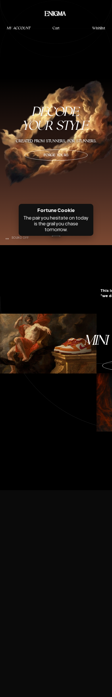

# UI Design System & Master Generation Blueprint: www-enigmascult-com

> **Enigma – Sneaker Auctions, Mystery Boxes & Reborn Customs** (https://www.enigmascult.com/) — Enigma is the cult of authenticated streetwear: live sneaker auctions, style-coded mystery boxes and Reborn customs. Decode your style. J...


---

## 1. Executive Visual Persona & Design Archetype

- **Brand Essence & Persona**: **Enigma – Sneaker Auctions, Mystery Boxes & Reborn Customs** (`https://www.enigmascult.com/`). Enigma is the cult of authenticated streetwear: live sneaker auctions, style-coded mystery boxes and Reborn customs. Decode your style. J...
- **Visual Archetype**: **Dark-Substrate WebGL / Canvas Interactive Experience (`#720eec` / `#ffba00`)**.
- **Anti-AI-Slop Differentiators**:
  - **Source-Grounded Chromatic Polarity**: Anchors the viewport in `#720eec` (`var(--woocommerce)` in `:root`) paired with `#fcfbfe` primary typography and `#ffba00` accents.
  - **Extracted Typographic Hierarchy**: Pairs `WooCommerce` for display copy (`Decode Your Style`) with `Helvena` and not declared in static CSS (uses primary stack / `ui-monospace`).
  - **Calibrated Spatial Grid & Motion**: Combines `1000px` container bounds (`gap: 12px`, padding `.9rem`) with `cubic-bezier(.45,.05,.25,1)` easing and Lenis Smooth Scroll (`data-lenis`), Three.js / WebGL Canvas Pipeline.

---

## 2. Spatial Architecture & Modular Grid Mathematics



### Viewport Allocation & Container Geometry
- **Captured Viewport Dimensions**: Desktop `1440×11069px` (`assets/desktop.png`, full-page scroll capture), Mobile `390×2400px` (`assets/mobile.png`, capped at 2400px multi-section capture).
- **Master Container Bounds**: `1000px` extracted from `www-enigmascult-com` stylesheet.
- **Canvas Lateral Padding & Spacing**: `.9rem` lateral canvas padding with `12px` grid gap.
- **Border Radius Scale**: `4px`, `8px`, `50%`, `12px`.

### Responsive Breakpoint Architecture
- **Desktop Layout**: Multi-column CSS Grid / Flexbox layout at `1440px` (`max-width: 1000px`, `gap: 12px`).
- **Mobile Layout**: Single-column vertical stack at `390px` viewport width with `.9rem` horizontal padding.
- **Extracted CSS Media Queries**: `@media only screen and (max-width:768px)`, `@media (max-width:782px)`, `@media (prefers-reduced-motion:reduce)`, `@media (max-width:781px)`.

---

## 3. Color System, Materiality & Atmospheric Lighting

### Semantic Palette & Source Grounding
| Semantic Role | Ground-Truth Value | Extracted CSS Source / Selector |
|---|---|---|
| **Primary Canvas Substrate** | `#720eec` | `var(--woocommerce)` in `:root` |
| **Primary Typography Ink** | `#007518` | `var(--wc-green)` in `:root` |
| **Elevated Surface / Card Substrate** | `#a00` | `var(--wc-red)` in `:root` |
| **Interactive Accent / Highlight** | `#ffba00` | `var(--wc-orange)` in `:root` |
| **Secondary / Muted Copy** | `#2ea2cc` | `var(--wc-blue)` in `:root` |
| **Structural Hairline Border** | `#fcfbfe` | `var(--wc-primary-text)` in `:root` |
| **Variable Token (`--wc-secondary`)** | `#e9e6ed` | `var(--wc-secondary)` in `:root` |
| **Variable Token (`--wc-secondary-text`)** | `#515151` | `var(--wc-secondary-text)` in `:root` |
| **Variable Token (`--wc-highlight`)** | `#958e09` | `var(--wc-highlight)` in `:root` |
| **Variable Token (`--wc-content-bg`)** | `#fff` | `var(--wc-content-bg)` in `:root` |
| **Variable Token (`--wc-subtext`)** | `#767676` | `var(--wc-subtext)` in `:root` |

### Sanitized Root CSS Variables (`ui-ux.md` Ground Truth)
| Variable Name | Extracted Value | Semantic Role |
|---|---|---|
| `--woocommerce` | `#720eec` | Color / Atmospheric Token |
| `--wc-green` | `#007518` | Color / Atmospheric Token |
| `--wc-red` | `#a00` | Color / Atmospheric Token |
| `--wc-orange` | `#ffba00` | Color / Atmospheric Token |
| `--wc-blue` | `#2ea2cc` | Color / Atmospheric Token |
| `--wc-primary` | `#720eec` | Brand / Palette Token |
| `--wc-primary-text` | `#fcfbfe` | Typography Ink Token |
| `--wc-secondary` | `#e9e6ed` | Brand / Palette Token |
| `--wc-secondary-text` | `#515151` | Typography Ink Token |
| `--wc-highlight` | `#958e09` | Canvas / Surface Token |
| `--wc-highligh-text` | `white` | Typography Ink Token |
| `--wc-content-bg` | `#fff` | Canvas / Surface Token |
| `--wc-subtext` | `#767676` | Typography Ink Token |
| `--wc-form-border-color` | `rgba(32, 7, 7, 0.8)` | Brand / Palette Token |
| `--wc-form-border-radius` | `4px` | Elevation / Border Token |
| `--wc-form-border-width` | `1px` | Layout / Spatial Grid Token |

---

## 4. Typographic Scale & Editorial Hierarchy

### Font Family Stacks
- **Display Typography**: `WooCommerce`.
- **Primary Body Stack**: `Helvena`.
- **Technical / Metadata Stack**: not declared in static CSS (uses primary stack / `ui-monospace`).

### Typographic Scale & Rules (Extracted from Stylesheet & Variables)
- **Hero Display (`H1`)**: not explicitly declared on tag in static CSS (stylesheet font-size ladder: `1.2em`, `var(--wp--preset--font-size--medium)`, `var(--wp--preset--font-size--small)`, `var(--wp--preset--font-size--large)`, `18px`).
- **Section Heading (`H2`)**: rule `h2` (`font-size: var(--wp--preset--font-size--...`).
- **Body Copy**: rule `p` (`font-size: clamp(14px,.8854166667vw,17px)`, `line-height: 1.4`).
- **Metadata & Navigation Labels**: CSS variables `--wpforms-label-color: hsla(0,0%,98%,.5)`, `--wpforms-label-sublabel-color: hsla(0,0%,98%,.5)`, `--wpforms-label-error-color: #fb5711`; rule `small` (`font-size: clamp(11px,.6770833333vw,13px)`).

---

## 5. Choreographed Motion & Interaction Physics

### Primary Easing Curves
- **Extracted Timing Functions**: `cubic-bezier(.45,.05,.25,1)`, `cubic-bezier(.22,1,.36,1)`, `cubic-bezier(.32,0,.18,1)`.

### Per-Element Transition & Choreography Rules
- **Selector `.swiper-wrapper`**: `transition: var(--swiper-wrapper-transition-timing-function,initial)` extracted from `www-enigmascult-com` stylesheet.
- **Selector `.rfc-slider`**: `transition: .2s` extracted from `www-enigmascult-com` stylesheet.
- **Selector `.rfc-slider:before`**: `transition: .2s` extracted from `www-enigmascult-com` stylesheet.
- **Extracted Easing Curve (`cubic-bezier(.45,.05,.25,1)`)**: Governs interactive state transitions across `<header.wp-block-template-part>` and `<section.manifesto>`.
- **Runtime Interaction Engine**: Integrates Lenis Smooth Scroll (`data-lenis`), Three.js / WebGL Canvas Pipeline, Swiper Touch Carousel Engine with `prefers-reduced-motion: reduce` fallback guards.

---

## 6. Component Wireframe & Structural DOM Map

### Visual Layout Schematic (Grounded in `dom.html` — `1440px` Desktop & `390px` Mobile Reflow)
```
┌────────────────────────────────────────────────────────────────────────┐
│ DESKTOP VIEWPORT (1440px) — Enigma – Sneaker Auctions, Mystery Boxes & │
│ ====================================================================== │
│ [ <header.wp-block-templat | My Account · Cart · Wishlist           ]  │
│ ---------------------------------------------------------------------- │
│ | HERO STAGE: <section.block-hero>                                 |   │
│ | H1: Decode Your Style                                            |   │
│ | Substrate: #720eec    | Ink: #fcfbfe    | Accent: #ffba00        |   │
│ ---------------------------------------------------------------------- │
│ | SHOWCASE GRID (<section.manifesto>       ) max-w: 1000px         |   │
│ | +------------------------------+  +------------------------------+ | │
│ | | Mini Manifesto               |  | Honor the Grind              | | │
│ | +------------------------------+  +------------------------------+ | │
│ ---------------------------------------------------------------------- │
│ | MOBILE VIEWPORT REFLOW (390px) — Single-Column Stack (gap: 12px  ) | │
│ | [<header.wp-block-t] -> [<section.block-her] -> [<section.manifesto] │
│ ---------------------------------------------------------------------- │
│ [ FOOTER (<footer.wp-block-templ) | https://www.enigmascult.com/       │
└────────────────────────────────────────────────────────────────────────┘
```

### Granular DOM Region Breakdown
1. **Brand Header & Navigation Bar (<header.wp-block-template-part> — `www-enigmascult-com`)**:
   - Landmark `<header class="wp-block-template-part">` hosting `Enigma – Sneaker Auctions, Mystery B` navigation (`My Account · Cart · Wishlist`), DOM attributes (`data-rfc-blocked="1"`, `data-rfc-category="analytics"`, `data-wp-strategy="defer"`, `data-wp-strategy="defer"`), and stylesheet rule `.woocommerce-checkout main .wooco... { max-width:1000px }`.
2. **Hero Stage & Focal Lead (<section.block-hero> — `Decode Your Style`)**:
   - Landmark `<section class="block-hero alignfull">` presenting display lead `Decode Your Style` and copy excerpt *"Sound off Sound on"* over `#720eec` canvas and `#fcfbfe` ink.
3. **Primary Showcase & Content Grid (<section.manifesto> — `Mini Manifesto`)**:
   - Landmark `<section class="manifesto alignfull">` rendering section `Mini Manifesto` with copy *"Created from stunners, for stunners."*, asset references (`embed`, `woocommerce-blocktheme.css`, `style-index.css`, `woocommerce-layout.css`), and grid rule `.clear { clear:both }`.
4. **Interactive Detail & Feature Matrix (<section.mystery-box> — `Honor the Grind`)**:
   - Landmark `<section class="mystery-box alignfull">` framing `Honor the Grind` and `Rarity Is Philosophy` (*"This isn’t fashion — it’s initiation. “we don’t revive fashion. w"*) with `#a00` surface cards, `#ffba00` accents, and `hover { opacity:.5 }`.
5. **Colophon & Global Directory Footer (<footer.wp-block-template-part> — `https://www.enigmascult.com/`)**:
   - Landmark `<footer class="wp-block-template-part">` anchoring `Enigma – Sneaker Auctions, Myste` footer links (`My Account · Cart · Wishlist`), copy *"Enigma is a fashion cult that guards the flame of true hype."*, and `#fcfbfe` structural dividers.

---

## 7. Master Zero-Shot AI Generation Prompt

```markdown
# Master Zero-Shot Frontend Generation Prompt: www-enigmascult-com (Enigma – Sneaker Auctions, Mystery Boxes & Reborn Customs)

You are a principal frontend architect and design systems engineer. Build a complete, production-ready web application replicating the exact design system, DOM landmarks, typographic hierarchy, color tokens, and motion physics of `www-enigmascult-com` (**Enigma – Sneaker Auctions, Mystery Boxes & Reborn Customs** — `https://www.enigmascult.com/`).

### 1. Visual Archetype & Anti-AI-Slop Mandates
- **Archetype**: Dark-Substrate WebGL / Canvas Interactive Experience (`#720eec` / `#ffba00`).
- **Identity & Domain Context**: Enigma is the cult of authenticated streetwear: live sneaker auctions, style-coded mystery boxes and Reborn customs. Decode your style. J...
- **Primary Substrate**: `#720eec` (`var(--woocommerce)` in `:root`), **Primary Ink**: `#fcfbfe`, **Accent / Highlight**: `#ffba00`.
- **Site-Specific Differentiators**:
  - **Source-Grounded Chromatic Polarity**: Anchors the viewport in `#720eec` (`var(--woocommerce)` in `:root`) paired with `#fcfbfe` primary typography and `#ffba00` accents.
  - **Extracted Typographic Hierarchy**: Pairs `WooCommerce` for display copy (`Decode Your Style`) with `Helvena` and not declared in static CSS (uses primary stack / `ui-monospace`).
  - **Calibrated Spatial Grid & Motion**: Combines `1000px` container bounds (`gap: 12px`, padding `.9rem`) with `cubic-bezier(.45,.05,.25,1)` easing and Lenis Smooth Scroll (`data-lenis`), Three.js / WebGL Canvas Pipeline.

### 2. Ground-Truth CSS Variables (`:root` Token Contract)
Declare and consume these exact custom properties extracted from `www-enigmascult-com` in your global stylesheet:

:root {
  /* Enigma – Sneaker Auctions, Mystery Boxes & Reborn Customs (www-enigmascult-com) — Ground-Truth Extracted CSS Variables */
  --woocommerce: #720eec; /* Color / Atmospheric Token (www-enigmascult-com) */
  --wc-green: #007518; /* Color / Atmospheric Token (www-enigmascult-com) */
  --wc-red: #a00; /* Color / Atmospheric Token (www-enigmascult-com) */
  --wc-orange: #ffba00; /* Color / Atmospheric Token (www-enigmascult-com) */
  --wc-blue: #2ea2cc; /* Color / Atmospheric Token (www-enigmascult-com) */
  --wc-primary: #720eec; /* Brand / Palette Token (www-enigmascult-com) */
  --wc-primary-text: #fcfbfe; /* Typography Ink Token (www-enigmascult-com) */
  --wc-secondary: #e9e6ed; /* Brand / Palette Token (www-enigmascult-com) */
  --wc-secondary-text: #515151; /* Typography Ink Token (www-enigmascult-com) */
  --wc-highlight: #958e09; /* Canvas / Surface Token (www-enigmascult-com) */
  --wc-highligh-text: white; /* Typography Ink Token (www-enigmascult-com) */
  --wc-content-bg: #fff; /* Canvas / Surface Token (www-enigmascult-com) */
  --wc-subtext: #767676; /* Typography Ink Token (www-enigmascult-com) */
  --wc-form-border-color: rgba(32, 7, 7, 0.8); /* Brand / Palette Token (www-enigmascult-com) */
  --wc-form-border-radius: 4px; /* Elevation / Border Token (www-enigmascult-com) */
  --wc-form-border-width: 1px; /* Layout / Spatial Grid Token (www-enigmascult-com) */
}

### 3. Semantic Color & Materiality Contract
Map every surface, ink, and border strictly to these source-grounded tokens:
- **Primary Canvas Substrate**: `#720eec` — grounded in `var(--woocommerce)` in `:root`
- **Primary Typography Ink**: `#007518` — grounded in `var(--wc-green)` in `:root`
- **Elevated Surface / Card Substrate**: `#a00` — grounded in `var(--wc-red)` in `:root`
- **Interactive Accent / Highlight**: `#ffba00` — grounded in `var(--wc-orange)` in `:root`
- **Secondary / Muted Copy**: `#2ea2cc` — grounded in `var(--wc-blue)` in `:root`
- **Structural Hairline Border**: `#fcfbfe` — grounded in `var(--wc-primary-text)` in `:root`
- **Variable Token (`--wc-secondary`)**: `#e9e6ed` — grounded in `var(--wc-secondary)` in `:root`
- **Variable Token (`--wc-secondary-text`)**: `#515151` — grounded in `var(--wc-secondary-text)` in `:root`
- **Variable Token (`--wc-highlight`)**: `#958e09` — grounded in `var(--wc-highlight)` in `:root`
- **Variable Token (`--wc-content-bg`)**: `#fff` — grounded in `var(--wc-content-bg)` in `:root`
- **Variable Token (`--wc-subtext`)**: `#767676` — grounded in `var(--wc-subtext)` in `:root`

### 4. Spatial Grid, Container Bounds & Responsive Breakpoints
- **Desktop Viewport Reference**: `1440×11069px` (full-page scroll capture, `1440px` standard desktop width).
- **Mobile Viewport Reference**: `390×2400px` (capped at 2400px multi-section capture, `390px` standard mobile width).
- **Container Max-Width**: `1000px` extracted from `www-enigmascult-com` stylesheet
- **Padding & Gutters**: `.9rem` lateral canvas padding with `12px` grid gap
- **Desktop Grid**: Multi-column CSS Grid / Flexbox layout at `1440px` (`max-width: 1000px`, `gap: 12px`)
- **Mobile Adaptation**: Single-column vertical stack at `390px` viewport width with `.9rem` horizontal padding
- **Media Queries**: `@media only screen and (max-width:768px)`, `@media (max-width:782px)`, `@media (prefers-reduced-motion:reduce)`, `@media (max-width:781px)`
- **Corner Radii**: `4px`, `8px`, `50%`, `12px`

### 5. Typography & Editorial Scale Contract
- **Display Font Stack**: `WooCommerce`
- **Body Font Stack**: `Helvena`
- **Monospace / Technical Font Stack**: not declared in static CSS (uses primary stack / `ui-monospace`)
- **H1 Display Rule**: not explicitly declared on tag in static CSS (stylesheet font-size ladder: `1.2em`, `var(--wp--preset--font-size--medium)`, `var(--wp--preset--font-size--small)`, `var(--wp--preset--font-size--large)`, `18px`)
- **H2 Section Rule**: rule `h2` (`font-size: var(--wp--preset--font-size--...`)
- **Body Copy Rule**: rule `p` (`font-size: clamp(14px,.8854166667vw,17px)`, `line-height: 1.4`)
- **Metadata & Index Rule**: CSS variables `--wpforms-label-color: hsla(0,0%,98%,.5)`, `--wpforms-label-sublabel-color: hsla(0,0%,98%,.5)`, `--wpforms-label-error-color: #720eec`; rule `small` (`font-size: clamp(11px,.6770833333vw,13px)`)

### 6. Component Hierarchy, Verbatim Copy & Real DOM Landmarks
Scaffold `www-enigmascult-com` (`Enigma – Sneaker Auctions, Mystery Boxes & Reborn Customs`) with these exact structural regions, extracted copy, and CSS rules from `dom.html`:
1. **Brand Header & Navigation Bar (<header.wp-block-template-part> — `www-enigmascult-com`)**:
   - DOM & Selectors: Landmark `<header class="wp-block-template-part">` hosting `Enigma – Sneaker Auctions, Mystery B` navigation (`My Account · Cart · Wishlist`), DOM attributes (`data-rfc-blocked="1"`, `data-rfc-category="analytics"`, `data-wp-strategy="defer"`, `data-wp-strategy="defer"`), and stylesheet rule `.woocommerce-checkout main .wooco... { max-width:1000px }`.
   - Responsive Contract: Header `Brand Header & Navigation Bar (<header.wp-block-template-part> — `www-enigmascult-com`)` (`www-enigmascult-com`) adapts across `@media only screen and (max-width:768px)`, `@media (max-width:782px)`, `@media (prefers-reduced-motion:reduce)`, `@media (max-width:781px)` with `cubic-bezier(.45,.05,.25,1)`, `cubic-bezier(.22,1,.36,1)`, `cubic-bezier(.32,0,.18,1)` transitions and links `My Account · Cart · Wishlist`.
2. **Hero Stage & Focal Lead (<section.block-hero> — `Decode Your Style`)**:
   - DOM & Selectors: Landmark `<section class="block-hero alignfull">` presenting display lead `Decode Your Style` and copy excerpt *"Sound off Sound on"* over `#720eec` canvas and `#fcfbfe` ink.
   - Responsive Contract: Hero stage (`1440×11069px` desktop / `390×2400px` mobile) sets `#720eec` background with `#fcfbfe` headline `Decode Your Style`.
3. **Primary Showcase & Content Grid (<section.manifesto> — `Mini Manifesto`)**:
   - DOM & Selectors: Landmark `<section class="manifesto alignfull">` rendering section `Mini Manifesto` with copy *"Created from stunners, for stunners."*, asset references (`embed`, `woocommerce-blocktheme.css`, `style-index.css`, `woocommerce-layout.css`), and grid rule `.clear { clear:both }`.
   - Responsive Contract: Showcase grid `Primary Showcase & Content Grid (<section.manifesto> — `Mini Manifesto`)` applies Multi-column CSS Grid / Flexbox layout at `1440px` (`max-width: 1000px`, `gap: 12px`) on desktop and Single-column vertical stack at `390px` viewport width with `.9rem` horizontal padding on mobile.
4. **Interactive Detail & Feature Matrix (<section.mystery-box> — `Honor the Grind`)**:
   - DOM & Selectors: Landmark `<section class="mystery-box alignfull">` framing `Honor the Grind` and `Rarity Is Philosophy` (*"This isn’t fashion — it’s initiation. “we don’t revive fashion. w"*) with `#a00` surface cards, `#ffba00` accents, and `hover { opacity:.5 }`.
   - Responsive Contract: Detail module `Interactive Detail & Feature Matrix (<section.mystery-box> — `Honor the Grind`)` uses `4px`, `8px`, `50%`, `12px` radii, `#ffba00` highlights, and assets (embed, woocommerce-blocktheme.css, style-index.css).
5. **Colophon & Global Directory Footer (<footer.wp-block-template-part> — `https://www.enigmascult.com/`)**:
   - DOM & Selectors: Landmark `<footer class="wp-block-template-part">` anchoring `Enigma – Sneaker Auctions, Myste` footer links (`My Account · Cart · Wishlist`), copy *"Enigma is a fashion cult that guards the flame of true hype."*, and `#fcfbfe` structural dividers.
   - Responsive Contract: Footer `Colophon & Global Directory Footer (<footer.wp-block-template-part> — `https://www.enigmascult.com/`)` aligns to `1000px` extracted from `www-enigmascult-com` stylesheet with `.9rem` lateral canvas padding with `12px` grid gap and attributes (data-rfc-blocked="1", data-rfc-category="analytics", data-wp-strategy="defer").

#### Verbatim DOM Copy Excerpts (`dom.html`)
- Copy Excerpt 1: *"Sound off Sound on"*
- Copy Excerpt 2: *"Created from stunners, for stunners."*
- Copy Excerpt 3: *"This isn’t fashion — it’s initiation. “we don’t revive fashion. we resurrect icons.”"*
- Copy Excerpt 4: *"Enigma is a fashion cult that guards the flame of true hype."*

### 7. Motion, Extracted Stylesheet Rules & Interaction Choreography
- **Primary Easing Functions**: `cubic-bezier(.45,.05,.25,1)`, `cubic-bezier(.22,1,.36,1)`, `cubic-bezier(.32,0,.18,1)`
- **Extracted Stylesheet Rules (`www-enigmascult-com`)**:
- `.woocommerce-checkout main .wooco... { max-width:1000px }`
- `.clear { clear:both }`
- `hover { opacity:.5 }`
- `.woocommerce input.button:hover { opacity:.9 }`
- `roduct .woocommerce-loop-product_... { font-size:1.2em }`
- **Per-Selector Transition Rules**:
- **Selector `.swiper-wrapper`**: `transition: var(--swiper-wrapper-transition-timing-function,initial)` extracted from `www-enigmascult-com` stylesheet.
- **Selector `.rfc-slider`**: `transition: .2s` extracted from `www-enigmascult-com` stylesheet.
- **Selector `.rfc-slider:before`**: `transition: .2s` extracted from `www-enigmascult-com` stylesheet.
- **Extracted Easing Curve (`cubic-bezier(.45,.05,.25,1)`)**: Governs interactive state transitions across `<header.wp-block-template-part>` and `<section.manifesto>`.
- **Runtime Interaction Engine**: Integrates Lenis Smooth Scroll (`data-lenis`), Three.js / WebGL Canvas Pipeline, Swiper Touch Carousel Engine with `prefers-reduced-motion: reduce` fallback guards.

### 8. Technical Deliverables
- Implement in Next.js (App Router) with TypeScript and Tailwind CSS consuming the `:root` custom properties defined above for `www-enigmascult-com`.
- Reproduce both the `1440px` desktop architecture and `390px` mobile breakpoint transitions, preserving semantic HTML5 landmarks (`<header>`, `<nav>`, `<main>`, `<section>`, `<footer>`) and `prefers-reduced-motion` accessibility guards.
```
