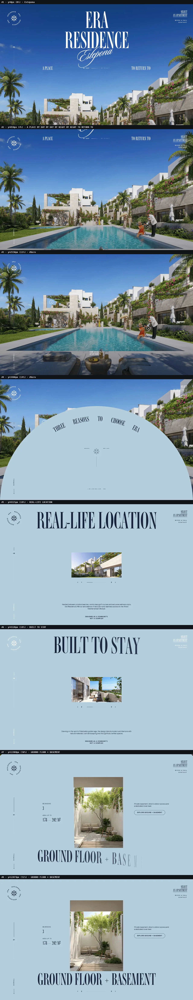
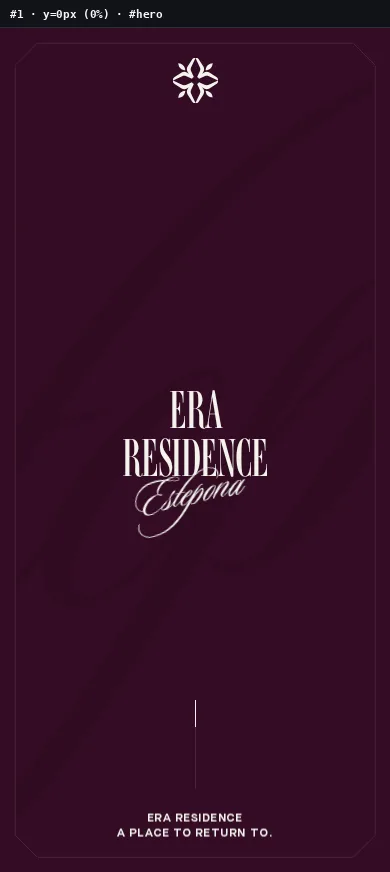

# UI Design System & Master Generation Blueprint: www-era-residence-com

> **ERA Residence — Contemporary Mediterranean Residences in Estepona** (https://www.era-residence.com/) — Boutique residences on the New Golden Mile combining contemporary architecture, natural materials and resort-style living near Marbella a...





---

## 1. Executive Visual Persona & Design Archetype

- **Brand Essence & Persona**: **ERA Residence — Contemporary Mediterranean Residences in Estepona** (`https://www.era-residence.com/`). Boutique residences on the New Golden Mile combining contemporary architecture, natural materials and resort-style living near Marbella a...
- **Capture Provenance**: Live browser capture (`tier1_fast`, HTTP `200`, captured `2026-11-24`).
- **Visual Archetype**: **Light-Substrate Editorial & Modular Grid System (`#f3f3ec` canvas, `#17233b` ink, `#0082f3` accent)**.
- **Anti-AI-Slop Differentiators**:
  - **Live-Computed Chromatic Polarity**: Anchors the viewport in `#f3f3ec` (live computed `html` `background-color` (`computed_styles.json`)) paired with `#17233b` primary typography and `#0082f3` accents.
  - **Grounded Typographic Hierarchy**: Pairs `ambroise-francois-std` for display copy (`ERA RESIDENCE`) with `Maison Neue Extended`.
  - **Calibrated Spatial Grid & Motion**: Combines `1440px` container bounds (`gap: 16px`, padding `9px`) with `cubic-bezier(0.76,0,0.24,1)` easing and Lenis Smooth Scroll (`data-lenis`), GSAP Timeline & ScrollTrigger.

---

## 2. Spatial Architecture & Modular Grid Mathematics

### Viewport Allocation & Container Geometry
- **Captured Journey Filmstrips**: Desktop `1280×6624px` (`assets/desktop-journey.webp`, `8` keyframes up to `y=12074px` / doc `24605px`), Mobile `390×872px` (`assets/mobile-journey.webp`, `1` keyframes).
- **Master Container Bounds**: `1440px` (full-bleed `100%` desktop stage measured on `1440px` viewport).
- **Canvas Lateral Padding & Spacing**: `9px` lateral canvas padding with `16px` grid gap.
- **Border Radius Scale**: `3px`, `100%`, `50%`, `var(--40px)`.

### Responsive Breakpoint Architecture
- **Desktop Layout**: Multi-column CSS Grid / Flexbox layout at `1440px` (`max-width: 1440px`, `gap: 16px`).
- **Mobile Layout**: Single-column vertical stack at `390px` viewport width with `9px` horizontal padding.
- **Extracted CSS Media Queries**: `@media screen and (max-width:991px)`, `@media screen and (max-width:767px)`, `@media screen and (max-width:479px)`, `@media (min-width:768px)`.

---

## 3. Color System, Materiality & Atmospheric Lighting

### Semantic Palette & Source Grounding
| Semantic Role | Ground-Truth Value | Extracted Live / CSS Source |
|---|---|---|
| **Primary Canvas Substrate** | `#f3f3ec` | live computed `html` `background-color` (`computed_styles.json`) |
| **Primary Typography Ink** | `#17233b` | live computed `main` `color` (`computed_styles.json`) |
| **Elevated Surface / Card Substrate** | `#ffff00` | `mark { background: #ffff00 }` |
| **Interactive Accent / Highlight** | `#0082f3` | `.w-dropdown-link.w--current { color: #0082f3 }` |
| **Secondary / Muted Copy** | `#ffffff` | live computed `h1` `color` (`computed_styles.json`) |
| **Structural Hairline Border** | `#e2e2e2` | `blockquote { border-left: #e2e2e2 }` |

### Sanitized Root CSS Variables (`ui-ux.md` Ground Truth)
| Variable Name | Extracted Value | Semantic Role |
|---|---|---|
| `--_fonts---font-body` | `"Maison Neue Extended",Arial,sans-serif` | Typography / Scale Token |
| `--_colors---base-1000--primary` | `var(--_global-colors---base-1000--100)` | Brand / Palette Token |
| `--_fonts---font-display` | `ambroise-francois-std,sans-serif` | Typography / Scale Token |
| `--_fonts---h1--size` | `calc(192rem/var(--_special-units---scale-ratio))` | Typography / Scale Token |
| `--_fonts---h1--line-height` | `87.5%` | Typography / Scale Token |
| `--_fonts---h1--letter-spacing` | `-.024em` | Typography / Scale Token |
| `--_fonts---h2--size` | `calc(136rem/var(--_special-units---scale-ratio))` | Typography / Scale Token |
| `--_fonts---h2--line-height` | `88.235%` | Typography / Scale Token |
| `--_fonts---h2--letter-spacing` | `-.024em` | Typography / Scale Token |
| `--_fonts---h3--size` | `calc(96rem/var(--_special-units---scale-ratio))` | Typography / Scale Token |
| `--_fonts---h3--line-height` | `91.667%` | Typography / Scale Token |
| `--_fonts---h3--letter-spacing` | `-.024em` | Typography / Scale Token |
| `--_fonts---h4--size` | `calc(63rem/var(--_special-units---scale-ratio))` | Typography / Scale Token |
| `--_fonts---h4--line-height` | `88.889%` | Typography / Scale Token |
| `--_fonts---h4--letter-spacing` | `-.016em` | Typography / Scale Token |
| `--_fonts---h5--size` | `calc(40rem/var(--_special-units---scale-ratio))` | Typography / Scale Token |

---

## 4. Typographic Scale & Editorial Hierarchy

### Font Family Stacks
- **Display Typography**: `ambroise-francois-std`.
- **Primary Body Stack**: `Maison Neue Extended`.
- **Technical / Metadata Stack**: not declared in live computed styles (uses primary stack / `ui-monospace`).

### Typographic Scale & Rules (Live Computed & Stylesheet Grounded)
- **Hero Display (`H1`)**: live computed `h1` (`font-size: 172.8px`, `line-height: 150.336px`, `font-weight: 400`, `letter-spacing: -4.1472px`); CSS variables `--_fonts---font-display: ambroise-francois-std,sans-serif`, `--_fonts---h1--size: calc(192rem/var(--_special-units---scale-ratio))`, `--_fonts---h1--line-height: 87.5%`.
- **Section Heading (`H2`)**: live computed `h2` (`font-size: 349.211px`, `line-height: 303.813px`, `font-weight: 400`, `letter-spacing: -8.38106px`); CSS variables `--_fonts---h2--size: calc(136rem/var(--_special-units---scale-ratio))`, `--_fonts---h2--line-height: 88.235%`, `--_fonts---h2--letter-spacing: -.024em`.
- **Body Copy**: live computed `body` (`font-size: 14.4px`, `line-height: 14.4px`, `font-weight: 400`); CSS variables `--_fonts---font-body: "Maison Neue Extended",Arial,sans-serif`.
- **Metadata & Navigation Labels**: live computed `nav/a` (`font-size: 14.4px`, `line-height: 14.4px`, `font-weight: 400`); CSS variables `--_fonts---h1--letter-spacing: -.024em`, `--_fonts---h2--letter-spacing: -.024em`, `--_fonts---h3--letter-spacing: -.024em`.

---

## 5. Choreographed Motion & Interaction Physics

### Primary Easing Curves
- **Extracted Timing Functions**: `cubic-bezier(0.76,0,0.24,1)`, `cubic-bezier(0.25,1,0.5,1)`, `cubic-bezier(0.5,0,0.75,0)`.

### Per-Element Transition & Choreography Rules
- **Selector `.w-webflow-badge>img`**: `transition: unset` extracted from `www-era-residence-com` stylesheet.
- **Selector `.w-slider-dot`**: `transition: background-color .1s,color .1s` extracted from `www-era-residence-com` stylesheet.
- **Selector `.w-lightbox-control`**: `transition: all .3s` extracted from `www-era-residence-com` stylesheet.
- **Extracted Easing Curve (`cubic-bezier(0.76,0,0.24,1)`)**: Governs interactive state transitions across `<header.w-mod-js>` and `<section.arch>`.
- **Runtime Interaction Engine**: Integrates Lenis Smooth Scroll (`data-lenis`), GSAP Timeline & ScrollTrigger, Three.js / WebGL Canvas Pipeline, Lottie Vector Animation Player, Barba.js Page Transition Router with `prefers-reduced-motion: reduce` fallback guards.
### Measured Runtime Scroll & Interaction Telemetry (`behavioral_journey_v2`)
- **Scroll Driver Mode**: `native` (max document height `24605px`, deepest scrollY reached `12074px` across `8` desktop keyframes).
- **Detected Scroll / Motion Libraries**: `Lenis`, `GSAP/ScrollTrigger`.
- **Hover Physics (`primary_cta` · `SELECT AN APARTMENT SELECT AN APA...`)**: Computed transition `0s` / `ease` (no static color/transform shift captured at rest).
- **Route Transition Architecture**: First internal navigation (`/contact`) measured as `SPA` in `1593ms`.

---

## 6. Component Wireframe & Structural DOM Map

### Visual Layout Schematic — Desktop (`1440px`, Grounded in `dom.html` & Landmark Bounding Boxes)
```
┌────────────────────────────────────────────────────────────────────────┐
│ DESKTOP VIEWPORT (1440px) — ERA Residence — Contemporary Mediterranean │
│ ====================================================================== │
│ [ <header.w-mod-js> (1440px)          | Menu Menu · Close Close · Co ] │
│ ---------------------------------------------------------------------- │
│ | HERO STAGE: <section.section> (w=1440px)                           | │
│ | H1: ERA RESIDENCE                                                  | │
│ | Substrate: #f3f3ec | Ink: #17233b | Accent: #0082f3                | │
│ ---------------------------------------------------------------------- │
│ | SHOWCASE GRID (<section.arch>) max-w: 1440px                       | │
│ | +------------------------------+  +------------------------------+ | │
│ | | E r a R e s i d e n c e      |  | E s t e p o n a              | | │
│ | +------------------------------+  +------------------------------+ | │
│ ---------------------------------------------------------------------- │
│ | DETAIL MODULE (<section.z-2>) — A p l a c e by day by              | │
│ ---------------------------------------------------------------------- │
│ [ FOOTER (<footer.lenis>      ) | https://www.era-residence.com/       │
└────────────────────────────────────────────────────────────────────────┘
```

### Visual Layout Schematic — Mobile Reflow (`390px`)
```
┌────────────────────────────────────────────────────────────────────────┐
│ MOBILE VIEWPORT REFLOW (390px) — Single-Column Stack (gap: 16px)       │
│ ====================================================================== │
│ [ HEADER BAR (<header.w-mod-js>       ) | Compact Menu (390px)         │
│ ---------------------------------------------------------------------- │
│ | HERO STAGE (<section.section>) — 390px Vertical Lead               | │
│ | H1: ERA RESIDENCE                                                  | │
│ ---------------------------------------------------------------------- │
│ | SHOWCASE STACK (<section.arch>) — 1-Col Stack                      | │
│ | [ Item 1: E r a R e s i d e n c e                                ] | │
│ | [ Item 2: E s t e p o n a                                        ] | │
│ ---------------------------------------------------------------------- │
│ | DETAIL STACK (<section.z-2>) — 1-Col (A p l a c e by day)          | │
│ ---------------------------------------------------------------------- │
│ [ FOOTER (<footer.lenis>      ) | Stacked 390px Colophon               │
└────────────────────────────────────────────────────────────────────────┘
```

### Granular DOM Region Breakdown
1. **Brand Header & Navigation Bar (<header.w-mod-js> — `www-era-residence-com`)**:
   - Landmark `<header class="w-mod-js">` (`1440px`) hosting `ERA Residence — Contemporary Mediter` navigation (`Menu Menu · Close Close · Contact Contact · by day by day · by night by night`), DOM attributes (`data-wf-domain="www.era-residence.com"`, `data-wf-page="6a068da7ad91b057365bf968"`, `data-wf-site="6a068da7ad91b057365bf967"`, `data-barba="wrapper"`), and stylesheet rule `html { -webkit-text-size-adjust:100%;-ms-text-size-adjust:100%;font-family:sans... }`.
2. **Hero Stage & Focal Lead (<section.section> — `ERA RESIDENCE`)**:
   - Landmark `<section class="section clip">` presenting display lead `ERA RESIDENCE` and copy excerpt *"A PLACE TO LIVE — TORETURN YEAR AFTER YEAR"* over `#f3f3ec` canvas and `#17233b` ink.
3. **Primary Showcase & Content Grid (<section.arch> — `E r a R e s i d e n c e`)**:
   - Landmark `<section class="section arch">` rendering section `E r a R e s i d e n c e` with copy *"a n A p a r t m e n t"*, asset references (`cdn.prod.website-files.com`, `era-residence.webflow.shared.c955...`, `845813938192979`, `fbevents.js`), and grid rule `summary { display:block }`.
4. **Interactive Detail & Feature Matrix (<section.z-2> — `E s t e p o n a`)**:
   - Landmark `<section class="section z-2">` framing `E s t e p o n a` and `A p l a c e by day by day by night by night t o r...` (*"t o r e t u r n t o"*) with `#ffff00` surface cards, `#0082f3` accents, and `video { vertical-align:baseline;display:inline-block }`.
5. **Colophon & Global Directory Footer (<footer.lenis> — `https://www.era-residence.com/`)**:
   - Landmark `<footer class="lenis">` anchoring `ERA Residence — Contemporary Med` footer links (`Menu Menu · Close Close · Contact Contact · by day by day · by night by night`), copy *"a p a r t m e n t s"*, and `#e2e2e2` structural dividers.
### Full Vertical Scroll Sequence (Desktop `1440×900` Keyframes)
- **Step 01** (`y=0px`, `0%`): Active landmark `Estepona` · sticky/fixed elements: `4`
- **Step 02** (`y=850px`, `4%`): Active landmark `A PLACE BY DAY BY DAY BY NIGHT BY NIGHT TO RETURN TO` · sticky/fixed elements: `4`
- **Step 03** (`y=2550px`, `11%`): Active landmark `#hero` · sticky/fixed elements: `4`
- **Step 04** (`y=3400px`, `14%`): Active landmark `#hero` · sticky/fixed elements: `4`
- **Step 05** (`y=4315px`, `18%`): Active landmark `REAL-LIFE LOCATION` · sticky/fixed elements: `4`
- **Step 06** (`y=4320px`, `18%`): Active landmark `BUILT TO STAY` · sticky/fixed elements: `4`
- **Step 07** (`y=11900px`, `50%`): Active landmark `GROUND FLOOR + BASEMENT` · sticky/fixed elements: `3`
- **Step 08** (`y=12074px`, `51%`): Active landmark `GROUND FLOOR + BASEMENT` · sticky/fixed elements: `3`

### Multi-Page Internal Route Map
- **About Route (`/contact`)**: `https://www.era-residence.com/contact` — H1: `CONTACT US`, scrollHeight `3591px`, transition `SPA` (`1593ms`)
- **Other Route (`/apartments`)**: `https://www.era-residence.com/apartments` — H1: `APARTMENTS`, scrollHeight `8571px`, transition `direct` (`1472ms`)

---

## 7. Master Zero-Shot AI Generation Prompt

```markdown
# Master Zero-Shot Frontend Generation Prompt: www-era-residence-com (ERA Residence — Contemporary Mediterranean Residences in Estepona)

You are a principal frontend architect and design systems engineer. Build a complete, production-ready web application replicating the exact design system, DOM landmarks, typographic hierarchy, color tokens, and motion physics of `www-era-residence-com` (**ERA Residence — Contemporary Mediterranean Residences in Estepona** — `https://www.era-residence.com/`).

### 1. Visual Archetype & Anti-AI-Slop Mandates
- **Archetype**: Light-Substrate Editorial & Modular Grid System (`#f3f3ec` canvas, `#17233b` ink, `#0082f3` accent).
- **Identity & Domain Context**: Boutique residences on the New Golden Mile combining contemporary architecture, natural materials and resort-style living near Marbella a...
- **Primary Substrate**: `#f3f3ec` (live computed `html` `background-color` (`computed_styles.json`)), **Primary Ink**: `#17233b`, **Accent / Highlight**: `#0082f3`.
- **Site-Specific Differentiators**:
  - **Live-Computed Chromatic Polarity**: Anchors the viewport in `#f3f3ec` (live computed `html` `background-color` (`computed_styles.json`)) paired with `#17233b` primary typography and `#0082f3` accents.
  - **Grounded Typographic Hierarchy**: Pairs `ambroise-francois-std` for display copy (`ERA RESIDENCE`) with `Maison Neue Extended`.
  - **Calibrated Spatial Grid & Motion**: Combines `1440px` container bounds (`gap: 16px`, padding `9px`) with `cubic-bezier(0.76,0,0.24,1)` easing and Lenis Smooth Scroll (`data-lenis`), GSAP Timeline & ScrollTrigger.

### 2. Ground-Truth CSS Variables (`:root` Token Contract)
Declare and consume these exact custom properties extracted from `www-era-residence-com` in your global stylesheet:

:root {
  /* ERA Residence — Contemporary Mediterranean Residences in Estepona (www-era-residence-com) — Live-Grounded CSS Variables */
  --_fonts---font-body: "Maison Neue Extended",Arial,sans-serif; /* Typography / Scale Token (www-era-residence-com) */
  --_colors---base-1000--primary: var(--_global-colors---base-1000--100); /* Brand / Palette Token (www-era-residence-com) */
  --_fonts---font-display: ambroise-francois-std,sans-serif; /* Typography / Scale Token (www-era-residence-com) */
  --_fonts---h1--size: calc(192rem/var(--_special-units---scale-ratio)); /* Typography / Scale Token (www-era-residence-com) */
  --_fonts---h1--line-height: 87.5%; /* Typography / Scale Token (www-era-residence-com) */
  --_fonts---h1--letter-spacing: -.024em; /* Typography / Scale Token (www-era-residence-com) */
  --_fonts---h2--size: calc(136rem/var(--_special-units---scale-ratio)); /* Typography / Scale Token (www-era-residence-com) */
  --_fonts---h2--line-height: 88.235%; /* Typography / Scale Token (www-era-residence-com) */
  --_fonts---h2--letter-spacing: -.024em; /* Typography / Scale Token (www-era-residence-com) */
  --_fonts---h3--size: calc(96rem/var(--_special-units---scale-ratio)); /* Typography / Scale Token (www-era-residence-com) */
  --_fonts---h3--line-height: 91.667%; /* Typography / Scale Token (www-era-residence-com) */
  --_fonts---h3--letter-spacing: -.024em; /* Typography / Scale Token (www-era-residence-com) */
  --_fonts---h4--size: calc(63rem/var(--_special-units---scale-ratio)); /* Typography / Scale Token (www-era-residence-com) */
  --_fonts---h4--line-height: 88.889%; /* Typography / Scale Token (www-era-residence-com) */
  --_fonts---h4--letter-spacing: -.016em; /* Typography / Scale Token (www-era-residence-com) */
  --_fonts---h5--size: calc(40rem/var(--_special-units---scale-ratio)); /* Typography / Scale Token (www-era-residence-com) */
}

### 3. Semantic Color & Materiality Contract
Map every surface, ink, and border strictly to these source-grounded tokens:
- **Primary Canvas Substrate**: `#f3f3ec` — grounded in live computed `html` `background-color` (`computed_styles.json`)
- **Primary Typography Ink**: `#17233b` — grounded in live computed `main` `color` (`computed_styles.json`)
- **Elevated Surface / Card Substrate**: `#ffff00` — grounded in `mark { background: #ffff00 }`
- **Interactive Accent / Highlight**: `#0082f3` — grounded in `.w-dropdown-link.w--current { color: #0082f3 }`
- **Secondary / Muted Copy**: `#ffffff` — grounded in live computed `h1` `color` (`computed_styles.json`)
- **Structural Hairline Border**: `#e2e2e2` — grounded in `blockquote { border-left: #e2e2e2 }`

### 4. Spatial Grid, Container Bounds & Responsive Breakpoints
- **Desktop Viewport Reference**: `1280×6624px` (multi-frame vertical journey filmstrip (6624px), `1440px` standard desktop width).
- **Mobile Viewport Reference**: `390×872px` (full-page live capture (872px), `390px` standard mobile width).
- **Container Max-Width**: `1440px` (full-bleed `100%` desktop stage measured on `1440px` viewport)
- **Padding & Gutters**: `9px` lateral canvas padding with `16px` grid gap
- **Desktop Grid**: Multi-column CSS Grid / Flexbox layout at `1440px` (`max-width: 1440px`, `gap: 16px`)
- **Mobile Adaptation**: Single-column vertical stack at `390px` viewport width with `9px` horizontal padding
- **Media Queries**: `@media screen and (max-width:991px)`, `@media screen and (max-width:767px)`, `@media screen and (max-width:479px)`, `@media (min-width:768px)`
- **Corner Radii**: `3px`, `100%`, `50%`, `var(--40px)`

### 5. Typography & Editorial Scale Contract
- **Display Font Stack**: `ambroise-francois-std`
- **Body Font Stack**: `Maison Neue Extended`
- **Monospace / Technical Font Stack**: not declared in live computed styles (uses primary stack / `ui-monospace`)
- **H1 Display Rule**: live computed `h1` (`font-size: 172.8px`, `line-height: 150.336px`, `font-weight: 400`, `letter-spacing: -4.1472px`); CSS variables `--_fonts---font-display: ambroise-francois-std,sans-serif`, `--_fonts---h1--size: calc(192rem/var(--_special-units---scale-ratio))`, `--_fonts---h1--line-height: 87.5%`
- **H2 Section Rule**: live computed `h2` (`font-size: 349.211px`, `line-height: 303.813px`, `font-weight: 400`, `letter-spacing: -8.38106px`); CSS variables `--_fonts---h2--size: calc(136rem/var(--_special-units---scale-ratio))`, `--_fonts---h2--line-height: 88.235%`, `--_fonts---h2--letter-spacing: -.024em`
- **Body Copy Rule**: live computed `body` (`font-size: 14.4px`, `line-height: 14.4px`, `font-weight: 400`); CSS variables `--_fonts---font-body: "Maison Neue Extended",Arial,sans-serif`
- **Metadata & Index Rule**: live computed `nav/a` (`font-size: 14.4px`, `line-height: 14.4px`, `font-weight: 400`); CSS variables `--_fonts---h1--letter-spacing: -.024em`, `--_fonts---h2--letter-spacing: -.024em`, `--_fonts---h3--letter-spacing: -.024em`

### 6. Component Hierarchy, Verbatim Copy & Real DOM Landmarks
Scaffold `www-era-residence-com` (`ERA Residence — Contemporary Mediterranean Residences in Estepona`) with these exact structural regions, extracted copy, and CSS rules from `dom.html`:
1. **Brand Header & Navigation Bar (<header.w-mod-js> — `www-era-residence-com`)**:
   - DOM & Selectors: Landmark `<header class="w-mod-js">` (`1440px`) hosting `ERA Residence — Contemporary Mediter` navigation (`Menu Menu · Close Close · Contact Contact · by day by day · by night by night`), DOM attributes (`data-wf-domain="www.era-residence.com"`, `data-wf-page="6a068da7ad91b057365bf968"`, `data-wf-site="6a068da7ad91b057365bf967"`, `data-barba="wrapper"`), and stylesheet rule `html { -webkit-text-size-adjust:100%;-ms-text-size-adjust:100%;font-family:sans... }`.
   - Responsive Contract: Header `Brand Header & Navigation Bar (<header.w-mod-js> — `www-era-residence-com`)` (`www-era-residence-com`) adapts across `@media screen and (max-width:991px)`, `@media screen and (max-width:767px)`, `@media screen and (max-width:479px)`, `@media (min-width:768px)` with `cubic-bezier(0.76,0,0.24,1)`, `cubic-bezier(0.25,1,0.5,1)`, `cubic-bezier(0.5,0,0.75,0)` transitions and links `Menu Menu · Close Close · Contact Contact · by day by day · by night by night`.
2. **Hero Stage & Focal Lead (<section.section> — `ERA RESIDENCE`)**:
   - DOM & Selectors: Landmark `<section class="section clip">` presenting display lead `ERA RESIDENCE` and copy excerpt *"A PLACE TO LIVE — TORETURN YEAR AFTER YEAR"* over `#f3f3ec` canvas and `#17233b` ink.
   - Responsive Contract: Hero stage (`1280×6624px` desktop / `390×872px` mobile) sets `#f3f3ec` background with `#17233b` headline `ERA RESIDENCE`.
3. **Primary Showcase & Content Grid (<section.arch> — `E r a R e s i d e n c e`)**:
   - DOM & Selectors: Landmark `<section class="section arch">` rendering section `E r a R e s i d e n c e` with copy *"a n A p a r t m e n t"*, asset references (`cdn.prod.website-files.com`, `era-residence.webflow.shared.c955...`, `845813938192979`, `fbevents.js`), and grid rule `summary { display:block }`.
   - Responsive Contract: Showcase grid `Primary Showcase & Content Grid (<section.arch> — `E r a R e s i d e n c e`)` applies Multi-column CSS Grid / Flexbox layout at `1440px` (`max-width: 1440px`, `gap: 16px`) on desktop and Single-column vertical stack at `390px` viewport width with `9px` horizontal padding on mobile.
4. **Interactive Detail & Feature Matrix (<section.z-2> — `E s t e p o n a`)**:
   - DOM & Selectors: Landmark `<section class="section z-2">` framing `E s t e p o n a` and `A p l a c e by day by day by night by night t o r...` (*"t o r e t u r n t o"*) with `#ffff00` surface cards, `#0082f3` accents, and `video { vertical-align:baseline;display:inline-block }`.
   - Responsive Contract: Detail module `Interactive Detail & Feature Matrix (<section.z-2> — `E s t e p o n a`)` uses `3px`, `100%`, `50%`, `var(--40px)` radii, `#0082f3` highlights, and assets (cdn.prod.website-files.com, era-residence.webflow.shared.c955..., 845813938192979).
5. **Colophon & Global Directory Footer (<footer.lenis> — `https://www.era-residence.com/`)**:
   - DOM & Selectors: Landmark `<footer class="lenis">` anchoring `ERA Residence — Contemporary Med` footer links (`Menu Menu · Close Close · Contact Contact · by day by day · by night by night`), copy *"a p a r t m e n t s"*, and `#e2e2e2` structural dividers.
   - Responsive Contract: Footer `Colophon & Global Directory Footer (<footer.lenis> — `https://www.era-residence.com/`)` aligns to `1440px` (full-bleed `100%` desktop stage measured on `1440px` viewport) with `9px` lateral canvas padding with `16px` grid gap and attributes (data-wf-domain="www.era-residence.com", data-wf-page="6a068da7ad91b057365bf968", data-wf-site="6a068da7ad91b057365bf967").

#### Verbatim DOM Copy Excerpts (`dom.html`)
- Copy Excerpt 1: *"A PLACE TO LIVE — TORETURN YEAR AFTER YEAR"*
- Copy Excerpt 2: *"a n A p a r t m e n t"*
- Copy Excerpt 3: *"t o r e t u r n t o"*
- Copy Excerpt 4: *"a p a r t m e n t s"*

### 7. Motion, Extracted Stylesheet Rules & Interaction Choreography
- **Primary Easing Functions**: `cubic-bezier(0.76,0,0.24,1)`, `cubic-bezier(0.25,1,0.5,1)`, `cubic-bezier(0.5,0,0.75,0)`
- **Extracted Stylesheet Rules (`www-era-residence-com`)**:
- `html { -webkit-text-size-adjust:100%;-ms-text-size-adjust:100%;font-family:sans... }`
- `summary { display:block }`
- `video { vertical-align:baseline;display:inline-block }`
- `template { display:none }`
- `strong { font-weight:700 }`
- **Per-Selector Transition Rules**:
- **Selector `.w-webflow-badge>img`**: `transition: unset` extracted from `www-era-residence-com` stylesheet.
- **Selector `.w-slider-dot`**: `transition: background-color .1s,color .1s` extracted from `www-era-residence-com` stylesheet.
- **Selector `.w-lightbox-control`**: `transition: all .3s` extracted from `www-era-residence-com` stylesheet.
- **Extracted Easing Curve (`cubic-bezier(0.76,0,0.24,1)`)**: Governs interactive state transitions across `<header.w-mod-js>` and `<section.arch>`.
- **Runtime Interaction Engine**: Integrates Lenis Smooth Scroll (`data-lenis`), GSAP Timeline & ScrollTrigger, Three.js / WebGL Canvas Pipeline, Lottie Vector Animation Player, Barba.js Page Transition Router with `prefers-reduced-motion: reduce` fallback guards.
### 7b. Full-Page Scroll Choreography, Interactive States & Multi-Page Routes
- **Scroll Mechanics**: Implement `native` vertical progression up to `24605px` across 8 distinct viewport chapters using Lenis, GSAP/ScrollTrigger.
- **Vertical Chapter Sequence**: Estepona (0%) -> A PLACE BY DAY BY DAY BY NI... (4%) -> #hero (11%) -> #hero (14%) -> REAL-LIFE LOCATION (18%) -> BUILT TO STAY (18%) -> GROUND FLOOR + BASEMENT (50%) -> GROUND FLOOR + BASEMENT (51%).
- **Multi-Page Routes**: Scaffold internal routes `/contact` (about, SPA), `/apartments` (other, direct) sharing the global header/footer shell and design tokens.

### 8. Technical Deliverables
- Implement in Next.js (App Router) with TypeScript and Tailwind CSS consuming the `:root` custom properties defined above for `www-era-residence-com`.
- Reproduce both the `1440px` desktop architecture and `390px` mobile breakpoint transitions, preserving semantic HTML5 landmarks (`<header>`, `<nav>`, `<main>`, `<section>`, `<footer>`) and `prefers-reduced-motion` accessibility guards.
```
---

## 8. Full-Page Scroll Journey, Interactive States & Subpage Inventory

### Desktop Scroll Keyframes (`1440×900` WebP)
| Step | Scroll Y | Progress | Active Landmark / Section | Sticky/Fixed | Visual Asset |
| :---: | :---: | :---: | :--- | :---: | :--- |
| `#01` | `0px` | `0%` | Estepona | `4` | [desktop-step-01.webp](assets/desktop-step-01.webp) |
| `#02` | `850px` | `4%` | A PLACE BY DAY BY DAY BY NIGHT BY NIGHT TO RE... | `4` | [desktop-step-02.webp](assets/desktop-step-02.webp) |
| `#03` | `2550px` | `11%` | #hero | `4` | [desktop-step-03.webp](assets/desktop-step-03.webp) |
| `#04` | `3400px` | `14%` | #hero | `4` | [desktop-step-04.webp](assets/desktop-step-04.webp) |
| `#05` | `4315px` | `18%` | REAL-LIFE LOCATION | `4` | [desktop-step-05.webp](assets/desktop-step-05.webp) |
| `#06` | `4320px` | `18%` | BUILT TO STAY | `4` | [desktop-step-06.webp](assets/desktop-step-06.webp) |
| `#07` | `11900px` | `50%` | GROUND FLOOR + BASEMENT | `3` | [desktop-step-07.webp](assets/desktop-step-07.webp) |
| `#08` | `12074px` | `51%` | GROUND FLOOR + BASEMENT | `3` | [desktop-step-08.webp](assets/desktop-step-08.webp) |

### Mobile Condensed Keyframes (`390×844` WebP)
| Step | Scroll Y | Progress | Active Landmark | Visual Asset |
| :---: | :---: | :---: | :--- | :--- |
| `#01` | `0px` | `0%` | #hero | [mobile-step-01.webp](assets/mobile-step-01.webp) |

### Internal Subpage Filmstrips (`1080px` Wide WebP)
| # | Template | Route URL | H1 / Title | Scroll Height | Transition | Filmstrip Asset |
| :-: | :---: | :--- | :--- | :---: | :---: | :--- |
| `1` | `about` | `https://www.era-residence.com/contact` | CONTACT US | `3591px` | `SPA` (`1593ms`) | [subpage-01-contact.webp](assets/subpage-01-contact.webp) |
| `2` | `other` | `https://www.era-residence.com/apartments` | APARTMENTS | `8571px` | `direct` (`1472ms`) | [subpage-02-apartments.webp](assets/subpage-02-apartments.webp) |

