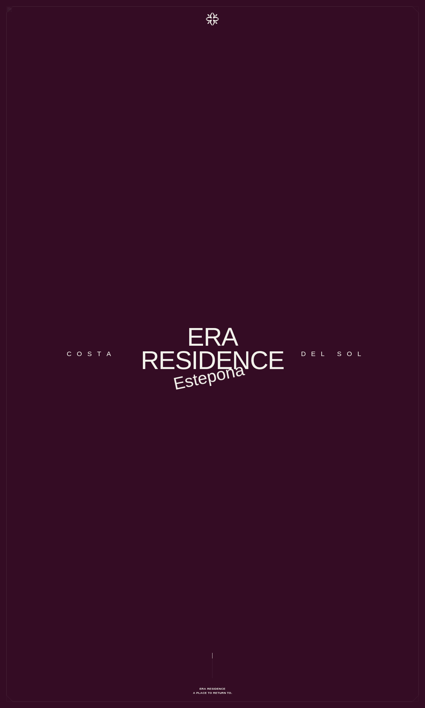
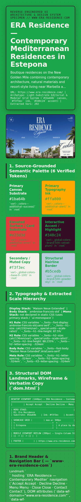

# UI Design System & Master Generation Blueprint: www-era-residence-com

> **ERA Residence — Contemporary Mediterranean Residences in Estepona** (https://www.era-residence.com/) — Boutique residences on the New Golden Mile combining contemporary architecture, natural materials and resort-style living near Marbella a...



---

## 1. Executive Visual Persona & Design Archetype

- **Brand Essence & Persona**: **ERA Residence — Contemporary Mediterranean Residences in Estepona** (`https://www.era-residence.com/`). Boutique residences on the New Golden Mile combining contemporary architecture, natural materials and resort-style living near Marbella a...
- **Visual Archetype**: **Light-Substrate Editorial & Modular Grid System (`#1ba64b` canvas, `#f3f3ec` ink, `#340c24` accent)**.
- **Anti-AI-Slop Differentiators**:
  - **Source-Grounded Chromatic Polarity**: Anchors the viewport in `#1ba64b` (`var(--_colors---additional--success)` in `:root`) paired with `#f3f3ec` primary typography and `#340c24` accents.
  - **Extracted Typographic Hierarchy**: Pairs `Maison Neue Extended` for display copy (`Era Residence`) with `ambroise-francois-std` and not declared in static CSS (uses primary stack / `ui-monospace`).
  - **Calibrated Spatial Grid & Motion**: Combines `940px` container bounds (`gap: 16px`, padding `9px`) with `cubic-bezier(0.76,0,0.24,1)` easing and Lenis Smooth Scroll (`data-lenis`), GSAP Timeline & ScrollTrigger.

---

## 2. Spatial Architecture & Modular Grid Mathematics



### Viewport Allocation & Container Geometry
- **Captured Viewport Dimensions**: Desktop `1440×2400px` (`assets/desktop.png`, capped at 2400px multi-section capture), Mobile `390×2400px` (`assets/mobile.png`, capped at 2400px multi-section capture).
- **Master Container Bounds**: `940px` extracted from `www-era-residence-com` stylesheet.
- **Canvas Lateral Padding & Spacing**: `9px` lateral canvas padding with `16px` grid gap.
- **Border Radius Scale**: `3px`, `100%`, `50%`, `var(--40px)`.

### Responsive Breakpoint Architecture
- **Desktop Layout**: Multi-column CSS Grid / Flexbox layout at `1440px` (`max-width: 940px`, `gap: 16px`).
- **Mobile Layout**: Single-column vertical stack at `390px` viewport width with `9px` horizontal padding.
- **Extracted CSS Media Queries**: `@media screen and (max-width:991px)`, `@media screen and (max-width:767px)`, `@media screen and (max-width:479px)`, `@media (min-width:768px)`.

---

## 3. Color System, Materiality & Atmospheric Lighting

### Semantic Palette & Source Grounding
| Semantic Role | Ground-Truth Value | Extracted CSS Source / Selector |
|---|---|---|
| **Primary Canvas Substrate** | `#1ba64b` | `var(--_colors---additional--success)` in `:root` |
| **Primary Typography Ink** | `#ffa800` | `var(--_colors---additional--alert)` in `:root` |
| **Elevated Surface / Card Substrate** | `#e23d3d` | `var(--_colors---additional--error)` in `:root` |
| **Interactive Accent / Highlight** | `#340c24` | `var(--_global-colors---brand-500--velvet-plum)` in `:root` |
| **Secondary / Muted Copy** | `#f3f3ec` | `var(--_global-colors---base-0--100)` in `:root` |
| **Structural Hairline Border** | `#b5cedb` | `var(--_global-colors---brand-500--powder-sky)` in `:root` |

### Sanitized Root CSS Variables (`ui-ux.md` Ground Truth)
| Variable Name | Extracted Value | Semantic Role |
|---|---|---|
| `--_fonts---font-body` | `"Maison Neue Extended",Arial,sans-serif` | Typography / Scale Token |
| `--_colors---base-1000--primary` | `var(--_global-colors---base-1000--100)` | Brand / Palette Token |
| `--_fonts---font-display` | `ambroise-francois-std,sans-serif` | Typography / Scale Token |
| `--_fonts---h1--size` | `calc(192rem/var(--_special-units---scale-ratio))` | Typography / Scale Token |
| `--_fonts---h1--line-height` | `87.5%` | Typography / Scale Token |
| `--_fonts---h1--letter-spacing` | `-.024em` | Typography / Scale Token |
| `--_fonts---h2--size` | `calc(136rem/var(--_special-units---scale-ratio))` | Typography / Scale Token |
| `--_fonts---h2--line-height` | `88.235%` | Typography / Scale Token |
| `--_fonts---h2--letter-spacing` | `-.024em` | Typography / Scale Token |
| `--_fonts---h3--size` | `calc(96rem/var(--_special-units---scale-ratio))` | Typography / Scale Token |
| `--_fonts---h3--line-height` | `91.667%` | Typography / Scale Token |
| `--_fonts---h3--letter-spacing` | `-.024em` | Typography / Scale Token |
| `--_fonts---h4--size` | `calc(63rem/var(--_special-units---scale-ratio))` | Typography / Scale Token |
| `--_fonts---h4--line-height` | `88.889%` | Typography / Scale Token |
| `--_fonts---h4--letter-spacing` | `-.016em` | Typography / Scale Token |
| `--_fonts---h5--size` | `calc(40rem/var(--_special-units---scale-ratio))` | Typography / Scale Token |

---

## 4. Typographic Scale & Editorial Hierarchy

### Font Family Stacks
- **Display Typography**: `Maison Neue Extended`.
- **Primary Body Stack**: `ambroise-francois-std`.
- **Technical / Metadata Stack**: not declared in static CSS (uses primary stack / `ui-monospace`).

### Typographic Scale & Rules (Extracted from Stylesheet & Variables)
- **Hero Display (`H1`)**: CSS variables `--_fonts---font-display: ambroise-francois-std,sans-serif`, `--_fonts---h1--size: calc(192rem/var(--_special-units---scale-ratio))`, `--_fonts---h1--line-height: 87.5%`.
- **Section Heading (`H2`)**: CSS variables `--_fonts---h2--size: calc(136rem/var(--_special-units---scale-ratio))`, `--_fonts---h2--line-height: 88.235%`, `--_fonts---h2--letter-spacing: -.024em`.
- **Body Copy**: CSS variables `--_fonts---font-body: "Maison Neue Extended",Arial,sans-serif`.
- **Metadata & Navigation Labels**: CSS variables `--_fonts---h1--letter-spacing: -.024em`, `--_fonts---h2--letter-spacing: -.024em`, `--_fonts---h3--letter-spacing: -.024em`.

---

## 5. Choreographed Motion & Interaction Physics

### Primary Easing Curves
- **Extracted Timing Functions**: `cubic-bezier(0.76,0,0.24,1)`, `cubic-bezier(0.25,1,0.5,1)`, `cubic-bezier(0.5,0,0.75,0)`.

### Per-Element Transition & Choreography Rules
- **Selector `.w-webflow-badge>img`**: `transition: unset` extracted from `www-era-residence-com` stylesheet.
- **Selector `.w-slider-dot`**: `transition: background-color .1s,color .1s` extracted from `www-era-residence-com` stylesheet.
- **Selector `.w-lightbox-control`**: `transition: all .3s` extracted from `www-era-residence-com` stylesheet.
- **Extracted Easing Curve (`cubic-bezier(0.76,0,0.24,1)`)**: Governs interactive state transitions across `<header.w-mod-js>` and `<section.section>`.
- **Runtime Interaction Engine**: Integrates Lenis Smooth Scroll (`data-lenis`), GSAP Timeline & ScrollTrigger, Three.js / WebGL Canvas Pipeline, Lottie Vector Animation Player, Barba.js Page Transition Router with `prefers-reduced-motion: reduce` fallback guards.

---

## 6. Component Wireframe & Structural DOM Map

### Visual Layout Schematic (Grounded in `dom.html` — `1440px` Desktop & `390px` Mobile Reflow)
```
┌────────────────────────────────────────────────────────────────────────┐
│ DESKTOP VIEWPORT (1440px) — ERA Residence — Contemporary Mediterranean │
│ ====================================================================== │
│ [ <header.w-mod-js>        | Accept Accept · Decline Decline · Menu ]  │
│ ---------------------------------------------------------------------- │
│ | HERO STAGE: <section.section>                                    |   │
│ | H1: Era Residence                                                |   │
│ | Substrate: #1ba64b    | Ink: #f3f3ec    | Accent: #340c24        |   │
│ ---------------------------------------------------------------------- │
│ | SHOWCASE GRID (<section.section>         ) max-w: 940px          |   │
│ | +------------------------------+  +------------------------------+ | │
│ | | Estepona                     |  | A place by day by day by nig | | │
│ | +------------------------------+  +------------------------------+ | │
│ ---------------------------------------------------------------------- │
│ | MOBILE VIEWPORT REFLOW (390px) — Single-Column Stack (gap: 16px  ) | │
│ | [<header.w-mod-js>] -> [<section.section>] -> [<section.section>] |  │
│ ---------------------------------------------------------------------- │
│ [ FOOTER (<footer.lenis>        ) | https://www.era-residence.com/     │
└────────────────────────────────────────────────────────────────────────┘
```

### Granular DOM Region Breakdown
1. **Brand Header & Navigation Bar (<header.w-mod-js> — `www-era-residence-com`)**:
   - Landmark `<header class="w-mod-js">` hosting `ERA Residence — Contemporary Mediter` navigation (`Accept Accept · Decline Decline · Menu Menu · Close Close · Contact Contact`), DOM attributes (`data-wf-domain="www.era-residence.com"`, `data-wf-page="6a068da7ad91b057365bf968"`, `data-wf-site="6a068da7ad91b057365bf967"`, `data-barba="wrapper"`), and stylesheet rule `html { -webkit-text-size-adjust:100%;-ms-text-size-adjust:100%;font-family:sans... }`.
2. **Hero Stage & Focal Lead (<section.section> — `Era Residence`)**:
   - Landmark `<section class="section clip">` presenting display lead `Era Residence` and copy excerpt *"Era Residence A place to return to."* over `#1ba64b` canvas and `#f3f3ec` ink.
3. **Primary Showcase & Content Grid (<section.section> — `Estepona`)**:
   - Landmark `<section class="section arch">` rendering section `Estepona` with copy *"A place to return to."*, asset references (`cdn.prod.website-files.com`, `era-residence.webflow.shared.c955...`, `845813938192979`, `fbevents.js`), and grid rule `summary { display:block }`.
4. **Interactive Detail & Feature Matrix (<section.section> — `A place by day by day by night by `)**:
   - Landmark `<section class="section z-2">` framing `A place by day by day by night by night to return to` and `Real-Life Location` (*"Select an Apartment Select an Apartment"*) with `#e23d3d` surface cards, `#340c24` accents, and `video { vertical-align:baseline;display:inline-block }`.
5. **Colophon & Global Directory Footer (<footer.lenis> — `https://www.era-residence.com/`)**:
   - Landmark `<footer class="lenis">` anchoring `ERA Residence — Contemporary Med` footer links (`Accept Accept · Decline Decline · Menu Menu · Close Close · Contact Contact`), copy *"Book a call Book a call"*, and `#b5cedb` structural dividers.

---

## 7. Master Zero-Shot AI Generation Prompt

```markdown
# Master Zero-Shot Frontend Generation Prompt: www-era-residence-com (ERA Residence — Contemporary Mediterranean Residences in Estepona)

You are a principal frontend architect and design systems engineer. Build a complete, production-ready web application replicating the exact design system, DOM landmarks, typographic hierarchy, color tokens, and motion physics of `www-era-residence-com` (**ERA Residence — Contemporary Mediterranean Residences in Estepona** — `https://www.era-residence.com/`).

### 1. Visual Archetype & Anti-AI-Slop Mandates
- **Archetype**: Light-Substrate Editorial & Modular Grid System (`#1ba64b` canvas, `#f3f3ec` ink, `#340c24` accent).
- **Identity & Domain Context**: Boutique residences on the New Golden Mile combining contemporary architecture, natural materials and resort-style living near Marbella a...
- **Primary Substrate**: `#1ba64b` (`var(--_colors---additional--success)` in `:root`), **Primary Ink**: `#f3f3ec`, **Accent / Highlight**: `#340c24`.
- **Site-Specific Differentiators**:
  - **Source-Grounded Chromatic Polarity**: Anchors the viewport in `#1ba64b` (`var(--_colors---additional--success)` in `:root`) paired with `#f3f3ec` primary typography and `#340c24` accents.
  - **Extracted Typographic Hierarchy**: Pairs `Maison Neue Extended` for display copy (`Era Residence`) with `ambroise-francois-std` and not declared in static CSS (uses primary stack / `ui-monospace`).
  - **Calibrated Spatial Grid & Motion**: Combines `940px` container bounds (`gap: 16px`, padding `9px`) with `cubic-bezier(0.76,0,0.24,1)` easing and Lenis Smooth Scroll (`data-lenis`), GSAP Timeline & ScrollTrigger.

### 2. Ground-Truth CSS Variables (`:root` Token Contract)
Declare and consume these exact custom properties extracted from `www-era-residence-com` in your global stylesheet:

:root {
  /* ERA Residence — Contemporary Mediterranean Residences in Estepona (www-era-residence-com) — Ground-Truth Extracted CSS Variables */
  --_fonts---font-body: "Maison Neue Extended",Arial,sans-serif; /* Typography / Scale Token (www-era-residence-com) */
  --_colors---base-1000--primary: var(--_global-colors---base-1000--100); /* Brand / Palette Token (www-era-residence-com) */
  --_fonts---font-display: ambroise-francois-std,sans-serif; /* Typography / Scale Token (www-era-residence-com) */
  --_fonts---h1--size: calc(192rem/var(--_special-units---scale-ratio)); /* Typography / Scale Token (www-era-residence-com) */
  --_fonts---h1--line-height: 87.5%; /* Typography / Scale Token (www-era-residence-com) */
  --_fonts---h1--letter-spacing: -.024em; /* Typography / Scale Token (www-era-residence-com) */
  --_fonts---h2--size: calc(136rem/var(--_special-units---scale-ratio)); /* Typography / Scale Token (www-era-residence-com) */
  --_fonts---h2--line-height: 88.235%; /* Typography / Scale Token (www-era-residence-com) */
  --_fonts---h2--letter-spacing: -.024em; /* Typography / Scale Token (www-era-residence-com) */
  --_fonts---h3--size: calc(96rem/var(--_special-units---scale-ratio)); /* Typography / Scale Token (www-era-residence-com) */
  --_fonts---h3--line-height: 91.667%; /* Typography / Scale Token (www-era-residence-com) */
  --_fonts---h3--letter-spacing: -.024em; /* Typography / Scale Token (www-era-residence-com) */
  --_fonts---h4--size: calc(63rem/var(--_special-units---scale-ratio)); /* Typography / Scale Token (www-era-residence-com) */
  --_fonts---h4--line-height: 88.889%; /* Typography / Scale Token (www-era-residence-com) */
  --_fonts---h4--letter-spacing: -.016em; /* Typography / Scale Token (www-era-residence-com) */
  --_fonts---h5--size: calc(40rem/var(--_special-units---scale-ratio)); /* Typography / Scale Token (www-era-residence-com) */
}

### 3. Semantic Color & Materiality Contract
Map every surface, ink, and border strictly to these source-grounded tokens:
- **Primary Canvas Substrate**: `#1ba64b` — grounded in `var(--_colors---additional--success)` in `:root`
- **Primary Typography Ink**: `#ffa800` — grounded in `var(--_colors---additional--alert)` in `:root`
- **Elevated Surface / Card Substrate**: `#e23d3d` — grounded in `var(--_colors---additional--error)` in `:root`
- **Interactive Accent / Highlight**: `#340c24` — grounded in `var(--_global-colors---brand-500--velvet-plum)` in `:root`
- **Secondary / Muted Copy**: `#f3f3ec` — grounded in `var(--_global-colors---base-0--100)` in `:root`
- **Structural Hairline Border**: `#b5cedb` — grounded in `var(--_global-colors---brand-500--powder-sky)` in `:root`

### 4. Spatial Grid, Container Bounds & Responsive Breakpoints
- **Desktop Viewport Reference**: `1440×2400px` (capped at 2400px multi-section capture, `1440px` standard desktop width).
- **Mobile Viewport Reference**: `390×2400px` (capped at 2400px multi-section capture, `390px` standard mobile width).
- **Container Max-Width**: `940px` extracted from `www-era-residence-com` stylesheet
- **Padding & Gutters**: `9px` lateral canvas padding with `16px` grid gap
- **Desktop Grid**: Multi-column CSS Grid / Flexbox layout at `1440px` (`max-width: 940px`, `gap: 16px`)
- **Mobile Adaptation**: Single-column vertical stack at `390px` viewport width with `9px` horizontal padding
- **Media Queries**: `@media screen and (max-width:991px)`, `@media screen and (max-width:767px)`, `@media screen and (max-width:479px)`, `@media (min-width:768px)`
- **Corner Radii**: `3px`, `100%`, `50%`, `var(--40px)`

### 5. Typography & Editorial Scale Contract
- **Display Font Stack**: `Maison Neue Extended`
- **Body Font Stack**: `ambroise-francois-std`
- **Monospace / Technical Font Stack**: not declared in static CSS (uses primary stack / `ui-monospace`)
- **H1 Display Rule**: CSS variables `--_fonts---font-display: ambroise-francois-std,sans-serif`, `--_fonts---h1--size: calc(192rem/var(--_special-units---scale-ratio))`, `--_fonts---h1--line-height: 87.5%`
- **H2 Section Rule**: CSS variables `--_fonts---h2--size: calc(136rem/var(--_special-units---scale-ratio))`, `--_fonts---h2--line-height: 88.235%`, `--_fonts---h2--letter-spacing: -.024em`
- **Body Copy Rule**: CSS variables `--_fonts---font-body: "Maison Neue Extended",Arial,sans-serif`
- **Metadata & Index Rule**: CSS variables `--_fonts---h1--letter-spacing: -.024em`, `--_fonts---h2--letter-spacing: -.024em`, `--_fonts---h3--letter-spacing: -.024em`

### 6. Component Hierarchy, Verbatim Copy & Real DOM Landmarks
Scaffold `www-era-residence-com` (`ERA Residence — Contemporary Mediterranean Residences in Estepona`) with these exact structural regions, extracted copy, and CSS rules from `dom.html`:
1. **Brand Header & Navigation Bar (<header.w-mod-js> — `www-era-residence-com`)**:
   - DOM & Selectors: Landmark `<header class="w-mod-js">` hosting `ERA Residence — Contemporary Mediter` navigation (`Accept Accept · Decline Decline · Menu Menu · Close Close · Contact Contact`), DOM attributes (`data-wf-domain="www.era-residence.com"`, `data-wf-page="6a068da7ad91b057365bf968"`, `data-wf-site="6a068da7ad91b057365bf967"`, `data-barba="wrapper"`), and stylesheet rule `html { -webkit-text-size-adjust:100%;-ms-text-size-adjust:100%;font-family:sans... }`.
   - Responsive Contract: Header `Brand Header & Navigation Bar (<header.w-mod-js> — `www-era-residence-com`)` (`www-era-residence-com`) adapts across `@media screen and (max-width:991px)`, `@media screen and (max-width:767px)`, `@media screen and (max-width:479px)`, `@media (min-width:768px)` with `cubic-bezier(0.76,0,0.24,1)`, `cubic-bezier(0.25,1,0.5,1)`, `cubic-bezier(0.5,0,0.75,0)` transitions and links `Accept Accept · Decline Decline · Menu Menu · Close Close · Contact Contact`.
2. **Hero Stage & Focal Lead (<section.section> — `Era Residence`)**:
   - DOM & Selectors: Landmark `<section class="section clip">` presenting display lead `Era Residence` and copy excerpt *"Era Residence A place to return to."* over `#1ba64b` canvas and `#f3f3ec` ink.
   - Responsive Contract: Hero stage (`1440×2400px` desktop / `390×2400px` mobile) sets `#1ba64b` background with `#f3f3ec` headline `Era Residence`.
3. **Primary Showcase & Content Grid (<section.section> — `Estepona`)**:
   - DOM & Selectors: Landmark `<section class="section arch">` rendering section `Estepona` with copy *"A place to return to."*, asset references (`cdn.prod.website-files.com`, `era-residence.webflow.shared.c955...`, `845813938192979`, `fbevents.js`), and grid rule `summary { display:block }`.
   - Responsive Contract: Showcase grid `Primary Showcase & Content Grid (<section.section> — `Estepona`)` applies Multi-column CSS Grid / Flexbox layout at `1440px` (`max-width: 940px`, `gap: 16px`) on desktop and Single-column vertical stack at `390px` viewport width with `9px` horizontal padding on mobile.
4. **Interactive Detail & Feature Matrix (<section.section> — `A place by day by day by night by `)**:
   - DOM & Selectors: Landmark `<section class="section z-2">` framing `A place by day by day by night by night to return to` and `Real-Life Location` (*"Select an Apartment Select an Apartment"*) with `#e23d3d` surface cards, `#340c24` accents, and `video { vertical-align:baseline;display:inline-block }`.
   - Responsive Contract: Detail module `Interactive Detail & Feature Matrix (<section.section> — `A place by day by day by night by `)` uses `3px`, `100%`, `50%`, `var(--40px)` radii, `#340c24` highlights, and assets (cdn.prod.website-files.com, era-residence.webflow.shared.c955..., 845813938192979).
5. **Colophon & Global Directory Footer (<footer.lenis> — `https://www.era-residence.com/`)**:
   - DOM & Selectors: Landmark `<footer class="lenis">` anchoring `ERA Residence — Contemporary Med` footer links (`Accept Accept · Decline Decline · Menu Menu · Close Close · Contact Contact`), copy *"Book a call Book a call"*, and `#b5cedb` structural dividers.
   - Responsive Contract: Footer `Colophon & Global Directory Footer (<footer.lenis> — `https://www.era-residence.com/`)` aligns to `940px` extracted from `www-era-residence-com` stylesheet with `9px` lateral canvas padding with `16px` grid gap and attributes (data-wf-domain="www.era-residence.com", data-wf-page="6a068da7ad91b057365bf968", data-wf-site="6a068da7ad91b057365bf967").

#### Verbatim DOM Copy Excerpts (`dom.html`)
- Copy Excerpt 1: *"Era Residence A place to return to."*
- Copy Excerpt 2: *"A place to return to."*
- Copy Excerpt 3: *"Select an Apartment Select an Apartment"*
- Copy Excerpt 4: *"Book a call Book a call"*

### 7. Motion, Extracted Stylesheet Rules & Interaction Choreography
- **Primary Easing Functions**: `cubic-bezier(0.76,0,0.24,1)`, `cubic-bezier(0.25,1,0.5,1)`, `cubic-bezier(0.5,0,0.75,0)`
- **Extracted Stylesheet Rules (`www-era-residence-com`)**:
- `html { -webkit-text-size-adjust:100%;-ms-text-size-adjust:100%;font-family:sans... }`
- `summary { display:block }`
- `video { vertical-align:baseline;display:inline-block }`
- `template { display:none }`
- `strong { font-weight:700 }`
- **Per-Selector Transition Rules**:
- **Selector `.w-webflow-badge>img`**: `transition: unset` extracted from `www-era-residence-com` stylesheet.
- **Selector `.w-slider-dot`**: `transition: background-color .1s,color .1s` extracted from `www-era-residence-com` stylesheet.
- **Selector `.w-lightbox-control`**: `transition: all .3s` extracted from `www-era-residence-com` stylesheet.
- **Extracted Easing Curve (`cubic-bezier(0.76,0,0.24,1)`)**: Governs interactive state transitions across `<header.w-mod-js>` and `<section.section>`.
- **Runtime Interaction Engine**: Integrates Lenis Smooth Scroll (`data-lenis`), GSAP Timeline & ScrollTrigger, Three.js / WebGL Canvas Pipeline, Lottie Vector Animation Player, Barba.js Page Transition Router with `prefers-reduced-motion: reduce` fallback guards.

### 8. Technical Deliverables
- Implement in Next.js (App Router) with TypeScript and Tailwind CSS consuming the `:root` custom properties defined above for `www-era-residence-com`.
- Reproduce both the `1440px` desktop architecture and `390px` mobile breakpoint transitions, preserving semantic HTML5 landmarks (`<header>`, `<nav>`, `<main>`, `<section>`, `<footer>`) and `prefers-reduced-motion` accessibility guards.
```
