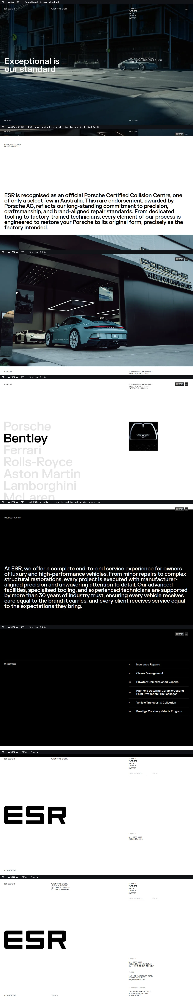
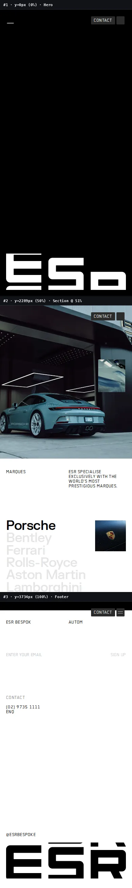

# UI Design System & Master Generation Blueprint: www-esrbespoke-au

> **ESR** (https://www.esrbespoke.au/) — Three decades of restoring excellence and reigniting the joy of the drive.





---

## 1. Executive Visual Persona & Design Archetype

- **Brand Essence & Persona**: **ESR** (`https://www.esrbespoke.au/`). Three decades of restoring excellence and reigniting the joy of the drive.
- **Capture Provenance**: Live browser capture (`tier1_fast`, HTTP `200`, captured `2026-11-24`).
- **Visual Archetype**: **Light-Gallery WebGL / Canvas Interactive Experience (`#ffffff` / `#9ca3af`)**.
- **Anti-AI-Slop Differentiators**:
  - **Live-Computed Chromatic Polarity**: Anchors the viewport in `#ffffff` (live computed `body` `background-color` (`computed_styles.json`)) paired with `#000000` primary typography and `#9ca3af` accents.
  - **Grounded Typographic Hierarchy**: Uses `__bodyFont_0f148b` across display (`Exceptional is our standard`) and body copy, paired with `SFMono-Regular` for monospace/code.
  - **Calibrated Spatial Grid & Motion**: Combines `1376px` container bounds (`gap: 16px`, padding `32px`) with `cubic-bezier(.4,0,.6,1)` easing and Lenis Smooth Scroll (`data-lenis`), Three.js / WebGL Canvas Pipeline.

---

## 2. Spatial Architecture & Modular Grid Mathematics

### Viewport Allocation & Container Geometry
- **Captured Journey Filmstrips**: Desktop `1280×6624px` (`assets/desktop-journey.webp`, `8` keyframes up to `y=5970px` / doc `6870px`), Mobile `390×2616px` (`assets/mobile-journey.webp`, `3` keyframes).
- **Master Container Bounds**: `1376px` (measured widest bounded `<section>` landmark width on `1440px` desktop).
- **Canvas Lateral Padding & Spacing**: `32px` lateral canvas padding with `16px` grid gap.
- **Border Radius Scale**: `2px`, `50%`.

### Responsive Breakpoint Architecture
- **Desktop Layout**: Multi-column CSS Grid / Flexbox layout at `1440px` (`max-width: 1376px`, `gap: 16px`).
- **Mobile Layout**: Single-column vertical stack at `390px` viewport width with `32px` horizontal padding.
- **Extracted CSS Media Queries**: `@media (min-width:1024px)`, `@media (max-width:1023px)`.

---

## 3. Color System, Materiality & Atmospheric Lighting

### Semantic Palette & Source Grounding
| Semantic Role | Ground-Truth Value | Extracted Live / CSS Source |
|---|---|---|
| **Primary Canvas Substrate** | `#ffffff` | live computed `body` `background-color` (`computed_styles.json`) |
| **Primary Typography Ink** | `#000000` | live computed `main` `color` (`computed_styles.json`) |
| **Elevated Surface / Card Substrate** | `#2299dd` | `#nprogress .bar { background: #2299dd }` |
| **Interactive Accent / Highlight** | `#9ca3af` | `textarea::placeholder { color: #9ca3af }` |
| **Secondary / Muted Copy** | `#9ca3af` | `textarea::placeholder { color: #9ca3af }` |
| **Structural Hairline Border** | `#e6e6e6` | `var(--border)` in `:root` (`rgba(0,0,0,0.1)`) |

### Sanitized Root CSS Variables (`ui-ux.md` Ground Truth)
| Variable Name | Extracted Value | Semantic Role |
|---|---|---|
| `--foreground-rgb` | `0,0,0` | Typography Ink Token |
| `--background-rgb` | `255,255,255` | Canvas / Surface Token |
| `--border-rgb` | `0,0,0` | Elevation / Border Token |
| `--scrollbarWidth` | `0px` | Layout / Spatial Grid Token |
| `--body-font` | `"__bodyFont_0f148b","__bodyFont_Fallback_0f148b",helvetica,arial,sans-serif` | Typography / Scale Token |
| `--foreground` | `#fff` | Typography Ink Token |
| `--background` | `#ffffff` | Canvas / Surface Token |
| `--border` | `rgba(0,0,0,0.1)` | Elevation / Border Token |
| `--tw-content` | `""` | Design System Custom Token |
| `--tw-border-spacing-x` | `0` | Layout / Spatial Grid Token |
| `--tw-border-spacing-y` | `0` | Layout / Spatial Grid Token |
| `--tw-translate-x` | `0` | Design System Custom Token |
| `--tw-translate-y` | `0` | Design System Custom Token |
| `--tw-rotate` | `0` | Design System Custom Token |
| `--www-esrbespoke-a-bg` | `#ffffff` | Canvas Substrate (from live computed `body` `background-color` (`computed_styles.json`)) |
| `--www-esrbespoke-a-ink` | `#000000` | Primary Typography Ink (computed-derived) |

---

## 4. Typographic Scale & Editorial Hierarchy

### Font Family Stacks
- **Display Typography**: `__bodyFont_0f148b`.
- **Primary Body Stack**: `__bodyFont_0f148b`.
- **Technical / Metadata Stack**: `SFMono-Regular`.

### Typographic Scale & Rules (Live Computed & Stylesheet Grounded)
- **Hero Display (`H1`)**: live computed `h1` (`font-size: 62px`, `line-height: 58.9px`, `font-weight: 500`, `letter-spacing: -0.62px`).
- **Section Heading (`H2`)**: live computed `h2` (`font-size: 40px`, `line-height: 40px`, `font-weight: 500`, `letter-spacing: -0.4px`).
- **Body Copy**: live computed `body` (`font-size: 18px`, `line-height: 23.4px`, `font-weight: 300`); CSS variables `--body-font: "__bodyFont_0f148b","__bodyFont_Fallback_0f148b",helvetica,arial,sans-serif`.
- **Metadata & Navigation Labels**: live computed `nav/a` (`font-size: 14px`, `line-height: 14px`, `font-weight: 300`, `letter-spacing: 1.26px`).

---

## 5. Choreographed Motion & Interaction Physics

### Primary Easing Curves
- **Extracted Timing Functions**: `cubic-bezier(.4,0,.6,1)`, `cubic-bezier(.4,0,.2,1)`, `cubic-bezier(.16,1,.3,1)`.

### Per-Element Transition & Choreography Rules
- **Selector `.transition`**: `transition: cubic-bezier(.4,0,.6,1)` extracted from `www-esrbespoke-au` stylesheet.
- **Selector `ansition-\[margin\2c transform\2c...`**: `transition: cubic-bezier(.4,0,.6,1)` extracted from `www-esrbespoke-au` stylesheet.
- **Selector `.transition-colors`**: `transition: cubic-bezier(.4,0,.6,1)` extracted from `www-esrbespoke-au` stylesheet.
- **Extracted Easing Curve (`cubic-bezier(.4,0,.6,1)`)**: Governs interactive state transitions across `<header.w-auto>` and `<section.items-end>`.
- **Runtime Interaction Engine**: Integrates Lenis Smooth Scroll (`data-lenis`), Three.js / WebGL Canvas Pipeline with `prefers-reduced-motion: reduce` fallback guards.
### Measured Runtime Scroll & Interaction Telemetry (`behavioral_journey_v2`)
- **Scroll Driver Mode**: `native` (max document height `6870px`, deepest scrollY reached `5970px` across `8` desktop keyframes).
- **Detected Scroll / Motion Libraries**: `Lenis`, `GSAP/ScrollTrigger`, `WebGL/Canvas`.
- **Nav / Drawer Probe (`Open menu`)**: Triggered visual change (pixel diff `35.866`, captured in `assets/state-nav.webp`); revealed links: ESR BESPOKE, SERVICES, PARTNERS, ABOUT, CONTACT, CAREERS.
- **Interactive Control Probe (`accordion` · `Open menu`)**: Triggered visual diff `191.624` (attr `false -> true`, captured in `assets/state-interactive.webp`).
- **Route Transition Architecture**: First internal navigation (`/services`) measured as `direct` in `807ms`.

---

## 6. Component Wireframe & Structural DOM Map

### Visual Layout Schematic — Desktop (`1440px`, Grounded in `dom.html` & Landmark Bounding Boxes)
```
┌────────────────────────────────────────────────────────────────────────┐
│ DESKTOP VIEWPORT (1440px) — ESR                                        │
│ ====================================================================== │
│ [ <header.w-auto> (1440x85px)         | Services · Partners · About  ] │
│ ---------------------------------------------------------------------- │
│ | HERO STAGE: <section.w-auto> (w=1440px)                            | │
│ | H1: Exceptional is our standard                                    | │
│ | Substrate: #ffffff | Ink: #000000 | Accent: #9ca3af                | │
│ ---------------------------------------------------------------------- │
│ | SHOWCASE GRID (<section.items-end>) max-w: 1376px                  | │
│ | +------------------------------+  +------------------------------+ | │
│ | | E x c e p t i o n a l i s o  |  | ESR is recognised as an offi | | │
│ | +------------------------------+  +------------------------------+ | │
│ ---------------------------------------------------------------------- │
│ | DETAIL MODULE (<section.mb-8>) — At ESR, we offer a co             | │
│ ---------------------------------------------------------------------- │
│ [ FOOTER (<footer.clip>       ) | https://www.esrbespoke.au/           │
└────────────────────────────────────────────────────────────────────────┘
```

### Visual Layout Schematic — Mobile Reflow (`390px`)
```
┌────────────────────────────────────────────────────────────────────────┐
│ MOBILE VIEWPORT REFLOW (390px) — Single-Column Stack (gap: 16px)       │
│ ====================================================================== │
│ [ HEADER BAR (<header.w-auto>         ) | Compact Menu (390px)         │
│ ---------------------------------------------------------------------- │
│ | HERO STAGE (<section.w-auto>) — 390px Vertical Lead                | │
│ | H1: Exceptional is our standard                                    | │
│ ---------------------------------------------------------------------- │
│ | SHOWCASE STACK (<section.items-end>) — 1-Col Stack                 | │
│ | [ Item 1: E x c e p t i o n a l i s o u r s t a n d a r d        ] | │
│ | [ Item 2: ESR is recognised as an official Porsche Certifie...   ] | │
│ ---------------------------------------------------------------------- │
│ | DETAIL STACK (<section.mb-8>) — 1-Col (At ESR, we offer a)         | │
│ ---------------------------------------------------------------------- │
│ [ FOOTER (<footer.clip>       ) | Stacked 390px Colophon               │
└────────────────────────────────────────────────────────────────────────┘
```

### Granular DOM Region Breakdown
1. **Brand Header & Navigation Bar (<header.w-auto> — `www-esrbespoke-au`)**:
   - Landmark `<header class="w-auto grid-layout">` (`1440x85px`) hosting `ESR` navigation (`Services · Partners · About · Contact · Careers`), DOM attributes (`data-next-font="size-adjust"`, `data-next-font="size-adjust"`, `data-next-font="size-adjust"`, `data-next-font="size-adjust"`), and stylesheet rule `.keen-slider__slide { min-height:100%;overflow:hidden;position:relative;width:100% }`.
2. **Hero Stage & Focal Lead (<section.w-auto> — `Exceptional is our standard`)**:
   - Landmark `<section class="w-auto grid-layout">` presenting display lead `Exceptional is our standard` and copy excerpt *"A u t o m o t i v e G r o u p since 1989"* over `#ffffff` canvas and `#000000` ink.
3. **Primary Showcase & Content Grid (<section.items-end> — `E x c e p t i o n a l i s o u r s `)**:
   - Landmark `<section class="w-auto items-end">` rendering section `E x c e p t i o n a l i s o u r s t a n d a r d` with copy *"( 0 2 ) 9 7 3 5 1 1 1 1 e n q u i r i e s @ e s r b e s p o k e ."*, asset references (`apple-touch-icon.png`, `favicon-32x32.png`, `favicon-16x16.png`, `favicon.ico`), and grid rule `nprogress { pointer-events:none }`.
4. **Interactive Detail & Feature Matrix (<section.mb-8> — `ESR is recognised as an official P`)**:
   - Landmark `<section class="w-auto mb-8">` framing `ESR is recognised as an official Porsche Certifie...` and `At ESR, we offer a complete end-to-end service ex...` (*"4 1 9 - 4 3 1 C a n t e r b u r y R o a d , C a m p s i e N S W 2"*) with `#2299dd` surface cards, `#9ca3af` accents, and `nprogress .bar { background:29d;position:fixed;z-index:1031;top:0;left:0;width:100%;heigh... }`.
5. **Colophon & Global Directory Footer (<footer.clip> — `https://www.esrbespoke.au/`)**:
   - Landmark `<footer class="clip mono">` anchoring `ESR` footer links (`Services · Partners · About · Contact · Careers`), copy *"E S R B e s p o k e S t u d i o"*, and `#e6e6e6` structural dividers.
### Full Vertical Scroll Sequence (Desktop `1440×900` Keyframes)
- **Step 01** (`y=0px`, `0%`): Active landmark `Exceptional is our standard` · sticky/fixed elements: `2`
- **Step 02** (`y=850px`, `14%`): Active landmark `ESR is recognised as an official Porsche Certifie...` · sticky/fixed elements: `2`
- **Step 03** (`y=1700px`, `28%`): Active landmark `Section @ 28%` · sticky/fixed elements: `2`
- **Step 04** (`y=2550px`, `43%`): Active landmark `Section @ 43%` · sticky/fixed elements: `2`
- **Step 05** (`y=4250px`, `71%`): Active landmark `At ESR, we offer a complete end-to-end service ex...` · sticky/fixed elements: `2`
- **Step 06** (`y=5100px`, `85%`): Active landmark `Section @ 85%` · sticky/fixed elements: `2`
- **Step 07** (`y=5950px`, `100%`): Active landmark `Footer` · sticky/fixed elements: `0`
- **Step 08** (`y=5970px`, `100%`): Active landmark `Footer` · sticky/fixed elements: `0`

### Multi-Page Internal Route Map
- **Listing Route (`/services`)**: `https://www.esrbespoke.au/services` — H1: `Exceeding expectations`, scrollHeight `9721px`, transition `direct` (`807ms`)
- **About Route (`/about`)**: `https://www.esrbespoke.au/about` — H1: `Restoring luxury since 1989`, scrollHeight `4127px`, transition `direct` (`655ms`)
- **About Route (`/contact`)**: `https://www.esrbespoke.au/contact` — H1: `Get in touch`, scrollHeight `5507px`, transition `direct` (`978ms`)

---

## 7. Master Zero-Shot AI Generation Prompt

```markdown
# Master Zero-Shot Frontend Generation Prompt: www-esrbespoke-au (ESR)

You are a principal frontend architect and design systems engineer. Build a complete, production-ready web application replicating the exact design system, DOM landmarks, typographic hierarchy, color tokens, and motion physics of `www-esrbespoke-au` (**ESR** — `https://www.esrbespoke.au/`).

### 1. Visual Archetype & Anti-AI-Slop Mandates
- **Archetype**: Light-Gallery WebGL / Canvas Interactive Experience (`#ffffff` / `#9ca3af`).
- **Identity & Domain Context**: Three decades of restoring excellence and reigniting the joy of the drive.
- **Primary Substrate**: `#ffffff` (live computed `body` `background-color` (`computed_styles.json`)), **Primary Ink**: `#000000`, **Accent / Highlight**: `#9ca3af`.
- **Site-Specific Differentiators**:
  - **Live-Computed Chromatic Polarity**: Anchors the viewport in `#ffffff` (live computed `body` `background-color` (`computed_styles.json`)) paired with `#000000` primary typography and `#9ca3af` accents.
  - **Grounded Typographic Hierarchy**: Uses `__bodyFont_0f148b` across display (`Exceptional is our standard`) and body copy, paired with `SFMono-Regular` for monospace/code.
  - **Calibrated Spatial Grid & Motion**: Combines `1376px` container bounds (`gap: 16px`, padding `32px`) with `cubic-bezier(.4,0,.6,1)` easing and Lenis Smooth Scroll (`data-lenis`), Three.js / WebGL Canvas Pipeline.

### 2. Ground-Truth CSS Variables (`:root` Token Contract)
Declare and consume these exact custom properties extracted from `www-esrbespoke-au` in your global stylesheet:

:root {
  /* ESR (www-esrbespoke-au) — Live-Grounded CSS Variables */
  --foreground-rgb: 0,0,0; /* Typography Ink Token (www-esrbespoke-au) */
  --background-rgb: 255,255,255; /* Canvas / Surface Token (www-esrbespoke-au) */
  --border-rgb: 0,0,0; /* Elevation / Border Token (www-esrbespoke-au) */
  --scrollbarWidth: 0px; /* Layout / Spatial Grid Token (www-esrbespoke-au) */
  --body-font: "__bodyFont_0f148b","__bodyFont_Fallback_0f148b",helvetica,arial,sans-serif; /* Typography / Scale Token (www-esrbespoke-au) */
  --foreground: #fff; /* Typography Ink Token (www-esrbespoke-au) */
  --background: #ffffff; /* Canvas / Surface Token (www-esrbespoke-au) */
  --border: rgba(0,0,0,0.1); /* Elevation / Border Token (www-esrbespoke-au) */
  --tw-content: ""; /* Design System Custom Token (www-esrbespoke-au) */
  --tw-border-spacing-x: 0; /* Layout / Spatial Grid Token (www-esrbespoke-au) */
  --tw-border-spacing-y: 0; /* Layout / Spatial Grid Token (www-esrbespoke-au) */
  --tw-translate-x: 0; /* Design System Custom Token (www-esrbespoke-au) */
  --tw-translate-y: 0; /* Design System Custom Token (www-esrbespoke-au) */
  --tw-rotate: 0; /* Design System Custom Token (www-esrbespoke-au) */
  --www-esrbespoke-a-bg: #ffffff; /* Canvas Substrate (from live computed `body` `background-color` (`computed_styles.json`)) (www-esrbespoke-au) */
  --www-esrbespoke-a-ink: #000000; /* Primary Typography Ink (computed-derived) (www-esrbespoke-au) */
}

### 3. Semantic Color & Materiality Contract
Map every surface, ink, and border strictly to these source-grounded tokens:
- **Primary Canvas Substrate**: `#ffffff` — grounded in live computed `body` `background-color` (`computed_styles.json`)
- **Primary Typography Ink**: `#000000` — grounded in live computed `main` `color` (`computed_styles.json`)
- **Elevated Surface / Card Substrate**: `#2299dd` — grounded in `#nprogress .bar { background: #2299dd }`
- **Interactive Accent / Highlight**: `#9ca3af` — grounded in `textarea::placeholder { color: #9ca3af }`
- **Secondary / Muted Copy**: `#9ca3af` — grounded in `textarea::placeholder { color: #9ca3af }`
- **Structural Hairline Border**: `#e6e6e6` — grounded in `var(--border)` in `:root` (`rgba(0,0,0,0.1)`)

### 4. Spatial Grid, Container Bounds & Responsive Breakpoints
- **Desktop Viewport Reference**: `1280×6624px` (multi-frame vertical journey filmstrip (6624px), `1440px` standard desktop width).
- **Mobile Viewport Reference**: `390×2616px` (multi-frame vertical journey filmstrip (2616px), `390px` standard mobile width).
- **Container Max-Width**: `1376px` (measured widest bounded `<section>` landmark width on `1440px` desktop)
- **Padding & Gutters**: `32px` lateral canvas padding with `16px` grid gap
- **Desktop Grid**: Multi-column CSS Grid / Flexbox layout at `1440px` (`max-width: 1376px`, `gap: 16px`)
- **Mobile Adaptation**: Single-column vertical stack at `390px` viewport width with `32px` horizontal padding
- **Media Queries**: `@media (min-width:1024px)`, `@media (max-width:1023px)`
- **Corner Radii**: `2px`, `50%`

### 5. Typography & Editorial Scale Contract
- **Display Font Stack**: `__bodyFont_0f148b`
- **Body Font Stack**: `__bodyFont_0f148b`
- **Monospace / Technical Font Stack**: `SFMono-Regular`
- **H1 Display Rule**: live computed `h1` (`font-size: 62px`, `line-height: 58.9px`, `font-weight: 500`, `letter-spacing: -0.62px`)
- **H2 Section Rule**: live computed `h2` (`font-size: 40px`, `line-height: 40px`, `font-weight: 500`, `letter-spacing: -0.4px`)
- **Body Copy Rule**: live computed `body` (`font-size: 18px`, `line-height: 23.4px`, `font-weight: 300`); CSS variables `--body-font: "__bodyFont_0f148b","__bodyFont_Fallback_0f148b",helvetica,arial,sans-serif`
- **Metadata & Index Rule**: live computed `nav/a` (`font-size: 14px`, `line-height: 14px`, `font-weight: 300`, `letter-spacing: 1.26px`)

### 6. Component Hierarchy, Verbatim Copy & Real DOM Landmarks
Scaffold `www-esrbespoke-au` (`ESR`) with these exact structural regions, extracted copy, and CSS rules from `dom.html`:
1. **Brand Header & Navigation Bar (<header.w-auto> — `www-esrbespoke-au`)**:
   - DOM & Selectors: Landmark `<header class="w-auto grid-layout">` (`1440x85px`) hosting `ESR` navigation (`Services · Partners · About · Contact · Careers`), DOM attributes (`data-next-font="size-adjust"`, `data-next-font="size-adjust"`, `data-next-font="size-adjust"`, `data-next-font="size-adjust"`), and stylesheet rule `.keen-slider__slide { min-height:100%;overflow:hidden;position:relative;width:100% }`.
   - Responsive Contract: Header `Brand Header & Navigation Bar (<header.w-auto> — `www-esrbespoke-au`)` (`www-esrbespoke-au`) adapts across `@media (min-width:1024px)`, `@media (max-width:1023px)` with `cubic-bezier(.4,0,.6,1)`, `cubic-bezier(.4,0,.2,1)`, `cubic-bezier(.16,1,.3,1)` transitions and links `Services · Partners · About · Contact · Careers`.
2. **Hero Stage & Focal Lead (<section.w-auto> — `Exceptional is our standard`)**:
   - DOM & Selectors: Landmark `<section class="w-auto grid-layout">` presenting display lead `Exceptional is our standard` and copy excerpt *"A u t o m o t i v e G r o u p since 1989"* over `#ffffff` canvas and `#000000` ink.
   - Responsive Contract: Hero stage (`1280×6624px` desktop / `390×2616px` mobile) sets `#ffffff` background with `#000000` headline `Exceptional is our standard`.
3. **Primary Showcase & Content Grid (<section.items-end> — `E x c e p t i o n a l i s o u r s `)**:
   - DOM & Selectors: Landmark `<section class="w-auto items-end">` rendering section `E x c e p t i o n a l i s o u r s t a n d a r d` with copy *"( 0 2 ) 9 7 3 5 1 1 1 1 e n q u i r i e s @ e s r b e s p o k e ."*, asset references (`apple-touch-icon.png`, `favicon-32x32.png`, `favicon-16x16.png`, `favicon.ico`), and grid rule `nprogress { pointer-events:none }`.
   - Responsive Contract: Showcase grid `Primary Showcase & Content Grid (<section.items-end> — `E x c e p t i o n a l i s o u r s `)` applies Multi-column CSS Grid / Flexbox layout at `1440px` (`max-width: 1376px`, `gap: 16px`) on desktop and Single-column vertical stack at `390px` viewport width with `32px` horizontal padding on mobile.
4. **Interactive Detail & Feature Matrix (<section.mb-8> — `ESR is recognised as an official P`)**:
   - DOM & Selectors: Landmark `<section class="w-auto mb-8">` framing `ESR is recognised as an official Porsche Certifie...` and `At ESR, we offer a complete end-to-end service ex...` (*"4 1 9 - 4 3 1 C a n t e r b u r y R o a d , C a m p s i e N S W 2"*) with `#2299dd` surface cards, `#9ca3af` accents, and `nprogress .bar { background:29d;position:fixed;z-index:1031;top:0;left:0;width:100%;heigh... }`.
   - Responsive Contract: Detail module `Interactive Detail & Feature Matrix (<section.mb-8> — `ESR is recognised as an official P`)` uses `2px`, `50%` radii, `#9ca3af` highlights, and assets (apple-touch-icon.png, favicon-32x32.png, favicon-16x16.png).
5. **Colophon & Global Directory Footer (<footer.clip> — `https://www.esrbespoke.au/`)**:
   - DOM & Selectors: Landmark `<footer class="clip mono">` anchoring `ESR` footer links (`Services · Partners · About · Contact · Careers`), copy *"E S R B e s p o k e S t u d i o"*, and `#e6e6e6` structural dividers.
   - Responsive Contract: Footer `Colophon & Global Directory Footer (<footer.clip> — `https://www.esrbespoke.au/`)` aligns to `1376px` (measured widest bounded `<section>` landmark width on `1440px` desktop) with `32px` lateral canvas padding with `16px` grid gap and attributes (data-next-font="size-adjust", data-next-font="size-adjust", data-next-font="size-adjust").

#### Verbatim DOM Copy Excerpts (`dom.html`)
- Copy Excerpt 1: *"A u t o m o t i v e G r o u p since 1989"*
- Copy Excerpt 2: *"( 0 2 ) 9 7 3 5 1 1 1 1 e n q u i r i e s @ e s r b e s p o k e . a u 8 a m – 5 p..."*
- Copy Excerpt 3: *"4 1 9 - 4 3 1 C a n t e r b u r y R o a d , C a m p s i e N S W 2 1 9 4 H q @ e s..."*
- Copy Excerpt 4: *"E S R B e s p o k e S t u d i o"*

### 7. Motion, Extracted Stylesheet Rules & Interaction Choreography
- **Primary Easing Functions**: `cubic-bezier(.4,0,.6,1)`, `cubic-bezier(.4,0,.2,1)`, `cubic-bezier(.16,1,.3,1)`
- **Extracted Stylesheet Rules (`www-esrbespoke-au`)**:
- `.keen-slider__slide { min-height:100%;overflow:hidden;position:relative;width:100% }`
- `nprogress { pointer-events:none }`
- `nprogress .bar { background:29d;position:fixed;z-index:1031;top:0;left:0;width:100%;heigh... }`
- `nprogress .spinner { display:block;position:fixed;z-index:1031;top:15px;right:15px }`
- `.nprogress-custom-parent { overflow:hidden;position:relative }`
- **Per-Selector Transition Rules**:
- **Selector `.transition`**: `transition: cubic-bezier(.4,0,.6,1)` extracted from `www-esrbespoke-au` stylesheet.
- **Selector `ansition-\[margin\2c transform\2c...`**: `transition: cubic-bezier(.4,0,.6,1)` extracted from `www-esrbespoke-au` stylesheet.
- **Selector `.transition-colors`**: `transition: cubic-bezier(.4,0,.6,1)` extracted from `www-esrbespoke-au` stylesheet.
- **Extracted Easing Curve (`cubic-bezier(.4,0,.6,1)`)**: Governs interactive state transitions across `<header.w-auto>` and `<section.items-end>`.
- **Runtime Interaction Engine**: Integrates Lenis Smooth Scroll (`data-lenis`), Three.js / WebGL Canvas Pipeline with `prefers-reduced-motion: reduce` fallback guards.
### 7b. Full-Page Scroll Choreography, Interactive States & Multi-Page Routes
- **Scroll Mechanics**: Implement `native` vertical progression up to `6870px` across 8 distinct viewport chapters using Lenis, GSAP/ScrollTrigger, WebGL/Canvas.
- **Vertical Chapter Sequence**: Exceptional is our standard (0%) -> ESR is recognised as an off... (14%) -> Section @ 28% (28%) -> Section @ 43% (43%) -> At ESR, we offer a complete... (71%) -> Section @ 85% (85%) -> Footer (100%) -> Footer (100%).
- **Navigation Drawer / Menu State**: Replicate interactive menu toggle (`Open menu`) with Escape-to-close keyboard handling.
- **Multi-Page Routes**: Scaffold internal routes `/services` (listing, direct), `/about` (about, direct), `/contact` (about, direct) sharing the global header/footer shell and design tokens.

### 8. Technical Deliverables
- Implement in Next.js (App Router) with TypeScript and Tailwind CSS consuming the `:root` custom properties defined above for `www-esrbespoke-au`.
- Reproduce both the `1440px` desktop architecture and `390px` mobile breakpoint transitions, preserving semantic HTML5 landmarks (`<header>`, `<nav>`, `<main>`, `<section>`, `<footer>`) and `prefers-reduced-motion` accessibility guards.
```
---

## 8. Full-Page Scroll Journey, Interactive States & Subpage Inventory

### Desktop Scroll Keyframes (`1440×900` WebP)
| Step | Scroll Y | Progress | Active Landmark / Section | Sticky/Fixed | Visual Asset |
| :---: | :---: | :---: | :--- | :---: | :--- |
| `#01` | `0px` | `0%` | Exceptional is our standard | `2` | [desktop-step-01.webp](assets/desktop-step-01.webp) |
| `#02` | `850px` | `14%` | ESR is recognised as an official Porsche Cert... | `2` | [desktop-step-02.webp](assets/desktop-step-02.webp) |
| `#03` | `1700px` | `28%` | Section @ 28% | `2` | [desktop-step-03.webp](assets/desktop-step-03.webp) |
| `#04` | `2550px` | `43%` | Section @ 43% | `2` | [desktop-step-04.webp](assets/desktop-step-04.webp) |
| `#05` | `4250px` | `71%` | At ESR, we offer a complete end-to-end servic... | `2` | [desktop-step-05.webp](assets/desktop-step-05.webp) |
| `#06` | `5100px` | `85%` | Section @ 85% | `2` | [desktop-step-06.webp](assets/desktop-step-06.webp) |
| `#07` | `5950px` | `100%` | Footer | `0` | [desktop-step-07.webp](assets/desktop-step-07.webp) |
| `#08` | `5970px` | `100%` | Footer | `0` | [desktop-step-08.webp](assets/desktop-step-08.webp) |

### Mobile Condensed Keyframes (`390×844` WebP)
| Step | Scroll Y | Progress | Active Landmark | Visual Asset |
| :---: | :---: | :---: | :--- | :--- |
| `#01` | `0px` | `0%` | Hero | [mobile-step-01.webp](assets/mobile-step-01.webp) |
| `#02` | `2289px` | `50%` | Section @ 51% | [mobile-step-02.webp](assets/mobile-step-02.webp) |
| `#03` | `3734px` | `100%` | Footer | [mobile-step-03.webp](assets/mobile-step-03.webp) |

### Interactive UI State Captures (`1440×900` WebP)
| State Type | Trigger / Observation | Visual Asset |
| :--- | :--- | :--- |
| `nav_menu` | Nav/Menu opened (`Open menu`, diff `35.866`) | [state-nav.webp](assets/state-nav.webp) |
| `interactive_control` | Control `accordion` (`Open menu`, diff `191.624`) | [state-interactive.webp](assets/state-interactive.webp) |

### Internal Subpage Filmstrips (`1080px` Wide WebP)
| # | Template | Route URL | H1 / Title | Scroll Height | Transition | Filmstrip Asset |
| :-: | :---: | :--- | :--- | :---: | :---: | :--- |
| `1` | `listing` | `https://www.esrbespoke.au/services` | Exceeding expectations | `9721px` | `direct` (`807ms`) | [subpage-01-services.webp](assets/subpage-01-services.webp) |
| `2` | `about` | `https://www.esrbespoke.au/about` | Restoring luxury since 1989 | `4127px` | `direct` (`655ms`) | [subpage-02-about.webp](assets/subpage-02-about.webp) |
| `3` | `about` | `https://www.esrbespoke.au/contact` | Get in touch | `5507px` | `direct` (`978ms`) | [subpage-03-contact.webp](assets/subpage-03-contact.webp) |

