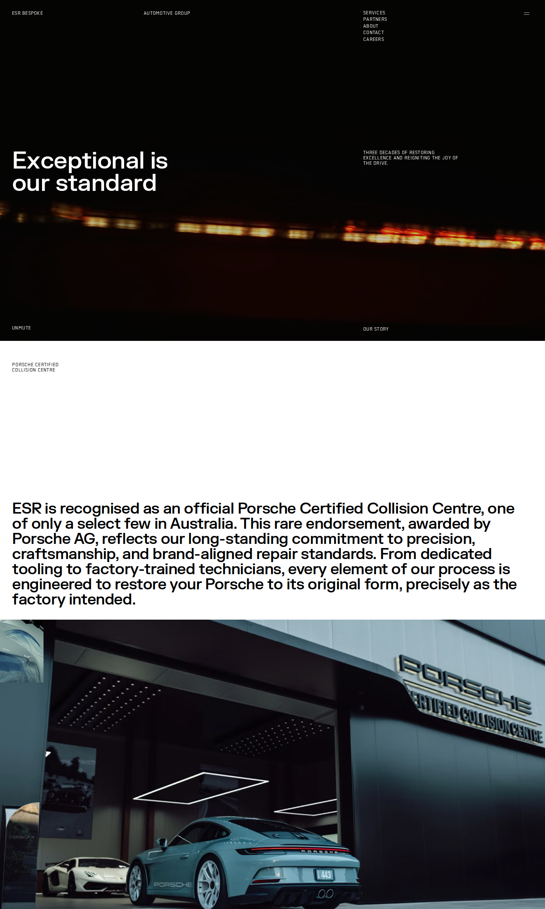
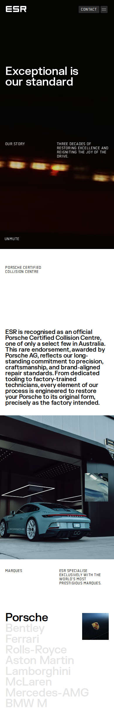

# UI Design System & Master Generation Blueprint: www-esrbespoke-au

> **ESR** (https://www.esrbespoke.au/) — Three decades of restoring excellence and reigniting the joy of the drive.



---

## 1. Executive Visual Persona & Design Archetype

- **Brand Essence & Persona**: **ESR** (`https://www.esrbespoke.au/`). Three decades of restoring excellence and reigniting the joy of the drive.
- **Capture Provenance**: Live browser capture (`tier1_fast`, HTTP `200`, captured `2026-11-23`).
- **Visual Archetype**: **Light-Gallery WebGL / Canvas Interactive Experience (`#ffffff` / `#9ca3af`)**.
- **Anti-AI-Slop Differentiators**:
  - **Live-Computed Chromatic Polarity**: Anchors the viewport in `#ffffff` (live computed `body` `background-color` (`computed_styles.json`)) paired with `#000000` primary typography and `#9ca3af` accents.
  - **Grounded Typographic Hierarchy**: Pairs `__bodyFont_0f148b` for display copy (`Exceptional is our standard`) with `__bodyFont_0f148b` and `SFMono-Regular`.
  - **Calibrated Spatial Grid & Motion**: Combines `1920px` container bounds (`gap: 16px`, padding `32px`) with `cubic-bezier(.4,0,.6,1)` easing and Lenis Smooth Scroll (`data-lenis`), Three.js / WebGL Canvas Pipeline.

---

## 2. Spatial Architecture & Modular Grid Mathematics



### Viewport Allocation & Container Geometry
- **Captured Viewport Dimensions**: Desktop `1440×2400px` (`assets/desktop.png`, clamped at 2400px live multi-section capture), Mobile `390×2400px` (`assets/mobile.png`, clamped at 2400px live multi-section capture).
- **Master Container Bounds**: `1920px` (non-`@media` desktop container stylesheet rule).
- **Canvas Lateral Padding & Spacing**: `32px` lateral canvas padding with `16px` grid gap.
- **Border Radius Scale**: `2px`, `50%`.

### Responsive Breakpoint Architecture
- **Desktop Layout**: Multi-column CSS Grid / Flexbox layout at `1440px` (`max-width: 1920px`, `gap: 16px`).
- **Mobile Layout**: Single-column vertical stack at `390px` viewport width with `32px` horizontal padding.
- **Extracted CSS Media Queries**: `@media (min-width:1024px)`, `@media (max-width:1023px)`.

---

## 3. Color System, Materiality & Atmospheric Lighting

### Semantic Palette & Source Grounding
| Semantic Role | Ground-Truth Value | Extracted Live / CSS Source |
|---|---|---|
| **Primary Canvas Substrate** | `#ffffff` | live computed `body` `background-color` (`computed_styles.json`) |
| **Primary Typography Ink** | `#000000` | live computed `main` `color` (`computed_styles.json`) |
| **Elevated Surface / Card Substrate** | `#2299dd` | `#nprogress .bar { background: #2299dd }` |
| **Interactive Accent / Highlight** | `#9ca3af` | `textarea::placeholder { color: #9ca3af }` |
| **Secondary / Muted Copy** | `#9ca3af` | `textarea::placeholder { color: #9ca3af }` |
| **Structural Hairline Border** | `#e6e6e6` | `var(--border)` in `:root` (`rgba(0,0,0,0.1)`) |

### Sanitized Root CSS Variables (`ui-ux.md` Ground Truth)
| Variable Name | Extracted Value | Semantic Role |
|---|---|---|
| `--foreground-rgb` | `0,0,0` | Typography Ink Token |
| `--background-rgb` | `255,255,255` | Canvas / Surface Token |
| `--border-rgb` | `0,0,0` | Elevation / Border Token |
| `--scrollbarWidth` | `0px` | Layout / Spatial Grid Token |
| `--body-font` | `"__bodyFont_0f148b","__bodyFont_Fallback_0f148b",helvetica,arial,sans-serif` | Typography / Scale Token |
| `--foreground` | `#fff` | Typography Ink Token |
| `--background` | `#ffffff` | Canvas / Surface Token |
| `--border` | `rgba(0,0,0,0.1)` | Elevation / Border Token |
| `--tw-content` | `""` | Design System Custom Token |
| `--tw-border-spacing-x` | `0` | Layout / Spatial Grid Token |
| `--tw-border-spacing-y` | `0` | Layout / Spatial Grid Token |
| `--tw-translate-x` | `0` | Design System Custom Token |
| `--tw-translate-y` | `0` | Design System Custom Token |
| `--tw-rotate` | `0` | Design System Custom Token |
| `--www-esrbespoke-a-bg` | `#ffffff` | Canvas Substrate (from live computed `body` `background-color` (`computed_styles.json`)) |
| `--www-esrbespoke-a-ink` | `#000000` | Primary Typography Ink (computed-derived) |

---

## 4. Typographic Scale & Editorial Hierarchy

### Font Family Stacks
- **Display Typography**: `__bodyFont_0f148b`.
- **Primary Body Stack**: `__bodyFont_0f148b`.
- **Technical / Metadata Stack**: `SFMono-Regular`.

### Typographic Scale & Rules (Live Computed & Stylesheet Grounded)
- **Hero Display (`H1`)**: live computed `h1` (`font-size: 62px`, `line-height: 58.9px`, `font-weight: 500`, `letter-spacing: -0.62px`).
- **Section Heading (`H2`)**: live computed `h2` (`font-size: 40px`, `line-height: 40px`, `font-weight: 500`, `letter-spacing: -0.4px`).
- **Body Copy**: live computed `body` (`font-size: 18px`, `line-height: 23.4px`, `font-weight: 300`); CSS variables `--body-font: "__bodyFont_0f148b","__bodyFont_Fallback_0f148b",helvetica,arial,sans-serif`.
- **Metadata & Navigation Labels**: live computed `nav/a` (`font-size: 14px`, `line-height: 14px`, `font-weight: 300`, `letter-spacing: 1.26px`).

---

## 5. Choreographed Motion & Interaction Physics

### Primary Easing Curves
- **Extracted Timing Functions**: `cubic-bezier(.4,0,.6,1)`, `cubic-bezier(.4,0,.2,1)`, `cubic-bezier(.16,1,.3,1)`.

### Per-Element Transition & Choreography Rules
- **Selector `.transition`**: `transition: cubic-bezier(.4,0,.6,1)` extracted from `www-esrbespoke-au` stylesheet.
- **Selector `ansition-\[margin\2c transform\2c...`**: `transition: cubic-bezier(.4,0,.6,1)` extracted from `www-esrbespoke-au` stylesheet.
- **Selector `.transition-colors`**: `transition: cubic-bezier(.4,0,.6,1)` extracted from `www-esrbespoke-au` stylesheet.
- **Extracted Easing Curve (`cubic-bezier(.4,0,.6,1)`)**: Governs interactive state transitions across `<header.w-auto>` and `<section.items-end>`.
- **Runtime Interaction Engine**: Integrates Lenis Smooth Scroll (`data-lenis`), Three.js / WebGL Canvas Pipeline with `prefers-reduced-motion: reduce` fallback guards.

---

## 6. Component Wireframe & Structural DOM Map

### Visual Layout Schematic — Desktop (`1440px`, Grounded in `dom.html` & Landmark Bounding Boxes)
```
┌────────────────────────────────────────────────────────────────────────┐
│ DESKTOP VIEWPORT (1440px) — ESR                                        │
│ ====================================================================== │
│ [ <header.w-auto> (1440x85px)         | Services · Partners · About  ] │
│ ---------------------------------------------------------------------- │
│ | HERO STAGE: <section.w-auto> (w=1440px)                            | │
│ | H1: Exceptional is our standard                                    | │
│ | Substrate: #ffffff | Ink: #000000 | Accent: #9ca3af                | │
│ ---------------------------------------------------------------------- │
│ | SHOWCASE GRID (<section.items-end>) max-w: 1920px                  | │
│ | +------------------------------+  +------------------------------+ | │
│ | | E x c e p t i o n a l i s o  |  | ESR is recognised as an offi | | │
│ | +------------------------------+  +------------------------------+ | │
│ ---------------------------------------------------------------------- │
│ | DETAIL MODULE (<section.mb-8>) — At ESR, we offer a co             | │
│ ---------------------------------------------------------------------- │
│ [ FOOTER (<footer.clip>       ) | https://www.esrbespoke.au/           │
└────────────────────────────────────────────────────────────────────────┘
```

### Visual Layout Schematic — Mobile Reflow (`390px`)
```
┌────────────────────────────────────────────────────────────────────────┐
│ MOBILE VIEWPORT REFLOW (390px) — Single-Column Stack (gap: 16px)       │
│ ====================================================================== │
│ [ HEADER BAR (<header.w-auto>         ) | Compact Menu (390px)         │
│ ---------------------------------------------------------------------- │
│ | HERO STAGE (<section.w-auto>) — 390px Vertical Lead                | │
│ | H1: Exceptional is our standard                                    | │
│ ---------------------------------------------------------------------- │
│ | SHOWCASE STACK (<section.items-end>) — 1-Col Stack                 | │
│ | [ Item 1: E x c e p t i o n a l i s o u r s t a n d a r d        ] | │
│ | [ Item 2: ESR is recognised as an official Porsche Certifie...   ] | │
│ ---------------------------------------------------------------------- │
│ | DETAIL STACK (<section.mb-8>) — 1-Col (At ESR, we offer a)         | │
│ ---------------------------------------------------------------------- │
│ [ FOOTER (<footer.clip>       ) | Stacked 390px Colophon               │
└────────────────────────────────────────────────────────────────────────┘
```

### Granular DOM Region Breakdown
1. **Brand Header & Navigation Bar (<header.w-auto> — `www-esrbespoke-au`)**:
   - Landmark `<header class="w-auto grid-layout">` (`1440x85px`) hosting `ESR` navigation (`Services · Partners · About · Contact · Careers`), DOM attributes (`data-next-font="size-adjust"`, `data-next-font="size-adjust"`, `data-next-font="size-adjust"`, `data-next-font="size-adjust"`), and stylesheet rule `nprogress { pointer-events:none }`.
2. **Hero Stage & Focal Lead (<section.w-auto> — `Exceptional is our standard`)**:
   - Landmark `<section class="w-auto grid-layout">` presenting display lead `Exceptional is our standard` and copy excerpt *"A u t o m o t i v e G r o u p since 1989"* over `#ffffff` canvas and `#000000` ink.
3. **Primary Showcase & Content Grid (<section.items-end> — `E x c e p t i o n a l i s o u r s `)**:
   - Landmark `<section class="w-auto items-end">` rendering section `E x c e p t i o n a l i s o u r s t a n d a r d` with copy *"( 0 2 ) 9 7 3 5 1 1 1 1 e n q u i r i e s @ e s r b e s p o k e ."*, asset references (`apple-touch-icon.png`, `favicon-32x32.png`, `favicon-16x16.png`, `favicon.ico`), and grid rule `nprogress .bar { background:29d;position:fixed;z-index:1031;top:0;left:0;width:100%;heigh... }`.
4. **Interactive Detail & Feature Matrix (<section.mb-8> — `ESR is recognised as an official P`)**:
   - Landmark `<section class="w-auto mb-8">` framing `ESR is recognised as an official Porsche Certifie...` and `At ESR, we offer a complete end-to-end service ex...` (*"4 1 9 - 4 3 1 C a n t e r b u r y R o a d , C a m p s i e N S W 2"*) with `#2299dd` surface cards, `#9ca3af` accents, and `nprogress .spinner { display:block;position:fixed;z-index:1031;top:15px;right:15px }`.
5. **Colophon & Global Directory Footer (<footer.clip> — `https://www.esrbespoke.au/`)**:
   - Landmark `<footer class="clip mono">` anchoring `ESR` footer links (`Services · Partners · About · Contact · Careers`), copy *"E S R B e s p o k e S t u d i o"*, and `#e6e6e6` structural dividers.

---

## 7. Master Zero-Shot AI Generation Prompt

```markdown
# Master Zero-Shot Frontend Generation Prompt: www-esrbespoke-au (ESR)

You are a principal frontend architect and design systems engineer. Build a complete, production-ready web application replicating the exact design system, DOM landmarks, typographic hierarchy, color tokens, and motion physics of `www-esrbespoke-au` (**ESR** — `https://www.esrbespoke.au/`).

### 1. Visual Archetype & Anti-AI-Slop Mandates
- **Archetype**: Light-Gallery WebGL / Canvas Interactive Experience (`#ffffff` / `#9ca3af`).
- **Identity & Domain Context**: Three decades of restoring excellence and reigniting the joy of the drive.
- **Primary Substrate**: `#ffffff` (live computed `body` `background-color` (`computed_styles.json`)), **Primary Ink**: `#000000`, **Accent / Highlight**: `#9ca3af`.
- **Site-Specific Differentiators**:
  - **Live-Computed Chromatic Polarity**: Anchors the viewport in `#ffffff` (live computed `body` `background-color` (`computed_styles.json`)) paired with `#000000` primary typography and `#9ca3af` accents.
  - **Grounded Typographic Hierarchy**: Pairs `__bodyFont_0f148b` for display copy (`Exceptional is our standard`) with `__bodyFont_0f148b` and `SFMono-Regular`.
  - **Calibrated Spatial Grid & Motion**: Combines `1920px` container bounds (`gap: 16px`, padding `32px`) with `cubic-bezier(.4,0,.6,1)` easing and Lenis Smooth Scroll (`data-lenis`), Three.js / WebGL Canvas Pipeline.

### 2. Ground-Truth CSS Variables (`:root` Token Contract)
Declare and consume these exact custom properties extracted from `www-esrbespoke-au` in your global stylesheet:

:root {
  /* ESR (www-esrbespoke-au) — Live-Grounded CSS Variables */
  --foreground-rgb: 0,0,0; /* Typography Ink Token (www-esrbespoke-au) */
  --background-rgb: 255,255,255; /* Canvas / Surface Token (www-esrbespoke-au) */
  --border-rgb: 0,0,0; /* Elevation / Border Token (www-esrbespoke-au) */
  --scrollbarWidth: 0px; /* Layout / Spatial Grid Token (www-esrbespoke-au) */
  --body-font: "__bodyFont_0f148b","__bodyFont_Fallback_0f148b",helvetica,arial,sans-serif; /* Typography / Scale Token (www-esrbespoke-au) */
  --foreground: #fff; /* Typography Ink Token (www-esrbespoke-au) */
  --background: #ffffff; /* Canvas / Surface Token (www-esrbespoke-au) */
  --border: rgba(0,0,0,0.1); /* Elevation / Border Token (www-esrbespoke-au) */
  --tw-content: ""; /* Design System Custom Token (www-esrbespoke-au) */
  --tw-border-spacing-x: 0; /* Layout / Spatial Grid Token (www-esrbespoke-au) */
  --tw-border-spacing-y: 0; /* Layout / Spatial Grid Token (www-esrbespoke-au) */
  --tw-translate-x: 0; /* Design System Custom Token (www-esrbespoke-au) */
  --tw-translate-y: 0; /* Design System Custom Token (www-esrbespoke-au) */
  --tw-rotate: 0; /* Design System Custom Token (www-esrbespoke-au) */
  --www-esrbespoke-a-bg: #ffffff; /* Canvas Substrate (from live computed `body` `background-color` (`computed_styles.json`)) (www-esrbespoke-au) */
  --www-esrbespoke-a-ink: #000000; /* Primary Typography Ink (computed-derived) (www-esrbespoke-au) */
}

### 3. Semantic Color & Materiality Contract
Map every surface, ink, and border strictly to these source-grounded tokens:
- **Primary Canvas Substrate**: `#ffffff` — grounded in live computed `body` `background-color` (`computed_styles.json`)
- **Primary Typography Ink**: `#000000` — grounded in live computed `main` `color` (`computed_styles.json`)
- **Elevated Surface / Card Substrate**: `#2299dd` — grounded in `#nprogress .bar { background: #2299dd }`
- **Interactive Accent / Highlight**: `#9ca3af` — grounded in `textarea::placeholder { color: #9ca3af }`
- **Secondary / Muted Copy**: `#9ca3af` — grounded in `textarea::placeholder { color: #9ca3af }`
- **Structural Hairline Border**: `#e6e6e6` — grounded in `var(--border)` in `:root` (`rgba(0,0,0,0.1)`)

### 4. Spatial Grid, Container Bounds & Responsive Breakpoints
- **Desktop Viewport Reference**: `1440×2400px` (clamped at 2400px live multi-section capture, `1440px` standard desktop width).
- **Mobile Viewport Reference**: `390×2400px` (clamped at 2400px live multi-section capture, `390px` standard mobile width).
- **Container Max-Width**: `1920px` (non-`@media` desktop container stylesheet rule)
- **Padding & Gutters**: `32px` lateral canvas padding with `16px` grid gap
- **Desktop Grid**: Multi-column CSS Grid / Flexbox layout at `1440px` (`max-width: 1920px`, `gap: 16px`)
- **Mobile Adaptation**: Single-column vertical stack at `390px` viewport width with `32px` horizontal padding
- **Media Queries**: `@media (min-width:1024px)`, `@media (max-width:1023px)`
- **Corner Radii**: `2px`, `50%`

### 5. Typography & Editorial Scale Contract
- **Display Font Stack**: `__bodyFont_0f148b`
- **Body Font Stack**: `__bodyFont_0f148b`
- **Monospace / Technical Font Stack**: `SFMono-Regular`
- **H1 Display Rule**: live computed `h1` (`font-size: 62px`, `line-height: 58.9px`, `font-weight: 500`, `letter-spacing: -0.62px`)
- **H2 Section Rule**: live computed `h2` (`font-size: 40px`, `line-height: 40px`, `font-weight: 500`, `letter-spacing: -0.4px`)
- **Body Copy Rule**: live computed `body` (`font-size: 18px`, `line-height: 23.4px`, `font-weight: 300`); CSS variables `--body-font: "__bodyFont_0f148b","__bodyFont_Fallback_0f148b",helvetica,arial,sans-serif`
- **Metadata & Index Rule**: live computed `nav/a` (`font-size: 14px`, `line-height: 14px`, `font-weight: 300`, `letter-spacing: 1.26px`)

### 6. Component Hierarchy, Verbatim Copy & Real DOM Landmarks
Scaffold `www-esrbespoke-au` (`ESR`) with these exact structural regions, extracted copy, and CSS rules from `dom.html`:
1. **Brand Header & Navigation Bar (<header.w-auto> — `www-esrbespoke-au`)**:
   - DOM & Selectors: Landmark `<header class="w-auto grid-layout">` (`1440x85px`) hosting `ESR` navigation (`Services · Partners · About · Contact · Careers`), DOM attributes (`data-next-font="size-adjust"`, `data-next-font="size-adjust"`, `data-next-font="size-adjust"`, `data-next-font="size-adjust"`), and stylesheet rule `nprogress { pointer-events:none }`.
   - Responsive Contract: Header `Brand Header & Navigation Bar (<header.w-auto> — `www-esrbespoke-au`)` (`www-esrbespoke-au`) adapts across `@media (min-width:1024px)`, `@media (max-width:1023px)` with `cubic-bezier(.4,0,.6,1)`, `cubic-bezier(.4,0,.2,1)`, `cubic-bezier(.16,1,.3,1)` transitions and links `Services · Partners · About · Contact · Careers`.
2. **Hero Stage & Focal Lead (<section.w-auto> — `Exceptional is our standard`)**:
   - DOM & Selectors: Landmark `<section class="w-auto grid-layout">` presenting display lead `Exceptional is our standard` and copy excerpt *"A u t o m o t i v e G r o u p since 1989"* over `#ffffff` canvas and `#000000` ink.
   - Responsive Contract: Hero stage (`1440×2400px` desktop / `390×2400px` mobile) sets `#ffffff` background with `#000000` headline `Exceptional is our standard`.
3. **Primary Showcase & Content Grid (<section.items-end> — `E x c e p t i o n a l i s o u r s `)**:
   - DOM & Selectors: Landmark `<section class="w-auto items-end">` rendering section `E x c e p t i o n a l i s o u r s t a n d a r d` with copy *"( 0 2 ) 9 7 3 5 1 1 1 1 e n q u i r i e s @ e s r b e s p o k e ."*, asset references (`apple-touch-icon.png`, `favicon-32x32.png`, `favicon-16x16.png`, `favicon.ico`), and grid rule `nprogress .bar { background:29d;position:fixed;z-index:1031;top:0;left:0;width:100%;heigh... }`.
   - Responsive Contract: Showcase grid `Primary Showcase & Content Grid (<section.items-end> — `E x c e p t i o n a l i s o u r s `)` applies Multi-column CSS Grid / Flexbox layout at `1440px` (`max-width: 1920px`, `gap: 16px`) on desktop and Single-column vertical stack at `390px` viewport width with `32px` horizontal padding on mobile.
4. **Interactive Detail & Feature Matrix (<section.mb-8> — `ESR is recognised as an official P`)**:
   - DOM & Selectors: Landmark `<section class="w-auto mb-8">` framing `ESR is recognised as an official Porsche Certifie...` and `At ESR, we offer a complete end-to-end service ex...` (*"4 1 9 - 4 3 1 C a n t e r b u r y R o a d , C a m p s i e N S W 2"*) with `#2299dd` surface cards, `#9ca3af` accents, and `nprogress .spinner { display:block;position:fixed;z-index:1031;top:15px;right:15px }`.
   - Responsive Contract: Detail module `Interactive Detail & Feature Matrix (<section.mb-8> — `ESR is recognised as an official P`)` uses `2px`, `50%` radii, `#9ca3af` highlights, and assets (apple-touch-icon.png, favicon-32x32.png, favicon-16x16.png).
5. **Colophon & Global Directory Footer (<footer.clip> — `https://www.esrbespoke.au/`)**:
   - DOM & Selectors: Landmark `<footer class="clip mono">` anchoring `ESR` footer links (`Services · Partners · About · Contact · Careers`), copy *"E S R B e s p o k e S t u d i o"*, and `#e6e6e6` structural dividers.
   - Responsive Contract: Footer `Colophon & Global Directory Footer (<footer.clip> — `https://www.esrbespoke.au/`)` aligns to `1920px` (non-`@media` desktop container stylesheet rule) with `32px` lateral canvas padding with `16px` grid gap and attributes (data-next-font="size-adjust", data-next-font="size-adjust", data-next-font="size-adjust").

#### Verbatim DOM Copy Excerpts (`dom.html`)
- Copy Excerpt 1: *"A u t o m o t i v e G r o u p since 1989"*
- Copy Excerpt 2: *"( 0 2 ) 9 7 3 5 1 1 1 1 e n q u i r i e s @ e s r b e s p o k e . a u 8 a m – 5 p..."*
- Copy Excerpt 3: *"4 1 9 - 4 3 1 C a n t e r b u r y R o a d , C a m p s i e N S W 2 1 9 4 H q @ e s..."*
- Copy Excerpt 4: *"E S R B e s p o k e S t u d i o"*

### 7. Motion, Extracted Stylesheet Rules & Interaction Choreography
- **Primary Easing Functions**: `cubic-bezier(.4,0,.6,1)`, `cubic-bezier(.4,0,.2,1)`, `cubic-bezier(.16,1,.3,1)`
- **Extracted Stylesheet Rules (`www-esrbespoke-au`)**:
- `nprogress { pointer-events:none }`
- `nprogress .bar { background:29d;position:fixed;z-index:1031;top:0;left:0;width:100%;heigh... }`
- `nprogress .spinner { display:block;position:fixed;z-index:1031;top:15px;right:15px }`
- `.nprogress-custom-parent { overflow:hidden;position:relative }`
- `before { box-sizing:border-box;border:0 solid }`
- **Per-Selector Transition Rules**:
- **Selector `.transition`**: `transition: cubic-bezier(.4,0,.6,1)` extracted from `www-esrbespoke-au` stylesheet.
- **Selector `ansition-\[margin\2c transform\2c...`**: `transition: cubic-bezier(.4,0,.6,1)` extracted from `www-esrbespoke-au` stylesheet.
- **Selector `.transition-colors`**: `transition: cubic-bezier(.4,0,.6,1)` extracted from `www-esrbespoke-au` stylesheet.
- **Extracted Easing Curve (`cubic-bezier(.4,0,.6,1)`)**: Governs interactive state transitions across `<header.w-auto>` and `<section.items-end>`.
- **Runtime Interaction Engine**: Integrates Lenis Smooth Scroll (`data-lenis`), Three.js / WebGL Canvas Pipeline with `prefers-reduced-motion: reduce` fallback guards.

### 8. Technical Deliverables
- Implement in Next.js (App Router) with TypeScript and Tailwind CSS consuming the `:root` custom properties defined above for `www-esrbespoke-au`.
- Reproduce both the `1440px` desktop architecture and `390px` mobile breakpoint transitions, preserving semantic HTML5 landmarks (`<header>`, `<nav>`, `<main>`, `<section>`, `<footer>`) and `prefers-reduced-motion` accessibility guards.
```
