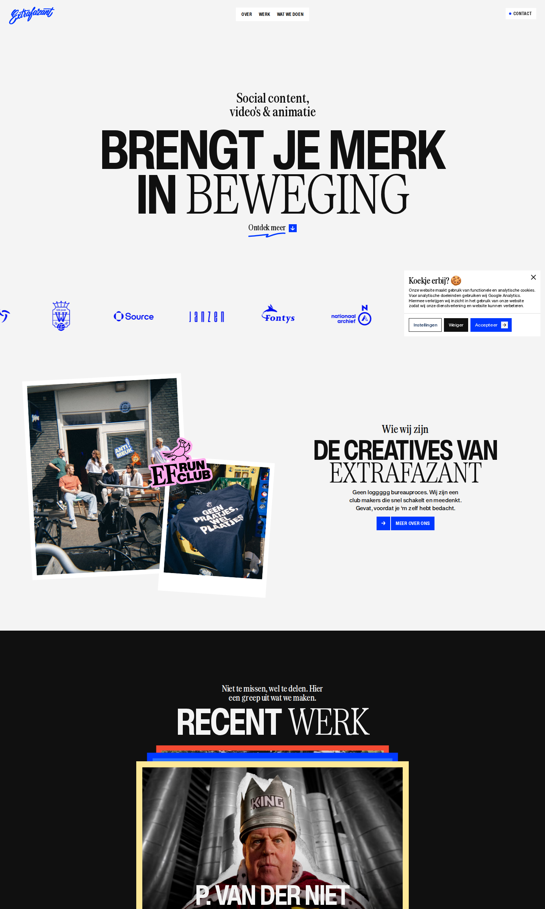
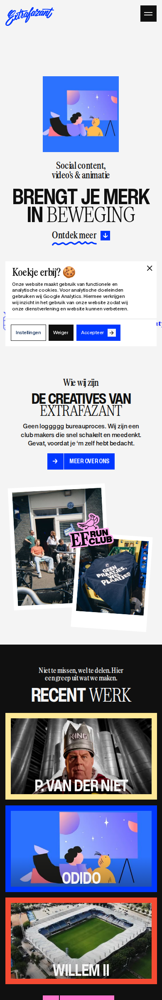

# UI Design System & Master Generation Blueprint: www-extrafazant-nl

> **Extrafazant · Social Content, Video's & Animatie** (https://www.extrafazant.nl/) — Creatives die je merk in beweging brengen. Animatie, film en social content die blijft hangen. Snel schakelen, meedenken, geen lang burea...



---

## 1. Executive Visual Persona & Design Archetype

- **Brand Essence & Persona**: **Extrafazant · Social Content, Video's & Animatie** (`https://www.extrafazant.nl/`). Creatives die je merk in beweging brengen. Animatie, film en social content die blijft hangen. Snel schakelen, meedenken, geen lang burea...
- **Capture Provenance**: Live browser capture (`tier1_fast`, HTTP `200`, captured `2026-11-23`).
- **Visual Archetype**: **Light-Substrate Editorial & Modular Grid System (`#f4f4f4` canvas, `#101010` ink, `#0082f3` accent)**.
- **Anti-AI-Slop Differentiators**:
  - **Live-Computed Chromatic Polarity**: Anchors the viewport in `#f4f4f4` (live computed `body` `background-color` (`computed_styles.json`)) paired with `#101010` primary typography and `#0082f3` accents.
  - **Grounded Typographic Hierarchy**: Pairs `Helvetica Now Subset` for display copy (`BRENGT JE MERK IN BEWEGING`) with `Helvetica Now Subset` and not declared in live computed styles (uses primary stack / `ui-monospace`).
  - **Calibrated Spatial Grid & Motion**: Combines `80em` container bounds (`gap: 16px`, padding `9px`) with `cubic-bezier(.509,.188,.041,.989)` easing and Lenis Smooth Scroll (`data-lenis`), GSAP Timeline & ScrollTrigger.

---

## 2. Spatial Architecture & Modular Grid Mathematics



### Viewport Allocation & Container Geometry
- **Captured Viewport Dimensions**: Desktop `1440×2400px` (`assets/desktop.png`, clamped at 2400px live multi-section capture), Mobile `390×2400px` (`assets/mobile.png`, clamped at 2400px live multi-section capture).
- **Master Container Bounds**: `80em` (non-`@media` desktop container stylesheet rule).
- **Canvas Lateral Padding & Spacing**: `9px` lateral canvas padding with `16px` grid gap.
- **Border Radius Scale**: `6px`, `3px`, `100%`, `50%`.

### Responsive Breakpoint Architecture
- **Desktop Layout**: Multi-column CSS Grid / Flexbox layout at `1440px` (`max-width: 80em`, `gap: 16px`).
- **Mobile Layout**: Single-column vertical stack at `390px` viewport width with `9px` horizontal padding.
- **Extracted CSS Media Queries**: `@media screen and (max-width: 991px)`, `@media screen and (max-width: 767px)`, `@media screen and (max-width: 479px)`, `@media (min-width: 768px)`.

---

## 3. Color System, Materiality & Atmospheric Lighting

### Semantic Palette & Source Grounding
| Semantic Role | Ground-Truth Value | Extracted Live / CSS Source |
|---|---|---|
| **Primary Canvas Substrate** | `#f4f4f4` | live computed `body` `background-color` (`computed_styles.json`) |
| **Primary Typography Ink** | `#101010` | live computed `h1` `color` (`computed_styles.json`) |
| **Elevated Surface / Card Substrate** | `#ffffff` | `var(--button-052-color-background)` in `:root` |
| **Interactive Accent / Highlight** | `#0082f3` | `.w-dropdown-link.w--current { color: #0082f3 }` |
| **Secondary / Muted Copy** | `#ff77cd` | `var(--_colors---swatch--pink)` in `:root` |
| **Structural Hairline Border** | `#e2e2e2` | `blockquote { border-left: #e2e2e2 }` |

### Sanitized Root CSS Variables (`ui-ux.md` Ground Truth)
| Variable Name | Extracted Value | Semantic Role |
|---|---|---|
| `--_theme---background` | `var(--_colors---swatch--off-white)` | Canvas / Surface Token |
| `--_paragraphs---paragraph-regular--font` | `var(--_fonts---fonts--paragraph)` | Typography / Scale Token |
| `--_theme---body-text` | `var(--_colors---swatch--black)` | Typography Ink Token |
| `--_paragraphs---paragraph-regular--line-height` | `1.4em` | Typography / Scale Token |
| `--_paragraphs---paragraph-regular--font-weight` | `var(--_fonts---font-weight--medium)` | Typography / Scale Token |
| `--_fonts---fonts--heading` | `"Helvetica Now Subset", Arial, sans-serif` | Typography Ink Token |
| `--_headings---heading-xxl--font-size` | `var(--_sizes---size--192px)` | Typography Ink Token |
| `--_headings---heading-xxl--line-height` | `.8em` | Typography Ink Token |
| `--_headings---heading-xxl--font-weight` | `var(--_fonts---font-weight--bold)` | Typography Ink Token |
| `--_headings---heading-xxl--letter-spacing` | `-.02em` | Typography Ink Token |
| `--_headings---heading-xl--font` | `var(--_fonts---fonts--heading)` | Typography Ink Token |
| `--_headings---heading-xl--font-size` | `var(--_sizes---size--128px)` | Typography Ink Token |
| `--_headings---heading-xl--font-weight` | `var(--_fonts---font-weight--bold)` | Typography Ink Token |
| `--_headings---heading-xl--letter-spacing` | `-.02em` | Typography Ink Token |
| `--_headings---heading-l--font` | `var(--_fonts---fonts--heading)` | Typography Ink Token |
| `--_headings---heading-l--font-size` | `var(--_sizes---size--96px)` | Typography Ink Token |

---

## 4. Typographic Scale & Editorial Hierarchy

### Font Family Stacks
- **Display Typography**: `Helvetica Now Subset`.
- **Primary Body Stack**: `Helvetica Now Subset`.
- **Technical / Metadata Stack**: not declared in live computed styles (uses primary stack / `ui-monospace`).

### Typographic Scale & Rules (Live Computed & Stylesheet Grounded)
- **Hero Display (`H1`)**: live computed `h1` (`font-size: 144px`, `line-height: 115.2px`, `font-weight: 700`, `letter-spacing: -2.88px`); rule `h1` (`font-size: 2em`).
- **Section Heading (`H2`)**: live computed `h2` (`font-size: 72px`, `line-height: 57.6px`, `font-weight: 500`, `letter-spacing: -1.44px`); rule `h2` (`font-size: 32px`, `line-height: 36px`).
- **Body Copy**: live computed `body` (`font-size: 12px`, `line-height: 16.8px`, `font-weight: 500`, `letter-spacing: -0.48px`); CSS variables `--_paragraphs---paragraph-regular--font: var(--_fonts---fonts--paragraph)`, `--_theme---body-text: var(--_colors---swatch--black)`, `--_paragraphs---paragraph-regular--line-height: 1.4em`; rule `body` (`font-size: 14px`, `line-height: 20px`).
- **Metadata & Navigation Labels**: live computed `nav/a` (`font-size: 12px`, `line-height: 14.4px`, `font-weight: 500`, `letter-spacing: -0.48px`); CSS variables `--_headings---heading-xxl--letter-spacing: -.02em`, `--_headings---heading-xl--letter-spacing: -.02em`, `--_headings---heading-l--letter-spacing: -.02em`; rule `small` (`font-size: 80%`).

---

## 5. Choreographed Motion & Interaction Physics

### Primary Easing Curves
- **Extracted Timing Functions**: `cubic-bezier(.509,.188,.041,.989)`, `cubic-bezier(.175,.885,.32,1.275)`, `cubic-bezier(.19,1,.22,1)`.

### Per-Element Transition & Choreography Rules
- **Selector `.w-webflow-badge > img`**: `transition: unset` extracted from `www-extrafazant-nl` stylesheet.
- **Selector `.w-slider-dot`**: `transition: background-color .1s, color .1s` extracted from `www-extrafazant-nl` stylesheet.
- **Selector `.w-lightbox-control`**: `transition: all .3s` extracted from `www-extrafazant-nl` stylesheet.
- **Extracted Easing Curve (`cubic-bezier(.509,.188,.041,.989)`)**: Governs interactive state transitions across `<header.section_hero>` and `<section.section_featured>`.
- **Runtime Interaction Engine**: Integrates Lenis Smooth Scroll (`data-lenis`), GSAP Timeline & ScrollTrigger, Three.js / WebGL Canvas Pipeline, Lottie Vector Animation Player, Barba.js Page Transition Router with `prefers-reduced-motion: reduce` fallback guards.

---

## 6. Component Wireframe & Structural DOM Map

### Visual Layout Schematic — Desktop (`1440px`, Grounded in `dom.html` & Landmark Bounding Boxes)
```
┌────────────────────────────────────────────────────────────────────────┐
│ DESKTOP VIEWPORT (1440px) — Extrafazant · Social Content, Video's & An │
│ ====================================================================== │
│ [ <header.section_hero> (1440x900px)  | Ontdek meer                  ] │
│ ---------------------------------------------------------------------- │
│ | HERO STAGE: <section.section_intro> (w=1440px)                     | │
│ | H1: BRENGT JE MERK IN BEWEGING                                     | │
│ | Substrate: #f4f4f4 | Ink: #101010 | Accent: #0082f3                | │
│ ---------------------------------------------------------------------- │
│ | SHOWCASE GRID (<section.section_featured>) max-w: 80em             | │
│ | +------------------------------+  +------------------------------+ | │
│ | | B r e n g t j e m e r k i n  |  | De creatives van Extrafazant | | │
│ | +------------------------------+  +------------------------------+ | │
│ ---------------------------------------------------------------------- │
│ | DETAIL MODULE (<section.section_services>) — R e c e n t W e r k   | │
│ ---------------------------------------------------------------------- │
│ [ FOOTER (<footer.footer>     ) | https://www.extrafazant.nl/          │
└────────────────────────────────────────────────────────────────────────┘
```

### Visual Layout Schematic — Mobile Reflow (`390px`)
```
┌────────────────────────────────────────────────────────────────────────┐
│ MOBILE VIEWPORT REFLOW (390px) — Single-Column Stack (gap: 16px)       │
│ ====================================================================== │
│ [ HEADER BAR (<header.section_hero>   ) | Compact Menu (390px)         │
│ ---------------------------------------------------------------------- │
│ | HERO STAGE (<section.section_intro>) — 390px Vertical Lead         | │
│ | H1: BRENGT JE MERK IN BEWEGING                                     | │
│ ---------------------------------------------------------------------- │
│ | SHOWCASE STACK (<section.section_featu) — 1-Col Stack              | │
│ | [ Item 1: B r e n g t j e m e r k i n b e w e g i n g            ] | │
│ | [ Item 2: De creatives van Extrafazant                           ] | │
│ ---------------------------------------------------------------------- │
│ | DETAIL STACK (<section.section_service) — 1-Col (R e c e n t W e r ) │
│ ---------------------------------------------------------------------- │
│ [ FOOTER (<footer.footer>     ) | Stacked 390px Colophon               │
└────────────────────────────────────────────────────────────────────────┘
```

### Granular DOM Region Breakdown
1. **Brand Header & Navigation Bar (<header.section_hero> — `www-extrafazant-nl`)**:
   - Landmark `<header class="section_hero">` (`1440x900px`) hosting `Extrafazant · Social Content, Video'` navigation (`Ontdek meer`), DOM attributes (`data-wf-domain="www.extrafazant.nl"`, `data-wf-page="6a7eba014f1644e9f15be500"`, `data-wf-site="6a7eba014f1644e9f15be52d"`, `data-page-ready`), and stylesheet rule `html { -webkit-text-size-adjust: 100%; -ms-text-size-adjust: 100%; font-family:... }`.
2. **Hero Stage & Focal Lead (<section.section_intro> — `BRENGT JE MERK IN BEWEGING`)**:
   - Landmark `<section class="section_intro">` presenting display lead `BRENGT JE MERK IN BEWEGING` and copy excerpt *"Geen loggggg bureauproces. Wij zijn een club makers die snel scha"* over `#f4f4f4` canvas and `#101010` ink.
3. **Primary Showcase & Content Grid (<section.section_featured> — `B r e n g t j e m e r k i n b e w `)**:
   - Landmark `<section class="section_featured theme-dark">` rendering section `B r e n g t j e m e r k i n b e w e g i n g` with copy *"Ontdek meer over ons"*, asset references (`cdn.prod.website-files.com`, `extrafazant-demo.webflow.shared.8...`, `fonts.googleapis.com`, `fonts.gstatic.com`), and grid rule `body { margin: 0; }`.
4. **Interactive Detail & Feature Matrix (<section.section_services> — `De creatives van Extrafazant`)**:
   - Landmark `<section class="section_services">` framing `De creatives van Extrafazant` and `R e c e n t W e r k` (*"Zeg waar je mee zit. Wij maken het zichtbaar."*) with `#ffffff` surface cards, `#0082f3` accents, and `summary { display: block; }`.
5. **Colophon & Global Directory Footer (<footer.footer> — `https://www.extrafazant.nl/`)**:
   - Landmark `<footer class="footer theme-dark">` anchoring `Extrafazant · Social Content, Vi` footer links (`Ontdek meer`), copy *"Vooruit met je verhaal"*, and `#e2e2e2` structural dividers.

---

## 7. Master Zero-Shot AI Generation Prompt

```markdown
# Master Zero-Shot Frontend Generation Prompt: www-extrafazant-nl (Extrafazant · Social Content, Video's & Animatie)

You are a principal frontend architect and design systems engineer. Build a complete, production-ready web application replicating the exact design system, DOM landmarks, typographic hierarchy, color tokens, and motion physics of `www-extrafazant-nl` (**Extrafazant · Social Content, Video's & Animatie** — `https://www.extrafazant.nl/`).

### 1. Visual Archetype & Anti-AI-Slop Mandates
- **Archetype**: Light-Substrate Editorial & Modular Grid System (`#f4f4f4` canvas, `#101010` ink, `#0082f3` accent).
- **Identity & Domain Context**: Creatives die je merk in beweging brengen. Animatie, film en social content die blijft hangen. Snel schakelen, meedenken, geen lang burea...
- **Primary Substrate**: `#f4f4f4` (live computed `body` `background-color` (`computed_styles.json`)), **Primary Ink**: `#101010`, **Accent / Highlight**: `#0082f3`.
- **Site-Specific Differentiators**:
  - **Live-Computed Chromatic Polarity**: Anchors the viewport in `#f4f4f4` (live computed `body` `background-color` (`computed_styles.json`)) paired with `#101010` primary typography and `#0082f3` accents.
  - **Grounded Typographic Hierarchy**: Pairs `Helvetica Now Subset` for display copy (`BRENGT JE MERK IN BEWEGING`) with `Helvetica Now Subset` and not declared in live computed styles (uses primary stack / `ui-monospace`).
  - **Calibrated Spatial Grid & Motion**: Combines `80em` container bounds (`gap: 16px`, padding `9px`) with `cubic-bezier(.509,.188,.041,.989)` easing and Lenis Smooth Scroll (`data-lenis`), GSAP Timeline & ScrollTrigger.

### 2. Ground-Truth CSS Variables (`:root` Token Contract)
Declare and consume these exact custom properties extracted from `www-extrafazant-nl` in your global stylesheet:

:root {
  /* Extrafazant · Social Content, Video's & Animatie (www-extrafazant-nl) — Live-Grounded CSS Variables */
  --_theme---background: var(--_colors---swatch--off-white); /* Canvas / Surface Token (www-extrafazant-nl) */
  --_paragraphs---paragraph-regular--font: var(--_fonts---fonts--paragraph); /* Typography / Scale Token (www-extrafazant-nl) */
  --_theme---body-text: var(--_colors---swatch--black); /* Typography Ink Token (www-extrafazant-nl) */
  --_paragraphs---paragraph-regular--line-height: 1.4em; /* Typography / Scale Token (www-extrafazant-nl) */
  --_paragraphs---paragraph-regular--font-weight: var(--_fonts---font-weight--medium); /* Typography / Scale Token (www-extrafazant-nl) */
  --_fonts---fonts--heading: "Helvetica Now Subset", Arial, sans-serif; /* Typography Ink Token (www-extrafazant-nl) */
  --_headings---heading-xxl--font-size: var(--_sizes---size--192px); /* Typography Ink Token (www-extrafazant-nl) */
  --_headings---heading-xxl--line-height: .8em; /* Typography Ink Token (www-extrafazant-nl) */
  --_headings---heading-xxl--font-weight: var(--_fonts---font-weight--bold); /* Typography Ink Token (www-extrafazant-nl) */
  --_headings---heading-xxl--letter-spacing: -.02em; /* Typography Ink Token (www-extrafazant-nl) */
  --_headings---heading-xl--font: var(--_fonts---fonts--heading); /* Typography Ink Token (www-extrafazant-nl) */
  --_headings---heading-xl--font-size: var(--_sizes---size--128px); /* Typography Ink Token (www-extrafazant-nl) */
  --_headings---heading-xl--font-weight: var(--_fonts---font-weight--bold); /* Typography Ink Token (www-extrafazant-nl) */
  --_headings---heading-xl--letter-spacing: -.02em; /* Typography Ink Token (www-extrafazant-nl) */
  --_headings---heading-l--font: var(--_fonts---fonts--heading); /* Typography Ink Token (www-extrafazant-nl) */
  --_headings---heading-l--font-size: var(--_sizes---size--96px); /* Typography Ink Token (www-extrafazant-nl) */
}

### 3. Semantic Color & Materiality Contract
Map every surface, ink, and border strictly to these source-grounded tokens:
- **Primary Canvas Substrate**: `#f4f4f4` — grounded in live computed `body` `background-color` (`computed_styles.json`)
- **Primary Typography Ink**: `#101010` — grounded in live computed `h1` `color` (`computed_styles.json`)
- **Elevated Surface / Card Substrate**: `#ffffff` — grounded in `var(--button-052-color-background)` in `:root`
- **Interactive Accent / Highlight**: `#0082f3` — grounded in `.w-dropdown-link.w--current { color: #0082f3 }`
- **Secondary / Muted Copy**: `#ff77cd` — grounded in `var(--_colors---swatch--pink)` in `:root`
- **Structural Hairline Border**: `#e2e2e2` — grounded in `blockquote { border-left: #e2e2e2 }`

### 4. Spatial Grid, Container Bounds & Responsive Breakpoints
- **Desktop Viewport Reference**: `1440×2400px` (clamped at 2400px live multi-section capture, `1440px` standard desktop width).
- **Mobile Viewport Reference**: `390×2400px` (clamped at 2400px live multi-section capture, `390px` standard mobile width).
- **Container Max-Width**: `80em` (non-`@media` desktop container stylesheet rule)
- **Padding & Gutters**: `9px` lateral canvas padding with `16px` grid gap
- **Desktop Grid**: Multi-column CSS Grid / Flexbox layout at `1440px` (`max-width: 80em`, `gap: 16px`)
- **Mobile Adaptation**: Single-column vertical stack at `390px` viewport width with `9px` horizontal padding
- **Media Queries**: `@media screen and (max-width: 991px)`, `@media screen and (max-width: 767px)`, `@media screen and (max-width: 479px)`, `@media (min-width: 768px)`
- **Corner Radii**: `6px`, `3px`, `100%`, `50%`

### 5. Typography & Editorial Scale Contract
- **Display Font Stack**: `Helvetica Now Subset`
- **Body Font Stack**: `Helvetica Now Subset`
- **Monospace / Technical Font Stack**: not declared in live computed styles (uses primary stack / `ui-monospace`)
- **H1 Display Rule**: live computed `h1` (`font-size: 144px`, `line-height: 115.2px`, `font-weight: 700`, `letter-spacing: -2.88px`); rule `h1` (`font-size: 2em`)
- **H2 Section Rule**: live computed `h2` (`font-size: 72px`, `line-height: 57.6px`, `font-weight: 500`, `letter-spacing: -1.44px`); rule `h2` (`font-size: 32px`, `line-height: 36px`)
- **Body Copy Rule**: live computed `body` (`font-size: 12px`, `line-height: 16.8px`, `font-weight: 500`, `letter-spacing: -0.48px`); CSS variables `--_paragraphs---paragraph-regular--font: var(--_fonts---fonts--paragraph)`, `--_theme---body-text: var(--_colors---swatch--black)`, `--_paragraphs---paragraph-regular--line-height: 1.4em`; rule `body` (`font-size: 14px`, `line-height: 20px`)
- **Metadata & Index Rule**: live computed `nav/a` (`font-size: 12px`, `line-height: 14.4px`, `font-weight: 500`, `letter-spacing: -0.48px`); CSS variables `--_headings---heading-xxl--letter-spacing: -.02em`, `--_headings---heading-xl--letter-spacing: -.02em`, `--_headings---heading-l--letter-spacing: -.02em`; rule `small` (`font-size: 80%`)

### 6. Component Hierarchy, Verbatim Copy & Real DOM Landmarks
Scaffold `www-extrafazant-nl` (`Extrafazant · Social Content, Video's & Animatie`) with these exact structural regions, extracted copy, and CSS rules from `dom.html`:
1. **Brand Header & Navigation Bar (<header.section_hero> — `www-extrafazant-nl`)**:
   - DOM & Selectors: Landmark `<header class="section_hero">` (`1440x900px`) hosting `Extrafazant · Social Content, Video'` navigation (`Ontdek meer`), DOM attributes (`data-wf-domain="www.extrafazant.nl"`, `data-wf-page="6a7eba014f1644e9f15be500"`, `data-wf-site="6a7eba014f1644e9f15be52d"`, `data-page-ready`), and stylesheet rule `html { -webkit-text-size-adjust: 100%; -ms-text-size-adjust: 100%; font-family:... }`.
   - Responsive Contract: Header `Brand Header & Navigation Bar (<header.section_hero> — `www-extrafazant-nl`)` (`www-extrafazant-nl`) adapts across `@media screen and (max-width: 991px)`, `@media screen and (max-width: 767px)`, `@media screen and (max-width: 479px)`, `@media (min-width: 768px)` with `cubic-bezier(.509,.188,.041,.989)`, `cubic-bezier(.175,.885,.32,1.275)`, `cubic-bezier(.19,1,.22,1)` transitions and links `Ontdek meer`.
2. **Hero Stage & Focal Lead (<section.section_intro> — `BRENGT JE MERK IN BEWEGING`)**:
   - DOM & Selectors: Landmark `<section class="section_intro">` presenting display lead `BRENGT JE MERK IN BEWEGING` and copy excerpt *"Geen loggggg bureauproces. Wij zijn een club makers die snel scha"* over `#f4f4f4` canvas and `#101010` ink.
   - Responsive Contract: Hero stage (`1440×2400px` desktop / `390×2400px` mobile) sets `#f4f4f4` background with `#101010` headline `BRENGT JE MERK IN BEWEGING`.
3. **Primary Showcase & Content Grid (<section.section_featured> — `B r e n g t j e m e r k i n b e w `)**:
   - DOM & Selectors: Landmark `<section class="section_featured theme-dark">` rendering section `B r e n g t j e m e r k i n b e w e g i n g` with copy *"Ontdek meer over ons"*, asset references (`cdn.prod.website-files.com`, `extrafazant-demo.webflow.shared.8...`, `fonts.googleapis.com`, `fonts.gstatic.com`), and grid rule `body { margin: 0; }`.
   - Responsive Contract: Showcase grid `Primary Showcase & Content Grid (<section.section_featured> — `B r e n g t j e m e r k i n b e w `)` applies Multi-column CSS Grid / Flexbox layout at `1440px` (`max-width: 80em`, `gap: 16px`) on desktop and Single-column vertical stack at `390px` viewport width with `9px` horizontal padding on mobile.
4. **Interactive Detail & Feature Matrix (<section.section_services> — `De creatives van Extrafazant`)**:
   - DOM & Selectors: Landmark `<section class="section_services">` framing `De creatives van Extrafazant` and `R e c e n t W e r k` (*"Zeg waar je mee zit. Wij maken het zichtbaar."*) with `#ffffff` surface cards, `#0082f3` accents, and `summary { display: block; }`.
   - Responsive Contract: Detail module `Interactive Detail & Feature Matrix (<section.section_services> — `De creatives van Extrafazant`)` uses `6px`, `3px`, `100%`, `50%` radii, `#0082f3` highlights, and assets (cdn.prod.website-files.com, extrafazant-demo.webflow.shared.8..., fonts.googleapis.com).
5. **Colophon & Global Directory Footer (<footer.footer> — `https://www.extrafazant.nl/`)**:
   - DOM & Selectors: Landmark `<footer class="footer theme-dark">` anchoring `Extrafazant · Social Content, Vi` footer links (`Ontdek meer`), copy *"Vooruit met je verhaal"*, and `#e2e2e2` structural dividers.
   - Responsive Contract: Footer `Colophon & Global Directory Footer (<footer.footer> — `https://www.extrafazant.nl/`)` aligns to `80em` (non-`@media` desktop container stylesheet rule) with `9px` lateral canvas padding with `16px` grid gap and attributes (data-wf-domain="www.extrafazant.nl", data-wf-page="6a7eba014f1644e9f15be500", data-wf-site="6a7eba014f1644e9f15be52d").

#### Verbatim DOM Copy Excerpts (`dom.html`)
- Copy Excerpt 1: *"Geen loggggg bureauproces. Wij zijn een club makers die snel schakelt en meedenkt...."*
- Copy Excerpt 2: *"Ontdek meer over ons"*
- Copy Excerpt 3: *"Zeg waar je mee zit. Wij maken het zichtbaar."*
- Copy Excerpt 4: *"Vooruit met je verhaal"*

### 7. Motion, Extracted Stylesheet Rules & Interaction Choreography
- **Primary Easing Functions**: `cubic-bezier(.509,.188,.041,.989)`, `cubic-bezier(.175,.885,.32,1.275)`, `cubic-bezier(.19,1,.22,1)`
- **Extracted Stylesheet Rules (`www-extrafazant-nl`)**:
- `html { -webkit-text-size-adjust: 100%; -ms-text-size-adjust: 100%; font-family:... }`
- `body { margin: 0; }`
- `summary { display: block; }`
- `video { vertical-align: baseline; display: inline-block; }`
- `template { display: none; }`
- **Per-Selector Transition Rules**:
- **Selector `.w-webflow-badge > img`**: `transition: unset` extracted from `www-extrafazant-nl` stylesheet.
- **Selector `.w-slider-dot`**: `transition: background-color .1s, color .1s` extracted from `www-extrafazant-nl` stylesheet.
- **Selector `.w-lightbox-control`**: `transition: all .3s` extracted from `www-extrafazant-nl` stylesheet.
- **Extracted Easing Curve (`cubic-bezier(.509,.188,.041,.989)`)**: Governs interactive state transitions across `<header.section_hero>` and `<section.section_featured>`.
- **Runtime Interaction Engine**: Integrates Lenis Smooth Scroll (`data-lenis`), GSAP Timeline & ScrollTrigger, Three.js / WebGL Canvas Pipeline, Lottie Vector Animation Player, Barba.js Page Transition Router with `prefers-reduced-motion: reduce` fallback guards.

### 8. Technical Deliverables
- Implement in Next.js (App Router) with TypeScript and Tailwind CSS consuming the `:root` custom properties defined above for `www-extrafazant-nl`.
- Reproduce both the `1440px` desktop architecture and `390px` mobile breakpoint transitions, preserving semantic HTML5 landmarks (`<header>`, `<nav>`, `<main>`, `<section>`, `<footer>`) and `prefers-reduced-motion` accessibility guards.
```
