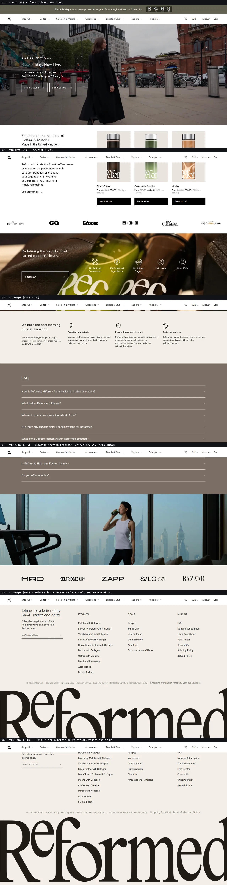
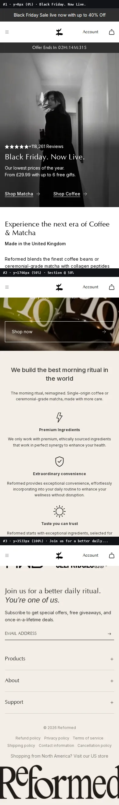

# UI Design System & Master Generation Blueprint: www-feelreformed-com

> **Reformed: The biggest thing to happen to Coffee since Coffee.** (https://www.feelreformed.com/) — Reformed: Arabica coffee and ceremonial matcha, enriched with functionality: collagen or creatine, adaptogens and twenty-one vitamins.





---

## 1. Executive Visual Persona & Design Archetype

- **Brand Essence & Persona**: **Reformed: The biggest thing to happen to Coffee since Coffee.** (`https://www.feelreformed.com/`). Reformed: Arabica coffee and ceremonial matcha, enriched with functionality: collagen or creatine, adaptogens and twenty-one vitamins.
- **Capture Provenance**: Live browser capture (`tier1_fast`, HTTP `200`, captured `2026-11-24`).
- **Visual Archetype**: **Light-Substrate Editorial & Modular Grid System (`#f9f8f6` canvas, `#000000` ink, `#ff0000` accent)**.
- **Anti-AI-Slop Differentiators**:
  - **Live-Computed Chromatic Polarity**: Anchors the viewport in `#f9f8f6` (live computed `body` `background-color` (`computed_styles.json`)) paired with `#000000` primary typography and `#ff0000` accents.
  - **Grounded Typographic Hierarchy**: Pairs `Optima` for display copy (`Black Coffee with Collagen`) with `Inter`.
  - **Calibrated Spatial Grid & Motion**: Combines `1920px` container bounds (`gap: var(--gap-md)`, padding `var(--page-margin)`) with `cubic-bezier(.4,0,.2,1)` easing and Three.js / WebGL Canvas Pipeline, Barba.js Page Transition Router.

---

## 2. Spatial Architecture & Modular Grid Mathematics

### Viewport Allocation & Container Geometry
- **Captured Journey Filmstrips**: Desktop `1280×4968px` (`assets/desktop-journey.webp`, `6` keyframes up to `y=3514px` / doc `4414px`), Mobile `390×2616px` (`assets/mobile-journey.webp`, `3` keyframes).
- **Master Container Bounds**: `1920px` (non-`@media` desktop container stylesheet rule).
- **Canvas Lateral Padding & Spacing**: `var(--page-margin)` lateral canvas padding with `var(--gap-md)` grid gap.
- **Border Radius Scale**: `var(--style-border-radius-inputs)`, `var(--style-border-radius-popover)`, `var(--style-border-radius-buttons-primary)`, `var(--style-border-radius-buttons-secondary)`.

### Responsive Breakpoint Architecture
- **Desktop Layout**: Multi-column CSS Grid / Flexbox layout at `1440px` (`max-width: 1920px`, `gap: var(--gap-md)`).
- **Mobile Layout**: Single-column vertical stack at `390px` viewport width with `var(--page-margin)` horizontal padding.
- **Extracted CSS Media Queries**: `@media (any-pointer:fine)and (prefers-reduced-motion:no-preference)`, `@media (prefers-reduced-motion:no-preference)`, `@media screen and (min-width:750px)`, `@media screen and (max-width:749px)`.

---

## 3. Color System, Materiality & Atmospheric Lighting

### Semantic Palette & Source Grounding
| Semantic Role | Ground-Truth Value | Extracted Live / CSS Source |
|---|---|---|
| **Primary Canvas Substrate** | `#f9f8f6` | live computed `body` `background-color` (`computed_styles.json`) |
| **Primary Typography Ink** | `#000000` | live computed `a` `color` (`computed_styles.json`) |
| **Elevated Surface / Card Substrate** | `#e5e5eb` | `var(--oke-avatar-backgroundColor)` in `:root` |
| **Interactive Accent / Highlight** | `#ff0000` | `.octane-popup__optin-channel-error { color: red }` (`#ff0000`) |
| **Secondary / Muted Copy** | `#7b6f65` | `var(--oke-stars-foregroundColor)` in `:root` |
| **Structural Hairline Border** | `#b3b3b1` | `var(--color-border)` in `:root` (`rgb(0 0 0 / 0.28)`) |

### Sanitized Root CSS Variables (`ui-ux.md` Ground Truth)
| Variable Name | Extracted Value | Semantic Role |
|---|---|---|
| `--hover-lift-amount` | `4px` | Dimension / Scale Token |
| `--hover-scale-amount` | `1` | Design System Custom Token |
| `--hover-subtle-zoom-amount` | `1.015` | Design System Custom Token |
| `--hover-shadow-color` | `var(--color-shadow)` | Brand / Palette Token |
| `--hover-transition-duration` | `.25s` | Motion / Easing Token |
| `--hover-transition-timing` | `ease-out` | Motion / Easing Token |
| `--sidebar-width` | `25rem` | Layout / Spatial Grid Token |
| `--narrow-content-width` | `36rem` | Layout / Spatial Grid Token |
| `--normal-content-width` | `42rem` | Layout / Spatial Grid Token |
| `--wide-content-width` | `46rem` | Layout / Spatial Grid Token |
| `--narrow-page-width` | `90rem` | Layout / Spatial Grid Token |
| `--normal-page-width` | `120rem` | Layout / Spatial Grid Token |
| `--wide-page-width` | `150rem` | Layout / Spatial Grid Token |
| `--section-height-small` | `15rem` | Layout / Spatial Grid Token |
| `--section-height-medium` | `25rem` | Layout / Spatial Grid Token |
| `--section-height-large` | `35rem` | Layout / Spatial Grid Token |

---

## 4. Typographic Scale & Editorial Hierarchy

### Font Family Stacks
- **Display Typography**: `Optima`.
- **Primary Body Stack**: `Inter`.
- **Technical / Metadata Stack**: not declared in live computed styles (uses primary stack / `ui-monospace`).

### Typographic Scale & Rules (Live Computed & Stylesheet Grounded)
- **Hero Display (`H1`)**: live computed `h1` (`font-size: 24px`, `line-height: 27.6px`, `font-weight: 400`); CSS variables `--header-logo-display: none`, `--header-logo-inverse-display: block`, `--text-4xl: calc(var(--base-font-size)*2.25)`; rule `h1` (`line-height: var(--line-height--di...`).
- **Section Heading (`H2`)**: live computed `h2` (`font-size: 48px`, `line-height: 52.8px`, `font-weight: 400`); CSS variables `--text-2xl: calc(var(--base-font-size)*1.5)`, `--text-2xl--line-height: calc(2/1.5)`, `--font-h2--spacing: 0.25em`; rule `h2` (`font-size: 24px`).
- **Body Copy**: live computed `body` (`font-size: 14px`, `line-height: 22.4px`, `font-weight: 400`); CSS variables `--font-paragraph--line-height: 1`, `--text-base: calc(var(--base-font-size))`, `--text-base--line-height: calc(1.5/1)`; rule `p` (`line-height: var(--line-height--bo...`).
- **Metadata & Navigation Labels**: live computed `nav/a` (`font-size: 14px`, `line-height: 22.4px`, `font-weight: 400`); CSS variables `--section-height-small: 15rem`, `--oke-text-small: 14px`, `--checkbox-label-padding: 8px`; rule `small` (`font-size: 80%`).

---

## 5. Choreographed Motion & Interaction Physics

### Primary Easing Curves
- **Extracted Timing Functions**: `cubic-bezier(.4,0,.2,1)`, `cubic-bezier(.4,0,1,1)`, `cubic-bezier(0,0,.2,1)`.

### Per-Element Transition & Choreography Rules
- **Selector `:root`**: `transition: .25s` extracted from `www-feelreformed-com` stylesheet.
- **Selector `.predictive-search-results__card`**: `transition: transform var(--hover-transition-duration) var(--hover-transit...` extracted from `www-feelreformed-com` stylesheet.
- **Selector `dictive-search-results__card .res...`**: `transition: none` extracted from `www-feelreformed-com` stylesheet.
- **Extracted Easing Curve (`cubic-bezier(.4,0,.2,1)`)**: Governs interactive state transitions across `<header.shopify-section>` and `<section.hero-wrapper>`.
- **Runtime Interaction Engine**: Integrates Three.js / WebGL Canvas Pipeline, Barba.js Page Transition Router with `prefers-reduced-motion: reduce` fallback guards.
### Measured Runtime Scroll & Interaction Telemetry (`behavioral_journey_v2`)
- **Scroll Driver Mode**: `native` (max document height `4414px`, deepest scrollY reached `3514px` across `6` desktop keyframes).
- **Detected Scroll / Motion Libraries**: Native browser scroll / standard CSS transitions.
- **Nav / Drawer Probe (`Open account menu`)**: Triggered visual change (pixel diff `31.489`, captured in `assets/state-nav.webp`).
- **Route Transition Architecture**: First internal navigation (`/products/collagen-black-coffee`) measured as `direct` in `9816ms`.

---

## 6. Component Wireframe & Structural DOM Map

### Visual Layout Schematic — Desktop (`1440px`, Grounded in `dom.html` & Landmark Bounding Boxes)
```
┌────────────────────────────────────────────────────────────────────────┐
│ DESKTOP VIEWPORT (1440px) — Reformed: The biggest thing to happen to C │
│ ====================================================================== │
│ [ <header.shopify-sectio (1440x0px)   | Black Coffee · Mocha · Match ] │
│ ---------------------------------------------------------------------- │
│ | HERO STAGE: <section.shopify-section> (w=1440px)                   | │
│ | H1: Black Coffee with Collagen                                     | │
│ | Substrate: #f9f8f6 | Ink: #000000 | Accent: #ff0000                | │
│ ---------------------------------------------------------------------- │
│ | SHOWCASE GRID (<section.hero-wrapper>) max-w: 1920px               | │
│ | +------------------------------+  +------------------------------+ | │
│ | | Matcha with Collagen         |  | Mocha with Collagen          | | │
│ | +------------------------------+  +------------------------------+ | │
│ ---------------------------------------------------------------------- │
│ | DETAIL MODULE (<section.section-wrapper>) — FAQ                    | │
│ ---------------------------------------------------------------------- │
│ [ FOOTER (<footer.shopify-sect) | https://www.feelreformed.com/        │
└────────────────────────────────────────────────────────────────────────┘
```

### Visual Layout Schematic — Mobile Reflow (`390px`)
```
┌────────────────────────────────────────────────────────────────────────┐
│ MOBILE VIEWPORT REFLOW (390px) — Single-Column Stack (gap: var(--ga)   │
│ ====================================================================== │
│ [ HEADER BAR (<header.shopify-section>) | Compact Menu (390px)         │
│ ---------------------------------------------------------------------- │
│ | HERO STAGE (<section.shopify-section) — 390px Vertical Lead        | │
│ | H1: Black Coffee with Collagen                                     | │
│ ---------------------------------------------------------------------- │
│ | SHOWCASE STACK (<section.hero-wrapper>) — 1-Col Stack              | │
│ | [ Item 1: Matcha with Collagen                                   ] | │
│ | [ Item 2: Mocha with Collagen                                    ] | │
│ ---------------------------------------------------------------------- │
│ | DETAIL STACK (<section.section-wrapper) — 1-Col (FAQ)              | │
│ ---------------------------------------------------------------------- │
│ [ FOOTER (<footer.shopify-sect) | Stacked 390px Colophon               │
└────────────────────────────────────────────────────────────────────────┘
```

### Granular DOM Region Breakdown
1. **Brand Header & Navigation Bar (<header.shopify-section> — `www-feelreformed-com`)**:
   - Landmark `<header class="shopify-section shopify-section-group-header-group">` (`1440x0px`) hosting `Reformed: The biggest thing to happe` navigation (`Black Coffee · Mocha · Matcha · Shop All · Mocha with Collagen`), DOM attributes (`data-source-attribution="shopify.exit_intersti..."`, `data-shopify`, `data-shop-id="81515184414"`, `data-venmo-supported="false"`), and stylesheet rule `svg { display:block;max-width:100% }`.
2. **Hero Stage & Focal Lead (<section.shopify-section> — `Black Coffee with Collagen`)**:
   - Landmark `<section class="shopify-section section-wrapper">` presenting display lead `Black Coffee with Collagen` and copy excerpt *"Our lowest prices of the year."* over `#f9f8f6` canvas and `#000000` ink.
3. **Primary Showcase & Content Grid (<section.hero-wrapper> — `Matcha with Collagen`)**:
   - Landmark `<section class="shopify-section hero-wrapper">` rendering section `Matcha with Collagen` with copy *"Experience the next era of Coffee & Matcha"*, asset references (`storefront.js`, `page-load`, `shopify.js`, `klaviyo.js`), and grid rule `img { width:100%;height:auto }`.
4. **Interactive Detail & Feature Matrix (<section.section-wrapper> — `Mocha with Collagen`)**:
   - Landmark `<section class="shopify-section hero-wrapper">` framing `Mocha with Collagen` and `FAQ` (*"Made in the United Kingdom"*) with `#e5e5eb` surface cards, `#ff0000` accents, and `select { font:inherit;border-radius:var(--style-border-radius-inputs) }`.
5. **Colophon & Global Directory Footer (<footer.shopify-section> — `https://www.feelreformed.com/`)**:
   - Landmark `<footer class="shopify-section shopify-section-group-footer-group">` anchoring `Reformed: The biggest thing to h` footer links (`Black Coffee · Mocha · Matcha · Shop All · Mocha with Collagen`), copy *"Reformed blends the finest coffee beans or ceremonial-grade "*, and `#b3b3b1` structural dividers.
### Full Vertical Scroll Sequence (Desktop `1440×900` Keyframes)
- **Step 01** (`y=0px`, `0%`): Active landmark `Black Friday. Now Live.` · sticky/fixed elements: `0`
- **Step 02** (`y=850px`, `24%`): Active landmark `Section @ 24%` · sticky/fixed elements: `0`
- **Step 03** (`y=1700px`, `48%`): Active landmark `FAQ` · sticky/fixed elements: `0`
- **Step 04** (`y=2550px`, `73%`): Active landmark `#shopify-section-template--27422738055545__hero_4...` · sticky/fixed elements: `0`
- **Step 05** (`y=3400px`, `97%`): Active landmark `Join us for a better daily ritual. You’re one of us.` · sticky/fixed elements: `0`
- **Step 06** (`y=3514px`, `100%`): Active landmark `Join us for a better daily ritual. You’re one of us.` · sticky/fixed elements: `0`

### Multi-Page Internal Route Map
- **Detail Route (`/products/collagen-black-coffee`)**: `https://www.feelreformed.com/products/collagen-black-coffee` — H1: `Black Coffee with Collagen`, scrollHeight `10609px`, transition `direct` (`9816ms`)
- **Detail Route (`/products/collagen-mocha`)**: `https://www.feelreformed.com/products/collagen-mocha` — H1: `Mocha with Collagen`, scrollHeight `10891px`, transition `direct` (`7623ms`)
- **Detail Route (`/products/collagen-matcha`)**: `https://www.feelreformed.com/products/collagen-matcha` — H1: `Matcha with Collagen`, scrollHeight `10744px`, transition `direct` (`7882ms`)

---

## 7. Master Zero-Shot AI Generation Prompt

```markdown
# Master Zero-Shot Frontend Generation Prompt: www-feelreformed-com (Reformed: The biggest thing to happen to Coffee since Coffee.)

You are a principal frontend architect and design systems engineer. Build a complete, production-ready web application replicating the exact design system, DOM landmarks, typographic hierarchy, color tokens, and motion physics of `www-feelreformed-com` (**Reformed: The biggest thing to happen to Coffee since Coffee.** — `https://www.feelreformed.com/`).

### 1. Visual Archetype & Anti-AI-Slop Mandates
- **Archetype**: Light-Substrate Editorial & Modular Grid System (`#f9f8f6` canvas, `#000000` ink, `#ff0000` accent).
- **Identity & Domain Context**: Reformed: Arabica coffee and ceremonial matcha, enriched with functionality: collagen or creatine, adaptogens and twenty-one vitamins.
- **Primary Substrate**: `#f9f8f6` (live computed `body` `background-color` (`computed_styles.json`)), **Primary Ink**: `#000000`, **Accent / Highlight**: `#ff0000`.
- **Site-Specific Differentiators**:
  - **Live-Computed Chromatic Polarity**: Anchors the viewport in `#f9f8f6` (live computed `body` `background-color` (`computed_styles.json`)) paired with `#000000` primary typography and `#ff0000` accents.
  - **Grounded Typographic Hierarchy**: Pairs `Optima` for display copy (`Black Coffee with Collagen`) with `Inter`.
  - **Calibrated Spatial Grid & Motion**: Combines `1920px` container bounds (`gap: var(--gap-md)`, padding `var(--page-margin)`) with `cubic-bezier(.4,0,.2,1)` easing and Three.js / WebGL Canvas Pipeline, Barba.js Page Transition Router.

### 2. Ground-Truth CSS Variables (`:root` Token Contract)
Declare and consume these exact custom properties extracted from `www-feelreformed-com` in your global stylesheet:

:root {
  /* Reformed: The biggest thing to happen to Coffee since Coffee. (www-feelreformed-com) — Live-Grounded CSS Variables */
  --hover-lift-amount: 4px; /* Dimension / Scale Token (www-feelreformed-com) */
  --hover-scale-amount: 1; /* Design System Custom Token (www-feelreformed-com) */
  --hover-subtle-zoom-amount: 1.015; /* Design System Custom Token (www-feelreformed-com) */
  --hover-shadow-color: var(--color-shadow); /* Brand / Palette Token (www-feelreformed-com) */
  --hover-transition-duration: .25s; /* Motion / Easing Token (www-feelreformed-com) */
  --hover-transition-timing: ease-out; /* Motion / Easing Token (www-feelreformed-com) */
  --sidebar-width: 25rem; /* Layout / Spatial Grid Token (www-feelreformed-com) */
  --narrow-content-width: 36rem; /* Layout / Spatial Grid Token (www-feelreformed-com) */
  --normal-content-width: 42rem; /* Layout / Spatial Grid Token (www-feelreformed-com) */
  --wide-content-width: 46rem; /* Layout / Spatial Grid Token (www-feelreformed-com) */
  --narrow-page-width: 90rem; /* Layout / Spatial Grid Token (www-feelreformed-com) */
  --normal-page-width: 120rem; /* Layout / Spatial Grid Token (www-feelreformed-com) */
  --wide-page-width: 150rem; /* Layout / Spatial Grid Token (www-feelreformed-com) */
  --section-height-small: 15rem; /* Layout / Spatial Grid Token (www-feelreformed-com) */
  --section-height-medium: 25rem; /* Layout / Spatial Grid Token (www-feelreformed-com) */
  --section-height-large: 35rem; /* Layout / Spatial Grid Token (www-feelreformed-com) */
}

### 3. Semantic Color & Materiality Contract
Map every surface, ink, and border strictly to these source-grounded tokens:
- **Primary Canvas Substrate**: `#f9f8f6` — grounded in live computed `body` `background-color` (`computed_styles.json`)
- **Primary Typography Ink**: `#000000` — grounded in live computed `a` `color` (`computed_styles.json`)
- **Elevated Surface / Card Substrate**: `#e5e5eb` — grounded in `var(--oke-avatar-backgroundColor)` in `:root`
- **Interactive Accent / Highlight**: `#ff0000` — grounded in `.octane-popup__optin-channel-error { color: red }` (`#ff0000`)
- **Secondary / Muted Copy**: `#7b6f65` — grounded in `var(--oke-stars-foregroundColor)` in `:root`
- **Structural Hairline Border**: `#b3b3b1` — grounded in `var(--color-border)` in `:root` (`rgb(0 0 0 / 0.28)`)

### 4. Spatial Grid, Container Bounds & Responsive Breakpoints
- **Desktop Viewport Reference**: `1280×4968px` (multi-frame vertical journey filmstrip (4968px), `1440px` standard desktop width).
- **Mobile Viewport Reference**: `390×2616px` (multi-frame vertical journey filmstrip (2616px), `390px` standard mobile width).
- **Container Max-Width**: `1920px` (non-`@media` desktop container stylesheet rule)
- **Padding & Gutters**: `var(--page-margin)` lateral canvas padding with `var(--gap-md)` grid gap
- **Desktop Grid**: Multi-column CSS Grid / Flexbox layout at `1440px` (`max-width: 1920px`, `gap: var(--gap-md)`)
- **Mobile Adaptation**: Single-column vertical stack at `390px` viewport width with `var(--page-margin)` horizontal padding
- **Media Queries**: `@media (any-pointer:fine)and (prefers-reduced-motion:no-preference)`, `@media (prefers-reduced-motion:no-preference)`, `@media screen and (min-width:750px)`, `@media screen and (max-width:749px)`
- **Corner Radii**: `var(--style-border-radius-inputs)`, `var(--style-border-radius-popover)`, `var(--style-border-radius-buttons-primary)`, `var(--style-border-radius-buttons-secondary)`

### 5. Typography & Editorial Scale Contract
- **Display Font Stack**: `Optima`
- **Body Font Stack**: `Inter`
- **Monospace / Technical Font Stack**: not declared in live computed styles (uses primary stack / `ui-monospace`)
- **H1 Display Rule**: live computed `h1` (`font-size: 24px`, `line-height: 27.6px`, `font-weight: 400`); CSS variables `--header-logo-display: none`, `--header-logo-inverse-display: block`, `--text-4xl: calc(var(--base-font-size)*2.25)`; rule `h1` (`line-height: var(--line-height--di...`)
- **H2 Section Rule**: live computed `h2` (`font-size: 48px`, `line-height: 52.8px`, `font-weight: 400`); CSS variables `--text-2xl: calc(var(--base-font-size)*1.5)`, `--text-2xl--line-height: calc(2/1.5)`, `--font-h2--spacing: 0.25em`; rule `h2` (`font-size: 24px`)
- **Body Copy Rule**: live computed `body` (`font-size: 14px`, `line-height: 22.4px`, `font-weight: 400`); CSS variables `--font-paragraph--line-height: 1`, `--text-base: calc(var(--base-font-size))`, `--text-base--line-height: calc(1.5/1)`; rule `p` (`line-height: var(--line-height--bo...`)
- **Metadata & Index Rule**: live computed `nav/a` (`font-size: 14px`, `line-height: 22.4px`, `font-weight: 400`); CSS variables `--section-height-small: 15rem`, `--oke-text-small: 14px`, `--checkbox-label-padding: 8px`; rule `small` (`font-size: 80%`)

### 6. Component Hierarchy, Verbatim Copy & Real DOM Landmarks
Scaffold `www-feelreformed-com` (`Reformed: The biggest thing to happen to Coffee since Coffee.`) with these exact structural regions, extracted copy, and CSS rules from `dom.html`:
1. **Brand Header & Navigation Bar (<header.shopify-section> — `www-feelreformed-com`)**:
   - DOM & Selectors: Landmark `<header class="shopify-section shopify-section-group-header-group">` (`1440x0px`) hosting `Reformed: The biggest thing to happe` navigation (`Black Coffee · Mocha · Matcha · Shop All · Mocha with Collagen`), DOM attributes (`data-source-attribution="shopify.exit_intersti..."`, `data-shopify`, `data-shop-id="81515184414"`, `data-venmo-supported="false"`), and stylesheet rule `svg { display:block;max-width:100% }`.
   - Responsive Contract: Header `Brand Header & Navigation Bar (<header.shopify-section> — `www-feelreformed-com`)` (`www-feelreformed-com`) adapts across `@media (any-pointer:fine)and (prefers-reduced-motion:no-preference)`, `@media (prefers-reduced-motion:no-preference)`, `@media screen and (min-width:750px)`, `@media screen and (max-width:749px)` with `cubic-bezier(.4,0,.2,1)`, `cubic-bezier(.4,0,1,1)`, `cubic-bezier(0,0,.2,1)` transitions and links `Black Coffee · Mocha · Matcha · Shop All · Mocha with Collagen`.
2. **Hero Stage & Focal Lead (<section.shopify-section> — `Black Coffee with Collagen`)**:
   - DOM & Selectors: Landmark `<section class="shopify-section section-wrapper">` presenting display lead `Black Coffee with Collagen` and copy excerpt *"Our lowest prices of the year."* over `#f9f8f6` canvas and `#000000` ink.
   - Responsive Contract: Hero stage (`1280×4968px` desktop / `390×2616px` mobile) sets `#f9f8f6` background with `#000000` headline `Black Coffee with Collagen`.
3. **Primary Showcase & Content Grid (<section.hero-wrapper> — `Matcha with Collagen`)**:
   - DOM & Selectors: Landmark `<section class="shopify-section hero-wrapper">` rendering section `Matcha with Collagen` with copy *"Experience the next era of Coffee & Matcha"*, asset references (`storefront.js`, `page-load`, `shopify.js`, `klaviyo.js`), and grid rule `img { width:100%;height:auto }`.
   - Responsive Contract: Showcase grid `Primary Showcase & Content Grid (<section.hero-wrapper> — `Matcha with Collagen`)` applies Multi-column CSS Grid / Flexbox layout at `1440px` (`max-width: 1920px`, `gap: var(--gap-md)`) on desktop and Single-column vertical stack at `390px` viewport width with `var(--page-margin)` horizontal padding on mobile.
4. **Interactive Detail & Feature Matrix (<section.section-wrapper> — `Mocha with Collagen`)**:
   - DOM & Selectors: Landmark `<section class="shopify-section hero-wrapper">` framing `Mocha with Collagen` and `FAQ` (*"Made in the United Kingdom"*) with `#e5e5eb` surface cards, `#ff0000` accents, and `select { font:inherit;border-radius:var(--style-border-radius-inputs) }`.
   - Responsive Contract: Detail module `Interactive Detail & Feature Matrix (<section.section-wrapper> — `Mocha with Collagen`)` uses `var(--style-border-radius-inputs)`, `var(--style-border-radius-popover)`, `var(--style-border-radius-buttons-primary)`, `var(--style-border-radius-buttons-secondary)` radii, `#ff0000` highlights, and assets (storefront.js, page-load, shopify.js).
5. **Colophon & Global Directory Footer (<footer.shopify-section> — `https://www.feelreformed.com/`)**:
   - DOM & Selectors: Landmark `<footer class="shopify-section shopify-section-group-footer-group">` anchoring `Reformed: The biggest thing to h` footer links (`Black Coffee · Mocha · Matcha · Shop All · Mocha with Collagen`), copy *"Reformed blends the finest coffee beans or ceremonial-grade "*, and `#b3b3b1` structural dividers.
   - Responsive Contract: Footer `Colophon & Global Directory Footer (<footer.shopify-section> — `https://www.feelreformed.com/`)` aligns to `1920px` (non-`@media` desktop container stylesheet rule) with `var(--page-margin)` lateral canvas padding with `var(--gap-md)` grid gap and attributes (data-source-attribution="shopify.exit_intersti...", data-shopify, data-shop-id="81515184414").

#### Verbatim DOM Copy Excerpts (`dom.html`)
- Copy Excerpt 1: *"Our lowest prices of the year."*
- Copy Excerpt 2: *"Experience the next era of Coffee & Matcha"*
- Copy Excerpt 3: *"Made in the United Kingdom"*
- Copy Excerpt 4: *"Reformed blends the finest coffee beans or ceremonial-grade matcha with collagen p..."*

### 7. Motion, Extracted Stylesheet Rules & Interaction Choreography
- **Primary Easing Functions**: `cubic-bezier(.4,0,.2,1)`, `cubic-bezier(.4,0,1,1)`, `cubic-bezier(0,0,.2,1)`
- **Extracted Stylesheet Rules (`www-feelreformed-com`)**:
- `svg { display:block;max-width:100% }`
- `img { width:100%;height:auto }`
- `select { font:inherit;border-radius:var(--style-border-radius-inputs) }`
- `input:hover { background-color:var(--color-input-hover-background) }`
- `.product-card__link { position:absolute;top:0;right:0;bottom:0;left:0 }`
- **Per-Selector Transition Rules**:
- **Selector `:root`**: `transition: .25s` extracted from `www-feelreformed-com` stylesheet.
- **Selector `.predictive-search-results__card`**: `transition: transform var(--hover-transition-duration) var(--hover-transit...` extracted from `www-feelreformed-com` stylesheet.
- **Selector `dictive-search-results__card .res...`**: `transition: none` extracted from `www-feelreformed-com` stylesheet.
- **Extracted Easing Curve (`cubic-bezier(.4,0,.2,1)`)**: Governs interactive state transitions across `<header.shopify-section>` and `<section.hero-wrapper>`.
- **Runtime Interaction Engine**: Integrates Three.js / WebGL Canvas Pipeline, Barba.js Page Transition Router with `prefers-reduced-motion: reduce` fallback guards.
### 7b. Full-Page Scroll Choreography, Interactive States & Multi-Page Routes
- **Scroll Mechanics**: Implement `native` vertical progression up to `4414px` across 6 distinct viewport chapters.
- **Vertical Chapter Sequence**: Black Friday. Now Live. (0%) -> Section @ 24% (24%) -> FAQ (48%) -> #shopify-section-template--... (73%) -> Join us for a better daily... (97%) -> Join us for a better daily... (100%).
- **Navigation Drawer / Menu State**: Replicate interactive menu toggle (`Open account menu`) with Escape-to-close keyboard handling.
- **Multi-Page Routes**: Scaffold internal routes `/products/collagen-black-coffee` (detail, direct), `/products/collagen-mocha` (detail, direct), `/products/collagen-matcha` (detail, direct) sharing the global header/footer shell and design tokens.

### 8. Technical Deliverables
- Implement in Next.js (App Router) with TypeScript and Tailwind CSS consuming the `:root` custom properties defined above for `www-feelreformed-com`.
- Reproduce both the `1440px` desktop architecture and `390px` mobile breakpoint transitions, preserving semantic HTML5 landmarks (`<header>`, `<nav>`, `<main>`, `<section>`, `<footer>`) and `prefers-reduced-motion` accessibility guards.
```
---

## 8. Full-Page Scroll Journey, Interactive States & Subpage Inventory

### Desktop Scroll Keyframes (`1440×900` WebP)
| Step | Scroll Y | Progress | Active Landmark / Section | Sticky/Fixed | Visual Asset |
| :---: | :---: | :---: | :--- | :---: | :--- |
| `#01` | `0px` | `0%` | Black Friday. Now Live. | `0` | [desktop-step-01.webp](assets/desktop-step-01.webp) |
| `#02` | `850px` | `24%` | Section @ 24% | `0` | [desktop-step-02.webp](assets/desktop-step-02.webp) |
| `#03` | `1700px` | `48%` | FAQ | `0` | [desktop-step-03.webp](assets/desktop-step-03.webp) |
| `#04` | `2550px` | `73%` | #shopify-section-template--27422738055545__he... | `0` | [desktop-step-04.webp](assets/desktop-step-04.webp) |
| `#05` | `3400px` | `97%` | Join us for a better daily ritual. You’re one... | `0` | [desktop-step-05.webp](assets/desktop-step-05.webp) |
| `#06` | `3514px` | `100%` | Join us for a better daily ritual. You’re one... | `0` | [desktop-step-06.webp](assets/desktop-step-06.webp) |

### Mobile Condensed Keyframes (`390×844` WebP)
| Step | Scroll Y | Progress | Active Landmark | Visual Asset |
| :---: | :---: | :---: | :--- | :--- |
| `#01` | `0px` | `0%` | Black Friday. Now Live. | [mobile-step-01.webp](assets/mobile-step-01.webp) |
| `#02` | `1766px` | `50%` | Section @ 50% | [mobile-step-02.webp](assets/mobile-step-02.webp) |
| `#03` | `3533px` | `100%` | Join us for a better daily ritual. You’re... | [mobile-step-03.webp](assets/mobile-step-03.webp) |

### Interactive UI State Captures (`1440×900` WebP)
| State Type | Trigger / Observation | Visual Asset |
| :--- | :--- | :--- |
| `nav_menu` | Nav/Menu opened (`Open account menu`, diff `31.489`) | [state-nav.webp](assets/state-nav.webp) |

### Internal Subpage Filmstrips (`1080px` Wide WebP)
| # | Template | Route URL | H1 / Title | Scroll Height | Transition | Filmstrip Asset |
| :-: | :---: | :--- | :--- | :---: | :---: | :--- |
| `1` | `detail` | `https://www.feelreformed.com/products/collagen-black-coffee` | Black Coffee with Collagen | `10609px` | `direct` (`9816ms`) | [subpage-01-products-collagen-black-coffee.webp](assets/subpage-01-products-collagen-black-coffee.webp) |
| `2` | `detail` | `https://www.feelreformed.com/products/collagen-mocha` | Mocha with Collagen | `10891px` | `direct` (`7623ms`) | [subpage-02-products-collagen-mocha.webp](assets/subpage-02-products-collagen-mocha.webp) |
| `3` | `detail` | `https://www.feelreformed.com/products/collagen-matcha` | Matcha with Collagen | `10744px` | `direct` (`7882ms`) | [subpage-03-products-collagen-matcha.webp](assets/subpage-03-products-collagen-matcha.webp) |

