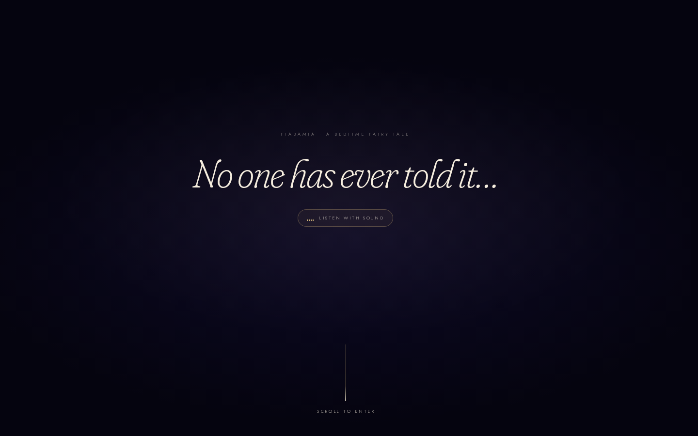
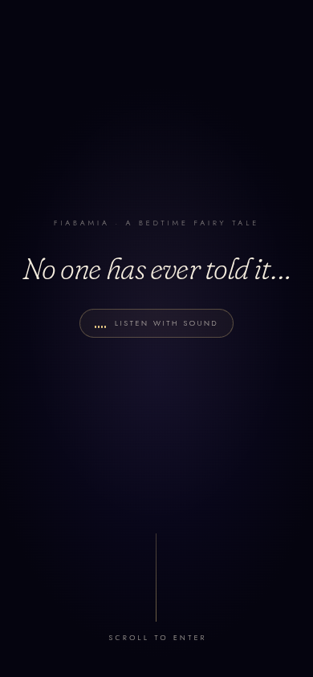

# UI Design System & Master Generation Blueprint: www-fiabamia-com

> **FiabaMia — Personalized bedtime stories for children** (https://www.fiabamia.com/) — Every night a brand-new bedtime story where your child is the hero: written in 30 seconds to fit their age, with music, interactive sound...



---

## 1. Executive Visual Persona & Design Archetype

- **Brand Essence & Persona**: **FiabaMia — Personalized bedtime stories for children** (`https://www.fiabamia.com/`). Every night a brand-new bedtime story where your child is the hero: written in 30 seconds to fit their age, with music, interactive sound...
- **Capture Provenance**: Live browser capture (`tier2_webgl`, HTTP `200`, captured `2026-11-23`).
- **Visual Archetype**: **Dark-Substrate WebGL / Canvas Interactive Experience (`#05040f` / `#f5c842`)**.
- **Anti-AI-Slop Differentiators**:
  - **Live-Computed Chromatic Polarity**: Anchors the viewport in `#05040f` (live computed `html` `background-color` (`computed_styles.json`)) paired with `#f8f4ff` primary typography and `#f5c842` accents.
  - **Grounded Typographic Hierarchy**: Pairs `Jost` for display copy (`Personalized bedtime stories for chi`) with `Nunito` and not declared in live computed styles (uses primary stack / `ui-monospace`).
  - **Calibrated Spatial Grid & Motion**: Combines `96rem` container bounds (`gap: 16px`, padding `56px`) with `cubic-bezier(.4,0,1,1)` easing and Lenis Smooth Scroll (`data-lenis`), Three.js / WebGL Canvas Pipeline.

---

## 2. Spatial Architecture & Modular Grid Mathematics



### Viewport Allocation & Container Geometry
- **Captured Viewport Dimensions**: Desktop `1440×900px` (`assets/desktop.png`, single-viewport 100vh live capture (900px)), Mobile `390×844px` (`assets/mobile.png`, single-viewport 100vh live capture (844px)).
- **Master Container Bounds**: `96rem` (non-`@media` desktop container stylesheet rule).
- **Canvas Lateral Padding & Spacing**: `56px` lateral canvas padding with `16px` grid gap.
- **Border Radius Scale**: `999px`, `var(--radius-xl)`, `var(--radius-2xl)`, `.25rem`.

### Responsive Breakpoint Architecture
- **Desktop Layout**: Multi-column CSS Grid / Flexbox layout at `1440px` (`max-width: 96rem`, `gap: 16px`).
- **Mobile Layout**: Single-column vertical stack at `390px` viewport width with `56px` horizontal padding.
- **Extracted CSS Media Queries**: `@media (min-width:40rem)`, `@media (min-width:48rem)`, `@media (min-width:64rem)`, `@media (min-width:80rem)`.

---

## 3. Color System, Materiality & Atmospheric Lighting

### Semantic Palette & Source Grounding
| Semantic Role | Ground-Truth Value | Extracted Live / CSS Source |
|---|---|---|
| **Primary Canvas Substrate** | `#05040f` | live computed `html` `background-color` (`computed_styles.json`) |
| **Primary Typography Ink** | `#f8f4ff` | live computed `main` `color` (`computed_styles.json`) |
| **Elevated Surface / Card Substrate** | `#252550` | `var(--color-night-card)` in `:root` |
| **Interactive Accent / Highlight** | `#f5c842` | `var(--color-accent-gold)` in `:root` |
| **Secondary / Muted Copy** | `#6b5a3e` | `var(--color-ink-warm)` in `:root` |
| **Structural Hairline Border** | `#e8d9b5` | `var(--color-book-border)` in `:root` |
| **Variable Token (`--color-red-300`)** | `#ffa3a3` | `var(--color-red-300)` in `:root` |
| **Variable Token (`--color-red-400`)** | `#ff6568` | `var(--color-red-400)` in `:root` |
| **Variable Token (`--color-red-500`)** | `#fb2c36` | `var(--color-red-500)` in `:root` |
| **Variable Token (`--color-amber-50`)** | `#fffbeb` | `var(--color-amber-50)` in `:root` |
| **Variable Token (`--color-amber-300`)** | `#ffd236` | `var(--color-amber-300)` in `:root` |
| **Variable Token (`--color-amber-400`)** | `#fcbb00` | `var(--color-amber-400)` in `:root` |
| **Variable Token (`--color-amber-500`)** | `#f99c00` | `var(--color-amber-500)` in `:root` |
| **Variable Token (`--color-amber-600`)** | `#dd7400` | `var(--color-amber-600)` in `:root` |
| **Variable Token (`--color-amber-700`)** | `#b75000` | `var(--color-amber-700)` in `:root` |
| **Variable Token (`--color-yellow-400`)** | `#fac800` | `var(--color-yellow-400)` in `:root` |

### Sanitized Root CSS Variables (`ui-ux.md` Ground Truth)
| Variable Name | Extracted Value | Semantic Role |
|---|---|---|
| `--lightningcss-dark` | `initial` | Canvas / Surface Token |
| `--font-lora` | `"Lora", "Lora Fallback"` | Typography / Scale Token |
| `--font-cormorant-sc` | `"Cormorant SC", "Cormorant SC Fallback"` | Typography / Scale Token |
| `--font-nunito` | `"Nunito", "Nunito Fallback"` | Typography / Scale Token |
| `--font-sans` | `var(--font-nunito)` | Typography / Scale Token |
| `--font-serif` | `var(--font-lora)` | Typography / Scale Token |
| `--color-red-300` | `#ffa3a3` | Brand / Palette Token |
| `--color-red-400` | `#ff6568` | Brand / Palette Token |
| `--color-red-500` | `#fb2c36` | Brand / Palette Token |
| `--color-amber-50` | `#fffbeb` | Brand / Palette Token |
| `--color-amber-300` | `#ffd236` | Brand / Palette Token |
| `--color-amber-400` | `#fcbb00` | Brand / Palette Token |
| `--color-amber-500` | `#f99c00` | Brand / Palette Token |
| `--color-amber-600` | `#dd7400` | Brand / Palette Token |
| `--color-amber-700` | `#b75000` | Brand / Palette Token |
| `--color-yellow-400` | `#fac800` | Brand / Palette Token |

---

## 4. Typographic Scale & Editorial Hierarchy

### Font Family Stacks
- **Display Typography**: `Jost`.
- **Primary Body Stack**: `Nunito`.
- **Technical / Metadata Stack**: not declared in live computed styles (uses primary stack / `ui-monospace`).

### Typographic Scale & Rules (Live Computed & Stylesheet Grounded)
- **Hero Display (`H1`)**: live computed `h1` (`font-size: 16px`, `line-height: 24px`, `font-weight: 300`); CSS variables `--text-4xl: 2.25rem`, `--text-4xl--line-height: calc(2.5 / 2.25)`, `--text-5xl: 3rem`.
- **Section Heading (`H2`)**: live computed `h3 (primary section heading)` (`font-size: 27.2px`, `line-height: 29.92px`, `font-weight: 300`, `letter-spacing: -0.544px`); CSS variables `--text-2xl: 1.5rem`, `--text-2xl--line-height: calc(2 / 1.5)`, `--text-3xl: 1.875rem`; rule `h2` (`font-size: clamp(1.45rem,2.6vw,1.85rem)`, `line-height: 1.2`, `letter-spacing: -.02em`, `font-weight: 300`).
- **Body Copy**: live computed `body` (`font-size: 16px`, `line-height: 24px`, `font-weight: 400`); CSS variables `--text-base: 1rem`, `--text-base--line-height: calc(1.5 / 1)`; rule `p` (`font-size: clamp(1.05rem,1.5vw,1.38rem)`, `line-height: 1.4`, `font-weight: 300`).
- **Metadata & Navigation Labels**: live computed `nav/a` (`font-size: 10.56px`, `line-height: 15.84px`, `font-weight: 400`, `letter-spacing: 2.3232px`); CSS variables `--text-xs: .75rem`, `--text-xs--line-height: calc(1 / .75)`, `--text-sm: .875rem`; rule `small` (`font-size: .42em`, `letter-spacing: 0`, `font-weight: 300`).

---

## 5. Choreographed Motion & Interaction Physics

### Primary Easing Curves
- **Extracted Timing Functions**: `cubic-bezier(.4,0,1,1)`, `cubic-bezier(0,0,.2,1)`, `cubic-bezier(.4,0,.2,1)`.

### Per-Element Transition & Choreography Rules
- **Selector `layer theme`**: `transition: .15s` extracted from `www-fiabamia-com` stylesheet.
- **Selector `layer components`**: `transition: var(--tw-ease,var(--default-transition-timing-function))` extracted from `www-fiabamia-com` stylesheet.
- **Selector `.btn-secondary`**: `transition: var(--tw-ease,var(--default-transition-timing-function))` extracted from `www-fiabamia-com` stylesheet.
- **Extracted Easing Curve (`cubic-bezier(.4,0,1,1)`)**: Governs interactive state transitions across `<header.vg-testata>` and `<section.vg-lettura>`.
- **Runtime Interaction Engine**: Integrates Lenis Smooth Scroll (`data-lenis`), Three.js / WebGL Canvas Pipeline with `prefers-reduced-motion: reduce` fallback guards.

---

## 6. Component Wireframe & Structural DOM Map

### Visual Layout Schematic — Desktop (`1440px`, Grounded in `dom.html` & Landmark Bounding Boxes)
```
┌────────────────────────────────────────────────────────────────────────┐
│ DESKTOP VIEWPORT (1440px) — FiabaMia — Personalized bedtime stories fo │
│ ====================================================================== │
│ [ <header.vg-testata> (1425x84px)     | Create a story               ] │
│ ---------------------------------------------------------------------- │
│ | HERO STAGE: <section.vg-hero> (w=1425px)                           | │
│ | H1: Personalized bedtime stories for children A fairy...           | │
│ | Substrate: #05040f | Ink: #f8f4ff | Accent: #f5c842                | │
│ ---------------------------------------------------------------------- │
│ | SHOWCASE GRID (<section.vg-lettura>) max-w: 96rem                  | │
│ | +------------------------------+  +------------------------------+ | │
│ | | A story made to measure: nam |  | E v e r y s t o r y h a s i  | | │
│ | +------------------------------+  +------------------------------+ | │
│ ---------------------------------------------------------------------- │
│ | DETAIL MODULE (<section.vg-tunnel>) — W o r d s t h a t c o        | │
│ ---------------------------------------------------------------------- │
│ [ FOOTER (<footer.vg-fondo>   ) | https://www.fiabamia.com/            │
└────────────────────────────────────────────────────────────────────────┘
```

### Visual Layout Schematic — Mobile Reflow (`390px`)
```
┌────────────────────────────────────────────────────────────────────────┐
│ MOBILE VIEWPORT REFLOW (390px) — Single-Column Stack (gap: 16px)       │
│ ====================================================================== │
│ [ HEADER BAR (<header.vg-testata>     ) | Compact Menu (390px)         │
│ ---------------------------------------------------------------------- │
│ | HERO STAGE (<section.vg-hero>) — 390px Vertical Lead               | │
│ | H1: Personalized bedtime stories for children A fairy...           | │
│ ---------------------------------------------------------------------- │
│ | SHOWCASE STACK (<section.vg-lettura>) — 1-Col Stack                | │
│ | [ Item 1: A story made to measure: name, age, value, place...    ] | │
│ | [ Item 2: E v e r y s t o r y h a s i t s o w n m u s i c        ] | │
│ ---------------------------------------------------------------------- │
│ | DETAIL STACK (<section.vg-tunnel>) — 1-Col (W o r d s t h a t )    | │
│ ---------------------------------------------------------------------- │
│ [ FOOTER (<footer.vg-fondo>   ) | Stacked 390px Colophon               │
└────────────────────────────────────────────────────────────────────────┘
```

### Granular DOM Region Breakdown
1. **Brand Header & Navigation Bar (<header.vg-testata> — `www-fiabamia-com`)**:
   - Landmark `<header class="vg-testata">` (`1425x84px`) hosting `FiabaMia — Personalized bedtime stor` navigation (`Create a story`), DOM attributes (`data-precedence="next"`, `data-precedence="next"`, `data-precedence="next"`, `data-precedence="next"`), and stylesheet rule `lora_59c43264-module__4gbARq__cla... { font-family:Lora,Lora Fallback;font-style:normal }`.
2. **Hero Stage & Focal Lead (<section.vg-hero> — `Personalized bedtime stories for c`)**:
   - Landmark `<section class="vg-hero is-via">` presenting display lead `Personalized bedtime stories for children A fairy...` and copy excerpt *"FIABAMIA · A BEDTIME FAIRY TALE"* over `#05040f` canvas and `#f8f4ff` ink.
3. **Primary Showcase & Content Grid (<section.vg-lettura> — `A story made to measure: name, age`)**:
   - Landmark `<section class="vg-lettura">` rendering section `A story made to measure: name, age, value, place...` with copy *"FiabaMia · a bedtime fairy tale"*, asset references (`07454f8ad8aaac57-s.p.0tqkxa-w3pk~...`, `25e51d4a4d803f16-s.p.01lzzy~hm0v2...`, `4917c4fe274b6773-s.p.03o7i-1ioayt...`, `54fc36028e2bb174-s.p.0nkps02--w45...`), and grid rule `.lora_59c43264-module__4gbARq__va... { --font-lora:"Lora", "Lora Fallback" }`.
4. **Interactive Detail & Feature Matrix (<section.vg-tunnel> — `E v e r y s t o r y h a s i t s o `)**:
   - Landmark `<section class="vg-tunnel">` framing `E v e r y s t o r y h a s i t s o w n m u s i c` and `W o r d s t h a t c o m e t o l i f e` (*"No one has ever told it…"*) with `#252550` surface cards, `#f5c842` accents, and `t_sc_8e09fe47-module__uQmyda__cla... { font-family:Cormorant SC,Cormorant SC Fallback;font-style:normal }`.
5. **Colophon & Global Directory Footer (<footer.vg-fondo> — `https://www.fiabamia.com/`)**:
   - Landmark `<footer class="vg-fondo site-footer">` anchoring `FiabaMia — Personalized bedtime ` footer links (`Create a story`), copy *"N o o n e h a s e v e r t o l d i t …"*, and `#e8d9b5` structural dividers.

---

## 7. Master Zero-Shot AI Generation Prompt

```markdown
# Master Zero-Shot Frontend Generation Prompt: www-fiabamia-com (FiabaMia — Personalized bedtime stories for children)

You are a principal frontend architect and design systems engineer. Build a complete, production-ready web application replicating the exact design system, DOM landmarks, typographic hierarchy, color tokens, and motion physics of `www-fiabamia-com` (**FiabaMia — Personalized bedtime stories for children** — `https://www.fiabamia.com/`).

### 1. Visual Archetype & Anti-AI-Slop Mandates
- **Archetype**: Dark-Substrate WebGL / Canvas Interactive Experience (`#05040f` / `#f5c842`).
- **Identity & Domain Context**: Every night a brand-new bedtime story where your child is the hero: written in 30 seconds to fit their age, with music, interactive sound...
- **Primary Substrate**: `#05040f` (live computed `html` `background-color` (`computed_styles.json`)), **Primary Ink**: `#f8f4ff`, **Accent / Highlight**: `#f5c842`.
- **Site-Specific Differentiators**:
  - **Live-Computed Chromatic Polarity**: Anchors the viewport in `#05040f` (live computed `html` `background-color` (`computed_styles.json`)) paired with `#f8f4ff` primary typography and `#f5c842` accents.
  - **Grounded Typographic Hierarchy**: Pairs `Jost` for display copy (`Personalized bedtime stories for chi`) with `Nunito` and not declared in live computed styles (uses primary stack / `ui-monospace`).
  - **Calibrated Spatial Grid & Motion**: Combines `96rem` container bounds (`gap: 16px`, padding `56px`) with `cubic-bezier(.4,0,1,1)` easing and Lenis Smooth Scroll (`data-lenis`), Three.js / WebGL Canvas Pipeline.

### 2. Ground-Truth CSS Variables (`:root` Token Contract)
Declare and consume these exact custom properties extracted from `www-fiabamia-com` in your global stylesheet:

:root {
  /* FiabaMia — Personalized bedtime stories for children (www-fiabamia-com) — Live-Grounded CSS Variables */
  --lightningcss-dark: initial; /* Canvas / Surface Token (www-fiabamia-com) */
  --font-lora: "Lora", "Lora Fallback"; /* Typography / Scale Token (www-fiabamia-com) */
  --font-cormorant-sc: "Cormorant SC", "Cormorant SC Fallback"; /* Typography / Scale Token (www-fiabamia-com) */
  --font-nunito: "Nunito", "Nunito Fallback"; /* Typography / Scale Token (www-fiabamia-com) */
  --font-sans: var(--font-nunito); /* Typography / Scale Token (www-fiabamia-com) */
  --font-serif: var(--font-lora); /* Typography / Scale Token (www-fiabamia-com) */
  --color-red-300: #ffa3a3; /* Brand / Palette Token (www-fiabamia-com) */
  --color-red-400: #ff6568; /* Brand / Palette Token (www-fiabamia-com) */
  --color-red-500: #fb2c36; /* Brand / Palette Token (www-fiabamia-com) */
  --color-amber-50: #fffbeb; /* Brand / Palette Token (www-fiabamia-com) */
  --color-amber-300: #ffd236; /* Brand / Palette Token (www-fiabamia-com) */
  --color-amber-400: #fcbb00; /* Brand / Palette Token (www-fiabamia-com) */
  --color-amber-500: #f99c00; /* Brand / Palette Token (www-fiabamia-com) */
  --color-amber-600: #dd7400; /* Brand / Palette Token (www-fiabamia-com) */
  --color-amber-700: #b75000; /* Brand / Palette Token (www-fiabamia-com) */
  --color-yellow-400: #fac800; /* Brand / Palette Token (www-fiabamia-com) */
}

### 3. Semantic Color & Materiality Contract
Map every surface, ink, and border strictly to these source-grounded tokens:
- **Primary Canvas Substrate**: `#05040f` — grounded in live computed `html` `background-color` (`computed_styles.json`)
- **Primary Typography Ink**: `#f8f4ff` — grounded in live computed `main` `color` (`computed_styles.json`)
- **Elevated Surface / Card Substrate**: `#252550` — grounded in `var(--color-night-card)` in `:root`
- **Interactive Accent / Highlight**: `#f5c842` — grounded in `var(--color-accent-gold)` in `:root`
- **Secondary / Muted Copy**: `#6b5a3e` — grounded in `var(--color-ink-warm)` in `:root`
- **Structural Hairline Border**: `#e8d9b5` — grounded in `var(--color-book-border)` in `:root`
- **Variable Token (`--color-red-300`)**: `#ffa3a3` — grounded in `var(--color-red-300)` in `:root`
- **Variable Token (`--color-red-400`)**: `#ff6568` — grounded in `var(--color-red-400)` in `:root`
- **Variable Token (`--color-red-500`)**: `#fb2c36` — grounded in `var(--color-red-500)` in `:root`
- **Variable Token (`--color-amber-50`)**: `#fffbeb` — grounded in `var(--color-amber-50)` in `:root`
- **Variable Token (`--color-amber-300`)**: `#ffd236` — grounded in `var(--color-amber-300)` in `:root`
- **Variable Token (`--color-amber-400`)**: `#fcbb00` — grounded in `var(--color-amber-400)` in `:root`
- **Variable Token (`--color-amber-500`)**: `#f99c00` — grounded in `var(--color-amber-500)` in `:root`
- **Variable Token (`--color-amber-600`)**: `#dd7400` — grounded in `var(--color-amber-600)` in `:root`
- **Variable Token (`--color-amber-700`)**: `#b75000` — grounded in `var(--color-amber-700)` in `:root`
- **Variable Token (`--color-yellow-400`)**: `#fac800` — grounded in `var(--color-yellow-400)` in `:root`

### 4. Spatial Grid, Container Bounds & Responsive Breakpoints
- **Desktop Viewport Reference**: `1440×900px` (single-viewport 100vh live capture (900px), `1440px` standard desktop width).
- **Mobile Viewport Reference**: `390×844px` (single-viewport 100vh live capture (844px), `390px` standard mobile width).
- **Container Max-Width**: `96rem` (non-`@media` desktop container stylesheet rule)
- **Padding & Gutters**: `56px` lateral canvas padding with `16px` grid gap
- **Desktop Grid**: Multi-column CSS Grid / Flexbox layout at `1440px` (`max-width: 96rem`, `gap: 16px`)
- **Mobile Adaptation**: Single-column vertical stack at `390px` viewport width with `56px` horizontal padding
- **Media Queries**: `@media (min-width:40rem)`, `@media (min-width:48rem)`, `@media (min-width:64rem)`, `@media (min-width:80rem)`
- **Corner Radii**: `999px`, `var(--radius-xl)`, `var(--radius-2xl)`, `.25rem`

### 5. Typography & Editorial Scale Contract
- **Display Font Stack**: `Jost`
- **Body Font Stack**: `Nunito`
- **Monospace / Technical Font Stack**: not declared in live computed styles (uses primary stack / `ui-monospace`)
- **H1 Display Rule**: live computed `h1` (`font-size: 16px`, `line-height: 24px`, `font-weight: 300`); CSS variables `--text-4xl: 2.25rem`, `--text-4xl--line-height: calc(2.5 / 2.25)`, `--text-5xl: 3rem`
- **H2 Section Rule**: live computed `h3 (primary section heading)` (`font-size: 27.2px`, `line-height: 29.92px`, `font-weight: 300`, `letter-spacing: -0.544px`); CSS variables `--text-2xl: 1.5rem`, `--text-2xl--line-height: calc(2 / 1.5)`, `--text-3xl: 1.875rem`; rule `h2` (`font-size: clamp(1.45rem,2.6vw,1.85rem)`, `line-height: 1.2`, `letter-spacing: -.02em`, `font-weight: 300`)
- **Body Copy Rule**: live computed `body` (`font-size: 16px`, `line-height: 24px`, `font-weight: 400`); CSS variables `--text-base: 1rem`, `--text-base--line-height: calc(1.5 / 1)`; rule `p` (`font-size: clamp(1.05rem,1.5vw,1.38rem)`, `line-height: 1.4`, `font-weight: 300`)
- **Metadata & Index Rule**: live computed `nav/a` (`font-size: 10.56px`, `line-height: 15.84px`, `font-weight: 400`, `letter-spacing: 2.3232px`); CSS variables `--text-xs: .75rem`, `--text-xs--line-height: calc(1 / .75)`, `--text-sm: .875rem`; rule `small` (`font-size: .42em`, `letter-spacing: 0`, `font-weight: 300`)

### 6. Component Hierarchy, Verbatim Copy & Real DOM Landmarks
Scaffold `www-fiabamia-com` (`FiabaMia — Personalized bedtime stories for children`) with these exact structural regions, extracted copy, and CSS rules from `dom.html`:
1. **Brand Header & Navigation Bar (<header.vg-testata> — `www-fiabamia-com`)**:
   - DOM & Selectors: Landmark `<header class="vg-testata">` (`1425x84px`) hosting `FiabaMia — Personalized bedtime stor` navigation (`Create a story`), DOM attributes (`data-precedence="next"`, `data-precedence="next"`, `data-precedence="next"`, `data-precedence="next"`), and stylesheet rule `lora_59c43264-module__4gbARq__cla... { font-family:Lora,Lora Fallback;font-style:normal }`.
   - Responsive Contract: Header `Brand Header & Navigation Bar (<header.vg-testata> — `www-fiabamia-com`)` (`www-fiabamia-com`) adapts across `@media (min-width:40rem)`, `@media (min-width:48rem)`, `@media (min-width:64rem)`, `@media (min-width:80rem)` with `cubic-bezier(.4,0,1,1)`, `cubic-bezier(0,0,.2,1)`, `cubic-bezier(.4,0,.2,1)` transitions and links `Create a story`.
2. **Hero Stage & Focal Lead (<section.vg-hero> — `Personalized bedtime stories for c`)**:
   - DOM & Selectors: Landmark `<section class="vg-hero is-via">` presenting display lead `Personalized bedtime stories for children A fairy...` and copy excerpt *"FIABAMIA · A BEDTIME FAIRY TALE"* over `#05040f` canvas and `#f8f4ff` ink.
   - Responsive Contract: Hero stage (`1440×900px` desktop / `390×844px` mobile) sets `#05040f` background with `#f8f4ff` headline `Personalized bedtime stories for children A fairy...`.
3. **Primary Showcase & Content Grid (<section.vg-lettura> — `A story made to measure: name, age`)**:
   - DOM & Selectors: Landmark `<section class="vg-lettura">` rendering section `A story made to measure: name, age, value, place...` with copy *"FiabaMia · a bedtime fairy tale"*, asset references (`07454f8ad8aaac57-s.p.0tqkxa-w3pk~...`, `25e51d4a4d803f16-s.p.01lzzy~hm0v2...`, `4917c4fe274b6773-s.p.03o7i-1ioayt...`, `54fc36028e2bb174-s.p.0nkps02--w45...`), and grid rule `.lora_59c43264-module__4gbARq__va... { --font-lora:"Lora", "Lora Fallback" }`.
   - Responsive Contract: Showcase grid `Primary Showcase & Content Grid (<section.vg-lettura> — `A story made to measure: name, age`)` applies Multi-column CSS Grid / Flexbox layout at `1440px` (`max-width: 96rem`, `gap: 16px`) on desktop and Single-column vertical stack at `390px` viewport width with `56px` horizontal padding on mobile.
4. **Interactive Detail & Feature Matrix (<section.vg-tunnel> — `E v e r y s t o r y h a s i t s o `)**:
   - DOM & Selectors: Landmark `<section class="vg-tunnel">` framing `E v e r y s t o r y h a s i t s o w n m u s i c` and `W o r d s t h a t c o m e t o l i f e` (*"No one has ever told it…"*) with `#252550` surface cards, `#f5c842` accents, and `t_sc_8e09fe47-module__uQmyda__cla... { font-family:Cormorant SC,Cormorant SC Fallback;font-style:normal }`.
   - Responsive Contract: Detail module `Interactive Detail & Feature Matrix (<section.vg-tunnel> — `E v e r y s t o r y h a s i t s o `)` uses `999px`, `var(--radius-xl)`, `var(--radius-2xl)`, `.25rem` radii, `#f5c842` highlights, and assets (07454f8ad8aaac57-s.p.0tqkxa-w3pk~..., 25e51d4a4d803f16-s.p.01lzzy~hm0v2..., 4917c4fe274b6773-s.p.03o7i-1ioayt...).
5. **Colophon & Global Directory Footer (<footer.vg-fondo> — `https://www.fiabamia.com/`)**:
   - DOM & Selectors: Landmark `<footer class="vg-fondo site-footer">` anchoring `FiabaMia — Personalized bedtime ` footer links (`Create a story`), copy *"N o o n e h a s e v e r t o l d i t …"*, and `#e8d9b5` structural dividers.
   - Responsive Contract: Footer `Colophon & Global Directory Footer (<footer.vg-fondo> — `https://www.fiabamia.com/`)` aligns to `96rem` (non-`@media` desktop container stylesheet rule) with `56px` lateral canvas padding with `16px` grid gap and attributes (data-precedence="next", data-precedence="next", data-precedence="next").

#### Verbatim DOM Copy Excerpts (`dom.html`)
- Copy Excerpt 1: *"FIABAMIA · A BEDTIME FAIRY TALE"*
- Copy Excerpt 2: *"FiabaMia · a bedtime fairy tale"*
- Copy Excerpt 3: *"No one has ever told it…"*
- Copy Excerpt 4: *"N o o n e h a s e v e r t o l d i t …"*

### 7. Motion, Extracted Stylesheet Rules & Interaction Choreography
- **Primary Easing Functions**: `cubic-bezier(.4,0,1,1)`, `cubic-bezier(0,0,.2,1)`, `cubic-bezier(.4,0,.2,1)`
- **Extracted Stylesheet Rules (`www-fiabamia-com`)**:
- `lora_59c43264-module__4gbARq__cla... { font-family:Lora,Lora Fallback;font-style:normal }`
- `.lora_59c43264-module__4gbARq__va... { --font-lora:"Lora", "Lora Fallback" }`
- `t_sc_8e09fe47-module__uQmyda__cla... { font-family:Cormorant SC,Cormorant SC Fallback;font-style:normal }`
- `nt_sc_8e09fe47-module__uQmyda__va... { --font-cormorant-sc:"Cormorant SC", "Cormorant SC Fallback" }`
- `nito_c83fe90b-module__6Ix-nq__cla... { font-family:Nunito,Nunito Fallback;font-style:normal }`
- **Per-Selector Transition Rules**:
- **Selector `layer theme`**: `transition: .15s` extracted from `www-fiabamia-com` stylesheet.
- **Selector `layer components`**: `transition: var(--tw-ease,var(--default-transition-timing-function))` extracted from `www-fiabamia-com` stylesheet.
- **Selector `.btn-secondary`**: `transition: var(--tw-ease,var(--default-transition-timing-function))` extracted from `www-fiabamia-com` stylesheet.
- **Extracted Easing Curve (`cubic-bezier(.4,0,1,1)`)**: Governs interactive state transitions across `<header.vg-testata>` and `<section.vg-lettura>`.
- **Runtime Interaction Engine**: Integrates Lenis Smooth Scroll (`data-lenis`), Three.js / WebGL Canvas Pipeline with `prefers-reduced-motion: reduce` fallback guards.

### 8. Technical Deliverables
- Implement in Next.js (App Router) with TypeScript and Tailwind CSS consuming the `:root` custom properties defined above for `www-fiabamia-com`.
- Reproduce both the `1440px` desktop architecture and `390px` mobile breakpoint transitions, preserving semantic HTML5 landmarks (`<header>`, `<nav>`, `<main>`, `<section>`, `<footer>`) and `prefers-reduced-motion` accessibility guards.
```
