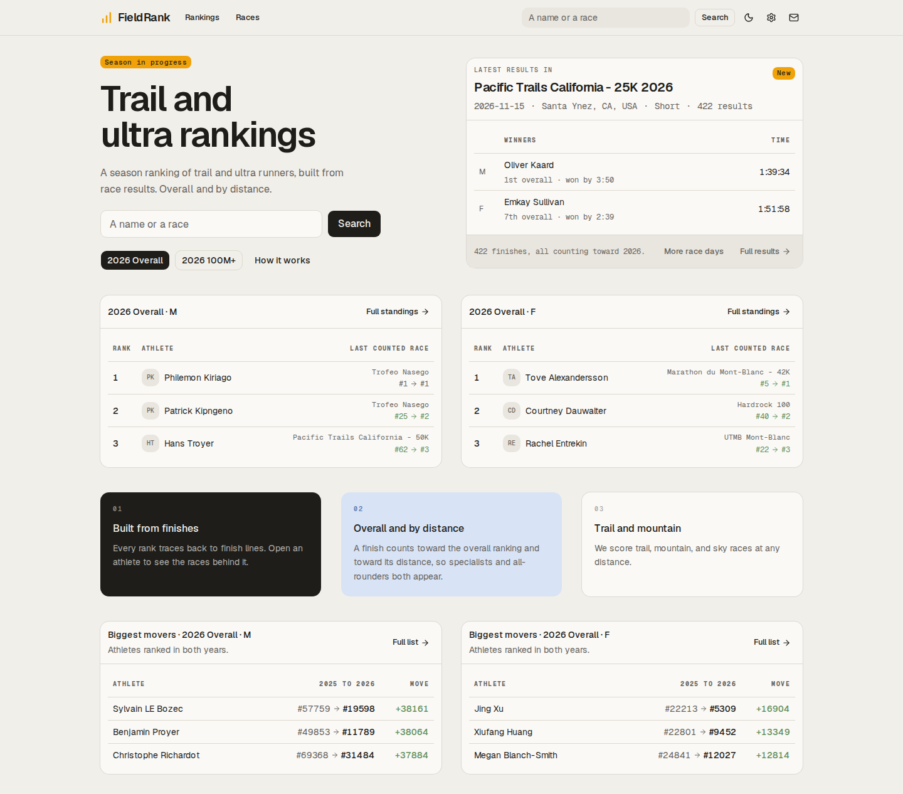
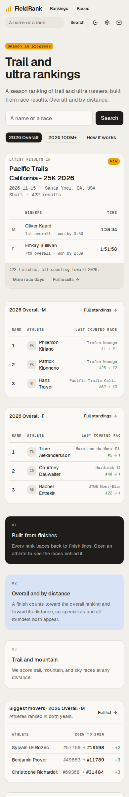

# UI Design System & Master Generation Blueprint: www-fieldrank-run

> **FieldRank: Trail and ultra rankings** (https://www.fieldrank.run) — A season ranking of trail and ultra runners, built from race results. Overall and by distance.



---

## 1. Executive Visual Persona & Design Archetype

- **Brand Essence & Persona**: **FieldRank: Trail and ultra rankings** (`https://www.fieldrank.run`). A season ranking of trail and ultra runners, built from race results. Overall and by distance.
- **Capture Provenance**: Live browser capture (`tier1_fast`, HTTP `200`, captured `2026-11-23`).
- **Visual Archetype**: **Light-Substrate Editorial & Modular Grid System (`#ffffff` canvas, `#1e1d1a` ink, `#f1efea` accent)**.
- **Anti-AI-Slop Differentiators**:
  - **Live-Computed Chromatic Polarity**: Anchors the viewport in `#ffffff` (live computed `browser-default` `background-color` (`computed_styles.json`)) paired with `#1e1d1a` primary typography and `#f1efea` accents.
  - **Grounded Typographic Hierarchy**: Pairs `Geist` for display copy (`Trail and ultra rankings`) with `Geist` and `Geist Mono`.
  - **Calibrated Spatial Grid & Motion**: Combines `1440px` container bounds (`gap: 4px`, padding `var(--card-spacing)`) with `cubic-bezier(.4,0,.6,1)` easing.

---

## 2. Spatial Architecture & Modular Grid Mathematics



### Viewport Allocation & Container Geometry
- **Captured Viewport Dimensions**: Desktop `1440×1266px` (`assets/desktop.png`, full-page live capture (1266px)), Mobile `390×2400px` (`assets/mobile.png`, clamped at 2400px live multi-section capture).
- **Master Container Bounds**: `1440px` (full-bleed `100%` viewport stage).
- **Canvas Lateral Padding & Spacing**: `var(--card-spacing)` lateral canvas padding with `4px` grid gap.
- **Border Radius Scale**: `8px`, `.25rem`, `1px`, `2px`.

### Responsive Breakpoint Architecture
- **Desktop Layout**: Multi-column CSS Grid / Flexbox layout at `1440px` (`max-width: 1440px`, `gap: 4px`).
- **Mobile Layout**: Single-column vertical stack at `390px` viewport width with `var(--card-spacing)` horizontal padding.
- **Extracted CSS Media Queries**: `@media not all and (min-width:40rem)`, `@media (min-width:40rem)`, `@media (min-width:48rem)`, `@media (min-width:64rem)`.

---

## 3. Color System, Materiality & Atmospheric Lighting

### Semantic Palette & Source Grounding
| Semantic Role | Ground-Truth Value | Extracted Live / CSS Source |
|---|---|---|
| **Primary Canvas Substrate** | `#ffffff` | live computed `browser-default` `background-color` (`computed_styles.json`) |
| **Primary Typography Ink** | `#1e1d1a` | `var(--foreground)` in `:root` |
| **Elevated Surface / Card Substrate** | `#f1efea` | `var(--background)` in `:root` |
| **Interactive Accent / Highlight** | `#f1efea` | `var(--primary-foreground)` in `:root` |
| **Secondary / Muted Copy** | `#66635d` | `var(--muted-foreground)` in `:root` |
| **Structural Hairline Border** | `#ddd9cf` | `var(--border)` in `:root` |
| **Variable Token (`--card`)** | `#faf9f6` | `var(--card)` in `:root` |
| **Variable Token (`--secondary`)** | `#e9e6df` | `var(--secondary)` in `:root` |
| **Variable Token (`--destructive`)** | `#e40014` | `var(--destructive)` in `:root` |

### Sanitized Root CSS Variables (`ui-ux.md` Ground Truth)
| Variable Name | Extracted Value | Semantic Role |
|---|---|---|
| `--background` | `#f1efea` | Canvas / Surface Token |
| `--foreground` | `#1e1d1a` | Typography Ink Token |
| `--card` | `#faf9f6` | Color / Atmospheric Token |
| `--card-foreground` | `#1e1d1a` | Typography Ink Token |
| `--popover` | `#faf9f6` | Color / Atmospheric Token |
| `--popover-foreground` | `#1e1d1a` | Typography Ink Token |
| `--primary` | `#1e1d1a` | Brand / Palette Token |
| `--primary-foreground` | `#f1efea` | Typography Ink Token |
| `--secondary` | `#e9e6df` | Brand / Palette Token |
| `--secondary-foreground` | `#1e1d1a` | Typography Ink Token |
| `--muted` | `#e9e6df` | Color / Atmospheric Token |
| `--muted-foreground` | `#66635d` | Typography Ink Token |
| `--accent` | `#e9e6df` | Brand / Palette Token |
| `--accent-foreground` | `#1e1d1a` | Typography Ink Token |
| `--destructive` | `#e40014` | Color / Atmospheric Token |
| `--border` | `#ddd9cf` | Elevation / Border Token |

---

## 4. Typographic Scale & Editorial Hierarchy

### Font Family Stacks
- **Display Typography**: `Geist`.
- **Primary Body Stack**: `Geist`.
- **Technical / Metadata Stack**: `Geist Mono`.

### Typographic Scale & Rules (Live Computed & Stylesheet Grounded)
- **Hero Display (`H1`)**: live computed `h1` (`font-size: 56px`, `line-height: 57.12px`, `font-weight: 600`, `letter-spacing: -1.96px`); CSS variables `--text-4xl: 2.25rem`, `--text-4xl--line-height: calc(2.5 / 2.25)`, `--text-5xl: 3rem`.
- **Section Heading (`H2`)**: CSS variables `--text-2xl: 1.5rem`, `--text-2xl--line-height: calc(2 / 1.5)`.
- **Body Copy**: live computed `body` (`font-size: 16px`, `line-height: 24px`, `font-weight: 400`); CSS variables `--text-base: 1rem`, `--text-base--line-height: calc(1.5 / 1)`.
- **Metadata & Navigation Labels**: live computed `nav/a` (`font-size: 16px`, `line-height: 24px`, `font-weight: 400`); CSS variables `--font-mono: var(--font-mono)`, `--text-xs: .75rem`, `--text-xs--line-height: calc(1 / .75)`.

---

## 5. Choreographed Motion & Interaction Physics

### Primary Easing Curves
- **Extracted Timing Functions**: `cubic-bezier(.4,0,.6,1)`, `cubic-bezier(.4,0,.2,1)`.

### Per-Element Transition & Choreography Rules
- **Selector `layer theme`**: `transition: .15s` extracted from `www-fieldrank-run` stylesheet.
- **Selector `.transition`**: `transition: var(--tw-ease,var(--default-transition-timing-function))` extracted from `www-fieldrank-run` stylesheet.
- **Selector `.transition-all`**: `transition: var(--tw-ease,var(--default-transition-timing-function))` extracted from `www-fieldrank-run` stylesheet.
- **Extracted Easing Curve (`cubic-bezier(.4,0,.6,1)`)**: Governs interactive state transitions across `<header.top-0>` and `<div.min-h-screen>`.
- **State & Hover Choreography**: Opacity and transform transitions on `<div.light>` and `<div.min-h-screen>` interactive targets.

---

## 6. Component Wireframe & Structural DOM Map

### Visual Layout Schematic — Desktop (`1440px`, Grounded in `dom.html` & Landmark Bounding Boxes)
```
┌────────────────────────────────────────────────────────────────────────┐
│ DESKTOP VIEWPORT (1440px) — FieldRank: Trail and ultra rankings        │
│ ====================================================================== │
│ [ <header.top-0> (1440x57px)          | Rankings · Races             ] │
│ ---------------------------------------------------------------------- │
│ | HERO STAGE: <div.light> (w=1440px)                                 | │
│ | H1: Trail and ultra rankings                                       | │
│ | Substrate: #ffffff | Ink: #1e1d1a | Accent: #f1efea                | │
│ ---------------------------------------------------------------------- │
│ | SHOWCASE GRID (<div.min-h-screen>) max-w: 1440px                   | │
│ | +------------------------------+  +------------------------------+ | │
│ | | A season ranking of trail an |  | Season in progress           | | │
│ | +------------------------------+  +------------------------------+ | │
│ ---------------------------------------------------------------------- │
│ | DETAIL MODULE (<div.bg-background>) — 2026-11-15 · Santa Yn        | │
│ ---------------------------------------------------------------------- │
│ [ FOOTER (<footer.text-foregro) | https://www.fieldrank.run            │
└────────────────────────────────────────────────────────────────────────┘
```

### Visual Layout Schematic — Mobile Reflow (`390px`)
```
┌────────────────────────────────────────────────────────────────────────┐
│ MOBILE VIEWPORT REFLOW (390px) — Single-Column Stack (gap: 4px)        │
│ ====================================================================== │
│ [ HEADER BAR (<header.top-0>          ) | Compact Menu (390px)         │
│ ---------------------------------------------------------------------- │
│ | HERO STAGE (<div.light>) — 390px Vertical Lead                     | │
│ | H1: Trail and ultra rankings                                       | │
│ ---------------------------------------------------------------------- │
│ | SHOWCASE STACK (<div.min-h-screen>) — 1-Col Stack                  | │
│ | [ Item 1: A season ranking of trail and ultra runners, bui       ] | │
│ | [ Item 2: Season in progress                                     ] | │
│ ---------------------------------------------------------------------- │
│ | DETAIL STACK (<div.bg-background>) — 1-Col (2026-11-15 · Santa)    | │
│ ---------------------------------------------------------------------- │
│ [ FOOTER (<footer.text-foregro) | Stacked 390px Colophon               │
└────────────────────────────────────────────────────────────────────────┘
```

### Granular DOM Region Breakdown
1. **Brand Header & Navigation Bar (<header.top-0> — `www-fieldrank-run`)**:
   - Landmark `<header class="top-0 z-40">` (`1440x57px`) hosting `FieldRank: Trail and ultra rankings` navigation (`Rankings · Races`), DOM attributes (`data-precedence="next"`, `data-site="KPVLKBUA"`, `data-auto="false"`, `data-slot="button"`), and stylesheet rule `host { --shimmer-angle:20deg }`.
2. **Hero Stage & Focal Lead (<div.light> — `Trail and ultra rankings`)**:
   - Landmark `<div class="light">` presenting display lead `Trail and ultra rankings` and copy excerpt *"A season ranking of trail and ultra runners, built from race resu"* over `#ffffff` canvas and `#1e1d1a` ink.
3. **Primary Showcase & Content Grid (<div.min-h-screen> — `A season ranking of trail and ultr`)**:
   - Landmark `<div class="min-h-screen">` rendering section `A season ranking of trail and ultra runners, bui` with copy *"Season in progress"*, asset references (`2oz0lep7db5t2.css`, `0jvhpaew_uadu.js`, `script.js`, `19mx3mg6lkumu.js`), and grid rule `backdrop { box-sizing:border-box;border:0 solid;margin:0;padding:0 }`.
4. **Interactive Detail & Feature Matrix (<div.bg-background> — `Season in progress`)**:
   - Landmark `<div class="bg-background">` framing `Season in progress` and `2026-11-15 · Santa Ynez, CA, USA · Short · 422 r` (*"2026-11-15 · Santa Ynez, CA, USA · Short · 422 results"*) with `#f1efea` surface cards, `#f1efea` accents, and `file-selector-button { box-sizing:border-box;border:0 solid;margin:0;padding:0 }`.
5. **Colophon & Global Directory Footer (<footer.text-foreground> — `https://www.fieldrank.run`)**:
   - Landmark `<footer class="text-foreground">` anchoring `FieldRank: Trail and ultra ranki` footer links (`Rankings · Races`), copy *"Santa Ynez, CA, USA"*, and `#ddd9cf` structural dividers.

---

## 7. Master Zero-Shot AI Generation Prompt

```markdown
# Master Zero-Shot Frontend Generation Prompt: www-fieldrank-run (FieldRank: Trail and ultra rankings)

You are a principal frontend architect and design systems engineer. Build a complete, production-ready web application replicating the exact design system, DOM landmarks, typographic hierarchy, color tokens, and motion physics of `www-fieldrank-run` (**FieldRank: Trail and ultra rankings** — `https://www.fieldrank.run`).

### 1. Visual Archetype & Anti-AI-Slop Mandates
- **Archetype**: Light-Substrate Editorial & Modular Grid System (`#ffffff` canvas, `#1e1d1a` ink, `#f1efea` accent).
- **Identity & Domain Context**: A season ranking of trail and ultra runners, built from race results. Overall and by distance.
- **Primary Substrate**: `#ffffff` (live computed `browser-default` `background-color` (`computed_styles.json`)), **Primary Ink**: `#1e1d1a`, **Accent / Highlight**: `#f1efea`.
- **Site-Specific Differentiators**:
  - **Live-Computed Chromatic Polarity**: Anchors the viewport in `#ffffff` (live computed `browser-default` `background-color` (`computed_styles.json`)) paired with `#1e1d1a` primary typography and `#f1efea` accents.
  - **Grounded Typographic Hierarchy**: Pairs `Geist` for display copy (`Trail and ultra rankings`) with `Geist` and `Geist Mono`.
  - **Calibrated Spatial Grid & Motion**: Combines `1440px` container bounds (`gap: 4px`, padding `var(--card-spacing)`) with `cubic-bezier(.4,0,.6,1)` easing.

### 2. Ground-Truth CSS Variables (`:root` Token Contract)
Declare and consume these exact custom properties extracted from `www-fieldrank-run` in your global stylesheet:

:root {
  /* FieldRank: Trail and ultra rankings (www-fieldrank-run) — Live-Grounded CSS Variables */
  --background: #f1efea; /* Canvas / Surface Token (www-fieldrank-run) */
  --foreground: #1e1d1a; /* Typography Ink Token (www-fieldrank-run) */
  --card: #faf9f6; /* Color / Atmospheric Token (www-fieldrank-run) */
  --card-foreground: #1e1d1a; /* Typography Ink Token (www-fieldrank-run) */
  --popover: #faf9f6; /* Color / Atmospheric Token (www-fieldrank-run) */
  --popover-foreground: #1e1d1a; /* Typography Ink Token (www-fieldrank-run) */
  --primary: #1e1d1a; /* Brand / Palette Token (www-fieldrank-run) */
  --primary-foreground: #f1efea; /* Typography Ink Token (www-fieldrank-run) */
  --secondary: #e9e6df; /* Brand / Palette Token (www-fieldrank-run) */
  --secondary-foreground: #1e1d1a; /* Typography Ink Token (www-fieldrank-run) */
  --muted: #e9e6df; /* Color / Atmospheric Token (www-fieldrank-run) */
  --muted-foreground: #66635d; /* Typography Ink Token (www-fieldrank-run) */
  --accent: #e9e6df; /* Brand / Palette Token (www-fieldrank-run) */
  --accent-foreground: #1e1d1a; /* Typography Ink Token (www-fieldrank-run) */
  --destructive: #e40014; /* Color / Atmospheric Token (www-fieldrank-run) */
  --border: #ddd9cf; /* Elevation / Border Token (www-fieldrank-run) */
}

### 3. Semantic Color & Materiality Contract
Map every surface, ink, and border strictly to these source-grounded tokens:
- **Primary Canvas Substrate**: `#ffffff` — grounded in live computed `browser-default` `background-color` (`computed_styles.json`)
- **Primary Typography Ink**: `#1e1d1a` — grounded in `var(--foreground)` in `:root`
- **Elevated Surface / Card Substrate**: `#f1efea` — grounded in `var(--background)` in `:root`
- **Interactive Accent / Highlight**: `#f1efea` — grounded in `var(--primary-foreground)` in `:root`
- **Secondary / Muted Copy**: `#66635d` — grounded in `var(--muted-foreground)` in `:root`
- **Structural Hairline Border**: `#ddd9cf` — grounded in `var(--border)` in `:root`
- **Variable Token (`--card`)**: `#faf9f6` — grounded in `var(--card)` in `:root`
- **Variable Token (`--secondary`)**: `#e9e6df` — grounded in `var(--secondary)` in `:root`
- **Variable Token (`--destructive`)**: `#e40014` — grounded in `var(--destructive)` in `:root`

### 4. Spatial Grid, Container Bounds & Responsive Breakpoints
- **Desktop Viewport Reference**: `1440×1266px` (full-page live capture (1266px), `1440px` standard desktop width).
- **Mobile Viewport Reference**: `390×2400px` (clamped at 2400px live multi-section capture, `390px` standard mobile width).
- **Container Max-Width**: `1440px` (full-bleed `100%` viewport stage)
- **Padding & Gutters**: `var(--card-spacing)` lateral canvas padding with `4px` grid gap
- **Desktop Grid**: Multi-column CSS Grid / Flexbox layout at `1440px` (`max-width: 1440px`, `gap: 4px`)
- **Mobile Adaptation**: Single-column vertical stack at `390px` viewport width with `var(--card-spacing)` horizontal padding
- **Media Queries**: `@media not all and (min-width:40rem)`, `@media (min-width:40rem)`, `@media (min-width:48rem)`, `@media (min-width:64rem)`
- **Corner Radii**: `8px`, `.25rem`, `1px`, `2px`

### 5. Typography & Editorial Scale Contract
- **Display Font Stack**: `Geist`
- **Body Font Stack**: `Geist`
- **Monospace / Technical Font Stack**: `Geist Mono`
- **H1 Display Rule**: live computed `h1` (`font-size: 56px`, `line-height: 57.12px`, `font-weight: 600`, `letter-spacing: -1.96px`); CSS variables `--text-4xl: 2.25rem`, `--text-4xl--line-height: calc(2.5 / 2.25)`, `--text-5xl: 3rem`
- **H2 Section Rule**: CSS variables `--text-2xl: 1.5rem`, `--text-2xl--line-height: calc(2 / 1.5)`
- **Body Copy Rule**: live computed `body` (`font-size: 16px`, `line-height: 24px`, `font-weight: 400`); CSS variables `--text-base: 1rem`, `--text-base--line-height: calc(1.5 / 1)`
- **Metadata & Index Rule**: live computed `nav/a` (`font-size: 16px`, `line-height: 24px`, `font-weight: 400`); CSS variables `--font-mono: var(--font-mono)`, `--text-xs: .75rem`, `--text-xs--line-height: calc(1 / .75)`

### 6. Component Hierarchy, Verbatim Copy & Real DOM Landmarks
Scaffold `www-fieldrank-run` (`FieldRank: Trail and ultra rankings`) with these exact structural regions, extracted copy, and CSS rules from `dom.html`:
1. **Brand Header & Navigation Bar (<header.top-0> — `www-fieldrank-run`)**:
   - DOM & Selectors: Landmark `<header class="top-0 z-40">` (`1440x57px`) hosting `FieldRank: Trail and ultra rankings` navigation (`Rankings · Races`), DOM attributes (`data-precedence="next"`, `data-site="KPVLKBUA"`, `data-auto="false"`, `data-slot="button"`), and stylesheet rule `host { --shimmer-angle:20deg }`.
   - Responsive Contract: Header `Brand Header & Navigation Bar (<header.top-0> — `www-fieldrank-run`)` (`www-fieldrank-run`) adapts across `@media not all and (min-width:40rem)`, `@media (min-width:40rem)`, `@media (min-width:48rem)`, `@media (min-width:64rem)` with `cubic-bezier(.4,0,.6,1)`, `cubic-bezier(.4,0,.2,1)` transitions and links `Rankings · Races`.
2. **Hero Stage & Focal Lead (<div.light> — `Trail and ultra rankings`)**:
   - DOM & Selectors: Landmark `<div class="light">` presenting display lead `Trail and ultra rankings` and copy excerpt *"A season ranking of trail and ultra runners, built from race resu"* over `#ffffff` canvas and `#1e1d1a` ink.
   - Responsive Contract: Hero stage (`1440×1266px` desktop / `390×2400px` mobile) sets `#ffffff` background with `#1e1d1a` headline `Trail and ultra rankings`.
3. **Primary Showcase & Content Grid (<div.min-h-screen> — `A season ranking of trail and ultr`)**:
   - DOM & Selectors: Landmark `<div class="min-h-screen">` rendering section `A season ranking of trail and ultra runners, bui` with copy *"Season in progress"*, asset references (`2oz0lep7db5t2.css`, `0jvhpaew_uadu.js`, `script.js`, `19mx3mg6lkumu.js`), and grid rule `backdrop { box-sizing:border-box;border:0 solid;margin:0;padding:0 }`.
   - Responsive Contract: Showcase grid `Primary Showcase & Content Grid (<div.min-h-screen> — `A season ranking of trail and ultr`)` applies Multi-column CSS Grid / Flexbox layout at `1440px` (`max-width: 1440px`, `gap: 4px`) on desktop and Single-column vertical stack at `390px` viewport width with `var(--card-spacing)` horizontal padding on mobile.
4. **Interactive Detail & Feature Matrix (<div.bg-background> — `Season in progress`)**:
   - DOM & Selectors: Landmark `<div class="bg-background">` framing `Season in progress` and `2026-11-15 · Santa Ynez, CA, USA · Short · 422 r` (*"2026-11-15 · Santa Ynez, CA, USA · Short · 422 results"*) with `#f1efea` surface cards, `#f1efea` accents, and `file-selector-button { box-sizing:border-box;border:0 solid;margin:0;padding:0 }`.
   - Responsive Contract: Detail module `Interactive Detail & Feature Matrix (<div.bg-background> — `Season in progress`)` uses `8px`, `.25rem`, `1px`, `2px` radii, `#f1efea` highlights, and assets (2oz0lep7db5t2.css, 0jvhpaew_uadu.js, script.js).
5. **Colophon & Global Directory Footer (<footer.text-foreground> — `https://www.fieldrank.run`)**:
   - DOM & Selectors: Landmark `<footer class="text-foreground">` anchoring `FieldRank: Trail and ultra ranki` footer links (`Rankings · Races`), copy *"Santa Ynez, CA, USA"*, and `#ddd9cf` structural dividers.
   - Responsive Contract: Footer `Colophon & Global Directory Footer (<footer.text-foreground> — `https://www.fieldrank.run`)` aligns to `1440px` (full-bleed `100%` viewport stage) with `var(--card-spacing)` lateral canvas padding with `4px` grid gap and attributes (data-precedence="next", data-site="KPVLKBUA", data-auto="false").

#### Verbatim DOM Copy Excerpts (`dom.html`)
- Copy Excerpt 1: *"A season ranking of trail and ultra runners, built from race results. Overall and..."*
- Copy Excerpt 2: *"Season in progress"*
- Copy Excerpt 3: *"2026-11-15 · Santa Ynez, CA, USA · Short · 422 results"*
- Copy Excerpt 4: *"Santa Ynez, CA, USA"*

### 7. Motion, Extracted Stylesheet Rules & Interaction Choreography
- **Primary Easing Functions**: `cubic-bezier(.4,0,.6,1)`, `cubic-bezier(.4,0,.2,1)`
- **Extracted Stylesheet Rules (`www-fieldrank-run`)**:
- `host { --shimmer-angle:20deg }`
- `backdrop { box-sizing:border-box;border:0 solid;margin:0;padding:0 }`
- `file-selector-button { box-sizing:border-box;border:0 solid;margin:0;padding:0 }`
- `strong { font-weight:bolder }`
- `small { font-size:80% }`
- **Per-Selector Transition Rules**:
- **Selector `layer theme`**: `transition: .15s` extracted from `www-fieldrank-run` stylesheet.
- **Selector `.transition`**: `transition: var(--tw-ease,var(--default-transition-timing-function))` extracted from `www-fieldrank-run` stylesheet.
- **Selector `.transition-all`**: `transition: var(--tw-ease,var(--default-transition-timing-function))` extracted from `www-fieldrank-run` stylesheet.
- **Extracted Easing Curve (`cubic-bezier(.4,0,.6,1)`)**: Governs interactive state transitions across `<header.top-0>` and `<div.min-h-screen>`.
- **State & Hover Choreography**: Opacity and transform transitions on `<div.light>` and `<div.min-h-screen>` interactive targets.

### 8. Technical Deliverables
- Implement in Next.js (App Router) with TypeScript and Tailwind CSS consuming the `:root` custom properties defined above for `www-fieldrank-run`.
- Reproduce both the `1440px` desktop architecture and `390px` mobile breakpoint transitions, preserving semantic HTML5 landmarks (`<header>`, `<nav>`, `<main>`, `<section>`, `<footer>`) and `prefers-reduced-motion` accessibility guards.
```
