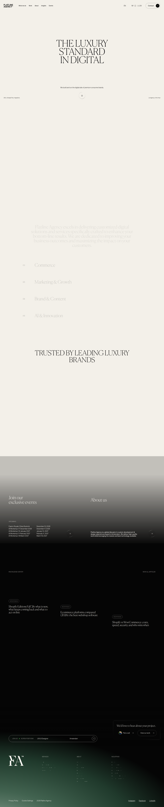

# UI Design System & Master Generation Blueprint: www-flatlineagency-com

> **Shopify, Marketing & AI Agency Amsterdam · Flatline** (https://www.flatlineagency.com/) — Flatline is a Shopify Platinum Partner in Amsterdam. We build, migrate and grow Shopify Plus stores and run marketing and AI for premium...



---

## 1. Executive Visual Persona & Design Archetype

- **Brand Essence & Persona**: **Shopify, Marketing & AI Agency Amsterdam · Flatline** (`https://www.flatlineagency.com/`). Flatline is a Shopify Platinum Partner in Amsterdam. We build, migrate and grow Shopify Plus stores and run marketing and AI for premium...
- **Visual Archetype**: **Light-Substrate Editorial & Modular Grid System (`#f3f0e9` canvas, `#000` ink, `#000` accent)**.
- **Anti-AI-Slop Differentiators**:
  - **Source-Grounded Chromatic Polarity**: Anchors the viewport in `#f3f0e9` (`var(--token-ee10f296-15d9-41da-871d-89b364a646e0)` in `:root`) paired with `#000` primary typography and `#000` accents.
  - **Extracted Typographic Hierarchy**: Pairs `Noto Serif` for display copy (`THE LUXURY STANDARD IN DIGITAL`) with `Canela Web Thin` and not declared in static CSS (uses primary stack / `ui-monospace`).
  - **Calibrated Spatial Grid & Motion**: Combines `1199.98px` container bounds (`gap: 3px`, padding `32px`) with `cubic-bezier(.44,0,.56,1)` easing and Framer Motion Layout Physics.

---

## 2. Spatial Architecture & Modular Grid Mathematics


### Viewport Allocation & Container Geometry
- **Captured Viewport Dimensions**: Desktop `1440×7042px` (`assets/desktop.png`, full-page scroll capture), Mobile `390×2400px` (`assets/mobile.png`, capped at 2400px multi-section capture).
- **Master Container Bounds**: `1199.98px` extracted from `www-flatlineagency-com` stylesheet.
- **Canvas Lateral Padding & Spacing**: `32px` lateral canvas padding with `3px` grid gap.
- **Border Radius Scale**: `20px`, `8px`, `15px`, `100px`.

### Responsive Breakpoint Architecture
- **Desktop Layout**: Multi-column CSS Grid / Flexbox layout at `1440px` (`max-width: 1199.98px`, `gap: 3px`).
- **Mobile Layout**: Single-column vertical stack at `390px` viewport width with `32px` horizontal padding.
- **Extracted CSS Media Queries**: `@media (min-width: 1200px)`, `@media (min-width: 810px) and (max-width: 1199.98px)`, `@media (max-width: 809.98px)`, `@media (max-width:1199px) and (min-width:810px)`.

---

## 3. Color System, Materiality & Atmospheric Lighting

### Semantic Palette & Source Grounding
| Semantic Role | Ground-Truth Value | Extracted CSS Source / Selector |
|---|---|---|
| **Primary Canvas Substrate** | `#f3f0e9` | `var(--token-ee10f296-15d9-41da-871d-89b364a646e0)` in `:root` |
| **Primary Typography Ink** | `#fdfaf5` | `var(--token-715d5f28-67a4-4211-a580-93fd5f080aaa)` in `:root` |
| **Elevated Surface / Card Substrate** | `#ece9e0` | `var(--token-a1931803-7cdb-4638-b54d-105fe7944f17)` in `:root` |
| **Interactive Accent / Highlight** | `#000` | `var(--token-1efbab02-5753-4dc6-9b5a-17f4306b9402)` in `:root` |
| **Secondary / Muted Copy** | `#050505` | `var(--token-417808d0-1dfe-483f-9164-e0725b1b82a7)` in `:root` |
| **Structural Hairline Border** | `#0a2315` | `var(--token-9218c30c-f55e-4ab0-8878-b6991b7cf484)` in `:root` |
| **Variable Token (`--token-054adc8c-fb63-490f-a5ca-c48666fdfb8c`)** | `#060f23` | `var(--token-054adc8c-fb63-490f-a5ca-c48666fdfb8c)` in `:root` |
| **Variable Token (`--token-758cee22-2452-4bed-9dbf-0b445d8c6457`)** | `#afdbf6` | `var(--token-758cee22-2452-4bed-9dbf-0b445d8c6457)` in `:root` |
| **Variable Token (`--token-84e9d4de-a1f9-41a3-90c4-b17803185d3f`)** | `#4cc352` | `var(--token-84e9d4de-a1f9-41a3-90c4-b17803185d3f)` in `:root` |
| **Variable Token (`--token-523425b1-9af9-406c-86b2-b80d42d167c2`)** | `#ff2142` | `var(--token-523425b1-9af9-406c-86b2-b80d42d167c2)` in `:root` |
| **Variable Token (`--token-3f6d4d2a-4271-4963-bcc0-922062838b2e`)** | `#0003` | `var(--token-3f6d4d2a-4271-4963-bcc0-922062838b2e)` in `:root` |

### Sanitized Root CSS Variables (`ui-ux.md` Ground Truth)
| Variable Name | Extracted Value | Semantic Role |
|---|---|---|
| `--token-ee10f296-15d9-41da-871d-89b364a646e0` | `#f3f0e9` | Color / Atmospheric Token |
| `--token-715d5f28-67a4-4211-a580-93fd5f080aaa` | `#fdfaf5` | Color / Atmospheric Token |
| `--token-a1931803-7cdb-4638-b54d-105fe7944f17` | `#ece9e0` | Color / Atmospheric Token |
| `--token-1efbab02-5753-4dc6-9b5a-17f4306b9402` | `#000` | Color / Atmospheric Token |
| `--token-417808d0-1dfe-483f-9164-e0725b1b82a7` | `#050505` | Color / Atmospheric Token |
| `--token-9218c30c-f55e-4ab0-8878-b6991b7cf484` | `#0a2315` | Color / Atmospheric Token |
| `--token-054adc8c-fb63-490f-a5ca-c48666fdfb8c` | `#060f23` | Color / Atmospheric Token |
| `--token-758cee22-2452-4bed-9dbf-0b445d8c6457` | `#afdbf6` | Color / Atmospheric Token |
| `--token-84e9d4de-a1f9-41a3-90c4-b17803185d3f` | `#4cc352` | Color / Atmospheric Token |
| `--token-523425b1-9af9-406c-86b2-b80d42d167c2` | `#ff2142` | Color / Atmospheric Token |
| `--token-3f6d4d2a-4271-4963-bcc0-922062838b2e` | `#0003` | Color / Atmospheric Token |
| `--text-decoration-skip-ink` | `var(--framer-text-decoration-skip-ink)` | Typography Ink Token |
| `--text-underline-offset` | `var(--framer-text-decoration-offset)` | Typography Ink Token |
| `--font-family` | `var(--framer-font-family)` | Typography / Scale Token |
| `--font-style` | `var(--framer-font-style)` | Typography / Scale Token |
| `--font-weight` | `var(--framer-font-weight)` | Typography / Scale Token |

---

## 4. Typographic Scale & Editorial Hierarchy

### Font Family Stacks
- **Display Typography**: `Noto Serif`.
- **Primary Body Stack**: `Canela Web Thin`.
- **Technical / Metadata Stack**: not declared in static CSS (uses primary stack / `ui-monospace`).

### Typographic Scale & Rules (Extracted from Stylesheet & Variables)
- **Hero Display (`H1`)**: CSS variables `--text-truncation-display-inline-for-safari-16: inline`, `--text-truncation-display-none-for-safari-16: none`; rule `h1` (`font-size: 80px`, `line-height: 90%`, `letter-spacing: 0em`, `font-weight: 100`).
- **Section Heading (`H2`)**: rule `h2` (`font-size: 40px`, `line-height: 1em`, `letter-spacing: 0px`, `font-weight: 100`).
- **Body Copy**: rule `p` (`font-size: 16px`, `line-height: 1.2em`, `letter-spacing: 0em`, `font-weight: 400`).
- **Metadata & Navigation Labels**: CSS variables `--letter-spacing: var(--framer-letter-spacing)`.

---

## 5. Choreographed Motion & Interaction Physics

### Primary Easing Curves
- **Extracted Timing Functions**: `cubic-bezier(.44,0,.56,1)`.

### Per-Element Transition & Choreography Rules
- **Selector `.framer-form-input-wrapper:after`**: `transition: var(--framer-input-focused-transition)` extracted from `www-flatlineagency-com` stylesheet.
- **Selector `.framer-form-input-wrapper`**: `transition: var(--framer-input-focused-transition)` extracted from `www-flatlineagency-com` stylesheet.
- **Selector `.framer-form-text-input-clear`**: `transition: color .15s` extracted from `www-flatlineagency-com` stylesheet.
- **Extracted Easing Curve (`cubic-bezier(.44,0,.56,1)`)**: Governs interactive state transitions across `<header.framer-ha9xM>` and `<section.framer-yjze81>`.
- **Runtime Interaction Engine**: Integrates Framer Motion Layout Physics with `prefers-reduced-motion: reduce` fallback guards.

---

## 6. Component Wireframe & Structural DOM Map

### Visual Layout Schematic (Grounded in `dom.html` — `1440px` Desktop & `390px` Mobile Reflow)
```
┌────────────────────────────────────────────────────────────────────────┐
│ DESKTOP VIEWPORT (1440px) — Shopify, Marketing & AI Agency Amsterdam · │
│ ====================================================================== │
│ [ <header.framer-ha9xM>    | What we do · Work · About · Insights · ]  │
│ ---------------------------------------------------------------------- │
│ | HERO STAGE: <section.framer-yjze81>                              |   │
│ | H1: THE LUXURY STANDARD IN DIGITAL                               |   │
│ | Substrate: #f3f0e9    | Ink: #000       | Accent: #000           |   │
│ ---------------------------------------------------------------------- │
│ | SHOWCASE GRID (<section.framer-yjze81>   ) max-w: 1199.98px      |   │
│ | +------------------------------+  +------------------------------+ | │
│ | | Elevating modern menswear th |  | Powering a smoother digital  | | │
│ | +------------------------------+  +------------------------------+ | │
│ ---------------------------------------------------------------------- │
│ | MOBILE VIEWPORT REFLOW (390px) — Single-Column Stack (gap: 3px   ) | │
│ | [<header.framer-ha9] -> [<section.framer-yj] -> [<section.framer-yj] │
│ ---------------------------------------------------------------------- │
│ [ FOOTER (<footer.framer-uH155> ) | https://www.flatlineagency.com/    │
└────────────────────────────────────────────────────────────────────────┘
```

### Granular DOM Region Breakdown
1. **Brand Header & Navigation Bar (<header.framer-ha9xM> — `www-flatlineagency-com`)**:
   - Landmark `<header class="framer-ha9xM framer-1sgxrsx">` hosting `Shopify, Marketing & AI Agency Amste` navigation (`What we do · Work · About · Insights · Events`), DOM attributes (`data-redirect-timezone="1"`, `data-framer-generated-canonical`, `data-framer-font-css`, `data-framer-generated-hreflang`), and stylesheet rule `.hidden-72rtr7 { display:none!important }`.
2. **Hero Stage & Focal Lead (<section.framer-yjze81> — `THE LUXURY STANDARD IN DIGITAL`)**:
   - Landmark `<section class="framer-yjze81">` presenting display lead `THE LUXURY STANDARD IN DIGITAL` and copy excerpt *"We build and run the digital side of premium consumer brands."* over `#f3f0e9` canvas and `#000` ink.
3. **Primary Showcase & Content Grid (<section.framer-yjze81> — `Elevating modern menswear through `)**:
   - Landmark `<section class="framer-yjze81">` rendering section `Elevating modern menswear through a refined digit...` with copy *"350+ Shopify Plus migrations"*, asset references (`goPYDmczsQmWoGJRaZvSdomTZc.png`, `fonts.gstatic.com`, `script`, `gv5TmFnYtTK9GLZ9FjU09gs1guk.mp4`), and grid rule `.hidden-19c8o6d { display:none!important }`.
4. **Interactive Detail & Feature Matrix (<section.framer-yjze81> — `Powering a smoother digital journe`)**:
   - Landmark `<section class="framer-yjze81">` framing `Powering a smoother digital journey for cycling e...` and `Crafting a premium digital home for contemporary...` (*"2x Agency of the Year"*) with `#ece9e0` surface cards, `#000` accents, and `.hidden-1us1r0u { display:none!important }`.
5. **Colophon & Global Directory Footer (<footer.framer-uH155> — `https://www.flatlineagency.com/`)**:
   - Landmark `<footer class="framer-uH155 framer-gkoC1">` anchoring `Shopify, Marketing & AI Agency A` footer links (`What we do · Work · About · Insights · Events`), copy *"Omnichannel eCommerce, where every touchpoint is united"*, and `#0a2315` structural dividers.

---

## 7. Master Zero-Shot AI Generation Prompt

```markdown
# Master Zero-Shot Frontend Generation Prompt: www-flatlineagency-com (Shopify, Marketing & AI Agency Amsterdam · Flatline)

You are a principal frontend architect and design systems engineer. Build a complete, production-ready web application replicating the exact design system, DOM landmarks, typographic hierarchy, color tokens, and motion physics of `www-flatlineagency-com` (**Shopify, Marketing & AI Agency Amsterdam · Flatline** — `https://www.flatlineagency.com/`).

### 1. Visual Archetype & Anti-AI-Slop Mandates
- **Archetype**: Light-Substrate Editorial & Modular Grid System (`#f3f0e9` canvas, `#000` ink, `#000` accent).
- **Identity & Domain Context**: Flatline is a Shopify Platinum Partner in Amsterdam. We build, migrate and grow Shopify Plus stores and run marketing and AI for premium...
- **Primary Substrate**: `#f3f0e9` (`var(--token-ee10f296-15d9-41da-871d-89b364a646e0)` in `:root`), **Primary Ink**: `#000`, **Accent / Highlight**: `#000`.
- **Site-Specific Differentiators**:
  - **Source-Grounded Chromatic Polarity**: Anchors the viewport in `#f3f0e9` (`var(--token-ee10f296-15d9-41da-871d-89b364a646e0)` in `:root`) paired with `#000` primary typography and `#000` accents.
  - **Extracted Typographic Hierarchy**: Pairs `Noto Serif` for display copy (`THE LUXURY STANDARD IN DIGITAL`) with `Canela Web Thin` and not declared in static CSS (uses primary stack / `ui-monospace`).
  - **Calibrated Spatial Grid & Motion**: Combines `1199.98px` container bounds (`gap: 3px`, padding `32px`) with `cubic-bezier(.44,0,.56,1)` easing and Framer Motion Layout Physics.

### 2. Ground-Truth CSS Variables (`:root` Token Contract)
Declare and consume these exact custom properties extracted from `www-flatlineagency-com` in your global stylesheet:

:root {
  /* Shopify, Marketing & AI Agency Amsterdam · Flatline (www-flatlineagency-com) — Ground-Truth Extracted CSS Variables */
  --token-ee10f296-15d9-41da-871d-89b364a646e0: #f3f0e9; /* Color / Atmospheric Token (www-flatlineagency-com) */
  --token-715d5f28-67a4-4211-a580-93fd5f080aaa: #fdfaf5; /* Color / Atmospheric Token (www-flatlineagency-com) */
  --token-a1931803-7cdb-4638-b54d-105fe7944f17: #ece9e0; /* Color / Atmospheric Token (www-flatlineagency-com) */
  --token-1efbab02-5753-4dc6-9b5a-17f4306b9402: #000; /* Color / Atmospheric Token (www-flatlineagency-com) */
  --token-417808d0-1dfe-483f-9164-e0725b1b82a7: #050505; /* Color / Atmospheric Token (www-flatlineagency-com) */
  --token-9218c30c-f55e-4ab0-8878-b6991b7cf484: #0a2315; /* Color / Atmospheric Token (www-flatlineagency-com) */
  --token-054adc8c-fb63-490f-a5ca-c48666fdfb8c: #060f23; /* Color / Atmospheric Token (www-flatlineagency-com) */
  --token-758cee22-2452-4bed-9dbf-0b445d8c6457: #afdbf6; /* Color / Atmospheric Token (www-flatlineagency-com) */
  --token-84e9d4de-a1f9-41a3-90c4-b17803185d3f: #4cc352; /* Color / Atmospheric Token (www-flatlineagency-com) */
  --token-523425b1-9af9-406c-86b2-b80d42d167c2: #ff2142; /* Color / Atmospheric Token (www-flatlineagency-com) */
  --token-3f6d4d2a-4271-4963-bcc0-922062838b2e: #0003; /* Color / Atmospheric Token (www-flatlineagency-com) */
  --text-decoration-skip-ink: var(--framer-text-decoration-skip-ink); /* Typography Ink Token (www-flatlineagency-com) */
  --text-underline-offset: var(--framer-text-decoration-offset); /* Typography Ink Token (www-flatlineagency-com) */
  --font-family: var(--framer-font-family); /* Typography / Scale Token (www-flatlineagency-com) */
  --font-style: var(--framer-font-style); /* Typography / Scale Token (www-flatlineagency-com) */
  --font-weight: var(--framer-font-weight); /* Typography / Scale Token (www-flatlineagency-com) */
}

### 3. Semantic Color & Materiality Contract
Map every surface, ink, and border strictly to these source-grounded tokens:
- **Primary Canvas Substrate**: `#f3f0e9` — grounded in `var(--token-ee10f296-15d9-41da-871d-89b364a646e0)` in `:root`
- **Primary Typography Ink**: `#fdfaf5` — grounded in `var(--token-715d5f28-67a4-4211-a580-93fd5f080aaa)` in `:root`
- **Elevated Surface / Card Substrate**: `#ece9e0` — grounded in `var(--token-a1931803-7cdb-4638-b54d-105fe7944f17)` in `:root`
- **Interactive Accent / Highlight**: `#000` — grounded in `var(--token-1efbab02-5753-4dc6-9b5a-17f4306b9402)` in `:root`
- **Secondary / Muted Copy**: `#050505` — grounded in `var(--token-417808d0-1dfe-483f-9164-e0725b1b82a7)` in `:root`
- **Structural Hairline Border**: `#0a2315` — grounded in `var(--token-9218c30c-f55e-4ab0-8878-b6991b7cf484)` in `:root`
- **Variable Token (`--token-054adc8c-fb63-490f-a5ca-c48666fdfb8c`)**: `#060f23` — grounded in `var(--token-054adc8c-fb63-490f-a5ca-c48666fdfb8c)` in `:root`
- **Variable Token (`--token-758cee22-2452-4bed-9dbf-0b445d8c6457`)**: `#afdbf6` — grounded in `var(--token-758cee22-2452-4bed-9dbf-0b445d8c6457)` in `:root`
- **Variable Token (`--token-84e9d4de-a1f9-41a3-90c4-b17803185d3f`)**: `#4cc352` — grounded in `var(--token-84e9d4de-a1f9-41a3-90c4-b17803185d3f)` in `:root`
- **Variable Token (`--token-523425b1-9af9-406c-86b2-b80d42d167c2`)**: `#ff2142` — grounded in `var(--token-523425b1-9af9-406c-86b2-b80d42d167c2)` in `:root`
- **Variable Token (`--token-3f6d4d2a-4271-4963-bcc0-922062838b2e`)**: `#0003` — grounded in `var(--token-3f6d4d2a-4271-4963-bcc0-922062838b2e)` in `:root`

### 4. Spatial Grid, Container Bounds & Responsive Breakpoints
- **Desktop Viewport Reference**: `1440×7042px` (full-page scroll capture, `1440px` standard desktop width).
- **Mobile Viewport Reference**: `390×2400px` (capped at 2400px multi-section capture, `390px` standard mobile width).
- **Container Max-Width**: `1199.98px` extracted from `www-flatlineagency-com` stylesheet
- **Padding & Gutters**: `32px` lateral canvas padding with `3px` grid gap
- **Desktop Grid**: Multi-column CSS Grid / Flexbox layout at `1440px` (`max-width: 1199.98px`, `gap: 3px`)
- **Mobile Adaptation**: Single-column vertical stack at `390px` viewport width with `32px` horizontal padding
- **Media Queries**: `@media (min-width: 1200px)`, `@media (min-width: 810px) and (max-width: 1199.98px)`, `@media (max-width: 809.98px)`, `@media (max-width:1199px) and (min-width:810px)`
- **Corner Radii**: `20px`, `8px`, `15px`, `100px`

### 5. Typography & Editorial Scale Contract
- **Display Font Stack**: `Noto Serif`
- **Body Font Stack**: `Canela Web Thin`
- **Monospace / Technical Font Stack**: not declared in static CSS (uses primary stack / `ui-monospace`)
- **H1 Display Rule**: CSS variables `--text-truncation-display-inline-for-safari-16: inline`, `--text-truncation-display-none-for-safari-16: none`; rule `h1` (`font-size: 80px`, `line-height: 90%`, `letter-spacing: 0em`, `font-weight: 100`)
- **H2 Section Rule**: rule `h2` (`font-size: 40px`, `line-height: 1em`, `letter-spacing: 0px`, `font-weight: 100`)
- **Body Copy Rule**: rule `p` (`font-size: 16px`, `line-height: 1.2em`, `letter-spacing: 0em`, `font-weight: 400`)
- **Metadata & Index Rule**: CSS variables `--letter-spacing: var(--framer-letter-spacing)`

### 6. Component Hierarchy, Verbatim Copy & Real DOM Landmarks
Scaffold `www-flatlineagency-com` (`Shopify, Marketing & AI Agency Amsterdam · Flatline`) with these exact structural regions, extracted copy, and CSS rules from `dom.html`:
1. **Brand Header & Navigation Bar (<header.framer-ha9xM> — `www-flatlineagency-com`)**:
   - DOM & Selectors: Landmark `<header class="framer-ha9xM framer-1sgxrsx">` hosting `Shopify, Marketing & AI Agency Amste` navigation (`What we do · Work · About · Insights · Events`), DOM attributes (`data-redirect-timezone="1"`, `data-framer-generated-canonical`, `data-framer-font-css`, `data-framer-generated-hreflang`), and stylesheet rule `.hidden-72rtr7 { display:none!important }`.
   - Responsive Contract: Header `Brand Header & Navigation Bar (<header.framer-ha9xM> — `www-flatlineagency-com`)` (`www-flatlineagency-com`) adapts across `@media (min-width: 1200px)`, `@media (min-width: 810px) and (max-width: 1199.98px)`, `@media (max-width: 809.98px)`, `@media (max-width:1199px) and (min-width:810px)` with `cubic-bezier(.44,0,.56,1)` transitions and links `What we do · Work · About · Insights · Events`.
2. **Hero Stage & Focal Lead (<section.framer-yjze81> — `THE LUXURY STANDARD IN DIGITAL`)**:
   - DOM & Selectors: Landmark `<section class="framer-yjze81">` presenting display lead `THE LUXURY STANDARD IN DIGITAL` and copy excerpt *"We build and run the digital side of premium consumer brands."* over `#f3f0e9` canvas and `#000` ink.
   - Responsive Contract: Hero stage (`1440×7042px` desktop / `390×2400px` mobile) sets `#f3f0e9` background with `#000` headline `THE LUXURY STANDARD IN DIGITAL`.
3. **Primary Showcase & Content Grid (<section.framer-yjze81> — `Elevating modern menswear through `)**:
   - DOM & Selectors: Landmark `<section class="framer-yjze81">` rendering section `Elevating modern menswear through a refined digit...` with copy *"350+ Shopify Plus migrations"*, asset references (`goPYDmczsQmWoGJRaZvSdomTZc.png`, `fonts.gstatic.com`, `script`, `gv5TmFnYtTK9GLZ9FjU09gs1guk.mp4`), and grid rule `.hidden-19c8o6d { display:none!important }`.
   - Responsive Contract: Showcase grid `Primary Showcase & Content Grid (<section.framer-yjze81> — `Elevating modern menswear through `)` applies Multi-column CSS Grid / Flexbox layout at `1440px` (`max-width: 1199.98px`, `gap: 3px`) on desktop and Single-column vertical stack at `390px` viewport width with `32px` horizontal padding on mobile.
4. **Interactive Detail & Feature Matrix (<section.framer-yjze81> — `Powering a smoother digital journe`)**:
   - DOM & Selectors: Landmark `<section class="framer-yjze81">` framing `Powering a smoother digital journey for cycling e...` and `Crafting a premium digital home for contemporary...` (*"2x Agency of the Year"*) with `#ece9e0` surface cards, `#000` accents, and `.hidden-1us1r0u { display:none!important }`.
   - Responsive Contract: Detail module `Interactive Detail & Feature Matrix (<section.framer-yjze81> — `Powering a smoother digital journe`)` uses `20px`, `8px`, `15px`, `100px` radii, `#000` highlights, and assets (goPYDmczsQmWoGJRaZvSdomTZc.png, fonts.gstatic.com, script).
5. **Colophon & Global Directory Footer (<footer.framer-uH155> — `https://www.flatlineagency.com/`)**:
   - DOM & Selectors: Landmark `<footer class="framer-uH155 framer-gkoC1">` anchoring `Shopify, Marketing & AI Agency A` footer links (`What we do · Work · About · Insights · Events`), copy *"Omnichannel eCommerce, where every touchpoint is united"*, and `#0a2315` structural dividers.
   - Responsive Contract: Footer `Colophon & Global Directory Footer (<footer.framer-uH155> — `https://www.flatlineagency.com/`)` aligns to `1199.98px` extracted from `www-flatlineagency-com` stylesheet with `32px` lateral canvas padding with `3px` grid gap and attributes (data-redirect-timezone="1", data-framer-generated-canonical, data-framer-font-css).

#### Verbatim DOM Copy Excerpts (`dom.html`)
- Copy Excerpt 1: *"We build and run the digital side of premium consumer brands."*
- Copy Excerpt 2: *"350+ Shopify Plus migrations"*
- Copy Excerpt 3: *"2x Agency of the Year"*
- Copy Excerpt 4: *"Omnichannel eCommerce, where every touchpoint is united"*

### 7. Motion, Extracted Stylesheet Rules & Interaction Choreography
- **Primary Easing Functions**: `cubic-bezier(.44,0,.56,1)`
- **Extracted Stylesheet Rules (`www-flatlineagency-com`)**:
- `.hidden-72rtr7 { display:none!important }`
- `.hidden-19c8o6d { display:none!important }`
- `.hidden-1us1r0u { display:none!important }`
- `.hidden-ds8oqe { display:none!important }`
- `.hidden-11hm25s { display:none!important }`
- **Per-Selector Transition Rules**:
- **Selector `.framer-form-input-wrapper:after`**: `transition: var(--framer-input-focused-transition)` extracted from `www-flatlineagency-com` stylesheet.
- **Selector `.framer-form-input-wrapper`**: `transition: var(--framer-input-focused-transition)` extracted from `www-flatlineagency-com` stylesheet.
- **Selector `.framer-form-text-input-clear`**: `transition: color .15s` extracted from `www-flatlineagency-com` stylesheet.
- **Extracted Easing Curve (`cubic-bezier(.44,0,.56,1)`)**: Governs interactive state transitions across `<header.framer-ha9xM>` and `<section.framer-yjze81>`.
- **Runtime Interaction Engine**: Integrates Framer Motion Layout Physics with `prefers-reduced-motion: reduce` fallback guards.

### 8. Technical Deliverables
- Implement in Next.js (App Router) with TypeScript and Tailwind CSS consuming the `:root` custom properties defined above for `www-flatlineagency-com`.
- Reproduce both the `1440px` desktop architecture and `390px` mobile breakpoint transitions, preserving semantic HTML5 landmarks (`<header>`, `<nav>`, `<main>`, `<section>`, `<footer>`) and `prefers-reduced-motion` accessibility guards.
```
