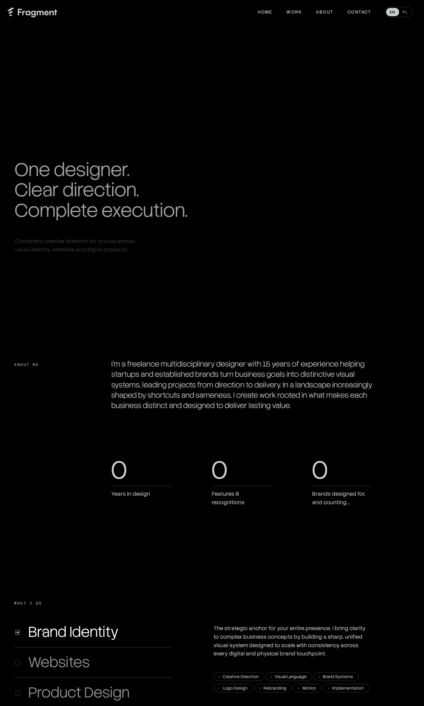
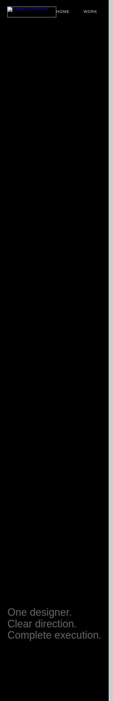

# UI Design System & Master Generation Blueprint: www-fragment-im

> **Fragment Studio · Independent Designer for Visual Identity, Websites & P...** (https://www.fragment.im) — Independent multidisciplinary designer creating visual identities, websites and digital product experiences, from creative direction thro...



---

## 1. Executive Visual Persona & Design Archetype

- **Brand Essence & Persona**: **Fragment Studio · Independent Designer for Visual Identity, Websites & P...** (`https://www.fragment.im`). Independent multidisciplinary designer creating visual identities, websites and digital product experiences, from creative direction thro...
- **Visual Archetype**: **Light-Substrate Editorial & Modular Grid System (`#c9d0d2` canvas, `#000` ink, `#fff` accent)**.
- **Anti-AI-Slop Differentiators**:
  - **Source-Grounded Chromatic Polarity**: Anchors the viewport in `#c9d0d2` (`var(--token-25c6a125-c456-4a8b-ab9f-41881ab19959)` in `:root`) paired with `#000` primary typography and `#fff` accents.
  - **Extracted Typographic Hierarchy**: Pairs `FragmentNoticeHeadline` for display copy (`One designer. Clear direction. Compl`) with `FragmentNoticeText` and `Fragment Mono`.
  - **Calibrated Spatial Grid & Motion**: Combines `809px` container bounds (`gap: 48px`, padding `64px`) with `cubic-bezier(.25,0,0,1)` easing and Framer Motion Layout Physics.

---

## 2. Spatial Architecture & Modular Grid Mathematics



### Viewport Allocation & Container Geometry
- **Captured Viewport Dimensions**: Desktop `1440×2400px` (`assets/desktop.png`, capped at 2400px multi-section capture), Mobile `390×2400px` (`assets/mobile.png`, capped at 2400px multi-section capture).
- **Master Container Bounds**: `809px` extracted from `www-fragment-im` stylesheet.
- **Canvas Lateral Padding & Spacing**: `64px` lateral canvas padding with `48px` grid gap.
- **Border Radius Scale**: `6px`, `8px`, `15px`, `0px`.

### Responsive Breakpoint Architecture
- **Desktop Layout**: Multi-column CSS Grid / Flexbox layout at `1440px` (`max-width: 809px`, `gap: 48px`).
- **Mobile Layout**: Single-column vertical stack at `390px` viewport width with `64px` horizontal padding.
- **Extracted CSS Media Queries**: `@media (max-width: 809px)`, `@media (max-width:809px)`, `@media (max-width:1599px) and (min-width:1200px)`, `@media (max-width:1199px) and (min-width:810px)`.

---

## 3. Color System, Materiality & Atmospheric Lighting

### Semantic Palette & Source Grounding
| Semantic Role | Ground-Truth Value | Extracted CSS Source / Selector |
|---|---|---|
| **Primary Canvas Substrate** | `#c9d0d2` | `var(--token-25c6a125-c456-4a8b-ab9f-41881ab19959)` in `:root` |
| **Primary Typography Ink** | `#000` | `var(--token-89b67f64-c980-4093-a59b-826aca646ff7)` in `:root` |
| **Elevated Surface / Card Substrate** | `#8d9496` | `var(--token-fe4a4709-d130-45cb-b56c-f30ed01b9abe)` in `:root` |
| **Interactive Accent / Highlight** | `#fff` | `var(--token-a95c7b0f-3d02-4bfd-a1a4-044fa7647703)` in `:root` |
| **Secondary / Muted Copy** | `#121516` | `var(--token-d3018533-ccc9-45bc-9cdd-b1ac632fea09)` in `:root` |
| **Structural Hairline Border** | `#687679` | `var(--token-095b07f5-0eeb-4dec-b4e4-b400a5a02e21)` in `:root` |
| **Variable Token (`--token-f73340a2-29c6-4e1e-9122-76db6b3c3c9b`)** | `#c9d0d252` | `var(--token-f73340a2-29c6-4e1e-9122-76db6b3c3c9b)` in `:root` |
| **Variable Token (`--token-7114c3e6-2498-4350-a884-eb0ae0ab8a2a`)** | `#14151529` | `var(--token-7114c3e6-2498-4350-a884-eb0ae0ab8a2a)` in `:root` |

### Sanitized Root CSS Variables (`ui-ux.md` Ground Truth)
| Variable Name | Extracted Value | Semantic Role |
|---|---|---|
| `--token-25c6a125-c456-4a8b-ab9f-41881ab19959` | `#c9d0d2` | Color / Atmospheric Token |
| `--token-89b67f64-c980-4093-a59b-826aca646ff7` | `#000` | Color / Atmospheric Token |
| `--token-f73340a2-29c6-4e1e-9122-76db6b3c3c9b` | `#c9d0d252` | Color / Atmospheric Token |
| `--token-fe4a4709-d130-45cb-b56c-f30ed01b9abe` | `#8d9496` | Color / Atmospheric Token |
| `--token-a95c7b0f-3d02-4bfd-a1a4-044fa7647703` | `#fff` | Color / Atmospheric Token |
| `--token-d3018533-ccc9-45bc-9cdd-b1ac632fea09` | `#121516` | Color / Atmospheric Token |
| `--token-7114c3e6-2498-4350-a884-eb0ae0ab8a2a` | `#14151529` | Color / Atmospheric Token |
| `--token-095b07f5-0eeb-4dec-b4e4-b400a5a02e21` | `#687679` | Color / Atmospheric Token |
| `--text-decoration-skip-ink` | `var(--framer-text-decoration-skip-ink)` | Typography Ink Token |
| `--text-underline-offset` | `var(--framer-text-decoration-offset)` | Typography Ink Token |
| `--font-family` | `var(--framer-font-family)` | Typography / Scale Token |
| `--font-style` | `var(--framer-font-style)` | Typography / Scale Token |
| `--font-weight` | `var(--framer-font-weight)` | Typography / Scale Token |
| `--text-color` | `var(--framer-text-color)` | Typography Ink Token |
| `--letter-spacing` | `var(--framer-letter-spacing)` | Typography / Scale Token |
| `--font-size` | `var(--framer-font-size)` | Typography / Scale Token |

---

## 4. Typographic Scale & Editorial Hierarchy

### Font Family Stacks
- **Display Typography**: `FragmentNoticeHeadline`.
- **Primary Body Stack**: `FragmentNoticeText`.
- **Technical / Metadata Stack**: `Fragment Mono`.

### Typographic Scale & Rules (Extracted from Stylesheet & Variables)
- **Hero Display (`H1`)**: rule `h1` (`font-size: 44px`, `line-height: 1.1`, `letter-spacing: 0`, `font-weight: 200`).
- **Section Heading (`H2`)**: not explicitly declared on tag in static CSS (stylesheet font-size ladder: `44px`, `20px`, `28px`, `16px`, `32px`).
- **Body Copy**: rule `p` (`font-size: 20px`, `line-height: 1.6`, `font-weight: 300`).
- **Metadata & Navigation Labels**: CSS variables `--letter-spacing: var(--framer-letter-spacing)`.

---

## 5. Choreographed Motion & Interaction Physics

### Primary Easing Curves
- **Extracted Timing Functions**: `cubic-bezier(.25,0,0,1)`, `cubic-bezier(0.25,0,0,1)`.

### Per-Element Transition & Choreography Rules
- **Selector `r-styles-preset-16vh2rd.rich-text...`**: `transition: color .4s cubic-bezier(.25,0,0,1)` extracted from `www-fragment-im` stylesheet.
- **Selector `er-styles-preset-hkk4oc.rich-text...`**: `transition: color .4s cubic-bezier(.25,0,0,1)` extracted from `www-fragment-im` stylesheet.
- **Selector `#__framer-editorbar-label`**: `transition: opacity 0.4s ease-out` extracted from `www-fragment-im` stylesheet.
- **Extracted Easing Curve (`cubic-bezier(.25,0,0,1)`)**: Governs interactive state transitions across `<nav.framer-tR7CP>` and `<section.framer-17uuuhg>`.
- **Runtime Interaction Engine**: Integrates Framer Motion Layout Physics with `prefers-reduced-motion: reduce` fallback guards.

---

## 6. Component Wireframe & Structural DOM Map

### Visual Layout Schematic (Grounded in `dom.html` — `1440px` Desktop & `390px` Mobile Reflow)
```
┌────────────────────────────────────────────────────────────────────────┐
│ DESKTOP VIEWPORT (1440px) — Fragment Studio · Independent Designer for │
│ ====================================================================== │
│ [ <nav.framer-tR7CP>       | Home Home · Work Work · About About ·  ]  │
│ ---------------------------------------------------------------------- │
│ | HERO STAGE: <section.framer-7o1u1h>                              |   │
│ | H1: One designer. Clear direction. Complete execution.           |   │
│ | Substrate: #c9d0d2    | Ink: #000       | Accent: #fff           |   │
│ ---------------------------------------------------------------------- │
│ | SHOWCASE GRID (<section.framer-17uuuhg>  ) max-w: 809px          |   │
│ | +------------------------------+  +------------------------------+ | │
│ | | About me                     |  | What I Do                    | | │
│ | +------------------------------+  +------------------------------+ | │
│ ---------------------------------------------------------------------- │
│ | MOBILE VIEWPORT REFLOW (390px) — Single-Column Stack (gap: 48px  ) | │
│ | [<nav.framer-tR7CP>] -> [<section.framer-7o] -> [<section.framer-17] │
│ ---------------------------------------------------------------------- │
│ [ FOOTER (<footer.framer-V3ncb> ) | https://www.fragment.im            │
└────────────────────────────────────────────────────────────────────────┘
```

### Granular DOM Region Breakdown
1. **Brand Header & Navigation Bar (<nav.framer-tR7CP> — `www-fragment-im`)**:
   - Landmark `<nav class="framer-tR7CP framer-W48R1">` hosting `Fragment Studio · Independent Design` navigation (`Home Home · Work Work · About About · Contact Contact · EN PL`), DOM attributes (`data-redirect-timezone="1"`, `data-framer-font-css`, `data-framer-css-ssr-minified`, `data-framer-components="framer-lib-cursors-ho..."`), and stylesheet rule `focus-visible { outline: 2px solid 757575; outline-offset: 6px; border-radius: 6px; }`.
2. **Hero Stage & Focal Lead (<section.framer-7o1u1h> — `One designer. Clear direction. Com`)**:
   - Landmark `<section class="framer-7o1u1h mobile-hero">` presenting display lead `One designer. Clear direction. Complete execution.` and copy excerpt *"Consistent creative direction for brands across visual identity, "* over `#c9d0d2` canvas and `#000` ink.
3. **Primary Showcase & Content Grid (<section.framer-17uuuhg> — `About me`)**:
   - Landmark `<section class="framer-17uuuhg">` rendering section `About me` with copy *"Start a Project Start a Project"*, asset references (`p1FP15nWl4LPFrB978NFoMKhMrE.png`, `GoVnPOGObUh1MO9i6ATNEe6r2g.png`, `3hSn8XTXecIOBHOo2uSnD8XPSc.png`, `fonts.gstatic.com`), and grid rule `.mobile-hero { height: 100svh !important; min-height: 100svh !important; }`.
4. **Interactive Detail & Feature Matrix (<section.framer-H4KuY> — `What I Do`)**:
   - Landmark `<section class="framer-H4KuY framer-tMFtv">` framing `What I Do` and `Brand Identity` (*"I’m a freelance multidisciplinary designer with 15 years of exper"*) with `#8d9496` surface cards, `#fff` accents, and `html { scrollbar-gutter: stable; }`.
5. **Colophon & Global Directory Footer (<footer.framer-V3ncb> — `https://www.fragment.im`)**:
   - Landmark `<footer class="framer-V3ncb framer-QbbfG">` anchoring `Fragment Studio · Independent De` footer links (`Home Home · Work Work · About About · Contact Contact · EN PL`), copy *"Learn More → Learn More →"*, and `#687679` structural dividers.

---

## 7. Master Zero-Shot AI Generation Prompt

```markdown
# Master Zero-Shot Frontend Generation Prompt: www-fragment-im (Fragment Studio · Independent Designer for Visual Identity, Websites & P...)

You are a principal frontend architect and design systems engineer. Build a complete, production-ready web application replicating the exact design system, DOM landmarks, typographic hierarchy, color tokens, and motion physics of `www-fragment-im` (**Fragment Studio · Independent Designer for Visual Identity, Websites & P...** — `https://www.fragment.im`).

### 1. Visual Archetype & Anti-AI-Slop Mandates
- **Archetype**: Light-Substrate Editorial & Modular Grid System (`#c9d0d2` canvas, `#000` ink, `#fff` accent).
- **Identity & Domain Context**: Independent multidisciplinary designer creating visual identities, websites and digital product experiences, from creative direction thro...
- **Primary Substrate**: `#c9d0d2` (`var(--token-25c6a125-c456-4a8b-ab9f-41881ab19959)` in `:root`), **Primary Ink**: `#000`, **Accent / Highlight**: `#fff`.
- **Site-Specific Differentiators**:
  - **Source-Grounded Chromatic Polarity**: Anchors the viewport in `#c9d0d2` (`var(--token-25c6a125-c456-4a8b-ab9f-41881ab19959)` in `:root`) paired with `#000` primary typography and `#fff` accents.
  - **Extracted Typographic Hierarchy**: Pairs `FragmentNoticeHeadline` for display copy (`One designer. Clear direction. Compl`) with `FragmentNoticeText` and `Fragment Mono`.
  - **Calibrated Spatial Grid & Motion**: Combines `809px` container bounds (`gap: 48px`, padding `64px`) with `cubic-bezier(.25,0,0,1)` easing and Framer Motion Layout Physics.

### 2. Ground-Truth CSS Variables (`:root` Token Contract)
Declare and consume these exact custom properties extracted from `www-fragment-im` in your global stylesheet:

:root {
  /* Fragment Studio · Independent Designer for Visual Identity, Websites & P... (www-fragment-im) — Ground-Truth Extracted CSS Variables */
  --token-25c6a125-c456-4a8b-ab9f-41881ab19959: #c9d0d2; /* Color / Atmospheric Token (www-fragment-im) */
  --token-89b67f64-c980-4093-a59b-826aca646ff7: #000; /* Color / Atmospheric Token (www-fragment-im) */
  --token-f73340a2-29c6-4e1e-9122-76db6b3c3c9b: #c9d0d252; /* Color / Atmospheric Token (www-fragment-im) */
  --token-fe4a4709-d130-45cb-b56c-f30ed01b9abe: #8d9496; /* Color / Atmospheric Token (www-fragment-im) */
  --token-a95c7b0f-3d02-4bfd-a1a4-044fa7647703: #fff; /* Color / Atmospheric Token (www-fragment-im) */
  --token-d3018533-ccc9-45bc-9cdd-b1ac632fea09: #121516; /* Color / Atmospheric Token (www-fragment-im) */
  --token-7114c3e6-2498-4350-a884-eb0ae0ab8a2a: #14151529; /* Color / Atmospheric Token (www-fragment-im) */
  --token-095b07f5-0eeb-4dec-b4e4-b400a5a02e21: #687679; /* Color / Atmospheric Token (www-fragment-im) */
  --text-decoration-skip-ink: var(--framer-text-decoration-skip-ink); /* Typography Ink Token (www-fragment-im) */
  --text-underline-offset: var(--framer-text-decoration-offset); /* Typography Ink Token (www-fragment-im) */
  --font-family: var(--framer-font-family); /* Typography / Scale Token (www-fragment-im) */
  --font-style: var(--framer-font-style); /* Typography / Scale Token (www-fragment-im) */
  --font-weight: var(--framer-font-weight); /* Typography / Scale Token (www-fragment-im) */
  --text-color: var(--framer-text-color); /* Typography Ink Token (www-fragment-im) */
  --letter-spacing: var(--framer-letter-spacing); /* Typography / Scale Token (www-fragment-im) */
  --font-size: var(--framer-font-size); /* Typography / Scale Token (www-fragment-im) */
}

### 3. Semantic Color & Materiality Contract
Map every surface, ink, and border strictly to these source-grounded tokens:
- **Primary Canvas Substrate**: `#c9d0d2` — grounded in `var(--token-25c6a125-c456-4a8b-ab9f-41881ab19959)` in `:root`
- **Primary Typography Ink**: `#000` — grounded in `var(--token-89b67f64-c980-4093-a59b-826aca646ff7)` in `:root`
- **Elevated Surface / Card Substrate**: `#8d9496` — grounded in `var(--token-fe4a4709-d130-45cb-b56c-f30ed01b9abe)` in `:root`
- **Interactive Accent / Highlight**: `#fff` — grounded in `var(--token-a95c7b0f-3d02-4bfd-a1a4-044fa7647703)` in `:root`
- **Secondary / Muted Copy**: `#121516` — grounded in `var(--token-d3018533-ccc9-45bc-9cdd-b1ac632fea09)` in `:root`
- **Structural Hairline Border**: `#687679` — grounded in `var(--token-095b07f5-0eeb-4dec-b4e4-b400a5a02e21)` in `:root`
- **Variable Token (`--token-f73340a2-29c6-4e1e-9122-76db6b3c3c9b`)**: `#c9d0d252` — grounded in `var(--token-f73340a2-29c6-4e1e-9122-76db6b3c3c9b)` in `:root`
- **Variable Token (`--token-7114c3e6-2498-4350-a884-eb0ae0ab8a2a`)**: `#14151529` — grounded in `var(--token-7114c3e6-2498-4350-a884-eb0ae0ab8a2a)` in `:root`

### 4. Spatial Grid, Container Bounds & Responsive Breakpoints
- **Desktop Viewport Reference**: `1440×2400px` (capped at 2400px multi-section capture, `1440px` standard desktop width).
- **Mobile Viewport Reference**: `390×2400px` (capped at 2400px multi-section capture, `390px` standard mobile width).
- **Container Max-Width**: `809px` extracted from `www-fragment-im` stylesheet
- **Padding & Gutters**: `64px` lateral canvas padding with `48px` grid gap
- **Desktop Grid**: Multi-column CSS Grid / Flexbox layout at `1440px` (`max-width: 809px`, `gap: 48px`)
- **Mobile Adaptation**: Single-column vertical stack at `390px` viewport width with `64px` horizontal padding
- **Media Queries**: `@media (max-width: 809px)`, `@media (max-width:809px)`, `@media (max-width:1599px) and (min-width:1200px)`, `@media (max-width:1199px) and (min-width:810px)`
- **Corner Radii**: `6px`, `8px`, `15px`, `0px`

### 5. Typography & Editorial Scale Contract
- **Display Font Stack**: `FragmentNoticeHeadline`
- **Body Font Stack**: `FragmentNoticeText`
- **Monospace / Technical Font Stack**: `Fragment Mono`
- **H1 Display Rule**: rule `h1` (`font-size: 44px`, `line-height: 1.1`, `letter-spacing: 0`, `font-weight: 200`)
- **H2 Section Rule**: not explicitly declared on tag in static CSS (stylesheet font-size ladder: `44px`, `20px`, `28px`, `16px`, `32px`)
- **Body Copy Rule**: rule `p` (`font-size: 20px`, `line-height: 1.6`, `font-weight: 300`)
- **Metadata & Index Rule**: CSS variables `--letter-spacing: var(--framer-letter-spacing)`

### 6. Component Hierarchy, Verbatim Copy & Real DOM Landmarks
Scaffold `www-fragment-im` (`Fragment Studio · Independent Designer for Visual Identity, Websites & P...`) with these exact structural regions, extracted copy, and CSS rules from `dom.html`:
1. **Brand Header & Navigation Bar (<nav.framer-tR7CP> — `www-fragment-im`)**:
   - DOM & Selectors: Landmark `<nav class="framer-tR7CP framer-W48R1">` hosting `Fragment Studio · Independent Design` navigation (`Home Home · Work Work · About About · Contact Contact · EN PL`), DOM attributes (`data-redirect-timezone="1"`, `data-framer-font-css`, `data-framer-css-ssr-minified`, `data-framer-components="framer-lib-cursors-ho..."`), and stylesheet rule `focus-visible { outline: 2px solid 757575; outline-offset: 6px; border-radius: 6px; }`.
   - Responsive Contract: Header `Brand Header & Navigation Bar (<nav.framer-tR7CP> — `www-fragment-im`)` (`www-fragment-im`) adapts across `@media (max-width: 809px)`, `@media (max-width:809px)`, `@media (max-width:1599px) and (min-width:1200px)`, `@media (max-width:1199px) and (min-width:810px)` with `cubic-bezier(.25,0,0,1)`, `cubic-bezier(0.25,0,0,1)` transitions and links `Home Home · Work Work · About About · Contact Contact · EN PL`.
2. **Hero Stage & Focal Lead (<section.framer-7o1u1h> — `One designer. Clear direction. Com`)**:
   - DOM & Selectors: Landmark `<section class="framer-7o1u1h mobile-hero">` presenting display lead `One designer. Clear direction. Complete execution.` and copy excerpt *"Consistent creative direction for brands across visual identity, "* over `#c9d0d2` canvas and `#000` ink.
   - Responsive Contract: Hero stage (`1440×2400px` desktop / `390×2400px` mobile) sets `#c9d0d2` background with `#000` headline `One designer. Clear direction. Complete execution.`.
3. **Primary Showcase & Content Grid (<section.framer-17uuuhg> — `About me`)**:
   - DOM & Selectors: Landmark `<section class="framer-17uuuhg">` rendering section `About me` with copy *"Start a Project Start a Project"*, asset references (`p1FP15nWl4LPFrB978NFoMKhMrE.png`, `GoVnPOGObUh1MO9i6ATNEe6r2g.png`, `3hSn8XTXecIOBHOo2uSnD8XPSc.png`, `fonts.gstatic.com`), and grid rule `.mobile-hero { height: 100svh !important; min-height: 100svh !important; }`.
   - Responsive Contract: Showcase grid `Primary Showcase & Content Grid (<section.framer-17uuuhg> — `About me`)` applies Multi-column CSS Grid / Flexbox layout at `1440px` (`max-width: 809px`, `gap: 48px`) on desktop and Single-column vertical stack at `390px` viewport width with `64px` horizontal padding on mobile.
4. **Interactive Detail & Feature Matrix (<section.framer-H4KuY> — `What I Do`)**:
   - DOM & Selectors: Landmark `<section class="framer-H4KuY framer-tMFtv">` framing `What I Do` and `Brand Identity` (*"I’m a freelance multidisciplinary designer with 15 years of exper"*) with `#8d9496` surface cards, `#fff` accents, and `html { scrollbar-gutter: stable; }`.
   - Responsive Contract: Detail module `Interactive Detail & Feature Matrix (<section.framer-H4KuY> — `What I Do`)` uses `6px`, `8px`, `15px`, `0px` radii, `#fff` highlights, and assets (p1FP15nWl4LPFrB978NFoMKhMrE.png, GoVnPOGObUh1MO9i6ATNEe6r2g.png, 3hSn8XTXecIOBHOo2uSnD8XPSc.png).
5. **Colophon & Global Directory Footer (<footer.framer-V3ncb> — `https://www.fragment.im`)**:
   - DOM & Selectors: Landmark `<footer class="framer-V3ncb framer-QbbfG">` anchoring `Fragment Studio · Independent De` footer links (`Home Home · Work Work · About About · Contact Contact · EN PL`), copy *"Learn More → Learn More →"*, and `#687679` structural dividers.
   - Responsive Contract: Footer `Colophon & Global Directory Footer (<footer.framer-V3ncb> — `https://www.fragment.im`)` aligns to `809px` extracted from `www-fragment-im` stylesheet with `64px` lateral canvas padding with `48px` grid gap and attributes (data-redirect-timezone="1", data-framer-font-css, data-framer-css-ssr-minified).

#### Verbatim DOM Copy Excerpts (`dom.html`)
- Copy Excerpt 1: *"Consistent creative direction for brands across visual identity, websites and digi..."*
- Copy Excerpt 2: *"Start a Project Start a Project"*
- Copy Excerpt 3: *"I’m a freelance multidisciplinary designer with 15 years of experience helping sta..."*
- Copy Excerpt 4: *"Learn More → Learn More →"*

### 7. Motion, Extracted Stylesheet Rules & Interaction Choreography
- **Primary Easing Functions**: `cubic-bezier(.25,0,0,1)`, `cubic-bezier(0.25,0,0,1)`
- **Extracted Stylesheet Rules (`www-fragment-im`)**:
- `focus-visible { outline: 2px solid 757575; outline-offset: 6px; border-radius: 6px; }`
- `.mobile-hero { height: 100svh !important; min-height: 100svh !important; }`
- `html { scrollbar-gutter: stable; }`
- `html.fragment-loader-active::after { animation: fragment-loader-emergency-hide 1ms step-end 5s forwards !impo... }`
- `to { visibility: hidden; pointer-events: none; }`
- **Per-Selector Transition Rules**:
- **Selector `r-styles-preset-16vh2rd.rich-text...`**: `transition: color .4s cubic-bezier(.25,0,0,1)` extracted from `www-fragment-im` stylesheet.
- **Selector `er-styles-preset-hkk4oc.rich-text...`**: `transition: color .4s cubic-bezier(.25,0,0,1)` extracted from `www-fragment-im` stylesheet.
- **Selector `#__framer-editorbar-label`**: `transition: opacity 0.4s ease-out` extracted from `www-fragment-im` stylesheet.
- **Extracted Easing Curve (`cubic-bezier(.25,0,0,1)`)**: Governs interactive state transitions across `<nav.framer-tR7CP>` and `<section.framer-17uuuhg>`.
- **Runtime Interaction Engine**: Integrates Framer Motion Layout Physics with `prefers-reduced-motion: reduce` fallback guards.

### 8. Technical Deliverables
- Implement in Next.js (App Router) with TypeScript and Tailwind CSS consuming the `:root` custom properties defined above for `www-fragment-im`.
- Reproduce both the `1440px` desktop architecture and `390px` mobile breakpoint transitions, preserving semantic HTML5 landmarks (`<header>`, `<nav>`, `<main>`, `<section>`, `<footer>`) and `prefers-reduced-motion` accessibility guards.
```
