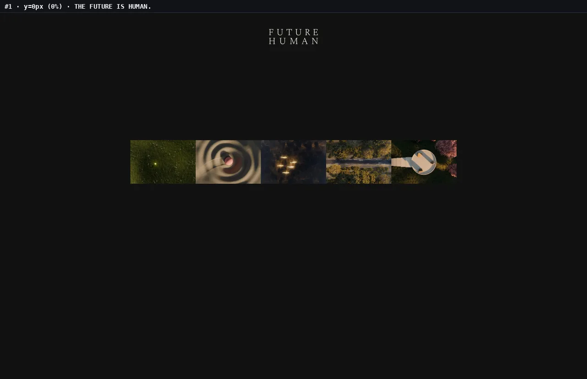
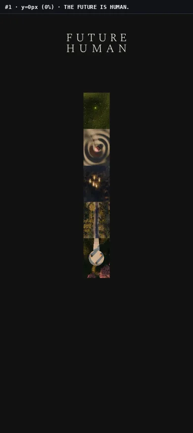

# UI Design System & Master Generation Blueprint: www-future-human-de

> **FUTURE HUMAN · A Shared Year of Co-Creation & Presence** (https://www.future-human.de/) — A one-year training for multidimensional coaching & co-creation. 8 modules, 16 participants, at Das HILLA near Kassel. Starts Oct 30, 2026.





---

## 1. Executive Visual Persona & Design Archetype

- **Brand Essence & Persona**: **FUTURE HUMAN · A Shared Year of Co-Creation & Presence** (`https://www.future-human.de/`). A one-year training for multidimensional coaching & co-creation. 8 modules, 16 participants, at Das HILLA near Kassel. Starts Oct 30, 2026.
- **Capture Provenance**: Live browser capture (`tier1_fast`, HTTP `200`, captured `2026-11-24`).
- **Visual Archetype**: **Light-Substrate Editorial & Modular Grid System (`#fff9ea` canvas, `#000000` ink, `#ffffff` accent)**.
- **Anti-AI-Slop Differentiators**:
  - **Live-Computed Chromatic Polarity**: Anchors the viewport in `#fff9ea` (live computed `body` `background-color` (`computed_styles.json`)) paired with `#000000` primary typography and `#ffffff` accents.
  - **Grounded Typographic Hierarchy**: Pairs `Spectral` for display copy (`THE FUTURE IS HUMAN.`) with `Plus Jakarta Sans`.
  - **Calibrated Spatial Grid & Motion**: Combines `1440px` container bounds (`gap: 16px`, padding `40px`) with `cubic-bezier(0.25,0.1,0.25,1)` easing and GSAP Timeline & ScrollTrigger, Framer Motion Layout Physics.

---

## 2. Spatial Architecture & Modular Grid Mathematics

### Viewport Allocation & Container Geometry
- **Captured Journey Filmstrips**: Desktop `1280×828px` (`assets/desktop-journey.webp`, `1` keyframes up to `y=0px` / doc `900px`), Mobile `390×872px` (`assets/mobile-journey.webp`, `1` keyframes).
- **Master Container Bounds**: `1440px` (full-bleed `100%` desktop stage measured on `1440px` viewport).
- **Canvas Lateral Padding & Spacing**: `40px` lateral canvas padding with `16px` grid gap.
- **Border Radius Scale**: `8px`, `15px`, `100px`, `50px`.

### Responsive Breakpoint Architecture
- **Desktop Layout**: Multi-column CSS Grid / Flexbox layout at `1440px` (`max-width: 1440px`, `gap: 16px`).
- **Mobile Layout**: Single-column vertical stack at `390px` viewport width with `40px` horizontal padding.
- **Extracted CSS Media Queries**: `@media (min-width: 1200px)`, `@media (min-width: 810px) and (max-width: 1199.98px)`, `@media (max-width: 809.98px)`, `@media (max-width:1199px) and (min-width:810px)`.

---

## 3. Color System, Materiality & Atmospheric Lighting

### Semantic Palette & Source Grounding
| Semantic Role | Ground-Truth Value | Extracted Live / CSS Source |
|---|---|---|
| **Primary Canvas Substrate** | `#fff9ea` | live computed `body` `background-color` (`computed_styles.json`) |
| **Primary Typography Ink** | `#000000` | live computed `main` `color` (`computed_styles.json`) |
| **Elevated Surface / Card Substrate** | `#fff9ea` | transparent/inherited card surface over live computed `body` `background-color` (`computed_styles.json`) |
| **Interactive Accent / Highlight** | `#ffffff` | `#__framer-editorbar-button { color: #ffffff }` |
| **Secondary / Muted Copy** | `#0099ff` | `.framer-S82Lr .framer-jkecn2 { color: #0099ff }` |
| **Structural Hairline Border** | `#0099ff` | hairline divider derived from `.framer-S82Lr .framer-jkecn2 { color: #0099ff }` |
| **Variable Token (`--token-5d91ee23-be21-4524-9b74-738a7ee13f13`)** | `#121212` | `var(--token-5d91ee23-be21-4524-9b74-738a7ee13f13)` in `:root` |
| **Variable Token (`--token-30996a26-1fe4-4007-9944-c80e3f142e44`)** | `#fffefc` | `var(--token-30996a26-1fe4-4007-9944-c80e3f142e44)` in `:root` |

### Sanitized Root CSS Variables (`ui-ux.md` Ground Truth)
| Variable Name | Extracted Value | Semantic Role |
|---|---|---|
| `--token-0ae2222e-ae06-4270-a415-3dc68910790b` | `#fff9ea` | Color / Atmospheric Token |
| `--token-b6e76abb-dcfc-435b-9de5-4434133bc927` | `#fff9eacc` | Color / Atmospheric Token |
| `--token-5d91ee23-be21-4524-9b74-738a7ee13f13` | `#121212` | Color / Atmospheric Token |
| `--token-30996a26-1fe4-4007-9944-c80e3f142e44` | `#fffefc` | Color / Atmospheric Token |
| `--token-5f5766cb-e316-4651-8423-ae295a71112c` | `#fff` | Color / Atmospheric Token |
| `--text-decoration-skip-ink` | `var(--framer-text-decoration-skip-ink)` | Typography Ink Token |
| `--text-underline-offset` | `var(--framer-text-decoration-offset)` | Typography Ink Token |
| `--font-family` | `var(--framer-font-family)` | Typography / Scale Token |
| `--font-style` | `var(--framer-font-style)` | Typography / Scale Token |
| `--font-weight` | `var(--framer-font-weight)` | Typography / Scale Token |
| `--text-color` | `var(--framer-text-color)` | Typography Ink Token |
| `--letter-spacing` | `var(--framer-letter-spacing)` | Typography / Scale Token |
| `--font-size` | `var(--framer-font-size)` | Typography / Scale Token |
| `--text-transform` | `var(--framer-text-transform)` | Typography Ink Token |
| `--line-height` | `var(--framer-line-height)` | Typography / Scale Token |
| `--overflow-clip-fallback` | `hidden` | Design System Custom Token |

---

## 4. Typographic Scale & Editorial Hierarchy

### Font Family Stacks
- **Display Typography**: `Spectral`.
- **Primary Body Stack**: `Plus Jakarta Sans`.
- **Technical / Metadata Stack**: not declared in live computed styles (uses primary stack / `ui-monospace`).

### Typographic Scale & Rules (Live Computed & Stylesheet Grounded)
- **Hero Display (`H1`)**: live computed `h1` (`font-size: 36px`, `line-height: 36px`, `font-weight: 300`, `letter-spacing: -1.44px`); rule `h1` (`font-size: 32px`, `line-height: 110%`, `letter-spacing: -.04em`, `font-weight: 300`).
- **Section Heading (`H2`)**: observed font-size ladder: `36px`, `12px`, `18px`, `var(--font-size)`, `var(--framer-font-size)`.
- **Body Copy**: live computed `body` (`font-size: 12px`, `line-height: normal`, `font-weight: 400`); rule `p` (`font-size: 18px`, `line-height: 140%`, `letter-spacing: -.02em`, `font-weight: 300`).
- **Metadata & Navigation Labels**: live computed `nav/a` (`font-size: 12px`, `line-height: normal`, `font-weight: 400`); CSS variables `--letter-spacing: var(--framer-letter-spacing)`.

---

## 5. Choreographed Motion & Interaction Physics

### Primary Easing Curves
- **Extracted Timing Functions**: `cubic-bezier(0.25,0.1,0.25,1)`.

### Per-Element Transition & Choreography Rules
- **Selector `#__framer-editorbar-label`**: `transition: opacity 0.4s ease-out` extracted from `www-future-human-de` stylesheet.
- **Selector `style]`**: `transition: none` extracted from `www-future-human-de` stylesheet.
- **Selector `style]`**: `transition: none` extracted from `www-future-human-de` stylesheet.
- **Standard CSS Easing (`cubic-bezier(0.25,0.1,0.25,1)`)**: Default timing curve (no custom `cubic-bezier()` declared in captured CSS).
- **Runtime Interaction Engine**: Integrates GSAP Timeline & ScrollTrigger, Framer Motion Layout Physics with `prefers-reduced-motion: reduce` fallback guards.
### Measured Runtime Scroll & Interaction Telemetry (`behavioral_journey_v2`)
- **Scroll Driver Mode**: `wheel` (max document height `900px`, deepest scrollY reached `0px` across `1` desktop keyframes).
- **Detected Scroll / Motion Libraries**: `Framer Motion`.

---

## 6. Component Wireframe & Structural DOM Map

### Visual Layout Schematic — Desktop (`1440px`, Grounded in `dom.html` & Landmark Bounding Boxes)
```
┌────────────────────────────────────────────────────────────────────────┐
│ DESKTOP VIEWPORT (1440px) — FUTURE HUMAN · A Shared Year of Co-Creatio │
│ ====================================================================== │
│ [ <nav.framer-1m76co> (152x24px)      | Overview · Index · Archive · ] │
│ ---------------------------------------------------------------------- │
│ | HERO STAGE: <section.framer-16vyecu> (w=1440px)                    | │
│ | H1: THE FUTURE IS HUMAN.                                           | │
│ | Substrate: #fff9ea | Ink: #000000 | Accent: #ffffff                | │
│ ---------------------------------------------------------------------- │
│ | SHOWCASE GRID (<section.framer-1omsice>) max-w: 1440px             | │
│ | +------------------------------+  +------------------------------+ | │
│ | | T H E F U T U R E I S H U M  |  | T h e M u l t i d i m e n s  | | │
│ | +------------------------------+  +------------------------------+ | │
│ ---------------------------------------------------------------------- │
│ | DETAIL MODULE (<section.framer-i64cag>) — T h e C o l l e c t i    | │
│ ---------------------------------------------------------------------- │
│ [ FOOTER (<footer.framer-1818e) | https://www.future-human.de/         │
└────────────────────────────────────────────────────────────────────────┘
```

### Visual Layout Schematic — Mobile Reflow (`390px`)
```
┌────────────────────────────────────────────────────────────────────────┐
│ MOBILE VIEWPORT REFLOW (390px) — Single-Column Stack (gap: 16px)       │
│ ====================================================================== │
│ [ HEADER BAR (<nav.framer-1m76co>     ) | Compact Menu (390px)         │
│ ---------------------------------------------------------------------- │
│ | HERO STAGE (<section.framer-16vyecu>) — 390px Vertical Lead        | │
│ | H1: THE FUTURE IS HUMAN.                                           | │
│ ---------------------------------------------------------------------- │
│ | SHOWCASE STACK (<section.framer-1omsic) — 1-Col Stack              | │
│ | [ Item 1: T H E F U T U R E I S H U M A N .                      ] | │
│ | [ Item 2: T h e M u l t i d i m e n s i o n a l H u m a n        ] | │
│ ---------------------------------------------------------------------- │
│ | DETAIL STACK (<section.framer-i64cag>) — 1-Col (T h e C o l l e c )  │
│ ---------------------------------------------------------------------- │
│ [ FOOTER (<footer.framer-1818e) | Stacked 390px Colophon               │
└────────────────────────────────────────────────────────────────────────┘
```

### Granular DOM Region Breakdown
1. **Brand Header & Navigation Bar (<nav.framer-1m76co> — `www-future-human-de`)**:
   - Landmark `<nav class="framer-1m76co">` (`152x24px`) hosting `FUTURE HUMAN · A Shared Year of Co-C` navigation (`Overview · Index · Archive · About · Contact`), DOM attributes (`data-framer-font-css`, `data-framer-breakpoint-css`, `data-framer-css-ssr-minified`, `data-framer-components="framer-lib-cursors-ho..."`), and stylesheet rule `.hidden-72rtr7 { display:none!important }`.
2. **Hero Stage & Focal Lead (<section.framer-16vyecu> — `THE FUTURE IS HUMAN.`)**:
   - Landmark `<section class="framer-16vyecu sct-room">` presenting display lead `THE FUTURE IS HUMAN.` and copy excerpt *"Die Welt braucht deine einzigartige Gabe."* over `#fff9ea` canvas and `#000000` ink.
3. **Primary Showcase & Content Grid (<section.framer-1omsice> — `T H E F U T U R E I S H U M A N .`)**:
   - Landmark `<section class="framer-1omsice sct-room">` rendering section `T H E F U T U R E I S H U M A N .` with copy *"D i e W e l t b r a u c h t d e i n e e i n z i g a r t i g e G a"*, asset references (`GAHKwEi2fQdp0x0qCbx0ph5tnCs.png`, `fonts.gstatic.com`, `hls.min.js`, `script`), and grid rule `.hidden-181529u { display:none!important }`.
4. **Interactive Detail & Feature Matrix (<section.framer-i64cag> — `T h e M u l t i d i m e n s i o n `)**:
   - Landmark `<section class="framer-i64cag sct-room">` framing `T h e M u l t i d i m e n s i o n a l H u m a n` and `T h e C o l l e c t i v e F i e l d` (*"e i n z i g a r t i g e"*) with `#fff9ea` surface cards, `#ffffff` accents, and `.hidden-126ue0n { display:none!important }`.
5. **Colophon & Global Directory Footer (<footer.framer-1818ei9> — `https://www.future-human.de/`)**:
   - Landmark `<footer class="framer-1818ei9">` anchoring `FUTURE HUMAN · A Shared Year of ` footer links (`Overview · Index · Archive · About · Contact`), copy *"M u l t i d i m e n s i o n a l"*, and `#0099ff` structural dividers.
### Full Vertical Scroll Sequence (Desktop `1440×900` Keyframes)
- **Step 01** (`y=0px`, `0%`): Active landmark `THE FUTURE IS HUMAN.` · sticky/fixed elements: `1`

---

## 7. Master Zero-Shot AI Generation Prompt

```markdown
# Master Zero-Shot Frontend Generation Prompt: www-future-human-de (FUTURE HUMAN · A Shared Year of Co-Creation & Presence)

You are a principal frontend architect and design systems engineer. Build a complete, production-ready web application replicating the exact design system, DOM landmarks, typographic hierarchy, color tokens, and motion physics of `www-future-human-de` (**FUTURE HUMAN · A Shared Year of Co-Creation & Presence** — `https://www.future-human.de/`).

### 1. Visual Archetype & Anti-AI-Slop Mandates
- **Archetype**: Light-Substrate Editorial & Modular Grid System (`#fff9ea` canvas, `#000000` ink, `#ffffff` accent).
- **Identity & Domain Context**: A one-year training for multidimensional coaching & co-creation. 8 modules, 16 participants, at Das HILLA near Kassel. Starts Oct 30, 2026.
- **Primary Substrate**: `#fff9ea` (live computed `body` `background-color` (`computed_styles.json`)), **Primary Ink**: `#000000`, **Accent / Highlight**: `#ffffff`.
- **Site-Specific Differentiators**:
  - **Live-Computed Chromatic Polarity**: Anchors the viewport in `#fff9ea` (live computed `body` `background-color` (`computed_styles.json`)) paired with `#000000` primary typography and `#ffffff` accents.
  - **Grounded Typographic Hierarchy**: Pairs `Spectral` for display copy (`THE FUTURE IS HUMAN.`) with `Plus Jakarta Sans`.
  - **Calibrated Spatial Grid & Motion**: Combines `1440px` container bounds (`gap: 16px`, padding `40px`) with `cubic-bezier(0.25,0.1,0.25,1)` easing and GSAP Timeline & ScrollTrigger, Framer Motion Layout Physics.

### 2. Ground-Truth CSS Variables (`:root` Token Contract)
Declare and consume these exact custom properties extracted from `www-future-human-de` in your global stylesheet:

:root {
  /* FUTURE HUMAN · A Shared Year of Co-Creation & Presence (www-future-human-de) — Live-Grounded CSS Variables */
  --token-0ae2222e-ae06-4270-a415-3dc68910790b: #fff9ea; /* Color / Atmospheric Token (www-future-human-de) */
  --token-b6e76abb-dcfc-435b-9de5-4434133bc927: #fff9eacc; /* Color / Atmospheric Token (www-future-human-de) */
  --token-5d91ee23-be21-4524-9b74-738a7ee13f13: #121212; /* Color / Atmospheric Token (www-future-human-de) */
  --token-30996a26-1fe4-4007-9944-c80e3f142e44: #fffefc; /* Color / Atmospheric Token (www-future-human-de) */
  --token-5f5766cb-e316-4651-8423-ae295a71112c: #fff; /* Color / Atmospheric Token (www-future-human-de) */
  --text-decoration-skip-ink: var(--framer-text-decoration-skip-ink); /* Typography Ink Token (www-future-human-de) */
  --text-underline-offset: var(--framer-text-decoration-offset); /* Typography Ink Token (www-future-human-de) */
  --font-family: var(--framer-font-family); /* Typography / Scale Token (www-future-human-de) */
  --font-style: var(--framer-font-style); /* Typography / Scale Token (www-future-human-de) */
  --font-weight: var(--framer-font-weight); /* Typography / Scale Token (www-future-human-de) */
  --text-color: var(--framer-text-color); /* Typography Ink Token (www-future-human-de) */
  --letter-spacing: var(--framer-letter-spacing); /* Typography / Scale Token (www-future-human-de) */
  --font-size: var(--framer-font-size); /* Typography / Scale Token (www-future-human-de) */
  --text-transform: var(--framer-text-transform); /* Typography Ink Token (www-future-human-de) */
  --line-height: var(--framer-line-height); /* Typography / Scale Token (www-future-human-de) */
  --overflow-clip-fallback: hidden; /* Design System Custom Token (www-future-human-de) */
}

### 3. Semantic Color & Materiality Contract
Map every surface, ink, and border strictly to these source-grounded tokens:
- **Primary Canvas Substrate**: `#fff9ea` — grounded in live computed `body` `background-color` (`computed_styles.json`)
- **Primary Typography Ink**: `#000000` — grounded in live computed `main` `color` (`computed_styles.json`)
- **Elevated Surface / Card Substrate**: `#fff9ea` — grounded in transparent/inherited card surface over live computed `body` `background-color` (`computed_styles.json`)
- **Interactive Accent / Highlight**: `#ffffff` — grounded in `#__framer-editorbar-button { color: #ffffff }`
- **Secondary / Muted Copy**: `#0099ff` — grounded in `.framer-S82Lr .framer-jkecn2 { color: #0099ff }`
- **Structural Hairline Border**: `#0099ff` — grounded in hairline divider derived from `.framer-S82Lr .framer-jkecn2 { color: #0099ff }`
- **Variable Token (`--token-5d91ee23-be21-4524-9b74-738a7ee13f13`)**: `#121212` — grounded in `var(--token-5d91ee23-be21-4524-9b74-738a7ee13f13)` in `:root`
- **Variable Token (`--token-30996a26-1fe4-4007-9944-c80e3f142e44`)**: `#fffefc` — grounded in `var(--token-30996a26-1fe4-4007-9944-c80e3f142e44)` in `:root`

### 4. Spatial Grid, Container Bounds & Responsive Breakpoints
- **Desktop Viewport Reference**: `1280×828px` (single-viewport 100vh live capture (900px), `1440px` standard desktop width).
- **Mobile Viewport Reference**: `390×872px` (full-page live capture (872px), `390px` standard mobile width).
- **Container Max-Width**: `1440px` (full-bleed `100%` desktop stage measured on `1440px` viewport)
- **Padding & Gutters**: `40px` lateral canvas padding with `16px` grid gap
- **Desktop Grid**: Multi-column CSS Grid / Flexbox layout at `1440px` (`max-width: 1440px`, `gap: 16px`)
- **Mobile Adaptation**: Single-column vertical stack at `390px` viewport width with `40px` horizontal padding
- **Media Queries**: `@media (min-width: 1200px)`, `@media (min-width: 810px) and (max-width: 1199.98px)`, `@media (max-width: 809.98px)`, `@media (max-width:1199px) and (min-width:810px)`
- **Corner Radii**: `8px`, `15px`, `100px`, `50px`

### 5. Typography & Editorial Scale Contract
- **Display Font Stack**: `Spectral`
- **Body Font Stack**: `Plus Jakarta Sans`
- **Monospace / Technical Font Stack**: not declared in live computed styles (uses primary stack / `ui-monospace`)
- **H1 Display Rule**: live computed `h1` (`font-size: 36px`, `line-height: 36px`, `font-weight: 300`, `letter-spacing: -1.44px`); rule `h1` (`font-size: 32px`, `line-height: 110%`, `letter-spacing: -.04em`, `font-weight: 300`)
- **H2 Section Rule**: observed font-size ladder: `36px`, `12px`, `18px`, `var(--font-size)`, `var(--framer-font-size)`
- **Body Copy Rule**: live computed `body` (`font-size: 12px`, `line-height: normal`, `font-weight: 400`); rule `p` (`font-size: 18px`, `line-height: 140%`, `letter-spacing: -.02em`, `font-weight: 300`)
- **Metadata & Index Rule**: live computed `nav/a` (`font-size: 12px`, `line-height: normal`, `font-weight: 400`); CSS variables `--letter-spacing: var(--framer-letter-spacing)`

### 6. Component Hierarchy, Verbatim Copy & Real DOM Landmarks
Scaffold `www-future-human-de` (`FUTURE HUMAN · A Shared Year of Co-Creation & Presence`) with these exact structural regions, extracted copy, and CSS rules from `dom.html`:
1. **Brand Header & Navigation Bar (<nav.framer-1m76co> — `www-future-human-de`)**:
   - DOM & Selectors: Landmark `<nav class="framer-1m76co">` (`152x24px`) hosting `FUTURE HUMAN · A Shared Year of Co-C` navigation (`Overview · Index · Archive · About · Contact`), DOM attributes (`data-framer-font-css`, `data-framer-breakpoint-css`, `data-framer-css-ssr-minified`, `data-framer-components="framer-lib-cursors-ho..."`), and stylesheet rule `.hidden-72rtr7 { display:none!important }`.
   - Responsive Contract: Header `Brand Header & Navigation Bar (<nav.framer-1m76co> — `www-future-human-de`)` (`www-future-human-de`) adapts across `@media (min-width: 1200px)`, `@media (min-width: 810px) and (max-width: 1199.98px)`, `@media (max-width: 809.98px)`, `@media (max-width:1199px) and (min-width:810px)` with `cubic-bezier(0.25,0.1,0.25,1)` transitions and links `Overview · Index · Archive · About · Contact`.
2. **Hero Stage & Focal Lead (<section.framer-16vyecu> — `THE FUTURE IS HUMAN.`)**:
   - DOM & Selectors: Landmark `<section class="framer-16vyecu sct-room">` presenting display lead `THE FUTURE IS HUMAN.` and copy excerpt *"Die Welt braucht deine einzigartige Gabe."* over `#fff9ea` canvas and `#000000` ink.
   - Responsive Contract: Hero stage (`1280×828px` desktop / `390×872px` mobile) sets `#fff9ea` background with `#000000` headline `THE FUTURE IS HUMAN.`.
3. **Primary Showcase & Content Grid (<section.framer-1omsice> — `T H E F U T U R E I S H U M A N .`)**:
   - DOM & Selectors: Landmark `<section class="framer-1omsice sct-room">` rendering section `T H E F U T U R E I S H U M A N .` with copy *"D i e W e l t b r a u c h t d e i n e e i n z i g a r t i g e G a"*, asset references (`GAHKwEi2fQdp0x0qCbx0ph5tnCs.png`, `fonts.gstatic.com`, `hls.min.js`, `script`), and grid rule `.hidden-181529u { display:none!important }`.
   - Responsive Contract: Showcase grid `Primary Showcase & Content Grid (<section.framer-1omsice> — `T H E F U T U R E I S H U M A N .`)` applies Multi-column CSS Grid / Flexbox layout at `1440px` (`max-width: 1440px`, `gap: 16px`) on desktop and Single-column vertical stack at `390px` viewport width with `40px` horizontal padding on mobile.
4. **Interactive Detail & Feature Matrix (<section.framer-i64cag> — `T h e M u l t i d i m e n s i o n `)**:
   - DOM & Selectors: Landmark `<section class="framer-i64cag sct-room">` framing `T h e M u l t i d i m e n s i o n a l H u m a n` and `T h e C o l l e c t i v e F i e l d` (*"e i n z i g a r t i g e"*) with `#fff9ea` surface cards, `#ffffff` accents, and `.hidden-126ue0n { display:none!important }`.
   - Responsive Contract: Detail module `Interactive Detail & Feature Matrix (<section.framer-i64cag> — `T h e M u l t i d i m e n s i o n `)` uses `8px`, `15px`, `100px`, `50px` radii, `#ffffff` highlights, and assets (GAHKwEi2fQdp0x0qCbx0ph5tnCs.png, fonts.gstatic.com, hls.min.js).
5. **Colophon & Global Directory Footer (<footer.framer-1818ei9> — `https://www.future-human.de/`)**:
   - DOM & Selectors: Landmark `<footer class="framer-1818ei9">` anchoring `FUTURE HUMAN · A Shared Year of ` footer links (`Overview · Index · Archive · About · Contact`), copy *"M u l t i d i m e n s i o n a l"*, and `#0099ff` structural dividers.
   - Responsive Contract: Footer `Colophon & Global Directory Footer (<footer.framer-1818ei9> — `https://www.future-human.de/`)` aligns to `1440px` (full-bleed `100%` desktop stage measured on `1440px` viewport) with `40px` lateral canvas padding with `16px` grid gap and attributes (data-framer-font-css, data-framer-breakpoint-css, data-framer-css-ssr-minified).

#### Verbatim DOM Copy Excerpts (`dom.html`)
- Copy Excerpt 1: *"Die Welt braucht deine einzigartige Gabe."*
- Copy Excerpt 2: *"D i e W e l t b r a u c h t d e i n e e i n z i g a r t i g e G a b e ."*
- Copy Excerpt 3: *"e i n z i g a r t i g e"*
- Copy Excerpt 4: *"M u l t i d i m e n s i o n a l"*

### 7. Motion, Extracted Stylesheet Rules & Interaction Choreography
- **Primary Easing Functions**: `cubic-bezier(0.25,0.1,0.25,1)`
- **Extracted Stylesheet Rules (`www-future-human-de`)**:
- `.hidden-72rtr7 { display:none!important }`
- `.hidden-181529u { display:none!important }`
- `.hidden-126ue0n { display:none!important }`
- `main { box-sizing:border-box;margin:0;padding:0 }`
- `root { -webkit-font-smoothing:antialiased;-moz-osx-font-smoothing:grayscale }`
- **Per-Selector Transition Rules**:
- **Selector `#__framer-editorbar-label`**: `transition: opacity 0.4s ease-out` extracted from `www-future-human-de` stylesheet.
- **Selector `style]`**: `transition: none` extracted from `www-future-human-de` stylesheet.
- **Selector `style]`**: `transition: none` extracted from `www-future-human-de` stylesheet.
- **Standard CSS Easing (`cubic-bezier(0.25,0.1,0.25,1)`)**: Default timing curve (no custom `cubic-bezier()` declared in captured CSS).
- **Runtime Interaction Engine**: Integrates GSAP Timeline & ScrollTrigger, Framer Motion Layout Physics with `prefers-reduced-motion: reduce` fallback guards.
### 7b. Full-Page Scroll Choreography, Interactive States & Multi-Page Routes
- **Scroll Mechanics**: Implement `wheel` vertical progression up to `900px` across 1 distinct viewport chapters using Framer Motion.
- **Vertical Chapter Sequence**: THE FUTURE IS HUMAN. (0%).

### 8. Technical Deliverables
- Implement in Next.js (App Router) with TypeScript and Tailwind CSS consuming the `:root` custom properties defined above for `www-future-human-de`.
- Reproduce both the `1440px` desktop architecture and `390px` mobile breakpoint transitions, preserving semantic HTML5 landmarks (`<header>`, `<nav>`, `<main>`, `<section>`, `<footer>`) and `prefers-reduced-motion` accessibility guards.
```
---

## 8. Full-Page Scroll Journey, Interactive States & Subpage Inventory

### Desktop Scroll Keyframes (`1440×900` WebP)
| Step | Scroll Y | Progress | Active Landmark / Section | Sticky/Fixed | Visual Asset |
| :---: | :---: | :---: | :--- | :---: | :--- |
| `#01` | `0px` | `0%` | THE FUTURE IS HUMAN. | `1` | [desktop-step-01.webp](assets/desktop-step-01.webp) |

### Mobile Condensed Keyframes (`390×844` WebP)
| Step | Scroll Y | Progress | Active Landmark | Visual Asset |
| :---: | :---: | :---: | :--- | :--- |
| `#01` | `0px` | `0%` | THE FUTURE IS HUMAN. | [mobile-step-01.webp](assets/mobile-step-01.webp) |

