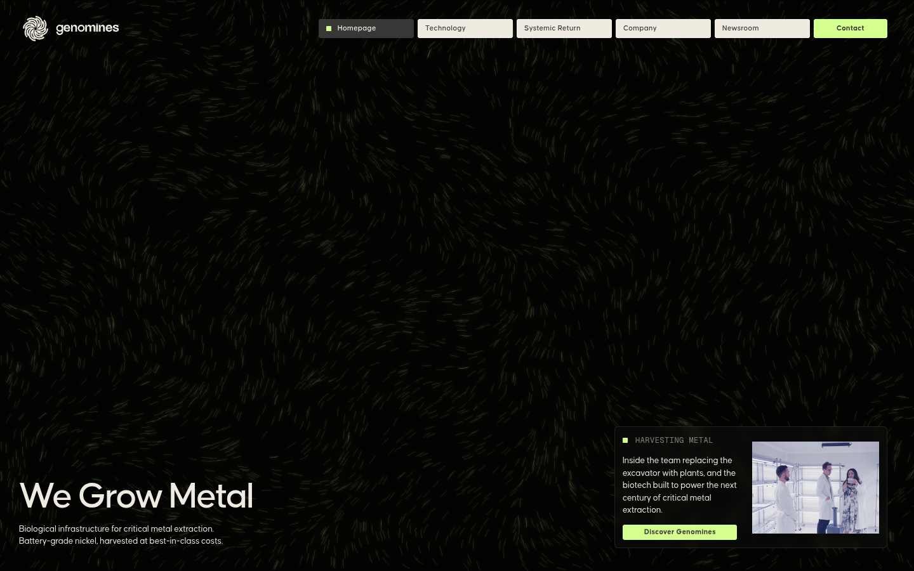
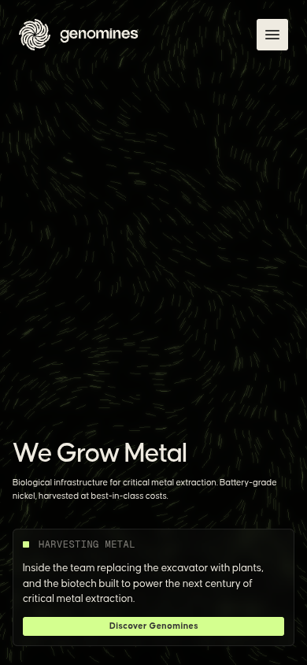

# UI Design System & Master Generation Blueprint: www-genomines-com

> **Genomines — We Grow Metal** (https://www.genomines.com/) — Plants that grow metal. Genomines uses phytomining and genomics to extract battery-grade nickel from low-grade soils, with no waste rock...



---

## 1. Executive Visual Persona & Design Archetype

- **Brand Essence & Persona**: **Genomines — We Grow Metal** (`https://www.genomines.com/`). Plants that grow metal. Genomines uses phytomining and genomics to extract battery-grade nickel from low-grade soils, with no waste rock...
- **Capture Provenance**: Live browser capture (`tier2_webgl`, HTTP `200`, captured `2026-11-23`).
- **Visual Archetype**: **Light-Gallery WebGL / Canvas Interactive Experience (`#efebe1` / `#b3261e`)**.
- **Anti-AI-Slop Differentiators**:
  - **Live-Computed Chromatic Polarity**: Anchors the viewport in `#efebe1` (live computed `body` `background-color` (`computed_styles.json`)) paired with `#373735` primary typography and `#b3261e` accents.
  - **Grounded Typographic Hierarchy**: Pairs `Causten` for display copy (`We Grow Metal`) with `Causten` and `Geist Mono`.
  - **Calibrated Spatial Grid & Motion**: Combines `1440px` container bounds (`gap: 12px`, padding `29.9995px`) with `cubic-bezier(.4,0,.2,1)` easing and Lenis Smooth Scroll (`data-lenis`), GSAP Timeline & ScrollTrigger.

---

## 2. Spatial Architecture & Modular Grid Mathematics



### Viewport Allocation & Container Geometry
- **Captured Viewport Dimensions**: Desktop `1440×900px` (`assets/desktop.png`, single-viewport 100vh live capture (900px)), Mobile `390×844px` (`assets/mobile.png`, single-viewport 100vh live capture (844px)).
- **Master Container Bounds**: `1440px` (full-bleed `100%` desktop stage measured on `1440px` viewport).
- **Canvas Lateral Padding & Spacing**: `29.9995px` lateral canvas padding with `12px` grid gap.
- **Border Radius Scale**: `3px`, `1px`, `8px`, `6px`.

### Responsive Breakpoint Architecture
- **Desktop Layout**: Multi-column CSS Grid / Flexbox layout at `1440px` (`max-width: 1440px`, `gap: 12px`).
- **Mobile Layout**: Single-column vertical stack at `390px` viewport width with `29.9995px` horizontal padding.
- **Extracted CSS Media Queries**: `@media (max-width:1000px)`, `@media (max-width:600px)`.

---

## 3. Color System, Materiality & Atmospheric Lighting

### Semantic Palette & Source Grounding
| Semantic Role | Ground-Truth Value | Extracted Live / CSS Source |
|---|---|---|
| **Primary Canvas Substrate** | `#efebe1` | live computed `body` `background-color` (`computed_styles.json`) |
| **Primary Typography Ink** | `#373735` | live computed `main` `color` (`computed_styles.json`) |
| **Elevated Surface / Card Substrate** | `#d4ff8f` | `header__nav>ul .nav__item .nav_... { background: #d4ff8f }` |
| **Interactive Accent / Highlight** | `#b3261e` | `al__form .contact-modal__feedba... { color: #b3261e }` |
| **Secondary / Muted Copy** | `#cec5b0` | `apper .team__content .team__hea... { color: #cec5b0 }` |
| **Structural Hairline Border** | `#c1beb6` | `ntact-modal__form .contact-moda... { border: #c1beb6 }` |

### Sanitized Root CSS Variables (`ui-ux.md` Ground Truth)
| Variable Name | Extracted Value | Semantic Role |
|---|---|---|
| `--gridCell` | `0px` | Layout / Spatial Grid Token |
| `--gridGap` | `0px` | Layout / Spatial Grid Token |
| `--gridMargin` | `0px` | Layout / Spatial Grid Token |
| `--wrapper-margin` | `max(18px, 2.0833vw)` | Layout / Spatial Grid Token |
| `--margin-xl` | `72px` | Layout / Spatial Grid Token |
| `--margin-l` | `48px` | Layout / Spatial Grid Token |
| `--margin-m` | `24px` | Layout / Spatial Grid Token |
| `--margin-s` | `12px` | Layout / Spatial Grid Token |
| `--controls-backdrop-color` | `rgba(0, 0, 0, .4)` | Brand / Palette Token |
| `--media-range-track-background` | `rgba(239, 235, 225, .25)` | Canvas / Surface Token |
| `--media-time-range-buffered-color` | `rgba(239, 235, 225, .45)` | Brand / Palette Token |
| `--gradient-steps` | `transparent 0%, transparent 100%` | Dimension / Scale Token |
| `--media-control-hover-background` | `rgba(239, 235, 225, .1)` | Canvas / Surface Token |
| `--media-menu-background` | `rgba(55, 55, 53, .5)` | Canvas / Surface Token |
| `--media-menu-item-hover-background` | `rgba(239, 235, 225, .1)` | Canvas / Surface Token |
| `--quotes-extra-height` | `111px` | Layout / Spatial Grid Token |

---

## 4. Typographic Scale & Editorial Hierarchy

### Font Family Stacks
- **Display Typography**: `Causten`.
- **Primary Body Stack**: `Causten`.
- **Technical / Metadata Stack**: `Geist Mono`.

### Typographic Scale & Rules (Live Computed & Stylesheet Grounded)
- **Hero Display (`H1`)**: live computed `h1` (`font-size: 60px`, `line-height: 57px`, `font-weight: 500`, `letter-spacing: -1.8px`).
- **Section Heading (`H2`)**: live computed `h2` (`font-size: 48px`, `line-height: 45.6px`, `font-weight: 500`, `letter-spacing: -1.44px`).
- **Body Copy**: live computed `body` (`font-size: 14px`, `line-height: 19.6px`, `font-weight: 400`).
- **Metadata & Navigation Labels**: live computed `nav/a` (`font-size: 14px`, `line-height: 19.6px`, `font-weight: 400`).

---

## 5. Choreographed Motion & Interaction Physics

### Primary Easing Curves
- **Extracted Timing Functions**: `cubic-bezier(.4,0,.2,1)`.

### Per-Element Transition & Choreography Rules
- **Selector `.header__nav>ul .nav__item .nav__...`**: `transition: transform .3s ease-out` extracted from `www-genomines-com` stylesheet.
- **Selector `er .header__nav>ul .nav__item .na...`**: `transition: opacity .25s ease-out,transform .25s ease-out,visibility .25s` extracted from `www-genomines-com` stylesheet.
- **Selector `submenu .submenu__item .submenu__...`**: `transition: transform .3s ease-out` extracted from `www-genomines-com` stylesheet.
- **Extracted Easing Curve (`cubic-bezier(.4,0,.2,1)`)**: Governs interactive state transitions across `<header.global__header>` and `<section.section__paradigm-shift>`.
- **Runtime Interaction Engine**: Integrates Lenis Smooth Scroll (`data-lenis`), GSAP Timeline & ScrollTrigger, Three.js / WebGL Canvas Pipeline with `prefers-reduced-motion: reduce` fallback guards.

---

## 6. Component Wireframe & Structural DOM Map

### Visual Layout Schematic — Desktop (`1440px`, Grounded in `dom.html` & Landmark Bounding Boxes)
```
┌────────────────────────────────────────────────────────────────────────┐
│ DESKTOP VIEWPORT (1440px) — Genomines — We Grow Metal                  │
│ ====================================================================== │
│ [ <header.global__header (1440x90px)  | Homepage · Technology · Syst ] │
│ ---------------------------------------------------------------------- │
│ | HERO STAGE: <section.section__hero> (w=1440px)                     | │
│ | H1: We Grow Metal                                                  | │
│ | Substrate: #efebe1 | Ink: #373735 | Accent: #b3261e                | │
│ ---------------------------------------------------------------------- │
│ | SHOWCASE GRID (<section.section__paradigm) max-w: 1440px           | │
│ | +------------------------------+  +------------------------------+ | │
│ | | The payload.                 |  | More than profit. More than  | | │
│ | +------------------------------+  +------------------------------+ | │
│ ---------------------------------------------------------------------- │
│ | DETAIL MODULE (<section.section__scenes>) — We’re growing. Genomi  | │
│ ---------------------------------------------------------------------- │
│ [ FOOTER (<footer.global__foot) | https://www.genomines.com/           │
└────────────────────────────────────────────────────────────────────────┘
```

### Visual Layout Schematic — Mobile Reflow (`390px`)
```
┌────────────────────────────────────────────────────────────────────────┐
│ MOBILE VIEWPORT REFLOW (390px) — Single-Column Stack (gap: 12px)       │
│ ====================================================================== │
│ [ HEADER BAR (<header.global__header> ) | Compact Menu (390px)         │
│ ---------------------------------------------------------------------- │
│ | HERO STAGE (<section.section__hero>) — 390px Vertical Lead         | │
│ | H1: We Grow Metal                                                  | │
│ ---------------------------------------------------------------------- │
│ | SHOWCASE STACK (<section.section__para) — 1-Col Stack              | │
│ | [ Item 1: The payload.                                           ] | │
│ | [ Item 2: More than profit. More than sustainability. Syste...   ] | │
│ ---------------------------------------------------------------------- │
│ | DETAIL STACK (<section.section__scenes) — 1-Col (We’re growing. Gen) │
│ ---------------------------------------------------------------------- │
│ [ FOOTER (<footer.global__foot) | Stacked 390px Colophon               │
└────────────────────────────────────────────────────────────────────────┘
```

### Granular DOM Region Breakdown
1. **Brand Header & Navigation Bar (<header.global__header> — `www-genomines-com`)**:
   - Landmark `<header class="global__header">` (`1440x90px`) hosting `Genomines — We Grow Metal` navigation (`Homepage · Technology · Systemic Return · About us · Work with us`), DOM attributes (`data-taxi-ignore="true"`, `data-action="contact"`, `data-taxi-ignore="true"`, `data-action="contact"`), and stylesheet rule `after { margin:0;padding:0;box-sizing:border-box }`.
2. **Hero Stage & Focal Lead (<section.section__hero> — `We Grow Metal`)**:
   - Landmark `<section class="section__hero">` presenting display lead `We Grow Metal` and copy excerpt *"Biological infrastructure for critical metal extraction."* over `#efebe1` canvas and `#373735` ink.
3. **Primary Showcase & Content Grid (<section.section__paradigm-shift> — `The payload.`)**:
   - Landmark `<section class="section__paradigm-shift">` rendering section `The payload.` with copy *"Battery-grade nickel, harvested at best-in-class costs."*, asset references (`favicon-96x96.png`, `favicon.svg`, `favicon.ico`, `apple-touch-icon.png`), and grid rule `video { max-width:100%;display:block }`.
4. **Interactive Detail & Feature Matrix (<section.section__scenes> — `More than profit. More than sustai`)**:
   - Landmark `<section class="section__scenes">` framing `More than profit. More than sustainability. Syste...` and `We’re growing. Genomines in the News.` (*"Inside the team replacing the"*) with `#d4ff8f` surface cards, `#b3261e` accents, and `button { background:none;border:none;cursor:pointer;font:inherit;color:inherit }`.
5. **Colophon & Global Directory Footer (<footer.global__footer> — `https://www.genomines.com/`)**:
   - Landmark `<footer class="global__footer">` anchoring `Genomines — We Grow Metal` footer links (`Homepage · Technology · Systemic Return · About us · Work with us`), copy *"excavator with plants, and the"*, and `#c1beb6` structural dividers.

---

## 7. Master Zero-Shot AI Generation Prompt

```markdown
# Master Zero-Shot Frontend Generation Prompt: www-genomines-com (Genomines — We Grow Metal)

You are a principal frontend architect and design systems engineer. Build a complete, production-ready web application replicating the exact design system, DOM landmarks, typographic hierarchy, color tokens, and motion physics of `www-genomines-com` (**Genomines — We Grow Metal** — `https://www.genomines.com/`).

### 1. Visual Archetype & Anti-AI-Slop Mandates
- **Archetype**: Light-Gallery WebGL / Canvas Interactive Experience (`#efebe1` / `#b3261e`).
- **Identity & Domain Context**: Plants that grow metal. Genomines uses phytomining and genomics to extract battery-grade nickel from low-grade soils, with no waste rock...
- **Primary Substrate**: `#efebe1` (live computed `body` `background-color` (`computed_styles.json`)), **Primary Ink**: `#373735`, **Accent / Highlight**: `#b3261e`.
- **Site-Specific Differentiators**:
  - **Live-Computed Chromatic Polarity**: Anchors the viewport in `#efebe1` (live computed `body` `background-color` (`computed_styles.json`)) paired with `#373735` primary typography and `#b3261e` accents.
  - **Grounded Typographic Hierarchy**: Pairs `Causten` for display copy (`We Grow Metal`) with `Causten` and `Geist Mono`.
  - **Calibrated Spatial Grid & Motion**: Combines `1440px` container bounds (`gap: 12px`, padding `29.9995px`) with `cubic-bezier(.4,0,.2,1)` easing and Lenis Smooth Scroll (`data-lenis`), GSAP Timeline & ScrollTrigger.

### 2. Ground-Truth CSS Variables (`:root` Token Contract)
Declare and consume these exact custom properties extracted from `www-genomines-com` in your global stylesheet:

:root {
  /* Genomines — We Grow Metal (www-genomines-com) — Live-Grounded CSS Variables */
  --gridCell: 0px; /* Layout / Spatial Grid Token (www-genomines-com) */
  --gridGap: 0px; /* Layout / Spatial Grid Token (www-genomines-com) */
  --gridMargin: 0px; /* Layout / Spatial Grid Token (www-genomines-com) */
  --wrapper-margin: max(18px, 2.0833vw); /* Layout / Spatial Grid Token (www-genomines-com) */
  --margin-xl: 72px; /* Layout / Spatial Grid Token (www-genomines-com) */
  --margin-l: 48px; /* Layout / Spatial Grid Token (www-genomines-com) */
  --margin-m: 24px; /* Layout / Spatial Grid Token (www-genomines-com) */
  --margin-s: 12px; /* Layout / Spatial Grid Token (www-genomines-com) */
  --controls-backdrop-color: rgba(0, 0, 0, .4); /* Brand / Palette Token (www-genomines-com) */
  --media-range-track-background: rgba(239, 235, 225, .25); /* Canvas / Surface Token (www-genomines-com) */
  --media-time-range-buffered-color: rgba(239, 235, 225, .45); /* Brand / Palette Token (www-genomines-com) */
  --gradient-steps: transparent 0%, transparent 100%; /* Dimension / Scale Token (www-genomines-com) */
  --media-control-hover-background: rgba(239, 235, 225, .1); /* Canvas / Surface Token (www-genomines-com) */
  --media-menu-background: rgba(55, 55, 53, .5); /* Canvas / Surface Token (www-genomines-com) */
  --media-menu-item-hover-background: rgba(239, 235, 225, .1); /* Canvas / Surface Token (www-genomines-com) */
  --quotes-extra-height: 111px; /* Layout / Spatial Grid Token (www-genomines-com) */
}

### 3. Semantic Color & Materiality Contract
Map every surface, ink, and border strictly to these source-grounded tokens:
- **Primary Canvas Substrate**: `#efebe1` — grounded in live computed `body` `background-color` (`computed_styles.json`)
- **Primary Typography Ink**: `#373735` — grounded in live computed `main` `color` (`computed_styles.json`)
- **Elevated Surface / Card Substrate**: `#d4ff8f` — grounded in `header__nav>ul .nav__item .nav_... { background: #d4ff8f }`
- **Interactive Accent / Highlight**: `#b3261e` — grounded in `al__form .contact-modal__feedba... { color: #b3261e }`
- **Secondary / Muted Copy**: `#cec5b0` — grounded in `apper .team__content .team__hea... { color: #cec5b0 }`
- **Structural Hairline Border**: `#c1beb6` — grounded in `ntact-modal__form .contact-moda... { border: #c1beb6 }`

### 4. Spatial Grid, Container Bounds & Responsive Breakpoints
- **Desktop Viewport Reference**: `1440×900px` (single-viewport 100vh live capture (900px), `1440px` standard desktop width).
- **Mobile Viewport Reference**: `390×844px` (single-viewport 100vh live capture (844px), `390px` standard mobile width).
- **Container Max-Width**: `1440px` (full-bleed `100%` desktop stage measured on `1440px` viewport)
- **Padding & Gutters**: `29.9995px` lateral canvas padding with `12px` grid gap
- **Desktop Grid**: Multi-column CSS Grid / Flexbox layout at `1440px` (`max-width: 1440px`, `gap: 12px`)
- **Mobile Adaptation**: Single-column vertical stack at `390px` viewport width with `29.9995px` horizontal padding
- **Media Queries**: `@media (max-width:1000px)`, `@media (max-width:600px)`
- **Corner Radii**: `3px`, `1px`, `8px`, `6px`

### 5. Typography & Editorial Scale Contract
- **Display Font Stack**: `Causten`
- **Body Font Stack**: `Causten`
- **Monospace / Technical Font Stack**: `Geist Mono`
- **H1 Display Rule**: live computed `h1` (`font-size: 60px`, `line-height: 57px`, `font-weight: 500`, `letter-spacing: -1.8px`)
- **H2 Section Rule**: live computed `h2` (`font-size: 48px`, `line-height: 45.6px`, `font-weight: 500`, `letter-spacing: -1.44px`)
- **Body Copy Rule**: live computed `body` (`font-size: 14px`, `line-height: 19.6px`, `font-weight: 400`)
- **Metadata & Index Rule**: live computed `nav/a` (`font-size: 14px`, `line-height: 19.6px`, `font-weight: 400`)

### 6. Component Hierarchy, Verbatim Copy & Real DOM Landmarks
Scaffold `www-genomines-com` (`Genomines — We Grow Metal`) with these exact structural regions, extracted copy, and CSS rules from `dom.html`:
1. **Brand Header & Navigation Bar (<header.global__header> — `www-genomines-com`)**:
   - DOM & Selectors: Landmark `<header class="global__header">` (`1440x90px`) hosting `Genomines — We Grow Metal` navigation (`Homepage · Technology · Systemic Return · About us · Work with us`), DOM attributes (`data-taxi-ignore="true"`, `data-action="contact"`, `data-taxi-ignore="true"`, `data-action="contact"`), and stylesheet rule `after { margin:0;padding:0;box-sizing:border-box }`.
   - Responsive Contract: Header `Brand Header & Navigation Bar (<header.global__header> — `www-genomines-com`)` (`www-genomines-com`) adapts across `@media (max-width:1000px)`, `@media (max-width:600px)` with `cubic-bezier(.4,0,.2,1)` transitions and links `Homepage · Technology · Systemic Return · About us · Work with us`.
2. **Hero Stage & Focal Lead (<section.section__hero> — `We Grow Metal`)**:
   - DOM & Selectors: Landmark `<section class="section__hero">` presenting display lead `We Grow Metal` and copy excerpt *"Biological infrastructure for critical metal extraction."* over `#efebe1` canvas and `#373735` ink.
   - Responsive Contract: Hero stage (`1440×900px` desktop / `390×844px` mobile) sets `#efebe1` background with `#373735` headline `We Grow Metal`.
3. **Primary Showcase & Content Grid (<section.section__paradigm-shift> — `The payload.`)**:
   - DOM & Selectors: Landmark `<section class="section__paradigm-shift">` rendering section `The payload.` with copy *"Battery-grade nickel, harvested at best-in-class costs."*, asset references (`favicon-96x96.png`, `favicon.svg`, `favicon.ico`, `apple-touch-icon.png`), and grid rule `video { max-width:100%;display:block }`.
   - Responsive Contract: Showcase grid `Primary Showcase & Content Grid (<section.section__paradigm-shift> — `The payload.`)` applies Multi-column CSS Grid / Flexbox layout at `1440px` (`max-width: 1440px`, `gap: 12px`) on desktop and Single-column vertical stack at `390px` viewport width with `29.9995px` horizontal padding on mobile.
4. **Interactive Detail & Feature Matrix (<section.section__scenes> — `More than profit. More than sustai`)**:
   - DOM & Selectors: Landmark `<section class="section__scenes">` framing `More than profit. More than sustainability. Syste...` and `We’re growing. Genomines in the News.` (*"Inside the team replacing the"*) with `#d4ff8f` surface cards, `#b3261e` accents, and `button { background:none;border:none;cursor:pointer;font:inherit;color:inherit }`.
   - Responsive Contract: Detail module `Interactive Detail & Feature Matrix (<section.section__scenes> — `More than profit. More than sustai`)` uses `3px`, `1px`, `8px`, `6px` radii, `#b3261e` highlights, and assets (favicon-96x96.png, favicon.svg, favicon.ico).
5. **Colophon & Global Directory Footer (<footer.global__footer> — `https://www.genomines.com/`)**:
   - DOM & Selectors: Landmark `<footer class="global__footer">` anchoring `Genomines — We Grow Metal` footer links (`Homepage · Technology · Systemic Return · About us · Work with us`), copy *"excavator with plants, and the"*, and `#c1beb6` structural dividers.
   - Responsive Contract: Footer `Colophon & Global Directory Footer (<footer.global__footer> — `https://www.genomines.com/`)` aligns to `1440px` (full-bleed `100%` desktop stage measured on `1440px` viewport) with `29.9995px` lateral canvas padding with `12px` grid gap and attributes (data-taxi-ignore="true", data-action="contact", data-taxi-ignore="true").

#### Verbatim DOM Copy Excerpts (`dom.html`)
- Copy Excerpt 1: *"Biological infrastructure for critical metal extraction."*
- Copy Excerpt 2: *"Battery-grade nickel, harvested at best-in-class costs."*
- Copy Excerpt 3: *"Inside the team replacing the"*
- Copy Excerpt 4: *"excavator with plants, and the"*

### 7. Motion, Extracted Stylesheet Rules & Interaction Choreography
- **Primary Easing Functions**: `cubic-bezier(.4,0,.2,1)`
- **Extracted Stylesheet Rules (`www-genomines-com`)**:
- `after { margin:0;padding:0;box-sizing:border-box }`
- `video { max-width:100%;display:block }`
- `button { background:none;border:none;cursor:pointer;font:inherit;color:inherit }`
- `textarea { font:inherit }`
- `.type__body { font-family:Causten,sans-serif;font-size:clamp(1.19rem,.9722222222vw,1.6... }`
- **Per-Selector Transition Rules**:
- **Selector `.header__nav>ul .nav__item .nav__...`**: `transition: transform .3s ease-out` extracted from `www-genomines-com` stylesheet.
- **Selector `er .header__nav>ul .nav__item .na...`**: `transition: opacity .25s ease-out,transform .25s ease-out,visibility .25s` extracted from `www-genomines-com` stylesheet.
- **Selector `submenu .submenu__item .submenu__...`**: `transition: transform .3s ease-out` extracted from `www-genomines-com` stylesheet.
- **Extracted Easing Curve (`cubic-bezier(.4,0,.2,1)`)**: Governs interactive state transitions across `<header.global__header>` and `<section.section__paradigm-shift>`.
- **Runtime Interaction Engine**: Integrates Lenis Smooth Scroll (`data-lenis`), GSAP Timeline & ScrollTrigger, Three.js / WebGL Canvas Pipeline with `prefers-reduced-motion: reduce` fallback guards.

### 8. Technical Deliverables
- Implement in Next.js (App Router) with TypeScript and Tailwind CSS consuming the `:root` custom properties defined above for `www-genomines-com`.
- Reproduce both the `1440px` desktop architecture and `390px` mobile breakpoint transitions, preserving semantic HTML5 landmarks (`<header>`, `<nav>`, `<main>`, `<section>`, `<footer>`) and `prefers-reduced-motion` accessibility guards.
```
