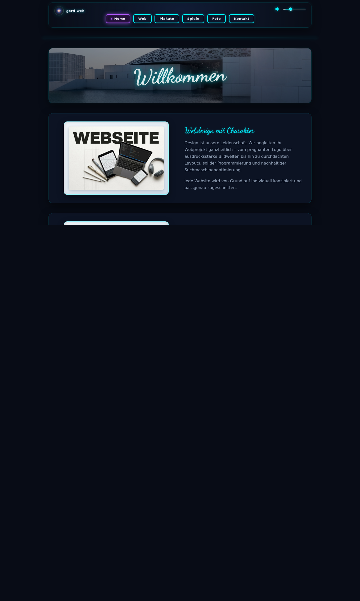

# UI Design System & Master Generation Blueprint: www-gerd-web-de

> **Gerd Web 3 Second - Design** (https://www.gerd-web.de) — Design ist unsere Leidenschaft. Wir begleiten Ihr Webprojekt ganzheitlich – vom prägnanten Logo über ausdrucksstarke Bildwelten bis hin z...



---

## 1. Executive Visual Persona & Design Archetype

- **Brand Essence & Persona**: **Gerd Web 3 Second - Design** (`https://www.gerd-web.de`). Design ist unsere Leidenschaft. Wir begleiten Ihr Webprojekt ganzheitlich – vom prägnanten Logo über ausdrucksstarke Bildwelten bis hin z...
- **Visual Archetype**: **High-Contrast Obsidian / Atmospheric Design System (`#080c16` canvas, `#e6edf8` ink, `#a855f7` accent)**.
- **Anti-AI-Slop Differentiators**:
  - **Source-Grounded Chromatic Polarity**: Anchors the viewport in `#080c16` (`var(--bg-base)` in `:root`) paired with `#e6edf8` primary typography and `#a855f7` accents.
  - **Extracted Typographic Hierarchy**: Pairs `Dancing Script` for display copy (`Webdesign mit Charakter`) with `Segoe UI` and not declared in static CSS (uses primary stack / `ui-monospace`).
  - **Calibrated Spatial Grid & Motion**: Combines `1100px` container bounds (`gap: 10px`, padding `14px`) with `cubic-bezier(0.4,0,0.2,1)` easing.

---

## 2. Spatial Architecture & Modular Grid Mathematics


### Viewport Allocation & Container Geometry
- **Captured Viewport Dimensions**: Desktop `1440×2574px` (`assets/desktop.png`, full-page scroll capture), Mobile `390×2400px` (`assets/mobile.png`, capped at 2400px multi-section capture).
- **Master Container Bounds**: `1100px` extracted from `www-gerd-web-de` stylesheet.
- **Canvas Lateral Padding & Spacing**: `14px` lateral canvas padding with `10px` grid gap.
- **Border Radius Scale**: `50%`, `16px`, `12px`, `8px`.

### Responsive Breakpoint Architecture
- **Desktop Layout**: Multi-column CSS Grid / Flexbox layout at `1440px` (`max-width: 1100px`, `gap: 10px`).
- **Mobile Layout**: Single-column vertical stack at `390px` viewport width with `14px` horizontal padding.
- **Extracted CSS Media Queries**: `@media (max-width: 768px)`, `@media (max-width: 480px)`.

---

## 3. Color System, Materiality & Atmospheric Lighting

### Semantic Palette & Source Grounding
| Semantic Role | Ground-Truth Value | Extracted CSS Source / Selector |
|---|---|---|
| **Primary Canvas Substrate** | `#080c16` | `var(--bg-base)` in `:root` |
| **Primary Typography Ink** | `#101c36` | `var(--bg-center)` in `:root` |
| **Elevated Surface / Card Substrate** | `#00f0ff` | `var(--net-color)` in `:root` |
| **Interactive Accent / Highlight** | `#a855f7` | `var(--active-color)` in `:root` |
| **Secondary / Muted Copy** | `#d8b4fe` | `var(--cursor-ring-color)` in `:root` |
| **Structural Hairline Border** | `#e6edf8` | `var(--text-color)` in `:root` |
| **Variable Token (`--text-muted`)** | `#94a3b8` | `var(--text-muted)` in `:root` |

### Sanitized Root CSS Variables (`ui-ux.md` Ground Truth)
| Variable Name | Extracted Value | Semantic Role |
|---|---|---|
| `--bg-base` | `#080c16` | Canvas / Surface Token |
| `--bg-center` | `#101c36` | Canvas / Surface Token |
| `--card-bg` | `rgba(14, 23, 42, 0.7)` | Canvas / Surface Token |
| `--net-color` | `#00f0ff` | Brand / Palette Token |
| `--net-glow` | `rgba(0, 240, 255, 0.35)` | Color / Atmospheric Token |
| `--btn-bg` | `rgba(13, 22, 41, 0.88)` | Canvas / Surface Token |
| `--btn-border` | `#00f0ff` | Elevation / Border Token |
| `--btn-hover-border` | `#00f0ff` | Elevation / Border Token |
| `--btn-hover-glow` | `rgba(0, 240, 255, 0.7)` | Color / Atmospheric Token |
| `--active-color` | `#a855f7` | Brand / Palette Token |
| `--active-glow` | `rgba(168, 85, 247, 0.75)` | Color / Atmospheric Token |
| `--cursor-ring-color` | `#d8b4fe` | Brand / Palette Token |
| `--cursor-ring-glow` | `rgba(168, 85, 247, 0.85)` | Elevation / Border Token |
| `--text-color` | `#e6edf8` | Typography Ink Token |
| `--text-muted` | `#94a3b8` | Typography Ink Token |
| `--section-spacing` | `40px` | Layout / Spatial Grid Token |

---

## 4. Typographic Scale & Editorial Hierarchy

### Font Family Stacks
- **Display Typography**: `Dancing Script`.
- **Primary Body Stack**: `Segoe UI`.
- **Technical / Metadata Stack**: not declared in static CSS (uses primary stack / `ui-monospace`).

### Typographic Scale & Rules (Extracted from Stylesheet & Variables)
- **Hero Display (`H1`)**: not explicitly declared on tag in static CSS (stylesheet font-size ladder: `13px`, `12px`, `78px`, `clamp(1.4rem, 4vw, 1.875rem)`, `1rem`).
- **Section Heading (`H2`)**: not explicitly declared on tag in static CSS (stylesheet font-size ladder: `13px`, `12px`, `78px`, `clamp(1.4rem, 4vw, 1.875rem)`, `1rem`).
- **Body Copy**: not explicitly declared on tag in static CSS (stylesheet font-size ladder: `13px`, `12px`, `78px`, `clamp(1.4rem, 4vw, 1.875rem)`, `1rem`).
- **Metadata & Navigation Labels**: not explicitly declared on tag in static CSS (stylesheet font-size ladder: `13px`, `12px`, `78px`, `clamp(1.4rem, 4vw, 1.875rem)`, `1rem`).

---

## 5. Choreographed Motion & Interaction Physics

### Primary Easing Curves
- **Extracted Timing Functions**: `cubic-bezier(0.4,0,0.2,1)`, `cubic-bezier(0.3,0,0.2,1)`, `cubic-bezier(0.25,1,0.5,1)`.

### Per-Element Transition & Choreography Rules
- **Selector `#custom-cursor`**: `transition: opacity 0.08s ease, border-color 0.18s ease, box-shadow 0.18s...` extracted from `www-gerd-web-de` stylesheet.
- **Selector `#cursor-dot`**: `transition: opacity 0.2s ease` extracted from `www-gerd-web-de` stylesheet.
- **Selector `#cursor-logo`**: `transition: opacity 0.15s ease, transform 0.65s cubic-bezier(0.4,0,0.2,1)` extracted from `www-gerd-web-de` stylesheet.
- **Extracted Easing Curve (`cubic-bezier(0.4,0,0.2,1)`)**: Governs interactive state transitions across `<nav.menu-container>` and `<section.impressum-section>`.
- **State & Hover Choreography**: Opacity and transform transitions on `<section.impressum-section>` and `<section.impressum-section>` interactive targets.

---

## 6. Component Wireframe & Structural DOM Map

### Visual Layout Schematic (Grounded in `dom.html` — `1440px` Desktop & `390px` Mobile Reflow)
```
┌────────────────────────────────────────────────────────────────────────┐
│ DESKTOP VIEWPORT (1440px) — Gerd Web 3 Second - Design                 │
│ ====================================================================== │
│ [ <nav.menu-container>     | Home · Web · Plakate · Spiele · Foto   ]  │
│ ---------------------------------------------------------------------- │
│ | HERO STAGE: <section.impressum-section>                          |   │
│ | H1: Webdesign mit Charakter                                      |   │
│ | Substrate: #080c16    | Ink: #e6edf8    | Accent: #a855f7        |   │
│ ---------------------------------------------------------------------- │
│ | SHOWCASE GRID (<section.impressum-section) max-w: 1100px         |   │
│ | +------------------------------+  +------------------------------+ | │
│ | | Design für Werbung und Unter |  | Fotografie & Porträts        | | │
│ | +------------------------------+  +------------------------------+ | │
│ ---------------------------------------------------------------------- │
│ | MOBILE VIEWPORT REFLOW (390px) — Single-Column Stack (gap: 10px  ) | │
│ | [<nav.menu-containe] -> [<section.impressum] -> [<section.impressum] │
│ ---------------------------------------------------------------------- │
│ [ FOOTER (<footer.sound-control>) | https://www.gerd-web.de            │
└────────────────────────────────────────────────────────────────────────┘
```

### Granular DOM Region Breakdown
1. **Brand Header & Navigation Bar (<nav.menu-container> — `www-gerd-web-de`)**:
   - Landmark `<nav class="menu-container">` hosting `Gerd Web 3 Second - Design` navigation (`Home · Web · Plakate · Spiele · Foto`), DOM attributes (`data-target="www-gerd-web-de"`), and stylesheet rule `cursor-dot { opacity: 0 !important; }`.
2. **Hero Stage & Focal Lead (<section.impressum-section> — `Webdesign mit Charakter`)**:
   - Landmark `<section class="impressum-section">` presenting display lead `Webdesign mit Charakter` and copy excerpt *"Design ist unsere Leidenschaft. Wir begleiten Ihr Webprojekt ganz"* over `#080c16` canvas and `#e6edf8` ink.
3. **Primary Showcase & Content Grid (<section.impressum-section> — `Design für Werbung und Unterhaltun`)**:
   - Landmark `<section class="impressum-section">` rendering section `Design für Werbung und Unterhaltung` with copy *"Jede Website wird von Grund auf individuell konzipiert und passge"*, asset references (`logo.png (Logo)`, `banner-index.jpg (Willkommen Banner)`, `index-webseite.jpg (Titelbild Startseite)`, `index-design.jpg (Fotografie Startseite)`), and grid rule `custom-cursor.hovering { box-shadow: 0 0 18px var(--active-glow), 0 0 28px rgba(168, 85, 247, 0.6); }`.
4. **Interactive Detail & Feature Matrix (<section.impressum-section> — `Fotografie & Porträts`)**:
   - Landmark `<section class="impressum-section">` framing `Fotografie & Porträts` and `Über mich` (*"Neben Webseiten gestalten wir unter anderem Interfaces und Visual"*) with `#00f0ff` surface cards, `#a855f7` accents, and `cursor-logo.rotated { opacity: 1; }`.
5. **Colophon & Global Directory Footer (<footer.sound-control> — `https://www.gerd-web.de`)**:
   - Landmark `<footer class="sound-control">` anchoring `Gerd Web 3 Second - Design` footer links (`Home · Web · Plakate · Spiele · Foto`), copy *"Ob Smartphone, Tablet oder Desktop: Dank Responsive Design p"*, and `#e6edf8` structural dividers.

---

## 7. Master Zero-Shot AI Generation Prompt

```markdown
# Master Zero-Shot Frontend Generation Prompt: www-gerd-web-de (Gerd Web 3 Second - Design)

You are a principal frontend architect and design systems engineer. Build a complete, production-ready web application replicating the exact design system, DOM landmarks, typographic hierarchy, color tokens, and motion physics of `www-gerd-web-de` (**Gerd Web 3 Second - Design** — `https://www.gerd-web.de`).

### 1. Visual Archetype & Anti-AI-Slop Mandates
- **Archetype**: High-Contrast Obsidian / Atmospheric Design System (`#080c16` canvas, `#e6edf8` ink, `#a855f7` accent).
- **Identity & Domain Context**: Design ist unsere Leidenschaft. Wir begleiten Ihr Webprojekt ganzheitlich – vom prägnanten Logo über ausdrucksstarke Bildwelten bis hin z...
- **Primary Substrate**: `#080c16` (`var(--bg-base)` in `:root`), **Primary Ink**: `#e6edf8`, **Accent / Highlight**: `#a855f7`.
- **Site-Specific Differentiators**:
  - **Source-Grounded Chromatic Polarity**: Anchors the viewport in `#080c16` (`var(--bg-base)` in `:root`) paired with `#e6edf8` primary typography and `#a855f7` accents.
  - **Extracted Typographic Hierarchy**: Pairs `Dancing Script` for display copy (`Webdesign mit Charakter`) with `Segoe UI` and not declared in static CSS (uses primary stack / `ui-monospace`).
  - **Calibrated Spatial Grid & Motion**: Combines `1100px` container bounds (`gap: 10px`, padding `14px`) with `cubic-bezier(0.4,0,0.2,1)` easing.

### 2. Ground-Truth CSS Variables (`:root` Token Contract)
Declare and consume these exact custom properties extracted from `www-gerd-web-de` in your global stylesheet:

:root {
  /* Gerd Web 3 Second - Design (www-gerd-web-de) — Ground-Truth Extracted CSS Variables */
  --bg-base: #080c16; /* Canvas / Surface Token (www-gerd-web-de) */
  --bg-center: #101c36; /* Canvas / Surface Token (www-gerd-web-de) */
  --card-bg: rgba(14, 23, 42, 0.7); /* Canvas / Surface Token (www-gerd-web-de) */
  --net-color: #00f0ff; /* Brand / Palette Token (www-gerd-web-de) */
  --net-glow: rgba(0, 240, 255, 0.35); /* Color / Atmospheric Token (www-gerd-web-de) */
  --btn-bg: rgba(13, 22, 41, 0.88); /* Canvas / Surface Token (www-gerd-web-de) */
  --btn-border: #00f0ff; /* Elevation / Border Token (www-gerd-web-de) */
  --btn-hover-border: #00f0ff; /* Elevation / Border Token (www-gerd-web-de) */
  --btn-hover-glow: rgba(0, 240, 255, 0.7); /* Color / Atmospheric Token (www-gerd-web-de) */
  --active-color: #a855f7; /* Brand / Palette Token (www-gerd-web-de) */
  --active-glow: rgba(168, 85, 247, 0.75); /* Color / Atmospheric Token (www-gerd-web-de) */
  --cursor-ring-color: #d8b4fe; /* Brand / Palette Token (www-gerd-web-de) */
  --cursor-ring-glow: rgba(168, 85, 247, 0.85); /* Elevation / Border Token (www-gerd-web-de) */
  --text-color: #e6edf8; /* Typography Ink Token (www-gerd-web-de) */
  --text-muted: #94a3b8; /* Typography Ink Token (www-gerd-web-de) */
  --section-spacing: 40px; /* Layout / Spatial Grid Token (www-gerd-web-de) */
}

### 3. Semantic Color & Materiality Contract
Map every surface, ink, and border strictly to these source-grounded tokens:
- **Primary Canvas Substrate**: `#080c16` — grounded in `var(--bg-base)` in `:root`
- **Primary Typography Ink**: `#101c36` — grounded in `var(--bg-center)` in `:root`
- **Elevated Surface / Card Substrate**: `#00f0ff` — grounded in `var(--net-color)` in `:root`
- **Interactive Accent / Highlight**: `#a855f7` — grounded in `var(--active-color)` in `:root`
- **Secondary / Muted Copy**: `#d8b4fe` — grounded in `var(--cursor-ring-color)` in `:root`
- **Structural Hairline Border**: `#e6edf8` — grounded in `var(--text-color)` in `:root`
- **Variable Token (`--text-muted`)**: `#94a3b8` — grounded in `var(--text-muted)` in `:root`

### 4. Spatial Grid, Container Bounds & Responsive Breakpoints
- **Desktop Viewport Reference**: `1440×2574px` (full-page scroll capture, `1440px` standard desktop width).
- **Mobile Viewport Reference**: `390×2400px` (capped at 2400px multi-section capture, `390px` standard mobile width).
- **Container Max-Width**: `1100px` extracted from `www-gerd-web-de` stylesheet
- **Padding & Gutters**: `14px` lateral canvas padding with `10px` grid gap
- **Desktop Grid**: Multi-column CSS Grid / Flexbox layout at `1440px` (`max-width: 1100px`, `gap: 10px`)
- **Mobile Adaptation**: Single-column vertical stack at `390px` viewport width with `14px` horizontal padding
- **Media Queries**: `@media (max-width: 768px)`, `@media (max-width: 480px)`
- **Corner Radii**: `50%`, `16px`, `12px`, `8px`

### 5. Typography & Editorial Scale Contract
- **Display Font Stack**: `Dancing Script`
- **Body Font Stack**: `Segoe UI`
- **Monospace / Technical Font Stack**: not declared in static CSS (uses primary stack / `ui-monospace`)
- **H1 Display Rule**: not explicitly declared on tag in static CSS (stylesheet font-size ladder: `13px`, `12px`, `78px`, `clamp(1.4rem, 4vw, 1.875rem)`, `1rem`)
- **H2 Section Rule**: not explicitly declared on tag in static CSS (stylesheet font-size ladder: `13px`, `12px`, `78px`, `clamp(1.4rem, 4vw, 1.875rem)`, `1rem`)
- **Body Copy Rule**: not explicitly declared on tag in static CSS (stylesheet font-size ladder: `13px`, `12px`, `78px`, `clamp(1.4rem, 4vw, 1.875rem)`, `1rem`)
- **Metadata & Index Rule**: not explicitly declared on tag in static CSS (stylesheet font-size ladder: `13px`, `12px`, `78px`, `clamp(1.4rem, 4vw, 1.875rem)`, `1rem`)

### 6. Component Hierarchy, Verbatim Copy & Real DOM Landmarks
Scaffold `www-gerd-web-de` (`Gerd Web 3 Second - Design`) with these exact structural regions, extracted copy, and CSS rules from `dom.html`:
1. **Brand Header & Navigation Bar (<nav.menu-container> — `www-gerd-web-de`)**:
   - DOM & Selectors: Landmark `<nav class="menu-container">` hosting `Gerd Web 3 Second - Design` navigation (`Home · Web · Plakate · Spiele · Foto`), DOM attributes (`data-target="www-gerd-web-de"`), and stylesheet rule `cursor-dot { opacity: 0 !important; }`.
   - Responsive Contract: Header `Brand Header & Navigation Bar (<nav.menu-container> — `www-gerd-web-de`)` (`www-gerd-web-de`) adapts across `@media (max-width: 768px)`, `@media (max-width: 480px)` with `cubic-bezier(0.4,0,0.2,1)`, `cubic-bezier(0.3,0,0.2,1)`, `cubic-bezier(0.25,1,0.5,1)` transitions and links `Home · Web · Plakate · Spiele · Foto`.
2. **Hero Stage & Focal Lead (<section.impressum-section> — `Webdesign mit Charakter`)**:
   - DOM & Selectors: Landmark `<section class="impressum-section">` presenting display lead `Webdesign mit Charakter` and copy excerpt *"Design ist unsere Leidenschaft. Wir begleiten Ihr Webprojekt ganz"* over `#080c16` canvas and `#e6edf8` ink.
   - Responsive Contract: Hero stage (`1440×2574px` desktop / `390×2400px` mobile) sets `#080c16` background with `#e6edf8` headline `Webdesign mit Charakter`.
3. **Primary Showcase & Content Grid (<section.impressum-section> — `Design für Werbung und Unterhaltun`)**:
   - DOM & Selectors: Landmark `<section class="impressum-section">` rendering section `Design für Werbung und Unterhaltung` with copy *"Jede Website wird von Grund auf individuell konzipiert und passge"*, asset references (`logo.png (Logo)`, `banner-index.jpg (Willkommen Banner)`, `index-webseite.jpg (Titelbild Startseite)`, `index-design.jpg (Fotografie Startseite)`), and grid rule `custom-cursor.hovering { box-shadow: 0 0 18px var(--active-glow), 0 0 28px rgba(168, 85, 247, 0.6); }`.
   - Responsive Contract: Showcase grid `Primary Showcase & Content Grid (<section.impressum-section> — `Design für Werbung und Unterhaltun`)` applies Multi-column CSS Grid / Flexbox layout at `1440px` (`max-width: 1100px`, `gap: 10px`) on desktop and Single-column vertical stack at `390px` viewport width with `14px` horizontal padding on mobile.
4. **Interactive Detail & Feature Matrix (<section.impressum-section> — `Fotografie & Porträts`)**:
   - DOM & Selectors: Landmark `<section class="impressum-section">` framing `Fotografie & Porträts` and `Über mich` (*"Neben Webseiten gestalten wir unter anderem Interfaces und Visual"*) with `#00f0ff` surface cards, `#a855f7` accents, and `cursor-logo.rotated { opacity: 1; }`.
   - Responsive Contract: Detail module `Interactive Detail & Feature Matrix (<section.impressum-section> — `Fotografie & Porträts`)` uses `50%`, `16px`, `12px`, `8px` radii, `#a855f7` highlights, and assets (logo.png (Logo), banner-index.jpg (Willkommen Banner), index-webseite.jpg (Titelbild Startseite)).
5. **Colophon & Global Directory Footer (<footer.sound-control> — `https://www.gerd-web.de`)**:
   - DOM & Selectors: Landmark `<footer class="sound-control">` anchoring `Gerd Web 3 Second - Design` footer links (`Home · Web · Plakate · Spiele · Foto`), copy *"Ob Smartphone, Tablet oder Desktop: Dank Responsive Design p"*, and `#e6edf8` structural dividers.
   - Responsive Contract: Footer `Colophon & Global Directory Footer (<footer.sound-control> — `https://www.gerd-web.de`)` aligns to `1100px` extracted from `www-gerd-web-de` stylesheet with `14px` lateral canvas padding with `10px` grid gap and attributes (www-gerd-web-de).

#### Verbatim DOM Copy Excerpts (`dom.html`)
- Copy Excerpt 1: *"Design ist unsere Leidenschaft. Wir begleiten Ihr Webprojekt ganzheitlich – vom pr..."*
- Copy Excerpt 2: *"Jede Website wird von Grund auf individuell konzipiert und passgenau zugeschnitten."*
- Copy Excerpt 3: *"Neben Webseiten gestalten wir unter anderem Interfaces und Visuals für Spiele sowi..."*
- Copy Excerpt 4: *"Ob Smartphone, Tablet oder Desktop: Dank Responsive Design passen sich alle Elemen..."*

### 7. Motion, Extracted Stylesheet Rules & Interaction Choreography
- **Primary Easing Functions**: `cubic-bezier(0.4,0,0.2,1)`, `cubic-bezier(0.3,0,0.2,1)`, `cubic-bezier(0.25,1,0.5,1)`
- **Extracted Stylesheet Rules (`www-gerd-web-de`)**:
- `cursor-dot { opacity: 0 !important; }`
- `custom-cursor.hovering { box-shadow: 0 0 18px var(--active-glow), 0 0 28px rgba(168, 85, 247, 0.6); }`
- `cursor-logo.rotated { opacity: 1; }`
- `body.page-fading-out { opacity: 0.15; }`
- `banner-container.scrolled .banner... { top: 10px; }`
- **Per-Selector Transition Rules**:
- **Selector `#custom-cursor`**: `transition: opacity 0.08s ease, border-color 0.18s ease, box-shadow 0.18s...` extracted from `www-gerd-web-de` stylesheet.
- **Selector `#cursor-dot`**: `transition: opacity 0.2s ease` extracted from `www-gerd-web-de` stylesheet.
- **Selector `#cursor-logo`**: `transition: opacity 0.15s ease, transform 0.65s cubic-bezier(0.4,0,0.2,1)` extracted from `www-gerd-web-de` stylesheet.
- **Extracted Easing Curve (`cubic-bezier(0.4,0,0.2,1)`)**: Governs interactive state transitions across `<nav.menu-container>` and `<section.impressum-section>`.
- **State & Hover Choreography**: Opacity and transform transitions on `<section.impressum-section>` and `<section.impressum-section>` interactive targets.

### 8. Technical Deliverables
- Implement in Next.js (App Router) with TypeScript and Tailwind CSS consuming the `:root` custom properties defined above for `www-gerd-web-de`.
- Reproduce both the `1440px` desktop architecture and `390px` mobile breakpoint transitions, preserving semantic HTML5 landmarks (`<header>`, `<nav>`, `<main>`, `<section>`, `<footer>`) and `prefers-reduced-motion` accessibility guards.
```
