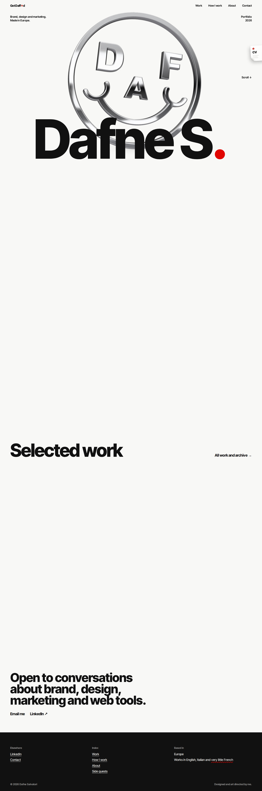
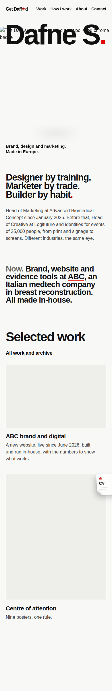

# UI Design System & Master Generation Blueprint: www-get-daffed-com

> **Dafne Salvatori · Brand, design and marketing, Europe** (https://www.get-daffed.com/) — Dafne Salvatori: Italian creative working across art direction, brand and marketing.



---

## 1. Executive Visual Persona & Design Archetype

- **Brand Essence & Persona**: **Dafne Salvatori · Brand, design and marketing, Europe** (`https://www.get-daffed.com/`). Dafne Salvatori: Italian creative working across art direction, brand and marketing.
- **Visual Archetype**: **Light-Substrate Editorial & Modular Grid System (`#f8f8f6` canvas, `#111` ink, `#111` accent)**.
- **Anti-AI-Slop Differentiators**:
  - **Source-Grounded Chromatic Polarity**: Anchors the viewport in `#f8f8f6` (`var(--paper)` in `:root`) paired with `#111` primary typography and `#111` accents.
  - **Extracted Typographic Hierarchy**: Pairs `Inter Tight Variable` for display copy (`Dafne S .`) with `Inter Tight Variable` and not declared in static CSS (uses primary stack / `ui-monospace`).
  - **Calibrated Spatial Grid & Motion**: Combines `var(--maxw)` container bounds (`gap: var(--gutter)`, padding `var(--margin)`) with `cubic-bezier(.16,1,.3,1)` easing.

---

## 2. Spatial Architecture & Modular Grid Mathematics



### Viewport Allocation & Container Geometry
- **Captured Viewport Dimensions**: Desktop `1440×4331px` (`assets/desktop.png`, full-page scroll capture), Mobile `390×2400px` (`assets/mobile.png`, capped at 2400px multi-section capture).
- **Master Container Bounds**: `var(--maxw)` extracted from `www-get-daffed-com` stylesheet.
- **Canvas Lateral Padding & Spacing**: `var(--margin)` lateral canvas padding with `var(--gutter)` grid gap.
- **Border Radius Scale**: `2px`, `50%`, `999px`, `30px`.

### Responsive Breakpoint Architecture
- **Desktop Layout**: Multi-column CSS Grid / Flexbox layout at `1440px` (`max-width: var(--maxw)`, `gap: var(--gutter)`).
- **Mobile Layout**: Single-column vertical stack at `390px` viewport width with `var(--margin)` horizontal padding.
- **Extracted CSS Media Queries**: `@media (prefers-reduced-motion:reduce)`, `@media (width<=760px)`, `@media (width<=860px)`, `@media (width<=960px)`.

---

## 3. Color System, Materiality & Atmospheric Lighting

### Semantic Palette & Source Grounding
| Semantic Role | Ground-Truth Value | Extracted CSS Source / Selector |
|---|---|---|
| **Primary Canvas Substrate** | `#f8f8f6` | `var(--paper)` in `:root` |
| **Primary Typography Ink** | `#eeeeeb` | `var(--paper-2)` in `:root` |
| **Elevated Surface / Card Substrate** | `#e4e4e0` | `var(--tissue)` in `:root` |
| **Interactive Accent / Highlight** | `#111` | `var(--ink)` in `:root` |
| **Secondary / Muted Copy** | `#474745` | `var(--ink-2)` in `:root` |
| **Structural Hairline Border** | `#6b6b66` | `var(--ink-3)` in `:root` |
| **Variable Token (`--line`)** | `#11111124` | `var(--line)` in `:root` |
| **Variable Token (`--line-strong`)** | `#1119` | `var(--line-strong)` in `:root` |
| **Variable Token (`--accent`)** | `#c3d0df` | `var(--accent)` in `:root` |
| **Variable Token (`--accent-ink`)** | `#2d3b4d` | `var(--accent-ink)` in `:root` |
| **Variable Token (`--signal`)** | `#ff3d1f` | `var(--signal)` in `:root` |
| **Variable Token (`--red`)** | `#e10600` | `var(--red)` in `:root` |

### Sanitized Root CSS Variables (`ui-ux.md` Ground Truth)
| Variable Name | Extracted Value | Semantic Role |
|---|---|---|
| `--paper` | `#f8f8f6` | Canvas / Surface Token |
| `--paper-2` | `#eeeeeb` | Canvas / Surface Token |
| `--tissue` | `#e4e4e0` | Color / Atmospheric Token |
| `--ink` | `#111` | Typography Ink Token |
| `--ink-2` | `#474745` | Typography Ink Token |
| `--ink-3` | `#6b6b66` | Typography Ink Token |
| `--line` | `#11111124` | Color / Atmospheric Token |
| `--line-strong` | `#1119` | Color / Atmospheric Token |
| `--accent` | `#c3d0df` | Brand / Palette Token |
| `--accent-ink` | `#2d3b4d` | Typography Ink Token |
| `--signal` | `#ff3d1f` | Color / Atmospheric Token |
| `--red` | `#e10600` | Color / Atmospheric Token |
| `--margin` | `clamp(20px, 4vw, 56px)` | Layout / Spatial Grid Token |
| `--gutter` | `clamp(12px, 1.6vw, 24px)` | Layout / Spatial Grid Token |
| `--maxw` | `1680px` | Dimension / Scale Token |
| `--header-h` | `64px` | Layout / Spatial Grid Token |

---

## 4. Typographic Scale & Editorial Hierarchy

### Font Family Stacks
- **Display Typography**: `Inter Tight Variable`.
- **Primary Body Stack**: `Inter Tight Variable`.
- **Technical / Metadata Stack**: not declared in static CSS (uses primary stack / `ui-monospace`).

### Typographic Scale & Rules (Extracted from Stylesheet & Variables)
- **Hero Display (`H1`)**: not explicitly declared on tag in static CSS (stylesheet font-size ladder: `var(--step-0)`, `var(--step--1)`, `.875rem`, `var(--step-5)`, `var(--step-4)`).
- **Section Heading (`H2`)**: not explicitly declared on tag in static CSS (stylesheet font-size ladder: `var(--step-0)`, `var(--step--1)`, `.875rem`, `var(--step-5)`, `var(--step-4)`).
- **Body Copy**: not explicitly declared on tag in static CSS (stylesheet font-size ladder: `var(--step-0)`, `var(--step--1)`, `.875rem`, `var(--step-5)`, `var(--step-4)`).
- **Metadata & Navigation Labels**: rule `,.label` (`font-size: .875rem`, `line-height: 1.3`, `letter-spacing: -.01em`, `font-weight: 650`).

---

## 5. Choreographed Motion & Interaction Physics

### Primary Easing Curves
- **Extracted Timing Functions**: `cubic-bezier(.16,1,.3,1)`, `cubic-bezier(.65,0,.35,1)`, `cubic-bezier(.3,1.6,.5,1)`.

### Per-Element Transition & Choreography Rules
- **Selector `.link`**: `transition: background-size .5s var(--ease-out)` extracted from `www-get-daffed-com` stylesheet.
- **Selector `.arrow-link span[aria-hidden]`**: `transition: transform .45s var(--ease-out)` extracted from `www-get-daffed-com` stylesheet.
- **Selector `.big-link span[aria-hidden]`**: `transition: transform .5s var(--ease-out)` extracted from `www-get-daffed-com` stylesheet.
- **Extracted Easing Curve (`cubic-bezier(.16,1,.3,1)`)**: Governs interactive state transitions across `<header.site-header>` and `<section.intro>`.
- **State & Hover Choreography**: Opacity and transform transitions on `<section.hero>` and `<section.intro>` interactive targets.

---

## 6. Component Wireframe & Structural DOM Map

### Visual Layout Schematic (Grounded in `dom.html` — `1440px` Desktop & `390px` Mobile Reflow)
```
┌────────────────────────────────────────────────────────────────────────┐
│ DESKTOP VIEWPORT (1440px) — Dafne Salvatori · Brand, design and market │
│ ====================================================================== │
│ [ <header.site-header>     | Work · Side quests · How I work · Abou ]  │
│ ---------------------------------------------------------------------- │
│ | HERO STAGE: <section.hero>                                       |   │
│ | H1: Dafne S .                                                    |   │
│ | Substrate: #f8f8f6    | Ink: #111       | Accent: #111           |   │
│ ---------------------------------------------------------------------- │
│ | SHOWCASE GRID (<section.intro>           ) max-w: var(--maxw)    |   │
│ | +------------------------------+  +------------------------------+ | │
│ | | Designer by training. Market |  | Now. Brand, website and evid | | │
│ | +------------------------------+  +------------------------------+ | │
│ ---------------------------------------------------------------------- │
│ | MOBILE VIEWPORT REFLOW (390px) — Single-Column Stack (gap: var(--) | │
│ | [<header.site-heade] -> [<section.hero>] -> [<section.intro>] |      │
│ ---------------------------------------------------------------------- │
│ [ FOOTER (<footer.site-footer>  ) | https://www.get-daffed.com/        │
└────────────────────────────────────────────────────────────────────────┘
```

### Granular DOM Region Breakdown
1. **Brand Header & Navigation Bar (<header.site-header> — `www-get-daffed-com`)**:
   - Landmark `<header class="site-header">` hosting `Dafne Salvatori · Brand, design and ` navigation (`Work · Side quests · How I work · About · Contact`), DOM attributes (`data-header`, `data-astro-cid-nen7h5rs`, `data-astro-cid-vjgwiq3r`, `data-drop`), and stylesheet rule `after { box-sizing:border-box }`.
2. **Hero Stage & Focal Lead (<section.hero> — `Dafne S .`)**:
   - Landmark `<section class="hero">` presenting display lead `Dafne S .` and copy excerpt *"Brand, design and marketing. Made in Europe."* over `#f8f8f6` canvas and `#111` ink.
3. **Primary Showcase & Content Grid (<section.intro> — `Designer by training. Marketer by `)**:
   - Landmark `<section class="intro wrap">` rendering section `Designer by training. Marketer by trade. Builder...` with copy *"Head of Marketing at Advanced Biomedical Concept since January 20"*, asset references (`favicon.svg`, `favicon-32.png`, `apple-touch-icon.png`, `sitemap-index.xml`), and grid rule `html { -webkit-text-size-adjust:100%;text-size-adjust:100%;scroll-behavior:smooth }`.
4. **Interactive Detail & Feature Matrix (<section.section> — `Now. Brand, website and evidence t`)**:
   - Landmark `<section class="section now">` framing `Now. Brand, website and evidence tools at ABC , a...` and `Selected work` (*"All work and archive →"*) with `#e4e4e0` surface cards, `#111` accents, and `canvas { max-width:100%;display:block }`.
5. **Colophon & Global Directory Footer (<footer.site-footer> — `https://www.get-daffed.com/`)**:
   - Landmark `<footer class="site-footer">` anchoring `Dafne Salvatori · Brand, design ` footer links (`Work · Side quests · How I work · About · Contact`), copy *"ABC brand and digital A new website, live since June 2026, b"*, and `#6b6b66` structural dividers.

---

## 7. Master Zero-Shot AI Generation Prompt

```markdown
# Master Zero-Shot Frontend Generation Prompt: www-get-daffed-com (Dafne Salvatori · Brand, design and marketing, Europe)

You are a principal frontend architect and design systems engineer. Build a complete, production-ready web application replicating the exact design system, DOM landmarks, typographic hierarchy, color tokens, and motion physics of `www-get-daffed-com` (**Dafne Salvatori · Brand, design and marketing, Europe** — `https://www.get-daffed.com/`).

### 1. Visual Archetype & Anti-AI-Slop Mandates
- **Archetype**: Light-Substrate Editorial & Modular Grid System (`#f8f8f6` canvas, `#111` ink, `#111` accent).
- **Identity & Domain Context**: Dafne Salvatori: Italian creative working across art direction, brand and marketing.
- **Primary Substrate**: `#f8f8f6` (`var(--paper)` in `:root`), **Primary Ink**: `#111`, **Accent / Highlight**: `#111`.
- **Site-Specific Differentiators**:
  - **Source-Grounded Chromatic Polarity**: Anchors the viewport in `#f8f8f6` (`var(--paper)` in `:root`) paired with `#111` primary typography and `#111` accents.
  - **Extracted Typographic Hierarchy**: Pairs `Inter Tight Variable` for display copy (`Dafne S .`) with `Inter Tight Variable` and not declared in static CSS (uses primary stack / `ui-monospace`).
  - **Calibrated Spatial Grid & Motion**: Combines `var(--maxw)` container bounds (`gap: var(--gutter)`, padding `var(--margin)`) with `cubic-bezier(.16,1,.3,1)` easing.

### 2. Ground-Truth CSS Variables (`:root` Token Contract)
Declare and consume these exact custom properties extracted from `www-get-daffed-com` in your global stylesheet:

:root {
  /* Dafne Salvatori · Brand, design and marketing, Europe (www-get-daffed-com) — Ground-Truth Extracted CSS Variables */
  --paper: #f8f8f6; /* Canvas / Surface Token (www-get-daffed-com) */
  --paper-2: #eeeeeb; /* Canvas / Surface Token (www-get-daffed-com) */
  --tissue: #e4e4e0; /* Color / Atmospheric Token (www-get-daffed-com) */
  --ink: #111; /* Typography Ink Token (www-get-daffed-com) */
  --ink-2: #474745; /* Typography Ink Token (www-get-daffed-com) */
  --ink-3: #6b6b66; /* Typography Ink Token (www-get-daffed-com) */
  --line: #11111124; /* Color / Atmospheric Token (www-get-daffed-com) */
  --line-strong: #1119; /* Color / Atmospheric Token (www-get-daffed-com) */
  --accent: #c3d0df; /* Brand / Palette Token (www-get-daffed-com) */
  --accent-ink: #2d3b4d; /* Typography Ink Token (www-get-daffed-com) */
  --signal: #ff3d1f; /* Color / Atmospheric Token (www-get-daffed-com) */
  --red: #e10600; /* Color / Atmospheric Token (www-get-daffed-com) */
  --margin: clamp(20px, 4vw, 56px); /* Layout / Spatial Grid Token (www-get-daffed-com) */
  --gutter: clamp(12px, 1.6vw, 24px); /* Layout / Spatial Grid Token (www-get-daffed-com) */
  --maxw: 1680px; /* Dimension / Scale Token (www-get-daffed-com) */
  --header-h: 64px; /* Layout / Spatial Grid Token (www-get-daffed-com) */
}

### 3. Semantic Color & Materiality Contract
Map every surface, ink, and border strictly to these source-grounded tokens:
- **Primary Canvas Substrate**: `#f8f8f6` — grounded in `var(--paper)` in `:root`
- **Primary Typography Ink**: `#eeeeeb` — grounded in `var(--paper-2)` in `:root`
- **Elevated Surface / Card Substrate**: `#e4e4e0` — grounded in `var(--tissue)` in `:root`
- **Interactive Accent / Highlight**: `#111` — grounded in `var(--ink)` in `:root`
- **Secondary / Muted Copy**: `#474745` — grounded in `var(--ink-2)` in `:root`
- **Structural Hairline Border**: `#6b6b66` — grounded in `var(--ink-3)` in `:root`
- **Variable Token (`--line`)**: `#11111124` — grounded in `var(--line)` in `:root`
- **Variable Token (`--line-strong`)**: `#1119` — grounded in `var(--line-strong)` in `:root`
- **Variable Token (`--accent`)**: `#c3d0df` — grounded in `var(--accent)` in `:root`
- **Variable Token (`--accent-ink`)**: `#2d3b4d` — grounded in `var(--accent-ink)` in `:root`
- **Variable Token (`--signal`)**: `#ff3d1f` — grounded in `var(--signal)` in `:root`
- **Variable Token (`--red`)**: `#e10600` — grounded in `var(--red)` in `:root`

### 4. Spatial Grid, Container Bounds & Responsive Breakpoints
- **Desktop Viewport Reference**: `1440×4331px` (full-page scroll capture, `1440px` standard desktop width).
- **Mobile Viewport Reference**: `390×2400px` (capped at 2400px multi-section capture, `390px` standard mobile width).
- **Container Max-Width**: `var(--maxw)` extracted from `www-get-daffed-com` stylesheet
- **Padding & Gutters**: `var(--margin)` lateral canvas padding with `var(--gutter)` grid gap
- **Desktop Grid**: Multi-column CSS Grid / Flexbox layout at `1440px` (`max-width: var(--maxw)`, `gap: var(--gutter)`)
- **Mobile Adaptation**: Single-column vertical stack at `390px` viewport width with `var(--margin)` horizontal padding
- **Media Queries**: `@media (prefers-reduced-motion:reduce)`, `@media (width<=760px)`, `@media (width<=860px)`, `@media (width<=960px)`
- **Corner Radii**: `2px`, `50%`, `999px`, `30px`

### 5. Typography & Editorial Scale Contract
- **Display Font Stack**: `Inter Tight Variable`
- **Body Font Stack**: `Inter Tight Variable`
- **Monospace / Technical Font Stack**: not declared in static CSS (uses primary stack / `ui-monospace`)
- **H1 Display Rule**: not explicitly declared on tag in static CSS (stylesheet font-size ladder: `var(--step-0)`, `var(--step--1)`, `.875rem`, `var(--step-5)`, `var(--step-4)`)
- **H2 Section Rule**: not explicitly declared on tag in static CSS (stylesheet font-size ladder: `var(--step-0)`, `var(--step--1)`, `.875rem`, `var(--step-5)`, `var(--step-4)`)
- **Body Copy Rule**: not explicitly declared on tag in static CSS (stylesheet font-size ladder: `var(--step-0)`, `var(--step--1)`, `.875rem`, `var(--step-5)`, `var(--step-4)`)
- **Metadata & Index Rule**: rule `,.label` (`font-size: .875rem`, `line-height: 1.3`, `letter-spacing: -.01em`, `font-weight: 650`)

### 6. Component Hierarchy, Verbatim Copy & Real DOM Landmarks
Scaffold `www-get-daffed-com` (`Dafne Salvatori · Brand, design and marketing, Europe`) with these exact structural regions, extracted copy, and CSS rules from `dom.html`:
1. **Brand Header & Navigation Bar (<header.site-header> — `www-get-daffed-com`)**:
   - DOM & Selectors: Landmark `<header class="site-header">` hosting `Dafne Salvatori · Brand, design and ` navigation (`Work · Side quests · How I work · About · Contact`), DOM attributes (`data-header`, `data-astro-cid-nen7h5rs`, `data-astro-cid-vjgwiq3r`, `data-drop`), and stylesheet rule `after { box-sizing:border-box }`.
   - Responsive Contract: Header `Brand Header & Navigation Bar (<header.site-header> — `www-get-daffed-com`)` (`www-get-daffed-com`) adapts across `@media (prefers-reduced-motion:reduce)`, `@media (width<=760px)`, `@media (width<=860px)`, `@media (width<=960px)` with `cubic-bezier(.16,1,.3,1)`, `cubic-bezier(.65,0,.35,1)`, `cubic-bezier(.3,1.6,.5,1)` transitions and links `Work · Side quests · How I work · About · Contact`.
2. **Hero Stage & Focal Lead (<section.hero> — `Dafne S .`)**:
   - DOM & Selectors: Landmark `<section class="hero">` presenting display lead `Dafne S .` and copy excerpt *"Brand, design and marketing. Made in Europe."* over `#f8f8f6` canvas and `#111` ink.
   - Responsive Contract: Hero stage (`1440×4331px` desktop / `390×2400px` mobile) sets `#f8f8f6` background with `#111` headline `Dafne S .`.
3. **Primary Showcase & Content Grid (<section.intro> — `Designer by training. Marketer by `)**:
   - DOM & Selectors: Landmark `<section class="intro wrap">` rendering section `Designer by training. Marketer by trade. Builder...` with copy *"Head of Marketing at Advanced Biomedical Concept since January 20"*, asset references (`favicon.svg`, `favicon-32.png`, `apple-touch-icon.png`, `sitemap-index.xml`), and grid rule `html { -webkit-text-size-adjust:100%;text-size-adjust:100%;scroll-behavior:smooth }`.
   - Responsive Contract: Showcase grid `Primary Showcase & Content Grid (<section.intro> — `Designer by training. Marketer by `)` applies Multi-column CSS Grid / Flexbox layout at `1440px` (`max-width: var(--maxw)`, `gap: var(--gutter)`) on desktop and Single-column vertical stack at `390px` viewport width with `var(--margin)` horizontal padding on mobile.
4. **Interactive Detail & Feature Matrix (<section.section> — `Now. Brand, website and evidence t`)**:
   - DOM & Selectors: Landmark `<section class="section now">` framing `Now. Brand, website and evidence tools at ABC , a...` and `Selected work` (*"All work and archive →"*) with `#e4e4e0` surface cards, `#111` accents, and `canvas { max-width:100%;display:block }`.
   - Responsive Contract: Detail module `Interactive Detail & Feature Matrix (<section.section> — `Now. Brand, website and evidence t`)` uses `2px`, `50%`, `999px`, `30px` radii, `#111` highlights, and assets (favicon.svg, favicon-32.png, apple-touch-icon.png).
5. **Colophon & Global Directory Footer (<footer.site-footer> — `https://www.get-daffed.com/`)**:
   - DOM & Selectors: Landmark `<footer class="site-footer">` anchoring `Dafne Salvatori · Brand, design ` footer links (`Work · Side quests · How I work · About · Contact`), copy *"ABC brand and digital A new website, live since June 2026, b"*, and `#6b6b66` structural dividers.
   - Responsive Contract: Footer `Colophon & Global Directory Footer (<footer.site-footer> — `https://www.get-daffed.com/`)` aligns to `var(--maxw)` extracted from `www-get-daffed-com` stylesheet with `var(--margin)` lateral canvas padding with `var(--gutter)` grid gap and attributes (data-header, data-astro-cid-nen7h5rs, data-astro-cid-vjgwiq3r).

#### Verbatim DOM Copy Excerpts (`dom.html`)
- Copy Excerpt 1: *"Brand, design and marketing. Made in Europe."*
- Copy Excerpt 2: *"Head of Marketing at Advanced Biomedical Concept since January 2026. Before that,..."*
- Copy Excerpt 3: *"All work and archive →"*
- Copy Excerpt 4: *"ABC brand and digital A new website, live since June 2026, built and run in-house,..."*

### 7. Motion, Extracted Stylesheet Rules & Interaction Choreography
- **Primary Easing Functions**: `cubic-bezier(.16,1,.3,1)`, `cubic-bezier(.65,0,.35,1)`, `cubic-bezier(.3,1.6,.5,1)`
- **Extracted Stylesheet Rules (`www-get-daffed-com`)**:
- `after { box-sizing:border-box }`
- `html { -webkit-text-size-adjust:100%;text-size-adjust:100%;scroll-behavior:smooth }`
- `canvas { max-width:100%;display:block }`
- `video { height:auto }`
- `button { font:inherit;color:inherit }`
- **Per-Selector Transition Rules**:
- **Selector `.link`**: `transition: background-size .5s var(--ease-out)` extracted from `www-get-daffed-com` stylesheet.
- **Selector `.arrow-link span[aria-hidden]`**: `transition: transform .45s var(--ease-out)` extracted from `www-get-daffed-com` stylesheet.
- **Selector `.big-link span[aria-hidden]`**: `transition: transform .5s var(--ease-out)` extracted from `www-get-daffed-com` stylesheet.
- **Extracted Easing Curve (`cubic-bezier(.16,1,.3,1)`)**: Governs interactive state transitions across `<header.site-header>` and `<section.intro>`.
- **State & Hover Choreography**: Opacity and transform transitions on `<section.hero>` and `<section.intro>` interactive targets.

### 8. Technical Deliverables
- Implement in Next.js (App Router) with TypeScript and Tailwind CSS consuming the `:root` custom properties defined above for `www-get-daffed-com`.
- Reproduce both the `1440px` desktop architecture and `390px` mobile breakpoint transitions, preserving semantic HTML5 landmarks (`<header>`, `<nav>`, `<main>`, `<section>`, `<footer>`) and `prefers-reduced-motion` accessibility guards.
```
