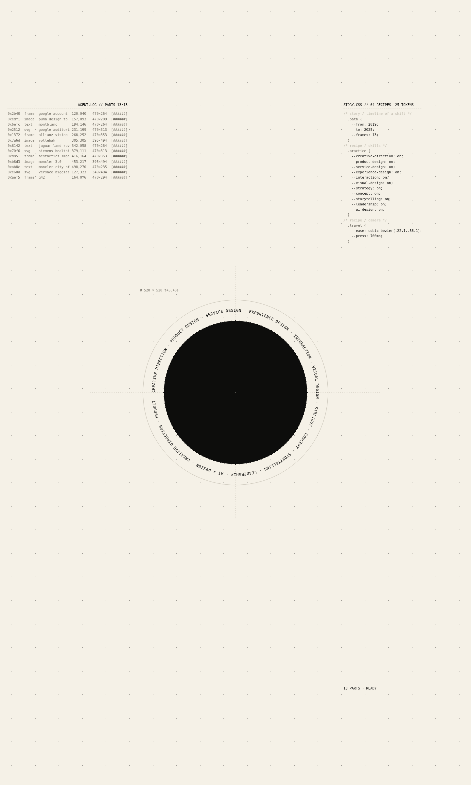
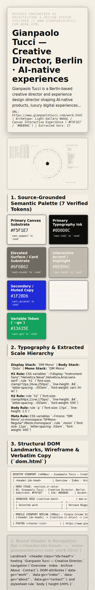

# UI Design System & Master Generation Blueprint: www-gianpaolotucci-com_work-html

> **Gianpaolo Tucci — Creative Director, Berlin · AI-native experiences** (https://www.gianpaolotucci.com/work.html) — Gianpaolo Tucci is a Berlin-based creative director and experience design director shaping AI-native products, luxury digital experiences...



---

## 1. Executive Visual Persona & Design Archetype

- **Brand Essence & Persona**: **Gianpaolo Tucci — Creative Director, Berlin · AI-native experiences** (`https://www.gianpaolotucci.com/work.html`). Gianpaolo Tucci is a Berlin-based creative director and experience design director shaping AI-native products, luxury digital experiences...
- **Visual Archetype**: **Light-Gallery WebGL / Canvas Interactive Experience (`#F5F1E7` / `#BEB9AC`)**.
- **Anti-AI-Slop Differentiators**:
  - **Source-Grounded Chromatic Polarity**: Anchors the viewport in `#F5F1E7` (`var(--paper)` in `:root`) paired with `#0D0D0C` primary typography and `#BEB9AC` accents.
  - **Extracted Typographic Hierarchy**: Pairs `DM Mono` for display copy (`Gianpaolo Tucci — Creative Director,`) with `Doto` and `DM Mono`.
  - **Calibrated Spatial Grid & Motion**: Combines `819px` container bounds (`gap: 14px`, padding `16px`) with `cubic-bezier(.22,1,.36,1)` easing and Three.js / WebGL Canvas Pipeline.

---

## 2. Spatial Architecture & Modular Grid Mathematics



### Viewport Allocation & Container Geometry
- **Captured Viewport Dimensions**: Desktop `1440×2400px` (`assets/desktop.png`, capped at 2400px multi-section capture), Mobile `390×2400px` (`assets/mobile.png`, capped at 2400px multi-section capture).
- **Master Container Bounds**: `819px` extracted from `www-gianpaolotucci-com_work-html` stylesheet.
- **Canvas Lateral Padding & Spacing**: `16px` lateral canvas padding with `14px` grid gap.
- **Border Radius Scale**: `999px`, `50%`.

### Responsive Breakpoint Architecture
- **Desktop Layout**: Multi-column CSS Grid / Flexbox layout at `1440px` (`max-width: 819px`, `gap: 14px`).
- **Mobile Layout**: Single-column vertical stack at `390px` viewport width with `16px` horizontal padding.
- **Extracted CSS Media Queries**: `@media (max-width:819px)`, `@media (prefers-reduced-motion:reduce)`, `@media (max-width:820px)`.

---

## 3. Color System, Materiality & Atmospheric Lighting

### Semantic Palette & Source Grounding
| Semantic Role | Ground-Truth Value | Extracted CSS Source / Selector |
|---|---|---|
| **Primary Canvas Substrate** | `#F5F1E7` | `var(--paper)` in `:root` |
| **Primary Typography Ink** | `#0D0D0C` | `var(--ink)` in `:root` |
| **Elevated Surface / Card Substrate** | `#6F6B62` | `var(--mute)` in `:root` |
| **Interactive Accent / Highlight** | `#BEB9AC` | `var(--faint)` in `:root` |
| **Secondary / Muted Copy** | `#1F2BD6` | `var(--accent)` in `:root` |
| **Structural Hairline Border** | `#F8F5EE` | `var(--sheet)` in `:root` |
| **Variable Token (`--go`)** | `#13A35E` | `var(--go)` in `:root` |

### Sanitized Root CSS Variables (`ui-ux.md` Ground Truth)
| Variable Name | Extracted Value | Semantic Role |
|---|---|---|
| `--paper` | `#F5F1E7` | Canvas / Surface Token |
| `--ink` | `#0D0D0C` | Typography Ink Token |
| `--mute` | `#6F6B62` | Color / Atmospheric Token |
| `--faint` | `#BEB9AC` | Color / Atmospheric Token |
| `--dot` | `#0D0D0C` | Color / Atmospheric Token |
| `--accent` | `#1F2BD6` | Brand / Palette Token |
| `--sheet` | `#F8F5EE` | Color / Atmospheric Token |
| `--f-display` | `"Instrument Sans","Helvetica Neue",Helvetica,Arial,sans-serif` | Design System Custom Token |
| `--f-serif` | `"Instrument Serif","Times New Roman",Georgia,serif` | Typography / Scale Token |
| `--f-dot` | `"Doto","DM Mono",ui-monospace,monospace` | Design System Custom Token |
| `--f-mono` | `"DM Mono",ui-monospace,"SFMono-Regular",Menlo,monospace` | Typography / Scale Token |
| `--ease` | `cubic-bezier(.22,1,.36,1)` | Motion / Easing Token |
| `--go` | `#13A35E` | Color / Atmospheric Token |
| `--pc` | `#13A35E` | Color / Atmospheric Token |
| `--hl-w` | `500` | Design System Custom Token |
| `--hl-wd` | `"wdth" 100` | Design System Custom Token |

---

## 4. Typographic Scale & Editorial Hierarchy

### Font Family Stacks
- **Display Typography**: `DM Mono`.
- **Primary Body Stack**: `Doto`.
- **Technical / Metadata Stack**: `DM Mono`.

### Typographic Scale & Rules (Extracted from Stylesheet & Variables)
- **Hero Display (`H1`)**: CSS variables `--f-display: "Instrument Sans","Helvetica Neue",Helvetica,Arial,sans-serif`; rule `h1` (`font-size: clamp(72px,16vw,250px)`, `line-height: .84`, `letter-spacing: -.055em`, `font-weight: var(--hl-w)`).
- **Section Heading (`H2`)**: rule `h2` (`font-size: clamp(64px,11vw,170px)`, `line-height: .84`, `letter-spacing: -.055em`, `font-weight: 500`).
- **Body Copy**: rule `p` (`font-size: 17px`, `line-height: 1.5`).
- **Metadata & Navigation Labels**: CSS variables `--f-mono: "DM Mono",ui-monospace,"SFMono-Regular",Menlo,monospace`; rule `.mono` (`font-size: 11px`, `letter-spacing: .02em`, `font-weight: 400`).

---

## 5. Choreographed Motion & Interaction Physics

### Primary Easing Curves
- **Extracted Timing Functions**: `cubic-bezier(.22,1,.36,1)`, `cubic-bezier(.77,0,.18,1)`, `cubic-bezier(.34,1.56,.64,1)`.

### Per-Element Transition & Choreography Rules
- **Selector `.idx`**: `transition: opacity .5s var(--ease)` extracted from `www-gianpaolotucci-com_work-html` stylesheet.
- **Selector `.idx-list button`**: `transition: color .3s,padding .45s var(--ease)` extracted from `www-gianpaolotucci-com_work-html` stylesheet.
- **Selector `.idx.on .idx-list button`**: `transition: color .3s,padding .45s var(--ease),opacity .7s var(--ease) var...` extracted from `www-gianpaolotucci-com_work-html` stylesheet.
- **Extracted Easing Curve (`cubic-bezier(.22,1,.36,1)`)**: Governs interactive state transitions across `<header.idx-head>` and `<section.boot>`.
- **Runtime Interaction Engine**: Integrates Three.js / WebGL Canvas Pipeline with `prefers-reduced-motion: reduce` fallback guards.

---

## 6. Component Wireframe & Structural DOM Map

### Visual Layout Schematic (Grounded in `dom.html` — `1440px` Desktop & `390px` Mobile Reflow)
```
┌────────────────────────────────────────────────────────────────────────┐
│ DESKTOP VIEWPORT (1440px) — Gianpaolo Tucci — Creative Director, Berli │
│ ====================================================================== │
│ [ <header.idx-head>        | Overview · Index · Archive · About · C ]  │
│ ---------------------------------------------------------------------- │
│ | HERO STAGE: <section.sr-only>                                    |   │
│ | H1: Gianpaolo Tucci — Creative Director, Berlin                  |   │
│ | Substrate: #F5F1E7    | Ink: #0D0D0C    | Accent: #BEB9AC        |   │
│ ---------------------------------------------------------------------- │
│ | SHOWCASE GRID (<section.boot>            ) max-w: 819px          |   │
│ | +------------------------------+  +------------------------------+ | │
│ | | Selected work                |  | Versace Biggies              | | │
│ | +------------------------------+  +------------------------------+ | │
│ ---------------------------------------------------------------------- │
│ | MOBILE VIEWPORT REFLOW (390px) — Single-Column Stack (gap: 14px  ) | │
│ | [<header.idx-head>] -> [<section.sr-only>] -> [<section.boot>] |     │
│ ---------------------------------------------------------------------- │
│ [ FOOTER (<footer.lcol>         ) | https://www.gianpaolotucci.com/wor │
└────────────────────────────────────────────────────────────────────────┘
```

### Granular DOM Region Breakdown
1. **Brand Header & Navigation Bar (<header.idx-head> — `www-gianpaolotucci-com_work-html`)**:
   - Landmark `<header class="idx-head">` hosting `Gianpaolo Tucci — Creative Director,` navigation (`Overview · Index · Archive · About · Contact`), DOM attributes (`data-go="work"`, `data-go="index"`, `data-go="about"`, `data-go="contact"`), and stylesheet rule `body { height:100% }`.
2. **Hero Stage & Focal Lead (<section.sr-only> — `Gianpaolo Tucci — Creative Directo`)**:
   - Landmark `<section class="sr-only">` presenting display lead `Gianpaolo Tucci — Creative Director, Berlin` and copy excerpt *"Gianpaolo Tucci is a Berlin-based creative director and experienc"* over `#F5F1E7` canvas and `#0D0D0C` ink.
3. **Primary Showcase & Content Grid (<section.boot> — `Selected work`)**:
   - Landmark `<section class="boot">` rendering section `Selected work` with copy *"This is not a portfolio. This is a timeline of a shift."*, asset references (`favicon.svg`, `favicon-32.png`, `apple-touch-icon.png`, `site.webmanifest`), and grid rule `button { font:inherit;color:inherit;background:none;border:0;padding:0;cursor:poi... }`.
4. **Interactive Detail & Feature Matrix (<section.col> — `Versace Biggies`)**:
   - Landmark `<section class="col">` framing `Versace Biggies` and `Moncler City of Genius` (*"Versace Biggies 2024 · Creative direction · Global campaign. One "*) with `#6F6B62` surface cards, `#BEB9AC` accents, and `img { max-width:100% }`.
5. **Colophon & Global Directory Footer (<footer.lcol> — `https://www.gianpaolotucci.com/work.html`)**:
   - Landmark `<footer class="lcol">` anchoring `Gianpaolo Tucci — Creative Direc` footer links (`Overview · Index · Archive · About · Contact`), copy *"2024 · Creative direction · Global campaign. One campaign ac"*, and `#F8F5EE` structural dividers.

---

## 7. Master Zero-Shot AI Generation Prompt

```markdown
# Master Zero-Shot Frontend Generation Prompt: www-gianpaolotucci-com_work-html (Gianpaolo Tucci — Creative Director, Berlin · AI-native experiences)

You are a principal frontend architect and design systems engineer. Build a complete, production-ready web application replicating the exact design system, DOM landmarks, typographic hierarchy, color tokens, and motion physics of `www-gianpaolotucci-com_work-html` (**Gianpaolo Tucci — Creative Director, Berlin · AI-native experiences** — `https://www.gianpaolotucci.com/work.html`).

### 1. Visual Archetype & Anti-AI-Slop Mandates
- **Archetype**: Light-Gallery WebGL / Canvas Interactive Experience (`#F5F1E7` / `#BEB9AC`).
- **Identity & Domain Context**: Gianpaolo Tucci is a Berlin-based creative director and experience design director shaping AI-native products, luxury digital experiences...
- **Primary Substrate**: `#F5F1E7` (`var(--paper)` in `:root`), **Primary Ink**: `#0D0D0C`, **Accent / Highlight**: `#BEB9AC`.
- **Site-Specific Differentiators**:
  - **Source-Grounded Chromatic Polarity**: Anchors the viewport in `#F5F1E7` (`var(--paper)` in `:root`) paired with `#0D0D0C` primary typography and `#BEB9AC` accents.
  - **Extracted Typographic Hierarchy**: Pairs `DM Mono` for display copy (`Gianpaolo Tucci — Creative Director,`) with `Doto` and `DM Mono`.
  - **Calibrated Spatial Grid & Motion**: Combines `819px` container bounds (`gap: 14px`, padding `16px`) with `cubic-bezier(.22,1,.36,1)` easing and Three.js / WebGL Canvas Pipeline.

### 2. Ground-Truth CSS Variables (`:root` Token Contract)
Declare and consume these exact custom properties extracted from `www-gianpaolotucci-com_work-html` in your global stylesheet:

:root {
  /* Gianpaolo Tucci — Creative Director, Berlin · AI-native experiences (www-gianpaolotucci-com_work-html) — Ground-Truth Extracted CSS Variables */
  --paper: #F5F1E7; /* Canvas / Surface Token (www-gianpaolotucci-com_work-html) */
  --ink: #0D0D0C; /* Typography Ink Token (www-gianpaolotucci-com_work-html) */
  --mute: #6F6B62; /* Color / Atmospheric Token (www-gianpaolotucci-com_work-html) */
  --faint: #BEB9AC; /* Color / Atmospheric Token (www-gianpaolotucci-com_work-html) */
  --dot: #0D0D0C; /* Color / Atmospheric Token (www-gianpaolotucci-com_work-html) */
  --accent: #1F2BD6; /* Brand / Palette Token (www-gianpaolotucci-com_work-html) */
  --sheet: #F8F5EE; /* Color / Atmospheric Token (www-gianpaolotucci-com_work-html) */
  --f-display: "Instrument Sans","Helvetica Neue",Helvetica,Arial,sans-serif; /* Design System Custom Token (www-gianpaolotucci-com_work-html) */
  --f-serif: "Instrument Serif","Times New Roman",Georgia,serif; /* Typography / Scale Token (www-gianpaolotucci-com_work-html) */
  --f-dot: "Doto","DM Mono",ui-monospace,monospace; /* Design System Custom Token (www-gianpaolotucci-com_work-html) */
  --f-mono: "DM Mono",ui-monospace,"SFMono-Regular",Menlo,monospace; /* Typography / Scale Token (www-gianpaolotucci-com_work-html) */
  --ease: cubic-bezier(.22,1,.36,1); /* Motion / Easing Token (www-gianpaolotucci-com_work-html) */
  --go: #13A35E; /* Color / Atmospheric Token (www-gianpaolotucci-com_work-html) */
  --pc: #13A35E; /* Color / Atmospheric Token (www-gianpaolotucci-com_work-html) */
  --hl-w: 500; /* Design System Custom Token (www-gianpaolotucci-com_work-html) */
  --hl-wd: "wdth" 100; /* Design System Custom Token (www-gianpaolotucci-com_work-html) */
}

### 3. Semantic Color & Materiality Contract
Map every surface, ink, and border strictly to these source-grounded tokens:
- **Primary Canvas Substrate**: `#F5F1E7` — grounded in `var(--paper)` in `:root`
- **Primary Typography Ink**: `#0D0D0C` — grounded in `var(--ink)` in `:root`
- **Elevated Surface / Card Substrate**: `#6F6B62` — grounded in `var(--mute)` in `:root`
- **Interactive Accent / Highlight**: `#BEB9AC` — grounded in `var(--faint)` in `:root`
- **Secondary / Muted Copy**: `#1F2BD6` — grounded in `var(--accent)` in `:root`
- **Structural Hairline Border**: `#F8F5EE` — grounded in `var(--sheet)` in `:root`
- **Variable Token (`--go`)**: `#13A35E` — grounded in `var(--go)` in `:root`

### 4. Spatial Grid, Container Bounds & Responsive Breakpoints
- **Desktop Viewport Reference**: `1440×2400px` (capped at 2400px multi-section capture, `1440px` standard desktop width).
- **Mobile Viewport Reference**: `390×2400px` (capped at 2400px multi-section capture, `390px` standard mobile width).
- **Container Max-Width**: `819px` extracted from `www-gianpaolotucci-com_work-html` stylesheet
- **Padding & Gutters**: `16px` lateral canvas padding with `14px` grid gap
- **Desktop Grid**: Multi-column CSS Grid / Flexbox layout at `1440px` (`max-width: 819px`, `gap: 14px`)
- **Mobile Adaptation**: Single-column vertical stack at `390px` viewport width with `16px` horizontal padding
- **Media Queries**: `@media (max-width:819px)`, `@media (prefers-reduced-motion:reduce)`, `@media (max-width:820px)`
- **Corner Radii**: `999px`, `50%`

### 5. Typography & Editorial Scale Contract
- **Display Font Stack**: `DM Mono`
- **Body Font Stack**: `Doto`
- **Monospace / Technical Font Stack**: `DM Mono`
- **H1 Display Rule**: CSS variables `--f-display: "Instrument Sans","Helvetica Neue",Helvetica,Arial,sans-serif`; rule `h1` (`font-size: clamp(72px,16vw,250px)`, `line-height: .84`, `letter-spacing: -.055em`, `font-weight: var(--hl-w)`)
- **H2 Section Rule**: rule `h2` (`font-size: clamp(64px,11vw,170px)`, `line-height: .84`, `letter-spacing: -.055em`, `font-weight: 500`)
- **Body Copy Rule**: rule `p` (`font-size: 17px`, `line-height: 1.5`)
- **Metadata & Index Rule**: CSS variables `--f-mono: "DM Mono",ui-monospace,"SFMono-Regular",Menlo,monospace`; rule `.mono` (`font-size: 11px`, `letter-spacing: .02em`, `font-weight: 400`)

### 6. Component Hierarchy, Verbatim Copy & Real DOM Landmarks
Scaffold `www-gianpaolotucci-com_work-html` (`Gianpaolo Tucci — Creative Director, Berlin · AI-native experiences`) with these exact structural regions, extracted copy, and CSS rules from `dom.html`:
1. **Brand Header & Navigation Bar (<header.idx-head> — `www-gianpaolotucci-com_work-html`)**:
   - DOM & Selectors: Landmark `<header class="idx-head">` hosting `Gianpaolo Tucci — Creative Director,` navigation (`Overview · Index · Archive · About · Contact`), DOM attributes (`data-go="work"`, `data-go="index"`, `data-go="about"`, `data-go="contact"`), and stylesheet rule `body { height:100% }`.
   - Responsive Contract: Header `Brand Header & Navigation Bar (<header.idx-head> — `www-gianpaolotucci-com_work-html`)` (`www-gianpaolotucci-com_work-html`) adapts across `@media (max-width:819px)`, `@media (prefers-reduced-motion:reduce)`, `@media (max-width:820px)` with `cubic-bezier(.22,1,.36,1)`, `cubic-bezier(.77,0,.18,1)`, `cubic-bezier(.34,1.56,.64,1)` transitions and links `Overview · Index · Archive · About · Contact`.
2. **Hero Stage & Focal Lead (<section.sr-only> — `Gianpaolo Tucci — Creative Directo`)**:
   - DOM & Selectors: Landmark `<section class="sr-only">` presenting display lead `Gianpaolo Tucci — Creative Director, Berlin` and copy excerpt *"Gianpaolo Tucci is a Berlin-based creative director and experienc"* over `#F5F1E7` canvas and `#0D0D0C` ink.
   - Responsive Contract: Hero stage (`1440×2400px` desktop / `390×2400px` mobile) sets `#F5F1E7` background with `#0D0D0C` headline `Gianpaolo Tucci — Creative Director, Berlin`.
3. **Primary Showcase & Content Grid (<section.boot> — `Selected work`)**:
   - DOM & Selectors: Landmark `<section class="boot">` rendering section `Selected work` with copy *"This is not a portfolio. This is a timeline of a shift."*, asset references (`favicon.svg`, `favicon-32.png`, `apple-touch-icon.png`, `site.webmanifest`), and grid rule `button { font:inherit;color:inherit;background:none;border:0;padding:0;cursor:poi... }`.
   - Responsive Contract: Showcase grid `Primary Showcase & Content Grid (<section.boot> — `Selected work`)` applies Multi-column CSS Grid / Flexbox layout at `1440px` (`max-width: 819px`, `gap: 14px`) on desktop and Single-column vertical stack at `390px` viewport width with `16px` horizontal padding on mobile.
4. **Interactive Detail & Feature Matrix (<section.col> — `Versace Biggies`)**:
   - DOM & Selectors: Landmark `<section class="col">` framing `Versace Biggies` and `Moncler City of Genius` (*"Versace Biggies 2024 · Creative direction · Global campaign. One "*) with `#6F6B62` surface cards, `#BEB9AC` accents, and `img { max-width:100% }`.
   - Responsive Contract: Detail module `Interactive Detail & Feature Matrix (<section.col> — `Versace Biggies`)` uses `999px`, `50%` radii, `#BEB9AC` highlights, and assets (favicon.svg, favicon-32.png, apple-touch-icon.png).
5. **Colophon & Global Directory Footer (<footer.lcol> — `https://www.gianpaolotucci.com/work.html`)**:
   - DOM & Selectors: Landmark `<footer class="lcol">` anchoring `Gianpaolo Tucci — Creative Direc` footer links (`Overview · Index · Archive · About · Contact`), copy *"2024 · Creative direction · Global campaign. One campaign ac"*, and `#F8F5EE` structural dividers.
   - Responsive Contract: Footer `Colophon & Global Directory Footer (<footer.lcol> — `https://www.gianpaolotucci.com/work.html`)` aligns to `819px` extracted from `www-gianpaolotucci-com_work-html` stylesheet with `16px` lateral canvas padding with `14px` grid gap and attributes (data-go="work", data-go="index", data-go="about").

#### Verbatim DOM Copy Excerpts (`dom.html`)
- Copy Excerpt 1: *"Gianpaolo Tucci is a Berlin-based creative director and experience design director..."*
- Copy Excerpt 2: *"This is not a portfolio. This is a timeline of a shift."*
- Copy Excerpt 3: *"Versace Biggies 2024 · Creative direction · Global campaign. One campaign across r..."*
- Copy Excerpt 4: *"2024 · Creative direction · Global campaign. One campaign across retail, social, A..."*

### 7. Motion, Extracted Stylesheet Rules & Interaction Choreography
- **Primary Easing Functions**: `cubic-bezier(.22,1,.36,1)`, `cubic-bezier(.77,0,.18,1)`, `cubic-bezier(.34,1.56,.64,1)`
- **Extracted Stylesheet Rules (`www-gianpaolotucci-com_work-html`)**:
- `body { height:100% }`
- `button { font:inherit;color:inherit;background:none;border:0;padding:0;cursor:poi... }`
- `img { max-width:100% }`
- `focus-visible { outline:1px solid var(--accent);outline-offset:4px }`
- `.mono { font-family:var(--f-mono);font-size:11px;letter-spacing:.02em;text-trans... }`
- **Per-Selector Transition Rules**:
- **Selector `.idx`**: `transition: opacity .5s var(--ease)` extracted from `www-gianpaolotucci-com_work-html` stylesheet.
- **Selector `.idx-list button`**: `transition: color .3s,padding .45s var(--ease)` extracted from `www-gianpaolotucci-com_work-html` stylesheet.
- **Selector `.idx.on .idx-list button`**: `transition: color .3s,padding .45s var(--ease),opacity .7s var(--ease) var...` extracted from `www-gianpaolotucci-com_work-html` stylesheet.
- **Extracted Easing Curve (`cubic-bezier(.22,1,.36,1)`)**: Governs interactive state transitions across `<header.idx-head>` and `<section.boot>`.
- **Runtime Interaction Engine**: Integrates Three.js / WebGL Canvas Pipeline with `prefers-reduced-motion: reduce` fallback guards.

### 8. Technical Deliverables
- Implement in Next.js (App Router) with TypeScript and Tailwind CSS consuming the `:root` custom properties defined above for `www-gianpaolotucci-com_work-html`.
- Reproduce both the `1440px` desktop architecture and `390px` mobile breakpoint transitions, preserving semantic HTML5 landmarks (`<header>`, `<nav>`, `<main>`, `<section>`, `<footer>`) and `prefers-reduced-motion` accessibility guards.
```
