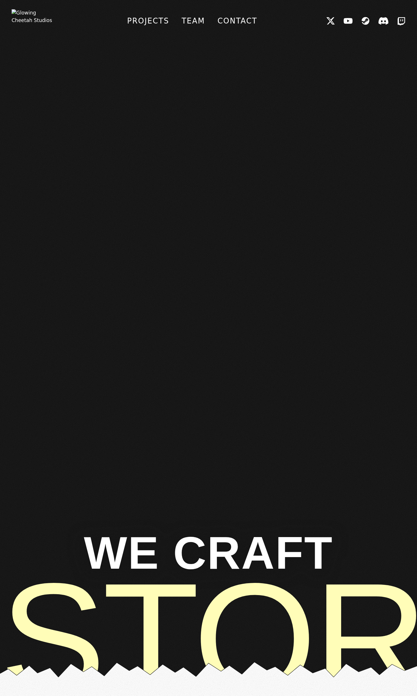
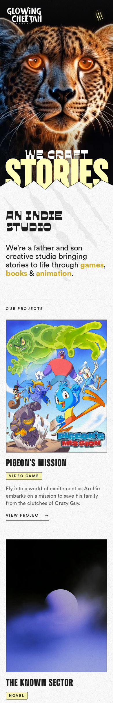

# UI Design System & Master Generation Blueprint: www-glowingcheetah-com

> **Glowing Cheetah Studios · Father & Son Indie Game Studio** (https://www.glowingcheetah.com/) — Glowing Cheetah is a father and son indie studio making games, books and animation. Creators of Pigeon’s Mission, a pixel platformer on S...



---

## 1. Executive Visual Persona & Design Archetype

- **Brand Essence & Persona**: **Glowing Cheetah Studios · Father & Son Indie Game Studio** (`https://www.glowingcheetah.com/`). Glowing Cheetah is a father and son indie studio making games, books and animation. Creators of Pigeon’s Mission, a pixel platformer on S...
- **Visual Archetype**: **High-Contrast Obsidian / Atmospheric Design System (`#131313` canvas, `#FFFDB8` ink, `#FFFDB8` accent)**.
- **Anti-AI-Slop Differentiators**:
  - **Source-Grounded Chromatic Polarity**: Anchors the viewport in `#131313` (`var(--night-deep)` in `:root`) paired with `#FFFDB8` primary typography and `#FFFDB8` accents.
  - **Extracted Typographic Hierarchy**: Pairs `Thanks` for display copy (`We craft stories`) with `Circular Std` and `SF Mono`.
  - **Calibrated Spatial Grid & Motion**: Combines `60ch` container bounds (`gap: 22px`, padding `4px`) with `cubic-bezier(.2,.8,.2,1)` easing and Three.js / WebGL Canvas Pipeline.

---

## 2. Spatial Architecture & Modular Grid Mathematics



### Viewport Allocation & Container Geometry
- **Captured Viewport Dimensions**: Desktop `1440×2400px` (`assets/desktop.png`, capped at 2400px multi-section capture), Mobile `390×2400px` (`assets/mobile.png`, capped at 2400px multi-section capture).
- **Master Container Bounds**: `60ch` extracted from `www-glowingcheetah-com` stylesheet.
- **Canvas Lateral Padding & Spacing**: `4px` lateral canvas padding with `22px` grid gap.
- **Border Radius Scale**: `2px`, `3px`, `4px`, `50%`.

### Responsive Breakpoint Architecture
- **Desktop Layout**: Multi-column CSS Grid / Flexbox layout at `1440px` (`max-width: 60ch`, `gap: 22px`).
- **Mobile Layout**: Single-column vertical stack at `390px` viewport width with `4px` horizontal padding.
- **Extracted CSS Media Queries**: `@media (max-width:900px)`, `@media (max-width:640px)`, `@media (min-width:641px) and (max-width:900px)`, `@media (max-width:1024px)`.

---

## 3. Color System, Materiality & Atmospheric Lighting

### Semantic Palette & Source Grounding
| Semantic Role | Ground-Truth Value | Extracted CSS Source / Selector |
|---|---|---|
| **Primary Canvas Substrate** | `#131313` | `var(--night-deep)` in `:root` |
| **Primary Typography Ink** | `#1F1F1F` | `var(--night)` in `:root` |
| **Elevated Surface / Card Substrate** | `#2A2A2A` | `var(--night-2)` in `:root` |
| **Interactive Accent / Highlight** | `#FFFDB8` | `var(--yellow)` in `:root` |
| **Secondary / Muted Copy** | `#D5B123` | `var(--yellow-glow)` in `:root` |
| **Structural Hairline Border** | `#B8981C` | `var(--yellow-deep)` in `:root` |
| **Variable Token (`--ember`)** | `#DF7042` | `var(--ember)` in `:root` |
| **Variable Token (`--white`)** | `#FFFFFF` | `var(--white)` in `:root` |

### Sanitized Root CSS Variables (`ui-ux.md` Ground Truth)
| Variable Name | Extracted Value | Semantic Role |
|---|---|---|
| `--night-deep` | `#131313` | Color / Atmospheric Token |
| `--night` | `#1F1F1F` | Color / Atmospheric Token |
| `--night-2` | `#2A2A2A` | Color / Atmospheric Token |
| `--yellow` | `#FFFDB8` | Color / Atmospheric Token |
| `--yellow-glow` | `#D5B123` | Color / Atmospheric Token |
| `--yellow-deep` | `#B8981C` | Color / Atmospheric Token |
| `--ember` | `#DF7042` | Color / Atmospheric Token |
| `--white` | `#FFFFFF` | Canvas / Surface Token |
| `--ink` | `#1F1F1F` | Typography Ink Token |
| `--fg-1` | `#FFFFFF` | Typography Ink Token |
| `--fg-2` | `rgba(255,255,255,.72)` | Typography Ink Token |
| `--fg-3` | `rgba(255,255,255,.48)` | Typography Ink Token |
| `--line-1` | `rgba(255,255,255,.12)` | Color / Atmospheric Token |
| `--line-2` | `rgba(255,255,255,.24)` | Color / Atmospheric Token |
| `--ink-1` | `#1F1F1F` | Typography Ink Token |
| `--ink-2` | `rgba(31,31,31,.72)` | Typography Ink Token |

---

## 4. Typographic Scale & Editorial Hierarchy

### Font Family Stacks
- **Display Typography**: `Thanks`.
- **Primary Body Stack**: `Circular Std`.
- **Technical / Metadata Stack**: `SF Mono`.

### Typographic Scale & Rules (Extracted from Stylesheet & Variables)
- **Hero Display (`H1`)**: CSS variables `--font-display: "Thanks",Impact,"Arial Narrow",sans-serif`, `--text-display: clamp(56px,6.5vw,96px)`, `--text-h1: 56px`.
- **Section Heading (`H2`)**: CSS variables `--text-h2: 40px`.
- **Body Copy**: CSS variables `--text-body: var(--fg-2)`, `--font-body: "Circular Std",system-ui,sans-serif`, `--leading-body: 1.5`; rule `body` (`font-size: var(--text-body)`, `line-height: var(--leading-body)`).
- **Metadata & Navigation Labels**: CSS variables `--font-mono: "SF Mono",Menlo,Consolas,monospace`, `--text-small: 14px`, `--text-caption: 12px`.

---

## 5. Choreographed Motion & Interaction Physics

### Primary Easing Curves
- **Extracted Timing Functions**: `cubic-bezier(.2,.8,.2,1)`, `cubic-bezier(.34,1.56,.64,1)`, `cubic-bezier(.7,0,.2,1)`.

### Per-Element Transition & Choreography Rules
- **Selector `::after`**: `transition: 0s !important` extracted from `www-glowingcheetah-com` stylesheet.
- **Selector `.gc-menu__word`**: `transition: color .2s` extracted from `www-glowingcheetah-com` stylesheet.
- **Selector `html.gc-rv [data-rv]`**: `transition: opacity .8s cubic-bezier(.2,.8,.2,1),transform .9s cubic-bezie...` extracted from `www-glowingcheetah-com` stylesheet.
- **Extracted Easing Curve (`cubic-bezier(.2,.8,.2,1)`)**: Governs interactive state transitions across `<nav.gc-rv>` and `<section.gc-skip>`.
- **Runtime Interaction Engine**: Integrates Three.js / WebGL Canvas Pipeline with `prefers-reduced-motion: reduce` fallback guards.

---

## 6. Component Wireframe & Structural DOM Map

### Visual Layout Schematic (Grounded in `dom.html` — `1440px` Desktop & `390px` Mobile Reflow)
```
┌────────────────────────────────────────────────────────────────────────┐
│ DESKTOP VIEWPORT (1440px) — Glowing Cheetah Studios · Father & Son Ind │
│ ====================================================================== │
│ [ <nav.gc-rv>              | Projects · Team · Contact              ]  │
│ ---------------------------------------------------------------------- │
│ | HERO STAGE: <section.sc-host>                                    |   │
│ | H1: We craft stories                                             |   │
│ | Substrate: #131313    | Ink: #FFFDB8    | Accent: #FFFDB8        |   │
│ ---------------------------------------------------------------------- │
│ | SHOWCASE GRID (<section.gc-skip>         ) max-w: 60ch           |   │
│ | +------------------------------+  +------------------------------+ | │
│ | | An indie studio              |  | Pigeon's Mission             | | │
│ | +------------------------------+  +------------------------------+ | │
│ ---------------------------------------------------------------------- │
│ | MOBILE VIEWPORT REFLOW (390px) — Single-Column Stack (gap: 22px  ) | │
│ | [<nav.gc-rv>] -> [<section.sc-host>] -> [<section.gc-skip>] |        │
│ ---------------------------------------------------------------------- │
│ [ FOOTER (<footer.gc-sr>        ) | https://www.glowingcheetah.com/    │
└────────────────────────────────────────────────────────────────────────┘
```

### Granular DOM Region Breakdown
1. **Brand Header & Navigation Bar (<nav.gc-rv> — `www-glowingcheetah-com`)**:
   - Landmark `<nav class="gc-rv">` hosting `Glowing Cheetah Studios · Father & S` navigation (`Projects · Team · Contact`), DOM attributes (`data-dc-tpl="1"`, `data-sc-name="Root"`, `data-dc-tpl="2"`, `data-dc-tpl="3"`), and stylesheet rule `l.sc-dc-streaming .sc-interp.sc-m... { position:relative; background:color-mix(in srgb,currentColor 5%,transpar... }`.
2. **Hero Stage & Focal Lead (<section.sc-host> — `We craft stories`)**:
   - Landmark `<section class="sc-host">` presenting display lead `We craft stories` and copy excerpt *"We're a father and son creative studio bringing stories to life t"* over `#131313` canvas and `#FFFDB8` ink.
3. **Primary Showcase & Content Grid (<section.gc-skip> — `An indie studio`)**:
   - Landmark `<section class="gc-skip">` rendering section `An indie studio` with copy *"Fly into a world of excitement as Archie embarks on a mission to "*, asset references (`clarity.js`, `ylwyja15eg`, `icon.svg`, `favicon-32.png`), and grid rule `before { animation:none; background:color-mix(in srgb,currentColor 8%,transparent) }`.
4. **Interactive Detail & Feature Matrix (<section.gc-intro__panel> — `Pigeon's Mission`)**:
   - Landmark `<section class="gc-intro__panel">` framing `Pigeon's Mission` and `The Known Sector` (*"A sci-fi epic rooted in Afrofuturism about three interconnected i"*) with `#2A2A2A` surface cards, `#FFFDB8` accents, and `.sc-host.sc-has-error { position:relative }`.
5. **Colophon & Global Directory Footer (<footer.gc-sr> — `https://www.glowingcheetah.com/`)**:
   - Landmark `<footer class="gc-sr">` anchoring `Glowing Cheetah Studios · Father` footer links (`Projects · Team · Contact`), copy *"When Logan was five, he beat Mario Odyssey for the first tim"*, and `#B8981C` structural dividers.

---

## 7. Master Zero-Shot AI Generation Prompt

```markdown
# Master Zero-Shot Frontend Generation Prompt: www-glowingcheetah-com (Glowing Cheetah Studios · Father & Son Indie Game Studio)

You are a principal frontend architect and design systems engineer. Build a complete, production-ready web application replicating the exact design system, DOM landmarks, typographic hierarchy, color tokens, and motion physics of `www-glowingcheetah-com` (**Glowing Cheetah Studios · Father & Son Indie Game Studio** — `https://www.glowingcheetah.com/`).

### 1. Visual Archetype & Anti-AI-Slop Mandates
- **Archetype**: High-Contrast Obsidian / Atmospheric Design System (`#131313` canvas, `#FFFDB8` ink, `#FFFDB8` accent).
- **Identity & Domain Context**: Glowing Cheetah is a father and son indie studio making games, books and animation. Creators of Pigeon’s Mission, a pixel platformer on S...
- **Primary Substrate**: `#131313` (`var(--night-deep)` in `:root`), **Primary Ink**: `#FFFDB8`, **Accent / Highlight**: `#FFFDB8`.
- **Site-Specific Differentiators**:
  - **Source-Grounded Chromatic Polarity**: Anchors the viewport in `#131313` (`var(--night-deep)` in `:root`) paired with `#FFFDB8` primary typography and `#FFFDB8` accents.
  - **Extracted Typographic Hierarchy**: Pairs `Thanks` for display copy (`We craft stories`) with `Circular Std` and `SF Mono`.
  - **Calibrated Spatial Grid & Motion**: Combines `60ch` container bounds (`gap: 22px`, padding `4px`) with `cubic-bezier(.2,.8,.2,1)` easing and Three.js / WebGL Canvas Pipeline.

### 2. Ground-Truth CSS Variables (`:root` Token Contract)
Declare and consume these exact custom properties extracted from `www-glowingcheetah-com` in your global stylesheet:

:root {
  /* Glowing Cheetah Studios · Father & Son Indie Game Studio (www-glowingcheetah-com) — Ground-Truth Extracted CSS Variables */
  --night-deep: #131313; /* Color / Atmospheric Token (www-glowingcheetah-com) */
  --night: #1F1F1F; /* Color / Atmospheric Token (www-glowingcheetah-com) */
  --night-2: #2A2A2A; /* Color / Atmospheric Token (www-glowingcheetah-com) */
  --yellow: #FFFDB8; /* Color / Atmospheric Token (www-glowingcheetah-com) */
  --yellow-glow: #D5B123; /* Color / Atmospheric Token (www-glowingcheetah-com) */
  --yellow-deep: #B8981C; /* Color / Atmospheric Token (www-glowingcheetah-com) */
  --ember: #DF7042; /* Color / Atmospheric Token (www-glowingcheetah-com) */
  --white: #FFFFFF; /* Canvas / Surface Token (www-glowingcheetah-com) */
  --ink: #1F1F1F; /* Typography Ink Token (www-glowingcheetah-com) */
  --fg-1: #FFFFFF; /* Typography Ink Token (www-glowingcheetah-com) */
  --fg-2: rgba(255,255,255,.72); /* Typography Ink Token (www-glowingcheetah-com) */
  --fg-3: rgba(255,255,255,.48); /* Typography Ink Token (www-glowingcheetah-com) */
  --line-1: rgba(255,255,255,.12); /* Color / Atmospheric Token (www-glowingcheetah-com) */
  --line-2: rgba(255,255,255,.24); /* Color / Atmospheric Token (www-glowingcheetah-com) */
  --ink-1: #1F1F1F; /* Typography Ink Token (www-glowingcheetah-com) */
  --ink-2: rgba(31,31,31,.72); /* Typography Ink Token (www-glowingcheetah-com) */
}

### 3. Semantic Color & Materiality Contract
Map every surface, ink, and border strictly to these source-grounded tokens:
- **Primary Canvas Substrate**: `#131313` — grounded in `var(--night-deep)` in `:root`
- **Primary Typography Ink**: `#1F1F1F` — grounded in `var(--night)` in `:root`
- **Elevated Surface / Card Substrate**: `#2A2A2A` — grounded in `var(--night-2)` in `:root`
- **Interactive Accent / Highlight**: `#FFFDB8` — grounded in `var(--yellow)` in `:root`
- **Secondary / Muted Copy**: `#D5B123` — grounded in `var(--yellow-glow)` in `:root`
- **Structural Hairline Border**: `#B8981C` — grounded in `var(--yellow-deep)` in `:root`
- **Variable Token (`--ember`)**: `#DF7042` — grounded in `var(--ember)` in `:root`
- **Variable Token (`--white`)**: `#FFFFFF` — grounded in `var(--white)` in `:root`

### 4. Spatial Grid, Container Bounds & Responsive Breakpoints
- **Desktop Viewport Reference**: `1440×2400px` (capped at 2400px multi-section capture, `1440px` standard desktop width).
- **Mobile Viewport Reference**: `390×2400px` (capped at 2400px multi-section capture, `390px` standard mobile width).
- **Container Max-Width**: `60ch` extracted from `www-glowingcheetah-com` stylesheet
- **Padding & Gutters**: `4px` lateral canvas padding with `22px` grid gap
- **Desktop Grid**: Multi-column CSS Grid / Flexbox layout at `1440px` (`max-width: 60ch`, `gap: 22px`)
- **Mobile Adaptation**: Single-column vertical stack at `390px` viewport width with `4px` horizontal padding
- **Media Queries**: `@media (max-width:900px)`, `@media (max-width:640px)`, `@media (min-width:641px) and (max-width:900px)`, `@media (max-width:1024px)`
- **Corner Radii**: `2px`, `3px`, `4px`, `50%`

### 5. Typography & Editorial Scale Contract
- **Display Font Stack**: `Thanks`
- **Body Font Stack**: `Circular Std`
- **Monospace / Technical Font Stack**: `SF Mono`
- **H1 Display Rule**: CSS variables `--font-display: "Thanks",Impact,"Arial Narrow",sans-serif`, `--text-display: clamp(56px,6.5vw,96px)`, `--text-h1: 56px`
- **H2 Section Rule**: CSS variables `--text-h2: 40px`
- **Body Copy Rule**: CSS variables `--text-body: var(--fg-2)`, `--font-body: "Circular Std",system-ui,sans-serif`, `--leading-body: 1.5`; rule `body` (`font-size: var(--text-body)`, `line-height: var(--leading-body)`)
- **Metadata & Index Rule**: CSS variables `--font-mono: "SF Mono",Menlo,Consolas,monospace`, `--text-small: 14px`, `--text-caption: 12px`

### 6. Component Hierarchy, Verbatim Copy & Real DOM Landmarks
Scaffold `www-glowingcheetah-com` (`Glowing Cheetah Studios · Father & Son Indie Game Studio`) with these exact structural regions, extracted copy, and CSS rules from `dom.html`:
1. **Brand Header & Navigation Bar (<nav.gc-rv> — `www-glowingcheetah-com`)**:
   - DOM & Selectors: Landmark `<nav class="gc-rv">` hosting `Glowing Cheetah Studios · Father & S` navigation (`Projects · Team · Contact`), DOM attributes (`data-dc-tpl="1"`, `data-sc-name="Root"`, `data-dc-tpl="2"`, `data-dc-tpl="3"`), and stylesheet rule `l.sc-dc-streaming .sc-interp.sc-m... { position:relative; background:color-mix(in srgb,currentColor 5%,transpar... }`.
   - Responsive Contract: Header `Brand Header & Navigation Bar (<nav.gc-rv> — `www-glowingcheetah-com`)` (`www-glowingcheetah-com`) adapts across `@media (max-width:900px)`, `@media (max-width:640px)`, `@media (min-width:641px) and (max-width:900px)`, `@media (max-width:1024px)` with `cubic-bezier(.2,.8,.2,1)`, `cubic-bezier(.34,1.56,.64,1)`, `cubic-bezier(.7,0,.2,1)` transitions and links `Projects · Team · Contact`.
2. **Hero Stage & Focal Lead (<section.sc-host> — `We craft stories`)**:
   - DOM & Selectors: Landmark `<section class="sc-host">` presenting display lead `We craft stories` and copy excerpt *"We're a father and son creative studio bringing stories to life t"* over `#131313` canvas and `#FFFDB8` ink.
   - Responsive Contract: Hero stage (`1440×2400px` desktop / `390×2400px` mobile) sets `#131313` background with `#FFFDB8` headline `We craft stories`.
3. **Primary Showcase & Content Grid (<section.gc-skip> — `An indie studio`)**:
   - DOM & Selectors: Landmark `<section class="gc-skip">` rendering section `An indie studio` with copy *"Fly into a world of excitement as Archie embarks on a mission to "*, asset references (`clarity.js`, `ylwyja15eg`, `icon.svg`, `favicon-32.png`), and grid rule `before { animation:none; background:color-mix(in srgb,currentColor 8%,transparent) }`.
   - Responsive Contract: Showcase grid `Primary Showcase & Content Grid (<section.gc-skip> — `An indie studio`)` applies Multi-column CSS Grid / Flexbox layout at `1440px` (`max-width: 60ch`, `gap: 22px`) on desktop and Single-column vertical stack at `390px` viewport width with `4px` horizontal padding on mobile.
4. **Interactive Detail & Feature Matrix (<section.gc-intro__panel> — `Pigeon's Mission`)**:
   - DOM & Selectors: Landmark `<section class="gc-intro__panel">` framing `Pigeon's Mission` and `The Known Sector` (*"A sci-fi epic rooted in Afrofuturism about three interconnected i"*) with `#2A2A2A` surface cards, `#FFFDB8` accents, and `.sc-host.sc-has-error { position:relative }`.
   - Responsive Contract: Detail module `Interactive Detail & Feature Matrix (<section.gc-intro__panel> — `Pigeon's Mission`)` uses `2px`, `3px`, `4px`, `50%` radii, `#FFFDB8` highlights, and assets (clarity.js, ylwyja15eg, icon.svg).
5. **Colophon & Global Directory Footer (<footer.gc-sr> — `https://www.glowingcheetah.com/`)**:
   - DOM & Selectors: Landmark `<footer class="gc-sr">` anchoring `Glowing Cheetah Studios · Father` footer links (`Projects · Team · Contact`), copy *"When Logan was five, he beat Mario Odyssey for the first tim"*, and `#B8981C` structural dividers.
   - Responsive Contract: Footer `Colophon & Global Directory Footer (<footer.gc-sr> — `https://www.glowingcheetah.com/`)` aligns to `60ch` extracted from `www-glowingcheetah-com` stylesheet with `4px` lateral canvas padding with `22px` grid gap and attributes (data-dc-tpl="1", data-sc-name="Root", data-dc-tpl="2").

#### Verbatim DOM Copy Excerpts (`dom.html`)
- Copy Excerpt 1: *"We're a father and son creative studio bringing stories to life through games , bo..."*
- Copy Excerpt 2: *"Fly into a world of excitement as Archie embarks on a mission to save his family f..."*
- Copy Excerpt 3: *"A sci-fi epic rooted in Afrofuturism about three interconnected individuals workin..."*
- Copy Excerpt 4: *"When Logan was five, he beat Mario Odyssey for the first time. Then he asked a que..."*

### 7. Motion, Extracted Stylesheet Rules & Interaction Choreography
- **Primary Easing Functions**: `cubic-bezier(.2,.8,.2,1)`, `cubic-bezier(.34,1.56,.64,1)`, `cubic-bezier(.7,0,.2,1)`
- **Extracted Stylesheet Rules (`www-glowingcheetah-com`)**:
- `l.sc-dc-streaming .sc-interp.sc-m... { position:relative; background:color-mix(in srgb,currentColor 5%,transpar... }`
- `before { animation:none; background:color-mix(in srgb,currentColor 8%,transparent) }`
- `.sc-host.sc-has-error { position:relative }`
- `page { margin: 0.5cm; }`
- `table { break-inside: avoid; }`
- **Per-Selector Transition Rules**:
- **Selector `::after`**: `transition: 0s !important` extracted from `www-glowingcheetah-com` stylesheet.
- **Selector `.gc-menu__word`**: `transition: color .2s` extracted from `www-glowingcheetah-com` stylesheet.
- **Selector `html.gc-rv [data-rv]`**: `transition: opacity .8s cubic-bezier(.2,.8,.2,1),transform .9s cubic-bezie...` extracted from `www-glowingcheetah-com` stylesheet.
- **Extracted Easing Curve (`cubic-bezier(.2,.8,.2,1)`)**: Governs interactive state transitions across `<nav.gc-rv>` and `<section.gc-skip>`.
- **Runtime Interaction Engine**: Integrates Three.js / WebGL Canvas Pipeline with `prefers-reduced-motion: reduce` fallback guards.

### 8. Technical Deliverables
- Implement in Next.js (App Router) with TypeScript and Tailwind CSS consuming the `:root` custom properties defined above for `www-glowingcheetah-com`.
- Reproduce both the `1440px` desktop architecture and `390px` mobile breakpoint transitions, preserving semantic HTML5 landmarks (`<header>`, `<nav>`, `<main>`, `<section>`, `<footer>`) and `prefers-reduced-motion` accessibility guards.
```
