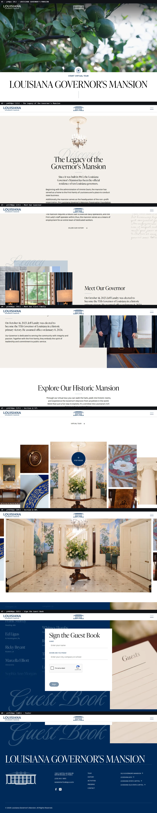
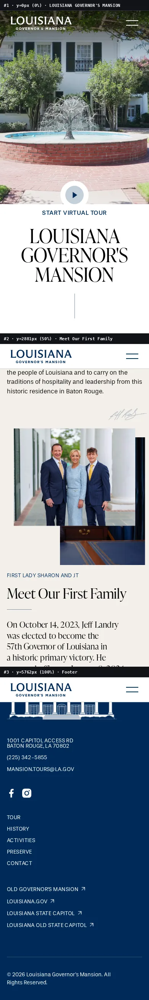

# UI Design System & Master Generation Blueprint: www-governorsmansion-org

> **Louisiana's House · Louisiana Governor's Mansion** (https://www.governorsmansion.org/) — Step inside the Louisiana Governor’s Mansion and discover a rich blend of history, culture, and civic pride. Take a virtual tour, explore...





---

## 1. Executive Visual Persona & Design Archetype

- **Brand Essence & Persona**: **Louisiana's House · Louisiana Governor's Mansion** (`https://www.governorsmansion.org/`). Step inside the Louisiana Governor’s Mansion and discover a rich blend of history, culture, and civic pride. Take a virtual tour, explore...
- **Capture Provenance**: Live browser capture (`tier1_fast`, HTTP `200`, captured `2026-11-24`).
- **Visual Archetype**: **High-Contrast Obsidian / Atmospheric Design System (`#002b59` canvas, `#ffffff` ink, `#0082f3` accent)**.
- **Anti-AI-Slop Differentiators**:
  - **Live-Computed Chromatic Polarity**: Anchors the viewport in `#002b59` (live computed `body` `background-color` (`computed_styles.json`)) paired with `#ffffff` primary typography and `#0082f3` accents.
  - **Grounded Typographic Hierarchy**: Pairs `ivypresto-display` for display copy (`LOUISIANA GOVERNOR'S MANSION`) with `stevie-sans`.
  - **Calibrated Spatial Grid & Motion**: Combines `1440px` container bounds (`gap: normal 16px`, padding `9px`) with `cubic-bezier(.49,.78,.46,1.34)` easing and Lenis Smooth Scroll (`data-lenis`), GSAP Timeline & ScrollTrigger.

---

## 2. Spatial Architecture & Modular Grid Mathematics

### Viewport Allocation & Container Geometry
- **Captured Journey Filmstrips**: Desktop `1280×6624px` (`assets/desktop-journey.webp`, `8` keyframes up to `y=7420px` / doc `8320px`), Mobile `390×2616px` (`assets/mobile-journey.webp`, `3` keyframes).
- **Master Container Bounds**: `1440px` (full-bleed `100%` desktop stage measured on `1440px` viewport).
- **Canvas Lateral Padding & Spacing**: `9px` lateral canvas padding with `normal 16px` grid gap.
- **Border Radius Scale**: `1440px`, `3px`, `100%`, `50%`.

### Responsive Breakpoint Architecture
- **Desktop Layout**: Multi-column CSS Grid / Flexbox layout at `1440px` (`max-width: 1440px`, `gap: normal 16px`).
- **Mobile Layout**: Single-column vertical stack at `390px` viewport width with `9px` horizontal padding.
- **Extracted CSS Media Queries**: `@media screen and (max-width:991px)`, `@media screen and (max-width:767px)`, `@media screen and (max-width:479px)`, `@media (min-width:768px)`.

---

## 3. Color System, Materiality & Atmospheric Lighting

### Semantic Palette & Source Grounding
| Semantic Role | Ground-Truth Value | Extracted Live / CSS Source |
|---|---|---|
| **Primary Canvas Substrate** | `#002b59` | live computed `body` `background-color` (`computed_styles.json`) |
| **Primary Typography Ink** | `#ffffff` | live computed `main` `color` (`computed_styles.json`) |
| **Elevated Surface / Card Substrate** | `#222222` | `.w-slider-nav-invert>div.w-active { background-color: #222222 }` |
| **Interactive Accent / Highlight** | `#0082f3` | `.w-dropdown-link.w--current { color: #0082f3 }` |
| **Secondary / Muted Copy** | `#000000` | live computed `h1` `color` (`computed_styles.json`) |
| **Structural Hairline Border** | `#3898ec` | `.w-select:focus { border-color: #3898ec }` |

### Sanitized Root CSS Variables (`ui-ux.md` Ground Truth)
| Variable Name | Extracted Value | Semantic Role |
|---|---|---|
| `--_theme---background` | `var(--swatch--light-100)` | Canvas / Surface Token |
| `--_text-style---font-family` | `var(--_typography---font--secondary-family)` | Typography Ink Token |
| `--_theme---text` | `var(--swatch--dark-900)` | Typography Ink Token |
| `--_text-style---font-size` | `var(--_typography---font-size--text-main)` | Typography Ink Token |
| `--_text-style---line-height` | `var(--_typography---line-height--huge)` | Typography Ink Token |
| `--_text-style---font-weight` | `var(--_typography---font--secondary-book)` | Typography Ink Token |
| `--_text-style---letter-spacing` | `var(--_typography---letter-spacing--normal)` | Typography Ink Token |
| `--radius--main` | `1rem` | Elevation / Border Token |
| `--_theme---background-2` | `var(--_brand---color-200)` | Canvas / Surface Token |
| `--site--column-count` | `12` | Layout / Spatial Grid Token |
| `--_responsive---large` | `1` | Design System Custom Token |
| `--_responsive---medium` | `0` | Design System Custom Token |
| `--_responsive---small` | `0` | Design System Custom Token |
| `--_responsive---xsmall` | `0` | Design System Custom Token |
| `--max-width--small` | `50rem` | Layout / Spatial Grid Token |
| `--_gap---size` | `var(--site--gutter)` | Layout / Spatial Grid Token |

---

## 4. Typographic Scale & Editorial Hierarchy

### Font Family Stacks
- **Display Typography**: `ivypresto-display`.
- **Primary Body Stack**: `stevie-sans`.
- **Technical / Metadata Stack**: not declared in live computed styles (uses primary stack / `ui-monospace`).

### Typographic Scale & Rules (Live Computed & Stylesheet Grounded)
- **Hero Display (`H1`)**: live computed `h1` (`font-size: 86.4px`, `line-height: 86.4px`, `font-weight: 300`); rule `h1` (`font-size: var(--_text-style---font-size)`, `line-height: var(--_text-style---l...`, `letter-spacing: var(--_text-style---l...`, `font-weight: var(--_text-s...`).
- **Section Heading (`H2`)**: live computed `h2` (`font-size: 64px`, `line-height: 64px`, `font-weight: 300`); rule `h2` (`font-size: var(--_text-style---font-size)`, `line-height: var(--_text-style---l...`, `letter-spacing: var(--_text-style---l...`, `font-weight: var(--_text-s...`).
- **Body Copy**: live computed `body` (`font-size: 18px`, `line-height: 27px`, `font-weight: 400`).
- **Metadata & Navigation Labels**: live computed `nav/a` (`font-size: 18px`, `line-height: 27px`, `font-weight: 400`); CSS variables `--_text-style---letter-spacing: var(--_typography---letter-spacing--normal)`, `--_responsive---small: 0`, `--_responsive---xsmall: 0`.

---

## 5. Choreographed Motion & Interaction Physics

### Primary Easing Curves
- **Extracted Timing Functions**: `cubic-bezier(.49,.78,.46,1.34)`.

### Per-Element Transition & Choreography Rules
- **Selector `.w-webflow-badge>img`**: `transition: unset` extracted from `www-governorsmansion-org` stylesheet.
- **Selector `.w-slider-dot`**: `transition: background-color .1s,color .1s` extracted from `www-governorsmansion-org` stylesheet.
- **Selector `.w-lightbox-control`**: `transition: all .3s` extracted from `www-governorsmansion-org` stylesheet.
- **Extracted Easing Curve (`cubic-bezier(.49,.78,.46,1.34)`)**: Governs interactive state transitions across `<header.nav_desktop_wrap>` and `<section.u-width-full>`.
- **Runtime Interaction Engine**: Integrates Lenis Smooth Scroll (`data-lenis`), GSAP Timeline & ScrollTrigger, Three.js / WebGL Canvas Pipeline, Swiper Touch Carousel Engine with `prefers-reduced-motion: reduce` fallback guards.
### Measured Runtime Scroll & Interaction Telemetry (`behavioral_journey_v2`)
- **Scroll Driver Mode**: `native` (max document height `8320px`, deepest scrollY reached `7420px` across `8` desktop keyframes).
- **Detected Scroll / Motion Libraries**: `Lenis`, `GSAP/ScrollTrigger`.
- **Hover Physics (`primary_cta` · `Start Virtual Tour`)**: Computed transition `0s` / `ease` (no static color/transform shift captured at rest).
- **Route Transition Architecture**: First internal navigation (`/tour/foyer`) measured as `direct` in `4680ms`.

---

## 6. Component Wireframe & Structural DOM Map

### Visual Layout Schematic — Desktop (`1440px`, Grounded in `dom.html` & Landmark Bounding Boxes)
```
┌────────────────────────────────────────────────────────────────────────┐
│ DESKTOP VIEWPORT (1440px) — Louisiana's House · Louisiana Governor's M │
│ ====================================================================== │
│ [ <header.nav_desktop_wr (1440x2835px) | Tour · History · Activities   │
│ ---------------------------------------------------------------------- │
│ | HERO STAGE: <section.u-section> (w=1440px)                         | │
│ | H1: LOUISIANA GOVERNOR'S MANSION                                   | │
│ | Substrate: #002b59 | Ink: #ffffff | Accent: #0082f3                | │
│ ---------------------------------------------------------------------- │
│ | SHOWCASE GRID (<section.u-width-full>) max-w: 1440px               | │
│ | +------------------------------+  +------------------------------+ | │
│ | | Louisiana Governor's Mansion |  | The Legacy of the Governor's | | │
│ | +------------------------------+  +------------------------------+ | │
│ ---------------------------------------------------------------------- │
│ | DETAIL MODULE (<section.u-section:nth(2)>) — Meet Our Governor     | │
│ ---------------------------------------------------------------------- │
│ [ FOOTER (<footer.footer_wrap>) | https://www.governorsmansion.org/    │
└────────────────────────────────────────────────────────────────────────┘
```

### Visual Layout Schematic — Mobile Reflow (`390px`)
```
┌────────────────────────────────────────────────────────────────────────┐
│ MOBILE VIEWPORT REFLOW (390px) — Single-Column Stack (gap: normal 1)   │
│ ====================================================================== │
│ [ HEADER BAR (<header.nav_desktop_wrap) | Compact Menu (390px)         │
│ ---------------------------------------------------------------------- │
│ | HERO STAGE (<section.u-section>) — 390px Vertical Lead             | │
│ | H1: LOUISIANA GOVERNOR'S MANSION                                   | │
│ ---------------------------------------------------------------------- │
│ | SHOWCASE STACK (<section.u-width-full>) — 1-Col Stack              | │
│ | [ Item 1: Louisiana Governor's Mansion                           ] | │
│ | [ Item 2: The Legacy of the Governor's Mansion                   ] | │
│ ---------------------------------------------------------------------- │
│ | DETAIL STACK (<section.u-section:nth(2) — 1-Col (Meet Our Governor)  │
│ ---------------------------------------------------------------------- │
│ [ FOOTER (<footer.footer_wrap>) | Stacked 390px Colophon               │
└────────────────────────────────────────────────────────────────────────┘
```

### Granular DOM Region Breakdown
1. **Brand Header & Navigation Bar (<header.nav_desktop_wrap> — `www-governorsmansion-org`)**:
   - Landmark `<header class="nav_desktop_wrap">` (`1440x2835px`) hosting `Louisiana's House · Louisiana Govern` navigation (`Tour · History · Activities · Preserve · Contact`), DOM attributes (`data-wf-domain="www.governorsmansion.org"`, `data-wf-page="68f8ead2dc9339599a128c26"`, `data-wf-site="68f8ead1dc9339599a128b88"`, `data-number="10"`), and stylesheet rule `html { -webkit-text-size-adjust:100%;-ms-text-size-adjust:100%;font-family:sans... }`.
2. **Hero Stage & Focal Lead (<section.u-section> — `LOUISIANA GOVERNOR'S MANSION`)**:
   - Landmark `<section class="u-section u-background-3">` presenting display lead `LOUISIANA GOVERNOR'S MANSION` and copy excerpt *"Start Virtual Tour"* over `#002b59` canvas and `#ffffff` ink.
3. **Primary Showcase & Content Grid (<section.u-width-full> — `Louisiana Governor's Mansion`)**:
   - Landmark `<section class="u-section u-width-full">` rendering section `Louisiana Governor's Mansion` with copy *"Since it was built in 1963, the Louisiana Governor’s Mansion has "*, asset references (`cdn.prod.website-files.com`, `governors-mansion.webflow.shared....`, `fonts.googleapis.com`, `fonts.gstatic.com`), and grid rule `summary { display:block }`.
4. **Interactive Detail & Feature Matrix (<section.u-section:nth(2)> — `The Legacy of the Governor's Mansi`)**:
   - Landmark `<section class="u-section u-width-full">` framing `The Legacy of the Governor's Mansion` and `Meet Our Governor` (*"Beginning with the administration of Jimmie Davis, the mansion ha"*) with `#222222` surface cards, `#0082f3` accents, and `video { vertical-align:baseline;display:inline-block }`.
5. **Colophon & Global Directory Footer (<footer.footer_wrap> — `https://www.governorsmansion.org/`)**:
   - Landmark `<footer class="footer_wrap u-theme-dark">` anchoring `Louisiana's House · Louisiana Go` footer links (`Tour · History · Activities · Preserve · Contact`), copy *"Additionally, the mansion serves as the headquarters of the "*, and `#3898ec` structural dividers.
### Full Vertical Scroll Sequence (Desktop `1440×900` Keyframes)
- **Step 01** (`y=0px`, `0%`): Active landmark `LOUISIANA GOVERNOR'S MANSION` · sticky/fixed elements: `2`
- **Step 02** (`y=850px`, `11%`): Active landmark `The Legacy of the Governor's Mansion` · sticky/fixed elements: `2`
- **Step 03** (`y=1700px`, `23%`): Active landmark `Meet Our Governor` · sticky/fixed elements: `2`
- **Step 04** (`y=3400px`, `46%`): Active landmark `Meet Our First Family` · sticky/fixed elements: `2`
- **Step 05** (`y=4250px`, `57%`): Active landmark `Section @ 57%` · sticky/fixed elements: `2`
- **Step 06** (`y=5950px`, `80%`): Active landmark `Section @ 80%` · sticky/fixed elements: `2`
- **Step 07** (`y=6800px`, `92%`): Active landmark `Sign the Guest Book` · sticky/fixed elements: `2`
- **Step 08** (`y=7420px`, `100%`): Active landmark `Footer` · sticky/fixed elements: `2`

### Multi-Page Internal Route Map
- **Detail Route (`/tour/foyer`)**: `https://www.governorsmansion.org/tour/foyer` — H1: `FOYER`, scrollHeight `12420px`, transition `direct` (`4680ms`)
- **About Route (`/contact`)**: `https://www.governorsmansion.org/contact` — H1: `Contact the Mansion`, scrollHeight `3487px`, transition `direct` (`2368ms`)
- **Other Route (`/tour`)**: `https://www.governorsmansion.org/tour` — H1: `Take the Louisiana Governor’s Mansion Virtual Tour`, scrollHeight `900px`, transition `direct` (`519ms`)

---

## 7. Master Zero-Shot AI Generation Prompt

```markdown
# Master Zero-Shot Frontend Generation Prompt: www-governorsmansion-org (Louisiana's House · Louisiana Governor's Mansion)

You are a principal frontend architect and design systems engineer. Build a complete, production-ready web application replicating the exact design system, DOM landmarks, typographic hierarchy, color tokens, and motion physics of `www-governorsmansion-org` (**Louisiana's House · Louisiana Governor's Mansion** — `https://www.governorsmansion.org/`).

### 1. Visual Archetype & Anti-AI-Slop Mandates
- **Archetype**: High-Contrast Obsidian / Atmospheric Design System (`#002b59` canvas, `#ffffff` ink, `#0082f3` accent).
- **Identity & Domain Context**: Step inside the Louisiana Governor’s Mansion and discover a rich blend of history, culture, and civic pride. Take a virtual tour, explore...
- **Primary Substrate**: `#002b59` (live computed `body` `background-color` (`computed_styles.json`)), **Primary Ink**: `#ffffff`, **Accent / Highlight**: `#0082f3`.
- **Site-Specific Differentiators**:
  - **Live-Computed Chromatic Polarity**: Anchors the viewport in `#002b59` (live computed `body` `background-color` (`computed_styles.json`)) paired with `#ffffff` primary typography and `#0082f3` accents.
  - **Grounded Typographic Hierarchy**: Pairs `ivypresto-display` for display copy (`LOUISIANA GOVERNOR'S MANSION`) with `stevie-sans`.
  - **Calibrated Spatial Grid & Motion**: Combines `1440px` container bounds (`gap: normal 16px`, padding `9px`) with `cubic-bezier(.49,.78,.46,1.34)` easing and Lenis Smooth Scroll (`data-lenis`), GSAP Timeline & ScrollTrigger.

### 2. Ground-Truth CSS Variables (`:root` Token Contract)
Declare and consume these exact custom properties extracted from `www-governorsmansion-org` in your global stylesheet:

:root {
  /* Louisiana's House · Louisiana Governor's Mansion (www-governorsmansion-org) — Live-Grounded CSS Variables */
  --_theme---background: var(--swatch--light-100); /* Canvas / Surface Token (www-governorsmansion-org) */
  --_text-style---font-family: var(--_typography---font--secondary-family); /* Typography Ink Token (www-governorsmansion-org) */
  --_theme---text: var(--swatch--dark-900); /* Typography Ink Token (www-governorsmansion-org) */
  --_text-style---font-size: var(--_typography---font-size--text-main); /* Typography Ink Token (www-governorsmansion-org) */
  --_text-style---line-height: var(--_typography---line-height--huge); /* Typography Ink Token (www-governorsmansion-org) */
  --_text-style---font-weight: var(--_typography---font--secondary-book); /* Typography Ink Token (www-governorsmansion-org) */
  --_text-style---letter-spacing: var(--_typography---letter-spacing--normal); /* Typography Ink Token (www-governorsmansion-org) */
  --radius--main: 1rem; /* Elevation / Border Token (www-governorsmansion-org) */
  --_theme---background-2: var(--_brand---color-200); /* Canvas / Surface Token (www-governorsmansion-org) */
  --site--column-count: 12; /* Layout / Spatial Grid Token (www-governorsmansion-org) */
  --_responsive---large: 1; /* Design System Custom Token (www-governorsmansion-org) */
  --_responsive---medium: 0; /* Design System Custom Token (www-governorsmansion-org) */
  --_responsive---small: 0; /* Design System Custom Token (www-governorsmansion-org) */
  --_responsive---xsmall: 0; /* Design System Custom Token (www-governorsmansion-org) */
  --max-width--small: 50rem; /* Layout / Spatial Grid Token (www-governorsmansion-org) */
  --_gap---size: var(--site--gutter); /* Layout / Spatial Grid Token (www-governorsmansion-org) */
}

### 3. Semantic Color & Materiality Contract
Map every surface, ink, and border strictly to these source-grounded tokens:
- **Primary Canvas Substrate**: `#002b59` — grounded in live computed `body` `background-color` (`computed_styles.json`)
- **Primary Typography Ink**: `#ffffff` — grounded in live computed `main` `color` (`computed_styles.json`)
- **Elevated Surface / Card Substrate**: `#222222` — grounded in `.w-slider-nav-invert>div.w-active { background-color: #222222 }`
- **Interactive Accent / Highlight**: `#0082f3` — grounded in `.w-dropdown-link.w--current { color: #0082f3 }`
- **Secondary / Muted Copy**: `#000000` — grounded in live computed `h1` `color` (`computed_styles.json`)
- **Structural Hairline Border**: `#3898ec` — grounded in `.w-select:focus { border-color: #3898ec }`

### 4. Spatial Grid, Container Bounds & Responsive Breakpoints
- **Desktop Viewport Reference**: `1280×6624px` (multi-frame vertical journey filmstrip (6624px), `1440px` standard desktop width).
- **Mobile Viewport Reference**: `390×2616px` (multi-frame vertical journey filmstrip (2616px), `390px` standard mobile width).
- **Container Max-Width**: `1440px` (full-bleed `100%` desktop stage measured on `1440px` viewport)
- **Padding & Gutters**: `9px` lateral canvas padding with `normal 16px` grid gap
- **Desktop Grid**: Multi-column CSS Grid / Flexbox layout at `1440px` (`max-width: 1440px`, `gap: normal 16px`)
- **Mobile Adaptation**: Single-column vertical stack at `390px` viewport width with `9px` horizontal padding
- **Media Queries**: `@media screen and (max-width:991px)`, `@media screen and (max-width:767px)`, `@media screen and (max-width:479px)`, `@media (min-width:768px)`
- **Corner Radii**: `1440px`, `3px`, `100%`, `50%`

### 5. Typography & Editorial Scale Contract
- **Display Font Stack**: `ivypresto-display`
- **Body Font Stack**: `stevie-sans`
- **Monospace / Technical Font Stack**: not declared in live computed styles (uses primary stack / `ui-monospace`)
- **H1 Display Rule**: live computed `h1` (`font-size: 86.4px`, `line-height: 86.4px`, `font-weight: 300`); rule `h1` (`font-size: var(--_text-style---font-size)`, `line-height: var(--_text-style---l...`, `letter-spacing: var(--_text-style---l...`, `font-weight: var(--_text-s...`)
- **H2 Section Rule**: live computed `h2` (`font-size: 64px`, `line-height: 64px`, `font-weight: 300`); rule `h2` (`font-size: var(--_text-style---font-size)`, `line-height: var(--_text-style---l...`, `letter-spacing: var(--_text-style---l...`, `font-weight: var(--_text-s...`)
- **Body Copy Rule**: live computed `body` (`font-size: 18px`, `line-height: 27px`, `font-weight: 400`)
- **Metadata & Index Rule**: live computed `nav/a` (`font-size: 18px`, `line-height: 27px`, `font-weight: 400`); CSS variables `--_text-style---letter-spacing: var(--_typography---letter-spacing--normal)`, `--_responsive---small: 0`, `--_responsive---xsmall: 0`

### 6. Component Hierarchy, Verbatim Copy & Real DOM Landmarks
Scaffold `www-governorsmansion-org` (`Louisiana's House · Louisiana Governor's Mansion`) with these exact structural regions, extracted copy, and CSS rules from `dom.html`:
1. **Brand Header & Navigation Bar (<header.nav_desktop_wrap> — `www-governorsmansion-org`)**:
   - DOM & Selectors: Landmark `<header class="nav_desktop_wrap">` (`1440x2835px`) hosting `Louisiana's House · Louisiana Govern` navigation (`Tour · History · Activities · Preserve · Contact`), DOM attributes (`data-wf-domain="www.governorsmansion.org"`, `data-wf-page="68f8ead2dc9339599a128c26"`, `data-wf-site="68f8ead1dc9339599a128b88"`, `data-number="10"`), and stylesheet rule `html { -webkit-text-size-adjust:100%;-ms-text-size-adjust:100%;font-family:sans... }`.
   - Responsive Contract: Header `Brand Header & Navigation Bar (<header.nav_desktop_wrap> — `www-governorsmansion-org`)` (`www-governorsmansion-org`) adapts across `@media screen and (max-width:991px)`, `@media screen and (max-width:767px)`, `@media screen and (max-width:479px)`, `@media (min-width:768px)` with `cubic-bezier(.49,.78,.46,1.34)` transitions and links `Tour · History · Activities · Preserve · Contact`.
2. **Hero Stage & Focal Lead (<section.u-section> — `LOUISIANA GOVERNOR'S MANSION`)**:
   - DOM & Selectors: Landmark `<section class="u-section u-background-3">` presenting display lead `LOUISIANA GOVERNOR'S MANSION` and copy excerpt *"Start Virtual Tour"* over `#002b59` canvas and `#ffffff` ink.
   - Responsive Contract: Hero stage (`1280×6624px` desktop / `390×2616px` mobile) sets `#002b59` background with `#ffffff` headline `LOUISIANA GOVERNOR'S MANSION`.
3. **Primary Showcase & Content Grid (<section.u-width-full> — `Louisiana Governor's Mansion`)**:
   - DOM & Selectors: Landmark `<section class="u-section u-width-full">` rendering section `Louisiana Governor's Mansion` with copy *"Since it was built in 1963, the Louisiana Governor’s Mansion has "*, asset references (`cdn.prod.website-files.com`, `governors-mansion.webflow.shared....`, `fonts.googleapis.com`, `fonts.gstatic.com`), and grid rule `summary { display:block }`.
   - Responsive Contract: Showcase grid `Primary Showcase & Content Grid (<section.u-width-full> — `Louisiana Governor's Mansion`)` applies Multi-column CSS Grid / Flexbox layout at `1440px` (`max-width: 1440px`, `gap: normal 16px`) on desktop and Single-column vertical stack at `390px` viewport width with `9px` horizontal padding on mobile.
4. **Interactive Detail & Feature Matrix (<section.u-section:nth(2)> — `The Legacy of the Governor's Mansi`)**:
   - DOM & Selectors: Landmark `<section class="u-section u-width-full">` framing `The Legacy of the Governor's Mansion` and `Meet Our Governor` (*"Beginning with the administration of Jimmie Davis, the mansion ha"*) with `#222222` surface cards, `#0082f3` accents, and `video { vertical-align:baseline;display:inline-block }`.
   - Responsive Contract: Detail module `Interactive Detail & Feature Matrix (<section.u-section:nth(2)> — `The Legacy of the Governor's Mansi`)` uses `1440px`, `3px`, `100%`, `50%` radii, `#0082f3` highlights, and assets (cdn.prod.website-files.com, governors-mansion.webflow.shared...., fonts.googleapis.com).
5. **Colophon & Global Directory Footer (<footer.footer_wrap> — `https://www.governorsmansion.org/`)**:
   - DOM & Selectors: Landmark `<footer class="footer_wrap u-theme-dark">` anchoring `Louisiana's House · Louisiana Go` footer links (`Tour · History · Activities · Preserve · Contact`), copy *"Additionally, the mansion serves as the headquarters of the "*, and `#3898ec` structural dividers.
   - Responsive Contract: Footer `Colophon & Global Directory Footer (<footer.footer_wrap> — `https://www.governorsmansion.org/`)` aligns to `1440px` (full-bleed `100%` desktop stage measured on `1440px` viewport) with `9px` lateral canvas padding with `normal 16px` grid gap and attributes (data-wf-domain="www.governorsmansion.org", data-wf-page="68f8ead2dc9339599a128c26", data-wf-site="68f8ead1dc9339599a128b88").

#### Verbatim DOM Copy Excerpts (`dom.html`)
- Copy Excerpt 1: *"Start Virtual Tour"*
- Copy Excerpt 2: *"Since it was built in 1963, the Louisiana Governor’s Mansion has been the official..."*
- Copy Excerpt 3: *"Beginning with the administration of Jimmie Davis, the mansion has served as a hom..."*
- Copy Excerpt 4: *"Additionally, the mansion serves as the headquarters of the non-profit organizatio..."*

### 7. Motion, Extracted Stylesheet Rules & Interaction Choreography
- **Primary Easing Functions**: `cubic-bezier(.49,.78,.46,1.34)`
- **Extracted Stylesheet Rules (`www-governorsmansion-org`)**:
- `html { -webkit-text-size-adjust:100%;-ms-text-size-adjust:100%;font-family:sans... }`
- `summary { display:block }`
- `video { vertical-align:baseline;display:inline-block }`
- `template { display:none }`
- `strong { font-weight:700 }`
- **Per-Selector Transition Rules**:
- **Selector `.w-webflow-badge>img`**: `transition: unset` extracted from `www-governorsmansion-org` stylesheet.
- **Selector `.w-slider-dot`**: `transition: background-color .1s,color .1s` extracted from `www-governorsmansion-org` stylesheet.
- **Selector `.w-lightbox-control`**: `transition: all .3s` extracted from `www-governorsmansion-org` stylesheet.
- **Extracted Easing Curve (`cubic-bezier(.49,.78,.46,1.34)`)**: Governs interactive state transitions across `<header.nav_desktop_wrap>` and `<section.u-width-full>`.
- **Runtime Interaction Engine**: Integrates Lenis Smooth Scroll (`data-lenis`), GSAP Timeline & ScrollTrigger, Three.js / WebGL Canvas Pipeline, Swiper Touch Carousel Engine with `prefers-reduced-motion: reduce` fallback guards.
### 7b. Full-Page Scroll Choreography, Interactive States & Multi-Page Routes
- **Scroll Mechanics**: Implement `native` vertical progression up to `8320px` across 8 distinct viewport chapters using Lenis, GSAP/ScrollTrigger.
- **Vertical Chapter Sequence**: LOUISIANA GOVERNOR'S MANSION (0%) -> The Legacy of the Governor'... (11%) -> Meet Our Governor (23%) -> Meet Our First Family (46%) -> Section @ 57% (57%) -> Section @ 80% (80%) -> Sign the Guest Book (92%) -> Footer (100%).
- **Multi-Page Routes**: Scaffold internal routes `/tour/foyer` (detail, direct), `/contact` (about, direct), `/tour` (other, direct) sharing the global header/footer shell and design tokens.

### 8. Technical Deliverables
- Implement in Next.js (App Router) with TypeScript and Tailwind CSS consuming the `:root` custom properties defined above for `www-governorsmansion-org`.
- Reproduce both the `1440px` desktop architecture and `390px` mobile breakpoint transitions, preserving semantic HTML5 landmarks (`<header>`, `<nav>`, `<main>`, `<section>`, `<footer>`) and `prefers-reduced-motion` accessibility guards.
```
---

## 8. Full-Page Scroll Journey, Interactive States & Subpage Inventory

### Desktop Scroll Keyframes (`1440×900` WebP)
| Step | Scroll Y | Progress | Active Landmark / Section | Sticky/Fixed | Visual Asset |
| :---: | :---: | :---: | :--- | :---: | :--- |
| `#01` | `0px` | `0%` | LOUISIANA GOVERNOR'S MANSION | `2` | [desktop-step-01.webp](assets/desktop-step-01.webp) |
| `#02` | `850px` | `11%` | The Legacy of the Governor's Mansion | `2` | [desktop-step-02.webp](assets/desktop-step-02.webp) |
| `#03` | `1700px` | `23%` | Meet Our Governor | `2` | [desktop-step-03.webp](assets/desktop-step-03.webp) |
| `#04` | `3400px` | `46%` | Meet Our First Family | `2` | [desktop-step-04.webp](assets/desktop-step-04.webp) |
| `#05` | `4250px` | `57%` | Section @ 57% | `2` | [desktop-step-05.webp](assets/desktop-step-05.webp) |
| `#06` | `5950px` | `80%` | Section @ 80% | `2` | [desktop-step-06.webp](assets/desktop-step-06.webp) |
| `#07` | `6800px` | `92%` | Sign the Guest Book | `2` | [desktop-step-07.webp](assets/desktop-step-07.webp) |
| `#08` | `7420px` | `100%` | Footer | `2` | [desktop-step-08.webp](assets/desktop-step-08.webp) |

### Mobile Condensed Keyframes (`390×844` WebP)
| Step | Scroll Y | Progress | Active Landmark | Visual Asset |
| :---: | :---: | :---: | :--- | :--- |
| `#01` | `0px` | `0%` | LOUISIANA GOVERNOR'S MANSION | [mobile-step-01.webp](assets/mobile-step-01.webp) |
| `#02` | `2881px` | `50%` | Meet Our First Family | [mobile-step-02.webp](assets/mobile-step-02.webp) |
| `#03` | `5762px` | `100%` | Footer | [mobile-step-03.webp](assets/mobile-step-03.webp) |

### Internal Subpage Filmstrips (`1080px` Wide WebP)
| # | Template | Route URL | H1 / Title | Scroll Height | Transition | Filmstrip Asset |
| :-: | :---: | :--- | :--- | :---: | :---: | :--- |
| `1` | `detail` | `https://www.governorsmansion.org/tour/foyer` | FOYER | `12420px` | `direct` (`4680ms`) | [subpage-01-tour-foyer.webp](assets/subpage-01-tour-foyer.webp) |
| `2` | `about` | `https://www.governorsmansion.org/contact` | Contact the Mansion | `3487px` | `direct` (`2368ms`) | [subpage-02-contact.webp](assets/subpage-02-contact.webp) |
| `3` | `other` | `https://www.governorsmansion.org/tour` | Take the Louisiana Governor’s Mansion... | `900px` | `direct` (`519ms`) | [subpage-03-tour.webp](assets/subpage-03-tour.webp) |

