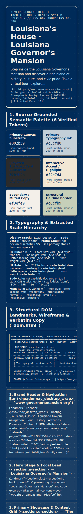

# UI Design System & Master Generation Blueprint: www-governorsmansion-org

> **Louisiana's House · Louisiana Governor's Mansion** (https://www.governorsmansion.org/) — Step inside the Louisiana Governor’s Mansion and discover a rich blend of history, culture, and civic pride. Take a virtual tour, explore...


---

## 1. Executive Visual Persona & Design Archetype

- **Brand Essence & Persona**: **Louisiana's House · Louisiana Governor's Mansion** (`https://www.governorsmansion.org/`). Step inside the Louisiana Governor’s Mansion and discover a rich blend of history, culture, and civic pride. Take a virtual tour, explore...
- **Visual Archetype**: **High-Contrast Obsidian / Atmospheric Design System (`#002b59` canvas, `#f3efe9` ink, `#f2e7d4` accent)**.
- **Anti-AI-Slop Differentiators**:
  - **Source-Grounded Chromatic Polarity**: Anchors the viewport in `#002b59` (`var(--swatch--brand-500)` in `:root`) paired with `#f3efe9` primary typography and `#f2e7d4` accents.
  - **Extracted Typographic Hierarchy**: Pairs `Luxurious Script` for display copy (`Louisiana Governor's Mansion`) with `stevie-sans` and not declared in static CSS (uses primary stack / `ui-monospace`).
  - **Calibrated Spatial Grid & Motion**: Combines `940px` container bounds (`gap: 16px`, padding `9px`) with `cubic-bezier(.49,.78,.46,1.34)` easing and Lenis Smooth Scroll (`data-lenis`), GSAP Timeline & ScrollTrigger.

---

## 2. Spatial Architecture & Modular Grid Mathematics



### Viewport Allocation & Container Geometry
- **Captured Viewport Dimensions**: Desktop `1440×2400px` (`assets/desktop.png`, capped at 2400px multi-section capture), Mobile `390×2400px` (`assets/mobile.png`, capped at 2400px multi-section capture).
- **Master Container Bounds**: `940px` extracted from `www-governorsmansion-org` stylesheet.
- **Canvas Lateral Padding & Spacing**: `9px` lateral canvas padding with `16px` grid gap.
- **Border Radius Scale**: `3px`, `100%`, `50%`, `var(--radius--small)`.

### Responsive Breakpoint Architecture
- **Desktop Layout**: Multi-column CSS Grid / Flexbox layout at `1440px` (`max-width: 940px`, `gap: 16px`).
- **Mobile Layout**: Single-column vertical stack at `390px` viewport width with `9px` horizontal padding.
- **Extracted CSS Media Queries**: `@media screen and (max-width:991px)`, `@media screen and (max-width:767px)`, `@media screen and (max-width:479px)`, `@media (min-width:768px)`.

---

## 3. Color System, Materiality & Atmospheric Lighting

### Semantic Palette & Source Grounding
| Semantic Role | Ground-Truth Value | Extracted CSS Source / Selector |
|---|---|---|
| **Primary Canvas Substrate** | `#002b59` | `var(--swatch--brand-500)` in `:root` |
| **Primary Typography Ink** | `#c3cfd8` | `var(--swatch--brand-200)` in `:root` |
| **Elevated Surface / Card Substrate** | `#2b2b2b` | `var(--swatch--dark-800)` in `:root` |
| **Interactive Accent / Highlight** | `#f2e7d4` | `var(--swatch--brand-5-200)` in `:root` |
| **Secondary / Muted Copy** | `#f3efe9` | `var(--swatch--light-200)` in `:root` |
| **Structural Hairline Border** | `#c6cfb9` | `var(--swatch--brand-2-200)` in `:root` |

### Sanitized Root CSS Variables (`ui-ux.md` Ground Truth)
| Variable Name | Extracted Value | Semantic Role |
|---|---|---|
| `--_theme---background` | `var(--swatch--light-100)` | Canvas / Surface Token |
| `--_text-style---font-family` | `var(--_typography---font--secondary-family)` | Typography Ink Token |
| `--_theme---text` | `var(--swatch--dark-900)` | Typography Ink Token |
| `--_text-style---font-size` | `var(--_typography---font-size--text-main)` | Typography Ink Token |
| `--_text-style---line-height` | `var(--_typography---line-height--huge)` | Typography Ink Token |
| `--_text-style---font-weight` | `var(--_typography---font--secondary-book)` | Typography Ink Token |
| `--_text-style---letter-spacing` | `var(--_typography---letter-spacing--normal)` | Typography Ink Token |
| `--radius--main` | `1rem` | Elevation / Border Token |
| `--_theme---background-2` | `var(--_brand---color-200)` | Canvas / Surface Token |
| `--site--column-count` | `12` | Layout / Spatial Grid Token |
| `--_responsive---large` | `1` | Design System Custom Token |
| `--_responsive---medium` | `0` | Design System Custom Token |
| `--_responsive---small` | `0` | Design System Custom Token |
| `--_responsive---xsmall` | `0` | Design System Custom Token |
| `--max-width--small` | `50rem` | Layout / Spatial Grid Token |
| `--_gap---size` | `var(--site--gutter)` | Layout / Spatial Grid Token |

---

## 4. Typographic Scale & Editorial Hierarchy

### Font Family Stacks
- **Display Typography**: `Luxurious Script`.
- **Primary Body Stack**: `stevie-sans`.
- **Technical / Metadata Stack**: not declared in static CSS (uses primary stack / `ui-monospace`).

### Typographic Scale & Rules (Extracted from Stylesheet & Variables)
- **Hero Display (`H1`)**: rule `h1` (`font-size: var(--_text-style---font-size)`, `line-height: var(--_text-style---l...`, `letter-spacing: var(--_text-style---l...`, `font-weight: var(--_text-s...`).
- **Section Heading (`H2`)**: rule `h2` (`font-size: var(--_text-style---font-size)`, `line-height: var(--_text-style---l...`, `letter-spacing: var(--_text-style---l...`, `font-weight: var(--_text-s...`).
- **Body Copy**: not explicitly declared on tag in static CSS (stylesheet font-size ladder: `2em`, `80%`, `75%`, `1em`, `14px`).
- **Metadata & Navigation Labels**: CSS variables `--_text-style---letter-spacing: var(--_typography---letter-spacing--normal)`, `--_responsive---small: 0`, `--_responsive---xsmall: 0`.

---

## 5. Choreographed Motion & Interaction Physics

### Primary Easing Curves
- **Extracted Timing Functions**: `cubic-bezier(.49,.78,.46,1.34)`.

### Per-Element Transition & Choreography Rules
- **Selector `.w-webflow-badge>img`**: `transition: unset` extracted from `www-governorsmansion-org` stylesheet.
- **Selector `.w-slider-dot`**: `transition: background-color .1s,color .1s` extracted from `www-governorsmansion-org` stylesheet.
- **Selector `.w-lightbox-control`**: `transition: all .3s` extracted from `www-governorsmansion-org` stylesheet.
- **Extracted Easing Curve (`cubic-bezier(.49,.78,.46,1.34)`)**: Governs interactive state transitions across `<header.nav_desktop_wrap>` and `<section.u-section>`.
- **Runtime Interaction Engine**: Integrates Lenis Smooth Scroll (`data-lenis`), GSAP Timeline & ScrollTrigger, Three.js / WebGL Canvas Pipeline, Swiper Touch Carousel Engine with `prefers-reduced-motion: reduce` fallback guards.

---

## 6. Component Wireframe & Structural DOM Map

### Visual Layout Schematic (Grounded in `dom.html` — `1440px` Desktop & `390px` Mobile Reflow)
```
┌────────────────────────────────────────────────────────────────────────┐
│ DESKTOP VIEWPORT (1440px) — Louisiana's House · Louisiana Governor's M │
│ ====================================================================== │
│ [ <header.nav_desktop_wrap | Tour · History · Activities · Preserve ]  │
│ ---------------------------------------------------------------------- │
│ | HERO STAGE: <section.u-section>                                  |   │
│ | H1: Louisiana Governor's Mansion                                 |   │
│ | Substrate: #002b59    | Ink: #f3efe9    | Accent: #f2e7d4        |   │
│ ---------------------------------------------------------------------- │
│ | SHOWCASE GRID (<section.u-section>       ) max-w: 940px          |   │
│ | +------------------------------+  +------------------------------+ | │
│ | | The Legacy of the Governor's |  | Meet Our Governor            | | │
│ | +------------------------------+  +------------------------------+ | │
│ ---------------------------------------------------------------------- │
│ | MOBILE VIEWPORT REFLOW (390px) — Single-Column Stack (gap: 16px  ) | │
│ | [<header.nav_deskto] -> [<section.u-section] -> [<section.u-section] │
│ ---------------------------------------------------------------------- │
│ [ FOOTER (<footer.footer_wrap>  ) | https://www.governorsmansion.org/  │
└────────────────────────────────────────────────────────────────────────┘
```

### Granular DOM Region Breakdown
1. **Brand Header & Navigation Bar (<header.nav_desktop_wrap> — `www-governorsmansion-org`)**:
   - Landmark `<header class="nav_desktop_wrap">` hosting `Louisiana's House · Louisiana Govern` navigation (`Tour · History · Activities · Preserve · Contact`), DOM attributes (`data-wf-domain="www.governorsmansion.org"`, `data-wf-page="68f8ead2dc9339599a128c26"`, `data-wf-site="68f8ead1dc9339599a128b88"`, `data-number="10"`), and stylesheet rule `html { -webkit-text-size-adjust:100%;-ms-text-size-adjust:100%;font-family:sans... }`.
2. **Hero Stage & Focal Lead (<section.u-section> — `Louisiana Governor's Mansion`)**:
   - Landmark `<section class="u-section u-background-3">` presenting display lead `Louisiana Governor's Mansion` and copy excerpt *"Skip to main content"* over `#002b59` canvas and `#f3efe9` ink.
3. **Primary Showcase & Content Grid (<section.u-section> — `The Legacy of the Governor's Mansi`)**:
   - Landmark `<section class="u-section u-width-full">` rendering section `The Legacy of the Governor's Mansion` with copy *"Button Text Button Text Button Text"*, asset references (`cdn.prod.website-files.com`, `governors-mansion.webflow.shared....`, `fonts.googleapis.com`, `fonts.gstatic.com`), and grid rule `summary { display:block }`.
4. **Interactive Detail & Feature Matrix (<section.footer_group_wrap> — `Meet Our Governor`)**:
   - Landmark `<section class="footer_group_wrap">` framing `Meet Our Governor` and `Meet Our First Family` (*"Mansion.Tours@la.gov"*) with `#2b2b2b` surface cards, `#f2e7d4` accents, and `video { vertical-align:baseline;display:inline-block }`.
5. **Colophon & Global Directory Footer (<footer.footer_wrap> — `https://www.governorsmansion.org/`)**:
   - Landmark `<footer class="footer_wrap u-theme-dark">` anchoring `Louisiana's House · Louisiana Go` footer links (`Tour · History · Activities · Preserve · Contact`), copy *"1001 Capitol Access Rd. Baton Rouge, LA 70802"*, and `#c6cfb9` structural dividers.

---

## 7. Master Zero-Shot AI Generation Prompt

```markdown
# Master Zero-Shot Frontend Generation Prompt: www-governorsmansion-org (Louisiana's House · Louisiana Governor's Mansion)

You are a principal frontend architect and design systems engineer. Build a complete, production-ready web application replicating the exact design system, DOM landmarks, typographic hierarchy, color tokens, and motion physics of `www-governorsmansion-org` (**Louisiana's House · Louisiana Governor's Mansion** — `https://www.governorsmansion.org/`).

### 1. Visual Archetype & Anti-AI-Slop Mandates
- **Archetype**: High-Contrast Obsidian / Atmospheric Design System (`#002b59` canvas, `#f3efe9` ink, `#f2e7d4` accent).
- **Identity & Domain Context**: Step inside the Louisiana Governor’s Mansion and discover a rich blend of history, culture, and civic pride. Take a virtual tour, explore...
- **Primary Substrate**: `#002b59` (`var(--swatch--brand-500)` in `:root`), **Primary Ink**: `#f3efe9`, **Accent / Highlight**: `#f2e7d4`.
- **Site-Specific Differentiators**:
  - **Source-Grounded Chromatic Polarity**: Anchors the viewport in `#002b59` (`var(--swatch--brand-500)` in `:root`) paired with `#f3efe9` primary typography and `#f2e7d4` accents.
  - **Extracted Typographic Hierarchy**: Pairs `Luxurious Script` for display copy (`Louisiana Governor's Mansion`) with `stevie-sans` and not declared in static CSS (uses primary stack / `ui-monospace`).
  - **Calibrated Spatial Grid & Motion**: Combines `940px` container bounds (`gap: 16px`, padding `9px`) with `cubic-bezier(.49,.78,.46,1.34)` easing and Lenis Smooth Scroll (`data-lenis`), GSAP Timeline & ScrollTrigger.

### 2. Ground-Truth CSS Variables (`:root` Token Contract)
Declare and consume these exact custom properties extracted from `www-governorsmansion-org` in your global stylesheet:

:root {
  /* Louisiana's House · Louisiana Governor's Mansion (www-governorsmansion-org) — Ground-Truth Extracted CSS Variables */
  --_theme---background: var(--swatch--light-100); /* Canvas / Surface Token (www-governorsmansion-org) */
  --_text-style---font-family: var(--_typography---font--secondary-family); /* Typography Ink Token (www-governorsmansion-org) */
  --_theme---text: var(--swatch--dark-900); /* Typography Ink Token (www-governorsmansion-org) */
  --_text-style---font-size: var(--_typography---font-size--text-main); /* Typography Ink Token (www-governorsmansion-org) */
  --_text-style---line-height: var(--_typography---line-height--huge); /* Typography Ink Token (www-governorsmansion-org) */
  --_text-style---font-weight: var(--_typography---font--secondary-book); /* Typography Ink Token (www-governorsmansion-org) */
  --_text-style---letter-spacing: var(--_typography---letter-spacing--normal); /* Typography Ink Token (www-governorsmansion-org) */
  --radius--main: 1rem; /* Elevation / Border Token (www-governorsmansion-org) */
  --_theme---background-2: var(--_brand---color-200); /* Canvas / Surface Token (www-governorsmansion-org) */
  --site--column-count: 12; /* Layout / Spatial Grid Token (www-governorsmansion-org) */
  --_responsive---large: 1; /* Design System Custom Token (www-governorsmansion-org) */
  --_responsive---medium: 0; /* Design System Custom Token (www-governorsmansion-org) */
  --_responsive---small: 0; /* Design System Custom Token (www-governorsmansion-org) */
  --_responsive---xsmall: 0; /* Design System Custom Token (www-governorsmansion-org) */
  --max-width--small: 50rem; /* Layout / Spatial Grid Token (www-governorsmansion-org) */
  --_gap---size: var(--site--gutter); /* Layout / Spatial Grid Token (www-governorsmansion-org) */
}

### 3. Semantic Color & Materiality Contract
Map every surface, ink, and border strictly to these source-grounded tokens:
- **Primary Canvas Substrate**: `#002b59` — grounded in `var(--swatch--brand-500)` in `:root`
- **Primary Typography Ink**: `#c3cfd8` — grounded in `var(--swatch--brand-200)` in `:root`
- **Elevated Surface / Card Substrate**: `#2b2b2b` — grounded in `var(--swatch--dark-800)` in `:root`
- **Interactive Accent / Highlight**: `#f2e7d4` — grounded in `var(--swatch--brand-5-200)` in `:root`
- **Secondary / Muted Copy**: `#f3efe9` — grounded in `var(--swatch--light-200)` in `:root`
- **Structural Hairline Border**: `#c6cfb9` — grounded in `var(--swatch--brand-2-200)` in `:root`

### 4. Spatial Grid, Container Bounds & Responsive Breakpoints
- **Desktop Viewport Reference**: `1440×2400px` (capped at 2400px multi-section capture, `1440px` standard desktop width).
- **Mobile Viewport Reference**: `390×2400px` (capped at 2400px multi-section capture, `390px` standard mobile width).
- **Container Max-Width**: `940px` extracted from `www-governorsmansion-org` stylesheet
- **Padding & Gutters**: `9px` lateral canvas padding with `16px` grid gap
- **Desktop Grid**: Multi-column CSS Grid / Flexbox layout at `1440px` (`max-width: 940px`, `gap: 16px`)
- **Mobile Adaptation**: Single-column vertical stack at `390px` viewport width with `9px` horizontal padding
- **Media Queries**: `@media screen and (max-width:991px)`, `@media screen and (max-width:767px)`, `@media screen and (max-width:479px)`, `@media (min-width:768px)`
- **Corner Radii**: `3px`, `100%`, `50%`, `var(--radius--small)`

### 5. Typography & Editorial Scale Contract
- **Display Font Stack**: `Luxurious Script`
- **Body Font Stack**: `stevie-sans`
- **Monospace / Technical Font Stack**: not declared in static CSS (uses primary stack / `ui-monospace`)
- **H1 Display Rule**: rule `h1` (`font-size: var(--_text-style---font-size)`, `line-height: var(--_text-style---l...`, `letter-spacing: var(--_text-style---l...`, `font-weight: var(--_text-s...`)
- **H2 Section Rule**: rule `h2` (`font-size: var(--_text-style---font-size)`, `line-height: var(--_text-style---l...`, `letter-spacing: var(--_text-style---l...`, `font-weight: var(--_text-s...`)
- **Body Copy Rule**: not explicitly declared on tag in static CSS (stylesheet font-size ladder: `2em`, `80%`, `75%`, `1em`, `14px`)
- **Metadata & Index Rule**: CSS variables `--_text-style---letter-spacing: var(--_typography---letter-spacing--normal)`, `--_responsive---small: 0`, `--_responsive---xsmall: 0`

### 6. Component Hierarchy, Verbatim Copy & Real DOM Landmarks
Scaffold `www-governorsmansion-org` (`Louisiana's House · Louisiana Governor's Mansion`) with these exact structural regions, extracted copy, and CSS rules from `dom.html`:
1. **Brand Header & Navigation Bar (<header.nav_desktop_wrap> — `www-governorsmansion-org`)**:
   - DOM & Selectors: Landmark `<header class="nav_desktop_wrap">` hosting `Louisiana's House · Louisiana Govern` navigation (`Tour · History · Activities · Preserve · Contact`), DOM attributes (`data-wf-domain="www.governorsmansion.org"`, `data-wf-page="68f8ead2dc9339599a128c26"`, `data-wf-site="68f8ead1dc9339599a128b88"`, `data-number="10"`), and stylesheet rule `html { -webkit-text-size-adjust:100%;-ms-text-size-adjust:100%;font-family:sans... }`.
   - Responsive Contract: Header `Brand Header & Navigation Bar (<header.nav_desktop_wrap> — `www-governorsmansion-org`)` (`www-governorsmansion-org`) adapts across `@media screen and (max-width:991px)`, `@media screen and (max-width:767px)`, `@media screen and (max-width:479px)`, `@media (min-width:768px)` with `cubic-bezier(.49,.78,.46,1.34)` transitions and links `Tour · History · Activities · Preserve · Contact`.
2. **Hero Stage & Focal Lead (<section.u-section> — `Louisiana Governor's Mansion`)**:
   - DOM & Selectors: Landmark `<section class="u-section u-background-3">` presenting display lead `Louisiana Governor's Mansion` and copy excerpt *"Skip to main content"* over `#002b59` canvas and `#f3efe9` ink.
   - Responsive Contract: Hero stage (`1440×2400px` desktop / `390×2400px` mobile) sets `#002b59` background with `#f3efe9` headline `Louisiana Governor's Mansion`.
3. **Primary Showcase & Content Grid (<section.u-section> — `The Legacy of the Governor's Mansi`)**:
   - DOM & Selectors: Landmark `<section class="u-section u-width-full">` rendering section `The Legacy of the Governor's Mansion` with copy *"Button Text Button Text Button Text"*, asset references (`cdn.prod.website-files.com`, `governors-mansion.webflow.shared....`, `fonts.googleapis.com`, `fonts.gstatic.com`), and grid rule `summary { display:block }`.
   - Responsive Contract: Showcase grid `Primary Showcase & Content Grid (<section.u-section> — `The Legacy of the Governor's Mansi`)` applies Multi-column CSS Grid / Flexbox layout at `1440px` (`max-width: 940px`, `gap: 16px`) on desktop and Single-column vertical stack at `390px` viewport width with `9px` horizontal padding on mobile.
4. **Interactive Detail & Feature Matrix (<section.footer_group_wrap> — `Meet Our Governor`)**:
   - DOM & Selectors: Landmark `<section class="footer_group_wrap">` framing `Meet Our Governor` and `Meet Our First Family` (*"Mansion.Tours@la.gov"*) with `#2b2b2b` surface cards, `#f2e7d4` accents, and `video { vertical-align:baseline;display:inline-block }`.
   - Responsive Contract: Detail module `Interactive Detail & Feature Matrix (<section.footer_group_wrap> — `Meet Our Governor`)` uses `3px`, `100%`, `50%`, `var(--radius--small)` radii, `#f2e7d4` highlights, and assets (cdn.prod.website-files.com, governors-mansion.webflow.shared...., fonts.googleapis.com).
5. **Colophon & Global Directory Footer (<footer.footer_wrap> — `https://www.governorsmansion.org/`)**:
   - DOM & Selectors: Landmark `<footer class="footer_wrap u-theme-dark">` anchoring `Louisiana's House · Louisiana Go` footer links (`Tour · History · Activities · Preserve · Contact`), copy *"1001 Capitol Access Rd. Baton Rouge, LA 70802"*, and `#c6cfb9` structural dividers.
   - Responsive Contract: Footer `Colophon & Global Directory Footer (<footer.footer_wrap> — `https://www.governorsmansion.org/`)` aligns to `940px` extracted from `www-governorsmansion-org` stylesheet with `9px` lateral canvas padding with `16px` grid gap and attributes (data-wf-domain="www.governorsmansion.org", data-wf-page="68f8ead2dc9339599a128c26", data-wf-site="68f8ead1dc9339599a128b88").

#### Verbatim DOM Copy Excerpts (`dom.html`)
- Copy Excerpt 1: *"Skip to main content"*
- Copy Excerpt 2: *"Button Text Button Text Button Text"*
- Copy Excerpt 3: *"Mansion.Tours@la.gov"*
- Copy Excerpt 4: *"1001 Capitol Access Rd. Baton Rouge, LA 70802"*

### 7. Motion, Extracted Stylesheet Rules & Interaction Choreography
- **Primary Easing Functions**: `cubic-bezier(.49,.78,.46,1.34)`
- **Extracted Stylesheet Rules (`www-governorsmansion-org`)**:
- `html { -webkit-text-size-adjust:100%;-ms-text-size-adjust:100%;font-family:sans... }`
- `summary { display:block }`
- `video { vertical-align:baseline;display:inline-block }`
- `template { display:none }`
- `strong { font-weight:700 }`
- **Per-Selector Transition Rules**:
- **Selector `.w-webflow-badge>img`**: `transition: unset` extracted from `www-governorsmansion-org` stylesheet.
- **Selector `.w-slider-dot`**: `transition: background-color .1s,color .1s` extracted from `www-governorsmansion-org` stylesheet.
- **Selector `.w-lightbox-control`**: `transition: all .3s` extracted from `www-governorsmansion-org` stylesheet.
- **Extracted Easing Curve (`cubic-bezier(.49,.78,.46,1.34)`)**: Governs interactive state transitions across `<header.nav_desktop_wrap>` and `<section.u-section>`.
- **Runtime Interaction Engine**: Integrates Lenis Smooth Scroll (`data-lenis`), GSAP Timeline & ScrollTrigger, Three.js / WebGL Canvas Pipeline, Swiper Touch Carousel Engine with `prefers-reduced-motion: reduce` fallback guards.

### 8. Technical Deliverables
- Implement in Next.js (App Router) with TypeScript and Tailwind CSS consuming the `:root` custom properties defined above for `www-governorsmansion-org`.
- Reproduce both the `1440px` desktop architecture and `390px` mobile breakpoint transitions, preserving semantic HTML5 landmarks (`<header>`, `<nav>`, `<main>`, `<section>`, `<footer>`) and `prefers-reduced-motion` accessibility guards.
```
