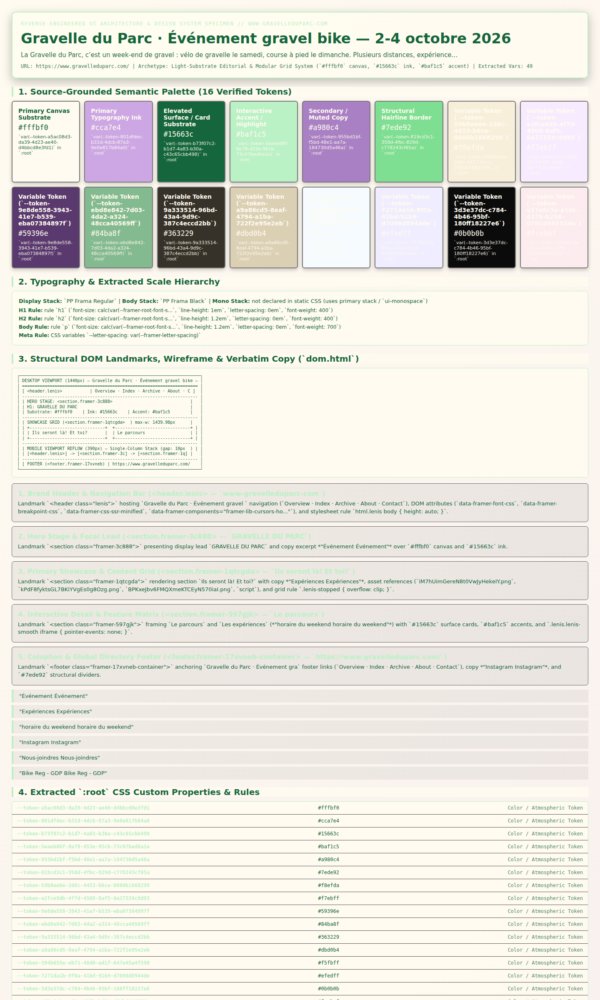
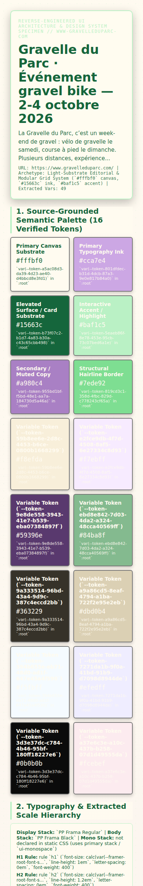

# UI Design System & Master Generation Blueprint: www-gravelleduparc-com

> **Gravelle du Parc · Événement gravel bike — 2-4 octobre 2026** (https://www.gravelleduparc.com/) — La Gravelle du Parc, c’est un week-end de gravel : vélo de gravelle le samedi, course à pied le dimanche. Plusieurs distances, expérience...



---

## 1. Executive Visual Persona & Design Archetype

- **Brand Essence & Persona**: **Gravelle du Parc · Événement gravel bike — 2-4 octobre 2026** (`https://www.gravelleduparc.com/`). La Gravelle du Parc, c’est un week-end de gravel : vélo de gravelle le samedi, course à pied le dimanche. Plusieurs distances, expérience...
- **Visual Archetype**: **Light-Substrate Editorial & Modular Grid System (`#fffbf0` canvas, `#15663c` ink, `#baf1c5` accent)**.
- **Anti-AI-Slop Differentiators**:
  - **Source-Grounded Chromatic Polarity**: Anchors the viewport in `#fffbf0` (`var(--token-a5ac08d3-da39-4d23-ae40-d4bbcd8e3fd1)` in `:root`) paired with `#15663c` primary typography and `#baf1c5` accents.
  - **Extracted Typographic Hierarchy**: Pairs `PP Frama Regular` for display copy (`GRAVELLE DU PARC`) with `PP Frama Black` and not declared in static CSS (uses primary stack / `ui-monospace`).
  - **Calibrated Spatial Grid & Motion**: Combines `1439.98px` container bounds (`gap: 10px`, padding `32px`) with `cubic-bezier(0.44,0,0.56,1)` easing and Lenis Smooth Scroll (`data-lenis`), GSAP Timeline & ScrollTrigger.

---

## 2. Spatial Architecture & Modular Grid Mathematics



### Viewport Allocation & Container Geometry
- **Captured Viewport Dimensions**: Desktop `1440×2400px` (`assets/desktop.png`, capped at 2400px multi-section capture), Mobile `390×2400px` (`assets/mobile.png`, capped at 2400px multi-section capture).
- **Master Container Bounds**: `1439.98px` extracted from `www-gravelleduparc-com` stylesheet.
- **Canvas Lateral Padding & Spacing**: `32px` lateral canvas padding with `10px` grid gap.
- **Border Radius Scale**: `50%`, `24px`, `18px`, `9999px`.

### Responsive Breakpoint Architecture
- **Desktop Layout**: Multi-column CSS Grid / Flexbox layout at `1440px` (`max-width: 1439.98px`, `gap: 10px`).
- **Mobile Layout**: Single-column vertical stack at `390px` viewport width with `32px` horizontal padding.
- **Extracted CSS Media Queries**: `@media (min-width: 1440px)`, `@media (min-width: 960px) and (max-width: 1439.98px)`, `@media (min-width: 810px) and (max-width: 959.98px)`, `@media (max-width: 809.98px)`.

---

## 3. Color System, Materiality & Atmospheric Lighting

### Semantic Palette & Source Grounding
| Semantic Role | Ground-Truth Value | Extracted CSS Source / Selector |
|---|---|---|
| **Primary Canvas Substrate** | `#fffbf0` | `var(--token-a5ac08d3-da39-4d23-ae40-d4bbcd8e3fd1)` in `:root` |
| **Primary Typography Ink** | `#cca7e4` | `var(--token-801dfdec-b31d-4dcb-87a3-9e0e817b84a0)` in `:root` |
| **Elevated Surface / Card Substrate** | `#15663c` | `var(--token-b73f07c2-b1d7-4a83-b30a-c43c65cbb498)` in `:root` |
| **Interactive Accent / Highlight** | `#baf1c5` | `var(--token-5eaeb86f-8e78-453e-95cb-73c07bed6a1e)` in `:root` |
| **Secondary / Muted Copy** | `#a980c4` | `var(--token-955bd1bf-f5bd-48e1-aa7a-184730d5a46a)` in `:root` |
| **Structural Hairline Border** | `#7ede92` | `var(--token-819cd3c1-358d-4fbc-829d-c778243cf65a)` in `:root` |
| **Variable Token (`--token-59b8ee6e-2d8c-4453-b6ce-0800b1668299`)** | `#f8efda` | `var(--token-59b8ee6e-2d8c-4453-b6ce-0800b1668299)` in `:root` |
| **Variable Token (`--token-e2fce9db-4f7d-4508-8af5-6e27334c8d93`)** | `#f7ebff` | `var(--token-e2fce9db-4f7d-4508-8af5-6e27334c8d93)` in `:root` |
| **Variable Token (`--token-9e8de558-3943-41e7-b539-eba07384897f`)** | `#59396e` | `var(--token-9e8de558-3943-41e7-b539-eba07384897f)` in `:root` |
| **Variable Token (`--token-ebd8e842-7d03-4da2-a324-48cca40569ff`)** | `#84ba8f` | `var(--token-ebd8e842-7d03-4da2-a324-48cca40569ff)` in `:root` |
| **Variable Token (`--token-9a333514-96bd-43a4-9d9c-387c4eccd2bb`)** | `#363229` | `var(--token-9a333514-96bd-43a4-9d9c-387c4eccd2bb)` in `:root` |
| **Variable Token (`--token-a9a86cd5-8eaf-4794-a1ba-722f2e95e2eb`)** | `#dbd0b4` | `var(--token-a9a86cd5-8eaf-4794-a1ba-722f2e95e2eb)` in `:root` |
| **Variable Token (`--token-394b655e-eb71-48d0-ad1f-647e45a4f590`)** | `#f5fbff` | `var(--token-394b655e-eb71-48d0-ad1f-647e45a4f590)` in `:root` |
| **Variable Token (`--token-7271da1b-9f0a-41bd-91b9-d7098d8944de`)** | `#efedff` | `var(--token-7271da1b-9f0a-41bd-91b9-d7098d8944de)` in `:root` |
| **Variable Token (`--token-3d3e37dc-c784-4b46-95bf-180ff18227e6`)** | `#0b0b0b` | `var(--token-3d3e37dc-c784-4b46-95bf-180ff18227e6)` in `:root` |
| **Variable Token (`--token-a37e6c3e-a10c-437b-b258-07d1d49555da`)** | `#fcebef` | `var(--token-a37e6c3e-a10c-437b-b258-07d1d49555da)` in `:root` |

### Sanitized Root CSS Variables (`ui-ux.md` Ground Truth)
| Variable Name | Extracted Value | Semantic Role |
|---|---|---|
| `--token-a5ac08d3-da39-4d23-ae40-d4bbcd8e3fd1` | `#fffbf0` | Color / Atmospheric Token |
| `--token-801dfdec-b31d-4dcb-87a3-9e0e817b84a0` | `#cca7e4` | Color / Atmospheric Token |
| `--token-b73f07c2-b1d7-4a83-b30a-c43c65cbb498` | `#15663c` | Color / Atmospheric Token |
| `--token-5eaeb86f-8e78-453e-95cb-73c07bed6a1e` | `#baf1c5` | Color / Atmospheric Token |
| `--token-955bd1bf-f5bd-48e1-aa7a-184730d5a46a` | `#a980c4` | Color / Atmospheric Token |
| `--token-819cd3c1-358d-4fbc-829d-c778243cf65a` | `#7ede92` | Color / Atmospheric Token |
| `--token-59b8ee6e-2d8c-4453-b6ce-0800b1668299` | `#f8efda` | Color / Atmospheric Token |
| `--token-e2fce9db-4f7d-4508-8af5-6e27334c8d93` | `#f7ebff` | Color / Atmospheric Token |
| `--token-9e8de558-3943-41e7-b539-eba07384897f` | `#59396e` | Color / Atmospheric Token |
| `--token-ebd8e842-7d03-4da2-a324-48cca40569ff` | `#84ba8f` | Color / Atmospheric Token |
| `--token-9a333514-96bd-43a4-9d9c-387c4eccd2bb` | `#363229` | Color / Atmospheric Token |
| `--token-a9a86cd5-8eaf-4794-a1ba-722f2e95e2eb` | `#dbd0b4` | Color / Atmospheric Token |
| `--token-394b655e-eb71-48d0-ad1f-647e45a4f590` | `#f5fbff` | Color / Atmospheric Token |
| `--token-7271da1b-9f0a-41bd-91b9-d7098d8944de` | `#efedff` | Color / Atmospheric Token |
| `--token-3d3e37dc-c784-4b46-95bf-180ff18227e6` | `#0b0b0b` | Color / Atmospheric Token |
| `--token-a37e6c3e-a10c-437b-b258-07d1d49555da` | `#fcebef` | Color / Atmospheric Token |

---

## 4. Typographic Scale & Editorial Hierarchy

### Font Family Stacks
- **Display Typography**: `PP Frama Regular`.
- **Primary Body Stack**: `PP Frama Black`.
- **Technical / Metadata Stack**: not declared in static CSS (uses primary stack / `ui-monospace`).

### Typographic Scale & Rules (Extracted from Stylesheet & Variables)
- **Hero Display (`H1`)**: rule `h1` (`font-size: calc(var(--framer-root-font-s...`, `line-height: 1em`, `letter-spacing: 0em`, `font-weight: 400`).
- **Section Heading (`H2`)**: rule `h2` (`font-size: calc(var(--framer-root-font-s...`, `line-height: 1.2em`, `letter-spacing: 0em`, `font-weight: 400`).
- **Body Copy**: rule `p` (`font-size: calc(var(--framer-root-font-s...`, `line-height: 1.2em`, `letter-spacing: 0em`, `font-weight: 700`).
- **Metadata & Navigation Labels**: CSS variables `--letter-spacing: var(--framer-letter-spacing)`.

---

## 5. Choreographed Motion & Interaction Physics

### Primary Easing Curves
- **Extracted Timing Functions**: `cubic-bezier(0.44,0,0.56,1)`.

### Per-Element Transition & Choreography Rules
- **Selector `.lenis.lenis-autoToggle`**: `transition: 1ms` extracted from `www-gravelleduparc-com` stylesheet.
- **Selector `.swiper-wrapper`**: `transition: var(--swiper-wrapper-transition-timing-function,initial)` extracted from `www-gravelleduparc-com` stylesheet.
- **Selector `.swiper-pagination`**: `transition: opacity .3s` extracted from `www-gravelleduparc-com` stylesheet.
- **Extracted Easing Curve (`cubic-bezier(0.44,0,0.56,1)`)**: Governs interactive state transitions across `<header.lenis>` and `<section.framer-1qtcgda>`.
- **Runtime Interaction Engine**: Integrates Lenis Smooth Scroll (`data-lenis`), GSAP Timeline & ScrollTrigger, Three.js / WebGL Canvas Pipeline, Swiper Touch Carousel Engine, Barba.js Page Transition Router, Framer Motion Layout Physics with `prefers-reduced-motion: reduce` fallback guards.

---

## 6. Component Wireframe & Structural DOM Map

### Visual Layout Schematic (Grounded in `dom.html` — `1440px` Desktop & `390px` Mobile Reflow)
```
┌────────────────────────────────────────────────────────────────────────┐
│ DESKTOP VIEWPORT (1440px) — Gravelle du Parc · Événement gravel bike — │
│ ====================================================================== │
│ [ <header.lenis>           | Overview · Index · Archive · About · C ]  │
│ ---------------------------------------------------------------------- │
│ | HERO STAGE: <section.framer-3c888>                               |   │
│ | H1: GRAVELLE DU PARC                                             |   │
│ | Substrate: #fffbf0    | Ink: #15663c    | Accent: #baf1c5        |   │
│ ---------------------------------------------------------------------- │
│ | SHOWCASE GRID (<section.framer-1qtcgda>  ) max-w: 1439.98px      |   │
│ | +------------------------------+  +------------------------------+ | │
│ | | Ils seront là! Et toi?       |  | Le parcours                  | | │
│ | +------------------------------+  +------------------------------+ | │
│ ---------------------------------------------------------------------- │
│ | MOBILE VIEWPORT REFLOW (390px) — Single-Column Stack (gap: 10px  ) | │
│ | [<header.lenis>] -> [<section.framer-3c] -> [<section.framer-1q] |   │
│ ---------------------------------------------------------------------- │
│ [ FOOTER (<footer.framer-17xvneb) | https://www.gravelleduparc.com/    │
└────────────────────────────────────────────────────────────────────────┘
```

### Granular DOM Region Breakdown
1. **Brand Header & Navigation Bar (<header.lenis> — `www-gravelleduparc-com`)**:
   - Landmark `<header class="lenis">` hosting `Gravelle du Parc · Événement gravel ` navigation (`Overview · Index · Archive · About · Contact`), DOM attributes (`data-framer-font-css`, `data-framer-breakpoint-css`, `data-framer-css-ssr-minified`, `data-framer-components="framer-lib-cursors-ho..."`), and stylesheet rule `html.lenis body { height: auto; }`.
2. **Hero Stage & Focal Lead (<section.framer-3c888> — `GRAVELLE DU PARC`)**:
   - Landmark `<section class="framer-3c888">` presenting display lead `GRAVELLE DU PARC` and copy excerpt *"Événement Événement"* over `#fffbf0` canvas and `#15663c` ink.
3. **Primary Showcase & Content Grid (<section.framer-1qtcgda> — `Ils seront là! Et toi?`)**:
   - Landmark `<section class="framer-1qtcgda">` rendering section `Ils seront là! Et toi?` with copy *"Expériences Expériences"*, asset references (`iM7hUimGereN8t0VwJyHekeIY.png`, `kPdF8fyktsGL7BKiYVgEs0g8Ozg.png`, `BPKxeJbv6FMQXmeKTCEyN570iaI.png`, `script`), and grid rule `.lenis-stopped { overflow: clip; }`.
4. **Interactive Detail & Feature Matrix (<section.framer-597gjk> — `Le parcours`)**:
   - Landmark `<section class="framer-597gjk">` framing `Le parcours` and `Les expériences` (*"horaire du weekend horaire du weekend"*) with `#15663c` surface cards, `#baf1c5` accents, and `.lenis.lenis-smooth iframe { pointer-events: none; }`.
5. **Colophon & Global Directory Footer (<footer.framer-17xvneb-container> — `https://www.gravelleduparc.com/`)**:
   - Landmark `<footer class="framer-17xvneb-container">` anchoring `Gravelle du Parc · Événement gra` footer links (`Overview · Index · Archive · About · Contact`), copy *"Instagram Instagram"*, and `#7ede92` structural dividers.

---

## 7. Master Zero-Shot AI Generation Prompt

```markdown
# Master Zero-Shot Frontend Generation Prompt: www-gravelleduparc-com (Gravelle du Parc · Événement gravel bike — 2-4 octobre 2026)

You are a principal frontend architect and design systems engineer. Build a complete, production-ready web application replicating the exact design system, DOM landmarks, typographic hierarchy, color tokens, and motion physics of `www-gravelleduparc-com` (**Gravelle du Parc · Événement gravel bike — 2-4 octobre 2026** — `https://www.gravelleduparc.com/`).

### 1. Visual Archetype & Anti-AI-Slop Mandates
- **Archetype**: Light-Substrate Editorial & Modular Grid System (`#fffbf0` canvas, `#15663c` ink, `#baf1c5` accent).
- **Identity & Domain Context**: La Gravelle du Parc, c’est un week-end de gravel : vélo de gravelle le samedi, course à pied le dimanche. Plusieurs distances, expérience...
- **Primary Substrate**: `#fffbf0` (`var(--token-a5ac08d3-da39-4d23-ae40-d4bbcd8e3fd1)` in `:root`), **Primary Ink**: `#15663c`, **Accent / Highlight**: `#baf1c5`.
- **Site-Specific Differentiators**:
  - **Source-Grounded Chromatic Polarity**: Anchors the viewport in `#fffbf0` (`var(--token-a5ac08d3-da39-4d23-ae40-d4bbcd8e3fd1)` in `:root`) paired with `#15663c` primary typography and `#baf1c5` accents.
  - **Extracted Typographic Hierarchy**: Pairs `PP Frama Regular` for display copy (`GRAVELLE DU PARC`) with `PP Frama Black` and not declared in static CSS (uses primary stack / `ui-monospace`).
  - **Calibrated Spatial Grid & Motion**: Combines `1439.98px` container bounds (`gap: 10px`, padding `32px`) with `cubic-bezier(0.44,0,0.56,1)` easing and Lenis Smooth Scroll (`data-lenis`), GSAP Timeline & ScrollTrigger.

### 2. Ground-Truth CSS Variables (`:root` Token Contract)
Declare and consume these exact custom properties extracted from `www-gravelleduparc-com` in your global stylesheet:

:root {
  /* Gravelle du Parc · Événement gravel bike — 2-4 octobre 2026 (www-gravelleduparc-com) — Ground-Truth Extracted CSS Variables */
  --token-a5ac08d3-da39-4d23-ae40-d4bbcd8e3fd1: #fffbf0; /* Color / Atmospheric Token (www-gravelleduparc-com) */
  --token-801dfdec-b31d-4dcb-87a3-9e0e817b84a0: #cca7e4; /* Color / Atmospheric Token (www-gravelleduparc-com) */
  --token-b73f07c2-b1d7-4a83-b30a-c43c65cbb498: #15663c; /* Color / Atmospheric Token (www-gravelleduparc-com) */
  --token-5eaeb86f-8e78-453e-95cb-73c07bed6a1e: #baf1c5; /* Color / Atmospheric Token (www-gravelleduparc-com) */
  --token-955bd1bf-f5bd-48e1-aa7a-184730d5a46a: #a980c4; /* Color / Atmospheric Token (www-gravelleduparc-com) */
  --token-819cd3c1-358d-4fbc-829d-c778243cf65a: #7ede92; /* Color / Atmospheric Token (www-gravelleduparc-com) */
  --token-59b8ee6e-2d8c-4453-b6ce-0800b1668299: #f8efda; /* Color / Atmospheric Token (www-gravelleduparc-com) */
  --token-e2fce9db-4f7d-4508-8af5-6e27334c8d93: #f7ebff; /* Color / Atmospheric Token (www-gravelleduparc-com) */
  --token-9e8de558-3943-41e7-b539-eba07384897f: #59396e; /* Color / Atmospheric Token (www-gravelleduparc-com) */
  --token-ebd8e842-7d03-4da2-a324-48cca40569ff: #84ba8f; /* Color / Atmospheric Token (www-gravelleduparc-com) */
  --token-9a333514-96bd-43a4-9d9c-387c4eccd2bb: #363229; /* Color / Atmospheric Token (www-gravelleduparc-com) */
  --token-a9a86cd5-8eaf-4794-a1ba-722f2e95e2eb: #dbd0b4; /* Color / Atmospheric Token (www-gravelleduparc-com) */
  --token-394b655e-eb71-48d0-ad1f-647e45a4f590: #f5fbff; /* Color / Atmospheric Token (www-gravelleduparc-com) */
  --token-7271da1b-9f0a-41bd-91b9-d7098d8944de: #efedff; /* Color / Atmospheric Token (www-gravelleduparc-com) */
  --token-3d3e37dc-c784-4b46-95bf-180ff18227e6: #0b0b0b; /* Color / Atmospheric Token (www-gravelleduparc-com) */
  --token-a37e6c3e-a10c-437b-b258-07d1d49555da: #fcebef; /* Color / Atmospheric Token (www-gravelleduparc-com) */
}

### 3. Semantic Color & Materiality Contract
Map every surface, ink, and border strictly to these source-grounded tokens:
- **Primary Canvas Substrate**: `#fffbf0` — grounded in `var(--token-a5ac08d3-da39-4d23-ae40-d4bbcd8e3fd1)` in `:root`
- **Primary Typography Ink**: `#cca7e4` — grounded in `var(--token-801dfdec-b31d-4dcb-87a3-9e0e817b84a0)` in `:root`
- **Elevated Surface / Card Substrate**: `#15663c` — grounded in `var(--token-b73f07c2-b1d7-4a83-b30a-c43c65cbb498)` in `:root`
- **Interactive Accent / Highlight**: `#baf1c5` — grounded in `var(--token-5eaeb86f-8e78-453e-95cb-73c07bed6a1e)` in `:root`
- **Secondary / Muted Copy**: `#a980c4` — grounded in `var(--token-955bd1bf-f5bd-48e1-aa7a-184730d5a46a)` in `:root`
- **Structural Hairline Border**: `#7ede92` — grounded in `var(--token-819cd3c1-358d-4fbc-829d-c778243cf65a)` in `:root`
- **Variable Token (`--token-59b8ee6e-2d8c-4453-b6ce-0800b1668299`)**: `#f8efda` — grounded in `var(--token-59b8ee6e-2d8c-4453-b6ce-0800b1668299)` in `:root`
- **Variable Token (`--token-e2fce9db-4f7d-4508-8af5-6e27334c8d93`)**: `#f7ebff` — grounded in `var(--token-e2fce9db-4f7d-4508-8af5-6e27334c8d93)` in `:root`
- **Variable Token (`--token-9e8de558-3943-41e7-b539-eba07384897f`)**: `#59396e` — grounded in `var(--token-9e8de558-3943-41e7-b539-eba07384897f)` in `:root`
- **Variable Token (`--token-ebd8e842-7d03-4da2-a324-48cca40569ff`)**: `#84ba8f` — grounded in `var(--token-ebd8e842-7d03-4da2-a324-48cca40569ff)` in `:root`
- **Variable Token (`--token-9a333514-96bd-43a4-9d9c-387c4eccd2bb`)**: `#363229` — grounded in `var(--token-9a333514-96bd-43a4-9d9c-387c4eccd2bb)` in `:root`
- **Variable Token (`--token-a9a86cd5-8eaf-4794-a1ba-722f2e95e2eb`)**: `#dbd0b4` — grounded in `var(--token-a9a86cd5-8eaf-4794-a1ba-722f2e95e2eb)` in `:root`
- **Variable Token (`--token-394b655e-eb71-48d0-ad1f-647e45a4f590`)**: `#f5fbff` — grounded in `var(--token-394b655e-eb71-48d0-ad1f-647e45a4f590)` in `:root`
- **Variable Token (`--token-7271da1b-9f0a-41bd-91b9-d7098d8944de`)**: `#efedff` — grounded in `var(--token-7271da1b-9f0a-41bd-91b9-d7098d8944de)` in `:root`
- **Variable Token (`--token-3d3e37dc-c784-4b46-95bf-180ff18227e6`)**: `#0b0b0b` — grounded in `var(--token-3d3e37dc-c784-4b46-95bf-180ff18227e6)` in `:root`
- **Variable Token (`--token-a37e6c3e-a10c-437b-b258-07d1d49555da`)**: `#fcebef` — grounded in `var(--token-a37e6c3e-a10c-437b-b258-07d1d49555da)` in `:root`

### 4. Spatial Grid, Container Bounds & Responsive Breakpoints
- **Desktop Viewport Reference**: `1440×2400px` (capped at 2400px multi-section capture, `1440px` standard desktop width).
- **Mobile Viewport Reference**: `390×2400px` (capped at 2400px multi-section capture, `390px` standard mobile width).
- **Container Max-Width**: `1439.98px` extracted from `www-gravelleduparc-com` stylesheet
- **Padding & Gutters**: `32px` lateral canvas padding with `10px` grid gap
- **Desktop Grid**: Multi-column CSS Grid / Flexbox layout at `1440px` (`max-width: 1439.98px`, `gap: 10px`)
- **Mobile Adaptation**: Single-column vertical stack at `390px` viewport width with `32px` horizontal padding
- **Media Queries**: `@media (min-width: 1440px)`, `@media (min-width: 960px) and (max-width: 1439.98px)`, `@media (min-width: 810px) and (max-width: 959.98px)`, `@media (max-width: 809.98px)`
- **Corner Radii**: `50%`, `24px`, `18px`, `9999px`

### 5. Typography & Editorial Scale Contract
- **Display Font Stack**: `PP Frama Regular`
- **Body Font Stack**: `PP Frama Black`
- **Monospace / Technical Font Stack**: not declared in static CSS (uses primary stack / `ui-monospace`)
- **H1 Display Rule**: rule `h1` (`font-size: calc(var(--framer-root-font-s...`, `line-height: 1em`, `letter-spacing: 0em`, `font-weight: 400`)
- **H2 Section Rule**: rule `h2` (`font-size: calc(var(--framer-root-font-s...`, `line-height: 1.2em`, `letter-spacing: 0em`, `font-weight: 400`)
- **Body Copy Rule**: rule `p` (`font-size: calc(var(--framer-root-font-s...`, `line-height: 1.2em`, `letter-spacing: 0em`, `font-weight: 700`)
- **Metadata & Index Rule**: CSS variables `--letter-spacing: var(--framer-letter-spacing)`

### 6. Component Hierarchy, Verbatim Copy & Real DOM Landmarks
Scaffold `www-gravelleduparc-com` (`Gravelle du Parc · Événement gravel bike — 2-4 octobre 2026`) with these exact structural regions, extracted copy, and CSS rules from `dom.html`:
1. **Brand Header & Navigation Bar (<header.lenis> — `www-gravelleduparc-com`)**:
   - DOM & Selectors: Landmark `<header class="lenis">` hosting `Gravelle du Parc · Événement gravel ` navigation (`Overview · Index · Archive · About · Contact`), DOM attributes (`data-framer-font-css`, `data-framer-breakpoint-css`, `data-framer-css-ssr-minified`, `data-framer-components="framer-lib-cursors-ho..."`), and stylesheet rule `html.lenis body { height: auto; }`.
   - Responsive Contract: Header `Brand Header & Navigation Bar (<header.lenis> — `www-gravelleduparc-com`)` (`www-gravelleduparc-com`) adapts across `@media (min-width: 1440px)`, `@media (min-width: 960px) and (max-width: 1439.98px)`, `@media (min-width: 810px) and (max-width: 959.98px)`, `@media (max-width: 809.98px)` with `cubic-bezier(0.44,0,0.56,1)` transitions and links `Overview · Index · Archive · About · Contact`.
2. **Hero Stage & Focal Lead (<section.framer-3c888> — `GRAVELLE DU PARC`)**:
   - DOM & Selectors: Landmark `<section class="framer-3c888">` presenting display lead `GRAVELLE DU PARC` and copy excerpt *"Événement Événement"* over `#fffbf0` canvas and `#15663c` ink.
   - Responsive Contract: Hero stage (`1440×2400px` desktop / `390×2400px` mobile) sets `#fffbf0` background with `#15663c` headline `GRAVELLE DU PARC`.
3. **Primary Showcase & Content Grid (<section.framer-1qtcgda> — `Ils seront là! Et toi?`)**:
   - DOM & Selectors: Landmark `<section class="framer-1qtcgda">` rendering section `Ils seront là! Et toi?` with copy *"Expériences Expériences"*, asset references (`iM7hUimGereN8t0VwJyHekeIY.png`, `kPdF8fyktsGL7BKiYVgEs0g8Ozg.png`, `BPKxeJbv6FMQXmeKTCEyN570iaI.png`, `script`), and grid rule `.lenis-stopped { overflow: clip; }`.
   - Responsive Contract: Showcase grid `Primary Showcase & Content Grid (<section.framer-1qtcgda> — `Ils seront là! Et toi?`)` applies Multi-column CSS Grid / Flexbox layout at `1440px` (`max-width: 1439.98px`, `gap: 10px`) on desktop and Single-column vertical stack at `390px` viewport width with `32px` horizontal padding on mobile.
4. **Interactive Detail & Feature Matrix (<section.framer-597gjk> — `Le parcours`)**:
   - DOM & Selectors: Landmark `<section class="framer-597gjk">` framing `Le parcours` and `Les expériences` (*"horaire du weekend horaire du weekend"*) with `#15663c` surface cards, `#baf1c5` accents, and `.lenis.lenis-smooth iframe { pointer-events: none; }`.
   - Responsive Contract: Detail module `Interactive Detail & Feature Matrix (<section.framer-597gjk> — `Le parcours`)` uses `50%`, `24px`, `18px`, `9999px` radii, `#baf1c5` highlights, and assets (iM7hUimGereN8t0VwJyHekeIY.png, kPdF8fyktsGL7BKiYVgEs0g8Ozg.png, BPKxeJbv6FMQXmeKTCEyN570iaI.png).
5. **Colophon & Global Directory Footer (<footer.framer-17xvneb-container> — `https://www.gravelleduparc.com/`)**:
   - DOM & Selectors: Landmark `<footer class="framer-17xvneb-container">` anchoring `Gravelle du Parc · Événement gra` footer links (`Overview · Index · Archive · About · Contact`), copy *"Instagram Instagram"*, and `#7ede92` structural dividers.
   - Responsive Contract: Footer `Colophon & Global Directory Footer (<footer.framer-17xvneb-container> — `https://www.gravelleduparc.com/`)` aligns to `1439.98px` extracted from `www-gravelleduparc-com` stylesheet with `32px` lateral canvas padding with `10px` grid gap and attributes (data-framer-font-css, data-framer-breakpoint-css, data-framer-css-ssr-minified).

#### Verbatim DOM Copy Excerpts (`dom.html`)
- Copy Excerpt 1: *"Événement Événement"*
- Copy Excerpt 2: *"Expériences Expériences"*
- Copy Excerpt 3: *"horaire du weekend horaire du weekend"*
- Copy Excerpt 4: *"Instagram Instagram"*

### 7. Motion, Extracted Stylesheet Rules & Interaction Choreography
- **Primary Easing Functions**: `cubic-bezier(0.44,0,0.56,1)`
- **Extracted Stylesheet Rules (`www-gravelleduparc-com`)**:
- `html.lenis body { height: auto; }`
- `.lenis-stopped { overflow: clip; }`
- `.lenis.lenis-smooth iframe { pointer-events: none; }`
- `.lenis.lenis-autoToggle { transition-property: overflow; transition-duration: 1ms; transition-beha... }`
- `.ph-xxs { font-size:.5em }`
- **Per-Selector Transition Rules**:
- **Selector `.lenis.lenis-autoToggle`**: `transition: 1ms` extracted from `www-gravelleduparc-com` stylesheet.
- **Selector `.swiper-wrapper`**: `transition: var(--swiper-wrapper-transition-timing-function,initial)` extracted from `www-gravelleduparc-com` stylesheet.
- **Selector `.swiper-pagination`**: `transition: opacity .3s` extracted from `www-gravelleduparc-com` stylesheet.
- **Extracted Easing Curve (`cubic-bezier(0.44,0,0.56,1)`)**: Governs interactive state transitions across `<header.lenis>` and `<section.framer-1qtcgda>`.
- **Runtime Interaction Engine**: Integrates Lenis Smooth Scroll (`data-lenis`), GSAP Timeline & ScrollTrigger, Three.js / WebGL Canvas Pipeline, Swiper Touch Carousel Engine, Barba.js Page Transition Router, Framer Motion Layout Physics with `prefers-reduced-motion: reduce` fallback guards.

### 8. Technical Deliverables
- Implement in Next.js (App Router) with TypeScript and Tailwind CSS consuming the `:root` custom properties defined above for `www-gravelleduparc-com`.
- Reproduce both the `1440px` desktop architecture and `390px` mobile breakpoint transitions, preserving semantic HTML5 landmarks (`<header>`, `<nav>`, `<main>`, `<section>`, `<footer>`) and `prefers-reduced-motion` accessibility guards.
```
