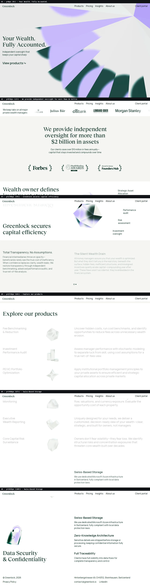
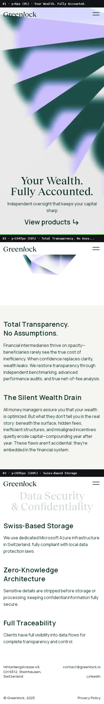

# UI Design System & Master Generation Blueprint: www-greenlock-io

> **Independent Wealth Oversight for Family Offices · GreenLock** (https://www.greenlock.io) — GreenLock is a Swiss-based platform offering objective, independent oversight for Single Family Offices. Expose hidden costs, optimize pe...





---

## 1. Executive Visual Persona & Design Archetype

- **Brand Essence & Persona**: **Independent Wealth Oversight for Family Offices · GreenLock** (`https://www.greenlock.io`). GreenLock is a Swiss-based platform offering objective, independent oversight for Single Family Offices. Expose hidden costs, optimize pe...
- **Capture Provenance**: Live browser capture (`tier1_fast`, HTTP `200`, captured `2026-11-24`).
- **Visual Archetype**: **Light-Substrate Editorial & Modular Grid System (`#ffffff` canvas, `#0a1516` ink, `#0000ff` accent)**.
- **Anti-AI-Slop Differentiators**:
  - **Live-Computed Chromatic Polarity**: Anchors the viewport in `#ffffff` (live computed `browser-default` `background-color` (`computed_styles.json`)) paired with `#0a1516` primary typography and `#0000ff` accents.
  - **Grounded Typographic Hierarchy**: Pairs `Reckless Neue Licensed` for display copy (`Your Wealth. Fully Accounted.`) with `Manrope`.
  - **Calibrated Spatial Grid & Motion**: Combines `104rem` container bounds (`gap: 16px`, padding `9px`) with `cubic-bezier(.23,1,.32,1)` easing and GSAP Timeline & ScrollTrigger, Three.js / WebGL Canvas Pipeline.

---

## 2. Spatial Architecture & Modular Grid Mathematics

### Viewport Allocation & Container Geometry
- **Captured Journey Filmstrips**: Desktop `1280×4968px` (`assets/desktop-journey.webp`, `6` keyframes up to `y=3889px` / doc `4789px`), Mobile `390×2616px` (`assets/mobile-journey.webp`, `3` keyframes).
- **Master Container Bounds**: `104rem` (non-`@media` desktop container stylesheet rule).
- **Canvas Lateral Padding & Spacing**: `9px` lateral canvas padding with `16px` grid gap.
- **Border Radius Scale**: `3px`, `100%`, `50%`, `2px`.

### Responsive Breakpoint Architecture
- **Desktop Layout**: Multi-column CSS Grid / Flexbox layout at `1440px` (`max-width: 104rem`, `gap: 16px`).
- **Mobile Layout**: Single-column vertical stack at `390px` viewport width with `9px` horizontal padding.
- **Extracted CSS Media Queries**: `@media screen and (max-width:991px)`, `@media screen and (max-width:767px)`, `@media screen and (max-width:479px)`, `@media (min-width:768px)`.

---

## 3. Color System, Materiality & Atmospheric Lighting

### Semantic Palette & Source Grounding
| Semantic Role | Ground-Truth Value | Extracted Live / CSS Source |
|---|---|---|
| **Primary Canvas Substrate** | `#ffffff` | live computed `browser-default` `background-color` (`computed_styles.json`) |
| **Primary Typography Ink** | `#0a1516` | live computed `p` `color` (`computed_styles.json`) |
| **Elevated Surface / Card Substrate** | `#f1f5f9` | `var(--background-color-ds-tertiary)` in `:root` |
| **Interactive Accent / Highlight** | `#0000ff` | `.button.is-text.w--current { color: blue }` (`#0000ff`) |
| **Secondary / Muted Copy** | `#f670c7` | `var(--ds-pink-400)` in `:root` |
| **Structural Hairline Border** | `#e2e8f0` | `var(--border)` in `:root` |
| **Variable Token (`--green-700`)** | `#0c221b` | `var(--green-700)` in `:root` |
| **Variable Token (`--green-100`)** | `#e0faef` | `var(--green-100)` in `:root` |
| **Variable Token (`--green-200`)** | `#99f4c0` | `var(--green-200)` in `:root` |
| **Variable Token (`--green-600`)** | `#0f3026` | `var(--green-600)` in `:root` |
| **Variable Token (`--gray-300`)** | `#94a8a2` | `var(--gray-300)` in `:root` |
| **Variable Token (`--green-250`)** | `#5d9c78` | `var(--green-250)` in `:root` |
| **Variable Token (`--transparent`)** | `#0000` | `var(--transparent)` in `:root` |
| **Variable Token (`--gray-500`)** | `#132526` | `var(--gray-500)` in `:root` |
| **Variable Token (`--yellow-200`)** | `#fcf89c` | `var(--yellow-200)` in `:root` |
| **Variable Token (`--purple-400`)** | `#3f328d` | `var(--purple-400)` in `:root` |
| **Variable Token (`--gray-400`)** | `#1f3f32` | `var(--gray-400)` in `:root` |
| **Variable Token (`--gray-100`)** | `#f4f5f3` | `var(--gray-100)` in `:root` |
| **Variable Token (`--green-400`)** | `#18975a` | `var(--green-400)` in `:root` |

### Sanitized Root CSS Variables (`ui-ux.md` Ground Truth)
| Variable Name | Extracted Value | Semantic Role |
|---|---|---|
| `--green-700` | `#0c221b` | Color / Atmospheric Token |
| `--manrope-grotesk` | `Manrope,sans-serif` | Design System Custom Token |
| `--green-100` | `#e0faef` | Color / Atmospheric Token |
| `--white` | `white` | Canvas / Surface Token |
| `--reckless-antiqua` | `"Reckless Neue Licensed",sans-serif` | Design System Custom Token |
| `--green-200` | `#99f4c0` | Color / Atmospheric Token |
| `--green-600` | `#0f3026` | Color / Atmospheric Token |
| `--gray-300` | `#94a8a2` | Color / Atmospheric Token |
| `--green-250` | `#5d9c78` | Color / Atmospheric Token |
| `--transparent` | `#0000` | Color / Atmospheric Token |
| `--gray-500` | `#132526` | Color / Atmospheric Token |
| `--yellow-200` | `#fcf89c` | Color / Atmospheric Token |
| `--purple-400` | `#3f328d` | Color / Atmospheric Token |
| `--gray-400` | `#1f3f32` | Color / Atmospheric Token |
| `--gray-100` | `#f4f5f3` | Color / Atmospheric Token |
| `--green-400` | `#18975a` | Color / Atmospheric Token |

---

## 4. Typographic Scale & Editorial Hierarchy

### Font Family Stacks
- **Display Typography**: `Reckless Neue Licensed`.
- **Primary Body Stack**: `Manrope`.
- **Technical / Metadata Stack**: not declared in live computed styles (uses primary stack / `ui-monospace`).

### Typographic Scale & Rules (Live Computed & Stylesheet Grounded)
- **Hero Display (`H1`)**: live computed `h1` (`font-size: 54.5058px`, `line-height: 59.6676px`, `font-weight: 500`); CSS variables `--text-4xl: 2.25rem`, `--text-4xl--line-height: calc(2.5 / 2.25)`, `--text-5xl: 3rem`; rule `h1` (`font-size: 2.5rem`, `line-height: 3.375rem`, `font-weight: 600`).
- **Section Heading (`H2`)**: live computed `h2` (`font-size: 54.5058px`, `line-height: 59.6676px`, `font-weight: 500`); CSS variables `--text-2xl: 1.5rem`, `--text-2xl--line-height: calc(2 / 1.5)`, `--text-3xl: 1.875rem`; rule `h2` (`font-size: 2.5rem`, `line-height: 3.375rem`, `font-weight: 600`).
- **Body Copy**: live computed `body` (`font-size: 20.6238px`, `line-height: 23.5701px`, `font-weight: 400`); CSS variables `--text-base: 1rem`, `--text-base--line-height: calc(1.5 / 1)`, `--font-ds-body: "Inter var", ui-sans-serif, system-ui, sans-serif`; rule `p` (`font-size: 1.75rem`, `line-height: 3rem`).
- **Metadata & Navigation Labels**: live computed `nav/a` (`font-size: 20.6238px`, `line-height: 23.5701px`, `font-weight: 400`); CSS variables `--text-xs: .75rem`, `--text-xs--line-height: calc(1 / .75)`, `--text-sm: .875rem`.

---

## 5. Choreographed Motion & Interaction Physics

### Primary Easing Curves
- **Extracted Timing Functions**: `cubic-bezier(.23,1,.32,1)`, `cubic-bezier(.4,0,1,1)`, `cubic-bezier(0,0,.2,1)`.

### Per-Element Transition & Choreography Rules
- **Selector `.w-webflow-badge>img`**: `transition: unset` extracted from `www-greenlock-io` stylesheet.
- **Selector `.w-slider-dot`**: `transition: background-color .1s,color .1s` extracted from `www-greenlock-io` stylesheet.
- **Selector `.w-lightbox-control`**: `transition: all .3s` extracted from `www-greenlock-io` stylesheet.
- **Extracted Easing Curve (`cubic-bezier(.23,1,.32,1)`)**: Governs interactive state transitions across `<header.w-mod-js>` and `<section.v2-hero-section>`.
- **Runtime Interaction Engine**: Integrates GSAP Timeline & ScrollTrigger, Three.js / WebGL Canvas Pipeline, Lottie Vector Animation Player with `prefers-reduced-motion: reduce` fallback guards.
### Measured Runtime Scroll & Interaction Telemetry (`behavioral_journey_v2`)
- **Scroll Driver Mode**: `native` (max document height `4789px`, deepest scrollY reached `3889px` across `6` desktop keyframes).
- **Detected Scroll / Motion Libraries**: Native browser scroll / standard CSS transitions.
- **Route Transition Architecture**: First internal navigation (`/pricing`) measured as `MPA` in `1191ms`.

---

## 6. Component Wireframe & Structural DOM Map

### Visual Layout Schematic — Desktop (`1440px`, Grounded in `dom.html` & Landmark Bounding Boxes)
```
┌────────────────────────────────────────────────────────────────────────┐
│ DESKTOP VIEWPORT (1440px) — Independent Wealth Oversight for Family Of │
│ ====================================================================== │
│ [ <header.w-mod-js> (1440px)          | Pricing · Insights · About u ] │
│ ---------------------------------------------------------------------- │
│ | HERO STAGE: <section.v2-header-section> (w=1440px)                 | │
│ | H1: Your Wealth. Fully Accounted.                                  | │
│ | Substrate: #ffffff | Ink: #0a1516 | Accent: #0000ff                | │
│ ---------------------------------------------------------------------- │
│ | SHOWCASE GRID (<section.v2-hero-section>) max-w: 104rem            | │
│ | +------------------------------+  +------------------------------+ | │
│ | | Fee                          |  | Benchmarking                 | | │
│ | +------------------------------+  +------------------------------+ | │
│ ---------------------------------------------------------------------- │
│ | DETAIL MODULE (<section.v2-ticker-section) — & Reduction           | │
│ ---------------------------------------------------------------------- │
│ [ FOOTER (<footer.wf-manrope-n) | https://www.greenlock.io             │
└────────────────────────────────────────────────────────────────────────┘
```

### Visual Layout Schematic — Mobile Reflow (`390px`)
```
┌────────────────────────────────────────────────────────────────────────┐
│ MOBILE VIEWPORT REFLOW (390px) — Single-Column Stack (gap: 16px)       │
│ ====================================================================== │
│ [ HEADER BAR (<header.w-mod-js>       ) | Compact Menu (390px)         │
│ ---------------------------------------------------------------------- │
│ | HERO STAGE (<section.v2-header-secti) — 390px Vertical Lead        | │
│ | H1: Your Wealth. Fully Accounted.                                  | │
│ ---------------------------------------------------------------------- │
│ | SHOWCASE STACK (<section.v2-hero-secti) — 1-Col Stack              | │
│ | [ Item 1: Fee                                                    ] | │
│ | [ Item 2: Benchmarking                                           ] | │
│ ---------------------------------------------------------------------- │
│ | DETAIL STACK (<section.v2-ticker-secti) — 1-Col (& Reduction)      | │
│ ---------------------------------------------------------------------- │
│ [ FOOTER (<footer.wf-manrope-n) | Stacked 390px Colophon               │
└────────────────────────────────────────────────────────────────────────┘
```

### Granular DOM Region Breakdown
1. **Brand Header & Navigation Bar (<header.w-mod-js> — `www-greenlock-io`)**:
   - Landmark `<header class="w-mod-js">` (`1440px`) hosting `Independent Wealth Oversight for Fam` navigation (`Pricing · Insights · About us · Client portal`), DOM attributes (`data-wf-domain="www.greenlock.io"`, `data-wf-page="6816540e936df6252569dd87"`, `data-wf-site="63fca69523dfba725518d390"`, `data-domain="greenlock.io"`), and stylesheet rule `html { -webkit-text-size-adjust:100%;-ms-text-size-adjust:100%;font-family:sans... }`.
2. **Hero Stage & Focal Lead (<section.v2-header-section> — `Your Wealth. Fully Accounted.`)**:
   - Landmark `<section class="v2-header-section">` presenting display lead `Your Wealth. Fully Accounted.` and copy excerpt *"Fee Benchmarking & Reduction"* over `#ffffff` canvas and `#0a1516` ink.
3. **Primary Showcase & Content Grid (<section.v2-hero-section> — `Fee`)**:
   - Landmark `<section class="v2-hero-section full-height-fix">` rendering section `Fee` with copy *"Investment Performance Audit"*, asset references (`cdn.prod.website-files.com`, `greenlock-site.webflow.shared.26f...`, `fonts.googleapis.com`, `fonts.gstatic.com`), and grid rule `summary { display:block }`.
4. **Interactive Detail & Feature Matrix (<section.v2-ticker-section> — `Benchmarking`)**:
   - Landmark `<section class="v2-ticker-section">` framing `Benchmarking` and `& Reduction` (*"PE/VC Portfolio Optimization"*) with `#f1f5f9` surface cards, `#0000ff` accents, and `video { vertical-align:baseline;display:inline-block }`.
5. **Colophon & Global Directory Footer (<footer.wf-manrope-n5-active> — `https://www.greenlock.io`)**:
   - Landmark `<footer class="wf-manrope-n5-active">` anchoring `Independent Wealth Oversight for` footer links (`Pricing · Insights · About us · Client portal`), copy *"Real Estate Assets Monitoring"*, and `#e2e8f0` structural dividers.
### Full Vertical Scroll Sequence (Desktop `1440×900` Keyframes)
- **Step 01** (`y=0px`, `0%`): Active landmark `Your Wealth. Fully Accounted.` · sticky/fixed elements: `1`
- **Step 02** (`y=850px`, `22%`): Active landmark `We provide independent oversight for more than $2...` · sticky/fixed elements: `1`
- **Step 03** (`y=1700px`, `44%`): Active landmark `Greenlock secures capital efficiency` · sticky/fixed elements: `1`
- **Step 04** (`y=2550px`, `66%`): Active landmark `Explore our products` · sticky/fixed elements: `1`
- **Step 05** (`y=3400px`, `87%`): Active landmark `Swiss-Based Storage` · sticky/fixed elements: `1`
- **Step 06** (`y=3889px`, `100%`): Active landmark `Swiss-Based Storage` · sticky/fixed elements: `1`

### Multi-Page Internal Route Map
- **Listing Route (`/pricing`)**: `https://www.greenlock.io/pricing` — H1: `Fee`, scrollHeight `1783px`, transition `MPA` (`1191ms`)
- **About Route (`/about`)**: `https://www.greenlock.io/about` — H1: `Fee`, scrollHeight `2198px`, transition `direct` (`993ms`)
- **Other Route (`/fees-audit`)**: `https://www.greenlock.io/fees-audit` — H1: `Fee`, scrollHeight `3103px`, transition `direct` (`1003ms`)

---

## 7. Master Zero-Shot AI Generation Prompt

```markdown
# Master Zero-Shot Frontend Generation Prompt: www-greenlock-io (Independent Wealth Oversight for Family Offices · GreenLock)

You are a principal frontend architect and design systems engineer. Build a complete, production-ready web application replicating the exact design system, DOM landmarks, typographic hierarchy, color tokens, and motion physics of `www-greenlock-io` (**Independent Wealth Oversight for Family Offices · GreenLock** — `https://www.greenlock.io`).

### 1. Visual Archetype & Anti-AI-Slop Mandates
- **Archetype**: Light-Substrate Editorial & Modular Grid System (`#ffffff` canvas, `#0a1516` ink, `#0000ff` accent).
- **Identity & Domain Context**: GreenLock is a Swiss-based platform offering objective, independent oversight for Single Family Offices. Expose hidden costs, optimize pe...
- **Primary Substrate**: `#ffffff` (live computed `browser-default` `background-color` (`computed_styles.json`)), **Primary Ink**: `#0a1516`, **Accent / Highlight**: `#0000ff`.
- **Site-Specific Differentiators**:
  - **Live-Computed Chromatic Polarity**: Anchors the viewport in `#ffffff` (live computed `browser-default` `background-color` (`computed_styles.json`)) paired with `#0a1516` primary typography and `#0000ff` accents.
  - **Grounded Typographic Hierarchy**: Pairs `Reckless Neue Licensed` for display copy (`Your Wealth. Fully Accounted.`) with `Manrope`.
  - **Calibrated Spatial Grid & Motion**: Combines `104rem` container bounds (`gap: 16px`, padding `9px`) with `cubic-bezier(.23,1,.32,1)` easing and GSAP Timeline & ScrollTrigger, Three.js / WebGL Canvas Pipeline.

### 2. Ground-Truth CSS Variables (`:root` Token Contract)
Declare and consume these exact custom properties extracted from `www-greenlock-io` in your global stylesheet:

:root {
  /* Independent Wealth Oversight for Family Offices · GreenLock (www-greenlock-io) — Live-Grounded CSS Variables */
  --green-700: #0c221b; /* Color / Atmospheric Token (www-greenlock-io) */
  --manrope-grotesk: Manrope,sans-serif; /* Design System Custom Token (www-greenlock-io) */
  --green-100: #e0faef; /* Color / Atmospheric Token (www-greenlock-io) */
  --white: white; /* Canvas / Surface Token (www-greenlock-io) */
  --reckless-antiqua: "Reckless Neue Licensed",sans-serif; /* Design System Custom Token (www-greenlock-io) */
  --green-200: #99f4c0; /* Color / Atmospheric Token (www-greenlock-io) */
  --green-600: #0f3026; /* Color / Atmospheric Token (www-greenlock-io) */
  --gray-300: #94a8a2; /* Color / Atmospheric Token (www-greenlock-io) */
  --green-250: #5d9c78; /* Color / Atmospheric Token (www-greenlock-io) */
  --transparent: #0000; /* Color / Atmospheric Token (www-greenlock-io) */
  --gray-500: #132526; /* Color / Atmospheric Token (www-greenlock-io) */
  --yellow-200: #fcf89c; /* Color / Atmospheric Token (www-greenlock-io) */
  --purple-400: #3f328d; /* Color / Atmospheric Token (www-greenlock-io) */
  --gray-400: #1f3f32; /* Color / Atmospheric Token (www-greenlock-io) */
  --gray-100: #f4f5f3; /* Color / Atmospheric Token (www-greenlock-io) */
  --green-400: #18975a; /* Color / Atmospheric Token (www-greenlock-io) */
}

### 3. Semantic Color & Materiality Contract
Map every surface, ink, and border strictly to these source-grounded tokens:
- **Primary Canvas Substrate**: `#ffffff` — grounded in live computed `browser-default` `background-color` (`computed_styles.json`)
- **Primary Typography Ink**: `#0a1516` — grounded in live computed `p` `color` (`computed_styles.json`)
- **Elevated Surface / Card Substrate**: `#f1f5f9` — grounded in `var(--background-color-ds-tertiary)` in `:root`
- **Interactive Accent / Highlight**: `#0000ff` — grounded in `.button.is-text.w--current { color: blue }` (`#0000ff`)
- **Secondary / Muted Copy**: `#f670c7` — grounded in `var(--ds-pink-400)` in `:root`
- **Structural Hairline Border**: `#e2e8f0` — grounded in `var(--border)` in `:root`
- **Variable Token (`--green-700`)**: `#0c221b` — grounded in `var(--green-700)` in `:root`
- **Variable Token (`--green-100`)**: `#e0faef` — grounded in `var(--green-100)` in `:root`
- **Variable Token (`--green-200`)**: `#99f4c0` — grounded in `var(--green-200)` in `:root`
- **Variable Token (`--green-600`)**: `#0f3026` — grounded in `var(--green-600)` in `:root`
- **Variable Token (`--gray-300`)**: `#94a8a2` — grounded in `var(--gray-300)` in `:root`
- **Variable Token (`--green-250`)**: `#5d9c78` — grounded in `var(--green-250)` in `:root`
- **Variable Token (`--transparent`)**: `#0000` — grounded in `var(--transparent)` in `:root`
- **Variable Token (`--gray-500`)**: `#132526` — grounded in `var(--gray-500)` in `:root`
- **Variable Token (`--yellow-200`)**: `#fcf89c` — grounded in `var(--yellow-200)` in `:root`
- **Variable Token (`--purple-400`)**: `#3f328d` — grounded in `var(--purple-400)` in `:root`
- **Variable Token (`--gray-400`)**: `#1f3f32` — grounded in `var(--gray-400)` in `:root`
- **Variable Token (`--gray-100`)**: `#f4f5f3` — grounded in `var(--gray-100)` in `:root`
- **Variable Token (`--green-400`)**: `#18975a` — grounded in `var(--green-400)` in `:root`

### 4. Spatial Grid, Container Bounds & Responsive Breakpoints
- **Desktop Viewport Reference**: `1280×4968px` (multi-frame vertical journey filmstrip (4968px), `1440px` standard desktop width).
- **Mobile Viewport Reference**: `390×2616px` (multi-frame vertical journey filmstrip (2616px), `390px` standard mobile width).
- **Container Max-Width**: `104rem` (non-`@media` desktop container stylesheet rule)
- **Padding & Gutters**: `9px` lateral canvas padding with `16px` grid gap
- **Desktop Grid**: Multi-column CSS Grid / Flexbox layout at `1440px` (`max-width: 104rem`, `gap: 16px`)
- **Mobile Adaptation**: Single-column vertical stack at `390px` viewport width with `9px` horizontal padding
- **Media Queries**: `@media screen and (max-width:991px)`, `@media screen and (max-width:767px)`, `@media screen and (max-width:479px)`, `@media (min-width:768px)`
- **Corner Radii**: `3px`, `100%`, `50%`, `2px`

### 5. Typography & Editorial Scale Contract
- **Display Font Stack**: `Reckless Neue Licensed`
- **Body Font Stack**: `Manrope`
- **Monospace / Technical Font Stack**: not declared in live computed styles (uses primary stack / `ui-monospace`)
- **H1 Display Rule**: live computed `h1` (`font-size: 54.5058px`, `line-height: 59.6676px`, `font-weight: 500`); CSS variables `--text-4xl: 2.25rem`, `--text-4xl--line-height: calc(2.5 / 2.25)`, `--text-5xl: 3rem`; rule `h1` (`font-size: 2.5rem`, `line-height: 3.375rem`, `font-weight: 600`)
- **H2 Section Rule**: live computed `h2` (`font-size: 54.5058px`, `line-height: 59.6676px`, `font-weight: 500`); CSS variables `--text-2xl: 1.5rem`, `--text-2xl--line-height: calc(2 / 1.5)`, `--text-3xl: 1.875rem`; rule `h2` (`font-size: 2.5rem`, `line-height: 3.375rem`, `font-weight: 600`)
- **Body Copy Rule**: live computed `body` (`font-size: 20.6238px`, `line-height: 23.5701px`, `font-weight: 400`); CSS variables `--text-base: 1rem`, `--text-base--line-height: calc(1.5 / 1)`, `--font-ds-body: "Inter var", ui-sans-serif, system-ui, sans-serif`; rule `p` (`font-size: 1.75rem`, `line-height: 3rem`)
- **Metadata & Index Rule**: live computed `nav/a` (`font-size: 20.6238px`, `line-height: 23.5701px`, `font-weight: 400`); CSS variables `--text-xs: .75rem`, `--text-xs--line-height: calc(1 / .75)`, `--text-sm: .875rem`

### 6. Component Hierarchy, Verbatim Copy & Real DOM Landmarks
Scaffold `www-greenlock-io` (`Independent Wealth Oversight for Family Offices · GreenLock`) with these exact structural regions, extracted copy, and CSS rules from `dom.html`:
1. **Brand Header & Navigation Bar (<header.w-mod-js> — `www-greenlock-io`)**:
   - DOM & Selectors: Landmark `<header class="w-mod-js">` (`1440px`) hosting `Independent Wealth Oversight for Fam` navigation (`Pricing · Insights · About us · Client portal`), DOM attributes (`data-wf-domain="www.greenlock.io"`, `data-wf-page="6816540e936df6252569dd87"`, `data-wf-site="63fca69523dfba725518d390"`, `data-domain="greenlock.io"`), and stylesheet rule `html { -webkit-text-size-adjust:100%;-ms-text-size-adjust:100%;font-family:sans... }`.
   - Responsive Contract: Header `Brand Header & Navigation Bar (<header.w-mod-js> — `www-greenlock-io`)` (`www-greenlock-io`) adapts across `@media screen and (max-width:991px)`, `@media screen and (max-width:767px)`, `@media screen and (max-width:479px)`, `@media (min-width:768px)` with `cubic-bezier(.23,1,.32,1)`, `cubic-bezier(.4,0,1,1)`, `cubic-bezier(0,0,.2,1)` transitions and links `Pricing · Insights · About us · Client portal`.
2. **Hero Stage & Focal Lead (<section.v2-header-section> — `Your Wealth. Fully Accounted.`)**:
   - DOM & Selectors: Landmark `<section class="v2-header-section">` presenting display lead `Your Wealth. Fully Accounted.` and copy excerpt *"Fee Benchmarking & Reduction"* over `#ffffff` canvas and `#0a1516` ink.
   - Responsive Contract: Hero stage (`1280×4968px` desktop / `390×2616px` mobile) sets `#ffffff` background with `#0a1516` headline `Your Wealth. Fully Accounted.`.
3. **Primary Showcase & Content Grid (<section.v2-hero-section> — `Fee`)**:
   - DOM & Selectors: Landmark `<section class="v2-hero-section full-height-fix">` rendering section `Fee` with copy *"Investment Performance Audit"*, asset references (`cdn.prod.website-files.com`, `greenlock-site.webflow.shared.26f...`, `fonts.googleapis.com`, `fonts.gstatic.com`), and grid rule `summary { display:block }`.
   - Responsive Contract: Showcase grid `Primary Showcase & Content Grid (<section.v2-hero-section> — `Fee`)` applies Multi-column CSS Grid / Flexbox layout at `1440px` (`max-width: 104rem`, `gap: 16px`) on desktop and Single-column vertical stack at `390px` viewport width with `9px` horizontal padding on mobile.
4. **Interactive Detail & Feature Matrix (<section.v2-ticker-section> — `Benchmarking`)**:
   - DOM & Selectors: Landmark `<section class="v2-ticker-section">` framing `Benchmarking` and `& Reduction` (*"PE/VC Portfolio Optimization"*) with `#f1f5f9` surface cards, `#0000ff` accents, and `video { vertical-align:baseline;display:inline-block }`.
   - Responsive Contract: Detail module `Interactive Detail & Feature Matrix (<section.v2-ticker-section> — `Benchmarking`)` uses `3px`, `100%`, `50%`, `2px` radii, `#0000ff` highlights, and assets (cdn.prod.website-files.com, greenlock-site.webflow.shared.26f..., fonts.googleapis.com).
5. **Colophon & Global Directory Footer (<footer.wf-manrope-n5-active> — `https://www.greenlock.io`)**:
   - DOM & Selectors: Landmark `<footer class="wf-manrope-n5-active">` anchoring `Independent Wealth Oversight for` footer links (`Pricing · Insights · About us · Client portal`), copy *"Real Estate Assets Monitoring"*, and `#e2e8f0` structural dividers.
   - Responsive Contract: Footer `Colophon & Global Directory Footer (<footer.wf-manrope-n5-active> — `https://www.greenlock.io`)` aligns to `104rem` (non-`@media` desktop container stylesheet rule) with `9px` lateral canvas padding with `16px` grid gap and attributes (data-wf-domain="www.greenlock.io", data-wf-page="6816540e936df6252569dd87", data-wf-site="63fca69523dfba725518d390").

#### Verbatim DOM Copy Excerpts (`dom.html`)
- Copy Excerpt 1: *"Fee Benchmarking & Reduction"*
- Copy Excerpt 2: *"Investment Performance Audit"*
- Copy Excerpt 3: *"PE/VC Portfolio Optimization"*
- Copy Excerpt 4: *"Real Estate Assets Monitoring"*

### 7. Motion, Extracted Stylesheet Rules & Interaction Choreography
- **Primary Easing Functions**: `cubic-bezier(.23,1,.32,1)`, `cubic-bezier(.4,0,1,1)`, `cubic-bezier(0,0,.2,1)`
- **Extracted Stylesheet Rules (`www-greenlock-io`)**:
- `html { -webkit-text-size-adjust:100%;-ms-text-size-adjust:100%;font-family:sans... }`
- `summary { display:block }`
- `video { vertical-align:baseline;display:inline-block }`
- `template { display:none }`
- `strong { font-weight:700 }`
- **Per-Selector Transition Rules**:
- **Selector `.w-webflow-badge>img`**: `transition: unset` extracted from `www-greenlock-io` stylesheet.
- **Selector `.w-slider-dot`**: `transition: background-color .1s,color .1s` extracted from `www-greenlock-io` stylesheet.
- **Selector `.w-lightbox-control`**: `transition: all .3s` extracted from `www-greenlock-io` stylesheet.
- **Extracted Easing Curve (`cubic-bezier(.23,1,.32,1)`)**: Governs interactive state transitions across `<header.w-mod-js>` and `<section.v2-hero-section>`.
- **Runtime Interaction Engine**: Integrates GSAP Timeline & ScrollTrigger, Three.js / WebGL Canvas Pipeline, Lottie Vector Animation Player with `prefers-reduced-motion: reduce` fallback guards.
### 7b. Full-Page Scroll Choreography, Interactive States & Multi-Page Routes
- **Scroll Mechanics**: Implement `native` vertical progression up to `4789px` across 6 distinct viewport chapters.
- **Vertical Chapter Sequence**: Your Wealth. Fully Accounted. (0%) -> We provide independent over... (22%) -> Greenlock secures capital e... (44%) -> Explore our products (66%) -> Swiss-Based Storage (87%) -> Swiss-Based Storage (100%).
- **Multi-Page Routes**: Scaffold internal routes `/pricing` (listing, MPA), `/about` (about, direct), `/fees-audit` (other, direct) sharing the global header/footer shell and design tokens.

### 8. Technical Deliverables
- Implement in Next.js (App Router) with TypeScript and Tailwind CSS consuming the `:root` custom properties defined above for `www-greenlock-io`.
- Reproduce both the `1440px` desktop architecture and `390px` mobile breakpoint transitions, preserving semantic HTML5 landmarks (`<header>`, `<nav>`, `<main>`, `<section>`, `<footer>`) and `prefers-reduced-motion` accessibility guards.
```
---

## 8. Full-Page Scroll Journey, Interactive States & Subpage Inventory

### Desktop Scroll Keyframes (`1440×900` WebP)
| Step | Scroll Y | Progress | Active Landmark / Section | Sticky/Fixed | Visual Asset |
| :---: | :---: | :---: | :--- | :---: | :--- |
| `#01` | `0px` | `0%` | Your Wealth. Fully Accounted. | `1` | [desktop-step-01.webp](assets/desktop-step-01.webp) |
| `#02` | `850px` | `22%` | We provide independent oversight for more tha... | `1` | [desktop-step-02.webp](assets/desktop-step-02.webp) |
| `#03` | `1700px` | `44%` | Greenlock secures capital efficiency | `1` | [desktop-step-03.webp](assets/desktop-step-03.webp) |
| `#04` | `2550px` | `66%` | Explore our products | `1` | [desktop-step-04.webp](assets/desktop-step-04.webp) |
| `#05` | `3400px` | `87%` | Swiss-Based Storage | `1` | [desktop-step-05.webp](assets/desktop-step-05.webp) |
| `#06` | `3889px` | `100%` | Swiss-Based Storage | `1` | [desktop-step-06.webp](assets/desktop-step-06.webp) |

### Mobile Condensed Keyframes (`390×844` WebP)
| Step | Scroll Y | Progress | Active Landmark | Visual Asset |
| :---: | :---: | :---: | :--- | :--- |
| `#01` | `0px` | `0%` | Your Wealth. Fully Accounted. | [mobile-step-01.webp](assets/mobile-step-01.webp) |
| `#02` | `1947px` | `50%` | Total Transparency. No Assumptions. | [mobile-step-02.webp](assets/mobile-step-02.webp) |
| `#03` | `3895px` | `100%` | Swiss-Based Storage | [mobile-step-03.webp](assets/mobile-step-03.webp) |

### Internal Subpage Filmstrips (`1080px` Wide WebP)
| # | Template | Route URL | H1 / Title | Scroll Height | Transition | Filmstrip Asset |
| :-: | :---: | :--- | :--- | :---: | :---: | :--- |
| `1` | `listing` | `https://www.greenlock.io/pricing` | Fee | `1783px` | `MPA` (`1191ms`) | [subpage-01-pricing.webp](assets/subpage-01-pricing.webp) |
| `2` | `about` | `https://www.greenlock.io/about` | Fee | `2198px` | `direct` (`993ms`) | [subpage-02-about.webp](assets/subpage-02-about.webp) |
| `3` | `other` | `https://www.greenlock.io/fees-audit` | Fee | `3103px` | `direct` (`1003ms`) | [subpage-03-fees-audit.webp](assets/subpage-03-fees-audit.webp) |

