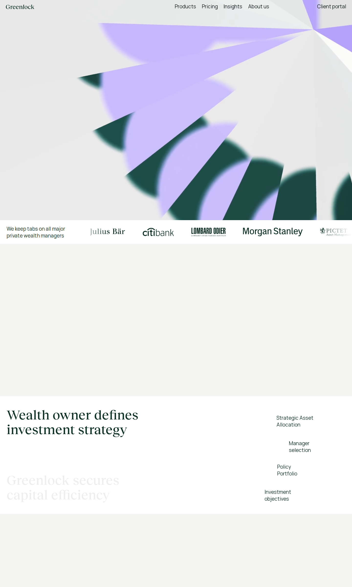
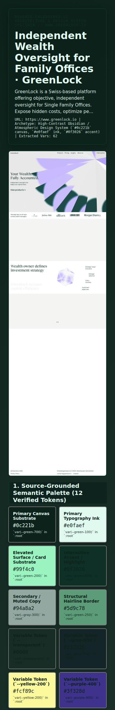

# UI Design System & Master Generation Blueprint: www-greenlock-io

> **Independent Wealth Oversight for Family Offices · GreenLock** (https://www.greenlock.io) — GreenLock is a Swiss-based platform offering objective, independent oversight for Single Family Offices. Expose hidden costs, optimize pe...



---

## 1. Executive Visual Persona & Design Archetype

- **Brand Essence & Persona**: **Independent Wealth Oversight for Family Offices · GreenLock** (`https://www.greenlock.io`). GreenLock is a Swiss-based platform offering objective, independent oversight for Single Family Offices. Expose hidden costs, optimize pe...
- **Visual Archetype**: **High-Contrast Obsidian / Atmospheric Design System (`#0c221b` canvas, `#e0faef` ink, `#0f3026` accent)**.
- **Anti-AI-Slop Differentiators**:
  - **Source-Grounded Chromatic Polarity**: Anchors the viewport in `#0c221b` (`var(--green-700)` in `:root`) paired with `#e0faef` primary typography and `#0f3026` accents.
  - **Extracted Typographic Hierarchy**: Pairs `Reckless Neue Licensed` for display copy (`Fee`) with `Reckless Neue` and not declared in static CSS (uses primary stack / `ui-monospace`).
  - **Calibrated Spatial Grid & Motion**: Combines `940px` container bounds (`gap: 16px`, padding `9px`) with `cubic-bezier(.23,1,.32,1)` easing and GSAP Timeline & ScrollTrigger, Three.js / WebGL Canvas Pipeline.

---

## 2. Spatial Architecture & Modular Grid Mathematics



### Viewport Allocation & Container Geometry
- **Captured Viewport Dimensions**: Desktop `1440×4789px` (`assets/desktop.png`, full-page scroll capture), Mobile `390×2400px` (`assets/mobile.png`, capped at 2400px multi-section capture).
- **Master Container Bounds**: `940px` extracted from `www-greenlock-io` stylesheet.
- **Canvas Lateral Padding & Spacing**: `9px` lateral canvas padding with `16px` grid gap.
- **Border Radius Scale**: `3px`, `100%`, `50%`, `2px`.

### Responsive Breakpoint Architecture
- **Desktop Layout**: Multi-column CSS Grid / Flexbox layout at `1440px` (`max-width: 940px`, `gap: 16px`).
- **Mobile Layout**: Single-column vertical stack at `390px` viewport width with `9px` horizontal padding.
- **Extracted CSS Media Queries**: `@media screen and (max-width:991px)`, `@media screen and (max-width:767px)`, `@media screen and (max-width:479px)`, `@media (min-width:768px)`.

---

## 3. Color System, Materiality & Atmospheric Lighting

### Semantic Palette & Source Grounding
| Semantic Role | Ground-Truth Value | Extracted CSS Source / Selector |
|---|---|---|
| **Primary Canvas Substrate** | `#0c221b` | `var(--green-700)` in `:root` |
| **Primary Typography Ink** | `#e0faef` | `var(--green-100)` in `:root` |
| **Elevated Surface / Card Substrate** | `#99f4c0` | `var(--green-200)` in `:root` |
| **Interactive Accent / Highlight** | `#0f3026` | `var(--green-600)` in `:root` |
| **Secondary / Muted Copy** | `#94a8a2` | `var(--gray-300)` in `:root` |
| **Structural Hairline Border** | `#5d9c78` | `var(--green-250)` in `:root` |
| **Variable Token (`--transparent`)** | `#0000` | `var(--transparent)` in `:root` |
| **Variable Token (`--gray-500`)** | `#132526` | `var(--gray-500)` in `:root` |
| **Variable Token (`--yellow-200`)** | `#fcf89c` | `var(--yellow-200)` in `:root` |
| **Variable Token (`--purple-400`)** | `#3f328d` | `var(--purple-400)` in `:root` |
| **Variable Token (`--gray-400`)** | `#1f3f32` | `var(--gray-400)` in `:root` |
| **Variable Token (`--gray-100`)** | `#f4f5f3` | `var(--gray-100)` in `:root` |

### Sanitized Root CSS Variables (`ui-ux.md` Ground Truth)
| Variable Name | Extracted Value | Semantic Role |
|---|---|---|
| `--w-backdrop-animation` | `initial` | Motion / Easing Token |
| `--green-700` | `#0c221b` | Color / Atmospheric Token |
| `--manrope-grotesk` | `Manrope,sans-serif` | Design System Custom Token |
| `--green-100` | `#e0faef` | Color / Atmospheric Token |
| `--white` | `white` | Canvas / Surface Token |
| `--reckless-antiqua` | `"Reckless Neue Licensed",sans-serif` | Design System Custom Token |
| `--green-200` | `#99f4c0` | Color / Atmospheric Token |
| `--green-600` | `#0f3026` | Color / Atmospheric Token |
| `--gray-300` | `#94a8a2` | Color / Atmospheric Token |
| `--green-250` | `#5d9c78` | Color / Atmospheric Token |
| `--transparent` | `#0000` | Color / Atmospheric Token |
| `--gray-500` | `#132526` | Color / Atmospheric Token |
| `--yellow-200` | `#fcf89c` | Color / Atmospheric Token |
| `--purple-400` | `#3f328d` | Color / Atmospheric Token |
| `--gray-400` | `#1f3f32` | Color / Atmospheric Token |
| `--gray-100` | `#f4f5f3` | Color / Atmospheric Token |

---

## 4. Typographic Scale & Editorial Hierarchy

### Font Family Stacks
- **Display Typography**: `Reckless Neue Licensed`.
- **Primary Body Stack**: `Reckless Neue`.
- **Technical / Metadata Stack**: not declared in static CSS (uses primary stack / `ui-monospace`).

### Typographic Scale & Rules (Extracted from Stylesheet & Variables)
- **Hero Display (`H1`)**: rule `h1` (`font-size: 2.5rem`, `line-height: 3.375rem`, `font-weight: 600`).
- **Section Heading (`H2`)**: rule `h2` (`font-size: 2.5rem`, `line-height: 3.375rem`, `font-weight: 600`).
- **Body Copy**: rule `p` (`font-size: 1.75rem`, `line-height: 3rem`).
- **Metadata & Navigation Labels**: not explicitly declared on tag in static CSS (stylesheet font-size ladder: `2em`, `80%`, `75%`, `1em`, `14px`).

---

## 5. Choreographed Motion & Interaction Physics

### Primary Easing Curves
- **Extracted Timing Functions**: `cubic-bezier(.23,1,.32,1)`.

### Per-Element Transition & Choreography Rules
- **Selector `.w-webflow-badge>img`**: `transition: unset` extracted from `www-greenlock-io` stylesheet.
- **Selector `.w-slider-dot`**: `transition: background-color .1s,color .1s` extracted from `www-greenlock-io` stylesheet.
- **Selector `.w-lightbox-control`**: `transition: all .3s` extracted from `www-greenlock-io` stylesheet.
- **Extracted Easing Curve (`cubic-bezier(.23,1,.32,1)`)**: Governs interactive state transitions across `<header.w-mod-js>` and `<section.v2-hero-section>`.
- **Runtime Interaction Engine**: Integrates GSAP Timeline & ScrollTrigger, Three.js / WebGL Canvas Pipeline, Lottie Vector Animation Player with `prefers-reduced-motion: reduce` fallback guards.

---

## 6. Component Wireframe & Structural DOM Map

### Visual Layout Schematic (Grounded in `dom.html` — `1440px` Desktop & `390px` Mobile Reflow)
```
┌────────────────────────────────────────────────────────────────────────┐
│ DESKTOP VIEWPORT (1440px) — Independent Wealth Oversight for Family Of │
│ ====================================================================== │
│ [ <header.w-mod-js>        | Pricing · Insights · About us · Client ]  │
│ ---------------------------------------------------------------------- │
│ | HERO STAGE: <section.v2-header-section>                          |   │
│ | H1: Fee                                                          |   │
│ | Substrate: #0c221b    | Ink: #e0faef    | Accent: #0f3026        |   │
│ ---------------------------------------------------------------------- │
│ | SHOWCASE GRID (<section.v2-hero-section> ) max-w: 940px          |   │
│ | +------------------------------+  +------------------------------+ | │
│ | | Benchmarking                 |  | & Reduction                  | | │
│ | +------------------------------+  +------------------------------+ | │
│ ---------------------------------------------------------------------- │
│ | MOBILE VIEWPORT REFLOW (390px) — Single-Column Stack (gap: 16px  ) | │
│ | [<header.w-mod-js>] -> [<section.v2-header] -> [<section.v2-hero-s]  │
│ ---------------------------------------------------------------------- │
│ [ FOOTER (<footer.wf-manrope-n5-) | https://www.greenlock.io           │
└────────────────────────────────────────────────────────────────────────┘
```

### Granular DOM Region Breakdown
1. **Brand Header & Navigation Bar (<header.w-mod-js> — `www-greenlock-io`)**:
   - Landmark `<header class="w-mod-js">` hosting `Independent Wealth Oversight for Fam` navigation (`Pricing · Insights · About us · Client portal`), DOM attributes (`data-wf-domain="www.greenlock.io"`, `data-wf-page="6816540e936df6252569dd87"`, `data-wf-site="63fca69523dfba725518d390"`, `data-domain="greenlock.io"`), and stylesheet rule `html { -webkit-text-size-adjust:100%;-ms-text-size-adjust:100%;font-family:sans... }`.
2. **Hero Stage & Focal Lead (<section.v2-header-section> — `Fee`)**:
   - Landmark `<section class="v2-header-section">` presenting display lead `Fee` and copy excerpt *"Fee Benchmarking & Reduction"* over `#0c221b` canvas and `#e0faef` ink.
3. **Primary Showcase & Content Grid (<section.v2-hero-section> — `Benchmarking`)**:
   - Landmark `<section class="v2-hero-section full-height-fix">` rendering section `Benchmarking` with copy *"Investment Performance Audit"*, asset references (`cdn.prod.website-files.com`, `greenlock-site.webflow.shared.26f...`, `fonts.googleapis.com`, `fonts.gstatic.com`), and grid rule `summary { display:block }`.
4. **Interactive Detail & Feature Matrix (<section.v2-ticker-section> — `& Reduction`)**:
   - Landmark `<section class="v2-ticker-section">` framing `& Reduction` and `Investment` (*"PE/VC Portfolio Optimization"*) with `#99f4c0` surface cards, `#0f3026` accents, and `video { vertical-align:baseline;display:inline-block }`.
5. **Colophon & Global Directory Footer (<footer.wf-manrope-n5-active> — `https://www.greenlock.io`)**:
   - Landmark `<footer class="wf-manrope-n5-active">` anchoring `Independent Wealth Oversight for` footer links (`Pricing · Insights · About us · Client portal`), copy *"Real Estate Assets Monitoring"*, and `#5d9c78` structural dividers.

---

## 7. Master Zero-Shot AI Generation Prompt

```markdown
# Master Zero-Shot Frontend Generation Prompt: www-greenlock-io (Independent Wealth Oversight for Family Offices · GreenLock)

You are a principal frontend architect and design systems engineer. Build a complete, production-ready web application replicating the exact design system, DOM landmarks, typographic hierarchy, color tokens, and motion physics of `www-greenlock-io` (**Independent Wealth Oversight for Family Offices · GreenLock** — `https://www.greenlock.io`).

### 1. Visual Archetype & Anti-AI-Slop Mandates
- **Archetype**: High-Contrast Obsidian / Atmospheric Design System (`#0c221b` canvas, `#e0faef` ink, `#0f3026` accent).
- **Identity & Domain Context**: GreenLock is a Swiss-based platform offering objective, independent oversight for Single Family Offices. Expose hidden costs, optimize pe...
- **Primary Substrate**: `#0c221b` (`var(--green-700)` in `:root`), **Primary Ink**: `#e0faef`, **Accent / Highlight**: `#0f3026`.
- **Site-Specific Differentiators**:
  - **Source-Grounded Chromatic Polarity**: Anchors the viewport in `#0c221b` (`var(--green-700)` in `:root`) paired with `#e0faef` primary typography and `#0f3026` accents.
  - **Extracted Typographic Hierarchy**: Pairs `Reckless Neue Licensed` for display copy (`Fee`) with `Reckless Neue` and not declared in static CSS (uses primary stack / `ui-monospace`).
  - **Calibrated Spatial Grid & Motion**: Combines `940px` container bounds (`gap: 16px`, padding `9px`) with `cubic-bezier(.23,1,.32,1)` easing and GSAP Timeline & ScrollTrigger, Three.js / WebGL Canvas Pipeline.

### 2. Ground-Truth CSS Variables (`:root` Token Contract)
Declare and consume these exact custom properties extracted from `www-greenlock-io` in your global stylesheet:

:root {
  /* Independent Wealth Oversight for Family Offices · GreenLock (www-greenlock-io) — Ground-Truth Extracted CSS Variables */
  --w-backdrop-animation: initial; /* Motion / Easing Token (www-greenlock-io) */
  --green-700: #0c221b; /* Color / Atmospheric Token (www-greenlock-io) */
  --manrope-grotesk: Manrope,sans-serif; /* Design System Custom Token (www-greenlock-io) */
  --green-100: #e0faef; /* Color / Atmospheric Token (www-greenlock-io) */
  --white: white; /* Canvas / Surface Token (www-greenlock-io) */
  --reckless-antiqua: "Reckless Neue Licensed",sans-serif; /* Design System Custom Token (www-greenlock-io) */
  --green-200: #99f4c0; /* Color / Atmospheric Token (www-greenlock-io) */
  --green-600: #0f3026; /* Color / Atmospheric Token (www-greenlock-io) */
  --gray-300: #94a8a2; /* Color / Atmospheric Token (www-greenlock-io) */
  --green-250: #5d9c78; /* Color / Atmospheric Token (www-greenlock-io) */
  --transparent: #0000; /* Color / Atmospheric Token (www-greenlock-io) */
  --gray-500: #132526; /* Color / Atmospheric Token (www-greenlock-io) */
  --yellow-200: #fcf89c; /* Color / Atmospheric Token (www-greenlock-io) */
  --purple-400: #3f328d; /* Color / Atmospheric Token (www-greenlock-io) */
  --gray-400: #1f3f32; /* Color / Atmospheric Token (www-greenlock-io) */
  --gray-100: #f4f5f3; /* Color / Atmospheric Token (www-greenlock-io) */
}

### 3. Semantic Color & Materiality Contract
Map every surface, ink, and border strictly to these source-grounded tokens:
- **Primary Canvas Substrate**: `#0c221b` — grounded in `var(--green-700)` in `:root`
- **Primary Typography Ink**: `#e0faef` — grounded in `var(--green-100)` in `:root`
- **Elevated Surface / Card Substrate**: `#99f4c0` — grounded in `var(--green-200)` in `:root`
- **Interactive Accent / Highlight**: `#0f3026` — grounded in `var(--green-600)` in `:root`
- **Secondary / Muted Copy**: `#94a8a2` — grounded in `var(--gray-300)` in `:root`
- **Structural Hairline Border**: `#5d9c78` — grounded in `var(--green-250)` in `:root`
- **Variable Token (`--transparent`)**: `#0000` — grounded in `var(--transparent)` in `:root`
- **Variable Token (`--gray-500`)**: `#132526` — grounded in `var(--gray-500)` in `:root`
- **Variable Token (`--yellow-200`)**: `#fcf89c` — grounded in `var(--yellow-200)` in `:root`
- **Variable Token (`--purple-400`)**: `#3f328d` — grounded in `var(--purple-400)` in `:root`
- **Variable Token (`--gray-400`)**: `#1f3f32` — grounded in `var(--gray-400)` in `:root`
- **Variable Token (`--gray-100`)**: `#f4f5f3` — grounded in `var(--gray-100)` in `:root`

### 4. Spatial Grid, Container Bounds & Responsive Breakpoints
- **Desktop Viewport Reference**: `1440×4789px` (full-page scroll capture, `1440px` standard desktop width).
- **Mobile Viewport Reference**: `390×2400px` (capped at 2400px multi-section capture, `390px` standard mobile width).
- **Container Max-Width**: `940px` extracted from `www-greenlock-io` stylesheet
- **Padding & Gutters**: `9px` lateral canvas padding with `16px` grid gap
- **Desktop Grid**: Multi-column CSS Grid / Flexbox layout at `1440px` (`max-width: 940px`, `gap: 16px`)
- **Mobile Adaptation**: Single-column vertical stack at `390px` viewport width with `9px` horizontal padding
- **Media Queries**: `@media screen and (max-width:991px)`, `@media screen and (max-width:767px)`, `@media screen and (max-width:479px)`, `@media (min-width:768px)`
- **Corner Radii**: `3px`, `100%`, `50%`, `2px`

### 5. Typography & Editorial Scale Contract
- **Display Font Stack**: `Reckless Neue Licensed`
- **Body Font Stack**: `Reckless Neue`
- **Monospace / Technical Font Stack**: not declared in static CSS (uses primary stack / `ui-monospace`)
- **H1 Display Rule**: rule `h1` (`font-size: 2.5rem`, `line-height: 3.375rem`, `font-weight: 600`)
- **H2 Section Rule**: rule `h2` (`font-size: 2.5rem`, `line-height: 3.375rem`, `font-weight: 600`)
- **Body Copy Rule**: rule `p` (`font-size: 1.75rem`, `line-height: 3rem`)
- **Metadata & Index Rule**: not explicitly declared on tag in static CSS (stylesheet font-size ladder: `2em`, `80%`, `75%`, `1em`, `14px`)

### 6. Component Hierarchy, Verbatim Copy & Real DOM Landmarks
Scaffold `www-greenlock-io` (`Independent Wealth Oversight for Family Offices · GreenLock`) with these exact structural regions, extracted copy, and CSS rules from `dom.html`:
1. **Brand Header & Navigation Bar (<header.w-mod-js> — `www-greenlock-io`)**:
   - DOM & Selectors: Landmark `<header class="w-mod-js">` hosting `Independent Wealth Oversight for Fam` navigation (`Pricing · Insights · About us · Client portal`), DOM attributes (`data-wf-domain="www.greenlock.io"`, `data-wf-page="6816540e936df6252569dd87"`, `data-wf-site="63fca69523dfba725518d390"`, `data-domain="greenlock.io"`), and stylesheet rule `html { -webkit-text-size-adjust:100%;-ms-text-size-adjust:100%;font-family:sans... }`.
   - Responsive Contract: Header `Brand Header & Navigation Bar (<header.w-mod-js> — `www-greenlock-io`)` (`www-greenlock-io`) adapts across `@media screen and (max-width:991px)`, `@media screen and (max-width:767px)`, `@media screen and (max-width:479px)`, `@media (min-width:768px)` with `cubic-bezier(.23,1,.32,1)` transitions and links `Pricing · Insights · About us · Client portal`.
2. **Hero Stage & Focal Lead (<section.v2-header-section> — `Fee`)**:
   - DOM & Selectors: Landmark `<section class="v2-header-section">` presenting display lead `Fee` and copy excerpt *"Fee Benchmarking & Reduction"* over `#0c221b` canvas and `#e0faef` ink.
   - Responsive Contract: Hero stage (`1440×4789px` desktop / `390×2400px` mobile) sets `#0c221b` background with `#e0faef` headline `Fee`.
3. **Primary Showcase & Content Grid (<section.v2-hero-section> — `Benchmarking`)**:
   - DOM & Selectors: Landmark `<section class="v2-hero-section full-height-fix">` rendering section `Benchmarking` with copy *"Investment Performance Audit"*, asset references (`cdn.prod.website-files.com`, `greenlock-site.webflow.shared.26f...`, `fonts.googleapis.com`, `fonts.gstatic.com`), and grid rule `summary { display:block }`.
   - Responsive Contract: Showcase grid `Primary Showcase & Content Grid (<section.v2-hero-section> — `Benchmarking`)` applies Multi-column CSS Grid / Flexbox layout at `1440px` (`max-width: 940px`, `gap: 16px`) on desktop and Single-column vertical stack at `390px` viewport width with `9px` horizontal padding on mobile.
4. **Interactive Detail & Feature Matrix (<section.v2-ticker-section> — `& Reduction`)**:
   - DOM & Selectors: Landmark `<section class="v2-ticker-section">` framing `& Reduction` and `Investment` (*"PE/VC Portfolio Optimization"*) with `#99f4c0` surface cards, `#0f3026` accents, and `video { vertical-align:baseline;display:inline-block }`.
   - Responsive Contract: Detail module `Interactive Detail & Feature Matrix (<section.v2-ticker-section> — `& Reduction`)` uses `3px`, `100%`, `50%`, `2px` radii, `#0f3026` highlights, and assets (cdn.prod.website-files.com, greenlock-site.webflow.shared.26f..., fonts.googleapis.com).
5. **Colophon & Global Directory Footer (<footer.wf-manrope-n5-active> — `https://www.greenlock.io`)**:
   - DOM & Selectors: Landmark `<footer class="wf-manrope-n5-active">` anchoring `Independent Wealth Oversight for` footer links (`Pricing · Insights · About us · Client portal`), copy *"Real Estate Assets Monitoring"*, and `#5d9c78` structural dividers.
   - Responsive Contract: Footer `Colophon & Global Directory Footer (<footer.wf-manrope-n5-active> — `https://www.greenlock.io`)` aligns to `940px` extracted from `www-greenlock-io` stylesheet with `9px` lateral canvas padding with `16px` grid gap and attributes (data-wf-domain="www.greenlock.io", data-wf-page="6816540e936df6252569dd87", data-wf-site="63fca69523dfba725518d390").

#### Verbatim DOM Copy Excerpts (`dom.html`)
- Copy Excerpt 1: *"Fee Benchmarking & Reduction"*
- Copy Excerpt 2: *"Investment Performance Audit"*
- Copy Excerpt 3: *"PE/VC Portfolio Optimization"*
- Copy Excerpt 4: *"Real Estate Assets Monitoring"*

### 7. Motion, Extracted Stylesheet Rules & Interaction Choreography
- **Primary Easing Functions**: `cubic-bezier(.23,1,.32,1)`
- **Extracted Stylesheet Rules (`www-greenlock-io`)**:
- `html { -webkit-text-size-adjust:100%;-ms-text-size-adjust:100%;font-family:sans... }`
- `summary { display:block }`
- `video { vertical-align:baseline;display:inline-block }`
- `template { display:none }`
- `strong { font-weight:700 }`
- **Per-Selector Transition Rules**:
- **Selector `.w-webflow-badge>img`**: `transition: unset` extracted from `www-greenlock-io` stylesheet.
- **Selector `.w-slider-dot`**: `transition: background-color .1s,color .1s` extracted from `www-greenlock-io` stylesheet.
- **Selector `.w-lightbox-control`**: `transition: all .3s` extracted from `www-greenlock-io` stylesheet.
- **Extracted Easing Curve (`cubic-bezier(.23,1,.32,1)`)**: Governs interactive state transitions across `<header.w-mod-js>` and `<section.v2-hero-section>`.
- **Runtime Interaction Engine**: Integrates GSAP Timeline & ScrollTrigger, Three.js / WebGL Canvas Pipeline, Lottie Vector Animation Player with `prefers-reduced-motion: reduce` fallback guards.

### 8. Technical Deliverables
- Implement in Next.js (App Router) with TypeScript and Tailwind CSS consuming the `:root` custom properties defined above for `www-greenlock-io`.
- Reproduce both the `1440px` desktop architecture and `390px` mobile breakpoint transitions, preserving semantic HTML5 landmarks (`<header>`, `<nav>`, `<main>`, `<section>`, `<footer>`) and `prefers-reduced-motion` accessibility guards.
```
