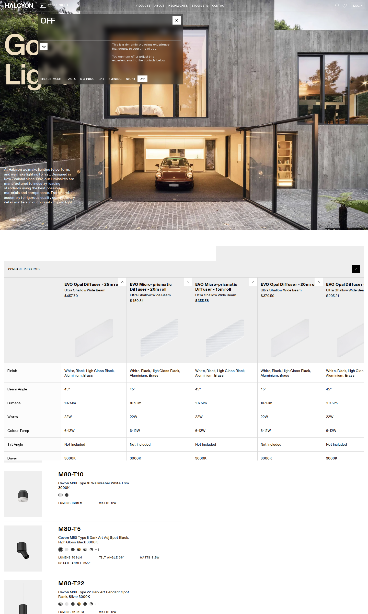
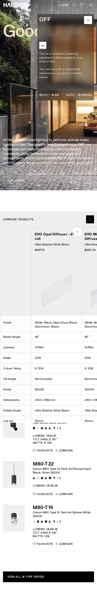

# UI Design System & Master Generation Blueprint: www-halcyon-co-nz

> **Halcyon · Leading Lighting Specialists** (https://www.halcyon.co.nz/) — Driven by innovation and an unwavering commitment to quality, Halcyon works with leading architects, specifiers and electrical experts to...



---

## 1. Executive Visual Persona & Design Archetype

- **Brand Essence & Persona**: **Halcyon · Leading Lighting Specialists** (`https://www.halcyon.co.nz/`). Driven by innovation and an unwavering commitment to quality, Halcyon works with leading architects, specifiers and electrical experts to...
- **Capture Provenance**: Live browser capture (`tier1_fast`, HTTP `200`, captured `2026-11-23`).
- **Visual Archetype**: **Light-Gallery WebGL / Canvas Interactive Experience (`#ffffff` / `#f7eb12`)**.
- **Anti-AI-Slop Differentiators**:
  - **Live-Computed Chromatic Polarity**: Anchors the viewport in `#ffffff` (live computed `browser-default` `background-color` (`computed_styles.json`)) paired with `#000000` primary typography and `#f7eb12` accents.
  - **Grounded Typographic Hierarchy**: Pairs `Halcyon Monument Grotesk` for display copy (`Good Light.`) with `Untitled` and `Halcyon Monument Grotesk Semi-Mono`.
  - **Calibrated Spatial Grid & Motion**: Combines `1600px` container bounds (`gap: 8px`, padding `16px`) with `cubic-bezier(.67,1.51,.8,.87)` easing and Three.js / WebGL Canvas Pipeline, Swiper Touch Carousel Engine.

---

## 2. Spatial Architecture & Modular Grid Mathematics



### Viewport Allocation & Container Geometry
- **Captured Viewport Dimensions**: Desktop `1440×2400px` (`assets/desktop.png`, clamped at 2400px live multi-section capture), Mobile `390×2400px` (`assets/mobile.png`, clamped at 2400px live multi-section capture).
- **Master Container Bounds**: `1600px` (non-`@media` desktop container stylesheet rule).
- **Canvas Lateral Padding & Spacing**: `16px` lateral canvas padding with `8px` grid gap.
- **Border Radius Scale**: `0px`, `34px`, `50%`, `40px`.

### Responsive Breakpoint Architecture
- **Desktop Layout**: Multi-column CSS Grid / Flexbox layout at `1440px` (`max-width: 1600px`, `gap: 8px`).
- **Mobile Layout**: Single-column vertical stack at `390px` viewport width with `16px` horizontal padding.
- **Extracted CSS Media Queries**: `@media (max-width:768.98px)`, `@media (max-width:991.98px)`, `@media (min-width:992px)`, `@media (max-width:768.98px)and (max-width:768.98px)`.

---

## 3. Color System, Materiality & Atmospheric Lighting

### Semantic Palette & Source Grounding
| Semantic Role | Ground-Truth Value | Extracted Live / CSS Source |
|---|---|---|
| **Primary Canvas Substrate** | `#ffffff` | live computed `browser-default` `background-color` (`computed_styles.json`) |
| **Primary Typography Ink** | `#000000` | live computed `p` `color` (`computed_styles.json`) |
| **Elevated Surface / Card Substrate** | `#ffe5b4` | `var(--color-background)` in `:root` |
| **Interactive Accent / Highlight** | `#f7eb12` | `.primary-button--light:after { background: #f7eb12 }` |
| **Secondary / Muted Copy** | `#303030` | `var(--megamenu-item-text)` in `:root` |
| **Structural Hairline Border** | `#eeeeee` | `var(--megamenu-divider)` in `:root` |
| **Variable Token (`--megamenu-hover`)** | `#f8f6f7` | `var(--megamenu-hover)` in `:root` |
| **Variable Token (`--halcyon-toast-success`)** | `#32e26e` | `var(--halcyon-toast-success)` in `:root` |
| **Variable Token (`--halcyon-toast-error`)** | `#e75619` | `var(--halcyon-toast-error)` in `:root` |
| **Variable Token (`--halcyon-toast-info`)** | `#3b82f6` | `var(--halcyon-toast-info)` in `:root` |
| **Variable Token (`--halcyon-toast-warning`)** | `#f59e0b` | `var(--halcyon-toast-warning)` in `:root` |

### Sanitized Root CSS Variables (`ui-ux.md` Ground Truth)
| Variable Name | Extracted Value | Semantic Role |
|---|---|---|
| `--height-full` | `100vh` | Layout / Spatial Grid Token |
| `--height-fill` | `calc(100vh - var(--nav-height))` | Layout / Spatial Grid Token |
| `--font-orion` | `"Untitled", sans-serif` | Typography / Scale Token |
| `--annoucement-height` | `37px` | Layout / Spatial Grid Token |
| `--nav-main-height` | `44px` | Layout / Spatial Grid Token |
| `--nav-height` | `calc(var(--nav-main-height))` | Layout / Spatial Grid Token |
| `--megamenu-hover` | `#f8f6f7` | Color / Atmospheric Token |
| `--megamenu-active` | `#eee` | Color / Atmospheric Token |
| `--megamenu-divider` | `#eee` | Color / Atmospheric Token |
| `--megamenu-item-text` | `#303030` | Typography Ink Token |
| `--transition-speed` | `2s` | Motion / Easing Token |
| `--halcyon-toast-success` | `#32e26e` | Color / Atmospheric Token |
| `--halcyon-toast-error` | `#e75619` | Color / Atmospheric Token |
| `--halcyon-toast-info` | `#3b82f6` | Color / Atmospheric Token |
| `--halcyon-toast-warning` | `#f59e0b` | Color / Atmospheric Token |
| `--halcyon-toast-text` | `#000` | Typography Ink Token |

---

## 4. Typographic Scale & Editorial Hierarchy

### Font Family Stacks
- **Display Typography**: `Halcyon Monument Grotesk`.
- **Primary Body Stack**: `Untitled`.
- **Technical / Metadata Stack**: `Halcyon Monument Grotesk Semi-Mono`.

### Typographic Scale & Rules (Live Computed & Stylesheet Grounded)
- **Hero Display (`H1`)**: live computed `h1` (`font-size: 115.2px`, `line-height: 115.2px`, `font-weight: 500`, `letter-spacing: -3.76px`); CSS variables `--x-shell-disclosure-display: block`, `--x-shell-order-summary-display: none`, `--x-shell-content-display: grid`; rule `,.h1` (`font-size: 88px`, `line-height: 100%`, `letter-spacing: -1.76px`, `font-weight: 500`).
- **Section Heading (`H2`)**: live computed `h2` (`font-size: 87.9984px`, `line-height: 87.9984px`, `font-weight: 500`, `letter-spacing: -1.76px`); rule `,.h2` (`font-size: 56px`, `line-height: 100%`, `letter-spacing: -.84px`, `font-weight: 500`).
- **Body Copy**: live computed `body` (`font-size: 16px`, `line-height: 18.4px`, `font-weight: 500`); CSS variables `--boostsd-general-font-size-base: 16px`, `--boostsd-cart-body-padding: 16px`, `--boostsd-cart-body-padding-medium: 24px`; rule `p` (`font-size: 12px`, `line-height: 90%`, `font-weight: 400`).
- **Metadata & Navigation Labels**: live computed `nav/a` (`font-size: 16px`, `line-height: 12px`, `font-weight: 500`); CSS variables `--boostsd-product-label-padding: 2px 6px`, `--boostsd-product-label-border-radius: 2px`, `--boostsd-product-label-border-radius-capsule: 40px`; rule `.label` (`font-size: 12px`, `line-height: 12px`, `letter-spacing: 0`, `font-weight: 400`).

---

## 5. Choreographed Motion & Interaction Physics

### Primary Easing Curves
- **Extracted Timing Functions**: `cubic-bezier(.67,1.51,.8,.87)`, `cubic-bezier(.075,.82,.165,1)`, `cubic-bezier(.445,.05,.55,.95)`.

### Per-Element Transition & Choreography Rules
- **Selector `.type-one-light`**: `transition: all .3s ease-in` extracted from `www-halcyon-co-nz` stylesheet.
- **Selector `.type-one-light-solid:after`**: `transition: .3s ease-out` extracted from `www-halcyon-co-nz` stylesheet.
- **Selector `.type-one-light-outline:after`**: `transition: .3s ease-out` extracted from `www-halcyon-co-nz` stylesheet.
- **Extracted Easing Curve (`cubic-bezier(.67,1.51,.8,.87)`)**: Governs interactive state transitions across `<header.js>` and `<section.featured-product>`.
- **Runtime Interaction Engine**: Integrates Three.js / WebGL Canvas Pipeline, Swiper Touch Carousel Engine with `prefers-reduced-motion: reduce` fallback guards.

---

## 6. Component Wireframe & Structural DOM Map

### Visual Layout Schematic — Desktop (`1440px`, Grounded in `dom.html` & Landmark Bounding Boxes)
```
┌────────────────────────────────────────────────────────────────────────┐
│ DESKTOP VIEWPORT (1440px) — Halcyon · Leading Lighting Specialists     │
│ ====================================================================== │
│ [ <header.js> (1440px)                | Return · Products · About ·  ] │
│ ---------------------------------------------------------------------- │
│ | HERO STAGE: <section.main-hero> (w=1440px)                         | │
│ | H1: Good Light.                                                    | │
│ | Substrate: #ffffff | Ink: #000000 | Accent: #f7eb12                | │
│ ---------------------------------------------------------------------- │
│ | SHOWCASE GRID (<section.featured-product>) max-w: 1600px           | │
│ | +------------------------------+  +------------------------------+ | │
│ | | Cevon M-Type                 |  | Latest Collections           | | │
│ | +------------------------------+  +------------------------------+ | │
│ ---------------------------------------------------------------------- │
│ | DETAIL MODULE (<section.tabbed-collection) — Trade Flex Pro        | │
│ ---------------------------------------------------------------------- │
│ [ FOOTER (<footer.js-ajax-cart) | https://www.halcyon.co.nz/           │
└────────────────────────────────────────────────────────────────────────┘
```

### Visual Layout Schematic — Mobile Reflow (`390px`)
```
┌────────────────────────────────────────────────────────────────────────┐
│ MOBILE VIEWPORT REFLOW (390px) — Single-Column Stack (gap: 8px)        │
│ ====================================================================== │
│ [ HEADER BAR (<header.js>             ) | Compact Menu (390px)         │
│ ---------------------------------------------------------------------- │
│ | HERO STAGE (<section.main-hero>) — 390px Vertical Lead             | │
│ | H1: Good Light.                                                    | │
│ ---------------------------------------------------------------------- │
│ | SHOWCASE STACK (<section.featured-prod) — 1-Col Stack              | │
│ | [ Item 1: Cevon M-Type                                           ] | │
│ | [ Item 2: Latest Collections                                     ] | │
│ ---------------------------------------------------------------------- │
│ | DETAIL STACK (<section.tabbed-collecti) — 1-Col (Trade Flex Pro)   | │
│ ---------------------------------------------------------------------- │
│ [ FOOTER (<footer.js-ajax-cart) | Stacked 390px Colophon               │
└────────────────────────────────────────────────────────────────────────┘
```

### Granular DOM Region Breakdown
1. **Brand Header & Navigation Bar (<header.js> — `www-halcyon-co-nz`)**:
   - Landmark `<header class="js">` (`1440px`) hosting `Halcyon · Leading Lighting Specialis` navigation (`Return · Products · About · Highlights · Stockists`), DOM attributes (`data-collection-view="grid"`, `data-source-attribution="shopify.exit_intersti..."`, `data-source-attribution="shopify.loadfeatures"`, `data-source-attribution="shopify.dynamic_check..."`), and stylesheet rule `html { line-height:1.15;-webkit-text-size-adjust:100% }`.
2. **Hero Stage & Focal Lead (<section.main-hero> — `Good Light.`)**:
   - Landmark `<section class="main-hero hero-main-section">` presenting display lead `Good Light.` and copy excerpt *"At Halcyon we make lighting to perform, and we make lighting to l"* over `#ffffff` canvas and `#000000` ink.
3. **Primary Showcase & Content Grid (<section.featured-product> — `Cevon M-Type`)**:
   - Landmark `<section class="featured-product">` rendering section `Cevon M-Type` with copy *"M-Type is a modular system developed for refined interiors where "*, asset references (`inventoryLocation.js`, `clarity.js`, `wwzwszat2d`, `gtm.js`), and grid rule `main { display:block }`.
4. **Interactive Detail & Feature Matrix (<section.tabbed-collection> — `Latest Collections`)**:
   - Landmark `<section class="tabbed-collection">` framing `Latest Collections` and `Trade Flex Pro` (*"From discreet illumination to feature lighting and general ambien"*) with `#ffe5b4` surface cards, `#f7eb12` accents, and `pre { font-family:monospace,monospace;font-size:1em }`.
5. **Colophon & Global Directory Footer (<footer.js-ajax-cart-empty> — `https://www.halcyon.co.nz/`)**:
   - Landmark `<footer class="js-ajax-cart-empty">` anchoring `Halcyon · Leading Lighting Speci` footer links (`Return · Products · About · Highlights · Stockists`), copy *"Cevon M80 Type 1 Dark Art Adjustable Black, Gold 3000K"*, and `#eeeeee` structural dividers.

---

## 7. Master Zero-Shot AI Generation Prompt

```markdown
# Master Zero-Shot Frontend Generation Prompt: www-halcyon-co-nz (Halcyon · Leading Lighting Specialists)

You are a principal frontend architect and design systems engineer. Build a complete, production-ready web application replicating the exact design system, DOM landmarks, typographic hierarchy, color tokens, and motion physics of `www-halcyon-co-nz` (**Halcyon · Leading Lighting Specialists** — `https://www.halcyon.co.nz/`).

### 1. Visual Archetype & Anti-AI-Slop Mandates
- **Archetype**: Light-Gallery WebGL / Canvas Interactive Experience (`#ffffff` / `#f7eb12`).
- **Identity & Domain Context**: Driven by innovation and an unwavering commitment to quality, Halcyon works with leading architects, specifiers and electrical experts to...
- **Primary Substrate**: `#ffffff` (live computed `browser-default` `background-color` (`computed_styles.json`)), **Primary Ink**: `#000000`, **Accent / Highlight**: `#f7eb12`.
- **Site-Specific Differentiators**:
  - **Live-Computed Chromatic Polarity**: Anchors the viewport in `#ffffff` (live computed `browser-default` `background-color` (`computed_styles.json`)) paired with `#000000` primary typography and `#f7eb12` accents.
  - **Grounded Typographic Hierarchy**: Pairs `Halcyon Monument Grotesk` for display copy (`Good Light.`) with `Untitled` and `Halcyon Monument Grotesk Semi-Mono`.
  - **Calibrated Spatial Grid & Motion**: Combines `1600px` container bounds (`gap: 8px`, padding `16px`) with `cubic-bezier(.67,1.51,.8,.87)` easing and Three.js / WebGL Canvas Pipeline, Swiper Touch Carousel Engine.

### 2. Ground-Truth CSS Variables (`:root` Token Contract)
Declare and consume these exact custom properties extracted from `www-halcyon-co-nz` in your global stylesheet:

:root {
  /* Halcyon · Leading Lighting Specialists (www-halcyon-co-nz) — Live-Grounded CSS Variables */
  --height-full: 100vh; /* Layout / Spatial Grid Token (www-halcyon-co-nz) */
  --height-fill: calc(100vh - var(--nav-height)); /* Layout / Spatial Grid Token (www-halcyon-co-nz) */
  --font-orion: "Untitled", sans-serif; /* Typography / Scale Token (www-halcyon-co-nz) */
  --annoucement-height: 37px; /* Layout / Spatial Grid Token (www-halcyon-co-nz) */
  --nav-main-height: 44px; /* Layout / Spatial Grid Token (www-halcyon-co-nz) */
  --nav-height: calc(var(--nav-main-height)); /* Layout / Spatial Grid Token (www-halcyon-co-nz) */
  --megamenu-hover: #f8f6f7; /* Color / Atmospheric Token (www-halcyon-co-nz) */
  --megamenu-active: #eee; /* Color / Atmospheric Token (www-halcyon-co-nz) */
  --megamenu-divider: #eee; /* Color / Atmospheric Token (www-halcyon-co-nz) */
  --megamenu-item-text: #303030; /* Typography Ink Token (www-halcyon-co-nz) */
  --transition-speed: 2s; /* Motion / Easing Token (www-halcyon-co-nz) */
  --halcyon-toast-success: #32e26e; /* Color / Atmospheric Token (www-halcyon-co-nz) */
  --halcyon-toast-error: #e75619; /* Color / Atmospheric Token (www-halcyon-co-nz) */
  --halcyon-toast-info: #3b82f6; /* Color / Atmospheric Token (www-halcyon-co-nz) */
  --halcyon-toast-warning: #f59e0b; /* Color / Atmospheric Token (www-halcyon-co-nz) */
  --halcyon-toast-text: #000; /* Typography Ink Token (www-halcyon-co-nz) */
}

### 3. Semantic Color & Materiality Contract
Map every surface, ink, and border strictly to these source-grounded tokens:
- **Primary Canvas Substrate**: `#ffffff` — grounded in live computed `browser-default` `background-color` (`computed_styles.json`)
- **Primary Typography Ink**: `#000000` — grounded in live computed `p` `color` (`computed_styles.json`)
- **Elevated Surface / Card Substrate**: `#ffe5b4` — grounded in `var(--color-background)` in `:root`
- **Interactive Accent / Highlight**: `#f7eb12` — grounded in `.primary-button--light:after { background: #f7eb12 }`
- **Secondary / Muted Copy**: `#303030` — grounded in `var(--megamenu-item-text)` in `:root`
- **Structural Hairline Border**: `#eeeeee` — grounded in `var(--megamenu-divider)` in `:root`
- **Variable Token (`--megamenu-hover`)**: `#f8f6f7` — grounded in `var(--megamenu-hover)` in `:root`
- **Variable Token (`--halcyon-toast-success`)**: `#32e26e` — grounded in `var(--halcyon-toast-success)` in `:root`
- **Variable Token (`--halcyon-toast-error`)**: `#e75619` — grounded in `var(--halcyon-toast-error)` in `:root`
- **Variable Token (`--halcyon-toast-info`)**: `#3b82f6` — grounded in `var(--halcyon-toast-info)` in `:root`
- **Variable Token (`--halcyon-toast-warning`)**: `#f59e0b` — grounded in `var(--halcyon-toast-warning)` in `:root`

### 4. Spatial Grid, Container Bounds & Responsive Breakpoints
- **Desktop Viewport Reference**: `1440×2400px` (clamped at 2400px live multi-section capture, `1440px` standard desktop width).
- **Mobile Viewport Reference**: `390×2400px` (clamped at 2400px live multi-section capture, `390px` standard mobile width).
- **Container Max-Width**: `1600px` (non-`@media` desktop container stylesheet rule)
- **Padding & Gutters**: `16px` lateral canvas padding with `8px` grid gap
- **Desktop Grid**: Multi-column CSS Grid / Flexbox layout at `1440px` (`max-width: 1600px`, `gap: 8px`)
- **Mobile Adaptation**: Single-column vertical stack at `390px` viewport width with `16px` horizontal padding
- **Media Queries**: `@media (max-width:768.98px)`, `@media (max-width:991.98px)`, `@media (min-width:992px)`, `@media (max-width:768.98px)and (max-width:768.98px)`
- **Corner Radii**: `0px`, `34px`, `50%`, `40px`

### 5. Typography & Editorial Scale Contract
- **Display Font Stack**: `Halcyon Monument Grotesk`
- **Body Font Stack**: `Untitled`
- **Monospace / Technical Font Stack**: `Halcyon Monument Grotesk Semi-Mono`
- **H1 Display Rule**: live computed `h1` (`font-size: 115.2px`, `line-height: 115.2px`, `font-weight: 500`, `letter-spacing: -3.76px`); CSS variables `--x-shell-disclosure-display: block`, `--x-shell-order-summary-display: none`, `--x-shell-content-display: grid`; rule `,.h1` (`font-size: 88px`, `line-height: 100%`, `letter-spacing: -1.76px`, `font-weight: 500`)
- **H2 Section Rule**: live computed `h2` (`font-size: 87.9984px`, `line-height: 87.9984px`, `font-weight: 500`, `letter-spacing: -1.76px`); rule `,.h2` (`font-size: 56px`, `line-height: 100%`, `letter-spacing: -.84px`, `font-weight: 500`)
- **Body Copy Rule**: live computed `body` (`font-size: 16px`, `line-height: 18.4px`, `font-weight: 500`); CSS variables `--boostsd-general-font-size-base: 16px`, `--boostsd-cart-body-padding: 16px`, `--boostsd-cart-body-padding-medium: 24px`; rule `p` (`font-size: 12px`, `line-height: 90%`, `font-weight: 400`)
- **Metadata & Index Rule**: live computed `nav/a` (`font-size: 16px`, `line-height: 12px`, `font-weight: 500`); CSS variables `--boostsd-product-label-padding: 2px 6px`, `--boostsd-product-label-border-radius: 2px`, `--boostsd-product-label-border-radius-capsule: 40px`; rule `.label` (`font-size: 12px`, `line-height: 12px`, `letter-spacing: 0`, `font-weight: 400`)

### 6. Component Hierarchy, Verbatim Copy & Real DOM Landmarks
Scaffold `www-halcyon-co-nz` (`Halcyon · Leading Lighting Specialists`) with these exact structural regions, extracted copy, and CSS rules from `dom.html`:
1. **Brand Header & Navigation Bar (<header.js> — `www-halcyon-co-nz`)**:
   - DOM & Selectors: Landmark `<header class="js">` (`1440px`) hosting `Halcyon · Leading Lighting Specialis` navigation (`Return · Products · About · Highlights · Stockists`), DOM attributes (`data-collection-view="grid"`, `data-source-attribution="shopify.exit_intersti..."`, `data-source-attribution="shopify.loadfeatures"`, `data-source-attribution="shopify.dynamic_check..."`), and stylesheet rule `html { line-height:1.15;-webkit-text-size-adjust:100% }`.
   - Responsive Contract: Header `Brand Header & Navigation Bar (<header.js> — `www-halcyon-co-nz`)` (`www-halcyon-co-nz`) adapts across `@media (max-width:768.98px)`, `@media (max-width:991.98px)`, `@media (min-width:992px)`, `@media (max-width:768.98px)and (max-width:768.98px)` with `cubic-bezier(.67,1.51,.8,.87)`, `cubic-bezier(.075,.82,.165,1)`, `cubic-bezier(.445,.05,.55,.95)` transitions and links `Return · Products · About · Highlights · Stockists`.
2. **Hero Stage & Focal Lead (<section.main-hero> — `Good Light.`)**:
   - DOM & Selectors: Landmark `<section class="main-hero hero-main-section">` presenting display lead `Good Light.` and copy excerpt *"At Halcyon we make lighting to perform, and we make lighting to l"* over `#ffffff` canvas and `#000000` ink.
   - Responsive Contract: Hero stage (`1440×2400px` desktop / `390×2400px` mobile) sets `#ffffff` background with `#000000` headline `Good Light.`.
3. **Primary Showcase & Content Grid (<section.featured-product> — `Cevon M-Type`)**:
   - DOM & Selectors: Landmark `<section class="featured-product">` rendering section `Cevon M-Type` with copy *"M-Type is a modular system developed for refined interiors where "*, asset references (`inventoryLocation.js`, `clarity.js`, `wwzwszat2d`, `gtm.js`), and grid rule `main { display:block }`.
   - Responsive Contract: Showcase grid `Primary Showcase & Content Grid (<section.featured-product> — `Cevon M-Type`)` applies Multi-column CSS Grid / Flexbox layout at `1440px` (`max-width: 1600px`, `gap: 8px`) on desktop and Single-column vertical stack at `390px` viewport width with `16px` horizontal padding on mobile.
4. **Interactive Detail & Feature Matrix (<section.tabbed-collection> — `Latest Collections`)**:
   - DOM & Selectors: Landmark `<section class="tabbed-collection">` framing `Latest Collections` and `Trade Flex Pro` (*"From discreet illumination to feature lighting and general ambien"*) with `#ffe5b4` surface cards, `#f7eb12` accents, and `pre { font-family:monospace,monospace;font-size:1em }`.
   - Responsive Contract: Detail module `Interactive Detail & Feature Matrix (<section.tabbed-collection> — `Latest Collections`)` uses `0px`, `34px`, `50%`, `40px` radii, `#f7eb12` highlights, and assets (inventoryLocation.js, clarity.js, wwzwszat2d).
5. **Colophon & Global Directory Footer (<footer.js-ajax-cart-empty> — `https://www.halcyon.co.nz/`)**:
   - DOM & Selectors: Landmark `<footer class="js-ajax-cart-empty">` anchoring `Halcyon · Leading Lighting Speci` footer links (`Return · Products · About · Highlights · Stockists`), copy *"Cevon M80 Type 1 Dark Art Adjustable Black, Gold 3000K"*, and `#eeeeee` structural dividers.
   - Responsive Contract: Footer `Colophon & Global Directory Footer (<footer.js-ajax-cart-empty> — `https://www.halcyon.co.nz/`)` aligns to `1600px` (non-`@media` desktop container stylesheet rule) with `16px` lateral canvas padding with `8px` grid gap and attributes (data-collection-view="grid", data-source-attribution="shopify.exit_intersti...", data-source-attribution="shopify.loadfeatures").

#### Verbatim DOM Copy Excerpts (`dom.html`)
- Copy Excerpt 1: *"At Halcyon we make lighting to perform, and we make lighting to last. Designed in..."*
- Copy Excerpt 2: *"M-Type is a modular system developed for refined interiors where lighting must int..."*
- Copy Excerpt 3: *"From discreet illumination to feature lighting and general ambient light, M-Type s..."*
- Copy Excerpt 4: *"Cevon M80 Type 1 Dark Art Adjustable Black, Gold 3000K"*

### 7. Motion, Extracted Stylesheet Rules & Interaction Choreography
- **Primary Easing Functions**: `cubic-bezier(.67,1.51,.8,.87)`, `cubic-bezier(.075,.82,.165,1)`, `cubic-bezier(.445,.05,.55,.95)`
- **Extracted Stylesheet Rules (`www-halcyon-co-nz`)**:
- `html { line-height:1.15;-webkit-text-size-adjust:100% }`
- `main { display:block }`
- `pre { font-family:monospace,monospace;font-size:1em }`
- `strong { font-weight:bolder }`
- `samp { font-family:monospace,monospace;font-size:1em }`
- **Per-Selector Transition Rules**:
- **Selector `.type-one-light`**: `transition: all .3s ease-in` extracted from `www-halcyon-co-nz` stylesheet.
- **Selector `.type-one-light-solid:after`**: `transition: .3s ease-out` extracted from `www-halcyon-co-nz` stylesheet.
- **Selector `.type-one-light-outline:after`**: `transition: .3s ease-out` extracted from `www-halcyon-co-nz` stylesheet.
- **Extracted Easing Curve (`cubic-bezier(.67,1.51,.8,.87)`)**: Governs interactive state transitions across `<header.js>` and `<section.featured-product>`.
- **Runtime Interaction Engine**: Integrates Three.js / WebGL Canvas Pipeline, Swiper Touch Carousel Engine with `prefers-reduced-motion: reduce` fallback guards.

### 8. Technical Deliverables
- Implement in Next.js (App Router) with TypeScript and Tailwind CSS consuming the `:root` custom properties defined above for `www-halcyon-co-nz`.
- Reproduce both the `1440px` desktop architecture and `390px` mobile breakpoint transitions, preserving semantic HTML5 landmarks (`<header>`, `<nav>`, `<main>`, `<section>`, `<footer>`) and `prefers-reduced-motion` accessibility guards.
```
